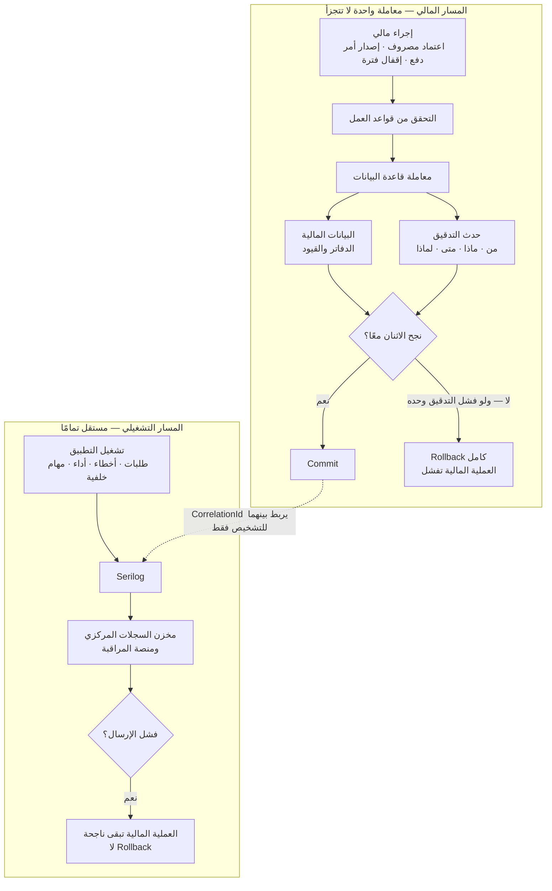

# ملحق التدقيق المالي والتسجيل التشغيلي

**الإصدار:** 1.1.4 · **تاريخ الإصدار الأول:** 2026-09-17 · **تاريخ التعديل:** 2026-09-17 *(أُضيف §3.12 — نطاق أحداث التقرير الشهري)*
**الحالة:** قرار معماري ورقابي معتمد — **توثيق فقط · لا كود ولا SQL ولا DDL ولا Migrations ولا تصميم فيزيائي**
**مصدر القرار:** **قرار صاحب المشروع** — قرار معماري ورقابي، **وليس اكتشافًا من ملفات Excel أو العقود**.
**يُقرأ مع:** `phase-zero-patch-v1.1.4-ar.md` (أعلى أولوية) · `monthly-financial-report-addendum-ar.md` · `phase-zero-patch-v1.1.3-ar.md` · `phase-zero-patch-v1.1.2-ar.md` · `phase-zero-patch-v1.1.1-ar.md` · `phase-zero-errata-v1.1-ar.md` · `confirmed-business-rules-ar.md`

---

## 1. الهدف

إثبات **من فعل ماذا، ومتى، ولماذا** في كل حركة مالية أو إدارية داخل Contractra — إثباتًا **لا يقبل التعديل ولا الحذف**، ومستقلًا عن السجل التشغيلي للتطبيق.

**ثلاثة أنظمة، ثلاث وظائف، لا يحل أحدها محل الآخر:**

| النظام | يجيب عن سؤال | من يستخدمه |
|---|---|---|
| **الدفاتر والقيود المالية** (Financial Ledgers) | **كم الرصيد؟** ما المجاميع والتكلفة والربحية؟ | المحاسب · المدير |
| **سجل التدقيق المالي** (Financial Audit Trail) | **من فعل؟ ماذا تغيّر؟ متى؟ ولماذا؟** | المدير · المحاسب · المراجع |
| **التسجيل التشغيلي** (Serilog / Operational Logging) | **لماذا تعطّل التطبيق؟ أين البطء؟ ما الخطأ؟** | الفريق التقني فقط |

**القاعدة الحاكمة:** **Serilog ليس نظام تدقيق**، ولا يجوز اعتبار ملفاته ولا وجهاته (Sinks) سجلًّا ماليًا رسميًا. و**سجل التدقيق ليس بديلًا عن الدفاتر** — لا يُحسب منه رصيد ولا مجموع.

---

## 2. الفرق بين الدفاتر وسجل التدقيق وSerilog

| البُعد | الدفاتر والقيود | سجل التدقيق | Serilog |
|---|---|---|---|
| **الغرض** | قياس مالي | إثبات مسؤولية | تشخيص تقني |
| **مصدر الأرصدة؟** | ✅ **نعم — المصدر الوحيد** | ❌ **لا إطلاقًا** | ❌ لا |
| **قابل للتعديل؟** | القيد المرحَّل غير قابل للتعديل؛ التصحيح بقيد جديد | ❌ **Append Only — لا تعديل ولا حذف** | يُدوَّر ويُحذف بسياسة تقنية |
| **داخل معاملة العملية؟** | ✅ نعم | ✅ **نعم — إلزامي** | ❌ **لا — ولا يجوز** |
| **فشله يُفشل العملية المالية؟** | ✅ نعم | ✅ **نعم — Rollback كامل** | ❌ **لا — العملية تنجح** |
| **من يقرأه؟** | المحاسب والمدير | المخوَّلون بصلاحية قراءة | الفريق التقني |
| **من يعدّله؟** | لا أحد بعد الترحيل | **لا أحد — ولا حتى الأدمن** | يُدار تقنيًا |
| **هل يحتوي بيانات حساسة؟** | بيانات مالية بضوابط | بيانات أعمال بحجب الحساس | **ممنوع منعًا باتًا** |
| **سياسة الاحتفاظ** | حسب القانون والسياسة المحاسبية | **سياسة معتمدة — لا حذف بدونها** | سياسة تقنية قابلة للتدوير |

### ما يميّز سجل التدقيق عن الدفاتر بالتحديد

الدفتر يقول: «رصيد عهدة المهندس 8,000 ج».
سجل التدقيق يقول: «موظف الإدارة فلان اعتمد المصروف رقم كذا بمبلغ 1,200 ج في التاريخ كذا، وكانت قيمته قبل التعديل 1,500 ج، وسببُ التعديل كذا».

**الرقم من الدفتر. القصة من سجل التدقيق. العطل من Serilog.**

---

## 3. نطاق الأحداث الخاضعة للتدقيق

سجل التدقيق يغطي **على الأقل** ما يلي. القائمة **حد أدنى ملزم** لا سقف.

### 3.1 المصروفات

إنشاء المصروف · تعديله · إرساله · **طلب التوضيح** · **رد المهندس على التوضيح** · **اعتماد المصروف** · **إنشاء قيد تصحيح أو عكس**.

### 3.2 العهدة

**تسليم العهدة** · **مرتجع العهدة** · **تحويل العهدة بين المهندسين** (مع قبول الطرفين إن كان مفعَّلًا) · **تصحيح العهدة**.

### 3.3 الأجور والعمالة

**تسجيل اليوميات واعتمادها** · **إعداد كشف الأجور واعتماده** · **تسجيل سلف العمال** · **مدفوعات العمال**.

### 3.4 المقاولون

**تسويات المقاولين** · **المصروفات المدفوعة نيابة عن المقاولين** (المطالبة · التخصيص · التحصيل · الشطب · النزاع).

### 3.5 الموردون

**الموردون** · **الفواتير** · **المدفوعات وتخصيصها** · **الشيكات**.

### 3.6 المستخلصات والتحصيل

**المستخلصات** · **سطور الاستقطاع** · **أوامر الدفع** · **التحصيلات وتخصيصها** (بما فيها غير المخصَّص والزائد).

### 3.7 المحتجزات والضمانات

**التعليات** · **المحتجزات** · **ضمان الأعمال** · **ردّها** · **شطبها** (بالسبب والمعتمِد).

### 3.8 الطبقة التعاقدية

**إنشاء اتفاق شركة خارجية وتعديله** · **تفعيله** · **تغيير النسبة أو أساس احتسابها أو تاريخ سريانها** · **تغيير قواعد الاستقطاع** · **تغيير سياسات الأجور**.

### 3.9 الإقفال

**إقفال الفترة المالية** · **إعادة فتحها** · **إقفال العملية** · **إعادة فتح العملية**.

### 3.10 الهوية والصلاحيات

**إنشاء المستخدمين** · **تعطيلهم** · **تغيير الأدوار والصلاحيات** · **ربط المهندس بالمواقع** · **إنهاء التكليف**.

### 3.11 البيانات التاريخية والمزامنة

**اعتماد الأرصدة الافتتاحية** · **عمليات الاستيراد التاريخي** · **المزامنة من وضع عدم الاتصال (Offline Sync)** · **تغيير أو إعادة معالجة بيانات سبق استيرادها**.

### 3.12 التقرير الشهري المالي والتشغيلي — **مضاف في 1.1.4**

**إنشاء التقرير** · **نتيجة المهمة الخلفية (نجاحًا أو فشلًا)** · **كل انتقال حالة** للتقرير بين الحالات الثماني · **إصدار نسخة جديدة** · **تحميل التقرير — ومن حمّله ومتى** · **إضافة أو حذف مستلم** · **الإرسال وإعادة الإرسال وفشل الإرسال** · **تغيير الجدولة** · **تغيير صلاحيات المستلمين — ومنح أو سحب `Payroll.View`** · **ومحاولة وصول مرفوضة**.

> **والتفصيل في `monthly-financial-report-addendum-ar.md` (ح-215…ح-246).**
>
> ⚠️ **وسجل الإرسال لكل مستلم (`MonthlyReportDeliveryAttempt`) سجل ثالث مستقل** — **لا هو سجل التدقيق ولا هو Serilog**. سجل التدقيق يثبت *من أمر بالإرسال*، وسجل الإرسال يثبت *هل وصل وبكم محاولة*. ولا يحل أحدهما محل الآخر.
>
> ⛔ **ولا تُسجَّل محتويات الرواتب في Serilog** — لا مبالغ ولا أسماء مقترنة بمبالغ (ح-245).

---

## 4. البيانات المسجَّلة في كل حدث تدقيق

كل حدث تدقيق يحتاج **منطقيًا** إلى العناصر التالية. **هذه قائمة مفاهيمية — ليست تصميمًا فيزيائيًا ولا أنواع أعمدة.**

| المجموعة | العنصر |
|---|---|
| **الهوية** | معرّف داخلي فريد للحدث |
| **الزمن** | تاريخ ووقت **من السيرفر** بصيغة **UTC** |
| **الفاعل** | المستخدم الذي نفّذ العملية · **الدور أو الصلاحية المستخدمة وقت التنفيذ** |
| **الفعل** | نوع العملية (Action) |
| **الهدف** | نوع الكيان المتأثر · معرّف الكيان المتأثر · **رقم المستند التجاري** إن وُجد |
| **السياق** | الشركة · العملية · الموقع — عند الحاجة |
| **التغيير** | الحالة السابقة · الحالة الجديدة · **القيم السابقة والجديدة أو فروق الحقول** (Field-Level Changes) |
| **التبرير** | **سبب التغيير أو التصحيح** — عند الحاجة |
| **الاعتماد** | **المستخدم الذي اعتمد العملية** عند اختلافه عن المنشئ |
| **الربط** | **Correlation ID** · **Causation ID** عند وجود عملية ناتجة عن أخرى |
| **المصدر** | Web · PWA · **Offline Sync** · **Import** · **System Job** |
| **منع التكرار** | **Client Event ID** أو **Idempotency Key** للحركات القادمة من المزامنة أو الاستيراد |
| **البيئة** | عنوان IP و User Agent أو معلومات الجهاز — **عند الحاجة ومع مراعاة الخصوصية** |
| **النسخة** | **إصدار بنية حدث التدقيق** (Schema Version) لتسهيل التطوير مستقبلًا |

> **تنبيه:** هذه القائمة **لا تُحوَّل إلى أعمدة ولا أنواع بيانات في هذه المرحلة.** تحويلها إلى بنية فعلية **مخرَج النموذج المنطقي** ثم التصميم الفيزيائي.

---

## 5. مستويا التدقيق

### 5.1 التدقيق العام لتغيّر البيانات (Generic Data Change Audit)

يلتقط **التغييرات العامة على البيانات**: أي صف تغيّر، وأي حقول، وقيمها قبل وبعد.

**يمكن تنفيذه لاحقًا** باعتراض طبقة الوصول للبيانات (EF Core Interceptor أو آلية مكافئة) — **والآلية تُحسم في التصميم الفيزيائي**.

### 5.2 أحداث التدقيق التجارية الصريحة (Explicit Business Audit Events)

تُسجَّل **صراحةً داخل منطق الأعمال** للأحداث ذات المعنى المالي أو الإداري:

| الحدث | متى يُسجَّل |
|---|---|
| `ExpenseApproved` | عند اعتماد مصروف |
| `ExpenseClarificationRequested` | عند طلب توضيح من المهندس |
| `CustodyDisbursed` | عند تسليم عهدة |
| `CustodyTransferred` | عند تحويل عهدة بين مهندسَين |
| `PayrollApproved` | عند اعتماد كشف أجور |
| `ClaimApproved` | عند اعتماد مستخلص |
| `PaymentOrderIssued` | عند إصدار أمر دفع |
| `CollectionAllocated` | عند تخصيص تحصيل |
| `FinancialPeriodClosed` | عند إقفال فترة مالية |
| `FinancialPeriodReopened` | عند إعادة فتح فترة مالية |
| `CorrectionPosted` | عند ترحيل قيد تصحيح أو عكس |
| `ExternalCompanyAgreementActivated` | عند تفعيل اتفاق شركة خارجية |

**القائمة أعلاه حد أدنى، وتتوسع مع كل حدث جديد ذي معنى مالي.**

### 5.3 لماذا لا يكفي الاعتراض العام وحده

الاعتراض العام يُظهر أن **صفًّا تغيّر من قيمة إلى قيمة**. لكنه **لا يشرح المعنى التجاري**: لا يفرّق بين «اعتماد مصروف» و«تصحيح مصروف معتمد»، ولا يعرف أن تغيّر حقل الحالة هو في الواقع **إقفال فترة مالية** يتطلب موافقة.

> **القاعدة:** **لا يُعتمد على الاعتراض العام وحده.** المستويان **معًا** إلزاميان: الأول يضمن ألا يمر تغيّر بلا أثر، والثاني يضمن أن يكون للأثر **معنى**.

---

## 6. قواعد عدم التعديل والحذف

| # | القاعدة |
|---|---|
| 1 | سجل التدقيق **نظام مستقل** داخل التطبيق وقاعدة البيانات — وليس عمودًا إضافيًا في جداول العمل |
| 2 | **Append Only** — لا تعديل ولا حذف مباشر لأي سجل |
| 3 | **لا يجوز لأي مستخدم عادي ولا لأدمن عادي تعديله** — الصلاحيات التقنية لقاعدة البيانات تُضبط بما يمنع ذلك |
| 4 | **واجهة العرض للقراءة فقط** — لا أزرار تعديل أو حذف إطلاقًا |
| 5 | **يُمنع استخدام سجل التدقيق طريقًا لإخفاء تعديل مباشر على معاملة معتمدة** — التصحيح يكون **بحركة تصحيح مستقلة**، لا بكتابة سجل تدقيق يزعم التغيير |
| 6 | **لا يُحسب منه رصيد ولا مجموع مالي** — ولا يُستخدم بديلًا عن الدفاتر |
| 7 | **سياسة الاحتفاظ والأرشفة قابلة للضبط**، و**لا يُحذف سجل مالي دون سياسة معتمدة** موثَّقة بمن اعتمدها وتاريخها |

---

## 7. المعاملات الذرية — القاعدة الحاسمة

```
العملية المالية + حدث التدقيق = معاملة واحدة لا تتجزأ
```

| # | القاعدة |
|---|---|
| 1 | حدث التدقيق يُكتب **داخل نفس معاملة قاعدة البيانات** الخاصة بالعملية الأساسية |
| 2 | **إذا فشلت كتابة حدث التدقيق، تفشل العملية المالية بالكامل ويحدث Rollback** |
| 3 | **لا يُكتب حدث التدقيق في طابور خارجي ولا في ملف ولا عبر خدمة خارجية** — لأن ذلك يجعل نجاحه احتماليًا |
| 4 | **هذا يخالف Serilog عمدًا**: فشل إرسال سجل تشغيلي **لا يُفشل** العملية المالية |

**لماذا هذا الاختلاف مقصود:** العملية المالية بلا أثر تدقيق = عملية بلا مسؤول. أما العملية المالية بلا سجل تشغيلي فهي عملية ناجحة يصعب تشخيصها تقنيًا — وهذا مقبول.

---

## 8. المزامنة من وضع عدم الاتصال والاستيراد

| # | القاعدة |
|---|---|
| 1 | كل حركة قادمة من **المزامنة** أو **الاستيراد** تحمل **Idempotency Key** أو **Client Event ID** |
| 2 | **تكرار المزامنة بنفس المفتاح لا يُنشئ معاملة مالية مكررة ولا حدث تدقيق مكررًا** |
| 3 | يُسجَّل في حدث التدقيق: **المصدر** (Offline Sync / Import) و**تاريخ الحركة** و**تاريخ الاستلام** — وهما مختلفان |
| 4 | **الاستيراد التاريخي** يُسجَّل بـ**دفعة الاستيراد** و**مصدر السجل** و**نتيجة الاستيراد** (نجاح · رفض · تحذير) |
| 5 | **إعادة معالجة بيانات سبق استيرادها حدث تدقيق مستقل** يشير إلى الاستيراد الأصلي |
| 6 | مسودة وصلت بتاريخ حركة خارج فترة تكليف المهندس **تُسجَّل ولا تُعتمد** — والرفض نفسه حدث تدقيق |

---

## 9. الأمان والخصوصية

### 9.1 ممنوع تسجيله — في سجل التدقيق وفي Serilog معًا

- كلمات المرور.
- رموز الوصول (Access Tokens) ورموز التجديد (Refresh Tokens).
- أي أسرار أو مفاتيح (Secrets).
- سلاسل الاتصال بقاعدة البيانات (Connection Strings).
- **بيانات الحسابات البنكية كاملة** — يُكتفى بما يكفي للتمييز.
- **محتويات المرفقات** — يُسجَّل وجود المرفق واسمه ومن أضافه، لا محتواه.
- أي بيانات مالية أو شخصية حساسة **دون حجب** (Masking).

### 9.2 قواعد الحجب

- الحجب يُطبَّق **قبل الكتابة** لا عند العرض.
- **لقطة القيم قبل وبعد** تخضع لنفس قواعد الحجب — لا استثناء لكونها «داخل التدقيق».
- عنوان IP ومعلومات الجهاز **عند الحاجة فقط** وبما يتوافق مع سياسة الخصوصية.

---

## 10. الصلاحيات

| الدور | سجل التدقيق | Serilog |
|---|---|---|
| **المهندس** | ❌ لا وصول | ❌ لا وصول |
| **موظف الإدارة** | 👁️ قراءة **في نطاقه فقط** (مواقعه ومصروفاته) | ❌ لا وصول |
| **المحاسب** | 👁️ قراءة كاملة للأحداث المالية | ❌ لا وصول |
| **المدير** | 👁️ **قراءة كاملة** | ❌ لا وصول |
| **الفريق التقني** | ❌ **لا وصول إلى محتوى الأحداث المالية** | ✅ وصول تشغيلي |

**قواعد ملزمة:**

1. **لا أحد يملك صلاحية تعديل أو حذف** — الصلاحية القصوى هي **القراءة**.
2. **البحث والتصفية والتصدير** مدعومة **وفق الصلاحيات** — ولا يرى المستخدم ما لا يملك صلاحية رؤيته.
3. **قراءة سجل التدقيق نفسها حدث تدقيق** عند التصدير الجماعي أو تصدير بيانات حساسة.

---

## 11. الاحتفاظ والأرشفة

| # | القاعدة |
|---|---|
| 1 | **سياسة الاحتفاظ قابلة للضبط** بحسب نوع الحدث — لا مدة واحدة للجميع |
| 2 | **لا يُحذف سجل تدقيق مالي دون سياسة معتمدة** موثَّقة بمن اعتمدها وتاريخها |
| 3 | الأرشفة **نقل لا إتلاف** — السجل المؤرشف يبقى قابلًا للاسترجاع والقراءة |
| 4 | **حذف بيانات الفترات المقفلة يتبع السياسة المحاسبية والقانونية**، لا السياسة التقنية |
| 5 | سجلات Serilog **لها سياسة تدوير تقنية مستقلة تمامًا**، وتدويرها **لا يمس سجل التدقيق** |

🟡 **يحتاج قرار المدير + المحاسب:** مدة الاحتفاظ بسجل التدقيق المالي، ومن يعتمد أي حذف أو أرشفة.

---

## 12. التسجيل التشغيلي — Serilog

### 12.1 نطاق الاستخدام

Serilog يُستخدم **حصرًا** في:

- تسجيل طلبات HTTP (HTTP Request Logging).
- الأخطاء والاستثناءات.
- أداء الـAPI والطلبات البطيئة.
- مشاكل الاتصال بقاعدة البيانات.
- مشاكل التخزين والمرفقات.
- فشل المهام الخلفية (Background Jobs).
- **فشل المزامنة من وضع عدم الاتصال** — الجانب التقني منه.
- محاولات الدخول الفاشلة.
- الوصول غير المصرَّح به.
- مشاكل الاستيراد — الجانب التقني.
- التكاملات الخارجية.
- بدء التشغيل والإيقاف والأحداث التشغيلية.

### 12.2 صيغة السجلات

**Structured Logging إلزامي** — لا رسائل نصية عشوائية. كل سجل حقول قابلة للاستعلام والتصفية.

### 12.3 الإثراء المطلوب

تُثرى السجلات — **عند توفر البيانات** — بـ:

`CorrelationId` · `RequestId` · `UserId` · `CompanyId` · `OperationId` · `SiteId` · `Environment` · `ApplicationVersion`

### 12.4 الوجهات

| البيئة | الوجهة |
|---|---|
| **التطوير** | Console |
| **التشغيل** | Seq أو OpenTelemetry أو منصة مراقبة مركزية |

> **الوجهة قابلة للإعداد حسب البيئة.** 🔵 **اختيار خدمة السحابة النهائية لم يُحسم بعد، ولا يُثبَّت في التوثيق.**

### 12.5 القاعدة الفاصلة

> **فشل إرسال سجلات Serilog إلى المنصة الخارجية لا يجوز أن يُفسد أو يعكس معاملة مالية ناجحة.**
>
> وهذا **عكس** سجل التدقيق تمامًا، الذي **يجب أن ينجح داخل نفس المعاملة المالية وإلا فشلت**.

---

## 13. الرسم التوضيحي



**الشرح:**

- **الدفاتر المالية** تحسب الأرصدة والمجاميع والتكلفة والربحية — **وهي المصدر الوحيد لأي رقم**.
- **سجل التدقيق** يثبت من فعل ماذا ولماذا — **ولا يُحسب منه رقم**.
- **Serilog** يساعد الفريق التقني على اكتشاف الأعطال ومراقبة التطبيق — **ولا علاقة له بالإثبات المالي**.
- **الرابط الوحيد بينهما هو `CorrelationId`** — للتشخيص فقط، لا لدمج الأنظمة.

---

## 14. حالات القبول الإلزامية

| # | حالة القبول |
|---|---|
| **ق-1** | اعتماد مصروف **يُنشئ أثرًا ماليًا وحدث تدقيق داخل نفس المعاملة** |
| **ق-2** | **فشل حفظ حدث التدقيق يؤدي إلى Rollback لاعتماد المصروف** — لا يُعتمد المصروف |
| **ق-3** | تعديل مسودة **يسجل القيم التي تغيّرت والمستخدم الذي غيّرها** |
| **ق-4** | طلب التوضيح **يسجل المراجع والتعليق والتاريخ** |
| **ق-5** | التصحيح بعد الاعتماد **لا يغيّر الأصل**، بل **ينشئ حركة تصحيح مرتبطة به**، و**يُسجَّل الحدثان** |
| **ق-6** | إقفال الفترة وإعادة فتحها **يسجل المستخدم والسبب والتاريخ والموافقة** |
| **ق-7** | تغيير نسبة شركة خارجية **ينشئ إصدار اتفاق جديدًا ولا يغيّر المستخلصات السابقة** |
| **ق-8** | **تكرار المزامنة بنفس Idempotency Key لا يُنشئ معاملة مالية ولا حدث تدقيق مكررًا** |
| **ق-9** | الاستيراد **يسجل دفعة الاستيراد ومصدر السجل ونتيجة الاستيراد** |
| **ق-10** | **الأدمن العادي لا يستطيع تعديل أو حذف حدث تدقيق** |
| **ق-11** | المستخدم المخوَّل **يستطيع قراءة سجل حركة محددة من البداية إلى آخر تصحيح** |
| **ق-12** | يمكن **ربط سجل Serilog بالطلب وبحدث التدقيق** باستخدام `CorrelationId` |
| **ق-13** | **توقف منصة تجميع السجلات لا يمنع المعاملة المالية** |
| **ق-14** | **فشل كتابة التدقيق داخل قاعدة البيانات يمنع اكتمال المعاملة المالية** |
| **ق-15** | **البيانات الحساسة لا تظهر في السجلات ولا في لقطات التدقيق دون حجب** |

---

## 15. المخاطر والضوابط

| # | الخطر | الضابط |
|---|---|---|
| 1 | استخدام Serilog بديلًا للتدقيق المالي عند الضغط | **قاعدة صريحة (ح-183)** + فصل الوجهات + منع وصول الفريق التقني لمحتوى الأحداث المالية |
| 2 | حساب أرصدة من سجل التدقيق لأنه «أسهل» | **قاعدة صريحة (ح-184)** + التقارير المالية تُبنى من الدفاتر حصرًا |
| 3 | كتابة التدقيق خارج المعاملة «لتحسين الأداء» | **قاعدة صريحة (ح-186)** + حالة قبول ق-2 وق-14 |
| 4 | تسريب بيانات حساسة داخل لقطات القيم قبل/بعد | حجب **قبل الكتابة** + حالة قبول ق-15 |
| 5 | حذف سجلات تدقيق بحجة المساحة | **سياسة احتفاظ معتمدة (ح-190)** + الأرشفة نقل لا إتلاف |
| 6 | تضخم حجم التدقيق وتأثيره على الأداء | سياسة احتفاظ متدرجة بحسب نوع الحدث + أرشفة — **والضبط الفني يُحسم في التصميم الفيزيائي** |
| 7 | الاكتفاء بالاعتراض العام فيضيع المعنى التجاري | **المستويان معًا إلزاميان (ح-185)** |
| 8 | تكرار أحداث التدقيق من المزامنة | **Idempotency Key إلزامي (ح-188)** + حالة قبول ق-8 |
| 9 | التفاف على منع التعديل بكتابة حدث تدقيق زائف | **قاعدة صريحة (ح-187)** — التصحيح بحركة تصحيح لا بسجل تدقيق |
| 10 | اعتبار غياب سجل Serilog دليلًا على عدم وقوع حركة | Serilog **ليس مصدر إثبات** — الإثبات في سجل التدقيق وحده |

---

## 16. نقاط تنتقل إلى النموذج المنطقي والتصميم الفيزيائي

**هذه النقاط مؤجَّلة عمدًا — وذكرها هنا يمنع تنفيذها سهوًا بطريقة خاطئة.**

| # | النقطة | إلى أي مرحلة |
|---|---|---|
| 1 | بنية حدث التدقيق: الحقول وأنواعها ومفاتيحها | **النموذج المنطقي** |
| 2 | كيف تُخزَّن فروق الحقول (سطر لكل حقل أم لقطة كاملة أم الاثنان) | **النموذج المنطقي** |
| 3 | فهرسة البحث والتصفية والتصدير | **التصميم الفيزيائي** |
| 4 | الآلية التقنية لمنع التعديل والحذف على مستوى قاعدة البيانات | **التصميم الفيزيائي** |
| 5 | آلية الاعتراض العام (Interceptor أو بديلها) | **التصميم الفيزيائي** |
| 6 | تقسيم الجداول أو الأرشفة الزمنية | **التصميم الفيزيائي** |
| 7 | اختيار منصة تجميع السجلات النهائية | **قرار تشغيلي لاحق — غير محسوم** 🔵 |
| 8 | مدة الاحتفاظ لكل نوع حدث | **قرار المدير والمحاسب** 🟡 |

**الفصل المعماري نفسه — ثلاثة أنظمة مستقلة — قرار معتمد ولا يُعاد فتحه في تلك المراحل.**

---

## 17. ما لم يتغيّر بهذا الملحق

- **لم تتغيّر أي قاعدة عمل مالية قائمة** (ح-1 … ح-181).
- **لم تُفتح أي أسئلة مالية مغلقة.**
- **لم يُعَد فحص أي ملف Excel ولا أي عقد** — هذا قرار معماري ورقابي لا اكتشاف من البيانات.
- **المعمارية تبقى Modular Monolith** — ولا توسّع إلى Microservices.
- **لم يُكتب كود ولا SQL ولا DDL ولا Migrations، ولم يبدأ التصميم الفيزيائي.**
