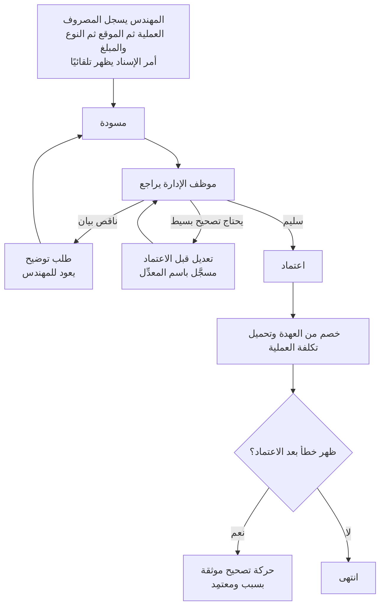
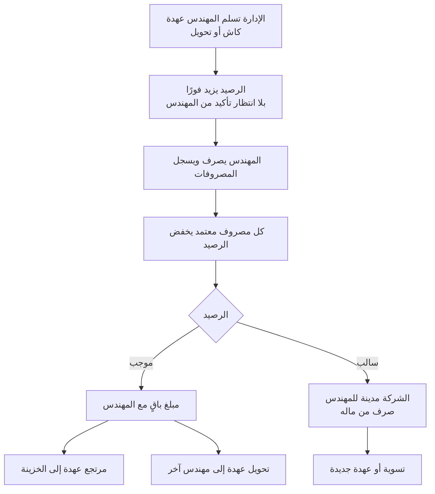
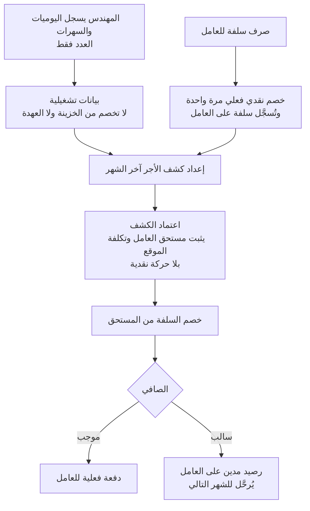
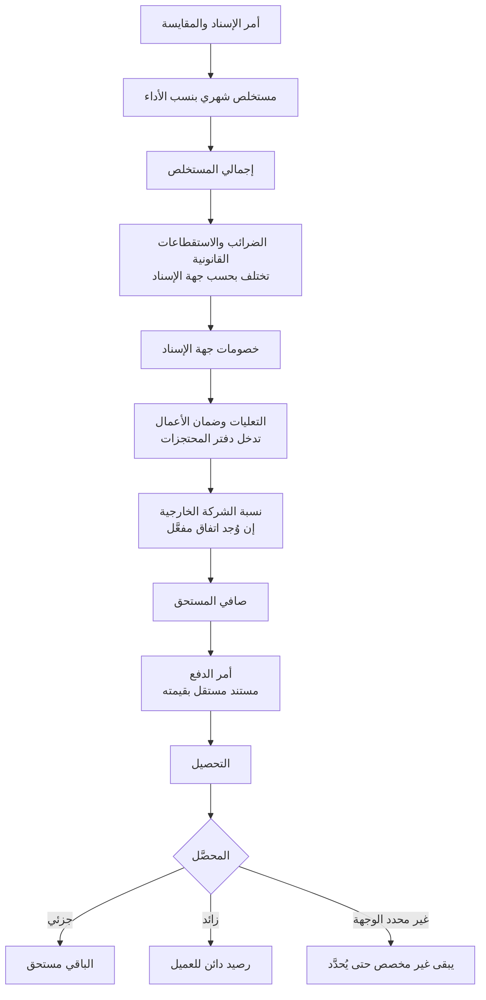
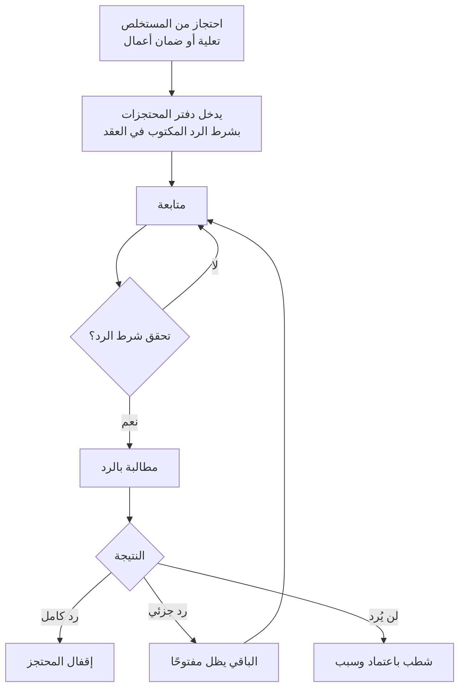

# Contractra

# وثيقة مراجعة واعتماد دورات العمل

| | |
|---|---|
| **اسم المشروع** | Contractra — نظام الإدارة المالية والتشغيلية |
| **اسم الوثيقة** | وثيقة مراجعة واعتماد دورات العمل |
| **الإصدار** | مسودة الاجتماع الأولى |
| **حالة الوثيقة** | 🟨 **مسودة للمراجعة** — لا تُعتبر معتمدة قبل توقيع المدير والمحاسب |
| **تاريخ الإصدار** | 2026-09-17 (محدَّثة بـ**BC-20 — التقرير الشهري** في v1.1.4) |
| **مكان الاجتماع** | ............................................ |
| **تاريخ الاجتماع** | ............................................ |
| **مدة الاجتماع المقترحة** | جلستان × ساعتين ونصف |

## الحضور

| # | الاسم | الصفة | الحضور | التوقيع |
|---|---|---|---|---|
| 1 | ....................... | مدير الشركة | ☐ | ................ |
| 2 | ....................... | المحاسب | ☐ | ................ |
| 3 | ....................... | موظف الإدارة — المراجعة | ☐ | ................ |
| 4 | ....................... | مهندس — ممثل المستخدمين | ☐ | ................ |
| 5 | ....................... | محلل النظام — مدير الاجتماع | ☐ | ................ |
| 6 | ....................... | ....................... | ☐ | ................ |

---

# 1. طريقة استخدام الوثيقة

**الهدف:** مراجعة **طريقة العمل**، لا مناقشة البرمجة. السؤال في كل صفحة واحد: **هل فهمنا شغلكم صح؟**

**كيف نقرأ الحالات:** كل حالة تحمل علامة واحدة:

| العلامة | المعنى | المطلوب في الاجتماع |
|---|---|---|
| ✅ **قرار مؤكد** | محسوم بقرار صريح منكم أو بمستند رسمي | **تأكيد فقط** — لا نعيد فتحه |
| 🟡 **يحتاج قرار المدير** | اختيار تشغيلي أو إداري | **قرار في الاجتماع** |
| 🟠 **يحتاج اعتماد المحاسب** | معالجة محاسبية أو ضريبية | **لا يُحسم تقنيًا** — رأي المحاسب |
| 🔴 **قرار حرج** | يوقف العمل إن لم يُحسم | **أولوية قصوى** |
| 🔵 **يمكن تأجيله** | لا يمنع النسخة الأولى | **تأجيل موثّق** |

**الفرق بين قرار المدير وقرار المحاسب:** المدير يقرر **كيف نعمل ومن يملك الصلاحية**. المحاسب يقرر **كيف يُقيَّد المبلغ في الدفاتر وما أثره الضريبي**. لا يحل أحدهما محل الآخر.

**كيف يُسجَّل القرار:** كل حالة في آخرها جدول «قرار الاجتماع». يُملأ **أثناء الجلسة** لا بعدها. القرار بلا صاحب وتاريخ يُعتبر غير مُتخذ.

**ما بعد الاجتماع:**

1. تُحدَّث هذه الوثيقة بالقرارات وتُوقَّع.
2. تُستكمل المستندات الناقصة المطلوبة في آخر الوثيقة.
3. **الخطوة التالية كتابة وثيقة المتطلبات (SRS) — وليست كتابة البرنامج.** البرمجة لا تبدأ قبل اعتماد المتطلبات.

---

# 2. الملخص التنفيذي

## المشكلة اليوم

العمل كله على ملفات Excel مرتبطة ببعضها ويدويًا. وهذا أنتج مشاكل **موثَّقة بالأرقام** من ملفات 2026 نفسها:

| المشكلة | الأثر المرصود |
|---|---|
| مستخلص واحد سُجِّل في ثلاثة صفوف | تضخيم إيراد بـ **7,802,857 ج** على أمر إسناد واحد |
| صيغة حسابية حُذفت من خلية واحدة في كشف أجور | صافي الأجور المنشور أعلى من الصحيح بـ **16,250 ج** |
| المكتب يصرف نيابة عن المقاولين | **لا يوجد قيد استرداد واحد** في ثلاثة دفاتر — التكلفة تُحمَّل ولا تُسترد |
| اسم الطرف نص حر في عمودين | الربط بين المصروف وصاحبه **بلا ضمان** |
| ترقيم المستخلصات | **39 من 40 أمر إسناد** بها فجوات أو تكرارات |
| محتجزات بلا متابعة | **11,138,575 ج** لا يمكن تحديد موعد ردها لغياب تاريخ التسليم النهائي |
| نسختان من ملف الأجور خلال يومين | **836 خطأ** اختفى و**23 كتلة شهرية** تغيّرت — بلا أثر يوضح أيهما المعتمد |

## لماذا النظام

ليس لأتمتة Excel، بل ليمنع هذه الأخطاء **قبل وقوعها**: رقم واحد يُدخَل مرة واحدة، وكل مبلغ له مصدر وصاحب وتاريخ، وكل تعديل له أثر.

## المستخدمون

**المهندس** (إدخال ميداني) · **موظف الإدارة** (مراجعة واعتماد) · **المحاسب** (التصنيف والترحيل والإقفال) · **المدير** (الاعتماد والتقارير والصلاحيات).

## نطاق النسخة الأولى

العمليات والمواقع وأوامر الإسناد · المصروفات والعهدة · الأجور واليوميات والسلف · المقاولون والموردون · المستخلصات والاستقطاعات وأوامر الدفع والتحصيل · المحتجزات والضمانات · التقارير الأساسية.

## أهم الفوائد

- **موقف العهدة لكل مهندس لحظيًا** بدل الجمع اليدوي.
- **منع الازدواج**: المبلغ لا يُخصم مرتين ولا يُحمَّل مرتين.
- **تنبيه قبل استحقاق المحتجزات** بدل اكتشافها متأخرة.
- **تكلفة وربحية كل عملية** من مصدر واحد.
- **أثر كامل**: من عدّل، ومتى، ولماذا.

## أهم القرارات المطلوبة

**ثلاثة قرارات تمنع التشغيل** (لا تمنع كتابة المتطلبات): معالجة المصروف القابل للاسترداد · تصنيف بندي التأمين · البنود غير المصنفة. وكلها **قرارات محاسبية** لا تقنية.

## فرق جوهري يجب أن يكون واضحًا

> **فهم النظام جاهز. ترحيل البيانات القديمة ليس جاهزًا.**
>
> أرقام 2026 في Excel تحمل ازدواجًا وتضخيمًا وبنودًا غير مصنفة بقيمة **21,819,378.93 ج**. النظام الجديد يمنع تكرار ذلك مستقبلًا؛ أما **تصحيح الماضي فقرار إداري ومحاسبي** يُتخذ في هذا الاجتماع أو بعده — ولا يعطّل بناء النظام.

---

# 3. جدول القرارات الحرجة

| # | الموضوع | صاحب القرار | الحالة | يمنع التنفيذ؟ |
|---|---|---|---|---|
| 1 | المعالجة المحاسبية للمصروف الذي دفعناه نيابة عن المقاول | المحاسب | 🟠 | **نعم — يمنع الترحيل المالي** |
| 2 | تصنيف بند «استكمال تأمين نهائى» (15,338,413.93 ج) | المحاسب | 🟠 | **نعم — يمنع الترحيل** |
| 3 | تصنيف بند «تامين ازاله مخلفات» (481,457.72 ج) | المحاسب | 🟠 | **نعم — يمنع الترحيل** |
| 4 | الضرائب والبنود غير المصنفة (21,819,378.93 ج إجمالًا) | المحاسب | 🟠 | **نعم — يمنع الترحيل** |
| 5 | هل تحويل العهدة بين مهندسَين يحتاج قبول الطرفين؟ | المدير | 🟡 | لا |
| 6 | من يملك صلاحية إقفال الفترة المالية وإعادة فتحها؟ | المدير + المحاسب | 🟡 | لا |
| 7 | سياسة التعامل مع الأخطاء التاريخية في أرقام 2026 | المدير + المحاسب | 🔴 | **نعم — يمنع الترحيل** |
| 8 | من يعتمد الأرصدة الافتتاحية؟ | المدير + المحاسب | 🔴 | **نعم — يمنع الترحيل** |
| 9 | التقارير الأساسية المطلوبة في النسخة الأولى | المدير | 🟡 | لا |
| 10 | حدود وصلاحيات كل مستخدم | المدير | 🟡 | لا |
| 11 | سياسة الصافي السالب للعامل أو المهندس | المدير + المحاسب | 🟡 | لا |
| 12 | من يوافق على التصحيحات المالية بعد الاعتماد؟ | المدير | 🟡 | لا |
| 13 | مدة الاحتفاظ بسجل «من فعل ماذا» ومن يقرأه | المدير + المحاسب | 🟡 | لا |

> **ملاحظة مهمة:** «يمنع التنفيذ» تعني **يمنع تشغيل النظام بأرقام حقيقية**. **لا شيء منها يمنع كتابة وثيقة المتطلبات.**

---

# 4. الرحلات التوضيحية

## 4.1 رحلة المصروف



**الشرح:** المصروف يمر بأربع محطات — إدخال، مراجعة، اعتماد، وربما تصحيح. **والعملية والموقع وأمر الإسناد إلزامية كلها من أول لحظة** — العملية أولًا، ثم الموقع من مواقع العملية، ثم يظهر أمر الإسناد تلقائيًا للقراءة فقط.

**مثال:** المهندس مكلف بمواقع داخل عملية واحدة، فيفتح الشاشة فيجد العملية وأمر الإسناد **محددين تلقائيًا**، ويختار الموقع «الحي الحادي عشر»، ثم نوع المصروف والمبلغ 1,200 ج ويرسل. وبعد الاعتماد يُخصم المبلغ من عهدته ويُحمَّل على تكلفة العملية.

**نقطة القرار:** **من يملك صلاحية اعتماد التصحيح بعد الاعتماد؟** (الحالة رقم 12 في جدول القرارات الحرجة).

---

## 4.2 رحلة العهدة



**الشرح:** العهدة دفتر حركات، والرصيد **يُحسب من الحركات ولا يُكتب يدويًا**. تسليم الإدارة **لا يحتاج تأكيد استلام من المهندس** — قرار الصرف قرار الإدارة.

**مثال:** المهندس استلم 50,000 ج، واعتُمدت له مصروفات 62,000 ج ⟹ الرصيد **−12,000 ج**، أي أن الشركة **مدينة له** بهذا المبلغ.

**نقطة القرار:** **هل تحويل العهدة بين مهندسَين يحتاج قبول الطرفين؟** (الحالة رقم 5).

---

## 4.3 رحلة اليومية والأجر



**الشرح:** هذه أهم نقطة في الأجور: **الاستحقاق شيء والدفع شيء آخر**. تسجيل اليومية لا يحرك نقدًا. صرف السلفة يحرك النقد **مرة واحدة فقط**، ثم تُخصم من المستحق بلا خصم نقدي ثانٍ.

**مثال حقيقي من ملف 2026:** عامل استحقاقه في الشهر 3,750 ج وسلفته 20,000 ج ⟹ الصافي **−16,250 ج**. ملف Excel لم يستطع تمثيل الرقم السالب فحُذفت الصيغة، فارتفع إجمالي الصافي المنشور بنفس المبلغ.

**نقطة القرار:** **كيف نعالج الصافي السالب؟** (الحالة رقم 11).

---

## 4.4 رحلة المستخلص وأمر الدفع



**الشرح:** المستخلص **تراكمي** — قيمة الشهر = التراكمي الحالي ناقص التراكمي السابق. وأمر الدفع **ليس بالضرورة مساويًا لصافي المستخلص**، ولذلك يُسجَّل كمستند مستقل بقيمته الصريحة.

**مثال متحقَّق منه:** مستخلص بإجمالي 447,907 ج، استقطاعات 140,974.22 ج ⟹ الصافي **306,932.78 ج**. وضمان الأعمال = 447,907 × 5% = **22,395 ج** يدخل دفتر المحتجزات.

**نقطة القرار:** **أي الاستقطاعات محتجز يُرد، وأيها مصروف نهائي؟** (الحالات 2 و3 و4).

---

## 4.5 رحلة المحتجز



**الشرح:** المحتجز **لا يُرد بحلول تاريخ**، بل **بتحقق شرط مكتوب في العقد** — نص عقد التيسير صريح: «ولا يسترد أى مبالغ الا بعد التسليم النهائى للجهاز». التاريخ المسجَّل في الدفاتر **تقدير للشرط لا الشرط نفسه**.

**مثال:** احتُجز 12,136,186.14 ج ضمان أعمال عبر 155 مستخلصًا خلال أربع سنوات، **ولم يُسجَّل صف رد واحد** في الدفاتر. إما أن الردود تحدث ولا تُسجَّل، أو لم يُطالَب بها.

**نقطة القرار:** **من يتابع المطالبة بالمحتجزات، ومتى يُشطب المحتجز؟** (يُحسم في الحالة BC-13).

---

# 5. جلسة التشغيل والإدارة

## BC-01 — المستخدمون والأدوار والصلاحيات

**الحالة:** 🟡 يحتاج قرار المدير
**من يشارك:** المدير · موظف الإدارة

**لماذا نناقشها؟** الصلاحيات تحدد من يرى الأرقام ومن يغيّرها. وضعها خطأ من البداية يعني إما شلل العمل أو انكشاف بيانات.

**الوضع الحالي:** ملفات Excel مفتوحة لمن يملكها — لا فرق بين من يُدخل ومن يعتمد.

**الوضع المقترح:** أربعة أدوار: **المهندس** (إدخال ميداني في مواقعه فقط) · **موظف الإدارة** (مراجعة واعتماد) · **المحاسب** (تصنيف وترحيل وإقفال) · **المدير** (صلاحية كاملة + منح الصلاحيات).

**مثال:** المهندس لا يرى تكلفة العملية ولا ربحيتها؛ يرى مصروفاته وعهدته وموقفه فقط.

**ما تم حسمه:** ✅ الأدمن وحده يمنح الصلاحيات ويربط المهندس بالمواقع.

**ما يحتاج قرارًا:** هل المحاسب يرى تكلفة كل العمليات أم عملياتٍ محددة؟ وهل موظف الإدارة يعتمد بلا سقف مبلغ أم بسقف يُصعَّد فوقه للمدير؟

**الخيارات:**

| الخيار | المزايا | العيوب والمخاطر |
|---|---|---|
| اعتماد بلا سقف | سرعة | لا رقابة على المبالغ الكبيرة |
| سقف مبلغ ثم تصعيد للمدير | رقابة على الكبير وسرعة في الصغير | يحتاج تحديد السقف وتحديثه |

**التوصية:** **سقف مبلغ مع تصعيد** — يوازن بين السرعة والرقابة. والسقف رقم يحدده المدير ويمكن تغييره لاحقًا.

**قرار الاجتماع:** القرار: ................ · صاحب القرار: ................ · التاريخ: ........ · ملاحظات: ................ · متابعة؟ ☐ · المسؤول: ........ · تاريخها: ........

**المرجع الداخلي:** ح-17 · ح-131 · ج-2

---

## BC-02 — ربط المهندس بالمواقع وما يراه

**الحالة:** ✅ قرار مؤكد — للتأكيد فقط
**من يشارك:** المدير · المهندس

**لماذا نناقشها؟** أكثر خطأ متوقع هو تسجيل مصروف على موقع خاطئ.

**الوضع الحالي:** المهندس يكتب اسم الموقع نصًّا، والأخطاء الإملائية تكسر الربط.

**الوضع المقترح:** الأدمن يربط كل مهندس بمواقعه بتاريخ بداية ونهاية. والمهندس **لا يرى في قائمته إلا المواقع المكلف بها والسارية في تاريخ الحركة**.

**مثال:** مهندس كُلِّف بموقعين وأُنهي تكليفه من أحدهما في 1 سبتمبر. حركاته قبل هذا التاريخ تظل صحيحة وظاهرة؛ ولا يستطيع تسجيل حركة جديدة عليه بعده.

**ما تم حسمه:** ✅ الأدمن وحده يربط · ✅ القائمة مقصورة على المواقع الفعّالة · ✅ التكليف **لا يُحذف** بل يُغلق بتاريخ حتى تبقى الحركات القديمة مفهومة.

**ما يحتاج قرارًا:** لا شيء — للتأكيد فقط.

**التوصية:** التأكيد كما هو.

**قرار الاجتماع:** القرار: ................ · صاحب القرار: ................ · التاريخ: ........ · ملاحظات: ................

**المرجع الداخلي:** ح-16 · ح-17 · ح-20 · ح-22 · ح-131 · ح-132

---

## BC-03 — تسجيل المصروف: العملية ثم الموقع، وأمر الإسناد تلقائي

**الحالة:** ✅ قرار مؤكد — للتأكيد فقط
**من يشارك:** المهندس · موظف الإدارة

**لماذا نناقشها؟** هذه أكثر شاشة استخدامًا في النظام كله، وترتيبها يحدد جودة كل التقارير بعدها.

**الوضع الحالي:** المصروف يُكتب في دفتر ويُربط لاحقًا بالعملية — وأحيانًا لا يُربط.

**الوضع المقترح — الترتيب الصحيح:**

1. **العملية** — إلزامية.
2. **الموقع من مواقع هذه العملية** — إلزامي.
3. **أمر الإسناد يظهر تلقائيًا للقراءة فقط** — والمهندس لا يكتبه ولا يعدّله.
4. **نوع المصروف** من قائمة — لا كتابة حرة.
5. **المبلغ**.
6. *إرفاق فاتورة أو صورة — اختياري دائمًا*.
7. *ملاحظة — اختيارية، إلا مع «أخرى» فتصبح إلزامية*.
8. **إرسال**.

**والنظام يختصر الخطوات تلقائيًا:** إن كان للمهندس **عملية واحدة** حُدِّدت تلقائيًا؛ وإن كان له **موقع واحد داخلها** حُدِّد تلقائيًا. فتصبح الرحلة أحيانًا: **نوع المصروف → المبلغ → إرسال**.

**مثال:**

```
العملية:      صيانة وتطوير أحياء الشيخ زايد
أمر الإسناد:  137
الموقع:       الحي الحادي عشر
```

**ما تم حسمه:** ✅ **العملية والموقع وأمر الإسناد إلزامية كلها** · ✅ العملية أولًا ثم الموقع · ✅ أمر الإسناد **يُجلب من العملية تلقائيًا ولا يكتبه المهندس** · ✅ نوع المصروف من قائمة · ✅ **المرفق اختياري دائمًا مهما كان المبلغ** · ✅ المهندس **لا يرى إلا عملياته ومواقعه** · ✅ **لا حقول طريقة الدفع ولا مصدر الدفع ولا المدفوع إليه** — كل مصروف معتمد يُحمَّل على عهدة المهندس تلقائيًا.

**⚠️ تصحيح مهم لِما ورد في مسودة سابقة:** كان مكتوبًا أن «الموقع إجباري والعملية يجوز تأجيلها ويحددها المراجع». **هذا مُلغى.** العملية إلزامية من أول لحظة، وتغيير المراجع للعملية أو الموقع **قبل الاعتماد** يبقى ممكنًا بسجل تدقيق، لكنه **استثناء لا المسار الطبيعي**.

**ما يحتاج قرارًا:** لا شيء — للتأكيد فقط.

**التوصية:** التأكيد. الترتيب الجديد يمنع تحميل مبلغ بلا مركز تكلفة، ولا يعطّل المهندس لأن النظام يملأ ما يستطيع تلقائيًا.

**قرار الاجتماع:** القرار: ................ · صاحب القرار: ................ · التاريخ: ........ · ملاحظات: ................

**المرجع الداخلي:** ح-15 · ح-196…ح-199 · ح-203…ح-208 · ح-210 · ح-211

---

## BC-04 — مراجعة المصروف واعتماده وطلب التوضيح

**الحالة:** 🟡 يحتاج قرار المدير
**من يشارك:** موظف الإدارة · المهندس · المدير

**لماذا نناقشها؟** المراجعة هي البوابة الوحيدة بين الإدخال الميداني والأثر المالي.

**الوضع الحالي:** المراجعة شفهية أو عبر الواتساب، ولا يبقى منها أثر.

**الوضع المقترح:** كل مصروف يُراجع **على حدة**. وللمراجع ثلاثة خيارات: **اعتماد** · **تعديل قبل الاعتماد** (باسم من عدّل) · **طلب توضيح** يعيد المصروف للمهندس مع تعليق مكتوب — **بدل الرفض النهائي**. وتُرفق الصور والمستندات بالمصروف نفسه، وتصل إشعارات للطرفين.

**مثال:** مصروف 4,500 ج بوصف «مهمات». المراجع يطلب توضيحًا، فيرد المهندس بصورة الفاتورة وتفصيل البنود، ثم يُعتمد.

**ما تم حسمه:** ✅ المراجعة فردية لكل مصروف · ✅ التعديل قبل الاعتماد مسموح ومسجَّل · ✅ طلب التوضيح بدل الرفض.

**ما يحتاج قرارًا:** ما مهلة رد المهندس على طلب التوضيح؟ ومتى يُصعَّد للمدير؟

**الخيارات:**

| الخيار | المزايا | العيوب والمخاطر |
|---|---|---|
| بلا مهلة | مرونة | مصروفات معلقة بلا نهاية تشوّه التقارير |
| تنبيه بعد 3 أيام وتصعيد بعد 7 | إغلاق منتظم | يحتاج انضباطًا في المتابعة |

**التوصية:** **تنبيه 3 أيام وتصعيد 7 أيام** — والمدد قابلة للتغيير من الإعدادات بلا تعديل برمجي.

**قرار الاجتماع:** القرار: ................ · صاحب القرار: ................ · التاريخ: ........ · ملاحظات: ................

**المرجع الداخلي:** ج-3 · ح-136

---

## BC-05 — التصحيح بعد الاعتماد

**الحالة:** 🟡 يحتاج قرار المدير
**من يشارك:** المدير · المحاسب · موظف الإدارة

**لماذا نناقشها؟** أخطر ما في أي نظام مالي هو تعديل رقم معتمد بلا أثر.

**الوضع الحالي:** الخلية تُعدَّل في Excel ولا يبقى دليل على القيمة القديمة.

**الوضع المقترح:** **المعتمَد لا يُعدَّل مباشرة أبدًا.** التصحيح يتم **بحركة تصحيح مستقلة مرتبطة بالأصل**، بسبب مكتوب ومعتمِد وتاريخ. القيمة القديمة تبقى ظاهرة، والجديدة تظهر بجوارها.

**مثال:** مصروف اعتُمد بـ12,000 ج والصحيح 10,200 ج. لا يُعدَّل الرقم؛ تُسجَّل حركة تصحيح بـ−1,800 ج بسبب «خطأ في قراءة الفاتورة».

**ما تم حسمه:** ✅ لا تعديل مباشر بعد الاعتماد · ✅ التصحيح بمستند مستقل مرتبط بالأصل مع الاحتفاظ بالتاريخ الكامل.

**ما يحتاج قرارًا:** **من يعتمد حركة التصحيح؟** وهل يختلف باختلاف المبلغ؟

**الخيارات:**

| الخيار | المزايا | العيوب والمخاطر |
|---|---|---|
| موظف الإدارة يعتمد التصحيح | سرعة | من راجع أصلًا يصحح نفسه — رقابة ضعيفة |
| المدير وحده | رقابة قصوى | بطء وتكدّس على المدير |
| موظف الإدارة حتى سقف · فوقه المدير | توازن | يحتاج تحديد السقف |

**التوصية:** **الخيار الثالث**، وأن يكون **المحاسب مُخطَرًا بكل تصحيح** يمس فترة مرحَّلة.

**قرار الاجتماع:** القرار: ................ · صاحب القرار: ................ · التاريخ: ........ · ملاحظات: ................

**المرجع الداخلي:** ح-178 · ح-143

---

## BC-06 — العمل بلا إنترنت والمزامنة

**الحالة:** ✅ قرار مؤكد
**من يشارك:** المهندس · موظف الإدارة

**لماذا نناقشها؟** كثير من المواقع بلا تغطية، والمهندس لا يستطيع انتظار الشبكة.

**الوضع الحالي:** يُكتب في ورقة ثم يُنقل لاحقًا — ومصدر نصف الأخطاء هو هذا النقل.

**الوضع المقترح:** التسجيل يعمل **بلا إنترنت**، ويُحفظ على الجهاز، ويُرسَل تلقائيًا عند عودة الشبكة. والتحقق عند الإرسال يستخدم **تاريخ الحركة لا تاريخ الإرسال**.

**مثال:** مهندس سجّل مصروفًا يوم 20 أغسطس وهو بلا شبكة، وأُنهي تكليفه من الموقع في 25 أغسطس، وأرسل في 28. **المصروف يُقبل** لأن تاريخ الحركة داخل فترة تكليفه.

**وماذا لو كانت الحركة نفسها خارج فترة التكليف؟** لا تُرفض ولا تُحذف — **تبقى ظاهرة بحالة «تحتاج مراجعة الإدارة» ولا تُعتمد** حتى تقرر الإدارة.

**ما تم حسمه:** ✅ العمل بلا إنترنت مدعوم · ✅ التحقق بتاريخ الحركة · ✅ المسودة خارج التكليف تبقى ولا تُعتمد.

**ما يحتاج قرارًا:** لا شيء — للتأكيد فقط.

**التوصية:** التأكيد.

**المرجع الداخلي:** ح-19 · ح-137 · ح-138

---

## BC-07 — العهدة: التسليم والرصيد والمرتجع والتحويل

**الحالة:** 🟡 يحتاج قرار المدير
**من يشارك:** المدير · موظف الإدارة · المهندس

**لماذا نناقشها؟** العهدة هي المال المتحرك يوميًا، وأكثر بند يُسأل عنه.

**الوضع الحالي:** موقف العهدة يُحسب بمعادلات يدوية، وإشارة الرصيد في الملف الحالي **معكوسة** عن المنطق المتعارف عليه.

**الوضع المقترح:** أربعة أنواع حركة واضحة:

| النوع | المعنى | الاعتماد المطلوب |
|---|---|---|
| **تسليم عهدة** | من الإدارة للمهندس | **معتمِد الصرف فقط — لا تأكيد من المهندس** |
| **تحويل عهدة** | من مهندس لمهندس | **محل القرار ↓** |
| **مرتجع عهدة** | من المهندس للخزينة | مستند إيداع أو إيصال |
| **تصحيح عهدة** | تصحيح موثق | سبب ومعتمِد، ولا يُعدَّل الأصل |

والرصيد **محسوب من الحركات دائمًا** — لا يُكتب يدويًا ولا يُعدَّل.

**مثال:** مهندس رصيده 8,000 ج انتقل لموقع آخر وسلّم العهدة لزميله. الحركة تُسجَّل تحويلًا فيقل رصيده ويزيد رصيد زميله بنفس المبلغ في حركة واحدة.

**ما تم حسمه:** ✅ الأنواع الأربعة مفصولة · ✅ تسليم الإدارة لا يحتاج تأكيد المهندس · ✅ الرصيد محسوب لا مخزَّن · ✅ الرصيد الموجب = باقٍ مع المهندس، والسالب = الشركة مدينة له.

**ما يحتاج قرارًا:** **هل تحويل العهدة بين مهندسَين يحتاج قبول الطرفين؟**

**الخيارات:**

| الخيار | المزايا | العيوب والمخاطر |
|---|---|---|
| تحويل فوري بلا قبول | سرعة | خلاف لاحق: «أنا ما استلمتش» بلا إثبات |
| قبول الطرفين مطلوب | إثبات واضح ويقلل النزاع | تعليق الحركة إذا تأخر الطرف الثاني |

**التوصية:** **اشتراط قبول الطرفين** مع حالة «معلَّق» ومهلة تصعيد للإدارة — لأن النزاع هنا نزاع على مال في اليد.

**قرار الاجتماع:** القرار: ................ · صاحب القرار: ................ · التاريخ: ........ · ملاحظات: ................

**المرجع الداخلي:** ح-24 · ح-25…ح-29 · ح-140…ح-143 · ج-26

---

## BC-08 — اليوميات والأجور والسلف والصافي السالب

**الحالة:** 🟡 يحتاج قرار المدير + 🟠 يحتاج اعتماد المحاسب
**من يشارك:** المدير · المحاسب · المهندس

**لماذا نناقشها؟** الأجور أكبر بند تكلفة تشغيلي، وأكثر بند تحدث فيه ازدواجية الخصم.

**الوضع الحالي:** كشوف شهرية بمعادلات مترابطة عبر ملفات. وتحققنا من كل معادلاتها، ورصدنا أن **فئة السهرة ليست قاعدة واحدة**: 549 حالة تُحسب بقسمة اليومية على 7، و129 على 2، و26 بقيمة يدوية.

**الوضع المقترح:**

1. المهندس يسجل **العدد فقط**، والنظام يحسب بالفئة المعتمدة للعامل في تاريخها.
2. **لكل عامل أو مجموعة سياسة أجر مؤرخة** — لا قاعدة واحدة للجميع.
3. **اليومية بيانات تشغيلية** لا تحرك نقدًا.
4. **السلفة حركة نقدية فعلية مرة واحدة**، ثم تُخصم من المستحق بلا خصم ثانٍ.
5. التمييز بين **السلفة الحالية** (تُخصم بالكامل) و**السلفة المستديمة** (تُخصم بالتقسيط، ولها رصيد يُدوَّر).

**مثال:** عامل استحقاقه 3,750 ج وسلفته 20,000 ج ⟹ الصافي −16,250 ج. النظام **يعرض الرقم السالب ولا يخفيه**.

**ما تم حسمه:** ✅ فصل الاستحقاق عن الدفع · ✅ السلفة تُخصم نقدًا مرة واحدة · ✅ سياسة أجر لكل مورد بتاريخ سريان · ✅ «تم القبض» يرتبط بدفعة فعلية معتمدة لا برقم حر.

**ما يحتاج قرارًا:**

- **(المدير)** هل يُسمح بصرف سلفة تتجاوز الاستحقاق المتوقع؟ وهل نضع سقفًا للسلف المستديمة؟
- **(المحاسب)** 🟠 كيف يُعالَج الصافي السالب محاسبيًا — رصيد مدين على العامل يُرحَّل، أم تسوية فورية؟

**الخيارات (للصافي السالب):**

| الخيار | المزايا | العيوب والمخاطر |
|---|---|---|
| ترحيله رصيدًا مدينًا على العامل | يعكس الواقع ويُحصَّل تدريجيًا | يحتاج متابعة وقد يتراكم |
| تسوية فورية | إقفال نظيف | قد يتعذر التحصيل فعليًا |

**التوصية:** **الترحيل كرصيد مدين** مع تنبيه عند تجاوز حد يحدده المدير — والقرار المحاسبي النهائي **للمحاسب**.

**قرار الاجتماع:** القرار: ................ · صاحب القرار: ................ · التاريخ: ........ · ملاحظات: ................

**المرجع الداخلي:** ح-34…ح-45 · ح-46…ح-50 · ج-16 · ج-20

---

## BC-09 — من تُحمَّل عليه التكلفة: عمال · مقاولون · معدات · موردون

**الحالة:** ✅ قرار مؤكد + 🔵 تصنيف تفصيلي يمكن تأجيله
**من يشارك:** موظف الإدارة · المحاسب · المهندس

**لماذا نناقشها؟** في ملف الأجور الحالي **108 اسم** تُحمَّل عليها التكلفة، **و30 منها ليست أشخاصًا** — سيارات وجرارات وشقق سكن وحساب «الغفر».

**الوضع الحالي:** كلها أسماء في عمود واحد، فلا يمكن التفرقة بين عامل له مستحق وحساب تجميعي لا يُدفع له.

**الوضع المقترح:** ستة أنواع: **فرد** · **مجموعة عمال** · **مهندس أو مشرف** · **مقاول أو رئيس مجموعة** · **سيارة أو جرار أو سكن** · **حساب تكلفة تجميعي**.

والحسابات التجميعية (اللودر، الشقة، الغفر) **لا يُنشأ لها مستخدم ولا حساب عهدة ولا يُدفع لها** — هي أوعية تكلفة فقط.

**والمقاول له مساران**: قد يظهر كمورد تكلفة في الموقع، وله في الوقت نفسه كشف تسوية مستقل. **والنظام يمنع احتسابه في الاثنين معًا عن الفترة نفسها.**

**مثال:** «شقة عمال سعد» تكلفة سكن تُحمَّل على الموقع، ولا يُصرف لها راتب ولا عهدة.

**ما تم حسمه:** ✅ الأنواع الستة · ✅ الحسابات التجميعية بلا مستخدم أو عهدة · ✅ منع ازدواج المقاول بين كشف الأجور وتسويته.

**ما يحتاج قرارًا:** 🔵 من يصنّف الـ108 اسمًا إلى الأنواع الستة؟ (مهمة **لمرة واحدة** قبل التشغيل).

**التوصية:** **موظف الأجور يصنّف والمدير يراجع.** يمكن تأجيلها إلى ما قبل الترحيل مباشرة.

**قرار الاجتماع:** القرار: ................ · صاحب القرار: ................ · التاريخ: ........ · ملاحظات: ................

**المرجع الداخلي:** ح-30…ح-33 · ح-52 · ح-56 · ح-57 · ج-19

---

# 6. جلسة الحسابات والعقود

## BC-10 — شركاتنا والشركات الخارجية والأدوار الخمسة

**الحالة:** ✅ قرار مؤكد + 🔴 نقطة تحتاج تأكيدًا صريحًا
**من يشارك:** المدير · المحاسب

**لماذا نناقشها؟** خلط شركاتنا بالشركات التي نعمل بأوراقها يقلب الربحية رأسًا على عقب.

**الوضع الحالي:** اسم الشركة عمود نصي في ملف واحد، بلا تفرقة بين المالك والمنفذ.

**الوضع المقترح:** خمسة أدوار مفصولة على كل عملية، **ويجوز أن يجمع طرف واحد أكثر من دور**:

| الدور | المعنى |
|---|---|
| **الشركة صاحبة الورق** | التي بُوسِّط بها العقد |
| **الشركة المنفذة فعليًا** | التي تنفذ الأعمال |
| **المستفيد الاقتصادي** | من يؤول إليه الربح |
| **جهة الإسناد** | الجهة التي أسندت العمل |
| **العميل** | من يُطالب بالسداد |

**مثال:** أعمال الحى الحادى عشر بالشيخ زايد: **جهة الإسناد** جهاز مدينة الشيخ زايد · **صاحبة الورق** التيسير · **المنفذ فعليًا** الأقصى.

**ما تم حسمه:** ✅ شركاتنا: **الروضة · الأقصى · الأمل** · ✅ التيسير وتاله وأي شركة لا نملكها = **أطراف خارجية**، حتى لو دخلنا العملية بأوراقها · ✅ العملية باسم إحدى شركاتنا وتنفذها ⟹ **نسبة الشركة الخارجية صفر** لا فراغ.

**ما يحتاج قرارًا:** 🔴 **«المدينة» — وردت في طلبكم مع شركاتنا، ولم ترد في أي مستند أو ملف فحصناه.** لا نفترض ملكية شركة لم تُذكر في المصادر.

**السؤال المباشر:** هل «المدينة» **شركة مملوكة لنا تُدار محاسبيًا داخل النظام**، أم **جهة إسناد** (مثل «جهاز مدينة الشيخ زايد»)، أم **شركة خارجية** نعمل بأوراقها؟

**الخيارات:**

| الخيار | الأثر |
|---|---|
| شركة مملوكة | تدخل نطاق الشركات المُدارة وتظهر لها تقارير ربحية مستقلة |
| جهة إسناد | تُسجَّل جهةً، ولا ربحية لها عندنا |
| شركة خارجية | تحتاج **اتفاق نسبة وأساس ومستند** مثل التيسير |

**التوصية:** **لا توصية — القرار قرار المدير، ولا يجوز افتراضه.** وهو **يمنع بدء المتطلبات في جزء الشركات** حتى يُحسم.

**قرار الاجتماع:** القرار: ................ · صاحب القرار: ................ · التاريخ: ........ · ملاحظات: ................

**المرجع الداخلي:** ح-1 · ح-2 · ح-3 · ح-6 · ج-21

---

## BC-11 — الاتفاق مع الشركة الخارجية: النسبة والأساس والمستند

**الحالة:** ✅ قرار مؤكد
**من يشارك:** المدير · المحاسب

**لماذا نناقشها؟** هذا أكثر بند اختلف فيه الفهم، وفرق تفسيره على عقد واحد **64,941 ج**.

**الوضع الحالي:** الاتفاق شفهي أو في ورقة، ولا أثر له في أي دفتر. وفحصنا الدفاتر الأربعة فلم نجد أي عمود أو حركة تحمل «نسبة».

**الوضع المقترح — قاعدة صارمة:**

1. **لا تُعمَّم نسبة ولا أساس احتساب من عقد إلى عقد.** كل اتفاق عالم قائم بذاته.
2. كل اتفاق يحمل **نسبته** و**أساس احتسابها** و**مستنده** و**تاريخ سريانه**، **مسجَّلة قبل بدء العملية**.
3. **اتفاق ناقص أيًّا من الأربعة لا يُفعَّل، ولا يُنشئ أي تسوية مالية** — يبقى مسودة.
4. **لا قيمة افتراضية ولا وراثة من اتفاق آخر ولا من «المعتاد».**
5. تعديل الاتفاق لاحقًا **لا يغيّر ما مضى** — يُنشأ إصدار جديد بتاريخ سريان.

**عقد التيسير — حالة موثقة لا تُعمَّم:** نص البند الثاني: «مع خصم نسبة (**١٠٪**) … لصالح الطرف الأول **من إجمالى قيمة كل مستخلص**». وعشرة مستخلصات موقَّعة ومختومة تطبق **10%**، وتحققنا من حساب خمسة منها. **هذا العقد وحده.**

**مثال:** مستخلص بإجمالي 379,024.32 ج ⟹ نسبة الشركة 37,902.43 ج ⟹ الصافي 341,121.89 ج.

**ما تم حسمه:** ✅ القواعد الخمس أعلاه · ✅ نسبة التيسير 10% من إجمالي المستخلص **لهذا العقد فقط**.

**ما يحتاج قرارًا:** **كم عقدًا خارجيًا قائمًا اليوم بلا مستند مكتوب؟** التعرض المرصود للعقود الخارجية **42,248,762 ج**، والمستند المتاح لدينا **عقد واحد**.

**التوصية:** **حصر العقود الخارجية القائمة وتوفير مستنداتها قبل التشغيل.** الاتفاق بلا مستند يبقى مسودة ولا يُرحَّل عنه شيء.

**قرار الاجتماع:** القرار: ................ · صاحب القرار: ................ · التاريخ: ........ · ملاحظات: ................

**المرجع الداخلي:** ح-4…ح-10 · **ح-170** · ح-114

---

## BC-12 — المستخلص وبنوده واستقطاعاته

**الحالة:** ✅ قرار مؤكد + 🟠 بند تاريخي يحتاج المحاسب
**من يشارك:** المحاسب · موظف الإدارة · المدير

**لماذا نناقشها؟** المستخلص مصدر الإيراد كله، وأخطاؤه تنتقل لكل التقارير.

**الوضع الحالي:** عمود «رقم المستخلص» يحمل نصوصًا مثل «رد تعليه» و«جزء 1 من م 1»، و**39 من 40 أمر إسناد** بها خلل ترقيم، و**25 صفًا** مستخلصات مدمجة.

**الوضع المقترح:**

- المستخلص **تراكمي**: قيمة الشهر = التراكمي الحالي − التراكمي السابق (تحققنا من ذلك على مستخلصين متتاليين).
- **الختامي صفة لا نوع** — مستخلص عادي موسوم بأنه ختامي.
- **فروق الأسعار** مسار مستقل (10 صفوف بـ22,954,029 ج).
- **بند المقايسة قد يكون شهريًا متكررًا أو مرة واحدة** — وقاعدة «التراكمي لا يتجاوز الكمية» تسري على **المرة الواحدة فقط**.
- **قواعد الاستقطاع تختلف باختلاف جهة الإسناد والعقد** (العاشر من رمضان والشيخ زايد وتحيا مصر قواعدها مختلفة فعليًا).

**مثال موثق:** المقايسة بند شهري 308,427.60 ج × 24 شهرًا + توريدان مرة واحدة = **8,011,262.40 ج**، وهو بالضبط قيمة العقد.

**ما تم حسمه:** ✅ التراكمية · ✅ الختامي صفة · ✅ فروق الأسعار مستقلة · ✅ البند المتكرر مقابل المرة الواحدة · ✅ قواعد الاستقطاع مؤرخة ولكل جهة قاعدتها.

**ما يحتاج قرارًا:** 🟠 **بند «خصم عميل» — 5,999,217.28 ج على 83 مستخلصًا** يحمل **ستة معانٍ مختلفة** (غرامة نهائية · خصم كمية · حجز مشروط · تسوية سابقة · خصم ثابت مسعَّر · غير مصنف).

**ملاحظة داعمة:** العقد ينص على غرامات مسعَّرة «غير قابلة للتفاوض»: الجرار الزراعي 600 ج/يوم · ماكينة القص 400 · العامل الزراعي 150 · سيارة المخلفات 400/نقلة. **هذه إحدى الفئات الست وليست كلها.**

**التوصية:** **يُستورد البند كله بحالة «غير مصنف»** ويُعاد تصنيفه بمراجعة المستندات — **ولا يُفترض أنه كله غرامات**.

**قرار الاجتماع:** القرار: ................ · صاحب القرار: ................ · التاريخ: ........ · ملاحظات: ................

**المرجع الداخلي:** ح-67 · ح-76 · ح-115 · ح-121 · ب-10 · ب-12

---

## BC-13 — المحتجزات والضمانات: أربعة أشياء مختلفة

**الحالة:** 🔴 قرار حرج + 🟠 يحتاج اعتماد المحاسب
**من يشارك:** المحاسب · المدير

**لماذا نناقشها؟** هذه أكبر المبالغ في الملف، وأكثرها اختلاطًا.

**الوضع الحالي:** أربعة بنود في أعمدة متجاورة، و**لا يوجد أي قيد رد سالب** في أي منها — الردود تُسجَّل صفوفًا مستقلة بنص حر.

**الوضع المقترح — التفرقة أولًا:**

| البند | ما هو | هل يُرد؟ |
|---|---|---|
| **التعلية** | حجز مشروط لباقي المستحقات لحين سداد التأمينات والقوى العاملة | ✅ **نعم — مؤكد بنص المستخلص وبردود فعلية** |
| **ضمان الأعمال 5%** | يُحتجز من كل مستخلص كضمان حسن تنفيذ | ✅ نعم — بعد التسليم النهائي (نص العقد) |
| **شيك الضمان** | **شيك** يُسلَّم للشركة، وليس خصمًا من مستخلص | يُرد بعد التسليم النهائي |
| **خطاب الضمان** | خطاب بنكي — أداة مختلفة تمامًا | يُرد أو يُلغى |
| **استكمال التأمين النهائي** | بند تاريخي | 🟠 **غير محسوم** |
| **تأمين رفع المخلفات** | بند تاريخي | 🟠 **غير محسوم** |

**الأرقام — بوصفها الدقيق:**

- **التعليات: 109,482,418.69 ج** إجمالي مسجَّل، ورُدّ منها في 2026 مبلغ **12,731,150.45 ج** (عشرة صفوف).
- **27,474,600.07 ج** = **«إجمالي المبالغ التاريخية المسجلة في عمودي ضمان الأعمال واستكمال التأمين النهائي»**. ⚠️ **وليس رصيد محتجزات قائمًا مؤكدًا** — لأن الرصيد الافتتاحي غير متاح والردود السابقة غير مكتملة التسجيل.
- **4,792,152.37 ج** على 18 أمر إسناد = **«مبلغ محتمل مستحق المتابعة بتاريخ الاستعلام 2026-09-16، بافتراض عدم وجود ردود غير مسجلة»**. ⚠️ **لا نقول إنه مبلغ مؤكد لم تتم المطالبة به.**
- **11,138,575.17 ج** لا يمكن تحديد موعد ردها لأن **تاريخ التسليم النهائي غير مسجَّل** على خمسة أوامر إسناد.

**مثال يوضح لماذا التاريخ ليس الشرط:** عقد التيسير ينص: «ولا يسترد أى مبالغ الا بعد **التسليم النهائى للجهاز**». فالشرط **حدث**، والتاريخ المسجَّل مجرد تقدير له.

**ما تم حسمه:** ✅ التعلية محتجز قابل للاسترداد · ✅ ضمان الأعمال 5% من إجمالي كل مستخلص · ✅ شرط الرد حدث تعاقدي لا تاريخ · ✅ التمييز بين الشيك وخطاب الضمان.

**ما يحتاج قرارًا:**

1. 🟠 **تصنيف «استكمال تأمين نهائى» (15,338,413.93 ج)** — محتجز يُرد أم مصروف نهائي؟
2. 🟠 **تصنيف «تامين ازاله مخلفات» (481,457.72 ج)** — نفس السؤال.
3. 🟡 **من يتابع المطالبة بالمحتجزات المستحقة، ومتى يُشطب محتجز؟**

**ملاحظة تستحق الانتباه:** احتُجز **12,136,186.14 ج** ضمان أعمال عبر **155 مستخلصًا** على مدى أربع سنوات، **ولم يُسجَّل صف رد واحد**.

**التوصية:** **لا توصية في التصنيف — قرار محاسبي بحت.** وفي المتابعة: **مسؤول واحد معيَّن + تنبيه قبل تحقق شرط الرد بثلاثين يومًا**، والشطب **باعتماد المدير وسبب مكتوب فقط**.

**قرار الاجتماع:** القرار: ................ · صاحب القرار: ................ · التاريخ: ........ · ملاحظات: ................

**المرجع الداخلي:** ح-119 · ح-124 · ح-125 · ح-128 · **ح-171** · **ح-172** · أ-3

---

## BC-14 — أمر الدفع والتحصيل

**الحالة:** ✅ قرار مؤكد + 🟡 نقطة تدقيق
**من يشارك:** المحاسب · المدير

**لماذا نناقشها؟** الخلط بين المستخلص وأمر الدفع والتحصيل هو أكثر ما يشوّه رقم الإيراد.

**الوضع الحالي:** مستخلص واحد بـ5,009,293 ج سُجِّل في **ثلاثة صفوف** لأنه لم تكن هناك وسيلة لتسجيل رد تعلية أو تحصيل جزئي ⟹ **تضخيم 7,802,857 ج**.

**الوضع المقترح:** ثلاثة مستندات منفصلة:

1. **المستخلص** — يثبت قيمة الأعمال.
2. **أمر الدفع** — مستند مستقل بقيمته الصريحة، وله نوع (صرف مستخلص · صرف جزئي · رد تعلية · رد ضمان · تسوية · تصحيح). **وقيمته ليست بالضرورة مساوية لصافي المستخلص.**
3. **التحصيل** — قد يكون **جزئيًا** أو **زائدًا** أو **غير محدد الوجهة**، وكلها مدعومة: الزائد يصبح رصيدًا دائنًا للعميل، وغير المحدد يبقى معلَّقًا حتى يُخصَّص.

**ورد التعلية أو ضمان الأعمال يُسجَّل حركة رد مرتبطة بالمبلغ المحتجز الأصلي — ولا يُسجَّل إيرادًا جديدًا.**

**مثال:** تحصيل 200,000 ج ورد بلا بيان. يُسجَّل «غير مخصص» ويظهر في تقرير مستقل حتى يحدد المحاسب المستخلص.

**ما تم حسمه:** ✅ أمر الدفع مستند مستقل بقيمته · ✅ التحصيل الجزئي والزائد وغير المخصص مدعومة · ✅ الرد حركة رد لا إيراد.

**ما يحتاج قرارًا:** 🟡 **رُصد أن المستفيد البنكي في بعض أوامر الدفع يختلف عن الطرف المستحق، وأن حسابًا واحدًا استُخدم لجهتين.** ما التفويض المستند إليه، ومن يعتمده؟

**التوصية:** **يُسجَّل كما هو مع تنبيه تدقيق إلزامي ومرفق التفويض.** لا يُمنع ولا يُخفى.

**قرار الاجتماع:** القرار: ................ · صاحب القرار: ................ · التاريخ: ........ · ملاحظات: ................

**المرجع الداخلي:** ح-79 · ح-82 · ح-164 · ح-165 · ب-6 · ب-11

---

## BC-15 — المصروف المدفوع نيابة عن المقاول وتسويته

**الحالة:** 🔴 قرار حرج + 🟠 يحتاج اعتماد المحاسب
**من يشارك:** المحاسب · المدير · موظف الإدارة

**لماذا نناقشها؟** **هذه أخطر مشكلة اكتشفناها**، وهي خسارة صامتة مستمرة.

**الوضع الحالي — بالدليل:** المكتب يصرف نيابة عن المقاول (أدوات · مواد · سلف)، فيُقيَّد المبلغ **تكلفة على العملية**، ويُفترض أن يُخصم من تسوية المقاول. لكن فحص ثلاثة دفاتر كاملة أعطى: **صفر قيد استرداد** في دفتر الخزينة، وعشرة قيود سالبة في دفتر العهد **كلها أرصدة افتتاحية**، و78 في دفتر الموردين **كلها فروق أسعار أو أرصدة افتتاحية**.

**بعبارة أخرى: التكلفة تُحمَّل، ولا يوجد أثر واحد على أنها استُردت.**

**الوضع المقترح — دورة كاملة:**

1. **مطالبة** باسم الطرف المدين: المبلغ الأصلي، والمبلغ القابل للاسترداد (قد يقل باتفاق)، والمستند.
2. **ربط بالمصروف الأصلي** — مصروف واحد قد يُقسَّم على أكثر من مدين.
3. **تحصيل** بطريقة واضحة: خصم من تسوية المقاول · خصم من أمر دفع · سداد نقدي · مقاصة.
4. **شطب** باعتماد وسبب، أو **نزاع** يجمّد الخصم التلقائي.
5. **المبلغ لا يُخصم من مسارين** — خصم من التسوية وخصم من أمر الدفع معًا ممنوع.

**وتسوية المقاول مسار مستقل تمامًا** عن كشف الأجور: مساحة × سعر × نسبة أعمال، ناقص **احتجاز 5%** وخصومات. والعقد ينص على **تمرير خصومات الجهاز** إلى المقاول، فيُفصَل الخصم مصدره **الجهاز** (مُمرَّر) عن الخصم مصدره **الشركة** (ما قدّمناه له).

**مثال:** المكتب اشترى للمقاول مواسير بـ18,000 ج. تُسجَّل مطالبة باسمه، وعند تسويته تُخصم مرة واحدة فقط، ويبقى أثرها ظاهرًا.

**ما تم حسمه:** ✅ الدورة الكاملة · ✅ المصروف يُقيَّد مرة واحدة · ✅ مسار استرداد واحد لكل مبلغ · ✅ فصل خصم الجهاز عن خصم الشركة · ✅ منع احتساب المقاول في كشف الأجور وتسويته معًا.

**ما يحتاج قرارًا:** 🟠 **المعالجة المحاسبية:** هل يُثبَت المبلغ **ذمة مدينة على الطرف من لحظة الصرف** (فلا يمس تكلفة العملية أصلًا)، أم **مصروف عملية ثم قيد استرداد يخفضها لاحقًا**؟

**الخيارات:**

| الخيار | المزايا | العيوب والمخاطر |
|---|---|---|
| ذمة مدينة من البداية | تكلفة العملية لا تتأرجح · الرصيد واضح | يحتاج انضباطًا في تحديد المدين لحظة الصرف |
| مصروف ثم استرداد | أقرب للممارسة الحالية | ربحية العملية تتأرجح شهريًا صعودًا وهبوطًا |

**التوصية:** **التوصية التقنية هي ذمة مدينة** لأن النتيجة النهائية واحدة والتقارير الشهرية لا تتأرجح — **لكن القرار قرار المحاسب، ولا يجوز حسمه تقنيًا.**

**قرار الاجتماع:** القرار: ................ · صاحب القرار: ................ · التاريخ: ........ · ملاحظات: ................

**المرجع الداخلي:** ح-120 · ح-169 · أ-2 · ب-5

---

## BC-16 — الموردون والفواتير والشيكات والفاتورة الإلكترونية

**الحالة:** ✅ قرار مؤكد + 🔵 يمكن تأجيله
**من يشارك:** المحاسب · موظف الإدارة

**لماذا نناقشها؟** الموردون أكبر عدد أطراف في الدفاتر، و**110 مورد** لهم أرصدة افتتاحية غير معتمدة.

**الوضع الحالي:** اسم المورد نص حر، والدفعات والفواتير في أعمدة متفرقة.

**الوضع المقترح:** المورد طرف له ملف واحد، وله فواتير ودفعات وشيكات، **وكل دفعة تُخصَّص على فاتورة أو أكثر**. والشيكات لها تواريخ استحقاق وتنبيهات.

**والفاتورة الإلكترونية مستند مستقل** — **لا يُفترض أنها واحدة لكل مستخلص**: فاتورة قد تغطي عدة مستخلصات، ومستخلص قد تغطيه عدة فواتير أو فاتورة وإشعار خصم.

**مثال:** فاتورة توريد تغطي ثلاثة مستخلصات. تُسجَّل مرة واحدة وتُوزَّع قيمتها على الثلاثة بمبلغ لكل واحد.

**ما تم حسمه:** ✅ المورد ملف واحد · ✅ الدفعة تُخصَّص على الفواتير · ✅ الفاتورة الإلكترونية علاقة مرنة لا واحد-لواحد.

**ما يحتاج قرارًا:** 🔵 هل للفاتورة الإلكترونية دورة اعتماد داخلية عندكم أم تُسجَّل مرجعًا فقط؟

**التوصية:** **تُسجَّل مرجعًا في النسخة الأولى.** دورة الاعتماد يمكن إضافتها لاحقًا بلا إعادة بناء.

**قرار الاجتماع:** القرار: ................ · صاحب القرار: ................ · التاريخ: ........ · ملاحظات: ................

**المرجع الداخلي:** ح-164 · ج-8 · ب-7

---

## BC-17 — التصحيح والإقفال: الفترة المالية والعملية

**الحالة:** 🟡 يحتاج قرار المدير + 🟠 يحتاج اعتماد المحاسب
**من يشارك:** المدير · المحاسب

**لماذا نناقشها؟** بلا إقفال منضبط تتغير أرقام شهر أُغلق، فتفقد التقارير مصداقيتها.

**الوضع الحالي:** لا يوجد إقفال. أي خلية قابلة للتعديل في أي وقت.

**الوضع المقترح:**

- **الفترة المالية** تُقفل، وبعدها **لا تعديل مباشر** — التصحيح بحركة تصحيح في فترة مفتوحة أو بإعادة فتح موثقة.
- **إعادة الفتح حدث مسجَّل** بسبب ومعتمِد وتاريخ.
- **العملية تُقفل ماليًا** فقط بعد: رد كل محتجزاتها · تحصيل كل مستحقها · تسوية كل أطرافها.
- **المصروفات بعد انتهاء العملية لا تُمنع** — تُصنَّف وتُنبَّه، لأن المنع يدفع الناس لتحميلها على عملية أخرى فيفسد كل شيء.

**مثال موثق:** رُصدت **561 حركة بقيمة 18,897,738 ج على 29 عملية بعد تاريخ تسليمها النهائي**. بعضها مشروع (ضمان وصيانة) وبعضها يحتاج مراجعة — والتفرقة تحتاج تصنيفًا لا منعًا.

**ما تم حسمه:** ✅ لا تعديل مباشر بعد الإقفال · ✅ إعادة الفتح حدث مسجَّل · ✅ شروط إقفال العملية · ✅ الإنفاق بعد الانتهاء يُصنَّف ولا يُمنع.

**ما يحتاج قرارًا:**

- **(المدير + المحاسب)** **من يملك صلاحية إقفال الفترة وإعادة فتحها؟**
- **(المحاسب)** 🟠 هل الإقفال شهري أم ربع سنوي؟

**الخيارات:**

| الخيار | المزايا | العيوب والمخاطر |
|---|---|---|
| المحاسب يقفل ويفتح | سرعة | لا رقابة على إعادة الفتح |
| المحاسب يقفل · المدير يوافق على إعادة الفتح | رقابة على الأخطر | خطوة إضافية |

**التوصية:** **الخيار الثاني** — الإقفال روتين، وإعادة الفتح استثناء يستحق موافقة.

**قرار الاجتماع:** القرار: ................ · صاحب القرار: ................ · التاريخ: ........ · ملاحظات: ................

**المرجع الداخلي:** ح-107…ح-109 · ج-2

---

## BC-18 — البيانات القديمة: الاستيراد والأرصدة الافتتاحية

**الحالة:** 🔴 قرار حرج
**من يشارك:** المدير · المحاسب

**لماذا نناقشها؟** **هذا هو الفاصل بين نظام يبدأ نظيفًا ونظام يرث أخطاء أربع سنوات.**

**الوضع الحالي:** أرقام 2026 تحمل مشاكل موثقة:

| المشكلة | القيمة |
|---|---|
| تضخيم إيراد على أمر إسناد واحد | **7,802,857 ج** |
| صافي أجور أعلى من الصحيح | **16,250 ج** |
| بنود غير مصنفة تنتظر المحاسب | **21,819,378.93 ج** |
| مستخلصات مدمجة (25 صفًا) | **79,362,406 ج** |
| ثلاث تسويات مقاولين بأرقام متطابقة حرفيًا | يُشتبه في تكرار **80,173.80 ج** |
| مندوبو عهدة وموردون بأرصدة افتتاحية غير معتمدة | **27 + 110** |

**وملف سنة 2025 غير متاح**، ولذلك **رصيد المحتجزات الافتتاحي غير معلوم**.

**الوضع المقترح:**

1. **السجلات القديمة تُستورد كما هي**، موسومة سجلات تاريخية، **بنصها الأصلي محفوظًا حرفيًا**.
2. **لا يُخترع رقم مستخلص تجاري** لسجل ناقص الترقيم.
3. السجلات التاريخية **تُستثنى من فحص تسلسل الترقيم**، **ولا تُستثنى من المطابقة المالية** — مجاميعها تدخل كل التسويات كاملة.
4. **الأرصدة الافتتاحية تُسجَّل بمصدرها وتاريخها ومعتمِدها** كقيد افتتاحي واحد.
5. **تقرير فروق موقَّع** يُعرض قبل التشغيل يبيّن كل اختلاف بين Excel والنظام.

**ما تم حسمه:** ✅ سياسة السجلات التاريخية بالبنود الخمسة أعلاه.

**ما يحتاج قرارًا:**

1. 🔴 **هل تُصحَّح أخطاء 2026 بأثر رجعي، أم يُرحَّل كما هو ويبدأ التصحيح من تاريخ التشغيل؟**
2. 🔴 **من يعتمد الأرصدة الافتتاحية؟**
3. 🟡 هل نرحّل 2026 فقط أم 2025 وما قبلها أيضًا؟

**الخيارات (للسؤال الأول):**

| الخيار | المزايا | العيوب والمخاطر |
|---|---|---|
| ترحيل كما هو + تقرير فروق موقَّع | أرقام النظام تطابق دفاتركم · بدء سريع | الأخطاء تظل في التاريخ موسومة |
| تصحيح بأثر رجعي | تاريخ نظيف | **كل أرقام 2026 ستختلف عن دفاتركم** · مجهود كبير · يحتاج اعتماد المحاسب لكل تصحيح |

**التوصية:** **الترحيل كما هو مع تقرير فروق موقَّع، والتصحيح من تاريخ التشغيل** — لأن اختلاف أرقام النظام عن دفاتركم سيربك كل مقارنة لاحقة. **والتصحيحات التاريخية تُجرى فُرادى باعتماد المحاسب.**

**قرار الاجتماع:** القرار: ................ · صاحب القرار: ................ · التاريخ: ........ · ملاحظات: ................

**المرجع الداخلي:** **ح-181** · ب-1 · ب-5 · ب-6 · ب-7 · ب-8 · ب-9

---

## BC-19 — سجل من فعل ماذا: التدقيق والاحتفاظ به

**الحالة:** ✅ قرار مؤكد + 🟡 يحتاج قرار المدير
**من يشارك:** المدير · المحاسب · موظف الإدارة

**لماذا نناقشها؟** في Excel لا يوجد أثر لمن غيّر ماذا. لو تغيّر رقم اليوم، لا أحد يعرف من غيّره ولا متى ولا لماذا.

**الوضع الحالي:** الخلية تُعدَّل وتختفي القيمة القديمة بلا رجعة.

**الوضع المقترح:** النظام يحتفظ بـ**سجل مستقل** يثبت في كل حركة مالية أو إدارية: **من فعل · ماذا تغيّر (القيمة قبل وبعد) · متى بالضبط · ولماذا** عند الحاجة.

وثلاث قواعد تحمي هذا السجل:

1. **لا يُعدَّل ولا يُحذف** — ولا حتى من الأدمن. الصلاحية القصوى فيه هي **القراءة**.
2. **إن تعذّر تسجيل الأثر، لا تتم العملية المالية أصلًا** — لا حركة مالية بلا مسؤول عنها.
3. **البيانات الحساسة لا تُسجَّل** — لا كلمات مرور ولا بيانات حسابات بنكية كاملة ولا محتويات المرفقات.

**ملاحظة مهمة:** هذا السجل **يثبت المسؤولية ولا يحسب أرقامًا**. الأرصدة والمجاميع تبقى من **الدفاتر** وحدها. وهناك سجل تقني ثالث للفريق التقني فقط لتشخيص أعطال التطبيق — **لا علاقة له بالإثبات المالي ولا يُستخدم بديلًا عنه**.

**مثال:** موظف الإدارة عدّل مصروفًا من 1,500 إلى 1,200 ج قبل اعتماده. السجل يحفظ: القيمة القديمة، الجديدة، اسم من عدّل، الوقت، وسبب التعديل. وبعد الاعتماد **لا يُعدَّل شيء** — التصحيح بحركة مستقلة، ويظهر الحدثان معًا.

**ما تم حسمه:** ✅ وجود السجل إلزامي · ✅ لا تعديل ولا حذف · ✅ الواجهة للقراءة فقط · ✅ البحث والتصفية والتصدير **وفق الصلاحيات** · ✅ الحساس محجوب.

**ما يحتاج قرارًا:**

1. **كم مدة الاحتفاظ بالسجل قبل الأرشفة؟** ومن يعتمد أي حذف أو أرشفة؟
2. **من يُسمح له بقراءته؟** المدير والمحاسب فقط، أم يشمل موظف الإدارة في نطاق عمله؟

**الخيارات (مدة الاحتفاظ):**

| الخيار | المزايا | العيوب والمخاطر |
|---|---|---|
| احتفاظ دائم بلا حذف | إثبات كامل لا ينقطع | حجم متزايد مع الوقت |
| احتفاظ كامل ثم أرشفة بعد مدة | توازن بين الإثبات والحجم | يحتاج سياسة مكتوبة ومعتمَدة |

**التوصية:** **الاحتفاظ الكامل ثم الأرشفة بعد مدة يحددها المحاسب بما يوافق المتطلبات القانونية** — و**الأرشفة نقل لا إتلاف**: السجل المؤرشف يبقى قابلًا للاسترجاع. وفي القراءة: **المدير والمحاسب كاملة، وموظف الإدارة في نطاق مواقعه ومصروفاته فقط**.

**قرار الاجتماع:** القرار: ................ · صاحب القرار: ................ · التاريخ: ........ · ملاحظات: ................ · متابعة؟ ☐ · المسؤول: ........ · تاريخها: ........

**المرجع الداخلي:** ح-182 · ح-184 · ح-187 · ح-190 · ح-191 · ح-192

---

## BC-20 — التقرير الشهري: ماذا كلّفنا الشهر، ومن يستلمه

**الحالة:** ✅ قرار مؤكد + 🟡 يحتاج قرار المدير
**من يشارك:** المدير · المحاسب · موظف الإدارة

**لماذا نناقشها؟** اليوم لا يوجد تقرير شهري واحد يجمع الصورة. الأرقام موزعة على ملفات، وكل من يريد صورة يجمعها بنفسه — فتختلف الأرقام من شخص لآخر.

**الوضع المقترح:** في بداية كل شهر يصدر النظام **تقريرًا واحدًا بصيغة PDF** باسم واضح مثل **«تقرير شهر سبتمبر 2026»**، ويصل بالبريد إلى المسؤولين المخوَّلين، ويبقى محفوظًا في النظام للتحميل في أي وقت.

**ماذا بداخله؟** مصروفات الشهر المعتمدة · تقسيمها حسب نوع المصروف · ما صرفه كل مهندس · يوميات العمالة في مواقعه · رواتب المهندسين · تكلفة كل موقع · تكلفة كل عملية · إجمالي الشهر · **وقسم منفصل للمصروفات ما زالت تحت المراجعة** · **وقسم للتصحيحات**.

**فرق جوهري يجب أن يكون واضحًا — رقمان لا رقم واحد:**

| الرقم | معناه | مثال |
|---|---|---|
| **تكلفة الشهر** | ما **استحق** علينا هذا الشهر | سُجّلت يوميات عمالة بـ80,000 ج |
| **النقد المنصرف** | ما **خرج فعلًا** من الخزنة أو البنك | دُفع منها 50,000 ج فقط |

> **تسجيل يومية العامل لا يعني أننا دفعنا له. واعتماد راتب المهندس لا يعني أنه صُرف.** ولذلك يظهر الرقمان منفصلين — **ولا يُجمعان**.

**ثلاث حمايات مهمة:**

1. **المصروف غير المعتمد لا يدخل الإجمالي الرسمي** — يظهر في قسم منفصل بعدده ومبلغه حتى تعرف حجم المعلَّق.
2. **التقرير بعد إصداره لا يتغيّر أبدًا.** لو صُحِّح رقم بعد الإصدار، **يصدر إصدار جديد** («الإصدار 2») ويبقى الأول كما هو — فلا يُتَّهم أحد بتغيير تقرير سبق إرساله.
3. **رسالة بريد منفصلة لكل مستلم** — لا يرى أحد عناوين الآخرين، ونعرف بالضبط من استلم ومن لم يستلم، ويمكن إعادة الإرسال لشخص واحد دون إزعاج الباقين.

**تنبيه أمني:** التقرير يحتوي **بيانات رواتب**، ولذلك **لا يكفي أن يكون المستخدم أدمن** — لا بد من صلاحية مستقلة للاطلاع على الرواتب تُمنح صراحةً. ومن لا يملكها **لا يستلم التقرير ولا يستطيع تحميله**.

**ما تم حسمه:** ✅ تقرير شهري تلقائي بصيغة PDF · ✅ اسم عربي واضح لكل تقرير · ✅ محفوظ في النظام ويمكن تحميله · ✅ **التكلفة والنقد رقمان منفصلان** · ✅ غير المعتمد خارج الإجمالي · ✅ **التقرير المُصدَر لا يتغيّر** · ✅ رسالة منفصلة لكل مستلم · ✅ **صلاحية الرواتب مستقلة عن الأدمن**.

**ما يحتاج قرارًا:**

1. **من يستلم التقرير الشهري بالبريد؟** ومن منهم يُسمح له برؤية أرقام الرواتب؟
2. **راتب المهندس الذي يدير أكثر من موقع — كيف يُحمَّل؟**
3. **متى يصدر التقرير؟** بعد إقفال الشهر مباشرة، أم في يوم محدد؟

**الخيارات (تحميل راتب المهندس على المواقع):**

| الخيار | المزايا | العيوب والمخاطر |
|---|---|---|
| نسب محددة لكل موقع | يعكس الواقع بدقة | يحتاج مراجعة واعتمادًا دوريًا |
| بالتساوي بين مواقعه | أبسط ما يمكن | يظلم الموقع الصغير ويجمّل الكبير |
| حسب أيام العمل في كل موقع | الأقرب للعدالة | يتطلب تسجيل أيام المهندس نفسه |
| **بلا توزيع — بند إداري منفصل** | **لا يشوّه تكلفة أي موقع** | تكلفة الموقع تظهر أقل من تكلفتها الاقتصادية |

**التوصية:** **البدء بـ«بلا توزيع»** حتى يعتمد المدير والمحاسب قاعدة صريحة — لأن **تحميل الراتب على موقع بلا قاعدة معتمدة يفسد رقم تكلفة الموقع بلا أن يلاحظ أحد**. وفي الجدولة: **بعد إقفال الشهر**؛ وإن لم يُقفل، ينتظر التقرير ويُوسم بأن أرقامه غير نهائية.

**قرار الاجتماع:** القرار: ................ · صاحب القرار: ................ · التاريخ: ........ · ملاحظات: ................ · متابعة؟ ☐ · المسؤول: ........ · تاريخها: ........

**المرجع الداخلي:** ح-215 · ح-217 · ح-219 · ح-222 · ح-225 · ح-229 · ح-235 · ح-236 · ح-245

---

# 7. التقارير المطلوبة

**للمدير:** ضع علامة في العمود المناسب لكل تقرير.

| # | التقرير | أساسي في النسخة الأولى | يمكن تأجيله | غير مطلوب | ملاحظات |
|---|---|---|---|---|---|
| 1 | موقف عهدة كل مهندس | ☐ | ☐ | ☐ | |
| 2 | إجمالي ما استلمه وصرفه كل مهندس | ☐ | ☐ | ☐ | |
| 3 | رصيد العهدة الحالي والمتوقع | ☐ | ☐ | ☐ | |
| 4 | مصروفات كل موقع | ☐ | ☐ | ☐ | |
| 5 | مصروفات كل عملية | ☐ | ☐ | ☐ | |
| 6 | المصروفات تحت المراجعة | ☐ | ☐ | ☐ | |
| 7 | المصروفات التي تحتاج توضيحًا | ☐ | ☐ | ☐ | |
| 8 | الأجور والسلف والمدفوعات | ☐ | ☐ | ☐ | |
| 9 | موقف الموردين | ☐ | ☐ | ☐ | |
| 10 | الشيكات المستحقة | ☐ | ☐ | ☐ | |
| 11 | تكلفة وربحية كل عملية | ☐ | ☐ | ☐ | |
| 12 | المستخلصات | ☐ | ☐ | ☐ | |
| 13 | أوامر الدفع | ☐ | ☐ | ☐ | |
| 14 | التحصيلات | ☐ | ☐ | ☐ | |
| 15 | المبالغ المحتملة للمتابعة من المحتجزات | ☐ | ☐ | ☐ | يُعرض دائمًا **بتاريخ الاستعلام** |
| 16 | العمليات المنتهية وعليها مصروفات | ☐ | ☐ | ☐ | |
| 17 | البنود غير المصنفة | ☐ | ☐ | ☐ | للمحاسب |
| 18 | أخطاء واستثناءات الاستيراد | ☐ | ☐ | ☐ | مرة واحدة عند الترحيل |
| 19 | سجل التعديلات والتصحيحات (من فعل ماذا ومتى ولماذا) | ☐ | ☐ | ☐ | للقراءة فقط · وفق الصلاحيات |
| 20 | تقرير يومي أو أسبوعي للإدارة | ☐ | ☐ | ☐ | حدد: يومي ☐ أسبوعي ☐ |
| **21** 🆕 | **التقرير الشهري المالي والتشغيلي (PDF بالبريد)** | ☐ | ☐ | ☐ | **متطلب معتمد — BC-20** · يحتوي رواتب ⟹ صلاحية مستقلة |

**ملاحظة:** كلما زاد عدد التقارير «الأساسية» طالت مدة النسخة الأولى. **التوصية: اختيار 8 إلى 10 تقارير أساسية وتأجيل الباقي.**

---

# 8. تسجيل نتيجة الاجتماع

## 8.1 ملخص القرارات

**القرارات المعتمدة:**

| # | الحالة | القرار | صاحب القرار |
|---|---|---|---|
| 1 | | | |
| 2 | | | |
| 3 | | | |
| 4 | | | |
| 5 | | | |

**القرارات المؤجلة:** ..............................................................................

**القرارات التي تحتاج المحاسب:** ..............................................................................

**القرارات التي تحتاج مستندات إضافية:** ..............................................................................

**القرارات التي تمنع كتابة وثيقة المتطلبات:** ..............................................................................

## 8.2 خطة المتابعة

| المطلوب | المسؤول | تاريخ الاستحقاق | الحالة |
|---|---|---|---|
| | | | ☐ |
| | | | ☐ |
| | | | ☐ |
| | | | ☐ |

## 8.3 المستندات المطلوبة

| المستند | من سيوفره | موعد التوفير | تأثير غيابه |
|---|---|---|---|
| ملف سنة 2025 | | | **رصيد المحتجزات الافتتاحي يظل غير معلوم** |
| ملفات أجور المواقع الثلاثة عشر | | | بيانات أجور 13 موقعًا لا تُرحَّل |
| عقود الشركات الخارجية القائمة | | | **لا تُفعَّل اتفاقاتها ولا تُنشأ لها تسويات** |
| كراسة الشروط والمواصفات | | | التزامات فنية وجزاءات غير موثقة |
| جداول نسب الأداء الشهري | | | أساس المحاسبة الشهرية ناقص |
| كشف حصر المزروعات | | | أساس عهدة المقاول غير موثق |
| مستند تفويض المستفيد البنكي | | | تنبيه تدقيق مفتوح |
| قائمة معتمدة بالأرصدة الافتتاحية | | | **الترحيل لا يبدأ** |

## 8.4 بيانات الاجتماع

| البند | القيمة |
|---|---|
| تاريخ الاجتماع | ................................ |
| مدة الاجتماع | ................................ |
| عدد الحضور | ................................ |
| ملاحظات عامة | ................................................................ |

| الاعتماد | الاسم | التوقيع | التاريخ |
|---|---|---|---|
| **اعتماد المدير** | ................ | ................ | ........ |
| **اعتماد المحاسب** | ................ | ................ | ........ |

## 8.5 بوابة الانتقال

> ### **هل أصبحت دورات العمل والقرارات المالية والتشغيلية واضحة بما يكفي لبدء كتابة وثيقة المتطلبات (SRS)؟**

- ☐ **نعم** — يبدأ العمل في وثيقة المتطلبات فورًا.
- ☐ **لا** — السبب: ..............................................................................
- ☐ **نعم، مع استكمال الملاحظات المحددة التالية:** ..............................................................................

**وفي كل الأحوال: البرمجة لا تبدأ قبل اعتماد وثيقة المتطلبات.**

---

## ملحق — المصادر المرجعية

هذه الوثيقة مستخرجة من مستندات المرحلة صفر، بترتيب الأولوية التالي عند أي اختلاف:

`phase-zero-patch-v1.1.2-ar.md` ← `audit-and-operational-logging-addendum-ar.md` ← `phase-zero-patch-v1.1.1-ar.md` ← `phase-zero-errata-v1.1-ar.md` ← `confirmed-business-rules-ar.md` ← `open-questions-ar.md` ← باقي المستندات:
`phase-zero-final-report-ar.md` · `conceptual-data-model-ar.md` · `consistency-matrix-ar.md` · `reconciliation-exceptions-ar.md` · `evidence-matrix-ar.md` · `contracts-and-payments-addendum-ar.md` · `wages-and-subcontractors-addendum-ar.md` · `excel-source-mapping-ar.md` · `phase-zero-closure-checklist-ar.md` · `diff-summary-v1.1-ar.md`

**كل رقم مالي في هذه الوثيقة مذكور بوصف حالته**: مسجَّل تاريخيًا · محتمل للمتابعة · غير مصنف · متحقَّق منه حسابيًا. **ولا يوجد رقم معروض على أنه رصيد مؤكد ما لم يُنَص على ذلك صراحة.**
