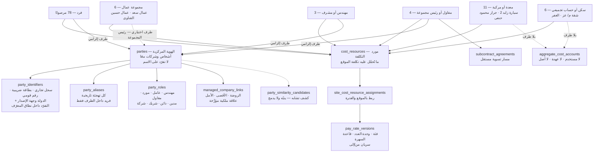
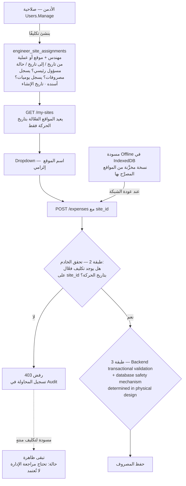
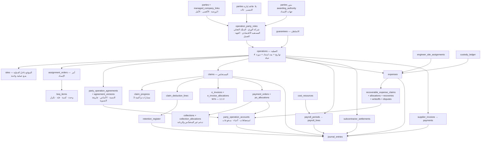
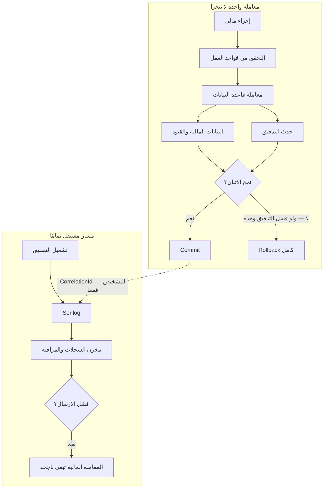
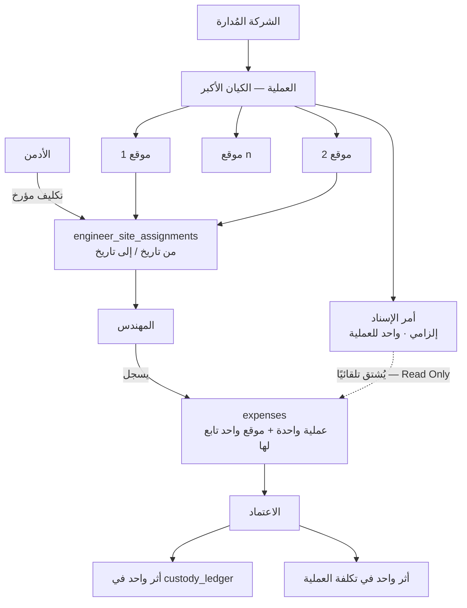
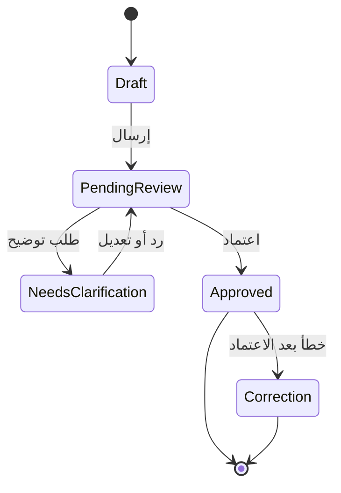
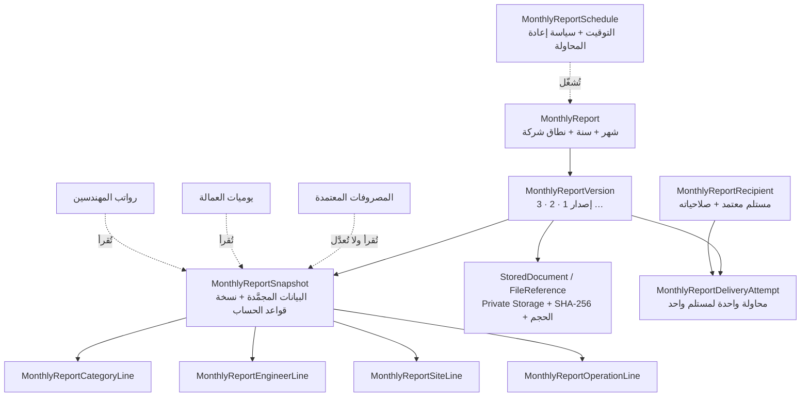
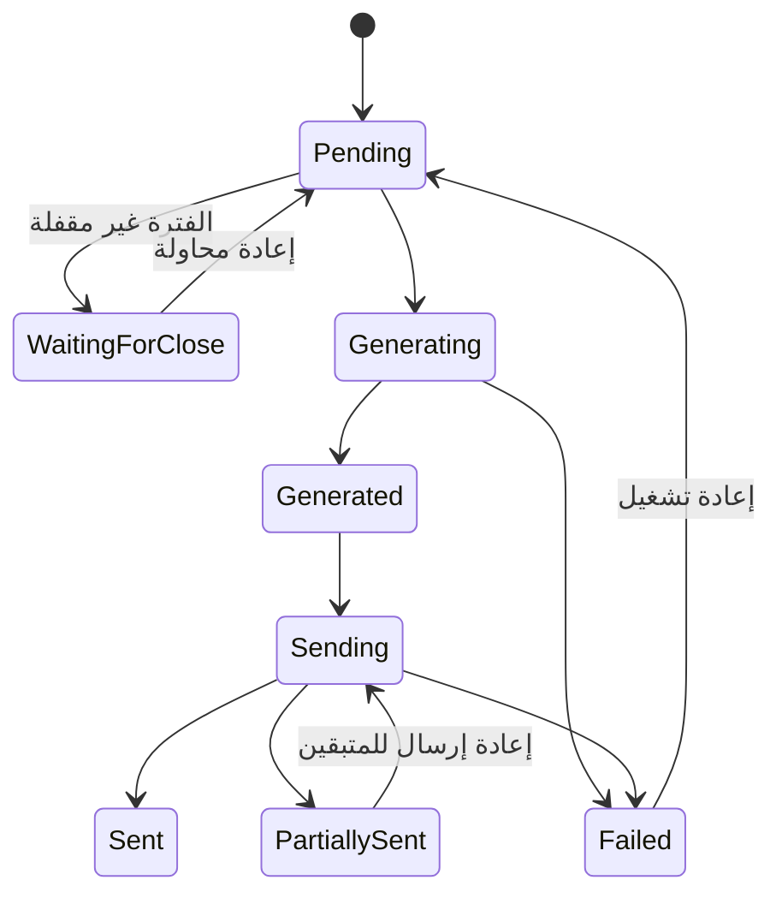
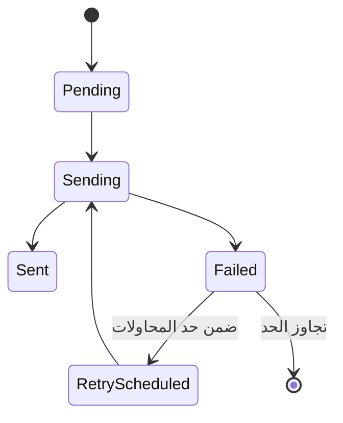

# النموذج المفاهيمي والمنطقي

**الإصدار:** 1.1.4 · **تاريخ الإصدار الأول:** 2026-09-16 · **تاريخ التعديل:** 2026-09-17
**الحالة:** مفاهيمي ومنطقي — **لا أنواع فيزيائية ولا DDL ولا Migrations**
**يُقرأ مع:** `phase-zero-patch-v1.1.4-ar.md` (أعلى أولوية) · `monthly-financial-report-addendum-ar.md` · `phase-zero-patch-v1.1.3-ar.md` · `operations-sites-and-expense-entry-addendum-ar.md` · `audit-and-operational-logging-addendum-ar.md` · `phase-zero-patch-v1.1.2-ar.md` · `phase-zero-patch-v1.1.1-ar.md` · `phase-zero-errata-v1.1-ar.md` — وعند أي اختلاف، **الترتيب أعلاه هو الحاكم**.

الأسماء التقنية هنا **مقترحة قابلة للتغيير**؛ الملزم هو **المسؤوليات والعلاقات والقيود**.

> **قاعدة قيود التفرد في هذا الإصدار:** لا يُفرض قيد تفرد إلا إذا كان **يستحيل** أن يخالفه واقع صحيح. أي قيد قد **يدمج كيانين حقيقيين** أو **يمنع حركة صحيحة** يتحول إلى **كشف تشابه ينبّه ولا يمنع**. طُبِّقت هذه القاعدة على كل جدول أدناه في الإصدار 1.1.

---

## 1. الوحدات داخل Modular Monolith

| الوحدة | تملك | لا تملك | تنشر |
|---|---|---|---|
| `IdentityAndPermissions` | المستخدمون · الأدوار · الصلاحيات الدقيقة | الأطراف التجارية | أحداث تسجيل الدخول والصلاحيات |
| `CoreParties` | الأطراف · الأدوار · الأسماء البديلة · الحسابات الفرعية | الأرصدة المحاسبية | إنشاء/دمج طرف |
| `Operations` | العمليات · المواقع · أوامر الإسناد · المقايسات · التواريخ ومدد الامتداد · دورة حياة العملية | المستخلصات | تغيّر حالة العملية |
| `Contracts` | عقود الشركات الخارجية · اتفاقات العمليات وإصداراتها · جداول الغرامات · الإنذارات | الحركات المالية | اعتماد اتفاق · إصدار جديد |
| `EngineerAssignments` | تكليفات المهندسين بالمواقع | المصروفات | بدء/إنهاء تكليف |
| `Custody` | دفتر حركات العهدة · تسليم العهدة · تسليم العهدة بين المناديب | المصروفات نفسها | تغيّر رصيد العهدة |
| `Expenses` | المصروفات ومسوداتها · دورة المراجعة · المرفقات | القيود المحاسبية | اعتماد مصروف |
| `WorkersAndPayroll` | موارد التكلفة · سياسات الأجر · الحضور · كشوف الأجور · السلف · المدفوعات | تسويات المقاولين | اعتماد كشف · دفعة عامل |
| `Subcontractors` | اتفاقات المقاولين · كشوف التسوية · خصوماتها · تعلياتها | كشوف الأجور | اعتماد تسوية |
| `ClaimsAndCollections` | المستخلصات ومساراتها · سطور الاستقطاع · الفواتير الإلكترونية · أوامر الدفع · التحصيلات | العهدة | إصدار مستخلص · تحصيل |
| `Retentions` | دفتر المحتجزات وحركاته | الاستقطاعات نفسها | استحقاق رد · رد |
| `Guarantees` | الضمانات المقدَّمة والمستلَمة · رسومها · تنبيهاتها | الشيكات التجارية | اقتراب انتهاء · رد |
| `SuppliersAndProcurement` | الموردون · التوريدات · الفواتير · الدفعات وتخصيصها · الشيكات | الأجور | فاتورة · دفعة |
| `TreasuryAndBanks` | الحسابات المالية · حركات النقد · المطابقة البنكية | التصنيفات | حركة نقدية |
| `Accounting` | دليل الحسابات · الفترات · القيود · قواعد الترحيل · مراكز التكلفة | المعاملات المصدرية | ترحيل قيد |
| `Reporting` | التقارير والـViews ومقاييس موحَّدة | أي مبلغ | — |
| `HistoricalImports` | دفعات الاستيراد · الخرائط · المطابقة | الإنتاج | نتيجة استيراد |
| `FinancialAuditTrail` **(1.1.2)** | **سجل التدقيق المالي/التجاري** — أحداث «من فعل ماذا ولماذا» · التدقيق العام لتغيّر البيانات · أحداث الأعمال الصريحة | **الأرصدة والمجاميع** · **السجلات التشغيلية** | لا تنشر — **تُكتب داخل معاملة العملية نفسها** |
| `OperationalLogging` **(1.1.2)** | **Serilog** — طلبات HTTP · الأخطاء · الأداء · المهام الخلفية · التكاملات | **أي إثبات مالي** · أي أرصدة | تُرسَل إلى مخزن سجلات مركزي **خارج معاملة العملية** |
| `Alerts` | التنبيهات وقواعدها | — | — |

---

## 2. الأطراف وموارد التكلفة

**شرح:** `مورد التكلفة` ليس مرادفًا لـ`الطرف`. من 108 مورد مرصود في ملف الأجور، **30 ليسوا أشخاصًا**: مجموعات عمال · سيارات وجرارات · شقق سكن · حساب `الغفر`. هؤلاء **حسابات تجميعية بلا طرف قانوني** — لا يُنشأ لهم مستخدم ولا حساب عهدة ولا أصل معدات (ح-31). ومجموعة العمال قد تُربط اختياريًا برئيسها كطرف يُدفع له، بينما التكلفة تُحمَّل على المجموعة. والمقاول له **مساران في آن**: مورد تكلفة في الموقع **و** اتفاق تسوية مستقل — ويمنع القيد (ح-52) أن يُحتسب مرتين.

---

## 3. تكليف المهندس بالمواقع والتحقق ثلاثي الطبقات

**شرح:** ثلاث طبقات لأن إخفاء الزر ليس أمانًا — طلب API معدَّل بـ`site_id` غير مصرَّح به يجب أن يُرفض ويُسجَّل. والتاريخ المستخدم في التحقق هو **تاريخ الحركة** لا تاريخ الإرسال، وإلا رُفضت حركة قديمة مشروعة لمهندس انتهى تكليفه بعدها. والتكليف **لا يُحذف** — يُغلق بتاريخ نهاية لتبقى الحركات القديمة قابلة للتفسير (ح-20).

---

## 4. الخريطة المفاهيمية الكبرى

**شرح:** العملية هي **الكيان الأكبر ومركز التكلفة الأساسي**، و**المواقع توجد داخلها**. **تصحيح 1.1.3:** كان مكتوبًا أن الموقع كيان «مستقل» عن العملية — والصحيح أن **الموقع يتبع عملية واحدة**. وتكرار **اسم** الموقع في الدليل عبر أوامر إسناد مختلفة **لا يعني أن الموقع كيان أعلى**، بل يعني أن **الاسم ليس مفتاحًا** وأن لكل عملية مواقعها بمعرّفاتها الخاصة. و`اتفاق الطرف على العملية` منفصل عن العملية نفسها لأن له **إصدارات مؤرخة**. وكل المسارات المالية تصبّ في `journal_entries` عبر **بوابة واحدة لكل نوع** (ح-105).

---

## 5. الكيانات — الغرض والمفاتيح والقيود

### 5.1 الأطراف والموارد

| الكيان | لماذا يوجد | مصدره في Excel | قيود جوهرية |
|---|---|---|---|
| `parties` | هوية مركزية واحدة — **كل شخص وكل شركة، مملوكة كانت أو خارجية** | أسماء في 6 أعمدة مختلفة | **لا UNIQUE على `normalized_name`** (أُلغي في 1.1: التشابه في الأسماء واقع مصري شائع — «محمد سليم» قد يكون شخصين). التفرّد يُبنى على **المعرّفات الرسمية عند توفرها** · لا حذف |
| `party_identifiers` | **جديد في 1.1** — أقوى إشارة هوية متاحة | بطاقة التيسير الضريبية `855-951-320` والسجل التجاري `3660` (`عقد.pdf` ص2) | **مصحَّح في 1.1.1: لا `Unique(identifier_type, identifier_value)` عالميًا.** المعرّف لا معنى له خارج نطاق إصداره: رقم سجل تجاري 3660 في مكتب سجل مختلف طرف مختلف. الحقول: `identifier_type` · `identifier_value` · **`jurisdiction_country`** · **`issuing_authority`** أو **`registration_office`** (عند الحاجة) · `valid_from`/`valid_to`. **التفرّد داخل نطاق المعرّف الصحيح** — أي `(type, value, jurisdiction_country, issuing_authority)` — ونطاق التفرّد الدقيق لكل نوع **يُحسم في النموذج المنطقي التالي**. **اختياري الوجود** ولا يمنع إنشاء الطرف |
| `party_similarity_candidates` | **جديد في 1.1** — بديل قيد التفرد | — | كشف تشابه (اسم مطبَّع · معرّف جزئي · حساب بنكي) يُنتج **مرشّحًا للمراجعة البشرية**، **لا يدمج ولا يمنع** |
| `party_aliases` | كل تهجئة تاريخية | `جمال عبدالشافى  توريد` بمسافتين | **لا UNIQUE عالمي على `alias`** (أُلغي في 1.1: الاسم البديل الواحد قد يخص طرفين مختلفين). التفرد فقط `(party_id, alias)` · وتكرار الاسم عبر أطراف يُرفع كـ`party_similarity_candidate` |
| `party_roles` | طرف بأدوار متعددة | `التيسير` مورد + صاحبة ورق | Unique(طرف، دور، فترة سريان) — **الدور مؤرَّخ** |
| `managed_company_links` | **جديد في 1.1** — يمثّل «الروضة والأقصى والأمل شركاتنا» | قرارك + `العملاء!AM` | **علاقة ملكية/إدارة مؤرَّخة** على `parties` (من · إلى · نوع العلاقة · مستند) — **وليست جدول هوية منفصلًا**. التيسير وتاله تبقيان `parties` بلا هذه العلاقة |
| `cost_resources` | ما تُحمَّل عليه التكلفة | `الإســــــــــــم` — 108 قيمة | **لا UNIQUE على (اسم، موقع)** — الاسم نفسه قد يتكرر لمَورِدين حقيقيين. معرّف داخلي + كشف تشابه · FK طرف **اختياري** |
| `aggregate_cost_accounts` | لودرات · شقق · غفر | `لودر عيد ملوى` · `شقة م/ عز` | **يُمنع** إنشاء مستخدم/عهدة تلقائيًا |
| `engineer_site_assignments` | تقييد ما يراه المهندس | لا مصدر — قاعدة جديدة | فترات **غير متداخلة** لنفس (مهندس، موقع) · لا Delete · **الأدمن وحده ينشئها** (ح-113) |
| `operation_party_roles` | **جديد في 1.1** — دور الطرف على عملية بعينها | العقد + `العملاء!AM/AN` | الأدوار: `official_paper_company` · `actual_executor` · `economic_beneficiary` · `awarding_authority` · `customer`. **طرف واحد يجوز له أكثر من دور على العملية نفسها**، وكل دور له فترة سريان ومستند. لا UNIQUE على (عملية، طرف) — فقط على (عملية، طرف، دور، فترة) |

### 5.2 العمليات والعقود

| الكيان | مصدره | قيود |
|---|---|---|
| `sites` | `دليل!F` (96 اسمًا مميزًا من 116) | معرّف داخلي — **الاسم ليس مفتاحًا** · **مصحَّح في 1.1.3: الموقع يتبع عملية واحدة (`operation_id` إلزامي)، والعملية تحتوي على موقع أو أكثر. الموقع ليس كيانًا أعلى من العملية** |
| `operations` | `دليل!A:K` (116 صفًا) | معرّف داخلي · `أمر الإسناد` **نصي** حقل بحث لا PK · **مصحَّح في 1.1.3: لكل عملية أمر إسناد إلزامي، ولا توجد عملية فعّالة بلا أمر إسناد** (ح-196) |
| `assignment_orders` | أمر الإسناد الورقي | Unique(الجهة، رقم العطاء، السنة) — **يحتاج اختبارًا** |
| `boq_items` | المقايسة | `تكرار` ∈ {مرة واحدة، شهري، دوري} · **قيد التراكمي ≤ الكمية للمرة الواحدة فقط** (ح-76) |
| `operation_dates` | المستخلصات + أمر الإسناد | 4 تواريخ · `النهو المقرر = استلام الموقع + المدة` |
| `operation_extensions` | ترويسة المستخلص (`امتداد`) | جدول مستقل: من · إلى · السبب · قرار الاعتماد |
| `party_operation_agreements` + `_versions` | عقد التيسير | تعديل = **إصدار جديد** لا تحديث · فترات غير متداخلة |
| `penalty_rate_schedule` | العقد البند 5 | (عقد، مورد، وحدة) + سريان |
| `contract_warnings` | العقد البند 8 | عدّاد · تنبيه عند الثاني · سحب عند الثالث |

### 5.3 المستخلصات

| الكيان | قيود جوهرية |
|---|---|
| `claims` | **تصحيح 1.1:** التفرّد يُبنى على **سلسلة المستخلص داخل العقد/أمر الإسناد** لا على العملية: `Unique(contract_id أو assignment_order_id، claim_series_id، رقم المستخلص)`. **العملية قد يكون لها أكثر من عقد** (عقدنا مع الجهاز + عقدنا مع المقاول + عقد التيسير معنا)، ولكل عقد سلسلته. `هل هو ختامي؟` **علم** — و**لا يُفترض مستخلص ختامي واحد لكل عملية**، بل واحد **لكل سلسلة** كحد أقصى، ويُنفَّذ كتحقق تطبيقي لا كقيد فريد أعمى |
| `claim_progress` | صف لكل مسار (أعمال/فروق/تشوينات) · `حركة المدة = التراكمي − السابق` · `السابق` = تراكمي المستخلص السابق فعليًا · **مصحَّح في 1.1.1:** تُحذف عبارة «التراكمي لا ينقص» — فهي تمنع تصحيحًا مشروعًا. البديل: **«المستخلص المعتمد لا يُعدَّل مباشرة؛ أي تخفيض أو تصحيح يتم بمستند `adjustment`/`reversal` مستقل مرتبط بالأصل، مع الحفاظ على التاريخ الكامل.»** فالتراكمي **قد ينقص** نتيجة مستند تصحيح، ولا ينقص بتعديل صامت |
| `claim_line_progress` | كمية البند: سابقة · خلال المدة · تراكمية · نسبة الصرف |
| `deduction_types` | **الهوية والتصنيف فقط** (تقسيم 1.1): الاسم الرسمي · اسم عمود Excel الحرفي · الجهة المستفيدة · **`default_accounting_treatment`** (تصحيح 1.1.1 — **افتراضي لا حاكم**) — **بلا نسب ولا أسس ولا ترتيب** |
| `deduction_rule_versions` | **جديد في 1.1** — القاعدة المؤرَّخة: `basis` · `rate` أو `amount` · `order_index` · `rounding_rule` · **نطاق التطبيق** (جهة إسناد · عقد · عملية · نوع وعاء: أعمال/فروق/تشوينات) · `effective_from` / `effective_to` · `version_no` · **`accounting_treatment`** (جديد في 1.1.1 — يَجُبّ الافتراضي عند تحديده). **فترات غير متداخلة داخل النطاق الواحد** |
| `claim_deduction_lines` | **مفتوح العدد** · **Snapshot للقاعدة المطبَّقة فعلًا**: `deduction_rule_version_id` + نسخة مجمَّدة من (الأساس · النسبة · المبلغ المطبَّق عليه · قاعدة التقريب) + **`accounting_treatment_snapshot`** (جديد في 1.1.1) · السبب النصي · الكمية والفئة · المهندس المسؤول. **تغيير القاعدة لاحقًا لا يمسّ سطرًا مرحَّلًا** |
| `e_invoices` + `e_invoice_allocations` | **تصحيح 1.1: لا علاقة 1:1 مع المستخلص.** الفاتورة الإلكترونية كيان مستقل (رقم ضريبي · قيمة · تاريخ · حالة)، ويربطها بالمستخلصات جدول **تخصيصات M:N** بمبلغ لكل تخصيص — لأن فاتورة واحدة قد تغطي عدة مستخلصات، ومستخلصًا واحدًا قد تغطيه عدة فواتير أو فاتورة + إشعار خصم |

### سلّم المعالجة المحاسبية الثلاثي — **تصحيح ملزم في 1.1.1**

في الإصدار 1.1 كانت `accounting_treatment` **مثبَّتة حصريًا على `deduction_types`**. هذا **خطأ**، والدليل من البيانات نفسها: عمود **`خصم عميل`** الواحد (5,999,217.28 على 83 مستخلصًا) يحمل **ست معالجات مختلفة** — غرامة نهائية (`FINAL_EXPENSE`) · خصم كمية (تعديل وعاء) · تعلية مشروطة (`REFUNDABLE_RETENTION`) · تسوية ذمة سابقة (`SETTLEMENT_OF_PRIOR_RECEIVABLE`) · خصم ثابت مسعَّر تعاقديًا (`FINAL_EXPENSE`) · غير مصنَّف. **نوع استقطاع واحد لا يمكن أن يحمل معالجة واحدة.**

البديل — ثلاث طبقات، الأخص يفوز:

| الطبقة | الحقل | الدور | متى يُقرأ |
|---|---|---|---|
| 1 | `deduction_types.default_accounting_treatment` | **افتراضي** يملأ الحقول عند إنشاء قاعدة جديدة | عند إنشاء `deduction_rule_version` |
| 2 | `deduction_rule_versions.accounting_treatment` | **المعالجة المقرَّرة للقاعدة في نطاقها وفترة سريانها** — تَجُبّ الافتراضي | عند احتساب المستخلص |
| 3 | **`claim_deduction_lines.accounting_treatment_snapshot`** | **الحاكم بعد الاعتماد** — نسخة مجمَّدة لا تتغير | في الترحيل والتقارير والمحتجزات |

**القاعدة الملزمة:** **بعد اعتماد المستخلص، `accounting_treatment_snapshot` وحده هو الحاكم.** تغيير الافتراضي على النوع أو تعديل القاعدة لاحقًا **لا يمسّ سطرًا معتمَدًا**، وإعادة تصنيف سطر معتمَد تتم **بمستند تصحيح مستقل** لا بتعديل صامت.

**وأثر هذا على `retention_register`:** دخول السطر دفتر المحتجزات يُقرَّر من **`accounting_treatment_snapshot`** لا من نوع الاستقطاع.

**أسماء `accounting_treatment` الصريحة** (تحلّ محل الرموز أ/ب/ج/د/هـ التي كانت غير معرَّفة في 1.0 — تصحيح ملزم):

| الاسم | ما يعنيه | مثال مرصود |
|---|---|---|
| `REFUNDABLE_RETENTION` | محتجز يُرد عند تحقق شرط | `5% ضمان اعمال` · `تعليات` |
| `PREPAID_TAX_ASSET` | ضريبة مدفوعة مقدمًا تُسوَّى بالإقرار | `ضريبه ارباح 1% و3%` |
| `FINAL_EXPENSE` | مصروف نهائي لا يُسترد | رسوم النقابات · الدمغات |
| `LIABILITY_TO_THIRD_PARTY` | مبلغ نوَرِّده لجهة ثالثة | `تامينات مقاولات` (مقترح) |
| `SETTLEMENT_OF_PRIOR_RECEIVABLE` | تسوية ذمة سابقة | خصم سلفة سبق صرفها |
| `UNCLASSIFIED_SUSPENSE` | **حساب معلّق** — لم يُصنَّف بعد | `خصم عميل` غير المصنَّف · `اتساع` · `شيك وموارد` |

**لا يُستخدم رمز غير معرَّف في أي مستند من هذا الإصدار.**

### 5.4 أوامر الدفع والتحصيل

| الكيان | قيود |
|---|---|
| `payment_orders` | **معرّف داخلي** · (الرقم، الجهة، السنة) **مفتاح أعمال يحتاج تحققًا** (ح-82) · `النوع` ∈ {صرف مستخلص، صرف جزئي، رد تعلية، رد ضمان، تسوية، تصحيح} · **القيمة صريحة** |
| `payment_order_allocations` | **سطور توزيع** — أمر واحد ↔ عدة مستندات (مستخلص/فاتورة/تعلية) |
| `payment_order_party_shares` | Snapshot سباعي **Immutable**: نسخة الاتفاق · الأساس · النسبة · المبلغ المطبَّق عليه · قيمة النسبة · الصافي لنا · طريقة التسوية |
| `payment_beneficiaries` | **الطرف المستحق ≠ المستفيد البنكي** · سبب الاختلاف · التفويض · المستند · **علم تنبيه تدقيق** |
| `collections` + `collection_allocations` | **تصحيح 1.1: يُلغى قيد «مجموع التحصيلات ≤ الصافي».** التحصيل كيان مستقل (مبلغ · تاريخ · حساب بنكي · مرجع)، ويُخصَّص على أوامر الدفع بسطور M:N. المدعوم صراحة: **متحصلات غير مخصَّصة** (`unapplied`) تدخل قبل أن يُعرف ما تخص، **الزيادة في التحصيل** (`overpayment`) تبقى رصيدًا دائنًا للطرف، و**تسويات التحصيل** (فرق عملة · عمولة بنك · خصم سداد معجَّل). القيد الوحيد: `مجموع التخصيصات لتحصيل ≤ مبلغ التحصيل`، والزيادة تُرحَّل إلى رصيد الطرف لا تُرفض |
| `payment_terms` | Back-to-back: تاريخ الاعتراف · تاريخ حلول الدفع · **شرط الحلول** · تاريخ تحققه · التحصيل المحقِّق |

### 5.5 المحتجزات والضمانات

| الكيان | قيود |
|---|---|
| `retention_register` | من `claim_deduction_lines` التي **`accounting_treatment_snapshot`** فيها `REFUNDABLE_RETENTION` (تصحيح 1.1.1: المعيار هو الـSnapshot لا نوع الاستقطاع) · **تصحيح 1.1:** تاريخ الرد المتوقع **لا يُشتق من `final_delivery_date`**، بل من **`release_condition_version`**: شرط الرد نصًّا + نوعه (`FINAL_DELIVERY_TO_AUTHORITY` · `PROVISIONAL_DELIVERY` · `WARRANTY_PERIOD_END` · `PAYMENT_OF_INSURANCE_AND_LABOUR` · `MANUAL_APPROVAL`) + الحدث المحقِّق له + تاريخه. الدليل: `عقد.pdf` البند 8 ينص «**ولا يسترد أى مبالغ الا بعد التسليم النهائى للجهاز**» — أي أن الشرط حدث تعاقدي، وتاريخ التسليم النهائي المسجَّل في الدليل مجرد **تقدير** له |
| `retention_movements` | حجز · مطالبة · رد جزئي · رد كامل · شطب بسبب واعتماد · **مجموع المردود ≤ الرصيد المحتجز** (ح-86) |
| `guarantees` | **الاتجاهان** · النوع · الرقم · البنك والحساب · المستفيد · القيمة والعملة · الإصدار والانتهاء · **التجديد التلقائي** · **الهامش/الغطاء** · الرسوم · العملية والعقد · شرط الرد · الحالة · تاريخ الرد/الإلغاء · المرفقات |
| `guarantee_events` | إصدار · تجديد · تعديل قيمة · مطالبة · رد · إلغاء · مصادرة |

### 5.6 العهدة والمصروفات

| الكيان | قيود |
|---|---|
| `custody_ledger` | حركات فقط — **لا حقل رصيد** · الرصيد View · كل حركة لها `movement_type` من الأنواع الأربعة أدناه |
| `custody_disbursement` | **تسليم عهدة من الإدارة إلى المهندس** — طرف واحد فقط. **لا يحتاج تأكيد المهندس** (تصحيح 1.1: كان المستند يقول إن كل تسليم يحتاج اعتماد الطرفين، وهو خطأ — الإدارة تصرف بقرارها). الاعتماد المطلوب: **معتمِد الصرف من جانب الإدارة** فقط |
| `custody_transfer` | **تحويل عهدة بين مهندسين** — طرفان. **يجوز اشتراط قبول الطرفين** بحسب إعداد الشركة (`requires_dual_acceptance`)، مع حالة `معلَّق` و`متنازع عليه` ومهلة تصعيد |
| `custody_return` | **مرتجع عهدة** من المهندس إلى الخزينة — يحتاج مستند إيداع أو إيصال |
| `custody_adjustment` / `custody_reversal` | **تصحيح موثَّق** — يشير إلى الحركة الأصلية، بسبب إلزامي ومعتمِد، ولا يُعدِّل الحركة الأصلية بل يعكسها أو يُعدِّلها بحركة جديدة |
| `expenses` | **مصحَّح في 1.1.3:** **`operation_id` إلزامي من لحظة الإدخال** · **`site_id` إلزامي ويجب أن يتبع `operation_id` المختارة** · **`assignment_order_id` يُشتق من العملية — لا يُدخله المهندس ولا يُترك فارغًا** · `engineer_id` صريح (لا يُشتق من الموقع) · `expense_type_id` من قائمة — **لا نص حر** · `amount > 0` · **`description` إلزامي فقط مع نوع «أخرى»** · **المرفقات اختيارية دائمًا — بلا استثناء ولا حد مبلغ** · `client_generated_id` · `entry_source` ∈ {Online · OfflineSync} · **ولا حقول: طريقة دفع · مصدر دفع · مدفوع إليه** (ح-196…ح-203) |
| `expense_reviews` | سلسلة تعليقات مستقلة · تخصيص العملية من المراجع مسموح **قبل** الاعتماد مع Audit Log |

### 5.7 الأجور وتسويات المقاولين

| الكيان | قيود |
|---|---|
| `pay_rate_versions` | **تصحيح 1.1: لا تُخزَّن صيغة حرة ولا تُنفَّذ.** الحقول: `calculation_method` ∈ {`DAILY_RATE_DIVIDED` · `DAILY_RATE_FIXED_MULTIPLE` · `EXPLICIT_AMOUNT`} + `parameters` (مثل `divisor = 7` أو `divisor = 2` أو `amount`) + فترات غير متداخلة. الأنماط المرصودة (549 حالة `÷7` · 129 حالة `÷2` · 26 قيمة يدوية) تُمثَّل كلها بهذه الثلاثة بلا مفسِّر صيغ. و`payroll_lines` تحمل **Snapshot** للطريقة والمعاملات وقت الاحتساب |
| `attendance_entries` | **تصحيح 1.1: يُلغى `Unique(مورد، موقع، تاريخ)`** — فهو يمنع حركة صحيحة: وردية ثانية في اليوم نفسه، أو سطرين بفئتي أجر مختلفتين، أو تصحيح سطر. **وتصحيح 1.1.1: البديل المقترح في 1.1 (`+ رقم الوردية، رقم السطر`) خاطئ أيضًا** — `line_number` رقم عرض لا هوية، واستخدامه لمنع التكرار يجعل إعادة إرسال السطر نفسه تمرّ بمجرد تغيّر ترتيبه. البديل الصحيح: **معرّف داخلي** + **`client_generated_id` / Idempotency Key** للحماية من الإرسال المكرر + **`duplicate_detection` ينبّه ولا يمنع** (مورد + موقع + تاريخ + كمية متقاربة). **القيود النهائية تُحدَّد في النموذج المنطقي التالي** · **بلا أثر مالي** |
| `payroll_periods` | **مصحَّح في 1.1.1: `Unique(موقع، سنة، شهر)` غير كافٍ.** المفتاح يجب أن يراعي **`managed_company_id`** و**`run_type`** (عادي · تكميلي · تصحيحي) و**`version`** و**`status`** — وإلا استحال تشغيل كشف تكميلي أو إعادة تشغيل بعد إلغاء. الشكل المرشَّح: `Unique(managed_company_id, site_id, year, month, run_type, version) WHERE status <> cancelled` — **والصيغة النهائية تُحسم في النموذج المنطقي التالي** |
| `payroll_lines` | **مصحَّح في 1.1.1: `Unique(فترة، مورد)` يمنع حركة صحيحة** — المورد الواحد قد يظهر بأكثر من سطر في الفترة نفسها (فئتا أجر · موقعان فرعيان · سطر تصحيح · بند مكافأة منفصل). **لا قيد تفرّد على (فترة، مورد).** البديل: **معرّف داخلي** + `client_generated_id`/Idempotency Key للحماية من الإرسال المكرر + **كشف تكرار ينبّه ولا يمنع**. و**يُمنع مورد نوعه `مقاول` له استحقاق في الفترة** يبقى تحققًا تطبيقيًا عابرًا للجداول |
| `worker_advances` / `long_term_advances` / `_installments` | السلفة مصدر **واحد** للخصم · الرصيد من الحركات |
| `worker_payments` | `تم القبض` **FK إلزامي** — لا رقم حر |
| `subcontract_agreements` / `subcontractor_settlements` / `_lines` / `_deductions` / `retention` | كشف دوري · خصومات مفصّلة بمصدر (الجهاز/الشركة) · تعليات مُسلسلة |

### 5.8 المحاسبة والاستيراد

| الكيان | قيود |
|---|---|
| `chart_of_accounts` · `fiscal_periods` · `journal_entries` · `journal_lines` | مدين = دائن **داخل القيد** · المرحَّل Immutable · **تصحيح 1.1: يُلغى `UNIQUE(source_type, source_id)`** — فهو يمنع الواقع الصحيح: المصدر الواحد يولّد عدة أحداث ترحيل (استحقاق ثم دفع ثم عكس ثم تسوية). البديل: **`UNIQUE(source_type, source_id, posting_event, posting_sequence)`** حيث `posting_event` ∈ {`ACCRUAL` · `PAYMENT` · `REVERSAL` · `ADJUSTMENT` · `RECLASS` · `FX`}، و`posting_sequence` يسمح بأكثر من تسوية للمصدر نفسه. الحماية من الترحيل المكرر تبقى عبر **Idempotency Key** على عملية الترحيل، لا عبر تفرّد المصدر |
| `cost_centers` | العملية مركز تكلفة أساسي |
| `overhead_allocation_rule` + `_versions` | **مصحَّح في 1.1.1: لا «تعريف واحد» عالميًا.** القاعدة **مؤرَّخة ومنسوخة** بنطاق: `managed_company_id` · `scope` (شركة · جهة إسناد · عملية) · `effective_from`/`effective_to` · `version_no`. القيد الحقيقي: **قاعدة فعّالة واحدة فقط داخل النطاق نفسه في اللحظة نفسها** (فترات غير متداخلة لكل نطاق) — وليس تعريفًا واحدًا للنظام كله. هذا ما يحسم تناقض `حساب التكاليف` مقابل `ح المدينون عمليات` دون تجميد السياسة إلى الأبد |
| `import_batches` | **تصحيح 1.1:** البصمة تُخزَّن **هنا فقط ومرة واحدة**: `source_file_name` · **`file_sha256`** (البصمة الأساسية) · `file_md5` (اختياري للتوافق التاريخي) · `file_size` · `imported_at` · `imported_by` · `mapping_version` |
| `import_rows` | `import_batch_id` · `source_sheet` · `source_row` · `source_record_hash` · `mapping_version` · `validation_status` · `raw_payload` |
| `record_lineage` | **جديد في 1.1** — كل سجل تشغيلي مُستورد يحمل **`source_import_row_id`** (أو صفًا في جدول Lineage عام عند تعدد المصادر). **يُمنع تكرار `file_md5` في الجداول التشغيلية** — البصمة تُستنتج بالانضمام عبر `import_rows → import_batches` |
| `audit_log` · `business_alerts` | التنبيه **بيانات لا كود**: الشرط · العتبة · المستلم · القناة |

### 5.9 دورة المصروف القابل للاسترداد — **جديدة كاملة في 1.1**

**سبب الإضافة:** في الإصدار 1.0 اختُزل السؤال أ-2 إلى «حقل `recoverable_from_party_id` على المصروف». هذا **خطأ تصميمي**: المبلغ القابل للاسترداد له **دورة حياة كاملة** (مطالبة · تخصيص · تحصيل · تسوية · نزاع · شطب) لا يحملها حقل واحد، وبدونها لا يمكن الإجابة عن «كم على المقاول فلان؟» ولا منع الازدواج المثبت (صفر قيد استرداد في ثلاثة دفاتر).

| الكيان | الغرض | الحقول الجوهرية |
|---|---|---|
| `recoverable_expense_claims` | **المطالبة** — أننا أنفقنا نيابة عن طرف ونطالبه | `debtor_party_id` **إلزامي** · `operation_id` · `original_amount` (ما أنفقناه فعلًا) · **`recoverable_amount`** (ما نطالب به — قد يقلّ عن الأصلي باتفاق) · `currency` · `claim_date` · `basis_document` · `status` · `created_by` · `approved_by` |
| `recoverable_expense_allocations` | **الربط بالمصدر** — M:N | `recoverable_expense_claim_id` · **`expense_id`** أو `supplier_invoice_id` أو `payroll_line_id` · `allocated_amount`. مصروف واحد قد يُقسَّم على أكثر من مدين، ومطالبة واحدة قد تجمع عدة مصروفات. **مجموع التخصيصات لمصروف ≤ قيمة المصروف** |
| `recoverable_expense_recoveries` | **التحصيلات والتسويات** | الطريقة: `DEDUCT_FROM_SETTLEMENT` (خصم من تسوية المقاول) · `DEDUCT_FROM_PAYMENT_ORDER` · `CASH_REPAYMENT` · `OFFSET_AGAINST_PAYABLE` · `IN_KIND`. الحقول: المبلغ · التاريخ · **المستند المحقِّق** (`subcontractor_settlement_id` أو `payment_order_id` أو `treasury_movement_id`) |
| `recoverable_expense_writeoffs` | **الشطب** | المبلغ · السبب · **المعتمِد** · المستند · التاريخ — لا شطب بلا اعتماد |
| `recoverable_expense_disputes` | **النزاع** | تاريخ الفتح · موقف الطرف · المبلغ المتنازع عليه · الحالة · التسوية النهائية. أثناء النزاع **يُجمَّد** الخصم التلقائي |
| `recoverable_expense_status` (محسوبة) | `OPEN` · `PARTIALLY_RECOVERED` · `FULLY_RECOVERED` · `DISPUTED` · `WRITTEN_OFF` — **محسوبة من الحركات، لا مخزَّنة** |

**قواعد ملزمة على الدورة:**

1. **المصروف يُقيَّد مرة واحدة فقط.** إنشاء مطالبة استرداد **لا ينشئ قيدًا ثانيًا للمبلغ** — بل يعيد تصنيفه أو ينشئ ذمة مدينة مقابلة، بحسب المعالجة المعتمَدة.
2. **مسار استرداد واحد لكل مبلغ.** يُمنع أن يُخصم المبلغ نفسه من تسوية المقاول ومن أمر الدفع معًا — الحماية بفهرس على `(recoverable_expense_claim_id, allocated_source)` مع تحقق مجموع.
3. **`مجموع التحصيلات + المشطوب ≤ recoverable_amount`** — والزيادة تُرفض بخطأ واضح لا تُبتلع.
4. **الرصيد لا يُخزَّن أبدًا** — يُحسب: `recoverable_amount − Σ recoveries − Σ writeoffs`.

> **المعالجة المحاسبية نفسها تبقى سؤالًا مفتوحًا (أ-2) يحتاج اعتماد المحاسب:** هل تُثبَت **ذمة مدينة على الطرف من لحظة الصرف** (فلا تمسّ تكلفة العملية أصلًا)، أم **مصروف عملية ثم قيد استرداد يخفّضها لاحقًا**؟ الدورة أعلاه **تدعم الاثنين** بلا تغيير جدول واحد؛ الفرق **قيد محاسبي واحد** عند لحظة الإنشاء. **لا تُبنى قيود الترحيل قبل اعتماد المحاسب.**

---

## 5.10 قرارات قاعدة البيانات — **مثبَّتة في 1.1**

| القرار | النص الملزم |
|---|---|
| **قاعدة بيانات واحدة** | **PostgreSQL واحدة** لكل النظام — لا قاعدة لكل شركة ولا لكل وحدة |
| **المعمارية** | **Modular Monolith** — الوحدات في القسم 1 منفصلة **منطقيًا**: لكل وحدة حدودها وواجهتها وأحداثها، ولا تقرأ وحدة جداول وحدة أخرى مباشرة |
| **الفصل الفيزيائي الاختياري** | يجوز استخدام **PostgreSQL schemas** (schema لكل وحدة) لفرض الحدود على مستوى الصلاحيات — **قرار تنفيذي يُتخذ في التصميم الفيزيائي**، ولا يغيّر النموذج المنطقي |
| **نطاق الشركة** | **`managed_company_id`** على المستندات والحسابات التي تحتاج نطاق شركة (المستخلصات · أوامر الدفع · القيود · الحسابات المالية · الضمانات · التسويات). **ليس على كل جدول** — الأطراف والمواقع وموارد التكلفة مشتركة |
| **الشركات الخارجية** | **التيسير وتاله وأمثالهما `parties` وليست Tenants ولا قواعد بيانات مستقلة.** لا Multi-tenancy في هذا النظام |
| **«شركاتنا»** | تُمثَّل بـ`managed_company_links` — **علاقة ملكية/إدارة مؤرَّخة على `parties`**، لا جدول هوية منفصل |

---

## 6. Payment Waterfall — الترتيب القابل للتهيئة

| # | المرحلة | الأساس | ملاحظة |
|---|---|---|---|
| 1 | **إجمالي المستخلص** | مجموع المسارات الثلاثة | — |
| 2 | الضرائب والاستقطاعات القانونية | **يختلف بالجهة** (ح-67) | ض.ق.م · أرباح · دمغات · نقابات · صناديق |
| 3 | خصومات جهة الإسناد | كمية × فئة | غرامات بأسباب موثقة |
| 4 | التعليات والضمانات | الإجمالي أو تقديري | تدخل `retention_register` |
| 5 | **نسبة الشركة الخارجية** | ✅ **محسوم في 1.1.1 — لكل اتفاق `rate` و`basis` الخاصان به** | **لا تعميم.** كل `party_operation_agreement_version` يحمل `rate` و`basis` **قبل بدء العملية**، ومستندَه المؤيِّد. عقد التيسير وحده يُسجَّل **10% من إجمالي المستخلص** استنادًا إلى البند 2 وعشرة مستخلصات موقَّعة. **اتفاق بلا `rate` أو `basis` أو مستند لا يصبح `Active` ولا ينشئ تسوية مالية** |
| 6 | السلف والتسويات | رصيد الطرف | مقاصّة |
| 7 | **صافي المستحق** | محسوب | قد يكون **سالبًا** |
| 8 | أمر الدفع | قيمة صريحة | **ليس بالضرورة = الصافي** (ح-79) |
| 9 | التحصيل الفعلي | — | قد يكون عدة دفعات |

**كل صف في المراحل 2–6 يحمل:** الأساس · الترتيب · النسبة أو المبلغ · **قاعدة التقريب** · تاريخ السريان · **نسخة القاعدة المستخدمة** (ح-85).

---

## 7. القيود التي تمنع أخطاء 2026 من التكرار

| الخطأ المرصود | القيد المانع |
|---|---|
| مستخلص 64 مسجَّل 3 مرات (+7.8 مليون) | **مصحَّح في 1.1:** `Unique(العقد/أمر الإسناد، السلسلة، رقم المستخلص)` · الرد والتحصيل **لا ينشئان مستخلصًا** |
| رد التعلية مسجَّل كإيراد | الرد حركة في `retention_movements` **لا تمسّ الإيراد** |
| 39 أمر إسناد بفجوات وتكرارات | `السابق` = تراكمي المستخلص السابق فعليًا |
| ازدواج تكلفة المصروف القابل للاسترداد | **الاستحقاقات وحدها** تدخل التكلفة (ح-51) |
| المقاول محسوب مرتين (80,173.8) | قيد عبر الجداول (ح-52) |
| 836 `#REF!` في أرصدة السلف | الرصيد **محسوب من الحركات** لا مخزَّن |
| `مصروفات` / `المصروفات` | اسم مطبَّع فريد في `expense_categories` |
| `اسيوط` في عمود `نسبة الضريبة` | قيد نوع على كل عمود |
| 305 صف مكرر في `العهد` | `client_generated_id` + **تحذير** تشابه (لا منع) |
| العمليات لا تُقفل | دورة حياة + تصنيف تلقائي لتكلفة الضمان |
| 27.5 مليون محتجزة منسية | `retention_register` + تنبيه قبل الاستحقاق بـ30 يومًا |
| شيك ضمان 400,563 غير مسجل | `guarantees` ثنائي الاتجاه |

---

## 8. كيف تُفرَض القيود العابرة للجداول — **جديد في 1.1**

عدة قواعد ملزمة في هذا النموذج **تقرأ جدولًا آخر** لتقرر الصحة. أبرزها:

- «الموقع المُدخَل يجب أن يكون ضمن تكليفات هذا المهندس **السارية في تاريخ الحركة**» (ح-113).
- «يُمنع أن يكون لمورد نوعه `مقاول` سطرُ أجر في كشف الفترة» (ح-52).
- «مجموع تحصيلات المحتجز ≤ رصيده».
- «لا يُخصم المبلغ القابل للاسترداد من مسارين».

**هذا النوع من التحقق لا يمكن تنفيذه كـ`CHECK` عادي في PostgreSQL**: قيد `CHECK` في PostgreSQL يُقيَّم على **صف الجدول نفسه فقط**، ولا يجوز أن يتضمن استعلامًا فرعيًا أو دالة تقرأ جداول أخرى. وحتى لو التُفّ عليه بدالة مُعلَنة `IMMUTABLE` تقرأ جدولًا آخر، فالنتيجة **غير موثوقة**: القيد لا يُعاد تقييمه عند تغيّر الجدول الآخر، ويكسره `pg_dump`/`restore`.

**المقترح للتصميم الفيزيائي لاحقًا — وليس الآن:**

| الطبقة | الدور |
|---|---|
| **خدمة تطبيقية داخل معاملة واحدة** | الطبقة الأساسية: تقرأ التكليفات والحالة، تتحقق، تكتب — كله في Transaction واحدة بمستوى عزل مناسب، مع قفل السطور المرجعية عند الحاجة |
| **Trigger (`CONSTRAINT TRIGGER … DEFERRABLE`)** | شبكة أمان في قاعدة البيانات لما لا يمرّ عبر الخدمة (استيراد · تصحيح يدوي · تكامل مستقبلي) |
| **`EXCLUDE` constraint مع `btree_gist`** | للقيود الزمنية الحقيقية مثل «فترات تكليف غير متداخلة لنفس (مهندس، موقع)» — هذا **يُفرَض فعلًا** في قاعدة البيانات |
| **مفتاح أجنبي مركّب** | حيثما أمكن تحويل القاعدة إلى FK: مثلًا `expenses(engineer_id, site_id, assignment_id)` تشير إلى `engineer_site_assignments` — فيتحول التحقق إلى FK حقيقي |
| **فهرس فريد جزئي** | `UNIQUE … WHERE status <> 'cancelled'` بدل قيد فريد أعمى يمنع إعادة الإدخال بعد الإلغاء |

**القاعدة الملزمة:** **لا يُعتمد على واجهة المستخدم وحدها.** الـDropdown المقيَّد بمواقع المهندس تجربة استخدام لا ضمان؛ و**الـBackend يعيد التحقق عند المزامنة باستخدام تاريخ الحركة لا تاريخ الإرسال** — لأن المهندس قد يُدخل دون اتصال ويُزامن بعد انتهاء تكليفه.

> **اختيار الآلية بالتحديد قرار المرحلة التالية (التصميم الفيزيائي).** ما يلزم الآن هو أن القاعدة **موثَّقة ومصنَّفة على أنها عابرة للجداول**، حتى لا تُنفَّذ سهوًا كـ`CHECK` لا يعمل.

---

## 9. التدقيق المالي والتسجيل التشغيلي — **جديد في 1.1.2**

**مصدر هذا القسم:** **قرار صاحب المشروع** — قرار معماري ورقابي، **لا اكتشاف من ملفات Excel أو العقود**.
**التفصيل الكامل في `audit-and-operational-logging-addendum-ar.md`. هنا الأثر على النموذج المفاهيمي فقط.**

### 9.1 ثلاثة أنظمة منفصلة لا يحل أحدها محل الآخر

| النظام | يملك | لا يملك |
|---|---|---|
| **الدفاتر والقيود** (`Accounting`) | **الأرصدة والمجاميع والتكلفة والربحية** | من فعل ولماذا |
| **سجل التدقيق المالي** (`FinancialAuditTrail`) | **من · ماذا · متى · لماذا** | **أي رصيد أو مجموع** |
| **التسجيل التشغيلي** (`OperationalLogging` / Serilog) | **التشخيص التقني للتطبيق** | **أي إثبات مالي** |

### 9.2 الكيانات المفاهيمية

| الكيان | الغرض | قيود جوهرية |
|---|---|---|
| `audit_events` | **الحدث** — الوحدة الأساسية للإثبات | **Append Only** — لا تعديل ولا حذف · يُكتب **داخل معاملة العملية** · **لا يُحسب منه رصيد** · يحمل `schema_version` لإصدار بنية الحدث |
| `audit_event_changes` | **فروق الحقول** — القيمة قبل والقيمة بعد لكل حقل تغيّر | تخضع لقواعد الحجب **قبل الكتابة** · **شكل التخزين (سطر لكل حقل أم لقطة أم الاثنان) يُحسم في النموذج المنطقي** |
| `audit_event_links` | ربط الحدث بالحدث الأصلي عند التصحيح أو العكس | يميّز **الحركة الأصلية** عن **حركة التصحيح** صراحةً |
| `audit_retention_policies` | سياسة الاحتفاظ والأرشفة لكل نوع حدث | **لا حذف بلا سياسة معتمدة** بمعتمِدها وتاريخها · الأرشفة **نقل لا إتلاف** |

**ولا يُضاف عمود تدقيق داخل جداول العمل** — سجل التدقيق **نظام مستقل**، لا حقول ملحقة.

### 9.3 محتوى الحدث — مفاهيميًا

الهوية · **وقت السيرفر بـUTC** · المستخدم · **الدور المستخدم وقت التنفيذ** · نوع العملية · نوع الكيان ومعرّفه · **رقم المستند التجاري** · الشركة والعملية والموقع عند الحاجة · الحالة السابقة والجديدة · **القيم قبل وبعد أو فروق الحقول** · **سبب التغيير** عند الحاجة · **المعتمِد** عند اختلافه عن المنشئ · **`CorrelationId`** و**`CausationId`** · **مصدر الحركة** (Web · PWA · Offline Sync · Import · System Job) · **`IdempotencyKey`/`ClientEventId`** للمزامنة والاستيراد · معلومات الجهاز عند الحاجة · **إصدار بنية الحدث**.

> ⛔ **لا تُحوَّل هذه القائمة إلى أعمدة ولا أنواع بيانات في هذه المرحلة.** (ح-189)

### 9.4 مستويان إلزاميان معًا

| المستوى | ما يلتقطه | الآلية |
|---|---|---|
| **تدقيق عام لتغيّر البيانات** | أي صف تغيّر وأي حقول | اعتراض طبقة الوصول للبيانات — **الآلية تُحسم في التصميم الفيزيائي** |
| **أحداث أعمال صريحة** | **المعنى التجاري**: اعتماد · تصحيح · إقفال · تفعيل اتفاق | تُسجَّل داخل منطق الأعمال |

**لا يُعتمد على الاعتراض العام وحده** — فهو يُظهر تغيّر الصفوف ولا يشرح دائمًا معناها التجاري (ح-185).

### 9.5 الذرّية — الفارق الحاسم عن التسجيل التشغيلي

**شرح:** حدث التدقيق **جزء من المعاملة المالية**، وفشله يُفشلها (ح-186). أما Serilog فخارجها تمامًا، وفشل إرساله **لا يمس** المعاملة (ح-194). والرابط الوحيد `CorrelationId` — **للتشخيص لا للدمج**.

### 9.6 الأثر على قواعد قائمة — بلا تغيير فيها

| القاعدة القائمة | كيف يدعمها سجل التدقيق |
|---|---|
| ح-136 المراجع يخصص العملية قبل الاعتماد **مع Audit Log** | صار له **بنية محددة** بدل إشارة عامة |
| ح-143 تصحيح العهدة بسبب ومعتمِد | الحدثان (الأصل والتصحيح) **مرتبطان صراحةً** |
| ح-178 المستخلص المعتمد لا يُعدَّل — التصحيح بمستند مستقل | **يُمنع الالتفاف** بكتابة سجل تدقيق يزعم التغيير (ح-187) |
| ح-170 اتفاق بلا نسبة أو أساس أو مستند لا يُفعَّل | **تفعيل الاتفاق حدث تدقيق صريح** (`ExternalCompanyAgreementActivated`) |
| ح-152…ح-155 بصمات الاستيراد وLineage | **الاستيراد وإعادة المعالجة حدثا تدقيق** بدفعتهما ومصدرهما ونتيجتهما (ح-188) |

**ولم تتغيّر أي قاعدة مالية قائمة بسبب هذا القسم.**

### 9.7 ما يُحسم لاحقًا

بنية الحدث وحقوله ومفاتيحه · شكل تخزين فروق الحقول · الفهرسة والبحث والتصدير · الآلية التقنية لمنع التعديل والحذف · آلية الاعتراض العام · التقسيم والأرشفة الزمنية — **كلها مخرَجات النموذج المنطقي ثم التصميم الفيزيائي**. أما **الفصل المعماري الثلاثي فقرار معتمد ولا يُعاد فتحه**.

---

## 10. العملية والمواقع وتسجيل المصروف — **مصحَّح ومثبَّت في 1.1.3**

**مصدر هذا القسم:** **قرارات تشغيلية معتمدة من صاحب المشروع.** التفصيل في `operations-sites-and-expense-entry-addendum-ar.md`.

### 10.1 اتجاه العلاقة — التصحيح الجوهري

> ❌ **خطأ سابق:** معاملة `الموقع` كأنه كيان مستقل تتفرع منه العمليات.
> ✅ **الصحيح:** **العملية هي الكيان الأكبر، والمواقع توجد داخلها.**

**شرح:** الشركة تملك العمليات · **لكل عملية أمر إسناد إلزامي** · العملية تحتوي على **موقع أو أكثر** · **الموقع يتبع عملية واحدة** · الأدمن ينشئ **تكليفًا مؤرَّخًا** يربط المهندس بالموقع · والمصروف يخص **عملية واحدة وموقعًا واحدًا تابعًا لها**، و**أمر إسناده مشتق من العملية**.

### 10.2 العلاقات المنطقية المثبَّتة

| # | العلاقة | القيد |
|---|---|---|
| 1 | `operations` ← `assignment_orders` | **إلزامية** — لا عملية فعّالة بلا أمر إسناد (ح-197) |
| 2 | `operations` ← `sites` | 1:N — العملية تحتوي موقعًا أو أكثر |
| 3 | `sites` → `operations` | **N:1 — الموقع يتبع عملية واحدة** (ح-198) |
| 4 | `engineer_site_assignments` | يربط المهندس بالموقع **بفترة مؤرَّخة** — لا حذف، إغلاق بتاريخ (ح-202) |
| 5 | `expenses` → `engineer` · `operation` · `site` | **واحد لكل منها** — والموقع **يجب أن يتبع العملية** (ح-211) |
| 6 | `expenses` → `assignment_order` | **مشتق من العملية** — لا يُدخله المهندس (ح-199) |
| 7 | `expenses` → `expense_type` | **نوع واحد أساسي من قائمة** — لا نص حر (ح-206) |
| 8 | `expenses` ← `attachments` | **0..N — اختيارية دائمًا** (ح-207) |
| 9 | `expenses` ← `expense_status_history` · `expense_reviews` | سجل حالات وتعليقات ومراجعات |
| 10 | `expenses (Approved)` → `custody_ledger` + تكلفة العملية | **أثر واحد لكل منهما** (ح-213) |

### 10.3 دورة الحالات

**ولا تُستخدم `Rejected` كرفض نهائي في الدورة الأساسية** (ح-209).

### 10.4 قرار ينتقل إلى المرحلة التالية

**قراءة المصروف تاريخيًا يجب أن تعطي أمر الإسناد الذي كان ساريًا وقت الاعتماد** (ح-214). فإذا تغيّر ارتباط العملية بأمر الإسناد لاحقًا — بالإجراء الإداري الموثَّق في ح-200 — **لا يجوز أن تتغيّر قراءة المصروفات القديمة بأثر رجعي**.

**والآلية — Snapshot على المصروف المعتمد، أم Versioning لارتباط العملية بأمر الإسناد، أم الاثنان — قرار يُحسم في النموذج المنطقي ثم التصميم الفيزيائي.** والمبدأ وحده هو الملزم الآن.

### 10.5 ما يُنفَّذ في الخادم لا في الواجهة

التحققات العشرة في ح-210 **عابرة للجداول**، ولا تُنفَّذ كـ`CHECK` عادي (ح-180 والقسم §8). **الآلية تُحسم في التصميم الفيزيائي.**

---

## 11. التقرير الشهري المالي والتشغيلي — **جديد في 1.1.4**

> **المرجع التفصيلي:** `monthly-financial-report-addendum-ar.md` · **القواعد:** ح-215…ح-246.
> ⛔ **أسماء مفاهيمية — لا جداول SQL ولا أنواع أعمدة.**

### 11.1 الكيانات المفاهيمية وعلاقاتها

### 11.2 العلاقات المنطقية المثبَّتة

| # | العلاقة | النوع | القاعدة |
|---|---|---|---|
| 1 | `MonthlyReport` ← `MonthlyReportVersion` | واحد إلى متعدد | كل إعادة توليد إصدار جديد لا يُكتب فوق سابقه (ح-229 · ح-230) |
| 2 | `MonthlyReportVersion` ← `MonthlyReportSnapshot` | واحد إلى واحد | لا إصدار بلا Snapshot (ح-228) |
| 3 | `MonthlyReportVersion` ← `StoredDocument` | واحد إلى واحد | الملف خارج القاعدة + بصمة + حجم (ح-232 · ح-233) |
| 4 | `MonthlyReportSnapshot` ← سطور التجميع الأربعة | واحد إلى متعدد | تصنيف · مهندس · موقع · عملية |
| 5 | `MonthlyReportVersion` ← `MonthlyReportDeliveryAttempt` | واحد إلى متعدد | محاولة لكل مستلم في كل إصدار (ح-238) |
| 6 | `MonthlyReportRecipient` ← `MonthlyReportDeliveryAttempt` | واحد إلى متعدد | و**`Email Snapshot` يُحفظ في المحاولة لا يُقرأ من المستلم لاحقًا** |
| 7 | `MonthlyReportSchedule` → `MonthlyReport` | إعداد يُشغّل | الجدولة بيانات لا كود (ح-216) |
| 8 | المصروفات المعتمدة → `MonthlyReportSnapshot` | قراءة فقط | التقرير لا يعدّل مصروفًا ولا ينشئه (ح-219) |
| 9 | يوميات العمالة ورواتب المهندسين → `MonthlyReportSnapshot` | قراءة فقط | استحقاق لا نقد (ح-222 · ح-223) |
| 10 | قاعدة توزيع راتب المهندس (مُصدَّرة) → `MonthlyReportSnapshot` | نسخة محفوظة | النسخة المستخدمة جزء من الـSnapshot (ح-227) |
| 11 | `MonthlyReportVersion` → سجل التدقيق | حدث لكل انتقال | ح-240 · ح-243 |
| 12 | `MonthlyReportDeliveryAttempt` → سجل التدقيق | حدث لكل إرسال وفشل | ح-243 — **وسجل الإرسال غير سجل التدقيق** (ح-244) |

### 11.3 دورتا الحالات

**حالة التقرير:**

**حالة محاولة الإرسال:**

### 11.4 ثلاثة أرقام لا تُخلط

| الرقم | مكوّناته | القاعدة |
|---|---|---|
| **إجمالي تكلفة الشهر** | المصروفات المعتمدة + يوميات العمالة المستحقة + رواتب المهندسين المستحقة أو الموزَّعة | ح-222 |
| **إجمالي النقد المنصرف** | الحركات النقدية الفعلية خلال الشهر | ح-222 |
| **الحركات تحت المراجعة** | غير معتمدة — **خارج الإجماليات الرسمية** | ح-219 |

> ⛔ **ولا يُجمع الأول مع الثاني** — ولا يُقرآن كأنهما نفس الشيء.

### 11.5 ما يُحسم لاحقًا

| النقطة | الحالة |
|---|---|
| **تمثيل راتب المهندس نفسه** كبند رواتب | 🔵 امتداد نطاق معتمد — يُستكمل في النموذج المنطقي |
| **قاعدة التوزيع المعتمدة** من الخيارات الأربعة | 🟡 قرار المدير والمحاسب — والافتراضي «بلا توزيع» |
| آلية Idempotency (فهرس · قيد · مفتاح) | 🔵 التصميم الفيزيائي — والمبدأ ملزم الآن (ح-241) |
| آلية المهام الخلفية (Hangfire أو بديلها) | 🔵 التصميم الفيزيائي |
| شكل التخزين الخاص ومدة الرابط المؤقت | 🔵 التصميم الفيزيائي |
