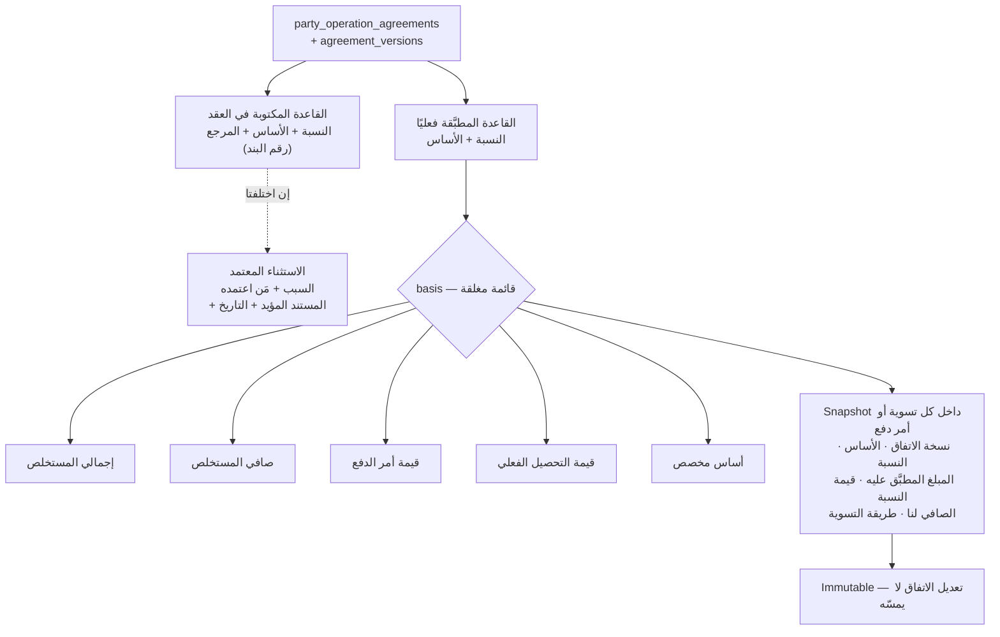
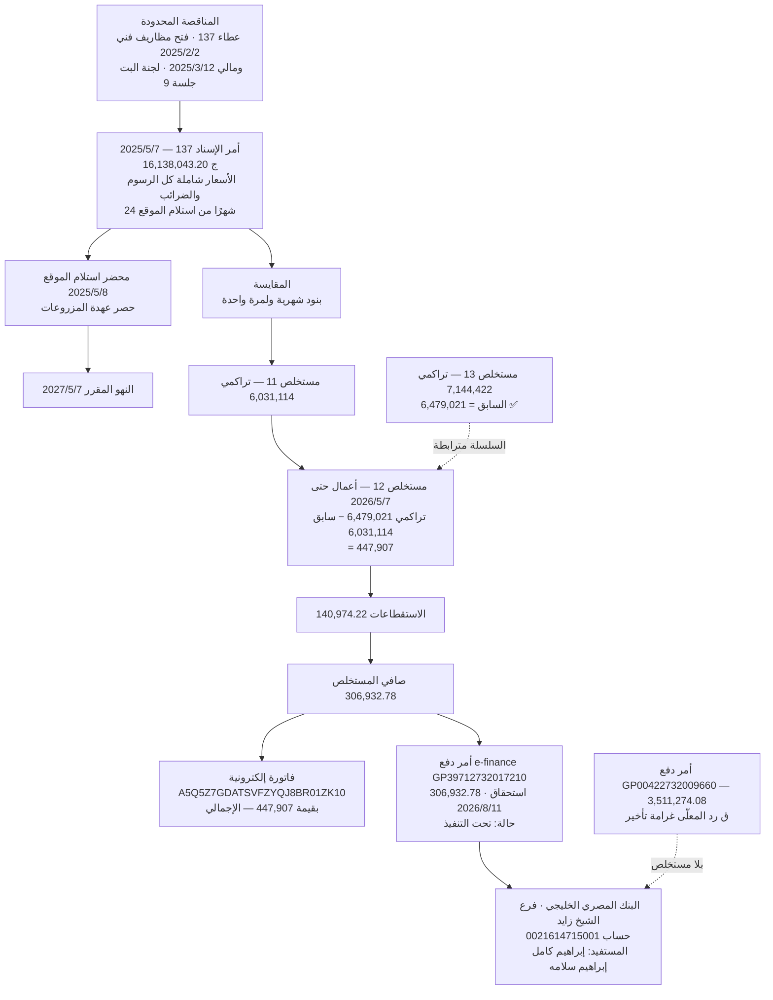
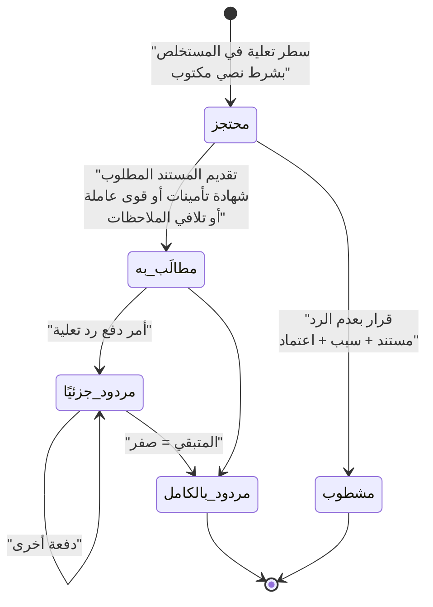
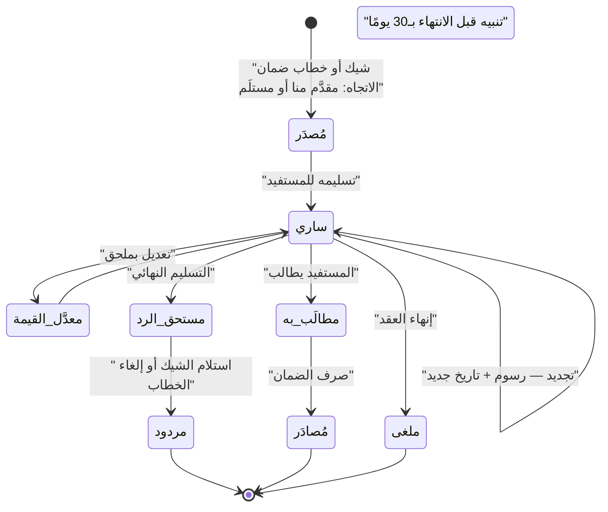
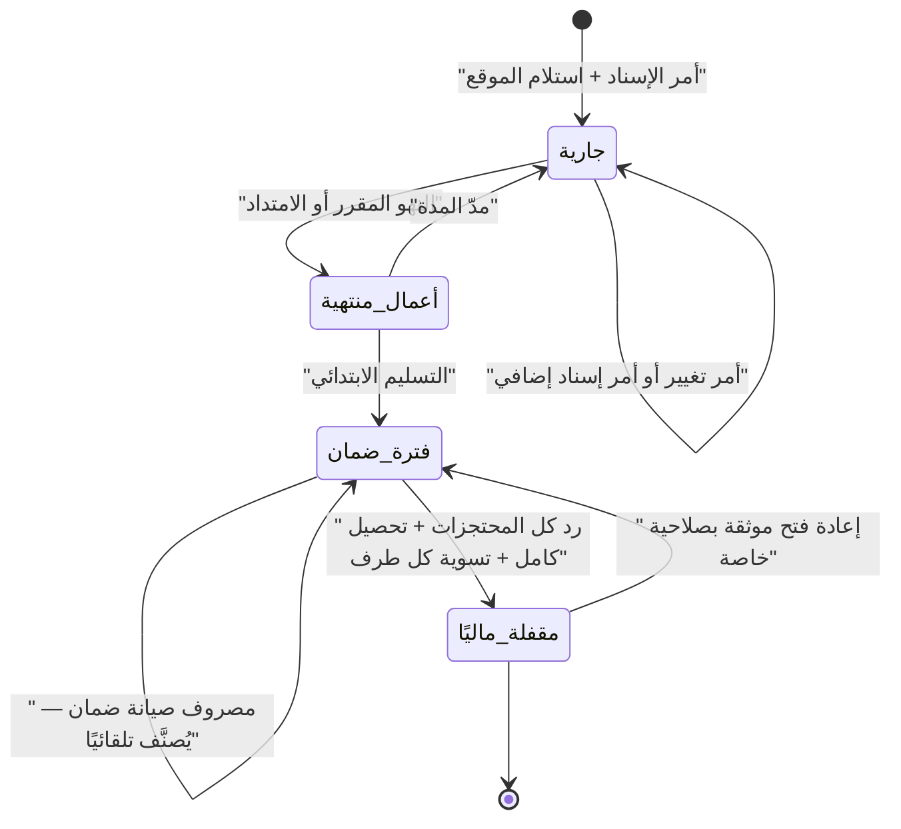

# ملحق العقود والمستخلصات وأوامر الدفع والضمانات

**الإصدار:** 1.1.1 · **تاريخ الإصدار الأول:** 2026-09-16 · **تاريخ التعديل:** 2026-09-16 · **جزء من** `phase-zero-final-report-ar.md`
**يُقرأ مع:** `phase-zero-patch-v1.1.1-ar.md` (أعلى أولوية) · `phase-zero-errata-v1.1-ar.md` · `reconciliation-exceptions-ar.md` · `consistency-matrix-ar.md` — وعند أي اختلاف، **الإصدار 1.1.1 هو الحاكم**.

---

## 1. الطبقة التعاقدية — غائبة تمامًا عن Excel

| المستند | ما يحمله | في Excel؟ |
|---|---|---|
| **أمر الإسناد** | رقم العطاء · جلسة فتح المظاريف الفني والمالي · جلسة لجنة البت · القيمة · مدة التنفيذ · مهلة استلام الموقع · القانون الحاكم (182/2018) | القيمة والتواريخ فقط |
| **العقد مع شركة خارجية** | الطرفان · النسبة وأساسها · شروط الدفع · جدول الغرامات · الضمانات · الإنذارات | ❌ |
| **المقايسة** | بنود بوحدات وكميات وفئات وتكرار | ❌ |
| **محضر استلام الموقع** | التاريخ (تبدأ منه المدة) · حصر عهدة المزروعات | ❌ |
| **الفاتورة الإلكترونية** | الرقم الضريبي · القيمة الإجمالية | ❌ |
| **أمر الدفع e-finance** | الرقم · الحالة · الاستحقاق · البنك · المستفيد | `رقم امر الدفع` في 20 صف من 204 |

---

## 2. نسبة الشركة الخارجية — النص والتعارض

### 2.1 عقد التيسير ↔ الأقصى

| البند | النص |
|---|---|
| الطرفان | **التيسير للمقاولات العمومية** (أحمد عزوز محمد) ↔ **الأقصى للمقاولات** (محمد كامل إبراهيم سلامه) |
| التاريخ | 2025/3/25 |
| التمهيد | أمر إسناد **95** بتاريخ 2025/2/27 أُسند للتيسير، وكلّفت الأقصى بالتنفيذ |
| **البند الثاني** | «بقيمة إجمالية قدرها **(8,011,262.4)** … مع خصم نسبة عشرة بالمائة **(10%) لصالح الطرف الأول من إجمالي قيمة كل مستخلص**، وتكون الأسعار ثابتة طوال مدة التعاقد» |
| البند الثالث | مدة «(24 شهر) **أربعة عشر شهرًا**» ← **تناقض داخل النص** |
| البند الخامس | جدول غرامات مسعَّر — §5 |
| **البند السادس** | «المحاسبة **بعد صرف مستحقات الشركة من جهة الإسناد**» · «**تعلية 5% ضمان أعمال من إجمالي أعمال كل مستخلص**… لا يحق للمقاول صرفها إلا عقب تسليم الأعمال» · «**استنزال كافة الخصومات المقررة على الشركة من قبل الجهاز من مستحقات المقاول**» |
| البند الثامن | **3 خطابات ملاحظات = حق إلغاء العقد وسحب الأعمال** |
| البند الحادي عشر | **لا يحق للمقاول الإسناد من الباطن للغير** |
| **البند الثاني عشر** | **شيك ضمان (400,563)** = 5% من قيمة العقد · لا يُرد إلا بعد التسليم النهائي |
| البند 13 ثم **15** | ← **البند 14 مفقود** |

> `8,011,262.4 × 5% = 400,563.12` ✅ · وقيمة العقد **تطابق `قيمة امر الاسناد` لأمر 95 في Excel بالضبط**.

### 2.2 🔴 التعارض المعروض صراحةً

| المصدر | أساس الـ10% |
|---|---|
| **نص العقد** | «من **إجمالي** قيمة كل مستخلص» |
| **وصفك التشغيلي** | الخصم من **أمر الدفع بعد الضرائب والاستقطاعات** |

| الأساس | مستخلصات التيسير 2026 | 10% |
|---|---:|---:|
| جمله الاعمال | 1,942,592 | **194,259** |
| صافي المستحق | 1,293,181 | **129,318** |
| **الفرق** | | **64,941 — زيادة 50%** |

**قيمة العقود الخارجية القائمة:** التيسير 8,011,262.4 + تاله 34,237,500 = **42,248,762.4**

**ولا أثر للنسبة في أي دفتر:** فحصت الدفاتر الأربعة — `التيسير` تظهر **كـ«مورد»** (`نوع المصروف = موردين`) في 8 حركات خزينة (189,768 · 203,341 · 202,348 · 200,975 · 130,666 · 72,715 · 204,454 · 400,000) بعضها موسوم `مستخلص (13)`..`(16)`، وفي `الوارد` مرة واحدة (67,350). **لا عمود ولا حركة تحمل «نسبة» ولا 10%، والمبالغ لا تساوي 10% من أي مستخلص.** ⟹ يؤكد قولك: «المكتب مش بيسجل ده في السيستم القديم».

### 2.3 القرار التصميمي — بلا حسم صامت

**شرح:** التصميم **لا يختار** بين العقد والتطبيق — يخزّن الاثنين ويوثّق الفارق. حقل `basis` يحمل الأسس الخمسة، فأي عقد قادم ينص على أساس مختلف يصبح **بيانات لا كودًا**. والـSnapshot السباعي يُجمَّد لحظة الإصدار: إصدار اتفاق جديد يسري على ما بعده فقط (ح-7). وعقد التيسير يُسجَّل اليوم بأساس «إجمالي المستخلص» مع علامة **`يحتاج تأكيد التطبيق الفعلي`**.

---

## 3. السلسلة الكاملة — من أمر الإسناد إلى البنك

**شرح:** كل رقم في السلسلة تحقّقت منه حسابيًا. الأهم أن **تراكمي مستخلص 12 هو نفسه «السابق» في مستخلص 13** — السلسلة سليمة ومترابطة. ولاحظ **الفاتورة الإلكترونية بالقيمة الإجمالية (447,907) لا الصافي** — كيان ثالث لا أثر له في Excel. والسهم المنقّط الأخير يبيّن أن **أمر الدفع قد ينشأ بلا مستخلص** — رد محتجز مثلًا.

**التحققات الرقمية:**

| البند | الحساب | النتيجة |
|---|---|---|
| صافي المستخلص | 447,907 − 140,974.22 | **306,932.78** ✅ |
| القيمة بدون الضريبة | 447,907 ÷ 1.14 | **392,900.88** ✅ |
| ض.ق.م المستقطعة | (392,900.88 × 14%) × 20% | **11,001.22** ✅ |
| ضمان تنفيذ الأعمال | 447,907 × 5% | **22,395** ✅ |
| تأمين رفع مخلفات | 447,907 × 0.25% | **1,120** ✅ |
| أرباح تجارية وصناعية | 392,900.88 × 3% | **11,787** ✅ |
| صندوق تحيا مصر | 392,900.88 × 1% | **3,929** ✅ |
| نقابة (كل منهما) | 392,900.88 × 0.75% | **2,947** ✅ |
| دمغة إضافية | 2,457 × 3 | **7,371** ✅ |
| المقايسة | 308,427.60 × 24 + 609,000 | **8,011,262.40** ✅ |
| شيك الضمان | 8,011,262.4 × 5% | **400,563.12** ✅ |

---

## 4. المستخلص — ثلاثة مسارات تراكمية

| المسار | البنود | مستخدم لديكم؟ |
|---|---|---|
| **الأعمال** | التراكمي − السابق = حركة المدة | ✅ |
| **الفروق** | التراكمي − السابق = **حركة الفروق (وعاء الضريبة)** | ✅ (10 صفوف · 22,954,029) |
| **التشوينات** | الحالية − السابقة = الحركة | ❌ **غير مستخدمة** (ح-62) — يبقى المسار معطَّلًا |

**بنود أخرى في النموذج الرسمي:** `خصم لعدم الوفاء بالالتزامات التعاقدية` · `دفعة مقدمة` · `دائن حوافز` · `تامين اشغال` · `صندوق الشهداء` · `صندوق ذوي الإعاقة` · **4–5 خانات `قيمة` فارغة للبنود الطارئة**.

> الخانات الفارغة تفسّر صيغ Excel اليدوية مثل `=100000+100000+150000` — كانت **سطور تعلية منفصلة بأسباب مختلفة** جُمعت في خلية واحدة فضاعت أسبابها.

### 4.1 قواعد الاستقطاع تختلف **بالجهة**

| البند | جهاز العاشر من رمضان | جهاز الشيخ زايد |
|---|---|---|
| **ض.ق.م** | **20% من الـ14%** = 11,001.22 | **الـ14% كاملة** = 35,412.63 |
| **تحيا مصر 1%** | من القيمة **بدون** الضريبة | من **الإجمالي شامل** الضريبة |
| نقابة تطبيقية | 2,947 | **صفر** |
| صندوق الشهداء / ذوي الإعاقة | — | **5 ج لكل** |

⟹ **الأساس والنسبة والانطباق خصائص للعقد/الجهة** (ح-67).

### 4.2 أخطاء تسمية في Excel

| عمود Excel | الاسم الرسمي الحقيقي | الخطورة |
|---|---|---|
| `ضريبه قيمة مضافه 14%` | **20% من الضريبة المستقطعة عند المنبع** | 🔴 عالية |
| `دمغة هندسية` / `دمغة تطبيقية` | **نقابة المهن الهندسية / التطبيقية** | 🟡 |
| `دمغة نسبية` | **دمغة عادية** | 🟢 |
| `تعليات` | **تعلية باقي مستحقات الشركة لحين سداد التأمينات والقوى العاملة** | 🔴 عالية |

**البرهان:** مستخلص 5 لأمر 137 — `اجمالى الضريبة المستحقة` 66,793.14 و`ضريبه قيمة مضافه 14%` 13,358.63 ⟹ النسبة **0.2000 بالضبط**. و`فرق الضريبة` (14,941,272 في 2026) ليس «فرقًا» بل **الـ80% الباقية الواجب توريدها**.

---

## 5. `خصم عميل` — حقل متعدد المعاني

> ⚠️ **تصحيح ملزم (ح-70):** المستندات تُثبت أن **بعض** الحالات غرامات مسعَّرة — **ولا تُثبت أن كلها كذلك**.

**الفئات الستّ المدعومة:** غرامة نهائية · خصم كمية أو أعمال · **تعلية مشروطة** · تسوية · خصم ثابت · **معنى غير مصنَّف**.

**جدول الغرامات المسعَّر (العقد، البند الخامس):**

| المورد | الوحدة | الفئة |
|---|---|---:|
| الجرار الزراعي | يوم | 600 |
| ماكينة القص | يوم | 400 |
| العامل الزراعي | يوم | 150 |
| سيارة مخلفات | **نقلة** | 400 |

**التطبيق الفعلي (مستخلص 4 — أمر 89):**

| البند | القيمة | التوقيع |
|---|---:|---|
| عدم تواجد مهندس موقع 5 أيام وسيارة مخلفات 5 أيام | 2,500 | مهندس الإدارة |
| عدم صيانة 6000 متر | 54,000 | مدير عام الإدارة |
| **تعلية لحين تلافي الملاحظات واستكمال الترقيمات** | 200,000 | — |

⟹ الثالث **ليس غرامة** بل تعلية قابلة للرد. **لذلك `المعالجة المحاسبية` تكون على السطر لا على النوع.**

**الحجم:** 5,999,217 على 83 مستخلصًا في 2026. أمر إسناد 89 به خصم في **كل** مستخلص (94,198 · 189,204 · 83,600 · 63,000 · 63,900 · 84,000) · وأمر 4 مستخلص 23: **211,220 على جمله 284,108 = 74%**.

**وصافي مستخلص 4 سالب:** 288,360 − 326,183.77 = **−37,823.77** (ح-69).

---

## 6. المقايسة والبنود المتكررة

> ⚠️ **تصحيح ملزم (ح-76):** القيد `التراكمي ≤ كمية المقايسة` **للبند الذي يُنفَّذ مرة واحدة فقط**.

| م | البند | الوحدة | الكمية | الفئة | الإجمالي | **التكرار** |
|---|---|---|---:|---:|---:|---|
| 1 | صيانة وتأمين المسطحات الخضراء | م² | 181,428 | 1.7 | 308,427.60 | **شهري × 24** |
| 2 | توريد ونثر نترات نشادر 33.5% | طن | 4.35 | 75,000 | 326,250.00 | مرة واحدة |
| 3 | توريد ونثر سوبر فوسفات | طن | 4.35 | 65,000 | 282,750.00 | مرة واحدة |
| | **الإجمالي** | | | | **8,011,262.40** | |

**نموذج البند المتكرر (ح-77):** طريقة التسعير · دورية الاحتساب · كمية الفترة · عدد الفترات · **الكمية التعاقدية القصوى** · بداية ونهاية السريان.

**طبقة سطور المستخلص** (من ورقة تفصيل مستخلص 4): `البند` · `الوحدة` · `كمية المقايسة` · `سعر الوحدة` · `قيمة الأعمال` · `كمية الأعمال السابقة` · `كمية الأعمال خلال المدة` · `إجمالي كمية الأعمال` · `نسبة الصرف` · `صافي المستخلص خلال المدة` · `إجمالي المستخلص حتى تاريخه`.

---

## 7. أمر الدفع — مستند مستقل بأنواع

> ⚠️ **تصحيح ملزم (ح-79):** `قيمة أمر الدفع = صافي المستخلص` **مثبتة للعينة المفحوصة فقط**، وليست قاعدة عامة.

| النوع | مثال مرصود |
|---|---|
| صرف مستخلص | GP39712732017210 — 306,932.78 |
| صرف جزئي | أمر 64: 1,000,000 ثم 2,793,563 |
| **رد تعلية** | GP00422732009660 — **3,511,274.08** «ق رد المعلّى غرامة تأخير» |
| رد ضمان | `رد ضمان اعمال` 4 صفوف بـ2,151,258 |
| تسوية | — |
| تصحيح | `اعادة الشى لاصلة` 5 صفوف بـ235,000 |

**الترقيم:** `GP397…` للعاشر من رمضان (رقم مؤسسي 40701014) · `GP004…` لبدر (40701003). ⟹ **لا يُفترض التفرد** قبل اختبار البيانات (ح-82): معرّف داخلي + (الرقم، الجهة، السنة) مفتاح أعمال **يحتاج تحققًا**.

**سطور التوزيع:** أمر واحد قد يرتبط بمستخلص أو فاتورة أو تعلية **أو أكثر من مستند** (ح-81).

### 7.1 🔴 سؤال تدقيق: المستفيد البنكي

| البند | القيمة |
|---|---|
| المستفيد في الأمرين | **إبراهيم كامل إبراهيم سلامه — الروضة** (شخص طبيعي) |
| الحساب في الأمرين | **0021614715001** — واحد لجهتين مختلفتين |
| رقم تعريف الجهة | **9015** (بدر) · **229656862** (العاشر) — مختلفان لنفس المستفيد |
| مالك الأقصى في العقد | **محمد كامل إبراهيم سلامه** — شخص آخر |

⟹ يُفصَل في التصميم بين: **الطرف المستحق · المستفيد البنكي · الحساب · الشركة المالكة · سبب الاختلاف · التفويض · المستند** — وأي اختلاف يُرفع **تنبيه تدقيق** لا يُمرَّر صامتًا (ح-87).

### 7.2 Back-to-back — خمسة تواريخ

| التاريخ | المعنى |
|---|---|
| تاريخ الاعتراف المحاسبي | إثبات الإيراد/التكلفة — **لا يتأخر بتأخر التحصيل** (ح-14) |
| تاريخ حلول الدفع | متى يصبح المبلغ واجب السداد |
| **شرط حلول الدفع** | «بعد صرف مستحقات الشركة من الجهاز» |
| تاريخ تحقق الشرط | — |
| التحصيل المحقِّق للشرط | FK إلى `collections` |

---

## 8. دورة التعلية

**شرح:** الحجز **لا يمسّ الإيراد** — الإيراد أُثبت بقيمة الأعمال كاملة، والتعلية **ذمة مدينة**. والرد **لا يمسّ الإيراد أيضًا** — يقفل الذمة ويدخل النقد. وهذا عكس ما يفعله Excel اليوم: يطرح عند الحجز ويضيف كـ`جمله الاعمال` عند الرد، فتتأرجح الأرقام شهريًا. والقيد الحاكم: **مجموع المردود ≤ الرصيد المحتجز** لكل سطر (ح-86)، والشطب لا يكون صامتًا أبدًا.

**الأسباب المرصودة:** سداد التأمينات والقوى العاملة (75,000/مستخلص) · تلافي الملاحظات واستكمال الترقيمات (200,000) · غرامة تأخير معلّاة (3,511,274.08).

**الأحجام 2026:** محتجز `تعليات` **109,482,419** · مردود **12,731,150** ⟹ صافي الزيادة **96,751,269**.

---

## 9. دورة الضمان

**شرح:** الضمان أداة مالية مستقلة عن `تعليات ضمان الأعمال` المتراكمة من المستخلصات (ح-91) — **ضمانان بنسبة 5% لكل، ولا يجوز الخلط**: شيك الضمان 5% من **قيمة العقد** يُقدَّم مرة واحدة، والتعلية 5% من **كل مستخلص** تتراكم. والسجل **ثنائي الاتجاه** لأن الشركة تُقدِّم ضمانات وتستلم ضمانات. وحقل **الهامش/الغطاء** ضروري لأن خطاب الضمان يحجز نقدًا أو حدًا ائتمانيًا في البنك بتكلفة مستمرة.

**الفجوة الحالية:** ورقة `شيكات` بها 153 شيكًا **كلها صادرة لموردين**؛ شيك الضمان 400,563 **غير مسجَّل**. وخطابات الضمان في `دليل!A` — 81 قيمة، **66 مميزة فقط**، ومنها `ليس لها` · `نقدى` · `نقدي` · `ابتدائى` · `شركة الأمل` ⟹ **العمود ليس أرقام خطابات بل خليط**، وبلا قيم ولا تواريخ انتهاء.

---

## 10. دورة حياة العملية

**شرح:** الحالة **تُصنِّف الإنفاق ولا تمنعه** (ح-108) — لأن المنع يدفع الموظفين لتحميل المصروف على عملية أخرى فتفسد البيانات أكثر. المصروف بعد `أعمال منتهية` يُصنَّف تلقائيًا `تكلفة ضمان` ويظهر في تقرير منفصل بدل أن يشوّه `تكلفه المتر`. والإقفال المالي مشروط بثلاثة شروط مجتمعة — وهذا ما يمنع نسيان 27.5 مليون محتجزة.

**الواقع:** 47 من 68 عملية انتهى تسليمها · **29 عملية بها 561 حركة بـ18,897,738 بعد التسليم** · أقدمها `اسناد 2` المسلَّمة يونيو 2024.

---

## 11. المحتجزات المستحقة الرد الآن

| الفئة | المبلغ (2026 فقط) |
|---|---:|
| **عمليات انتهى تسليمها ⟸ مستحقة الرد** | **4,792,152.37 بتاريخ استعلام 2026-09-16** (18 أمرًا) · ~~4,555,239 بتاريخ 2026-09-13~~ — الرقمان صحيحان بتاريخيهما (ح-150) |
| تنتهي خلال 12 شهرًا | 11,101,022 |
| أبعد | 679,764 |
| **عمليات بلا `تاريخ التسليم النهائى` مسجل** | **11,138,575** |
| الإجمالي | **27,474,600** |

**أكبرها:** `298` النرجس 15 مايو 1,416,657 · `164/ مارينا` 1,044,402 · `172` سوهاج 287,710 · `239` برج العرب 366,572 · `213` تطوير الدائرى زايد 58,269 (مسلَّمة **يونيو 2024**).

> 11.1 مليون معلَّقة لأن `تاريخ التسليم النهائى` فارغ. **تعبئته من العقود مهمة يدوية لمرة واحدة تساوي ملايين.**

---

## § تعديلات الإصدار 1.1 — ملزمة وتَجُبّ ما يخالفها أعلاه

### 1. حالة فحص العقد: **فحص كامل** (18 صفحة)

الإصدار 1.0 حمل تناقضًا: موضع يقول «ص9–18 لم تُقرأ» وآخر يصف العقد بأنه «فُحص كاملًا». **التناقض حقيقي وكان خطأً.** الحالة الآن **فحص كامل**:

| الصفحات | المحتوى |
|---|---|
| 1 | غلاف |
| 2 | أطراف العقد بمعرّفاتهم (التيسير: س.ت 3660 · بطاقة ضريبية 855-951-320 ‖ الأقصى: س.ت 309429) |
| 3 | تمهيد (أمر إسناد 95 بتاريخ 2025/2/27) + البنود 1–3 |
| 4 | البنود 4–6 |
| 5 | البنود 7–12 |
| 6 | البنود 13 · **15** · 16 + التوقيعات — **البند 14 مفقود** |
| 7 | محضر استلام موقع (2025/3/25) |
| 8 | المقايسة التقديرية (8,011,262.40) |
| **9–18** | **عشرة مستخلصات جارية أرقام 1…10** — من 2025/3/25 إلى 2025/12 |

**كل الصفحات صور ممسوحة بلا طبقة نصية؛** رُسمت بدقة 300 نقطة/بوصة وقُرئت بصريًا، وكل رقم أُعيد التحقق منه حسابيًا.

### 2. النسبة وأساسها — دليل مستندي جديد

**نص البند الثاني حرفيًا:** «مع خصم نسبة (١٠٪) فقط عشرة بالمائة لصالح الطرف الأول **من إجمالى قيمة كل مستخلص** وتكون الأسعار ثابتة طوال مدة التعاقد.»

**وكل مستخلص من العشرة يحمل كتلة:** `الاجمالى` → `(%١٠) نسبة الشركة` → `صافي المستخلص`.

| المستخلص | الاجمالى | نسبة الشركة | صافي المستخلص |
|---|---|---|---|
| 1 (ص9) | 43,179.86 | 4,317.99 | — |
| 2 (ص10) | 215,899.32 | 21,589.93 | — |
| **3 (ص11)** | **379,024.32** | **37,902.43** | **341,121.89** |
| 4 (ص12) | 185,056.56 | 18,505.66 | — |
| 5 (ص13) | 231,320.70 | 23,132.07 | — |

**المستخلص 3 مصالحة تامة:** 215,899.32 + 163,125.00 = 379,024.32 ✅ · ×10% = 37,902.43 ✅ · الطرح = 341,121.89 ✅. والنسخة المطبوعة (215,899.32 → 21,589.93 → 194,309.39) **مشطوبة بالقلم** ومصحَّحة يدويًا — **والنسبة صمدت في النسختين.**

**الأساس:** مجموع عمود «صافي المستخلص صرفه» = (قيمة إجمالي الأعمال حتى الآن − استقطاعات ومبالغ معلقة). **والنموذج لا يحتوي على أي سطر ضريبي إطلاقًا.**

**حد الدليل — أذكره صراحةً:** عمود «استقطاعات ومبالغ معلقة» كان **فارغًا في كل الصفوف المفحوصة**، فالمستخلصات **لا تفصل** بين «الإجمالي» و«الإجمالي بعد الاستقطاعات». ما تحسمه قطعًا: **النسبة 10%** و**غياب أي ضريبة من الوعاء**.

### 3. التعارض — معروض بطرفيه، غير مُسوَّى (أ-1 مضيَّق)

| الطرف | المصدر | الأساس |
|---|---|---|
| **أ** | العقد البند 2 + 10 مستخلصات موقَّعة ومختومة | **إجمالي قيمة المستخلص قبل أي ضريبة** |
| **ب** | وصفك التشغيلي | **قيمة أمر الدفع بعد الضرائب والاستقطاعات** |

**⟹ أ-1 لم يُغلق، بل ضاق:** الأساس محسوم **لعقد التيسير**. السؤال الباقي: **هل يُعمَّم على بقية الاتفاقات (42,248,762 تعرضًا)؟**

### 4. المقايسة — دليل مستندي على البند المتكرر

المقايسة التقديرية (ص8):

| م | البند | الوحدة | الكمية | الفئة | الإجمالي | التكرار |
|---|---|---|---|---|---|---|
| 1 | تأمين صيانة المسطحات الخضراء بما عليها من مزروعات | م² | 181,428 | 1.70 | **308,427.60** | **«الإجمالى الشهرى»** × 24 |
| 2 | توريد ونثر سماد كيماوي نترات نشادر 33.5% | بالطن | 4.35 | 75,000 | 326,250.00 | **مرة واحدة** |
| 3 | توريد ونثر سماد كيماوي سوبر فوسفات | بالطن | 4.35 | 65,000 | 282,750.00 | **مرة واحدة** |
| | **إجمالي المقايسة** | | | | **8,011,262.40** | |

**التحقق:** 308,427.60 × 24 + 326,250 + 282,750 = **8,011,262.40** ✅ — مطابق للبند الثاني بالضبط.

**⟹ هذا دليل مستندي على تصحيح قيد «التراكمي ≤ كمية المقايسة»:** القيد يسري على **بنود المرة الواحدة فقط**؛ والبند المتكرر يحتاج `طريقة التسعير` و`الدورية` و`كمية الفترة` و`عدد الفترات` و`الحد الأقصى التعاقدي` و`تواريخ السريان`.

### 5. القيود المصحَّحة في هذا المجال

| القيد في 1.0 | التصحيح في 1.1 |
|---|---|
| `claims Unique(عملية، رقم المستخلص، نوع الوعاء)` + «ختامي واحد لكل عملية» | `Unique(عقد/أمر إسناد، سلسلة، رقم المستخلص)` + «ختامي واحد **لكل سلسلة**». **العملية قد يكون لها أكثر من عقد** — عقدنا مع الجهاز، وعقد التيسير معنا، وعقدنا مع المقاول |
| `e_invoices` 1:1 مع المستخلص | كيان مستقل + **`e_invoice_allocations`** M:N بمبلغ لكل تخصيص |
| `collections`: مجموع التحصيلات ≤ الصافي | تحصيل مستقل + تخصيصات · دعم **`unapplied`** و**الزيادة** و**تسويات التحصيل** |
| تاريخ رد المحتجز = `final_delivery_date` | **`release_condition_version`** — والدليل نص البند الثامن: «**ولا يسترد اى مبالغ الا بعد التسليم النهائى للجهاز**» |
| رموز المعالجة أ/ب/ج/د/هـ | ستة أسماء صريحة (`REFUNDABLE_RETENTION` … `UNCLASSIFIED_SUSPENSE`) |

### سياسة `LEGACY` — **معتمَدة في 1.1.1**

لا يمكن فرض تفرد المستخلص على بيانات 2026 كما هي: عمود `رقم المستخلص` يحمل نصوصًا مثل `رد تعليه` و`20% رد تعليه` و`جزء 1 من م 1`، و**39 من 40 أمر إسناد** بها خلل ترقيم، و**25 صفًا** مدمجة. السياسة المعتمدة:

| # | القاعدة |
|---|---|
| 1 | **`claim_series = LEGACY`** لكل سجل تاريخي مُرحَّل |
| 2 | **`legacy_sequence`** — معرّف داخلي **ثابت** لا يتغير بعد الترحيل، ولا معنى تجاري له |
| 3 | **`original_claim_reference`** — يحفظ النص الأصلي **حرفيًا** كما هو في Excel، بمسافاته وأخطائه |
| 4 | **`source_import_row_id`** و**`source_record_hash`** **إلزاميان** على كل سجل `LEGACY` |
| 5 | **لا يُخترع رقم مستخلص تجاري** — لا ترقيم تقديري ولا إعادة بناء للتسلسل |
| 6 | سجلات `LEGACY` **تُستثنى من تحقق التسلسل الطبيعي** (فجوات · تكرارات · `السابق = تراكمي السابق`) — **ولا تُستثنى من المطابقة المالية**: مجاميعها تدخل كل تسويات الترحيل والمطابقات كاملةً |

**السجلات الجديدة** بعد التشغيل تخضع للتفرد الكامل `Unique(عقد/أمر إسناد، سلسلة، رقم المستخلص)` وسلسلة حقيقية لا `LEGACY`.

### 6. الضمانات — تصحيح نوع الأداة

العقد يستخدم **شيك ضمان** بقيمة **400,563** (البند الثاني عشر)، لا خطاب ضمان بنكي. التحقق: 8,011,262.40 × 5% = **400,563.12** ✅.
⟹ `guarantees.instrument_type` يجب أن يميّز `CHEQUE` عن `BANK_LETTER` — المعالجة والمتابعة والرسوم مختلفة تمامًا.

### 7. مستندات يعتبرها العقد جزءًا منه ولم تصل

| المستند | مصدر الإشارة | ما يحجبه |
|---|---|---|
| كراسة الشروط والمواصفات | البند الأول («جزء لا يتجزأ من هذا العقد») | التزامات فنية وجزاءات |
| جداول نسب الأداء الشهري | البند السادس | **أساس المحاسبة الشهرية** |
| كشف حصر المزروعات | محضر الاستلام + البند السابع | **أساس عهدة المقاول** |

**لا تُفترض محتوياتها.**

### 8. عيوب توثيقية في العقد

1. **البند الرابع عشر مفقود** — الترقيم يقفز من «الثالث عشر» إلى «الخامس عشر».
2. **لا يوجد بند اختصاص قضائي ولا تحكيم في العقد كله.**

⟹ يُسجَّلان في `contract_defects` ويحتاجان **مراجعة قانونية**. **لا يُفترض محتوى بند غائب.**
