# Contractra — فهرس التوثيق

# Documentation Index

---

## 0. إدارة الوثيقة

| البند | القيمة |
|---|---|
| **المعرّف** | `documentation-index-ar` |
| **الإصدار** | **2.0.1** |
| **الحالة** | 🟢 مكتمل — **Informative** |
| **التاريخ** | 2026-09-17 |
| **الغرض** | ⭐ **نقطة الدخول الوحيدة لكل توثيق المشروع** — تقول لكل قارئ **ماذا يقرأ وبأي ترتيب ولماذا** |

### 0.1 كيف يُقرأ هذا الفهرس

| العمود | المعنى |
|---|---|
| **Normative** | ⭐ **ملزم — يُبنى عليه ويُحتج به عند الخلاف** |
| **Informative** | ⭐ **مفيد — يشرح ويوجّه ولا يُحتج به** |
| **الأولوية** | موضعه في ترتيب الحسم عند التعارض (1 = الأعلى) |

---

## 1. ⭐ ترتيب أولوية المصادر — الحاكم عند أي تعارض

```
━━━ مستندات المرحلة صفر — المصادر ━━━
 1.  phase-zero-patch-v1.1.4-ar.md              ← ⭐ أعلى Patch
 2.  monthly-financial-report-addendum-ar.md
 3.  phase-zero-patch-v1.1.3-ar.md
 4.  operations-sites-and-expense-entry-addendum-ar.md
 5.  audit-and-operational-logging-addendum-ar.md
 6.  phase-zero-patch-v1.1.2-ar.md
 7.  phase-zero-patch-v1.1.1-ar.md
 8.  phase-zero-errata-v1.1-ar.md
 9.  confirmed-business-rules-ar.md              ← ⭐ سجل ح-1…ح-246
10.  المستند المتخصص في المجال
11.  conceptual-data-model-ar.md
12.  phase-zero-final-report-ar.md
13.  الأدلة المستخرجة من Excel والعقود
14.  الافتراضات والمقترحات القديمة

━━━ المخرجات الجديدة — مشتقة من المصادر ━━━
15.  system-specification-and-team-reference-ar.md   ← ⭐ المرجع الرسمي للفريق
16.  logical-data-model-ar.md
17.  data-dictionary-ar.md
18.  database-integrity-rules-ar.md
19.  architecture-decision-records-ar.md
20.  requirements-traceability-matrix-ar.md
21.  database-design-review-checklist-ar.md
22.  documentation-index-ar.md
23.  documentation-generation-guide-ar.md
24.  database-design-ar.md                            ← ⭐ شرح قاعدة البيانات وعلاقاتها
24a. logical-model-patch-v1.2.1-ar.md                 ← ⭐ باتش المحاسبة والخزينة (سجل تاريخي)
24c. logical-model-correction-patch-v2.0.1-ar.md      ← ⭐ باتش التصحيح الحاكم
24b. mvp-entity-scope-matrix-ar.md                    ← ⭐ تصنيف نطاق 148 كيانًا
25.  system-specification-and-team-reference-ar.html ← ⭐ مولَّد لا مصدر
26.  database-design-ar.html                         ← ⭐ مولَّد لا مصدر

━━━ تاريخ لا يُعاد كتابته ━━━
27.  ستة ملفات بأسماء عربية خارج docs/            ← ⛔ Superseded
```

**قواعد ملزمة:**

1. ⭐ **المخرجات الجديدة مشتقة من المصادر** — **وعند اختلافها معها يُعمَل بالمصدر**، ويُسجَّل الخلاف **خطأً في المخرَج يجب تصحيحه** — ⛔ **لا تغييرًا في القاعدة**.
2. ⛔ **لا يُستخدم تاريخ تعديل الملف وحده لتحديد الأولوية** — الحاكم **رقم الإصدار ونوع المستند ونص القرار**.
3. ⭐ **`system-specification-and-team-reference-ar.md` هو المرجع الرسمي للفريق** — لكنه **لا يعلو على المصادر**.

---

## 2. ⭐ المخرجات الجديدة — أربعة عشر مستندًا

### 2.1 `system-specification-and-team-reference-ar.md`

| البند | القيمة |
|---|---|
| **الغرض** | ⭐ **المرجع الرسمي الوحيد للفريق** — يؤدي عمليًا وظيفة SRS كاملة، ويزيد بأنه **مكتوب بلغة يفهمها المدير والمحاسب كما يفهمها المطور والمختبر** |
| **الإصدار** | 1.2.0 |
| **الحالة** | 🟢 معتمد للمراجعة الإدارية — **Living Document** |
| **المصدر** | ⭐ **مشتق من كل مستندات المرحلة صفر** |
| **الأولوية** | **15** |
| **الجمهور** | ⭐ **الكل** — المدير · المحاسب · موظف الإدارة · المهندس · المطور · المختبر · مسؤول قاعدة البيانات |
| **التصنيف** | ⭐ **Normative** |
| **الحجم** | **35 قسمًا** · 246 قاعدة · 226 متطلبًا وظيفيًا · 54 غير وظيفي · 32 حالة استخدام · 232 معيار قبول |
| **العلاقة بالباقي** | ⭐ **الأب** — كل المستندات الأخرى **تفصّل قسمًا منه أو تخدمه** |
| **يقرؤه أولًا** | ⭐ **كل عضو جديد في الفريق — §1.4 يقول له ماذا يقرأ بحسب دوره** |

### 2.2 `logical-data-model-ar.md`

| البند | القيمة |
|---|---|
| **الغرض** | ⭐ **النموذج المنطقي الكامل** — 18 مجالًا · 125 كيانًا · 142 علاقة · بلا SQL ولا أنواع فيزيائية |
| **الإصدار** | 1.2.0 · **الحالة** 🟢 مكتمل للمراجعة |
| **المصدر** | `conceptual-data-model-ar.md` — ⛔ **ولا يعيد اختراع المشروع** |
| **الأولوية** | **16** |
| **الجمهور** | ⭐ **المطور · مسؤول قاعدة البيانات · المحلل** |
| **التصنيف** | ⭐ **Normative** |
| **يفصّل** | §16 و§17 من الوثيقة الرئيسية |
| **يخدمه** | `data-dictionary-ar.md` (تفاصيل الأعمدة) · `database-integrity-rules-ar.md` (القيود) |
| **⭐ ما يحسمه** | **BR-174 · BR-175 · BR-176 · BR-177 · BR-181 · BR-214** — **القيود المؤجَّلة من المرحلة صفر** |

### 2.3 `data-dictionary-ar.md`

| البند | القيمة |
|---|---|
| **الغرض** | ⭐ **قاموس الأعمدة وخريطة Excel** — **ثلاثة أسماء متعايشة لكل حقل**: تقني · عربي للعرض · **اسم Excel حرفيًا** |
| **الإصدار** | 1.2.0 · **الحالة** 🟢 مكتمل |
| **المصدر** | `excel-source-mapping-ar.md` + النموذج المنطقي |
| **الأولوية** | **17** |
| **الجمهور** | ⭐ **المطور · المحاسب (لخريطة Excel) · مسؤول الترحيل** |
| **التصنيف** | ⭐ **Normative** |
| **يفصّل** | §18 و§24 من الوثيقة الرئيسية |
| **⭐ ما يمنعه** | ⭐ **إعادة العيب القديم الخاص بعمود `بيان المصروف`** — **تسعة مفاهيم مفصولة** |

### 2.4 `database-integrity-rules-ar.md`

| البند | القيمة |
|---|---|
| **الغرض** | ⭐ **قواعد النزاهة والتصحيح والتزامن ومنع الازدواج** |
| **الإصدار** | 1.2.0 · **الحالة** 🟢 مكتمل |
| **المصدر** | BR-100 … BR-106 + قواعد المرحلة صفر |
| **الأولوية** | **18** |
| **الجمهور** | ⭐ **المطور · مسؤول قاعدة البيانات · المراجع التقني** |
| **التصنيف** | ⭐ **Normative** |
| **يفصّل** | §19 من الوثيقة الرئيسية |
| **⭐ ما يثبّته** | ⭐ **التمييز الثلاثي**: قيد يمنع ≠ تنبيه ≠ استثناء Legacy · و**19 قيدًا عابرًا للجداول بآلياتها** · و**39 قيدًا فريدًا معتمدًا و9 مرفوضة بسببها** |

### 2.5 `database-design-review-checklist-ar.md`

| البند | القيمة |
|---|---|
| **الغرض** | ⭐ **أداة مراجعة تُنفَّذ قبل كتابة أي DDL** — **والنتيجة مسجَّلة داخلها** |
| **الإصدار** | 1.2.0 · **الحالة** 🟢 **مُنفَّذة — الحكم: جاهز للتصميم الفيزيائي** |
| **المصدر** | فحص الجودة الثلاثون + المبادئ الثمانية والثلاثون |
| **الأولوية** | **21** |
| **الجمهور** | ⭐ **مسؤول قاعدة البيانات · المراجع · المدير (للحكم النهائي)** |
| **التصنيف** | ⭐ **Normative** |
| **⭐ ما يفعله** | ⭐ **بند واحد ❌ يمنع الانتقال إلى التصميم الفيزيائي** · **والنتيجة الحالية: ✅ 27 · ⚠️ 3 · ❌ 0** |

### 2.6 `requirements-traceability-matrix-ar.md`

| البند | القيمة |
|---|---|
| **الغرض** | ⭐ **إثبات ألا متطلب يتيم ولا قاعدة معلَّقة في الهواء** |
| **الإصدار** | 1.2.0 · **الحالة** 🟢 مكتملة |
| **المصدر** | الوثيقة الرئيسية + النموذج المنطقي |
| **الأولوية** | **20** |
| **الجمهور** | ⭐ **المختبر · المراجع · مدير المشروع** |
| **التصنيف** | ⭐ **Normative** |
| **يفصّل** | §29 من الوثيقة الرئيسية |
| **⭐ ما يثبته** | **صفر متطلب يتيم · صفر معيار قبول بلا اختبار · صفر Blocking Decision** · و**11 قاعدة بلا متطلب — مُعلَنة ومبرَّرة** |

### 2.7 `architecture-decision-records-ar.md`

| البند | القيمة |
|---|---|
| **الغرض** | ⭐ **18 قرارًا معماريًا ببدائلها ومزاياها وتكلفتها ومخاطرها** |
| **الإصدار** | 1.2.0 · **الحالة** 🟢 مكتمل |
| **المصدر** | BR-156 · BR-157 · BR-182 · BR-232 وقرارات المرحلة صفر |
| **الأولوية** | **19** |
| **الجمهور** | ⭐ **المطور · المهندس المعماري · المدير التقني** |
| **التصنيف** | ⭐ **Normative** |
| **يفصّل** | §31 من الوثيقة الرئيسية |
| **⭐ ما يحسمه** | ⭐ **ADR-015 — Snapshot لأمر الإسناد** يحسم **BR-214** المؤجَّل · و**14 قرارًا مؤجَّلًا صراحةً إلى التصميم الفيزيائي** |

### 2.8 `documentation-index-ar.md`

| البند | القيمة |
|---|---|
| **الغرض** | ⭐ **نقطة الدخول الوحيدة — هذه الوثيقة** |
| **الإصدار** | 1.2.0 · **الحالة** 🟢 مكتمل |
| **الأولوية** | **22** |
| **الجمهور** | ⭐ **الكل — ويُقرأ أولًا** |
| **التصنيف** | ⭐ **Informative** |

### 2.9 `documentation-generation-guide-ar.md`

| البند | القيمة |
|---|---|
| **الغرض** | ⭐ **كيف تُحدَّث الوثائق وكيف تُعاد توليد النسخة التفاعلية** |
| **الإصدار** | 1.2.0 · **الحالة** 🟢 مكتمل |
| **الأولوية** | **23** |
| **الجمهور** | ⭐ **مسؤول التوثيق · المطور** |
| **التصنيف** | ⭐ **Informative** |
| **يخدم** | **ADR-012 · ADR-013** |

### 2.10 `system-specification-and-team-reference-ar.html`

| البند | القيمة |
|---|---|
| **الغرض** | ⭐ **نسخة قراءة تفاعلية** — **أحد عشر تبويبًا** · **بطاقات** · **بحث عبر كل التبويبات بعدّادات** · **فهرس لكل تبويب** · **روابط داخلية** · **Badges** · **RTL كامل** · **طباعة A4** · **بلا إنترنت ولا CDN** |
| **الإصدار** | **يتبع Markdown** · **الحالة** 🟢 مولَّد |
| **المصدر** | ⭐ **`system-specification-and-team-reference-ar.md` حصرًا** |
| **الأولوية** | **24** |
| **الجمهور** | ⭐ **المدير · المحاسب · موظف الإدارة — ومن يفضّل القراءة المنسَّقة** |
| **التصنيف** | ⭐ **Presentation — ⛔ ليس Normative ولا مصدرًا** |
| ⭐ **القاعدة الملزمة** | ⭐ ⛔ **لا معلومة في HTML بلا أصل في Markdown** · و⛔ **لا يُعدَّل يدويًا — يُعاد توليده** |

### 2.11 `database-design-ar.md`

| البند | القيمة |
|---|---|
| **الغرض** | ⭐ **شرح قاعدة البيانات كاملةً**: كل جدول ولماذا وُجد · وكل علاقة ولماذا هي بهذا الشكل · ⭐ **ومخطط ERD شامل** |
| **الإصدار** | 1.0.0 · **الحالة** 🟢 مكتملة للمراجعة |
| **المصدر** | ⭐ **`logical-data-model-ar.md` حصرًا** — **وهذه شرح له لا بديل عنه** |
| **الأولوية** | **24** |
| **الجمهور** | ⭐ **المطور · مسؤول قاعدة البيانات · المختبر** — والمحاسب يقرأ المبادئ والمجالات والمخطط |
| **التصنيف** | ⭐ **Derived** — ⛔ **ليست مصدرًا: التعارض يُحسم لصالح النموذج المنطقي** |
| **ما تحويه** | **58 جدولًا نواة ببطاقة مفصَّلة** · **74 جدولًا في جدول موجز** · **160 علاقة في مصفوفة واحدة** · **الأنماط التصميمية السبعة** · **مخطط ERD لكل الجداول الـ132** |
| **⭐ ما تضيفه** | ⭐ **سطر «لماذا هكذا» لكل جدول وكل علاقة** — ⛔ **بلا قاعدة جديدة ولا جدول جديد** |
| ⚠️ **ما ترفعه** | ⭐ **ملاحظتان على النموذج المنطقي** (§13): **جدولان في المخططات بلا صف كيان** · **وفرق في عدّ الكيانات 125 مقابل 132 بسببه المحدَّد** |

### 2.12 `database-design-ar.html`

| البند | القيمة |
|---|---|
| **الغرض** | ⭐ **النسخة التفاعلية لوثيقة التصميم** — **ثمانية تبويبات** · **بحث** · ⭐ **ومخطط ERD مرسوم SVG بتكبير وتحريك** |
| **الإصدار** | **يتبع Markdown** · **الحالة** 🟢 مولَّد |
| **المصدر** | ⭐ **`database-design-ar.md` حصرًا** |
| **الأولوية** | **26** |
| **التصنيف** | ⭐ **Presentation** — ⛔ **ليست مصدرًا ولا تُعدَّل يدويًا** |
| **الأدوات** | `generate-html.py` (الصفحة) · ⭐ **`generate-erd.py` (الرسم)** — **ويتطلب Graphviz وقت التوليد فقط ⛔ لا وقت العرض** |

### 2.13 🟢 ⭐ `logical-model-patch-v1.2.1-ar.md`

| البند | القيمة |
|---|---|
| **الغرض** | ⭐ **الباتش التصحيحي للنموذج المنطقي**: **تسعة تصحيحات** · **مجالا المحاسبة والخزينة كاملين** · **مصادر الحقيقة الأربعة** · ⭐ **منع الخصم النقدي المزدوج** · **مقارنة بدائل ربط القيد بمصدره** |
| **الإصدار** | **v1.2.1** · **الحالة** 🟢 **مكتمل — بنود موسومة تنتظر اعتماد المحاسب** |
| **الأولوية** | ⭐ **15** — **يُقرأ قبل النموذج المنطقي عند أي تعارض ظاهري** |
| **الجمهور** | ⭐ **المطور · مسؤول قاعدة البيانات · المحاسب** |
| **التصنيف** | ⭐ **Normative** — **وهو الحاكم لما يخصّه** |
| **⭐ ما يغلقه** | ⭐ **ثغرتان مانعتان للتصميم الفيزيائي**: `journal_entries` و`cash_movements` بلا تعريف · **وتعارض Cardinality للعملية وأمر الإسناد** |

### 2.15 🟢 ⭐ `logical-model-correction-patch-v2.0.1-ar.md`

| البند | القيمة |
|---|---|
| **الغرض** | ⭐ **إغلاق آخر مشكلات النموذج المنطقي قبل التصميم الفيزيائي**: **مصفوفة آثار الحدث المالي** · **قيد واحد لكل حدث** · **مستند التصحيح** · **تخصيصات الخزينة** · **التسميات والاستيراد** |
| **الإصدار** | **v2.0.1** · **الحالة** 🟢 **مكتمل** |
| **الأولوية** | ⭐ **14** — ⭐ **الحاكم عند أي تعارض مع ما قبله** |
| **الجمهور** | **المطور · مسؤول قاعدة البيانات · المحاسب** |
| **التصنيف** | ⭐ **Normative** |
| **يَجُبّ** | ⭐ **ما يخالفه في `logical-model-patch-v1.2.1-ar.md`** — **وذاك يبقى سجلًا تاريخيًا ⛔ لا يُحذف** |
| **⭐ الكيان المضاف** | **واحد فقط**: `accounting_adjustments` |

### 2.14 🟢 ⭐ `mvp-entity-scope-matrix-ar.md`

| البند | القيمة |
|---|---|
| **الغرض** | ⭐ **تصنيف 149 كيانًا**: MVP Required · Post-MVP · Migration Only · Reporting Only — ⭐ **وأربع موجات تنفيذ وخمس خطوات داخل W1** |
| **الإصدار** | **2.0.1** · **الحالة** 🔵 **مقترحة — تحتاج اعتماد ترتيب الموجات** |
| **الأولوية** | **25** |
| **الجمهور** | ⭐ **صاحب المشروع · قائد التطوير** |
| **التصنيف** | **Derived** — ⛔ **لا تغيّر قاعدة عمل ولا تحذف كيانًا** |
| **⭐ أهم ما فيها** | ⭐ **الموجة الأولى W1 = 54 كيانًا** — **مقسَّمة إلى خمس خطوات W1-A … W1-E** · ⛔ **وممنوع تشغيل حركة مالية قبل اكتمال W1-C وW1-D** |

---

## 3. ⭐ مستندات المرحلة صفر — المصادر

> ⭐ **هذه المستندات هي المصادر.** ⛔ **ولم تُعدَّل ولن تُعدَّل في هذه الجولة.**

| # | الملف | الإصدار | الغرض | الجمهور | التصنيف | الأولوية |
|---|---|---|---|---|---|---|
| 1 | `phase-zero-patch-v1.1.4-ar.md` | **1.1.4** | ⭐ **أعلى Patch — يضيف التقرير الشهري** | الكل | **Normative** | **1** |
| 2 | `monthly-financial-report-addendum-ar.md` | 1.1.4 | ⭐ **المرجع المباشر للتقرير الشهري** — 21 قسمًا | المدير · المطور | **Normative** | **2** |
| 3 | `phase-zero-patch-v1.1.3-ar.md` | 1.1.3 | ⭐ **تصحيح علاقات + تثبيت دورة المصروف** | الكل | **Normative** | **3** |
| 4 | `operations-sites-and-expense-entry-addendum-ar.md` | 1.1.3 | ⭐ **المرجع المباشر للعملية والموقع وأمر الإسناد ونموذج المصروف** — 17 قسمًا | المهندس · المطور | **Normative** | **4** |
| 5 | `audit-and-operational-logging-addendum-ar.md` | 1.1.4 | ⭐ **المرجع المباشر للتدقيق وSerilog** — 17 قسمًا | المطور · المدير | **Normative** | **5** |
| 6 | `phase-zero-patch-v1.1.2-ar.md` | 1.1.2 | **يضيف مجال التدقيق والتسجيل** | الكل | **Normative** | **6** |
| 7 | `phase-zero-patch-v1.1.1-ar.md` | 1.1.1 | **عشر تصحيحات ملزمة** | الكل | **Normative** | **7** |
| 8 | `phase-zero-errata-v1.1-ar.md` | 1.1.1 | **تصويبات وفحص العقد الكامل** | المحلل | **Normative** | **8** |
| 9 | `confirmed-business-rules-ar.md` | 1.1.4 | ⭐ **سجل ح-1 … ح-246 بمصادرها** | ⭐ **الكل** | ⭐ **Normative — الأهم** | **9** |
| 10 | `contracts-and-payments-addendum-ar.md` | 1.1.1 | **العقود والمستخلصات وأوامر الدفع والضمانات** | المحاسب · المطور | **Normative** | **10** |
| 11 | `wages-and-subcontractors-addendum-ar.md` | 1.1.1 | **الأجور واليوميات وتسويات المقاولين** | المحاسب · المطور | **Normative** | **10** |
| 12 | `excel-source-mapping-ar.md` | 1.1.1 | ⭐ **خريطة أعمدة Excel إلى الكيانات** | مسؤول الترحيل | **Normative** | **10** |
| 13 | `conceptual-data-model-ar.md` | 1.1.4 | ⭐ **النموذج المفاهيمي — أساس النموذج المنطقي** | المطور · المحلل | **Normative** | **11** |
| 14 | `phase-zero-final-report-ar.md` | 1.1.4 | ⭐ **تقرير الفحص الشامل والعيوب الستة** | المدير · المحلل | **Informative** | **12** |
| 15 | `evidence-matrix-ar.md` | 1.1.1 | ⭐ **مصفوفة الأدلة والبصمات** | المحلل · المراجع | **Informative** | **13** |
| 16 | `reconciliation-exceptions-ar.md` | 1.1.1 | ⭐ **مصالحة الأجور والمحتجزات والبصمات** | المحاسب | **Informative** | **13** |
| 17 | `consistency-matrix-ar.md` | 1.1.4 | **ربط القاعدة بالنموذج بالخريطة بالسؤال** | المراجع | **Informative** | **13** |
| 18 | `open-questions-ar.md` | 1.1.1 | ⭐ **الأسئلة المفتوحة مصنَّفة بالخطورة** | المدير · المحاسب | **Informative** | **14** |
| 19 | `diff-summary-v1.1-ar.md` | 1.1.1 | **ملخص الفروق من 1.0 إلى 1.1** | المراجع | **Informative** | **14** |
| 20 | `phase-zero-closure-checklist-ar.md` | 1.1.4 | **قائمة إغلاق المرحلة صفر** | المدير | **Informative** | **14** |
| 21 | `business-validation-pack-ar.md` | مسودة اجتماع | ⭐ **BC-01 … BC-20 — وثيقة مراجعة واعتماد دورات العمل** | ⭐ **المدير والمحاسب — للاجتماع** | **Informative** | **14** |

---

## 4. ⛔ ملفات Superseded — تاريخ لا يُعاد كتابته

> ⭐ **ستة ملفات بأسماء عربية خارج `docs/` — نسخ جولة سابقة (14–16 سبتمبر) استُبدلت بمحتوى `docs/`.**
> ⛔ **لم تُعدَّل ولم تُحذف — وتُدرج هنا للتاريخ فقط.**

| # | الملف | الموضع | ⟹ استُبدل بـ |
|---|---|---|---|
| 1 | `تقرير-فحص-المرحلة-صفر.md` | الجذر | `phase-zero-final-report-ar.md` |
| 2 | `تحديث-المرحلة-صفر-الأجور-والتسويات.md` | الجذر | `wages-and-subcontractors-addendum-ar.md` |
| 3 | `تصميم-أوامر-الدفع-وحسابات-الأطراف.md` | الجذر | `contracts-and-payments-addendum-ar.md` |
| 4 | `حلول-المشاكل-القائمة-والمتوقعة.md` | الجذر | `conceptual-data-model-ar.md` + `consistency-matrix-ar.md` |
| 5 | `دليل-أنواع-الاستقطاع-والمعالجة-المحاسبية.md` | الجذر | ⭐ **الأسماء الستة للمعالجة المحاسبية** (BR-147) |
| 6 | `الطبقة-التعاقدية-ونسبة-الشركة-الخارجية.md` | `Claude outputs/` | `contracts-and-payments-addendum-ar.md` §2 + **BR-170** |

**التصنيف:** ⛔ **Superseded** · **الأولوية: 25 (الأدنى)** · **التصنيف: Informative — تاريخ فقط**

---

## 5. ⭐ ملفات مذكورة ولا وجود لها

| الاسم المذكور | الواقع |
|---|---|
| `contractra-business-meeting-guide-ar.md` | ⭐ ⛔ **غير موجود في المشروع — لا الآن ولا في أي جولة سابقة.** ⭐ **ووثيقة الاجتماع الفعلية اسمها `business-validation-pack-ar.md`** · ⛔ **ولم يُعَد تسمية أي ملف ولم يُنشأ ملف بالاسم القديم — حتى لا يوجد مرجعان لوثيقة واحدة** |

---

## 6. ⭐ خريطة القراءة بحسب الدور

### 6.1 عضو جديد في الفريق — أول يوم

```
1. documentation-index-ar.md                      (هذه الوثيقة — 10 دقائق)
2. system-specification-and-team-reference-ar.md  §1.4 → ماذا يقرأ دورك
3. ثم المسار الخاص بدورك أدناه
```

### 6.2 المدير

| الترتيب | المستند | القسم |
|---|---|---|
| 1 | الوثيقة الرئيسية | **§2 الملخص التنفيذي** |
| 2 | الوثيقة الرئيسية | §3 المصطلحات |
| 3 | الوثيقة الرئيسية | §9 قواعد العمل |
| 4 | الوثيقة الرئيسية | ⭐ **§32 القرارات المفتوحة** |
| 5 | الوثيقة الرئيسية | ⭐ **§33 المخاطر** |
| 6 | `business-validation-pack-ar.md` | ⭐ **BC-01 … BC-20 — للاجتماع** |
| 7 | `database-design-review-checklist-ar.md` | ⭐ **§10 الحكم** |

### 6.3 المحاسب

| الترتيب | المستند | القسم |
|---|---|---|
| 1 | الوثيقة الرئيسية | §3 المصطلحات · §9 قواعد العمل |
| 2 | الوثيقة الرئيسية | **§12 دورات العمل** |
| 3 | الوثيقة الرئيسية | ⭐ **§24 استيراد Excel · §25 المطابقة** |
| 4 | `contracts-and-payments-addendum-ar.md` | كامل |
| 5 | `wages-and-subcontractors-addendum-ar.md` | كامل |
| 6 | `reconciliation-exceptions-ar.md` | كامل |
| 7 | `data-dictionary-ar.md` | ⭐ **القسم ب — خريطة Excel** |

### 6.4 المطور

| الترتيب | المستند |
|---|---|
| 1 | الوثيقة الرئيسية — **§8 الوحدات · §10 المتطلبات** |
| 2 | ⭐ **`logical-data-model-ar.md`** — كامل |
| 3 | ⭐ **`database-integrity-rules-ar.md`** — كامل |
| 4 | `data-dictionary-ar.md` — كامل |
| 5 | `architecture-decision-records-ar.md` — كامل |
| 6 | الوثيقة الرئيسية — **§26 API · §15 التدقيق** |

### 6.5 المختبر

| الترتيب | المستند |
|---|---|
| 1 | الوثيقة الرئيسية — **§11 حالات الاستخدام** |
| 2 | الوثيقة الرئيسية — ⭐ **§28 الاختبارات ومعايير القبول Given/When/Then** |
| 3 | ⭐ **`requirements-traceability-matrix-ar.md`** — كامل |
| 4 | الوثيقة الرئيسية — §10 المتطلبات |

### 6.6 مسؤول قاعدة البيانات

| الترتيب | المستند |
|---|---|
| 1 | ⭐ **`logical-data-model-ar.md`** — كامل |
| 2 | ⭐ **`database-integrity-rules-ar.md`** — كامل |
| 3 | ⭐ **`database-design-review-checklist-ar.md`** — كامل |
| 4 | `data-dictionary-ar.md` — القسم أ |
| 5 | `architecture-decision-records-ar.md` — ADR-001 · ADR-005 · ADR-009 · ADR-011 · ADR-015 · ADR-018 |

### 6.7 المهندس (المستخدم الميداني)

| الترتيب | المستند | القسم |
|---|---|---|
| 1 | الوثيقة الرئيسية | **§11 — UC-009 … UC-021** |
| 2 | الوثيقة الرئيسية | **§23 العمل بلا إنترنت** |
| 3 | الوثيقة الرئيسية | ⭐ **§27.2 شاشة المصروف** |

---

## 7. ⭐ خريطة العلاقات بين المستندات

```mermaid
graph TD
    subgraph SRC["المصادر — المرحلة صفر"]
        P4["Patch 1.1.4"]
        RPT["ملحق التقرير الشهري"]
        P3["Patch 1.1.3"]
        OPS["ملحق العمليات والمصروف"]
        AUD["ملحق التدقيق"]
        P2["Patch 1.1.2"]
        P1["Patch 1.1.1"]
        ERR["Errata 1.1"]
        BR["سجل القواعد ح-1…ح-246"]
        CDM["النموذج المفاهيمي"]
        CPA["ملحق العقود"]
        WAG["ملحق الأجور"]
        XLS["خريطة Excel"]
        EVD["مصفوفة الأدلة"]
        REC["استثناءات المصالحة"]
        OQ["الأسئلة المفتوحة"]
        BVP["وثيقة الاجتماع BC"]
    end
    subgraph OUT["المخرجات الجديدة"]
        SPEC["⭐ المواصفة ومرجع الفريق"]
        LDM["النموذج المنطقي"]
        DD["قاموس البيانات"]
        INT["قواعد النزاهة"]
        CHK["قائمة المراجعة"]
        RTM["مصفوفة التتبع"]
        ADR["القرارات المعمارية"]
        IDX["الفهرس"]
        GEN["دليل التوليد"]
        HTML["النسخة التفاعلية"]
    end
    P4 --> SPEC
    RPT --> SPEC
    P3 --> SPEC
    OPS --> SPEC
    AUD --> SPEC
    P2 --> SPEC
    P1 --> SPEC
    ERR --> SPEC
    BR --> SPEC
    CPA --> SPEC
    WAG --> SPEC
    EVD --> SPEC
    REC --> SPEC
    OQ --> SPEC
    BVP --> SPEC
    CDM --> LDM
    SPEC --> LDM
    XLS --> DD
    LDM --> DD
    LDM --> INT
    BR --> INT
    LDM --> CHK
    INT --> CHK
    SPEC --> RTM
    LDM --> RTM
    SPEC --> ADR
    SPEC --> HTML
    GEN -.->|"يشرح طريقة التوليد"| HTML
    IDX -.->|"يفهرس الكل"| SPEC
```



---

## 8. ⭐ سياسة الصيانة

| # | القاعدة |
|---|---|
| 1 | ⭐ **أي تعديل على مستند مصدر يستدعي مراجعة المخرجات المشتقة منه** |
| 2 | ⭐ **أي تعديل على الوثيقة الرئيسية يستدعي إعادة توليد HTML** |
| 3 | ⭐ **أي قاعدة جديدة تُضاف بالرقم `BR-247` فصاعدًا** — **وبالتوازي `ح-247` في سجل القواعد** |
| 4 | ⛔ **لا يُعاد استخدام أي معرّف محذوف** — **BR-134 محجوز** |
| 5 | ⭐ **كل تعديل يُسجَّل في §35 Change Log** برقم إصدار وتاريخ وسبب وموضع |
| 6 | ⭐ **تعديل قاعدة مالية مؤكدة يتطلب موافقة صاحب المشروع كتابةً** |
| 7 | ⭐ **هذا الفهرس يُحدَّث مع كل مستند جديد أو محذوف** |

---

## 9. الإحصاء

| البند | العدد |
|---|---|
| **مستندات المرحلة صفر (مصادر)** | **21** |
| منها **Normative** | **13** |
| منها **Informative** | **8** |
| **المخرجات الجديدة** | **9 Markdown + 1 HTML** |
| منها **Normative** | **6** |
| منها **Informative** | **2** |
| منها **Presentation** | **1** |
| ⛔ **ملفات Superseded** | **6** |
| ⛔ **ملفات مذكورة ولا وجود لها** | **1** |
| **إجمالي ملفات المشروع الحية** | **31** |
