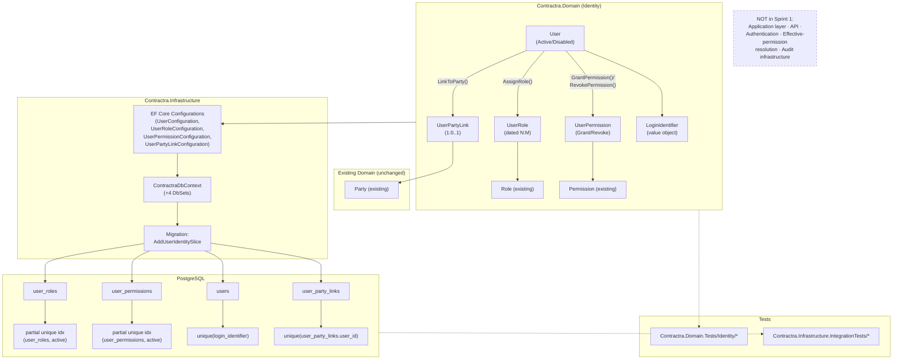
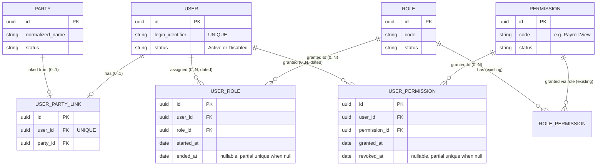

# Backend Sprint 1 — User & Authorization Persistence Foundation

> Planning document only. No Domain/Application/Infrastructure/API code, no EF Core migrations, and no database changes were made while producing this document. This file itself is the only artifact created.

Status: 🟢 Draft for review
Date: 2026-09-23
Scope: `Contractra_System` backend (.NET 10 / ASP.NET Core / EF Core / PostgreSQL, Clean Architecture)

---

## 0. Documentation basis

Read, in this order, per `CLAUDE.md` and `docs/documentation-index-ar.md`:

1. `CLAUDE.md` (repo root)
2. `docs/documentation-index-ar.md` (authority order)
3. `docs/logical-data-model-ar.md` §1 (Domain 1 — Identity, Roles, Permissions, Users) — Normative, priority 16
4. `docs/database-design-ar.md` (derived, priority 24) — cross-checked, not treated as source where it conflicts with the logical model
5. `docs/confirmed-business-rules-ar.md` (ح-1…ح-246, priority 9) and `docs/system-specification-and-team-reference-ar.md` §10.1 (FR-AUTH-001…011), §7 (roles/permissions catalog), BR-235
6. `docs/mvp-entity-scope-matrix-ar.md` §4.1 (Domain 1 entity classification, wave W1-A)
7. `docs/decisions/0001-party-identity-persistence.md` and `docs/decisions/0002-authorization-catalog-persistence.md` (existing ADRs — respected, not contradicted)
8. Current code: `Contractra.Domain/Identity/*`, `Contractra.Domain/Parties/*`, `Contractra.Infrastructure/Persistence/*`, `Contractra.Infrastructure/Migrations/*`, `Contractra.Domain.Tests/*`, `Contractra.Infrastructure.IntegrationTests/*`

No new business rule is invented anywhere in this document. Every persistence decision either cites a confirmed rule or is explicitly marked `BLOCKED / REQUIRES BUSINESS DECISION`, following the same discipline as ADR 0001/0002.

---

## A. CURRENT BACKEND STATE

Verified directly against code (not assumed from prior claims):

- **Solution**: `Contractra.sln` with `Contractra.Domain`, `Contractra.Application`, `Contractra.Infrastructure`, `Contractra.Api`, `Contractra.Domain.Tests`, `Contractra.Infrastructure.IntegrationTests`. Clean Architecture layering matches `CLAUDE.md`.
- **Party Identity slice** (`Contractra.Domain/Parties/`): `Party`, `PartyRole`, `PartyAlias`, `PartyIdentifier`, plus value objects `PartyStatus` (enum), `PartyRoleCode`, `PartyIdentifierType` — all confirmed present, with EF configurations in `Contractra.Infrastructure/Persistence/Configurations/`, migration `20260922111924_InitialPartySlice`, and matching tests in `Contractra.Domain.Tests/Parties/` and `Contractra.Infrastructure.IntegrationTests/` (`PartyAliasAndNameTests`, `PartyDeleteCascadeTests`, `PartyIdentifierUniquenessTests`, `PartyRoleOverlapTests`). Documented in `docs/decisions/0001-party-identity-persistence.md`.
- **Authorization Catalog slice** (`Contractra.Domain/Identity/`): `Role`, `Permission`, `RolePermission`, plus `RoleStatus`, `PermissionStatus`, `RoleCode`, `PermissionCode`, `CatalogCode` — confirmed present, with EF configurations, migration `20260922195442_AddAuthorizationCatalog`, and tests (`Contractra.Domain.Tests/Identity/*`, plus integration tests `AuthorizationCatalogCodeUniquenessTests`, `AuthorizationCatalogMigrationTests`, `PayrollViewGuardTests`, `RolePermissionIntegrityTests`, `SchemaConstraintNameTests`). Documented in ADR 0002.
- **`Payroll.View` independence (BR-235)** is already enforced twice: domain-level in `Role.GrantPermission` and database-level via two PostgreSQL triggers (`fn_role_permissions_forbid_payroll_view`, `fn_permissions_forbid_granted_rename_to_payroll_view`), with a concurrency test. This existing guard is the pattern Sprint 1 must extend to per-user grants, not re-implement differently.
- **Not yet implemented** (confirmed by absence in the Domain tree): `User`, `UserRole`, `UserPermission`, `UserPartyLink` — no files exist under any `Users`/`Identity` path for these. No authentication, no Application layer use cases, no API endpoints, no audit infrastructure (`audit_events`/W1-C) anywhere in the repo.
- **Working tree**: at the time of this analysis, `git status --short` shows a number of files modified outside this task's scope (line-ending/whitespace-only diffs across `.gitignore`, `.csproj` files, migrations, docs, etc. — see §K) and an untracked `docs/implementation/` directory. These pre-date this session's work and were not touched or investigated further, per the read-only constraint on anything outside the one file this task is scoped to write.
- A stash exists: `stash@{0}: On main: wip: flutter admin and employee foundation`. Confirmed via `git stash list` only; not touched.

**Conclusion:** the "already completed" foundation stated in the task brief is accurate. Nothing in Domain currently links a login-capable user to a `Party`, and there is no mechanism to compute a user's effective permissions (role-derived + direct grants + `Payroll.View`).

---

## B. CANDIDATE NEXT AREAS

| Candidate | Purpose | Dependencies | Prerequisites present? | Blockers / unresolved rules | Sprint 1? |
|---|---|---|---|---|---|
| **User (persistence)** | Login-capable account, `Active`/`Disabled` lifecycle | none new | Yes | `login_identifier` shape not specified (username vs. email) — see §H | ✅ Yes |
| **UserRole** | Dated N:M link of `User` → `Role` | User, Role (exists) | Yes | Removal/"Ended" semantics documented (`ended_at`), consistent with `PartyRole` pattern | ✅ Yes |
| **UserPermission** | Direct per-user grant/revoke, the only path for `Payroll.View` | User, Permission (exists) | Yes | `Granted`/`Revoked` are audit events (BR-186/BR-195) — audit infra doesn't exist yet; must be handled without inventing audit tables (§H) | ✅ Yes |
| **UserPartyLink** | Links an Engineer's login account to their commercial `Party` | User, Party (exists) | Yes | 1:0..1, `UNIQUE(user_id)` — straightforward | ✅ Yes |
| **Effective authorization resolution** (role-derived + direct grants, minus revocations, with `Payroll.View` rule) | Answer "what can this user do" | User, UserRole, UserPermission, Role, RolePermission | Only if this sprint builds the four entities above | No Application layer exists yet; this is read/query logic, naturally an Application-layer concern | ❌ Next sprint — see rationale below |
| **Authentication (login flow, password hashing, token issuance)** | Let a user actually log in | User (persistence), password policy | No — `password_hash` handling, hashing algorithm choice, token/session model are undecided | Security-sensitive; needs its own design pass (hashing algorithm, token lifetime, refresh strategy — none confirmed in docs) | ❌ Next sprint |
| **Operations / Sites / Engineer Assignments (W1-B)** | Operational core, depends on `users(Engineer)` | User, Party | User persistence not yet built | Explicitly a later wave (W1-B) per `mvp-entity-scope-matrix-ar.md` | ❌ Later |
| **Financial modules (accounting, treasury, custody)** | W1-D/W1-E | Users, Operations, Audit | None of the prerequisites exist | Documentation explicitly forbids any real financial transaction before W1-C (audit) and W1-D (accounting) are complete | ❌ Much later |
| **Audit infrastructure (`audit_events`, W1-C)** | Required before any mutating use case can be safely exposed | none new structurally | Not built | `UserCreated`, `RoleAssigned`, `PermissionGranted`, etc. are all confirmed required audit events (§1.8 logical model) but this project doesn't have a use case layer yet to write them from | ⚠️ Flagged as a dependency of the *next* sprint (Application-layer use cases), not of this one |

---

## C. SELECTED SPRINT 1

**Goal:** Build the persistence/domain foundation for `User`, `UserRole`, `UserPermission`, and `UserPartyLink` — the four W1-A entities in Domain 1 of `logical-data-model-ar.md` that are not yet implemented — following exactly the same pattern already established by ADR 0001 (Party Identity) and ADR 0002 (Authorization Catalog): Domain entities/value objects, EF Core configuration, PostgreSQL constraints/indexes/triggers, a migration, Domain tests, and PostgreSQL integration tests. **No Application layer, no API, no authentication mechanics, and no audit infrastructure are in scope.**

**Why this is the safest, most logical next increment:**

1. `docs/mvp-entity-scope-matrix-ar.md` places `users`, `roles`, `permissions`, `role_permissions`, `user_roles`, `user_permissions`, `user_party_links` together in the same step (**W1-A**, "الهوية والبيانات المرجعية"), with the explicit note ⛔ *"لا شيء قبلها"* (nothing precedes it). `roles`/`permissions`/`role_permissions` are already done; `users`/`user_roles`/`user_permissions`/`user_party_links` are the remaining W1-A items — this is literally the next unfinished piece of the wave already in progress, not a new wave.
2. It directly unblocks the stated next candidate (Operations/Sites, W1-B), which requires `users(Engineer)` to exist for `engineer_site_assignments`.
3. It keeps the same architectural boundary ADR 0001 §13 and ADR 0002 §10 both already drew: **persistence without Application-layer mutation use cases**, because the audit trail those mutations require (`UserCreated`, `RoleAssigned`, `PermissionGranted`, `PermissionRevoked`, `PayrollViewGranted`/`Revoked`) does not exist yet (W1-C). Building persistence now and deferring the use-case layer to a sprint that also builds (or explicitly stubs, with sign-off) the audit write path is consistent with prior decisions, not a new one.
4. It deliberately **excludes authentication** (password hashing, login flow, token issuance). Login mechanics need their own design decisions (hashing algorithm, session/token model, lockout policy for FR-AUTH-002) that are not settled in any doc and would force invented rules if bundled here. Splitting persistence from authentication mirrors the split already made between ADR 0001 (persistence) and the not-yet-written "Party mutation use cases" — same seam, applied to Users.
5. It deliberately **excludes effective-permission resolution** (computing what a user can actually do). That is read-side orchestration logic naturally suited to the Application layer, which doesn't exist yet for anything in this codebase. Building it directly in Domain/Infrastructure now would either invent an Application-shaped concept inside the wrong layer, or force the Application layer to be started prematurely and inconsistently with the rest of the codebase's phased approach.

**In one sentence:** Sprint 1 finishes wave W1-A's remaining persistence work (Users + their role/permission/party links) exactly as it was already built for Parties and the Authorization Catalog, and stops at the same boundary those two ADRs already stopped at.

---

## D. USER STORIES

5 stories, `US-BE-001` … `US-BE-005`.

### US-BE-001 — User account persistence

```
As a: backend developer building the authorization foundation

I want: a `User` domain entity and its EF Core/PostgreSQL persistence, with
Active/Disabled lifecycle and a unique login identifier

So that: the system has a durable, non-deletable record of every login-capable
account, ready for authentication and role/permission linkage to be built on
top of it

Business Value:
No login, no role assignment, and no permission grant can exist without a
durable User record. This is the single most-blocking entity in Domain 1
(mvp-entity-scope-matrix-ar.md marks `users` "يمنع الإطلاق؟ = نعم").

Acceptance Criteria:
- A User can be created with a required, unique `login_identifier` and an
  initial status of Active.
- A User's status transitions only Active -> Disabled and Disabled -> Active
  (per logical-data-model-ar.md §1.5: "Disabled قابلة للعودة إلى Active").
  No other transition is exposed.
- A User is never hard-deleted at the domain or database level (no Delete
  method; FK behavior is RESTRICT wherever User is referenced).
- `login_identifier` uniqueness is enforced at the database level.
- password_hash, if stored in this slice, is never written to logs or audit
  output by anything this slice touches (no logging code is added in this
  slice; this is a constraint on what NOT to add).

Business Rules:
- logical-data-model-ar.md §1.4/§1.5/§1.6/§1.7 (users lifecycle, UNIQUE
  login_identifier, password_hash never logged)
- database-design-ar.md §6.1 (users table narrative, cross-checked, not
  authoritative over the logical model)
- FR-AUTH-004 (disable, never delete)

Dependencies:
- None new (first entity of this sprint).

Blocked By:
- None.

Out of Scope:
- Authentication (login flow, password verification, token issuance).
- Password hashing algorithm selection/implementation.
- Any Application-layer or API surface.

Affected Layers:
- Domain / Infrastructure / Database / Tests
```

### US-BE-002 — User ↔ Role assignment (dated)

```
As a: backend developer building the authorization foundation

I want: a `UserRole` entity linking a User to a Role over a dated period,
mirroring the PartyRole pattern already used for Party ↔ PartyRoleCode

So that: a user's role membership has a defensible history — a role can be
assigned, later ended, and reassigned, without ever deleting the record of a
prior assignment

Business Value:
FR-AUTH-003 requires every created user to have at least one role. Role-based
authorization cannot function without a durable, historical User-Role link.

Acceptance Criteria:
- A UserRole records `user_id`, `role_id`, `effective_from`/comparable "start"
  marker, and an end marker that is null while active (Active -> Ended by
  setting an end date only; never deleted).
- The same (user, role) pair may have multiple non-overlapping historical
  UserRole records (a role ended and later reassigned) — no UNIQUE(user,
  role) constraint; instead a partial index over currently-active rows,
  matching logical-data-model-ar.md §1.6 exactly: "لا تفرّد على (user, role)
  ... فهرس جزئي WHERE ended_at IS NULL".
- No UserRole can be created for a non-existent User or Role (FK, RESTRICT).
- No delete operation exists at the domain or database level for UserRole.

Business Rules:
- logical-data-model-ar.md §1.4 ("users → user_roles 1:N مؤرَّخة"), §1.5
  ("Active → Ended بإدخال ended_at — لا حذف"), §1.6 (partial-index rule
  quoted above)
- FR-AUTH-003 (a user must have at least one role at creation — enforced at
  the Application layer when it exists; NOT enforced inside this entity,
  since Domain here mirrors PartyRole's "party can exist with 0 roles"
  precedent unless a stronger invariant is confirmed for users specifically
  — flagged in §H)

Dependencies:
- US-BE-001 (User must exist)
- Role (already implemented, ADR 0002)

Blocked By:
- None.

Out of Scope:
- Enforcing "user must have >= 1 active role" as a Domain invariant (see
  Blockers, §H) — left to the Application layer, consistent with how
  Party/PartyRole left similar policy decisions out of Domain (ADR 0001 §4).

Affected Layers:
- Domain / Infrastructure / Database / Tests
```

### US-BE-003 — Direct per-user permission grant/revoke (including Payroll.View)

```
As a: backend developer building the authorization foundation

I want: a `UserPermission` entity recording direct grants and revocations of
a Permission to a User, independent of role membership

So that: `Payroll.View` (BR-235/FR-AUTH-006) and any other permission that
must bypass role-derived authorization can be granted explicitly per user,
with the same two-layer (domain + database) enforcement already built for
role grants in ADR 0002 §6

Business Value:
BR-235 is a confirmed, named, high-priority rule: Payroll.View must never be
derivable through any role, Admin included. Without a per-user grant path,
that rule cannot be satisfied at all — this is the direct enabler of BR-235
at the user level (ADR 0002 already closed the role-level half of this rule;
this story closes the other half).

Acceptance Criteria:
- A UserPermission records `user_id`, `permission_id`, and a Granted/Revoked
  lifecycle via a dated marker (mirroring UserRole's ended_at pattern) —
  logical-data-model-ar.md §1.5 states user_permissions lifecycle as
  "Granted · Revoked — كلاهما حدث تدقيق", so both are first-class states.
- The same (user, permission) pair may have multiple historical grants -
  no UNIQUE(user, permission); instead a partial index over currently-active
  rows, per logical-data-model-ar.md §1.6.
- Granting Payroll.View to a user through UserPermission is explicitly
  allowed and is in fact the ONLY sanctioned path (this is the inverse of
  Role.GrantPermission's rejection).
- No delete operation exists — revocation is a state transition, not removal.
- FK RESTRICT on both `user_id` and `permission_id`.

Business Rules:
- logical-data-model-ar.md §1.4/§1.5/§1.6, §1.9 ("Payroll.View تُمنح ضمنيًا
  بالدور -> لا تُدرج ضمن أي role_permissions افتراضي — تُمنح عبر
  user_permissions صراحةً")
- confirmed-business-rules-ar.md ح-235 · BR-235 · FR-AUTH-006
- Audit requirement: PermissionGranted/PermissionRevoked/PayrollViewGranted/
  PayrollViewRevoked are named required audit events (§1.8) — NOT
  implemented in this slice (no audit infra exists); flagged as a hard
  dependency for the mutation use case that will call this entity (§H).

Dependencies:
- US-BE-001 (User)
- Permission (already implemented, ADR 0002)

Blocked By:
- None for persistence. The eventual Application-layer "grant/revoke"
  use case IS blocked by the missing audit infrastructure (W1-C) — noted
  here so it isn't silently forgotten, but that blocker does not stop this
  persistence-only story.

Out of Scope:
- Any Application use case or API endpoint that actually performs a grant
  or revoke as a user-facing action (would require the audit write to be
  transactional per BR-186 — not possible without W1-C).
- Effective-permission resolution/query logic.

Affected Layers:
- Domain / Infrastructure / Database / Tests
```

### US-BE-004 — User ↔ Party link (Engineer identity bridge)

```
As a: backend developer building the authorization foundation

I want: a `UserPartyLink` entity linking a login-capable User to their
commercial Party record, at most one Party per User

So that: an Engineer, who is both a system user and a commercial party
(receives custody, is referenced in expenses/assignments), has a single,
queryable bridge between their login identity and their business identity

Business Value:
logical-data-model-ar.md §1.4 states this plainly: "المهندس مستخدم وطرف
معًا" (the engineer is a user and a party together). Without this link,
nothing built on Operations/Sites/Engineer Assignments (W1-B, the next wave)
can resolve "which Party does this logged-in Engineer correspond to."

Acceptance Criteria:
- A UserPartyLink records `user_id` and `party_id`.
- `UNIQUE(user_id)` — a user links to at most one party (per §1.6: "مستخدم
  واحد لطرف واحد").
- No stated uniqueness constraint on `party_id` in the logical model for
  this table — NOT invented here; a party could in principle appear
  unlinked, or (if some future rule allows it) linked from more than one
  user account is NOT assumed either way since it's undocumented — this
  slice implements exactly what's confirmed (unique on user_id only) and
  flags the party_id-side question in §H rather than guessing.
- FK RESTRICT on both `user_id` and `party_id`; no delete operation.
- Cardinality in code matches the documented `1 : 0..1` (`users` →
  `user_party_links`): a User may have zero or one link; nothing forces
  every user to have one (Admin/OfficeStaff/Accountant users have no
  Party).

Business Rules:
- logical-data-model-ar.md §1.3 (user_party_links "يربط حساب المهندس
  بطرفه التجاري"), §1.4 ("users → user_party_links 1:0..1"), §1.6
  ("UNIQUE(user_id) — مستخدم واحد لطرف واحد")

Dependencies:
- US-BE-001 (User)
- Party (already implemented, ADR 0001)

Blocked By:
- None.

Out of Scope:
- Any workflow that creates a Party and a User together as one operation
  (e.g., "onboard a new engineer") — that is Application-layer orchestration
  for a later sprint.

Affected Layers:
- Domain / Infrastructure / Database / Tests
```

### US-BE-005 — Migration, schema documentation, and constraint verification

```
As a: backend developer building the authorization foundation

I want: a single additive EF Core migration covering User, UserRole,
UserPermission, and UserPartyLink, plus an ADR (0003) documenting the
physical-design decisions the same way ADR 0001/0002 do

So that: the schema change is reviewable as one coherent unit, and the next
developer has the same "confirmed rule vs. engineering choice" trail that
made ADR 0001/0002 auditable

Business Value:
Consistency of documentation and migration granularity is itself a stated
project convention (CLAUDE.md "Development Workflow", ADR 0001/0002
structure). Skipping this erodes the traceability the project has
deliberately built up over two prior slices.

Acceptance Criteria:
- One migration, additive only, named descriptively (e.g.
  `AddUserIdentitySlice`), covering exactly the four new tables plus their
  constraints/indexes/triggers.
- `Down()` cleanly reverses only what this migration adds, without touching
  `InitialPartySlice` or `AddAuthorizationCatalog` objects (same pattern as
  ADR 0002 §12).
- A new `docs/decisions/0003-user-identity-persistence.md` is written (this
  is Domain/Infrastructure documentation work under `docs/decisions/`, which
  is explicitly project-owned engineering documentation, NOT one of the
  authoritative `docs/` source files CLAUDE.md forbids modifying — same
  category as ADR 0001/0002 which already exist there).
- A test confirms migrating down to `AddAuthorizationCatalog` and back up
  succeeds (mirroring ADR 0002 §12's migration-reversibility test).

Business Rules:
- N/A (process/documentation story, not a business-rule story).

Dependencies:
- US-BE-001, US-BE-002, US-BE-003, US-BE-004 (all four entities must be
  designed before the single combined migration is written).

Blocked By:
- US-BE-001 through US-BE-004.

Out of Scope:
- Applying the migration to any environment (`dotnet ef database update`
  is explicitly not run as part of planning or — per this task's
  constraints — as part of implementation either, without separate
  explicit approval per CLAUDE.md: "Creating a migration and applying a
  migration are separate actions").

Affected Layers:
- Infrastructure / Database / Tests
```

**Total: 5 user stories.**

---

## E. TASKS

24 tasks total, grouped by story.

### US-BE-001 — User account persistence (6 tasks)

```
## TASK-BE-001 — Define User aggregate + UserStatus in Domain

Description:
Create `Contractra.Domain/Identity/User.cs` (sealed class, private
constructor, public constructor requiring an initial UserStatus, Guid Id via
Guid.CreateVersion7() — same pattern as Party/Role/Permission) and
`Contractra.Domain/Identity/UserStatus.cs` (closed enum: Active, Disabled).

Scope:
Domain entity + enum only. No collections/navigation to UserRole/
UserPermission/UserPartyLink are added on User itself in this task (added,
if at all, in later tasks once those entities exist) — start minimal,
matching how Party started with only its own scalar fields before
AssignRole/AddAlias/AddIdentifier were added.

Expected Layer:
Domain

Likely Files / Areas:
- Contractra.Domain/Identity/User.cs
- Contractra.Domain/Identity/UserStatus.cs

Business Rules:
- logical-data-model-ar.md §1.5 (Active/Disabled, no delete, Disabled can
  return to Active)

Validation / Constraints:
- Constructor throws ArgumentException on null/empty/whitespace
  login_identifier (see TASK-BE-002).
- Initial status is a required constructor parameter (no default), matching
  Party/Role/Permission convention.

Testing:
- Covered by TASK-BE-005 (Domain tests).

Done When:
- User.cs compiles, has no dependency on Infrastructure/Application/API,
  and exposes no delete/remove method.

Dependencies:
- None.
```

```
## TASK-BE-002 — Define LoginIdentifier value object

Description:
Create `Contractra.Domain/Identity/LoginIdentifier.cs` as a
`readonly record struct` (same pattern as RoleCode/PermissionCode/
PartyRoleCode), validating non-null/non-empty/non-whitespace, rejecting
(not trimming) leading/trailing whitespace — same rationale as
CatalogCode.Validate: silently changing an identifier hides that the caller
supplied something different.

Scope:
Value object only. No email-format validation, no case-folding decision is
made here (see §H — the documented business key is `login_identifier`, not
explicitly stated to be an email; format is unconfirmed).

Expected Layer:
Domain

Likely Files / Areas:
- Contractra.Domain/Identity/LoginIdentifier.cs

Business Rules:
- logical-data-model-ar.md §1.6 (UNIQUE(login_identifier))

Validation / Constraints:
- Not null/empty/whitespace-only.
- No leading/trailing whitespace (rejected, not trimmed).
- No format (email/username) enforced in Domain — see §H BLOCKED item on
  whether login_identifier is email or a separate username field.

Testing:
- Covered by TASK-BE-005.

Done When:
- LoginIdentifier.cs compiles and is used as User's login identifier type.

Dependencies:
- None (can be done in parallel with TASK-BE-001, combined in User.cs's
  constructor).
```

```
## TASK-BE-003 — Add User.Disable() / User.Reactivate() transitions

Description:
Add two methods to User: `Disable()` (Active -> Disabled) and
`Reactivate()` (Disabled -> Active), each throwing InvalidOperationException
if called from the wrong state — same pattern as Role.Deprecate()/
Permission.Deprecate(), except User additionally supports the reverse
transition per the documented lifecycle (§1.5: "Disabled قابلة للعودة إلى
Active").

Scope:
Two guarded state-transition methods on User. No side effects (no audit
event raised — audit infra doesn't exist; see §H).

Expected Layer:
Domain

Likely Files / Areas:
- Contractra.Domain/Identity/User.cs

Business Rules:
- logical-data-model-ar.md §1.5 (Active -> Disabled -> Active, no delete)
- FR-AUTH-004 (disable, never delete)

Validation / Constraints:
- Disable() throws unless Status == Active.
- Reactivate() throws unless Status == Disabled.

Testing:
- Domain tests for both legal transitions and both illegal-transition
  exceptions (TASK-BE-005).

Done When:
- Both methods implemented and covered by passing Domain tests.

Dependencies:
- TASK-BE-001
```

```
## TASK-BE-004 — EF Core configuration + PostgreSQL constraints for User

Description:
Create `Contractra.Infrastructure/Persistence/Configurations/
UserConfiguration.cs` (IEntityTypeConfiguration<User>): map Id as uuid/
ValueGeneratedNever(), LoginIdentifier as a converted `text` column, Status
as `text` via HasConversion<string>() with a CHECK constraint (same
`ck_*_status_valid_values` pattern as PartyStatus/RoleStatus/
PermissionStatus). Add the case-sensitive/insensitive uniqueness decision
for login_identifier explicitly (see §H — default to the
`ux_roles_code_lower`/`ux_permissions_code_lower` precedent of a
lower(login_identifier) expression unique index via raw SQL in the
migration, unless case-sensitivity is confirmed required — flag either way
in ADR 0003).

Scope:
EF configuration class + raw-SQL unique index (added inside the combined
migration in TASK-BE-021, not a separate migration).

Expected Layer:
Infrastructure

Likely Files / Areas:
- Contractra.Infrastructure/Persistence/Configurations/UserConfiguration.cs
- Contractra.Infrastructure/Persistence/ContractraDbContext.cs (DbSet<User>)

Business Rules:
- logical-data-model-ar.md §1.6 (UNIQUE(login_identifier))
- §1.7 (password_hash never logged — informs that no logging/interceptor
  code touches this column in this slice)

Validation / Constraints:
- CHECK constraint enforcing UserStatus's closed set at the database level.
- Unique index on login_identifier (case-sensitivity per §H decision,
  documented in ADR 0003).
- No MaxLength on login_identifier unless a format decision (§H) confirms
  one — same "don't invent a limit" precedent as ADR 0001 §12.

Testing:
- Covered by TASK-BE-006 integration tests.

Done When:
- ContractraDbContext includes DbSet<User>; `dotnet ef migrations
  --project ... --startup-project ... has-pending-model-changes`-style
  review (not applying) confirms the shape is as designed.

Dependencies:
- TASK-BE-001, TASK-BE-002, TASK-BE-003
```

```
## TASK-BE-005 — Domain tests for User

Description:
Write `Contractra.Domain.Tests/Identity/UserTests.cs` and
`LoginIdentifierTests.cs`, mirroring the structure/naming of
`RoleTests.cs`/`RoleCodeTests.cs`.

Scope:
Domain-layer unit tests only (no database).

Expected Layer:
Tests (Domain)

Likely Files / Areas:
- Contractra.Domain.Tests/Identity/UserTests.cs
- Contractra.Domain.Tests/Identity/LoginIdentifierTests.cs

Business Rules:
- Same as TASK-BE-001/002/003.

Validation / Constraints:
- N/A (test file).

Testing:
Test cases to cover:
- User_CanBeCreated_WithActiveStatus
- User_Disable_TransitionsToDisabled
- User_Disable_Throws_WhenAlreadyDisabled
- User_Reactivate_TransitionsToActive
- User_Reactivate_Throws_WhenAlreadyActive
- User_HasNoDeleteMethod (structural/documentation test, same spirit as
  Party's absence-of-delete verification)
- LoginIdentifier_Throws_OnNullEmptyOrWhitespace
- LoginIdentifier_Throws_OnLeadingOrTrailingWhitespace (not trimmed)
- LoginIdentifier_PreservesSuppliedValue

Done When:
- All listed tests exist and pass.

Dependencies:
- TASK-BE-001, TASK-BE-002, TASK-BE-003
```

```
## TASK-BE-006 — PostgreSQL integration tests for User

Description:
Write `Contractra.Infrastructure.IntegrationTests/UserUniquenessAndLifecycleTests.cs`
using the existing `PostgresTestDatabaseFixture`/`PostgresAssert` pattern
(ephemeral `contractra_test_<guid>` database, `CONTRACTRA_TEST_POSTGRES`).

Scope:
Integration tests only; no test touches the development database.

Expected Layer:
Tests (PostgreSQL Integration)

Likely Files / Areas:
- Contractra.Infrastructure.IntegrationTests/UserUniquenessAndLifecycleTests.cs

Business Rules:
- logical-data-model-ar.md §1.6 (UNIQUE(login_identifier))

Validation / Constraints:
- N/A (test file).

Testing:
Test cases to cover:
- Inserting two Users with the same login_identifier (same casing per §H
  decision) violates the unique index/constraint.
- CHECK constraint rejects an out-of-range status value via raw SQL insert.
- Attempting a raw DbSet.Remove on User is rejected (no delete path),
  mirroring PartyDeleteCascadeTests's verification style, OR confirmed as
  N/A if no FK yet references User in this task (re-verified once
  UserRole/UserPermission/UserPartyLink exist, in TASK-BE-020).

Done When:
- All listed tests exist, pass against the ephemeral test database, and
  the development database was never touched.

Dependencies:
- TASK-BE-004
```

### US-BE-002 — User ↔ Role assignment (5 tasks)

```
## TASK-BE-007 — Define UserRole entity in Domain

Description:
Create `Contractra.Domain/Identity/UserRole.cs`, mirroring
`Contractra.Domain/Parties/PartyRole.cs`: Id, UserId, RoleId, an
"effective from"-equivalent start marker, and a nullable end marker
(`EndedAt` or `EffectiveTo` — name to match the documented `ended_at`
column, e.g. `EndedAt: DateOnly?`), plus an `IsActiveOn(DateOnly asOf)`
helper following PartyRole's deterministic, clock-free pattern.

Scope:
Domain entity, created through `User.AssignRole(Role, DateOnly startedOn)`
(internal constructor on UserRole, same ownership pattern as
Role.GrantPermission -> RolePermission).

Expected Layer:
Domain

Likely Files / Areas:
- Contractra.Domain/Identity/UserRole.cs
- Contractra.Domain/Identity/User.cs (add AssignRole method + _roles
  collection + Roles read-only exposure)

Business Rules:
- logical-data-model-ar.md §1.4 ("users → user_roles 1:N مؤرَّخة")
- §1.5 ("Active → Ended بإدخال ended_at — لا حذف")

Validation / Constraints:
- No End() method removes the record; only sets EndedAt (End(DateOnly
  endedOn, DateOnly asOf), guarding endedOn <= asOf, same pattern as
  PartyIdentifier.Close).
- No uniqueness invariant enforced at the Domain level for (user, role) —
  the database partial index is the real guard (TASK-BE-009), matching
  ADR 0001 §7's split between a cheap constraint and a real overlap
  guarantee.

Testing:
- Covered by TASK-BE-008.

Done When:
- UserRole.cs compiles; User exposes AssignRole and a read-only Roles
  collection.

Dependencies:
- TASK-BE-001 (User must exist), Role (existing)
```

```
## TASK-BE-008 — Domain tests for UserRole

Description:
Write `Contractra.Domain.Tests/Identity/UserRoleTests.cs`.

Scope:
Domain-layer unit tests only.

Expected Layer:
Tests (Domain)

Likely Files / Areas:
- Contractra.Domain.Tests/Identity/UserRoleTests.cs

Business Rules:
- Same as TASK-BE-007.

Validation / Constraints:
- N/A (test file).

Testing:
Test cases to cover:
- User_AssignRole_CreatesActiveUserRole
- UserRole_IsActiveOn_ReturnsTrue_WithinPeriod / False_OutsidePeriod
- UserRole_End_SetsEndedAt
- UserRole_End_Throws_WhenEndedOnAfterAsOf
- User_CanHaveZeroRoles (mirrors Party_CanExist_WithZeroRoles — the
  >=1-role invariant from FR-AUTH-003 is explicitly NOT enforced here;
  see US-BE-002's Out of Scope and §H)
- User_CanHave_MultipleHistoricalUserRoles_ForSameRole (same role assigned,
  ended, reassigned)

Done When:
- All listed tests exist and pass.

Dependencies:
- TASK-BE-007
```

```
## TASK-BE-009 — EF Core configuration + partial unique index for UserRole

Description:
Create `UserRoleConfiguration.cs`. FKs to User and Role, both
`DeleteBehavior.Restrict`. No plain UNIQUE(user_id, role_id) — instead a
partial unique index `ux_user_roles_user_id_role_id_active` on
`(user_id, role_id) WHERE ended_at IS NULL`, created via raw SQL in the
migration (EF Core fluent API cannot express a partial index directly in
this provider version, same limitation noted in ADR 0001 §9/ADR 0002 §5.2
for other raw-SQL objects).

Scope:
EF configuration + raw-SQL partial index (added in the combined migration,
TASK-BE-021).

Expected Layer:
Infrastructure

Likely Files / Areas:
- Contractra.Infrastructure/Persistence/Configurations/UserRoleConfiguration.cs
- Contractra.Infrastructure/Persistence/ContractraDbContext.cs (DbSet<UserRole>)

Business Rules:
- logical-data-model-ar.md §1.6 (explicit "لا تفرّد ... فهرس جزئي WHERE
  ended_at IS NULL")

Validation / Constraints:
- FK RESTRICT on user_id and role_id.
- Partial unique index as specified above.
- CHECK (ended_at IS NULL OR ended_at >= started_at)-equivalent, mirroring
  PartyRole's CHECK.

Testing:
- Covered by TASK-BE-010.

Done When:
- ContractraDbContext includes DbSet<UserRole>; configuration compiles.

Dependencies:
- TASK-BE-004, TASK-BE-007
```

```
## TASK-BE-010 — PostgreSQL integration tests for UserRole

Description:
Write `Contractra.Infrastructure.IntegrationTests/UserRoleIntegrityTests.cs`.

Scope:
Integration tests only.

Expected Layer:
Tests (PostgreSQL Integration)

Likely Files / Areas:
- Contractra.Infrastructure.IntegrationTests/UserRoleIntegrityTests.cs

Business Rules:
- Same as TASK-BE-009.

Validation / Constraints:
- N/A (test file).

Testing:
Test cases to cover:
- Two concurrently-active UserRole rows for the same (user, role) violate
  the partial unique index.
- A historical (ended) UserRole plus a new active one for the same (user,
  role) is allowed (proves the index is correctly partial, not a full
  unique).
- FK RESTRICT: deleting a referenced User or Role at the raw-SQL level is
  rejected while a UserRole references it.

Done When:
- All listed tests exist and pass against the ephemeral test database.

Dependencies:
- TASK-BE-009
```

```
## TASK-BE-011 — Wire UserRole into User's public surface + reconfirm no removal method

Description:
Review User.cs to ensure AssignRole/Roles collection follow the exact
ownership convention already used for Party.AssignRole/Roles (private
backing list, IReadOnlyCollection exposure, entity created only through the
aggregate method — never a public UserRole constructor).

Scope:
Small consistency/review task, not new behavior beyond TASK-BE-007.

Expected Layer:
Domain

Likely Files / Areas:
- Contractra.Domain/Identity/User.cs
- Contractra.Domain/Identity/UserRole.cs

Business Rules:
- N/A (internal consistency, not a business rule).

Validation / Constraints:
- UserRole's non-EF constructor is internal, not public (same as
  RolePermission's internal constructor).

Testing:
- Covered by existing tests in TASK-BE-008 (no new tests required if
  already correctly encapsulated from TASK-BE-007).

Done When:
- Code review confirms encapsulation matches Party/Role precedent exactly.

Dependencies:
- TASK-BE-007
```

### US-BE-003 — Direct per-user permission grant/revoke (6 tasks)

```
## TASK-BE-012 — Define UserPermission entity in Domain

Description:
Create `Contractra.Domain/Identity/UserPermission.cs`: Id, UserId,
PermissionId, a Granted/Revoked-equivalent lifecycle expressed as a
nullable `RevokedAt: DateOnly?` marker (Granted = RevokedAt is null),
created through `User.GrantPermission(Permission, DateOnly grantedOn)`
(internal constructor, mirroring Role.GrantPermission's ownership pattern
exactly — including that Payroll.View is explicitly ALLOWED here, the
inverse of Role.GrantPermission's rejection).

Scope:
Domain entity + User.GrantPermission/RevokePermission methods.

Expected Layer:
Domain

Likely Files / Areas:
- Contractra.Domain/Identity/UserPermission.cs
- Contractra.Domain/Identity/User.cs (add GrantPermission/RevokePermission
  methods + _permissions collection + Permissions read-only exposure)

Business Rules:
- logical-data-model-ar.md §1.5 (Granted/Revoked, both audit events), §1.9
  (Payroll.View granted ONLY through user_permissions)
- confirmed-business-rules-ar.md ح-235 · BR-235 · FR-AUTH-006

Validation / Constraints:
- GrantPermission does NOT reject Payroll.View (contrast with
  Role.GrantPermission, which does) — this asymmetry is the entire point
  of the rule and must be covered by an explicit test proving it (see
  TASK-BE-013).
- RevokePermission(DateOnly revokedOn, DateOnly asOf) sets RevokedAt;
  throws if already revoked or if revokedOn > asOf.
- Duplicate-active-grant detection at the Domain level over currently-loaded
  grants (same "early guard, database is final guard" pattern as
  Role.GrantPermission), the database partial unique index is authoritative.

Testing:
- Covered by TASK-BE-013.

Done When:
- UserPermission.cs compiles; User exposes GrantPermission/RevokePermission
  and a read-only Permissions collection; Payroll.View grant succeeds
  through this path.

Dependencies:
- TASK-BE-001 (User), Permission (existing)
```

```
## TASK-BE-013 — Domain tests for UserPermission, including Payroll.View asymmetry

Description:
Write `Contractra.Domain.Tests/Identity/UserPermissionTests.cs`.

Scope:
Domain-layer unit tests only.

Expected Layer:
Tests (Domain)

Likely Files / Areas:
- Contractra.Domain.Tests/Identity/UserPermissionTests.cs

Business Rules:
- Same as TASK-BE-012, explicitly including BR-235.

Validation / Constraints:
- N/A (test file).

Testing:
Test cases to cover:
- User_GrantPermission_CreatesActiveGrant
- User_GrantPermission_AllowsPayrollView (the key BR-235 assertion — this
  MUST pass, proving the per-user path is open where the per-role path,
  already tested in RoleTests.cs, is closed)
- User_RevokePermission_SetsRevokedAt
- User_RevokePermission_Throws_WhenAlreadyRevoked
- User_GrantPermission_Throws_OnDuplicateActiveGrant (loaded-collection
  check)
- User_CanHave_MultipleHistoricalGrants_ForSamePermission (granted, revoked,
  re-granted)

Done When:
- All listed tests exist and pass, and the Payroll.View-allowed test is
  present and green (this is the single most important test in this
  sprint, given BR-235's priority in the documentation).

Dependencies:
- TASK-BE-012
```

```
## TASK-BE-014 — EF Core configuration + partial unique index for UserPermission

Description:
Create `UserPermissionConfiguration.cs`. FKs to User and Permission, both
`DeleteBehavior.Restrict`. Partial unique index
`ux_user_permissions_user_id_permission_id_active` on
`(user_id, permission_id) WHERE revoked_at IS NULL`, raw SQL in the
migration, mirroring TASK-BE-009's UserRole index exactly (same documented
rule shape in §1.6).

Scope:
EF configuration + raw-SQL partial index.

Expected Layer:
Infrastructure

Likely Files / Areas:
- Contractra.Infrastructure/Persistence/Configurations/UserPermissionConfiguration.cs
- Contractra.Infrastructure/Persistence/ContractraDbContext.cs (DbSet<UserPermission>)

Business Rules:
- logical-data-model-ar.md §1.6 ("فهرس جزئي على (user, permission) WHERE
  ended_at IS NULL" — adapted to this table's revoked_at column name)

Validation / Constraints:
- FK RESTRICT on user_id and permission_id.
- Partial unique index as specified above.
- No trigger is added here mirroring ADR 0002's Payroll.View-forbidding
  triggers — those forbid the role path; this table is the explicitly
  ALLOWED path, so no equivalent restriction exists. This is stated
  explicitly in the migration/ADR to avoid a future reader assuming a
  missing guard is an oversight.

Testing:
- Covered by TASK-BE-015.

Done When:
- ContractraDbContext includes DbSet<UserPermission>; configuration
  compiles.

Dependencies:
- TASK-BE-004, TASK-BE-012
```

```
## TASK-BE-015 — PostgreSQL integration tests for UserPermission, including Payroll.View path

Description:
Write `Contractra.Infrastructure.IntegrationTests/UserPermissionIntegrityTests.cs`.

Scope:
Integration tests only.

Expected Layer:
Tests (PostgreSQL Integration)

Likely Files / Areas:
- Contractra.Infrastructure.IntegrationTests/UserPermissionIntegrityTests.cs

Business Rules:
- Same as TASK-BE-014, explicitly including BR-235.

Validation / Constraints:
- N/A (test file).

Testing:
Test cases to cover:
- Two concurrently-active UserPermission rows for the same (user,
  permission) violate the partial unique index.
- A historical (revoked) grant plus a new active grant for the same (user,
  permission) is allowed.
- Inserting a UserPermission row referencing the Payroll.View permission
  succeeds at the database level (proving no trigger blocks this path,
  unlike role_permissions) — this is the database-level counterpart to
  TASK-BE-013's domain test and is the most important integration test in
  this sprint.
- FK RESTRICT on user_id and permission_id.

Done When:
- All listed tests exist and pass, with the Payroll.View-succeeds test
  explicitly present and green.

Dependencies:
- TASK-BE-014
```

```
## TASK-BE-016 — Cross-check: existing Payroll.View role-guard tests still pass unmodified

Description:
Re-run (not modify) `PayrollViewGuardTests.cs` from ADR 0002 after this
sprint's schema changes land, to confirm the existing role-side guard
(forbidding Payroll.View via role_permissions) is untouched and still
enforced. This is a regression-safety task, not new functionality.

Scope:
Verification only — no production code changes.

Expected Layer:
Tests (PostgreSQL Integration) — verification

Likely Files / Areas:
- Contractra.Infrastructure.IntegrationTests/PayrollViewGuardTests.cs
  (read-only; not modified)

Business Rules:
- BR-235 (both halves: role-side forbidden, user-side allowed, must coexist
  correctly)

Validation / Constraints:
- N/A.

Testing:
- Run the existing test suite; confirm 0 regressions in
  PayrollViewGuardTests after the new migration is applied to a test
  database.

Done When:
- Existing PayrollViewGuardTests pass unmodified alongside the new
  UserPermission tests.

Dependencies:
- TASK-BE-015, TASK-BE-021 (migration must exist to test against)
```

```
## TASK-BE-017 — Document the two-sided Payroll.View enforcement in ADR 0003

Description:
Extend the new ADR (TASK-BE-023) with a section explicitly cross-referencing
ADR 0002 §6, stating in one place: role_permissions forbids Payroll.View
(database trigger + domain check, built in ADR 0002); user_permissions
allows it and is the only sanctioned path (built in this sprint). This
closes the loop so a future reader doesn't have to piece the two halves
together from two separate ADRs without a pointer.

Scope:
Documentation only (part of TASK-BE-023's ADR, not a separate file).

Expected Layer:
Infrastructure (documentation, docs/decisions/ — project-owned, not an
authoritative docs/ source file)

Likely Files / Areas:
- docs/decisions/0003-user-identity-persistence.md

Business Rules:
- BR-235

Validation / Constraints:
- N/A.

Testing:
- N/A (documentation).

Done When:
- ADR 0003 contains the cross-reference section.

Dependencies:
- TASK-BE-023
```

### US-BE-004 — User ↔ Party link (4 tasks)

```
## TASK-BE-018 — Define UserPartyLink entity in Domain

Description:
Create `Contractra.Domain/Identity/UserPartyLink.cs`: Id, UserId, PartyId,
created through `User.LinkToParty(Party)` (returns UserPartyLink; throws if
this User is already linked to a party — loaded-state check, database
UNIQUE(user_id) is the final guard, same layered-guard pattern used
throughout this sprint and in ADR 0001/0002).

Scope:
Domain entity + User.LinkToParty method. No "unlink" method — not
documented (see §H); a link, once created, has no removal path in this
slice, consistent with the "no undocumented deletion" discipline in both
existing ADRs.

Expected Layer:
Domain

Likely Files / Areas:
- Contractra.Domain/Identity/UserPartyLink.cs
- Contractra.Domain/Identity/User.cs (add LinkToParty method + nullable
  PartyLink property, since cardinality is 1:0..1, not a collection)

Business Rules:
- logical-data-model-ar.md §1.3 ("يربط حساب المهندس بطرفه التجاري"), §1.4
  ("users → user_party_links 1:0..1"), §1.6 ("UNIQUE(user_id)")

Validation / Constraints:
- User.LinkToParty throws InvalidOperationException if PartyLink is already
  set (mirrors the "already exists" guards elsewhere in this codebase, e.g.
  Role.GrantPermission's duplicate check).
- No cross-check against Party (e.g., "party must have PartyRoleCode ==
  Engineer") is enforced here — not documented as a Domain-level invariant
  anywhere; flagged rather than invented (§H).

Testing:
- Covered by TASK-BE-019.

Done When:
- UserPartyLink.cs compiles; User exposes LinkToParty and a nullable
  PartyLink property.

Dependencies:
- TASK-BE-001 (User), Party (existing)
```

```
## TASK-BE-019 — Domain tests for UserPartyLink

Description:
Write `Contractra.Domain.Tests/Identity/UserPartyLinkTests.cs`.

Scope:
Domain-layer unit tests only.

Expected Layer:
Tests (Domain)

Likely Files / Areas:
- Contractra.Domain.Tests/Identity/UserPartyLinkTests.cs

Business Rules:
- Same as TASK-BE-018.

Validation / Constraints:
- N/A (test file).

Testing:
Test cases to cover:
- User_LinkToParty_CreatesLink
- User_LinkToParty_Throws_WhenAlreadyLinked
- User_CanExist_WithNoPartyLink (Admin/OfficeStaff/Accountant case)

Done When:
- All listed tests exist and pass.

Dependencies:
- TASK-BE-018
```

```
## TASK-BE-020 — EF Core configuration + unique index for UserPartyLink

Description:
Create `UserPartyLinkConfiguration.cs`. FKs to User and Party, both
`DeleteBehavior.Restrict`. `UNIQUE(user_id)` as a standard (non-partial)
unique index — no dating/ending semantics are documented for this table
(§1.5 lists lifecycle for users/user_roles/user_permissions/roles/
permissions but not user_party_links, so none is invented here).

Scope:
EF configuration + standard unique index (expressible directly via Fluent
API's HasIndex(...).IsUnique(), no raw SQL needed here, unlike the
lower(code) and partial-index cases elsewhere in this sprint).

Expected Layer:
Infrastructure

Likely Files / Areas:
- Contractra.Infrastructure/Persistence/Configurations/UserPartyLinkConfiguration.cs
- Contractra.Infrastructure/Persistence/ContractraDbContext.cs (DbSet<UserPartyLink>)

Business Rules:
- logical-data-model-ar.md §1.6 ("UNIQUE(user_id) — مستخدم واحد لطرف واحد")

Validation / Constraints:
- FK RESTRICT on user_id and party_id.
- UNIQUE(user_id).
- party_id is deliberately left without a uniqueness constraint (§H,
  undocumented either way).

Testing:
- Covered by this task's own integration follow-up below and included in
  the general FK-RESTRICT sweep.

Done When:
- ContractraDbContext includes DbSet<UserPartyLink>; configuration
  compiles; a PostgreSQL integration test
  (`UserPartyLinkUniquenessTests.cs`) proves UNIQUE(user_id) is enforced
  and that party_id may repeat without violation (documenting the
  deliberate absence of a constraint there, not an accidental gap).

Dependencies:
- TASK-BE-004, TASK-BE-018
```

### US-BE-005 — Migration, ADR, verification (3 tasks)

```
## TASK-BE-021 — Author the combined AddUserIdentitySlice migration

Description:
Run `dotnet ef migrations add AddUserIdentitySlice --project
Contractra.Infrastructure --startup-project Contractra.Api` (creation only,
per CLAUDE.md: "Creating a migration and applying a migration are separate
actions" — do NOT run `dotnet ef database update`). The migration must
contain: the four new tables (users, user_roles, user_permissions,
user_party_links), their PKs, CHECK constraints (UserStatus), FKs (all
RESTRICT), the two partial unique indexes (raw SQL, TASK-BE-009/
TASK-BE-014), the standard unique index (TASK-BE-020), and the
login_identifier uniqueness index (raw SQL or fluent, per the §H decision
made in TASK-BE-004).

Scope:
Single additive migration file pair (.cs + .Designer.cs) plus updated
ContractraDbContextModelSnapshot.cs. No changes to InitialPartySlice or
AddAuthorizationCatalog migration files.

Expected Layer:
Infrastructure / Database

Likely Files / Areas:
- Contractra.Infrastructure/Migrations/<timestamp>_AddUserIdentitySlice.cs
- Contractra.Infrastructure/Migrations/<timestamp>_AddUserIdentitySlice.Designer.cs
- Contractra.Infrastructure/Migrations/ContractraDbContextModelSnapshot.cs

Business Rules:
- All rules already cited in US-BE-001 through US-BE-004.

Validation / Constraints:
- `Down()` must reverse exactly this migration's objects and nothing from
  prior migrations (mirroring ADR 0002 §12's approach and its dedicated
  reversibility test, TASK-BE-022).
- Migration is NOT applied to any database as part of this sprint's
  execution without separate explicit approval (per CLAUDE.md and this
  task's own constraints).

Testing:
- Covered by TASK-BE-022.

Done When:
- Migration file created (not applied); reviewed against every constraint
  listed in §F.

Dependencies:
- TASK-BE-004, TASK-BE-009, TASK-BE-014, TASK-BE-020 (all EF configurations
  must exist first)
```

```
## TASK-BE-022 — Migration reversibility test

Description:
Write `Contractra.Infrastructure.IntegrationTests/UserIdentitySliceMigrationTests.cs`,
mirroring `AuthorizationCatalogMigrationTests.cs`: migrate an ephemeral test
database down to `AddAuthorizationCatalog`, then back up to
`AddUserIdentitySlice`, and confirm success plus that
InitialPartySlice/AddAuthorizationCatalog objects are untouched.

Scope:
Integration test only.

Expected Layer:
Tests (PostgreSQL Integration)

Likely Files / Areas:
- Contractra.Infrastructure.IntegrationTests/UserIdentitySliceMigrationTests.cs

Business Rules:
- N/A (migration-mechanics test).

Validation / Constraints:
- N/A.

Testing:
- Down-then-up round trip succeeds on an ephemeral database.
- Existing Party/Role/Permission tables and constraints are unaffected
  (spot-checked via PostgresAssert helpers already in the test project).

Done When:
- Test exists and passes.

Dependencies:
- TASK-BE-021
```

```
## TASK-BE-023 — Write ADR 0003 (User Identity persistence)

Description:
Write `docs/decisions/0003-user-identity-persistence.md`, following the
exact structure of ADR 0001/0002: Status, Scope, then numbered sections
separating "Confirmed rule" (with doc + section citation) from "Decision
(engineering)", covering every choice made in TASK-BE-001 through
TASK-BE-021, plus the Payroll.View cross-reference from TASK-BE-017, plus
an explicit "Unresolved" section listing every item from §H of this sprint
plan that was deferred rather than decided.

Scope:
Documentation only, under docs/decisions/ (project-owned engineering
documentation — not one of the authoritative docs/ files CLAUDE.md forbids
editing).

Expected Layer:
Infrastructure (documentation)

Likely Files / Areas:
- docs/decisions/0003-user-identity-persistence.md

Business Rules:
- N/A (meta: documents rules already cited elsewhere in this plan).

Validation / Constraints:
- N/A.

Testing:
- N/A (documentation).

Done When:
- ADR 0003 exists, covers all decisions from this sprint, and every
  BLOCKED/unresolved item in §H of this plan has a corresponding
  "Unresolved" entry in the ADR.

Dependencies:
- TASK-BE-021, TASK-BE-022
```

**Total: 23 tasks (TASK-BE-001 … TASK-BE-023).**

---

## F. ARCHITECTURE / DATABASE IMPACT

**New entities/tables:**

| Table | Purpose | PK | Key constraints |
|---|---|---|---|
| `users` | Login-capable account | `id` (uuid) | `UNIQUE(login_identifier)` (case rule per §H); CHECK on status (`Active`/`Disabled`); no delete |
| `user_roles` | Dated User↔Role membership | `id` (uuid) | FK `user_id`→users RESTRICT, FK `role_id`→roles RESTRICT; partial unique `(user_id, role_id) WHERE ended_at IS NULL`; CHECK `ended_at >= started_at` |
| `user_permissions` | Direct Grant/Revoke of Permission to User (sole path for `Payroll.View`) | `id` (uuid) | FK `user_id`→users RESTRICT, FK `permission_id`→permissions RESTRICT; partial unique `(user_id, permission_id) WHERE revoked_at IS NULL`; **no Payroll.View-forbidding trigger** (deliberately, this is the allowed path) |
| `user_party_links` | 1:0..1 bridge, Engineer's User↔Party | `id` (uuid) | FK `user_id`→users RESTRICT, FK `party_id`→parties RESTRICT; `UNIQUE(user_id)` |

**Deletion behavior:** RESTRICT everywhere, no soft-delete flags, no hard-delete methods anywhere in Domain — identical posture to ADR 0001/0002.

**Affected layers:**
- **Domain**: 4 new entities, 2 new value objects (`LoginIdentifier`), 1 new enum (`UserStatus`); `User` gains `AssignRole`, `GrantPermission`, `RevokePermission`, `LinkToParty`, `Disable`, `Reactivate`.
- **Infrastructure**: 4 new `IEntityTypeConfiguration<T>` classes, 4 new `DbSet<T>` on `ContractraDbContext`, 1 additive migration, updated model snapshot.
- **Database**: 4 new tables, 2 new partial unique indexes (raw SQL), 1 case-normalized unique index (raw SQL or fluent per §H), 2 standard unique/FK indexes, several CHECK constraints — no new triggers required beyond what already exists (the Payroll.View role-side guard is untouched; the user-side path needs no trigger because it is the sanctioned path, not a forbidden one).
- **Application, API**: untouched — explicitly out of scope (§C).

---

## G. TEST PLAN

**Domain Tests** (`Contractra.Domain.Tests/Identity/`):
- `UserTests.cs`, `LoginIdentifierTests.cs` — creation, Disable/Reactivate transitions and their guards, no-delete-method check.
- `UserRoleTests.cs` — assignment, `IsActiveOn`, ending, zero-roles allowed, multiple historical assignments.
- `UserPermissionTests.cs` — grant, revoke, duplicate-active-grant rejection, **explicit `Payroll.View`-allowed assertion** (the sprint's single most important test).
- `UserPartyLinkTests.cs` — link creation, already-linked rejection, zero-link allowed.

**Application Tests:** none — no Application-layer use cases are in scope this sprint.

**PostgreSQL Integration Tests** (`Contractra.Infrastructure.IntegrationTests/`), all using the existing `PostgresTestDatabaseFixture`/ephemeral-database pattern:
- `UserUniquenessAndLifecycleTests.cs` — `login_identifier` uniqueness, status CHECK, no-delete verification.
- `UserRoleIntegrityTests.cs` — partial unique index (concurrent-active rejected, historical-plus-new allowed), FK RESTRICT.
- `UserPermissionIntegrityTests.cs` — partial unique index, FK RESTRICT, and **the database-level proof that granting `Payroll.View` via `user_permissions` succeeds** (mirrors and complements the existing `PayrollViewGuardTests.cs`, which proves the *role* path is blocked).
- `UserPartyLinkUniquenessTests.cs` — `UNIQUE(user_id)` enforced, `party_id` repetition allowed (documented as deliberate).
- `UserIdentitySliceMigrationTests.cs` — down/up migration round trip, no effect on prior migrations' objects.
- Regression check: existing `PayrollViewGuardTests.cs` re-run unmodified and still green.

**API Tests:** none — no API endpoints are in scope this sprint.

---

## H. BLOCKERS / UNRESOLVED QUESTIONS

1. **`BLOCKED / REQUIRES BUSINESS DECISION` — `login_identifier` format.** No document states whether this is an email address, a separate username, or either. `docs/open-questions-ar.md` was checked and does not raise this specifically. Recommendation for sign-off: treat as an opaque unique string in this slice (as planned), defer any email-specific validation/format constraint to whichever sprint builds authentication, where the login mechanism itself will settle the question.
2. **`BLOCKED / REQUIRES BUSINESS DECISION` — case sensitivity of `login_identifier` uniqueness.** Unlike `RoleCode`/`PermissionCode`, where ADR 0002 explicitly chose case-insensitive `lower(code)` uniqueness, no equivalent statement exists for `login_identifier`. If it is an email address, case-insensitive is the conventional and almost certainly correct choice, but this plan does not invent that decision silently — it is flagged for explicit confirmation in ADR 0003 before TASK-BE-004/021 are implemented.
3. **Open question — "a user must have at least one role at creation" (FR-AUTH-003).** This is stated as a functional requirement, not explicitly as a Domain-level invariant with a source column/constraint. This plan follows the `Party`/`PartyRole` precedent (ADR 0001 §4: zero roles allowed at the Domain/database level) and defers enforcing "≥1 role at creation" to the Application-layer use case that doesn't exist yet — flagged so it isn't lost, and explicitly listed as Out of Scope in US-BE-002.
4. **Deferred, not blocking this sprint — Audit infrastructure (W1-C, `audit_events`).** §1.8 of the logical data model names `UserCreated`, `UserDisabled`, `UserReactivated`, `RoleAssigned`, `RoleEnded`, `PermissionGranted`, `PermissionRevoked`, `PayrollViewGranted`, `PayrollViewRevoked` as required audit events. This sprint builds only persistence (direct entity construction in tests/migrations), which never goes through an audited "action," so no rule is violated. The dependency is explicit: **no Application-layer use case that performs a grant/revoke/create/disable as a user-facing action may be built until W1-C exists**, per the same boundary ADR 0001 §13 and ADR 0002 §10 already drew.
5. **Open question — `user_party_links.party_id` uniqueness.** The logical model states `UNIQUE(user_id)` only. Whether a single `Party` could ever be linked from more than one `User` (or whether that should also be forbidden) is not stated either way. Not invented here; flagged in ADR 0003 as an explicit non-decision, matching this project's established discipline (e.g., ADR 0001 §5's treatment of `PartyRoleCode`'s non-exhaustive list).
6. **Documentation defect, reported not resolved** — same class of finding ADR 0002 §11 already logged for the permission-code format contradiction: `database-design-ar.md` (derived, priority 24) may describe `users`/related tables with additional narrative detail not present in `logical-data-model-ar.md` (priority 16). Per the authority order, the logical model governs; any apparent extra detail in the derived doc that isn't in the logical model is treated as non-authoritative and not implemented from that source alone. No specific conflicting statement was found during this review, but the same governing rule as ADR 0002 §11 applies if one surfaces during implementation.
7. **Not a blocker, noted for the next sprint's scoping** — effective-permission resolution (role-derived ∪ direct grants − revocations, with `Payroll.View`'s independence preserved) and authentication (hashing, token/session model, FR-AUTH-002's failed-login handling) both need their own planning pass; this sprint deliberately stops short of both, per §C.

---

## I. MERMAID DIAGRAMS

### I.1 Sprint 1 architecture flow



### I.2 Sprint 1 entity relationships



---

## J. FUTURE AREAS (high level only)

```
Completed Foundation (Party Identity, Authorization Catalog)
    -> Backend Sprint 1: User & Authorization Persistence Foundation  [this plan]
    -> Authentication (login flow, password hashing, token/session model)
    -> Effective Authorization Resolution (Application-layer permission query)
    -> Audit Infrastructure (W1-C: audit_events, transactional write-through)
    -> Operations Foundation (Operations, Assignment Orders, Sites, Engineer
       Assignments — W1-B)
    -> Custody, Expenses, Workers/Daily Wages (W1-E)
    -> Suppliers and Company Participation
    -> Contracts, Certificates, Guarantees, Payment Orders
    -> Accounting and Treasury (Chart of Accounts, Journal Entries, Financial
       Events — W1-D)
    -> Monthly Financial Reporting
```

---

## K. FILES CHANGED

**`git -C Contractra_System status --short`:**

```
 M .gitignore
 M Contractra.Api/Contractra.Api.csproj
 M Contractra.Api/Contractra.Api.http
 M Contractra.Api/Program.cs
 M Contractra.Api/Properties/launchSettings.json
 M Contractra.Api/appsettings.Development.json
 M Contractra.Api/appsettings.json
 M Contractra.Application/Class1.cs
 M Contractra.Application/Contractra.Application.csproj
 M Contractra.Domain.Tests/Contractra.Domain.Tests.csproj
 M Contractra.Domain/Class1.cs
 M Contractra.Domain/Contractra.Domain.csproj
 M Contractra.Infrastructure.IntegrationTests/Contractra.Infrastructure.IntegrationTests.csproj
 M Contractra.Infrastructure/Class1.cs
 M Contractra.Infrastructure/Contractra.Infrastructure.csproj
 M Contractra.Infrastructure/DependencyInjection.cs
 M Contractra.Infrastructure/Migrations/20260922111924_InitialPartySlice.Designer.cs
 M Contractra.Infrastructure/Migrations/20260922111924_InitialPartySlice.cs
 M Contractra.Infrastructure/Migrations/20260922195442_AddAuthorizationCatalog.Designer.cs
 M Contractra.Infrastructure/Migrations/20260922195442_AddAuthorizationCatalog.cs
 M Contractra.Infrastructure/Migrations/ContractraDbContextModelSnapshot.cs
 M Contractra.Infrastructure/Persistence/ContractraDbContext.cs
 M Contractra.sln
 M docs/architecture-decision-records-ar.html
 M docs/architecture-decision-records-ar.md
 M docs/documentation-index-ar.html
 M docs/documentation-index-ar.md
 M docs/system-specification-and-team-reference-ar.html
 M docs/system-specification-and-team-reference-ar.md
?? docs/implementation/
```

**`git -C Contractra_System diff --stat`:** 29 files changed, 10232 insertions(+), 10232 deletions(-) (line-ending/whitespace-only churn across the listed files — confirmed pre-existing in the working tree before this task started; not produced by this task, and not investigated further since it falls outside this task's single-file scope).

**Confirmation:**
- The only new content on disk from this task is `Contractra_System/docs/implementation/backend/sprints/sprint-01.md` (this file), under the newly created `docs/implementation/backend/sprints/` directory. The sibling frontend plan at `docs/implementation/sprints/sprint-01.md` was not read or touched.
- No `git add`, `git commit`, or `git push` was run.
- No EF Core migration was created (`dotnet ef migrations add` was not run).
- No database command was run.
- The stash (`stash@{0}: On main: wip: flutter admin and employee foundation`) was inspected only via `git stash list`; it was never applied, popped, or otherwise modified.
