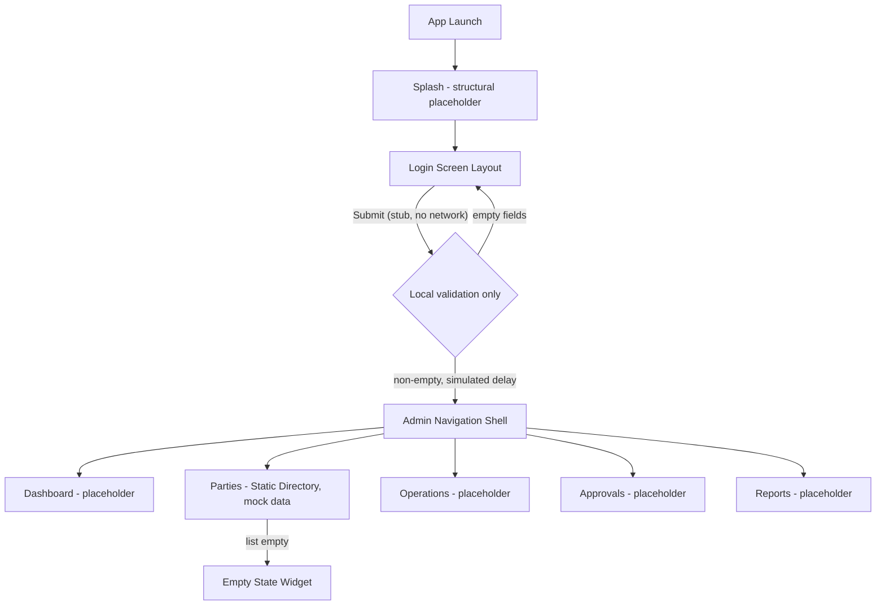
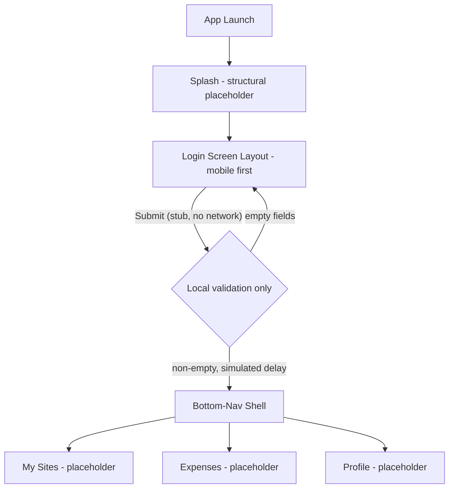

# Sprint 1

> ⚠️ **Superseded by the auth contract (v1.4 on 2026-10-01, now v1.5 of 2026-10-15).** The default password `12345678`, the `users.disabled` login message, the non-versioned `/api/...` paths and the "show the new password after a reset" dialog in this sprint are **obsolete**. The source of truth is `docs/implementation/backend/features/auth-and-users-api-contract.md` (§16 lists the frontend changes); the ordered work for both apps is `docs/implementation/sprints/frontend-auth-contract-alignment-plan.md`. The text below is kept unchanged as history.

**Project:** Contractra — Frontend (Admin & Employee apps)
**Doc status:** Derived planning document — not authoritative for business rules. On any conflict with `docs/documentation-index-ar.md`-ranked sources, the sources win.
**Backend state assumed:** Party Identity implemented · Authorization Catalog implemented · Users/Auth NOT implemented · Operations/Sites NOT implemented · Financial modules NOT implemented.
**Constraint carried through every story below:** no task in this sprint calls a real API, implements authentication, or renders real business data. Anything that looks like it reads backend data is built against **static/mock data shaped like the documented model**, clearly marked as a placeholder in code.

---

## 0. Candidate User Stories Considered

| Candidate | Kept for Sprint 1? | Reason |
|---|---|---|
| Flutter workspace scaffolding for both apps | Yes | Pure setup, zero backend dependency. Already the ground this sprint stands on. |
| Design system / theme foundation (colors, type scale, spacing) | Yes | Local-only, needed by every later screen, blocks nothing. |
| Shared UI kit (buttons, inputs, empty/loading/error states) | Yes | Local-only, needed before any real screen can be built in Sprint 2. |
| Admin navigation shell (web-first) | Yes | Structural routing/layout only; module screens stay placeholders. |
| Employee navigation shell (mobile-first) | Yes | Same reasoning, different device-first assumption. |
| Admin login screen layout | Yes | UC-001 (تسجيل الدخول) is documented and role-agnostic; **layout only**, no `POST /login` call — Users/Auth backend doesn't exist yet. |
| Employee login screen layout | Yes | Same UC-001, Employee shell is mobile-first so the layout differs materially from Admin's. |
| Static Party Directory screen (Admin) | Yes | Party Identity is the one domain with a real backend today, so its list/detail **shape** is knowable from `logical-data-model-ar.md` §2. Data is still mocked — no API call — because there is no endpoint to call yet and wiring one is out of scope. |
| Real login (calling an auth endpoint) | No — Rejected | Users/Auth is not implemented backend-side. |
| Any Operations/Sites screen (UC-004…UC-007) | No — Rejected | Operations/Sites backend not implemented; nothing real to model the screen against yet. |
| Any Expenses/Custody screen (UC-008…UC-016) | No — Rejected | Depends on Operations/Sites + financial modules, neither implemented. |
| Dashboard with real KPIs/reports | No — Rejected | Depends on financial + operations data that doesn't exist. |
| Role/permission-driven navigation (hiding menu items by permission) | No — Deferred | Needs a real authenticated session (Users/Auth) to know the caller's permissions; the Authorization Catalog defines *what* permissions exist but not *who has what* until a user can log in. |
| User/permission management screen (UC-002) | No — Deferred | Belongs to Admin's "Users" module, itself gated behind Users/Auth existing. |

**Dependency chain informing the cut:** `workspace scaffold -> design system -> shared UI kit -> navigation shells -> login layouts -> static Party Directory`. Each story only depends on the ones before it in this chain plus documentation already on disk; nothing depends on a backend capability that isn't built.

**Why these stories belong together:** they are exactly the slice of frontend work that has zero backend precondition — pure structure, pure presentation, pure layout — while still being traceable to real documented use cases (UC-001, and the `parties` entity in `logical-data-model-ar.md`/`database-design-ar.md`). Nothing here fabricates a business flow that isn't in the source documents.

---

## Sprint Goal

Stand up both Contractra frontend applications (Admin, Employee) on a shared architectural pattern — theming, navigation shell, and a first documented screen layout (login) per app — so that Sprint 2+ can start wiring real screens the moment Users/Auth and Operations/Sites exist on the backend, without redoing structural work.

## Included Applications

- **Contractra Admin** — `Contractra_System/apps/contractra_admin` — web-first management shell.
- **Contractra Employee** — `Contractra_System/apps/contractra_employee` — mobile-first operational shell.

---

## User Story US-001

**Title:** Design System Foundation (Theme, Typography, Spacing)

**As a** frontend developer on either Contractra app
**I want** a shared set of design tokens (colors, type scale, spacing, radii) implemented as Flutter theme extensions
**So that** every screen built from Sprint 2 onward pulls from one consistent source instead of hardcoding values per screen

**Acceptance Criteria:**
- `ThemeModel` in each app exposes named color roles (primary, accent, background, surface, border, success/warning/danger, text-primary/secondary) — no raw `Colors.*` used outside this file.
- A `TextStyleHelper`-style class exposes a named type scale (e.g. `h1`…`h6`, `bodyLg`, `bodySm`, `caption`) built on `flutter_screenutil_plus` sizes.
- A spacing/radius token set (`AppSpacing`, `AppRadius`) exists and is documented with a doc-comment per token explaining intended usage.
- Applying `ThemeCubit.changeTheme` swaps every token live (verified by toggling dark/light in a throwaway debug screen, removed before merge).
- No screen-specific or business-specific color/spacing exists in this story's output.

**Dependencies:** Flutter workspace scaffold (done — see `Contractra_System/apps/contractra_admin`, `Contractra_System/apps/contractra_employee`).

**Blocked by:** none.

**Out of Scope:** Admin- vs Employee-specific visual identity beyond shared tokens (both apps may end up with identical tokens this sprint — divergence, if any, is a design decision for later); dark mode polish beyond "doesn't visually break."

### Tasks

#### TASK-001 — Extend `ThemeModel` with the Full Color Role Set

**Description:** Extend the scaffolded `ThemeModel` (`lib/core/theme/theme_model.dart`) in both apps from its current 6 placeholder colors to the full named role set needed by later screens.
**Scope:** Add fields: `surfaceColor`, `borderColor`, `successColor`, `textPrimaryColor`, `textSecondaryColor`, `disabledColor`. Update `copyWith`, `toJson`, `fromJson`, `lerp` accordingly. Provide one light and one dark `ThemeModel` preset.
**Done When:** `ThemeModel.defaultTheme` and a new `ThemeModel.darkTheme` both compile, round-trip through `toJson`/`fromJson` without loss, and `flutter analyze` is clean in both apps.
**Files or Areas Expected:** `lib/core/theme/theme_model.dart` in both `contractra_admin` and `contractra_employee`.
**Dependencies:** none.

#### TASK-002 — Build the Typography Scale Helper

**Description:** Create `lib/utilities/text_style_helper.dart` exposing a static/context-based API for the named type scale, built on `flutter_screenutil_plus` (`.sp`) and `google_fonts`.
**Scope:** Define `TextStyleHelper.of(context)` returning an object with getters `h1`…`h4`, `bodyLg`, `bodyMd`, `bodySm`, `caption`, `label`. Each getter returns a `TextStyle` with explicit `fontSize`, `fontWeight`, and `height` — no color baked in (color is applied by the caller from `ThemeModel`).
**Done When:** The helper compiles, is unused-import-free, and a unit test (`test/text_style_helper_test.dart`) asserts each getter returns a non-null `TextStyle` with the expected relative ordering of font sizes (h1 > h2 > … > caption).
**Files or Areas Expected:** `lib/utilities/text_style_helper.dart`, `test/text_style_helper_test.dart` — both apps.
**Dependencies:** none.

#### TASK-003 — Define Spacing & Radius Tokens

**Description:** Create `lib/core/theme/app_spacing.dart` with a small static class of spacing (`xs`, `sm`, `md`, `lg`, `xl`) and radius (`sm`, `md`, `lg`, `pill`) constants, in scaled (`.w`/`.r`) units.
**Scope:** Values only — no widgets in this file.
**Done When:** File exists, values are documented with one-line doc-comments stating intended usage (e.g. "sm — spacing between a label and its input"), and both apps import it without error.
**Files or Areas Expected:** `lib/core/theme/app_spacing.dart` — both apps.
**Dependencies:** none.

#### TASK-004 — Manual Theme Verification Screen (Throwaway)

**Description:** Build a temporary debug-only screen (not wired into the router, launched via a `flutter run --dart-define=DEBUG_THEME=1` flag or a commented-out route) that renders every color role and every type scale entry as swatches/text so a human can eyeball correctness before merge.
**Scope:** One file, deleted at the end of the story (tracked so it doesn't ship).
**Done When:** Reviewer has visually confirmed both light and dark theme render all tokens without overflow or contrast failure, then the file is removed in the same PR/commit that closes this story.
**Files or Areas Expected:** a temporary file under `lib/module/home/presentation/screens_layout/` (or equivalent), deleted before task close.
**Dependencies:** TASK-001, TASK-002, TASK-003.

---

## User Story US-002

**Title:** Shared UI Kit — Base Widgets and Local UI States

**As a** frontend developer building any future screen
**I want** a small set of reusable, theme-driven base widgets and empty/loading/error state widgets
**So that** Sprint 2+ screens compose these instead of each hand-rolling buttons, inputs, and state placeholders

**Acceptance Criteria:**
- `AppButton` (primary/secondary/text variants), `AppTextField`, `AppCard` exist, theme-driven, no business copy or business validation logic inside them.
- `EmptyStateWidget`, `LoadingStateWidget`, `ErrorStateWidget` exist, each accepting a title/message/optional action callback — content is passed in by the caller, never hardcoded to a specific feature.
- Every widget has a `flutter_test` widget test asserting it renders without throwing for its documented required parameters.
- No widget in this story makes a network call, reads `SharedPreferences`, or depends on any module-specific cubit.

**Dependencies:** US-001 (needs theme tokens to consume).

**Blocked by:** none.

**Out of Scope:** Form-level validation widgets tied to a specific business field (e.g. national-ID formatting); table/data-grid components for Admin (deferred to the story that actually needs one, since a "dense management table" without real columns is not buildable yet — flagged as **Future Work**, see the Future Work section).

### Tasks

#### TASK-005 — Implement `AppButton`

**Description:** Build a single `AppButton` widget supporting `primary`, `secondary`, and `text` visual variants via an enum parameter, plus `isLoading` and `isDisabled` states.
**Scope:** Widget + its own `ButtonVariant` enum. Uses `ThemeModel` colors and `TextStyleHelper` exclusively for styling.
**Done When:** Widget test renders all 3 variants x {enabled, disabled, loading} = 9 render passes without exception; `flutter analyze` clean.
**Files or Areas Expected:** `lib/widget/app_button.dart`, `test/widget/app_button_test.dart` — both apps.
**Dependencies:** US-001 complete.

#### TASK-006 — Implement `AppTextField`

**Description:** Build a single-line/multi-line capable text field widget wrapping `TextFormField`, exposing `label`, `hint`, `errorText`, `obscureText`, `keyboardType`, `onChanged` — no built-in validators.
**Scope:** Structural wrapper only; actual validation rules belong to the feature that uses it (e.g. the login story, or a Sprint 2 form).
**Done When:** Widget test covers: empty state, populated state, error-text-shown state; renders under both LTR and RTL `Directionality` without overflow.
**Files or Areas Expected:** `lib/widget/app_text_field.dart`, `test/widget/app_text_field_test.dart` — both apps.
**Dependencies:** US-001 complete.

#### TASK-007 — Implement `AppCard`

**Description:** Build a themed container widget (`AppCard`) wrapping `Card`/`DecoratedBox` with consistent elevation, radius (from `AppSpacing`), and padding, accepting an arbitrary `child`.
**Scope:** Layout-only, no content assumptions.
**Done When:** Widget test renders with a placeholder child at 3 different content sizes without overflow.
**Files or Areas Expected:** `lib/widget/app_card.dart`, `test/widget/app_card_test.dart` — both apps.
**Dependencies:** US-001 complete.

#### TASK-008 — Implement Empty / Loading / Error State Widgets

**Description:** Build 3 small widgets — `EmptyStateWidget`, `LoadingStateWidget`, `ErrorStateWidget` — each taking `title`, optional `message`, optional `actionLabel` + `onAction` callback (Empty/Error only). `LoadingStateWidget` shows a `CircularProgressIndicator` plus optional label.
**Scope:** Presentation only; no data-fetching logic, no cubit wiring — a future feature's cubit picks which of these 3 to show.
**Done When:** All 3 render in isolation in widget tests, with and without the optional action/message.
**Files or Areas Expected:** `lib/widget/empty_state_widget.dart`, `lib/widget/loading_state_widget.dart`, `lib/widget/error_state_widget.dart`, matching tests — both apps.
**Dependencies:** US-001 complete.

---

## User Story US-003

**Title:** Admin App Navigation Shell (Web-First)

**As an** Admin/OfficeStaff/Accountant user of Contractra Admin
**I want** a persistent navigation shell (side rail/drawer on web width, collapsible on narrower widths) exposing the app's anticipated modules
**So that** the app has one consistent frame for every module screen built in later sprints, and module screens can be added by registering a route without re-plumbing navigation

**Acceptance Criteria:**
- An `AppShellScreen` widget renders a side navigation listing entries for: Dashboard, Parties, Operations, Approvals, Reports — each entry navigates via `go_router` to a route that currently renders only a placeholder ("Coming soon" + module name) screen.
- Layout is responsive: side rail is always visible >= 1200px width (per template's `largeSize`), collapses to a drawer-triggered-by-menu-icon below that.
- No navigation entry is gated by permission yet (explicitly deferred — see the Future Work section) since there is no authenticated session to read permissions from.
- Route table lives in `router_config.dart`, one `GoRoute` per module, all pointing at their module's `presentation/screens_layout` folder (already scaffolded).

**Dependencies:** US-001, US-002 (shell uses theme + shared widgets for the placeholder screens).

**Blocked by:** none for the shell itself. Permission-aware menu filtering is blocked by Users/Auth not existing.

**Out of Scope:** Real Dashboard/Parties/Operations/Approvals/Reports screen content (all placeholder); breadcrumbs; multi-level nested navigation.

### Tasks

#### TASK-009 — Build `AppShellScreen` Layout Contract

**Description:** Define the shell widget that lays out a side navigation rail + content area (using `go_router`'s `ShellRoute` / `StatefulShellRoute`), matching the responsive breakpoints already defined by the template's `RushSetup` convention (large >= 1200, medium >= 600).
**Scope:** Layout and navigation wiring only — the content area renders whatever child route gives it.
**Done When:** Manually resizing the app window across the 3 breakpoints keeps the nav usable (rail visible / drawer collapsed) with no overflow; `flutter analyze` clean.
**Files or Areas Expected:** `lib/utilities/app_shell_screen.dart` (or `lib/module/home/presentation/screens_layout/` per existing scaffold pattern), `lib/utilities/router_config.dart` — `contractra_admin` only.
**Dependencies:** US-002 complete (uses `AppCard`/base widgets for nav items).

#### TASK-010 — Register Placeholder Routes for the 5 Admin Modules

**Description:** Add one `GoRoute` per module (`dashboard`, `parties`, `operations`, `approvals`, `reports`) nested under the shell route, each rendering a trivial placeholder screen ("`<Module Name>` — coming soon").
**Scope:** Routing table + 5 placeholder widget files (one per already-scaffolded module folder).
**Done When:** Clicking each nav entry navigates to its route and shows the correct module name; deep-linking to each route directly (e.g. via URL on web) also works.
**Files or Areas Expected:** `lib/module/{dashboard,parties,operations,approvals,reports}/presentation/screens_layout/*_placeholder_screen.dart`, `lib/utilities/router_config.dart` — `contractra_admin`.
**Dependencies:** TASK-009.

#### TASK-011 — Nav Item Widget with Active-Route Highlighting

**Description:** Build a small `NavRailItem` widget used by the shell that highlights itself when its route is the currently active one (via `GoRouterState`).
**Scope:** Single reusable widget, theme-driven.
**Done When:** Widget test confirms the "active" visual state applies only when passed `isActive: true`.
**Files or Areas Expected:** `lib/widget/nav_rail_item.dart` or co-located with the shell — `contractra_admin`.
**Dependencies:** TASK-009.

---

## User Story US-004

**Title:** Employee App Navigation Shell (Mobile-First)

**As an** Engineer using Contractra Employee
**I want** a simple bottom-navigation shell exposing only the sections relevant to me
**So that** the app stays task-focused with no admin/management surface area, matching the documented role boundary (Engineer cannot see cost/profitability, cannot approve, cannot manage assignments — §7.1 of the team reference)

**Acceptance Criteria:**
- A bottom navigation bar with 3 destinations: **My Sites** (maps to the scaffolded `assignments` module), **Expenses** (`expenses` module), **Profile** (`profile` module) — deliberately excludes anything resembling reports, approvals, or system-wide views.
- Each destination routes to a placeholder screen ("coming soon" + destination name) via `go_router`'s bottom-nav-friendly shell pattern (`StatefulShellRoute.indexedStack` or equivalent).
- Layout assumes phone width first; verified not to break at tablet width (secondary, not primary, per requirements).

**Dependencies:** US-001, US-002.

**Blocked by:** none.

**Out of Scope:** Real "My Sites"/"Expenses"/"Profile" content (all placeholder); offline/sync UI (documented in §23 of the team reference but depends on Operations/Sites + Expenses backend, neither implemented).

### Tasks

#### TASK-012 — Build Bottom-Navigation Shell

**Description:** Implement the Employee shell using `go_router`'s indexed-stack shell pattern with 3 tabs (My Sites, Expenses, Profile), each with its own icon + label.
**Scope:** Navigation/layout only.
**Done When:** Switching tabs preserves each tab's own navigation stack (verified by pushing a dummy sub-route on one tab, switching away, switching back, sub-route still there), `flutter analyze` clean.
**Files or Areas Expected:** `lib/utilities/app_shell_screen.dart`, `lib/utilities/router_config.dart` — `contractra_employee`.
**Dependencies:** US-002 complete.

#### TASK-013 — Register Placeholder Routes for the 3 Employee Tabs

**Description:** Add placeholder screens for `assignments`, `expenses`, `profile`, each showing its own name and a "coming soon" message.
**Scope:** 3 placeholder screen files + route registration.
**Done When:** All 3 tabs render their correct placeholder and are reachable both by tapping and by direct route.
**Files or Areas Expected:** `lib/module/{assignments,expenses,profile}/presentation/screens_layout/*_placeholder_screen.dart`, `lib/utilities/router_config.dart` — `contractra_employee`.
**Dependencies:** TASK-012.

---

## User Story US-005

**Title:** Admin Login Screen Layout (No Backend Call)

**As an** Admin/OfficeStaff/Accountant opening Contractra Admin
**I want** a login screen matching UC-001's documented flow shape (identifier + password + submit)
**So that** the visual/structural contract exists before Users/Auth is implemented, so wiring the real call in a later sprint is a cubit change, not a UI rebuild

**Acceptance Criteria:**
- Screen shows: identifier field, password field (obscured, with a visibility toggle), submit button, and a static "forgot password?" link that is visually present but **disabled/non-functional** (no flow exists to send it to).
- Submitting triggers only **local, structural** state transitions (`idle -> submitting -> idle`) via a `LoginCubit` that does **not** call any repository, service, or `Dio` client — the cubit's `submit()` method is a stub that simulates a 1-second delay then resets, with a `// TODO(sprint-2): call POST /auth/login once Users/Auth backend exists` comment.
- Layout follows UC-001's actor-agnostic nature (no role picker — role comes from the account after real auth exists) and is web-first per Admin's stated design direction (centered card on large screens; matching the template's `LargeLoginScreen` branding-panel pattern is optional/adaptable, not mandatory to copy verbatim).
- No password is logged, printed, or persisted anywhere (`password_hash` handling in `logical-data-model-ar.md` §1.7 explicitly forbids logging raw credentials — this UI-only story respects that by never writing the field's value outside the form's own state).

**Dependencies:** US-001, US-002.

**Blocked by:** Real authentication is blocked by Users/Auth backend not existing — explicitly out of scope, not attempted.

**Out of Scope:** Any real authentication call; "remember me"; session persistence; forgot-password flow; multi-factor; error messaging tied to real server responses (only a generic local validation message, e.g. "both fields are required", is allowed).

### Tasks

#### TASK-014 — Define Admin Login Page Layout

**Description:** Build the static layout for the Admin login screen: identifier field, password field with visibility toggle, submit button, disabled "forgot password?" link, using `AppTextField`/`AppButton` from US-002.
**Scope:** Layout contract only — no submit logic lives in this task, the button calls a no-op callback passed in from outside for now.
**Done When:** Screen renders correctly at large (>=1200) and small (<600) widths without overflow; widget test confirms all 4 elements (2 fields, button, disabled link) are present.
**Files or Areas Expected:** `lib/module/auth/login/presentation/screens_layout/l_login_screen.dart`, `.../s_login_screen.dart`, `lib/module/auth/login/presentation/login_screen.dart` — `contractra_admin`.
**Dependencies:** US-002 complete.

#### TASK-015 — Implement Stub `LoginCubit` (No Network)

**Description:** Implement `LoginCubit`/`LoginState` with states `idle`, `submitting`, `validationError`. `submit(identifier, password)` validates both fields are non-empty locally, then simulates a delay and returns to `idle` — never calls a repository or `Dio`.
**Scope:** Cubit + state class only.
**Done When:** Unit test (`bloc_test`) confirms the exact state sequence `idle -> submitting -> idle` on valid input and `idle -> validationError` on empty input, with zero network package (`dio`/`fast_dio`) imports anywhere in the cubit file.
**Files or Areas Expected:** `lib/module/auth/login/cubit/login_cubit.dart`, `login_state.dart`, `test/module/auth/login/login_cubit_test.dart` — `contractra_admin`.
**Dependencies:** none.

#### TASK-016 — Wire Login Screen to Stub Cubit and Register Route

**Description:** Connect TASK-014's layout to TASK-015's cubit via `BlocProvider`/`BlocBuilder`, and register `/login` in `router_config.dart` as the app's actual entry route (replacing the placeholder splash route as the effective start screen, splash can remain a brief transient screen before redirecting to `/login`).
**Scope:** Wiring + routing only.
**Done When:** Launching the app lands on (or transiently passes through splash to) the login screen; submitting valid-looking input visibly shows a loading state on the button and returns to idle; submitting empty input shows the local validation message.
**Files or Areas Expected:** `lib/module/auth/login/presentation/login_screen.dart`, `lib/utilities/router_config.dart` — `contractra_admin`.
**Dependencies:** TASK-014, TASK-015.

---

## User Story US-006

**Title:** Employee Login Screen Layout (No Backend Call)

**As an** Engineer opening Contractra Employee
**I want** a mobile-first login screen matching UC-001
**So that** the Employee app has the same structural entry-point contract as Admin, sized and laid out for a phone rather than adapted from a desktop layout

**Acceptance Criteria:**
- Same functional contract as US-005 (identifier, password w/ toggle, submit, disabled forgot-password link, stub cubit, no network call, no credential logging).
- Layout is single-column, full-width fields, bottom-anchored submit button — no side branding panel (that pattern is Admin/web-specific per US-005, not appropriate for a phone-first single-column screen).

**Dependencies:** US-001, US-002.

**Blocked by:** Real authentication — same reasoning as US-005, explicitly out of scope.

**Out of Scope:** identical list to US-005's Out of Scope.

### Tasks

#### TASK-017 — Define Employee Login Page Layout

**Description:** Build the static mobile-first layout: identifier field, password field with visibility toggle, full-width submit button pinned near the bottom, disabled "forgot password?" text link.
**Scope:** Layout only, no submit logic (no-op callback).
**Done When:** Renders correctly on a 375x812 (small) canvas and a 768-wide (medium/tablet) canvas without overflow; widget test confirms all elements present.
**Files or Areas Expected:** `lib/module/auth/login/presentation/screens_layout/s_login_screen.dart`, `.../m_login_screen.dart`, `lib/module/auth/login/presentation/login_screen.dart` — `contractra_employee`.
**Dependencies:** US-002 complete.

#### TASK-018 — Implement Stub `LoginCubit` (No Network)

**Description:** Same contract as TASK-015, implemented independently for the Employee app (apps share no code dependency per the task's constraint that they remain separate apps).
**Scope:** Cubit + state class only.
**Done When:** Same as TASK-015's Done When, run against `contractra_employee`.
**Files or Areas Expected:** `lib/module/auth/login/cubit/login_cubit.dart`, `login_state.dart`, `test/module/auth/login/login_cubit_test.dart` — `contractra_employee`.
**Dependencies:** none.

#### TASK-019 — Wire Login Screen to Stub Cubit and Register Route

**Description:** Same contract as TASK-016, for `contractra_employee`.
**Scope:** Wiring + routing only.
**Done When:** Same as TASK-016's Done When, run against `contractra_employee`.
**Files or Areas Expected:** `lib/module/auth/login/presentation/login_screen.dart`, `lib/utilities/router_config.dart` — `contractra_employee`.
**Dependencies:** TASK-017, TASK-018.

---

## User Story US-007

**Title:** Static Party Directory Screen (Admin, Mock Data Only)

**As an** Admin/OfficeStaff/Accountant browsing Contractra Admin
**I want** a read-only list layout shaped exactly like the documented `parties` entity (name, role badges, status)
**So that** the Parties module has a real, documented-shape screen ready the moment a `GET /parties` (or equivalent) endpoint exists, instead of starting from a blank screen in a later sprint

**Acceptance Criteria:**
- Screen renders a list of party rows sourced from a **local, hardcoded mock list** (not a repository, not a service call) whose shape matches `parties` + `party_roles` from `logical-data-model-ar.md` §2 / `database-design-ar.md` §6.2: display name, one or more role badges (e.g. "Supplier", "Subcontractor" — using the documented role vocabulary, not invented ones), and a status indicator reflecting the documented lifecycle (`Active` / `NeedsClassification` / `Inactive`).
- The mock data file is clearly named and commented as a placeholder (e.g. `mock_parties.dart` with a top-of-file comment: "Placeholder data shaped after `parties`/`party_roles` — replace with a real repository call once the Parties read API exists. Do not treat as real records.").
- Uses `EmptyStateWidget` if the mock list is emptied (verified in a test by passing an empty list), demonstrating the shared UI kit's empty state actually gets used by a real screen.
- No create/edit/delete affordance — this is a read-only list per the "no business feature implementation" scaffolding constraint; even though Party Identity has a real backend, wiring writes is explicitly deferred to whichever sprint does real API integration.

**Dependencies:** US-001, US-002, US-003 (renders inside the Admin shell's `parties` route).

**Blocked by:** none for the static version. Real data wiring is blocked by no confirmed read API contract for Parties yet (flagged as an open item, not assumed).

**Out of Scope:** Search/filter/sort; pagination; party detail screen; create/edit forms; any real HTTP call.

### Tasks

#### TASK-020 — Create Mock Party Dataset Matching the Documented Model

**Description:** Create a local Dart file with 8-12 hardcoded party records whose fields match `parties`/`party_roles` as documented (id, display name, list of role codes from the documented vocabulary, lifecycle status).
**Scope:** Data only, no widget code.
**Done When:** File compiles, is imported only by the Parties screen/test (not by any core/shared file), and every role code used appears in the documented role vocabulary (§7.1/§6.2 of the source docs) — cross-checked by the task's author against the doc before commit.
**Files or Areas Expected:** `lib/module/parties/data_layer/models/mock_parties.dart` — `contractra_admin`.
**Dependencies:** none.

#### TASK-021 — Build `PartyListItemWidget`

**Description:** Build a single list-row widget rendering one mock party's display name, role badges, and status indicator, using `AppCard` and theme tokens from US-001/US-002.
**Scope:** Presentation only, takes a plain Dart model as input, no cubit.
**Done When:** Widget test renders the row for a party with 1 role and a party with 3 roles without overflow, and confirms the status indicator's color matches the documented status (e.g. `NeedsClassification` renders visually distinct from `Active`).
**Files or Areas Expected:** `lib/module/parties/presentation/widgets/party_list_item_widget.dart`, matching test — `contractra_admin`.
**Dependencies:** TASK-020.

#### TASK-022 — Assemble the Party Directory List Screen

**Description:** Build the screen that renders `ListView.builder` over the mock dataset using `PartyListItemWidget`, falling back to `EmptyStateWidget` when the list is empty, and register it at the `parties` route (replacing that module's placeholder from TASK-010).
**Scope:** Screen assembly + route swap only.
**Done When:** Navigating to Parties from the Admin nav shell shows the mock list; a widget test with an empty list shows `EmptyStateWidget` instead.
**Files or Areas Expected:** `lib/module/parties/presentation/screens_layout/party_directory_screen.dart`, `lib/utilities/router_config.dart` — `contractra_admin`.
**Dependencies:** TASK-021, TASK-010 (US-003).

---

## Sprint 1 User Flows

### Admin — Sprint 1 Flow

### Employee — Sprint 1 Flow

---

## Sprint 1 Summary

| Metric | Value |
|---|---|
| User Stories | 7 (US-001…US-007) |
| Tasks | 22 (TASK-001…TASK-022) |
| Applications touched | Both (US-001, US-002 shared-pattern); Admin-only (US-003, US-005, US-007); Employee-only (US-004, US-006) |
| Backend dependencies introduced | None — every task is local/static/mock |
| Explicitly flagged blockers | Real authentication (Users/Auth not implemented); permission-aware navigation filtering (needs an authenticated session); real Parties data wiring (no confirmed read API contract yet) |
| Open questions surfaced, not resolved | Whether Admin and Employee will diverge on theme tokens (deferred — no source document mandates a difference yet, so treated as "same until told otherwise") |

---

## Future Work (Sprint 2+, broad areas only — not detailed here)

- **Real authentication integration** once Users/Auth backend exists (wire the two stub `LoginCubit`s to a real endpoint, add session persistence, add permission-aware navigation filtering).
- **Real Parties data + CRUD** once a Parties API contract is confirmed (replace mock dataset, add create/edit/detail screens, add search/filter/pagination).
- **Operations & Sites module** (Admin) — entirely blocked until that backend domain exists (UC-004…UC-007).
- **Engineer Assignments / My Sites real content** (Employee) — blocked on Operations/Sites backend.
- **Expenses module** (both apps, different views) — blocked on Operations/Sites + Custody/Expenses backend.
- **Approvals module** (Admin) — blocked on Expenses backend existing to have anything to approve.
- **Reports module** (Admin) — blocked on financial modules.
- **Dense data table / filter component for Admin** — deferred until a real module needs one, so its column/filter contract is driven by real data, not guessed.
- **Offline-first sync UX** (Employee, §23 of the team reference) — blocked on Expenses backend + defined sync protocol.
- **Localization content buildout** (`i18n/en.json`, `i18n/ar.json`) — currently only structural placeholder keys exist; real UI copy gets added per-screen as screens are built.
- **Design divergence review** between Admin and Employee visual identity, if the product decides they should differ beyond information density.

---

## Sprint 1 Extension — Authentication & User Management

**Added:** 2026-09-26, at the product owner's request (`claude-code-prompt-02-frontend.md`).

**Supersedes, for these stories only:** the sprint-wide constraint "no task calls a real API", and the stub-only scope of US-005 (TASK-015) and US-006 (TASK-018). The stub `LoginCubit`s are replaced, not kept alongside.

**Backend state at time of writing:** the API contract file (`docs/implementation/backend/features/auth-and-users-api-contract.md`) does not exist, and there are no auth or users endpoints. Every story below is built **mock-first** behind a repository interface. The Dio implementations follow the endpoint list in the prompt and stay unverified until the contract exists.

**Detailed plan, gaps and risks:** `frontend-auth-and-users-plan.md` in this folder. These gaps come from the prompt and are **not** in the authoritative docs, so they need confirmation before the real integration:
- G2: default password and forced password change.
- G3: token model.
- G4: reactivate and reset endpoints.
- G7: who may use the Employee app.
- G9: web token storage.

### User Story US-008

**Title:** Networking Foundation (both apps)

**As a** frontend developer
**I want** one configured HTTP client with token handling and typed errors
**So that** every feature calls the backend the same way and never handles tokens or raw error payloads itself

**Acceptance Criteria:**
- The base URL and mock mode come from `--dart-define` (`API_BASE_URL`, `USE_MOCK_API`), per environment.
- The access token is attached to every request. On a 401 the client refreshes **once** (concurrent 401s share one refresh) and then retries. If the refresh fails, the session is cleared.
- ProblemDetails `code` values map to typed failures. Unknown codes map to a generic failure and are never shown raw.
- Tokens are stored with `flutter_secure_storage`. The web trade-off is documented in code (plan G9).

**Dependencies:** US-001, US-002. **Blocked by:** none (mock-first).

#### TASK-023 — App Config per Environment
Read `API_BASE_URL` and `USE_MOCK_API` from `--dart-define`, with safe defaults (mock on). Files: `lib/core/config/app_config.dart`, both apps.

#### TASK-024 — Token Storage
A `TokenStorage` interface with a secure-storage implementation and an in-memory implementation for tests. The access token is held in memory only; the refresh token is persisted. Files: `lib/core/network/token_storage.dart`, both apps.

#### TASK-025 — ProblemDetails → Typed Failures
A sealed `Failure` hierarchy and a mapper for the known codes: `auth.invalid_credentials`, `auth.password_change_required`, `users.login_identifier_taken`, `users.role_required` and `users.disabled`, plus network, unauthorized, forbidden and unknown failures. **Done When:** a unit test covers every code. Files: `lib/core/network/failures.dart`, `problem_details_mapper.dart`, both apps.

#### TASK-026 — Dio Client + Auth Interceptor
A Dio factory and an interceptor that attaches the token, handles a 401 with a single shared refresh, retries the request, and logs out if the refresh fails. **Done When:** unit tests with a mocked Dio cover:
- the token being attached;
- refresh followed by a retry;
- concurrent 401s refreshing only once;
- a failed refresh clearing the session.

Files: `lib/core/network/api_client.dart`, `auth_interceptor.dart`, both apps.

### User Story US-009

**Title:** Session & Router Guards (both apps)

**As a** user of either app
**I want** the app to know whether I am signed in and whether I must change my password
**So that** I only ever see the screens my session allows

**Acceptance Criteria:**
- `SessionCubit` states: unknown → unauthenticated → authenticating → authenticated / passwordChangeRequired.
- Guards:
  - Not signed in goes to `/login`.
  - `mustChangePassword` goes to `/change-password`, and logout is the only way out.
  - Signed in on `/login` goes to the landing route.
- Splash restores an existing session (refresh token, then `/auth/me`) before redirecting.

**Dependencies:** US-008.

#### TASK-027 — AuthRepository (Interface, Dio, Mock)
Covers login, refresh, logout, change-password and `me`. The mock seeds placeholder users, including one that must change its password and one disabled account. **Done When:** repository tests with a mocked Dio pass. Files: `lib/module/auth/data_layer/**`, both apps.

#### TASK-028 — SessionCubit
**Done When:** a bloc_test covers each transition. Files: `lib/core/session/*`, both apps.

#### TASK-029 — Router Guards
A `redirect` plus a `refreshListenable` bound to `SessionCubit`. **Done When:** a guard table test covers every session state against both public and protected routes. Files: `lib/utilities/router_config.dart`, both apps.

#### TASK-030 — Splash Session Restore
Replaces the Sprint 1 timer-based splash redirect. Files: `lib/module/auth/splash/**`, both apps.

### User Story US-010

**Title:** Real Login, Forced Password Change, Logout (both apps)

**As a** user created by an Admin
**I want** to sign in, set my own password on first sign-in, and sign out
**So that** my account is protected from the first day

**Acceptance Criteria:**
- Login uses the Sprint 1 layouts (TASK-014, TASK-017), now wired to `AuthRepository`. Invalid credentials show one generic message that never says which field is wrong (UC-001 exception flow). A disabled account is rejected.
- Change-password has current, new and confirm fields, with these client rules:
  - at least 8 characters;
  - not `12345678`;
  - confirm must match.

  Server errors are mapped. Success lands on the app's landing route: Admin `/dashboard`, Employee `/assignments` (plan G8).
- Logout is available in both apps, including from the change-password screen.
- Neither app has a sign-up screen (FR-AUTH-003, UC-002).
- Credentials are never logged or persisted.

**Dependencies:** US-009.

#### TASK-031 — LoginCubit on AuthRepository
Replaces the stubs from TASK-015 and TASK-018. **Done When:** a bloc_test covers success, `mustChangePassword`, invalid credentials, and a disabled account. Both apps.

#### TASK-032 — Login Screen Error States
Adds the generic error message and the disabled-account message. **Done When:** widget tests pass. Both apps.

#### TASK-033 — Change-Password Screen + Cubit
**Done When:** cubit and widget tests cover each client rule, a server error, and success. Files: `lib/module/auth/change_password/**`, both apps.

#### TASK-034 — Logout Action
The Admin app puts it in an account menu in the shell; the Employee app puts it on the Profile tab. **Done When:** a test shows logout clears the session and returns to `/login`. Both apps.

### User Story US-011

**Title:** Users List (Admin)

**As an** Admin holding `Users.Manage`
**I want** to browse, search and filter users
**So that** I can manage accounts without leaving the app

**Acceptance Criteria:**
- The nav item "المستخدمين" is visible, and `/users` is reachable, **only** with `Users.Manage`. This resolves the Sprint 1 deferral of permission-aware navigation, for this one item.
- A table shows the login identifier, roles, and status (Active / Disabled badge), with search, a status filter, pagination, and empty / loading / error states. Below 600 px it becomes a card list.
- There is no delete action (FR-AUTH-004).

**Dependencies:** US-009, US-010.

#### TASK-035 — UsersRepository (Interface, Dio, Mock)
Covers these calls:
- `GET /api/users` (paged, with search and status filter);
- `GET /api/users/{id}`;
- `GET /api/roles`;
- create, disable, reactivate and reset-password.

**Done When:** repository tests with a mocked Dio pass. Files: `lib/module/users/data_layer/**`.

#### TASK-036 — Users List Cubit + Screen
**Done When:** cubit tests (search, filter, paging, error) and widget tests (each state) pass. Files: `lib/module/users/{cubit,presentation}/**`.

#### TASK-037 — Permission-Gated Nav Item
**Done When:** a test shows the item is hidden without `Users.Manage` and the route redirects. Files: `app_shell_screen.dart`, `router_config.dart`.

### User Story US-012

**Title:** Create User & Account Actions (Admin)

**As an** Admin holding `Users.Manage`
**I want** to create users and to disable, reactivate, or reset them
**So that** onboarding and offboarding happen in the system, never by deleting history

**Acceptance Criteria:**
- The "مستخدم جديد" form has a login identifier field and a role multi-select loaded from `GET /api/roles`, with at least one role required (FR-AUTH-003). It has no password field. On success a dialog says: "تم إنشاء المستخدم — كلمة المرور الافتراضية 12345678 وسيُطلب منه تغييرها عند أول دخول".
- Disable, reactivate and reset-password each require a confirmation dialog. Reset shows the same default-password message.
- Server errors (`users.login_identifier_taken`, `users.role_required`, and so on) are shown in Arabic.

**Dependencies:** US-011.

#### TASK-038 — New-User Form Cubit + Screen
**Done When:** widget tests cover the role-required rule, a taken identifier, and the success dialog.

#### TASK-039 — User Details + Row Actions
Disable, reactivate and reset-password, each with a confirmation dialog. **Done When:** cubit and widget tests cover both confirming and cancelling each action.

#### TASK-040 — Default-Password Dialog
One shared dialog, used after create and after reset. The default password appears only here (plan G2).

### Extension Summary

| Metric | Value |
|---|---|
| User Stories | 5 (US-008…US-012) |
| Tasks | 18 (TASK-023…TASK-040) |
| Applications | Both apps (US-008…US-010); Admin only (US-011, US-012) |
| Backend dependency | Mock-first; the real integration waits on the API contract and backend auth |
| Open decisions | Plan gaps G2, G3, G4, G7, G9 |
