# Contractra — النموذج المنطقي للبيانات

# Logical Data Model

---

## 0. إدارة الوثيقة

| البند | القيمة |
|---|---|
| **اسم المشروع** | **Contractra** |
| **المعرّف** | `logical-data-model-ar` |
| **الإصدار** | **2.0.1** |
| **الحالة** | 🟢 **مكتمل للمراجعة** — يسبق التصميم الفيزيائي |
| **تاريخ الإصدار** | 2026-09-20 |
| ⭐ **آخر باتش** | ⭐ **`logical-model-correction-patch-v2.0.1-ar.md`** — **مصفوفة آثار الحدث المالي · قيد واحد لكل حدث · `accounting_adjustments` · تصحيح التخصيصات والتسميات** |
| **الباتش السابق** | `logical-model-patch-v1.2.1-ar.md` — ⭐ **سجل تاريخي ⛔ لا يُعدَّل** |
| **يُقرأ مع** | `system-specification-and-team-reference-ar.md` (الأب) · `data-dictionary-ar.md` · `database-integrity-rules-ar.md` · `conceptual-data-model-ar.md` (المصدر) |
| **النطاق** | ⛔ **لا SQL · لا DDL · لا Migrations · لا أنواع PostgreSQL · لا فهارس فيزيائية** |
| **يَبني على** | `conceptual-data-model-ar.md` — ⛔ **ولا يعيد اختراع المشروع من الصفر** |

### 0.1 اصطلاحات هذه الوثيقة

| الرمز | المعنى |
|---|---|
| **AR** | **Aggregate Root** — كيان جذري له هوية وحياة مستقلة |
| **CE** | **Child Entity** — كيان تابع لا معنى له خارج جذره |
| **RD** | **Reference Data** — بيانات مرجعية تُدار ولا تُحذف |
| **VE** | **Value / Derived** — محسوب أو مشتق ⛔ **لا يُخزَّن كرقم قابل للتعديل** |
| 🔑 | Primary Key |
| 🔖 | Natural / Business Key |
| 🔗 | Foreign Key |
| 🔒 | بيانات حساسة |
| 📝 | خاضع للتدقيق |
| ⚡ | يتطلب Idempotency |
| 📊 | له Source Mapping من Excel |
| 🏗️ | ⭐ **Physical Design Candidate — Not Yet Approved** · ⛔ **ليس قرارًا** |

### 0.2 المبادئ الإلزامية المطبَّقة على كل مجال

> **هذه المبادئ ليست توصيات — كل جدول أدناه فُحص عليها.**

| # | المبدأ |
|---|---|
| 1 | **مصدر حقيقة واحد لكل مفهوم مالي** — جدول مالك واحد، والباقي Views |
| 2 | ⛔ **لا رصيد مخزَّن قابل للتعديل يدويًا** — الأرصدة **مشتقة من دفتر حركات**، ويجوز Read Models وSnapshots **للأداء فقط** |
| 3 | ⛔ **لا تعديل مباشر لحركة مالية معتمدة** — التصحيح بـ`reversal` أو `adjustment` **مرتبط بالأصل** |
| 4 | ⛔ **لا Float ولا Double للمبالغ** — نوع عشري دقيق · **والدقة الفيزيائية قرار لاحق** |
| 5 | **فصل التواريخ ذات المعاني المختلفة** — العملية · التسجيل · الاعتماد · السريان المحاسبي · الاستحقاق · الدفع |
| 6 | **كل سجل مالي يحمل نسبه** — المنشئ · وقت الإنشاء · الحالة · المصدر · العملية والموقع عند اللزوم · الطرف عند اللزوم · المرجع الأصلي · **هل هو مستورد** · `import_batch_id` · Idempotency Key عند الحاجة |
| 7 | **فصل الوصف الحر عن التصنيف عن الطرف** — ⛔ **لا عمود يحمل أكثر من معنى** |
| 8 | ⛔ **لا اسم شخص أو مورد أو موقع مفتاحًا** |
| 9 | **Party Model موحَّد** حيث يخدم أكثر من دور — **بلا تعقيد زائد** |
| 10 | **`aliases` للتنظيف لا للهوية** |
| 11 | **`identifiers` بنطاق**: النوع · الدولة · الجهة المصدرة · نطاق التفرّد |
| 12 | ⛔ **لا Unique على بيانات تاريخية قبل اختبارها** |
| 13 | **تمييز ثلاثي**: قيد يمنع الخطأ ≠ تنبيه تكرار محتمل ≠ **استثناء ترحيل Legacy** |
| 14 | ⛔ **`line_number` ليس هوية ثابتة** |
| 15 | **Idempotency للاستيراد والمزامنة والمهام الخلفية** |
| 16 | ⛔ **منع الأثر المالي المزدوج** من إعادة الطلب أو إعادة التشغيل |
| 17 | **Offline Client ID على المصروف** |

### 0.3 خريطة المجالات الثمانية عشر

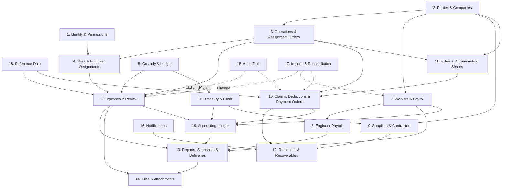

### 0.4 ERD عالي المستوى — Aggregate Roots فقط

```mermaid
erDiagram
    PARTY ||--o{ PARTY_ROLE : "له"
    PARTY ||--o{ PARTY_IDENTIFIER : "له"
    PARTY ||--o{ MANAGED_COMPANY_LINK : "شركاتنا"
    PARTY ||--o{ OPERATION_PARTY_ROLE : "دوره على عملية"
    OPERATION ||--|| ASSIGNMENT_ORDER : "واحد إلزامي"
    OPERATION ||--o| OPERATION_DATES : "صف واحد"
    OPERATION ||--o{ SITE : "يحتوي"
    OPERATION ||--o{ OPERATION_PARTY_ROLE : "أدوار"
    OPERATION ||--o{ PARTY_OPERATION_AGREEMENT : "اتفاقات"
    OPERATION ||--o{ CLAIM : "مستخلصات"
    OPERATION ||--o{ EXPENSE : "مصروفات"
    OPERATION ||--o{ PAYROLL_PERIOD : "كشوف"
    SITE ||--o{ ENGINEER_SITE_ASSIGNMENT : "تكليفات"
    ENGINEER_SITE_ASSIGNMENT ||--o{ EXPENSE : "تُجيز"
    CUSTODY_LEDGER_ENTRY }o--|| EXPENSE : "أثر واحد"
    CLAIM ||--o{ CLAIM_DEDUCTION_LINE : "سطور"
    CLAIM_DEDUCTION_LINE ||--o| RETENTION_REGISTER : "محتجز"
    CLAIM ||--o{ PAYMENT_ORDER_ALLOCATION : "توزيع"
    PAYMENT_ORDER ||--o{ PAYMENT_ORDER_ALLOCATION : "سطور"
    PAYMENT_ORDER ||--o{ PAYMENT_ORDER_PARTY_SHARE : "حصص"
    PAYMENT_ORDER ||--o{ COLLECTION_ALLOCATION : "تحصيل"
    PARTY_OPERATION_AGREEMENT ||--o{ AGREEMENT_VERSION : "إصدارات"
    AGREEMENT_VERSION ||--o{ PAYMENT_ORDER_PARTY_SHARE : "Snapshot"
    PAYROLL_PERIOD ||--o{ PAYROLL_LINE : "سطور"
    MONTHLY_REPORT ||--o{ MONTHLY_REPORT_VERSION : "إصدارات"
    MONTHLY_REPORT_VERSION ||--|| MONTHLY_REPORT_SNAPSHOT : "لقطة"
    MONTHLY_REPORT_VERSION ||--o{ DELIVERY_ATTEMPT : "إرسال"
    IMPORT_BATCH ||--o{ IMPORT_ROW : "صفوف"
    AUDIT_EVENT ||--o{ AUDIT_EVENT_CHANGE : "فروق"
    FINANCIAL_EVENT ||--o{ JOURNAL_ENTRY : "قيود"
    FINANCIAL_EVENT ||--o{ TREASURY_MOVEMENT : "أثر نقدي"
    JOURNAL_ENTRY ||--|{ JOURNAL_ENTRY_LINE : "سطور متوازنة"
    EXPENSE ||--o| FINANCIAL_EVENT : "عند الاعتماد"
    CUSTODY_LEDGER_ENTRY ||--o| FINANCIAL_EVENT : "حدث مالي"
    FINANCIAL_ACCOUNT ||--o{ TREASURY_MOVEMENT : "دفتر الحساب"
    MONTHLY_REPORT_VERSION ||--o{ MONTHLY_REPORT_DELIVERY : "مستلم"
    MONTHLY_REPORT_DELIVERY ||--o{ DELIVERY_ATTEMPT : "محاولات"
```

---

# Domain 1 — Identity, Users, Roles, Permissions

## 1.1 الغرض

إثبات هوية المستخدم وتحديد **ما يملك فعله بالضبط**، وضمان أن **الصلاحية لا تُشتق ضمنيًا** — وخاصةً `Payroll.View`.

## 1.2 قواعد العمل التي يخدمها

**BR-017** · **BR-018** · **BR-131** · **BR-138** · **BR-192** · **BR-195** · **BR-234** · **BR-235**

## 1.3 الكيانات

| الكيان | الاسم العربي | النوع | الغرض |
|---|---|---|---|
| `users` | المستخدمون | **AR** | حساب الدخول والهوية داخل النظام |
| `roles` | الأدوار | **RD** | تجميع منطقي للصلاحيات |
| `permissions` | الصلاحيات | **RD** | الصلاحية الدقيقة `<Domain>.<Entity>.<Action>` |
| `role_permissions` | صلاحيات الدور | **CE** | ربط N:M |
| `user_roles` | أدوار المستخدم | **CE** | ربط N:M **مؤرَّخ** |
| `user_permissions` | صلاحيات المستخدم المباشرة | **CE** | منح أو **سحب** صلاحية بعينها **فوق الدور** |
| `user_party_links` | ربط المستخدم بالطرف | **CE** | يربط حساب المهندس بطرفه التجاري |

## 1.4 العلاقات والـCardinality

| العلاقة | النوع | Ownership | ملاحظة |
|---|---|---|---|
| `users` → `user_roles` | **1 : N** | `users` يملك | مؤرَّخة |
| `roles` → `role_permissions` | **1 : N** | `roles` يملك | — |
| `users` → `user_permissions` | **1 : N** | `users` يملك | ⭐ **تسمح بالمنح والسحب الصريحين** |
| `users` → `user_party_links` | **1 : 0..1** | `users` يملك | المهندس **مستخدم وطرف معًا** |
| `permissions` ← `role_permissions` · `user_permissions` | **1 : N** | `permissions` مرجعي | — |

## 1.5 Lifecycle وحالات السجل

| الكيان | الحالات | الانتقالات |
|---|---|---|
| `users` | `Active` → `Disabled` | ⛔ **لا حذف** · `Disabled` قابلة للعودة إلى `Active` |
| `user_roles` | `Active` → `Ended` | بإدخال `ended_at` — ⛔ **لا حذف** |
| `user_permissions` | `Granted` · `Revoked` | كلاهما **حدث تدقيق** |
| `roles` · `permissions` | `Active` → `Deprecated` | ⛔ **لا حذف مع وجود استخدام** |

## 1.6 المفاتيح المرشحة والقيود

| الكيان | 🔑 PK | 🔖 Business Key | القيود |
|---|---|---|---|
| `users` | `id` | `login_identifier` | **`UNIQUE(login_identifier)`** — قيد آمن: المعرّف يُنشئه النظام لا البيانات التاريخية |
| `roles` | `id` | `code` | `UNIQUE(code)` |
| `permissions` | `id` | `code` | `UNIQUE(code)` · والصيغة `<Domain>.<Entity>.<Action>` |
| `role_permissions` | `id` | (role, permission) | `UNIQUE(role_id, permission_id)` |
| `user_roles` | `id` | — | ⛔ **لا تفرّد على (user, role)** — لأن الدور قد يُمنح ثم يُنهى ثم يُمنح مجددًا · **فهرس جزئي `WHERE ended_at IS NULL`** |
| `user_permissions` | `id` | — | **فهرس جزئي على (user, permission) `WHERE ended_at IS NULL`** |
| `user_party_links` | `id` | `user_id` | `UNIQUE(user_id)` — مستخدم واحد لطرف واحد |

## 1.7 البيانات الحساسة

| الحقل | المعالجة |
|---|---|
| `password_hash` 🔒 | **مجزَّأ بخوارزمية حديثة بملح فريد** · ⛔ **لا يُسجَّل في التدقيق ولا Serilog إطلاقًا** |
| `email` 🔒 | يُسجَّل في التدقيق · ⛔ **ولا يُكشف لمستلمي التقرير الآخرين** |
| رموز الوصول والتجديد 🔒 | ⛔ **لا تُخزَّن ولا تُسجَّل** |

## 1.8 أحداث التدقيق 📝

`UserCreated` · `UserDisabled` · `UserReactivated` · `RoleAssigned` · `RoleEnded` · `PermissionGranted` · `PermissionRevoked` · ⭐ **`PayrollViewGranted`** · ⭐ **`PayrollViewRevoked`** · `LoginFailed` (Serilog) · `AccessDenied`

## 1.9 مخاطر التكرار

| الخطر | الضابط |
|---|---|
| مستخدمان لشخص واحد | `user_party_links` + كشف تشابه على الطرف |
| منح صلاحية مرتين | فهرس جزئي `WHERE ended_at IS NULL` |
| `Payroll.View` تُمنح ضمنيًا بالدور | ⭐ **لا تُدرج ضمن أي `role_permissions` افتراضي** — تُمنح عبر `user_permissions` صراحةً |

## 1.10 أثر الاستيراد التاريخي

⛔ **لا استيراد لهذا المجال.** المستخدمون يُنشَأون يدويًا. و**27 مندوب عهدة** مرصودًا في `العهد` **يُستوردون أطرافًا** (Domain 2) **لا مستخدمين** — وإنشاء حساب لكل منهم **قرار إداري منفصل**.

## 1.11 الأسئلة المفتوحة

| OQ | السؤال |
|---|---|
| **OQ-003** | سقف مبلغ اعتماد موظف الإدارة — **الحقل موجود والقيمة الفارغة تعني بلا سقف** |
| **OQ-005** | هل المحاسب يرى تكلفة كل العمليات أم محددة؟ — **نطاق صلاحية لا بنية** |

---

# Domain 2 — Parties and Companies

## 2.1 الغرض

**هوية مركزية واحدة لكل شخص وكل شركة** — مملوكة كانت أو خارجية — تُنهي العيب البنيوي الأول: **عمودان نصّيان حرّان يحملان معًا هوية الطرف بلا مفتاح ولا تحقق إملائي**.

## 2.2 قواعد العمل التي يخدمها

**BR-001** · **BR-002** · **BR-006** · **BR-030** … **BR-033** · **BR-053** … **BR-059** · **BR-100** · **BR-106** · **BR-159** · **BR-160** · **BR-168** · **BR-177**

## 2.3 الكيانات

| الكيان | الاسم العربي | النوع | الغرض |
|---|---|---|---|
| `parties` | الأطراف | **AR** | الهوية المركزية — شخص أو شركة |
| `party_roles` | أدوار الطرف | **CE** | مهندس · عامل · مورد · مقاول · مدين · دائن · شريك · شركة — **مؤرَّخة** |
| `party_aliases` | الأسماء البديلة | **CE** | كل تهجئة تاريخية **حرفيًا** |
| `party_identifiers` | المعرّفات الرسمية | **CE** | سجل تجاري · بطاقة ضريبية · رقم قومي — **بنطاقها** |
| `party_similarity_candidates` | مرشحو التشابه | **CE** | ⭐ **ينبّه ولا يدمج** |
| `party_accounts` | حسابات الطرف الفرعية | **CE** | حساب لكل غرض (مورد · عامل · مقاول) |
| `party_bank_accounts` | حسابات الطرف البنكية | **CE** | 🔒 **يُسجَّل في التدقيق ما يكفي للتمييز فقط** |
| `managed_company_links` | علاقة الملكية والإدارة | **CE** | ⭐ **«شركاتنا» علاقة مؤرَّخة لا جدول هوية** |
| `cost_resources` | موارد التكلفة | **AR** | ما تُحمَّل عليه تكلفة الموقع — **ليس مرادفًا للطرف** |
| `aggregate_cost_accounts` | الحسابات التجميعية | **CE** | لوادر · شقق · `الغفر` — ⛔ **بلا طرف قانوني** |
| `operation_party_roles` | أدوار الطرف على العملية | **CE** | الأدوار الخمسة — **مؤرَّخة** |

## 2.4 مخطط المجال

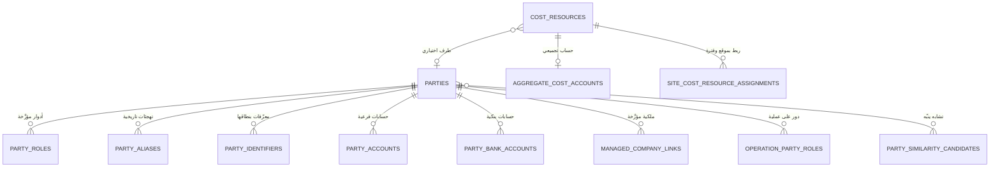

**شرح عربي:** `مورد التكلفة` **ليس مرادفًا للطرف**. من **108 مورد** مرصود في ملف الأجور، **30 ليسوا أشخاصًا**: 6 مجموعات عمال · 11 معدة أو مركبة · 6 سكن أو حساب تجميعي · وباقيها أفراد ومقاولون ومهندسون. الحسابات التجميعية **بلا طرف قانوني**، و⛔ **لا يُنشأ لها مستخدم ولا حساب عهدة ولا أصل معدات**. ومجموعة العمال **قد تُربط اختياريًا برئيسها كطرف يُدفع له**، بينما التكلفة تُحمَّل على المجموعة.

## 2.5 العلاقات والـCardinality

| العلاقة | النوع | Ownership |
|---|---|---|
| `parties` → `party_roles` | **1 : N مؤرَّخة** | `parties` |
| `parties` → `party_aliases` | **1 : N** | `parties` |
| `parties` → `party_identifiers` | **1 : 0..N** | `parties` — **اختياري الوجود ولا يمنع إنشاء الطرف** |
| `parties` → `managed_company_links` | **1 : 0..N مؤرَّخة** | `parties` — **الشركة الخارجية طرف بلا هذه العلاقة** |
| `parties` ↔ `party_similarity_candidates` | **N : M** | مستقل — **مرشّح للمراجعة البشرية** |
| `cost_resources` → `parties` | **N : 0..1** | **الطرف اختياري** |
| `cost_resources` → `aggregate_cost_accounts` | **1 : 0..1** | للحسابات بلا طرف |
| `operations` ↔ `parties` عبر `operation_party_roles` | **N : M مؤرَّخة** | ⭐ **طرف واحد يجوز له أكثر من دور على العملية نفسها** |

## 2.6 Lifecycle وحالات السجل

| الكيان | الحالات |
|---|---|
| `parties` | `Active` · `NeedsClassification` (**للأسماء التاريخية غير المحسومة**) · `Inactive` — ⛔ **لا حذف** |
| `party_roles` | `Active` → `Ended` بتاريخ |
| `party_identifiers` | `Valid` → `Expired` بـ`valid_to` |
| `party_similarity_candidates` | `Open` → `Merged` · `Rejected` · `Deferred` |
| `managed_company_links` | `Active` → `Ended` بتاريخ |
| `cost_resources` | `Active` · `NeedsClassification` · `Inactive` |

## 2.7 ⭐ المفاتيح المرشحة والقيود — حسم BR-177

| الكيان | 🔑 PK | القيود المعتمدة |
|---|---|---|
| `parties` | `id` (داخلي) | ⛔ **لا `UNIQUE` على `normalized_name`** — **أُلغي في 1.1**: «محمد سليم» قد يكون شخصين حقيقيين · **التفرّد يُبنى على المعرّفات الرسمية عند توفرها** |
| `party_identifiers` | `id` | ⭐ **الحسم:** `UNIQUE(identifier_type, identifier_value, jurisdiction_country, issuing_authority)` **جزئي `WHERE valid_to IS NULL`** — **لأن المعرّف لا معنى له خارج نطاق إصداره**: رقم سجل تجاري `3660` في مكتب سجل مختلف **طرف مختلف تمامًا** · و`issuing_authority` **قد تكون فارغة** لأنواع لا تحتاجها (الرقم القومي مثلًا) فتُعامل قيمةً واحدة في القيد |
| `party_aliases` | `id` | ⛔ **لا `UNIQUE` عالمي على `alias`** — التفرّد فقط على **`(party_id, alias)`** · وتكرار الاسم عبر أطراف **يُرفع مرشّح تشابه** |
| `party_roles` | `id` | `UNIQUE(party_id, role_code, effective_from)` — **الدور مؤرَّخ** · وفترات **غير متداخلة** لنفس (طرف، دور) |
| `cost_resources` | `id` | ⛔ **لا `UNIQUE` على (اسم، موقع)** — الاسم نفسه قد يتكرر لمَورِدين حقيقيين · معرّف داخلي + **كشف تشابه** |
| `operation_party_roles` | `id` | `UNIQUE(operation_id, party_id, role_code, effective_from)` — ⛔ **ولا تفرّد على (عملية، طرف)** |
| `managed_company_links` | `id` | فترات **غير متداخلة** لنفس الطرف |
| `party_bank_accounts` | `id` | `UNIQUE(bank_code, account_number)` **جزئي `WHERE is_active`** — 🔵 **يحتاج اختبار بيانات قبل فرضه** |

## 2.8 البيانات الحساسة

| الحقل | المعالجة |
|---|---|
| `party_identifiers.identifier_value` 🔒 | يُسجَّل في التدقيق **محجوبًا جزئيًا** |
| `party_bank_accounts.account_number` 🔒 | ⛔ **لا يُسجَّل كاملًا في أي سجل** — **ما يكفي للتمييز فقط** (BR-191) |
| `parties.phone` · `parties.address` 🔒 | تُسجَّل بضوابط الخصوصية |

## 2.9 أحداث التدقيق 📝

`PartyCreated` · `PartyRoleAssigned` · `PartyRoleEnded` · `PartyIdentifierAdded` · `PartyMerged` · `SimilarityCandidateResolved` · `ManagedCompanyLinkCreated` · `ManagedCompanyLinkClosed` · `CostResourceCreated` · `CostResourceClassified` · `BankAccountAdded`

## 2.10 ⭐ مخاطر التكرار — أخطر مجال في النظام

| الخطر | الضابط | لماذا لا يُستخدم قيد تفرّد |
|---|---|---|
| **طرفان حقيقيان بالاسم نفسه يُدمجان** | ⛔ **لا تفرّد على الاسم** + **كشف تشابه ينبّه ولا يدمج** | **تشابه الأسماء في مصر شائع** — والقيد كان سيدمج شخصين حقيقيين (**RISK-016**) |
| **طرف واحد بتهجئتين** | `party_aliases` + التطبيع (مسافات · همزات · `ى/ي` · `ة/ه`) + مرشّح تشابه | الدليل: `جمال عبدالشافى  توريد` **بمسافتين** |
| **`عمال حسين القناوى` مقابل `عمال حسين قناوى خوارج`** | ⭐ **يُستوردان منفصلين مع تنبيه تشابه** | **قد يكونان موردين مختلفين فعلًا** («خوارج» = عمالة من خارج الموقع) — ⛔ **ولا يُدمجان تلقائيًا** |
| **حساب تجميعي يُعامَل شخصًا** | `aggregate_cost_accounts` + منع صريح | ⛔ **لا مستخدم ولا عهدة ولا أصل تلقائيًا** (BR-031) |
| **مورد التكلفة يُخلط بالطرف** | كيانان منفصلان + FK اختياري | **30 من 108 ليسوا أشخاصًا** |

## 2.11 أثر الاستيراد التاريخي 🔧 📊

| المصدر | العدد | المعالجة |
|---|---|---|
| `دليل!N` أسماء الموردين | **243** (المستخدَم **110**) | **133 اسمًا ميتًا** ⟹ يُستوردون `Inactive` |
| `دليل!M` مندوبو العهد | **33** | ⟹ `parties` بدور `مندوب عهدة` · و`مرحل` **رصيد افتتاحي لا شخص** |
| `دليل!Q` العملاء المدينون | **6** | ⟹ `NeedsClassification` |
| `دليل!S` ديون | **20** | ⟹ `NeedsClassification` |
| ملف الأجور — `الإســــــــــــم` | **108 مورد تكلفة** | ⟹ `cost_resources` · **30 منها `aggregate_cost_accounts`** |
| `الخزينه!شرح القيد` | **216 قيمة مميزة** | ⟹ **تفكيك بخريطة يدوية** إلى طرف أو وصف |
| **معرّفات رسمية** | التيسير: س.ت `3660` · ضريبية `855-951-320` ‖ الأقصى: س.ت `309429` | ⟹ `party_identifiers` **بنطاقها** |

**قاعدة ملزمة:** الأسماء التاريخية غير المحسومة تُستورد بحالة **`NeedsClassification` برصيد موثَّق المصدر، يراجعها المحاسب لا المهندس** (BR-058).

## 2.12 الأسئلة المفتوحة

| OQ | السؤال |
|---|---|
| **OQ-025** | **من يعتمد الأرصدة الافتتاحية** لـ27 مندوبًا و110 موردًا |
| — | **تصنيف الـ108 مورد تكلفة** — مهمة يدوية لمرة واحدة (DEP-08) |
---

# Domain 3 — Operations and Assignment Orders

## 3.1 الغرض

تمثيل **الكيان الأكبر في النظام** — العملية — ومركز التكلفة الأساسي، وضمان **ألا توجد عملية فعّالة بلا أمر إسناد**.

## 3.2 قواعد العمل التي يخدمها

⭐ **BR-196** · **BR-197** · **BR-198** · **BR-200** · BR-006 · BR-074 … BR-077 · BR-107 … BR-112 · BR-124 · BR-158

## 3.3 الكيانات

| الكيان | الاسم العربي | النوع | الغرض |
|---|---|---|---|
| `operations` | العمليات | **AR** | ⭐ **الكيان الأكبر ومركز التكلفة الأساسي** |
| `assignment_orders` | أوامر الإسناد | **AR** | المستند الرسمي الذي أسند العملية |
| `awarding_authorities` | جهات الإسناد | **RD** | الجهة الحكومية أو المالكة |
| `boq_items` | بنود المقايسة | **CE** | البند بوحدته وكميته وفئته **ونوع تكراره** |
| `operation_dates` | تواريخ العملية | **CE** | أربعة تواريخ |
| `operation_extensions` | امتدادات المدة | **CE** | من · إلى · السبب · قرار الاعتماد |
| `contracts` | العقود | **AR** | عقدنا مع الجهاز · وعقد الشركة الخارجية معنا · وعقدنا مع المقاول |
| `contract_warnings` | خطابات الملاحظات | **CE** | ⭐ **عدّاد الإنذارات — الثالث يعني حق سحب الأعمال** |
| `penalty_rate_schedule` | جدول الغرامات المسعَّر | **CE** | فئات تعاقدية لكل (عقد · مورد · وحدة) |

## 3.4 مخطط المجال

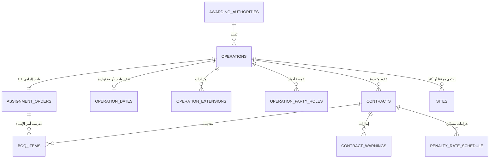

**شرح عربي:** ⭐ **العملية هي الكيان الأكبر** — ولها **أمر إسناد واحد إلزامي `1 : 1`** لا تصبح فعّالة بدونه، ⛔ **وأمر الإسناد الواحد لا يخدم أكثر من عملية**. ⭐ **واختيار الموقع يحدد العملية، والعملية تحدد أمر الإسناد، ويظهر للمهندس مملوءًا تلقائيًا للقراءة فقط** — ⛔ **ولا يكتبه يدويًا**. و**قد يكون للعملية أكثر من عقد**: عقدنا مع الجهاز · وعقد التيسير معنا · وعقدنا مع المقاول — **ولكل عقد سلسلة مستخلصاته**. والمواقع **توجد داخل العملية** ولا تعلوها.

## 3.5 العلاقات والـCardinality

| العلاقة | النوع | Ownership | القيد |
|---|---|---|---|
| `operations` → `assignment_orders` | 🟢 ⭐ **1 : 1 إلزامية للعملية الفعّالة** | مشترك | ⭐ **حُسم في الباتش v1.2.1**: **كل عملية أمر إسناد واحد · وأمر الإسناد لا يرتبط بأكثر من عملية** · ⛔ **ولا عملية `جارية` بلا أمر إسناد** (BR-197) |
| `operations` → `sites` | **1 : N** (N ≥ 1) | `operations` | (BR-198) |
| `operations` → `operation_dates` | 🟢 **1 : 0..1** | `operations` | ⭐ **صف واحد يحمل التواريخ الأربعة** · **و`0` لأن العملية `مسودة` قد تُنشأ قبل تسجيل تاريخ** |
| `operations` → `operation_extensions` | **1 : 0..N** | `operations` | جدول مستقل بسببه وقرار اعتماده |
| `operations` → `contracts` | **1 : 0..N** | مشترك | ⭐ **عدة عقود للعملية الواحدة** |
| `contracts` → `boq_items` | **1 : N** | `contracts` | — |
| `contracts` → `contract_warnings` | **1 : 0..N** | `contracts` | ⭐ **عدّاد** |
| `awarding_authorities` → `operations` | **1 : N** | مرجعي | — |

## 3.6 Lifecycle وحالات السجل

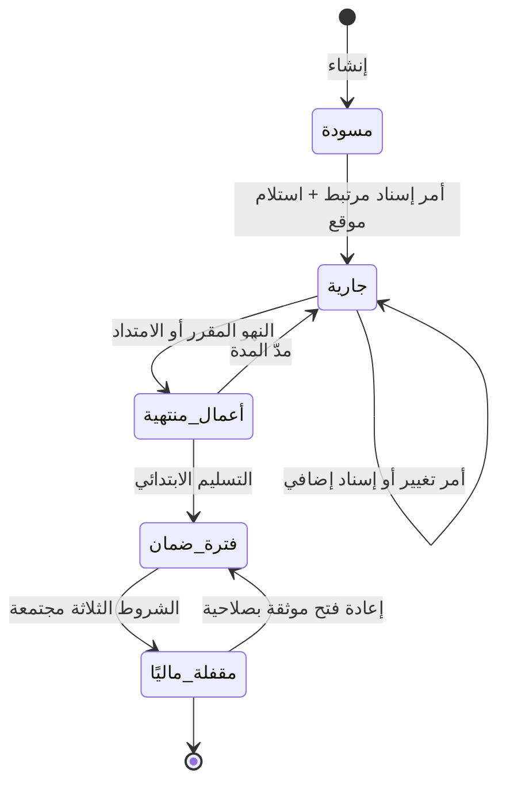

| الحالة | المعنى | أثرها على الإنفاق |
|---|---|---|
| `مسودة` | ⛔ **بلا أمر إسناد بعد** | **لا إنفاق** |
| `جارية` | العمل قائم | إنفاق عادي |
| `أعمال منتهية` | انتهى التنفيذ | **يُصنَّف الإنفاق ولا يُمنع** |
| `فترة ضمان` | ضمان قائم | **المصروف يُصنَّف `تكلفة ضمان` تلقائيًا** |
| `مقفلة ماليًا` | رد المحتجزات + تحصيل كامل + تسوية كل طرف | — |

> ⭐ **الحالة تُصنِّف الإنفاق ولا تمنعه** (BR-108) — **لأن المنع يدفع لتحميل المصروف على عملية أخرى فتفسد البيانات أكثر.**

## 3.7 المفاتيح المرشحة والقيود

| الكيان | 🔑 PK | 🔖 Business Key | القيود |
|---|---|---|---|
| `operations` | `id` | — | ⛔ **لا تفرّد على الاسم** · **FK إلزامي لأمر الإسناد عند `status <> مسودة`** — يُفرض بـ**تحقق تطبيقي داخل معاملة** (عابر للحالة) · 🟢 ⭐ **وتفرّد على `assignment_order_id` نفسه — فلا يتشارك أمرٌ واحد عمليتين** · ⭐ **دلالة الغياب: `NULL` = «لم يُربط بعد» والعملية `مسودة` حتمًا ⛔ ولا يدخل حساب التفرّد** · 🏗️ **آلية الاستثناء للفارغ قرار فيزيائي** |
| `assignment_orders` | `id` | (جهة · رقم العطاء · السنة) | 🔵 **`UNIQUE(authority_id, order_number, order_year)` — يحتاج اختبار بيانات**: `دليل!B` به **116 قيمة و115 مميزة** (الرقم `35` مكرر) و**33 قيمة نصية من 116** |
| `boq_items` | `id` | (عقد · رقم البند) | `UNIQUE(contract_id, item_no)` · و`recurrence ∈ {ONCE, MONTHLY, PERIODIC}` |
| `operation_dates` | `id` | `operation_id` | `UNIQUE(operation_id)` |
| `operation_extensions` | `id` | — | فترات **غير متداخلة** لنفس العملية |
| `contracts` | `id` | (عملية · طرف · نوع العقد) | 🔵 يحتاج اختبار |
| `contract_warnings` | `id` | (عقد · رقم الإنذار) | `UNIQUE(contract_id, warning_no)` |
| `penalty_rate_schedule` | `id` | (عقد · مورد · وحدة · سريان) | فترات **غير متداخلة** |

## 3.8 ⭐ قيد المقايسة — تصحيح ملزم

| نوع البند | القيد |
|---|---|
| `ONCE` (مرة واحدة) | ✅ **`التراكمي ≤ كمية المقايسة` يسري** |
| `MONTHLY` · `PERIODIC` (متكرر) | ⛔ **لا يسري** — والبند يحتاج بدلًا منه: `pricing_method` · `period_frequency` · `period_quantity` · `period_count` · **`max_contract_quantity`** · `valid_from` · `valid_to` |

**الدليل المستندي (BR-115):** المقايسة التقديرية — البند 1 «صيانة وتأمين المسطحات الخضراء» موسوم **«الإجمالى الشهرى»** ويتكرر **24 مرة** (308,427.60 × 24)، بينما البندان 2 و3 **توريد مرة واحدة**. والتحقق: `308,427.60 × 24 + 326,250 + 282,750 = 8,011,262.40` ✅ **مطابق لقيمة العقد بالضبط**.

## 3.9 البيانات الحساسة

| الحقل | المعالجة |
|---|---|
| `contracts.contract_value` 🔒 | بيانات تجارية — تُعرض وفق الصلاحية |
| مرفقات العقود ومحاضر الاستلام 🔒 | ⛔ **محتواها لا يُسجَّل في أي سجل** — يُسجَّل وجودها واسمها ومن أضافها |

## 3.10 أحداث التدقيق 📝

`OperationCreated` · `AssignmentOrderLinked` · ⭐ **`AssignmentOrderRelinked`** (يتطلب إجراءً إداريًا موثقًا) · `OperationActivated` · `OperationStatusChanged` · `OperationClosed` · `OperationReopened` · `BoqItemCreated` · `ContractWarningIssued` · `PenaltyRateVersioned`

## 3.11 مخاطر التكرار

| الخطر | الضابط |
|---|---|
| **أمر إسناد مكرر رقمًا** | 🔵 مفتاح أعمال **يحتاج اختبارًا** — ⛔ **ولا يُفرض قبله** (BR-082 نفس المبدأ) |
| **عملية بلا أمر إسناد تمر** | ⭐ **تحقق تطبيقي داخل معاملة عند التفعيل** + شبكة أمان في القاعدة (التصميم الفيزيائي) |
| **موقع يتبع عمليتين** | FK واحد إلزامي من `sites` إلى `operations` |
| **تكرار اسم الموقع عبر عمليات** | ✅ **مقبول وليس خطأً** — الاسم ليس مفتاحًا |

## 3.12 أثر الاستيراد التاريخي 🔧 📊

| المصدر | الحجم | الملاحظة |
|---|---|---|
| `دليل الحسابات!A:K` | **116 صفًا** | ⭐ **الأصل** — والنسخ الثلاث الأخرى تُهمَل |
| `دليل!B` أمر اسناد | **116 قيمة · 115 مميزة** | **83 رقمًا + 33 نصًا** ⟹ **نصي · حقل بحث لا PK** |
| `دليل!C` نسبة الضريبة | 58 قيمة | ⚠️ **الصف 102 به النص `اسيوط`** ⟹ **خطأ نوع يُرفض ويُعلَّم** |
| `دليل!D` الشركة | 57 | الروضة 47 · الأقصى 5 · **الامل 3** · التيسير 1 · تاله 1 |
| `دليل!E` جهه الاسناد | 113 قيمة · **20 مميزة** | ⭐ **`القاهرة الجديدة` و`مدينة القاهرة الجديدة` ⟹ دمج** |
| `دليل!F` اسم الموقع | 116 · **96 مميزة** | ⭐ **12 اسمًا مكررًا ⟹ الاسم ليس مفتاحًا** |
| `دليل!G,H,I` التواريخ | 79 · 68 · 68 | `تاريخ استلام الموقع` **تبدأ منه المدة** |
| `دليل!J` قيمة امر الاسناد | 59 | ✅ تحقق: أمر 137 = **16,138,043.20** |
| `دليل!A` رقم خطاب الضمان | 81 · **66 مميزة** | ⚠️ **ليس مفتاحًا** — به `ليس لها` · `نقدى` · `نقدي` · `ابتدائى` · `شركة الأمل` ⟹ **العمود خليط لا أرقام خطابات** |
| **المقايسة والعقود** | ❌ **غائبة تمامًا عن Excel** | ⟹ **إدخال يدوي من المستندات الورقية** |

> ⭐ **`دليل الحسابات` ثماني قوائم في ورقة واحدة:** الأعمدة A–K تشكّل **سجلًا واحدًا** (أمر إسناد)، بينما M–S **قوائم مستقلة تشترك في الصفوف بالمصادفة فقط**. ⟹ **تُفكَّك إلى ثمانية جداول عند الاستيراد.**

## 3.13 الأسئلة المفتوحة

| OQ | السؤال |
|---|---|
| **OQ-014** | مدة فترة الضمان لكل عقد — ⚪ **سنة من التسليم الابتدائي** ما لم ينص العقد |
| **RISK-012** | **البند 14 مفقود من العقد ولا بند اختصاص ولا تحكيم** — ⛔ **لا يُفترض بند غائب** · يُسجَّل عيبًا يحتاج مراجعة قانونية |
| **RISK-013** | **أربعة مستندات يعتبرها العقد جزءًا منه ولم تصل** — ⛔ **لا تُفترض محتوياتها** |

---

# Domain 4 — Sites and Engineer Assignments

## 4.1 الغرض

تمثيل **الموقع داخل العملية**، و**تقييد ما يراه المهندس ويسجّل عليه** بتكليف مؤرَّخ ينشئه الأدمن وحده.

## 4.2 قواعد العمل التي يخدمها

⭐ **BR-015** … **BR-022** · **BR-131** · **BR-132** · **BR-198** · **BR-201** · **BR-202**

## 4.3 الكيانات

| الكيان | الاسم العربي | النوع | الغرض |
|---|---|---|---|
| `sites` | المواقع | **AR** | مكان التنفيذ **داخل عملية واحدة** |
| `engineer_site_assignments` | تكليفات المهندسين | **AR** | ⭐ **العلاقة المؤرَّخة التي تحكم كل شيء** |

## 4.4 مخطط المجال

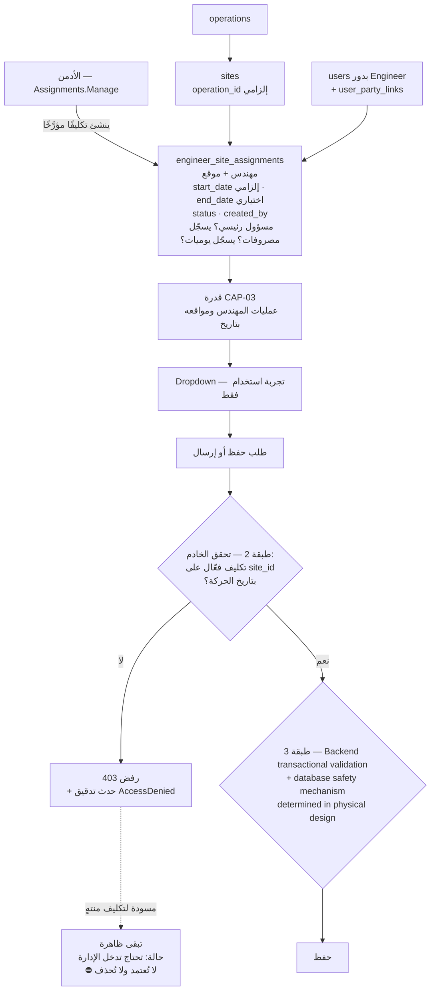

**شرح عربي:** ⭐ **ثلاث طبقات لأن إخفاء الزر ليس أمانًا.** طلب API معدَّل بـ`site_id` غير مصرَّح به **يجب أن يُرفض ويُسجَّل**. والتاريخ المستخدم في التحقق **تاريخ الحركة لا تاريخ الإرسال** — وإلا رُفضت حركة قديمة مشروعة لمهندس انتهى تكليفه بعدها. والتكليف **لا يُحذف** — **يُغلق بتاريخ نهاية** لتبقى الحركات القديمة قابلة للتفسير.

## 4.5 العلاقات والـCardinality

| العلاقة | النوع | Ownership | القيد |
|---|---|---|---|
| `operations` → `sites` | **1 : N** (N ≥ 1) | `operations` | — |
| `sites` → `operations` | ⭐ **N : 1 إلزامية** | — | **الموقع يتبع عملية واحدة** |
| `sites` ↔ `users(Engineer)` عبر `engineer_site_assignments` | ⭐ **N : M مؤرَّخة** | مستقل | **مهندس ↔ عدة مواقع · وموقع ↔ عدة مهندسين** |
| `engineer_site_assignments` → `expenses` | **1 : N** | — | **التكليف يُجيز المصروف** |

## 4.6 Lifecycle

| الكيان | الحالات | الانتقالات |
|---|---|---|
| `sites` | `Active` → `Inactive` | ⛔ **لا حذف** |
| `engineer_site_assignments` | `Active` → `Ended` | ⭐ **بإدخال `end_date` فقط** — ⛔ **لا حذف إطلاقًا** |

## 4.7 المفاتيح المرشحة والقيود

| الكيان | 🔑 PK | القيود |
|---|---|---|
| `sites` | `id` | ⛔ **لا `UNIQUE` على `name`** — **12 اسمًا مكررًا من 116 مرصودة** · و**FK `operation_id` إلزامي** |
| `engineer_site_assignments` | `id` | ⭐ **فترات غير متداخلة لنفس `(engineer_id, site_id)`** — وهو **قيد زمني حقيقي يُفرَض فعلًا في قاعدة البيانات** (🏗️ **Physical Design Candidate — Not Yet Approved:** `EXCLUDE` مع `btree_gist`) · و**`end_date >= start_date` أو `NULL`** |

## 4.8 ⭐ الحقول الجوهرية للتكليف

| الحقل | الغرض |
|---|---|
| `engineer_id` 🔗 | المهندس |
| `site_id` 🔗 | الموقع — **والعملية تُشتق منه** |
| `start_date` | **إلزامي** |
| `end_date` | **اختياري** — ووجوده يعني الإغلاق |
| `status` | `Active` · `Ended` |
| `created_by` 🔗 📝 | ⭐ **الأدمن الذي أنشأه** |
| `can_record_expenses` | علم |
| `can_record_attendance` | علم |
| `is_primary_responsible` | علم |

## 4.9 ⭐ اشتقاق وصول المهندس للعملية — قرار مثبَّت

> **القاعدة:** **وصول المهندس للعملية يُشتق من المواقع المكلَّف بها داخلها** (BR-201).

| البديل | القرار |
|---|---|
| `EngineerSiteAssignment` وحدها | ✅ **المعتمَد** — **تحقق القاعدة المطلوبة بالكامل** |
| `EngineerOperationAssignment` علاقة إضافية | ❌ **لا تُعتمد افتراضيًا** (تعليمات §تاسعًا-15) — **ولا يوجد اليوم متطلب عمل يحتاجها** |

**الاستعلام المنطقي:** عمليات المهندس = `DISTINCT operation_id` من `sites` المرتبطة بتكليفات المهندس الفعّالة بتاريخ الحركة.

> **متى تُضاف `EngineerOperationAssignment`؟** **فقط عند ظهور حاجة عمل مستقلة ومثبتة** — مثل تكليف مهندس بعملية كاملة بلا تحديد مواقع، أو صلاحية على مستوى العملية لا يغطيها الاشتقاق. **وحتى ذلك الحين لا تُنشأ.**

## 4.10 أحداث التدقيق 📝

`SiteCreated` · `SiteDeactivated` · ⭐ **`EngineerSiteAssignmentCreated`** · ⭐ **`EngineerSiteAssignmentClosed`** · `EngineerSiteAssignmentModified` · `AccessDenied` (محاولة على موقع غير مكلَّف به)

## 4.11 مخاطر التكرار

| الخطر | الضابط |
|---|---|
| تكليفان متداخلان لنفس (مهندس، موقع) | ⭐ **قيد زمني مفروض في القاعدة** |
| حذف تكليف يُيتّم حركات قديمة | ⛔ **لا حذف** — إغلاق بتاريخ |
| موقع باسم مكرر يُدمج | ⛔ **لا تفرّد على الاسم** |

## 4.12 أثر الاستيراد التاريخي 🔧

| البند | الملاحظة |
|---|---|
| `sites` | ⟹ من `دليل!F` — **96 اسمًا مميزًا من 116** · وكل اسم يُنشأ **داخل عمليته** |
| `engineer_site_assignments` | ⛔ **لا مصدر في Excel إطلاقًا — قاعدة جديدة بالكامل** |
| **الحركات التاريخية** | 🔧 **مشكلة ترحيل**: حركات 2026 سُجِّلت بلا تكليفات · ⟹ **تُرحَّل بعلامة `LegacyNoAssignment`** وتُستثنى من تحقق التكليف · ⛔ **ولا يُخترع تكليف بأثر رجعي** |

## 4.13 الأسئلة المفتوحة

| # | السؤال |
|---|---|
| 1 | **من يُنشئ التكليفات الأولى عند التشغيل؟** — ⚪ الأدمن، مهمة يدوية لمرة واحدة |

---

# Domain 5 — Custody and Custody Ledger

## 5.1 الغرض

تتبّع **ما استلمه المهندس وما أنفقه وما رده** — بـ**رصيد مشتق من دفتر حركات لا يُخزَّن رقمًا**.

## 5.2 قواعد العمل التي يخدمها

⭐ **BR-024** … **BR-029** · **BR-140** … **BR-143** · **BR-208** · **BR-213**

## 5.3 الكيانات

| الكيان | الاسم العربي | النوع | الغرض |
|---|---|---|---|
| `custody_accounts` | حسابات العهدة | **AR** | (مهندس · شركة مُدارة) — **وعاء الحركات** |
| `custody_ledger_entries` | حركات العهدة | **AR** | ⭐ **حركات فقط — ⛔ لا حقل رصيد** |
| `custody_transfer_acceptances` | قبول التحويل | **CE** | عند تفعيل `requires_dual_acceptance` |

## 5.4 ⭐ أنواع الحركة الخمسة

| `movement_type` | الاتجاه | يحتاج اعتماد؟ | ملاحظة |
|---|---|---|---|
| `OPENING_BALANCE` | `+` أو `−` | ⭐ **اعتماد الأرصدة الافتتاحية** | **مصدر وتاريخ ومعتمِد إلزامية** |
| `DISBURSEMENT` | `+` | **معتمِد الصرف من الإدارة وحده** | ⛔ **لا تأكيد من المهندس** (BR-140) |
| `RETURN` | `−` | نعم | **بمستند إيداع أو إيصال** (BR-142) |
| `TRANSFER_IN` / `TRANSFER_OUT` | `+` / `−` | ⭐ **قد يشترط قبول الطرفين** | (BR-141) |
| `EXPENSE_APPROVED` | `−` | — | ⭐ **يُنشأ آليًا عند اعتماد المصروف — أثر واحد فقط** |
| `ADJUSTMENT` / `REVERSAL` | `±` | نعم | ⭐ **يشير إلى الحركة الأصلية بسبب إلزامي ومعتمِد** |

## 5.5 مخطط المجال

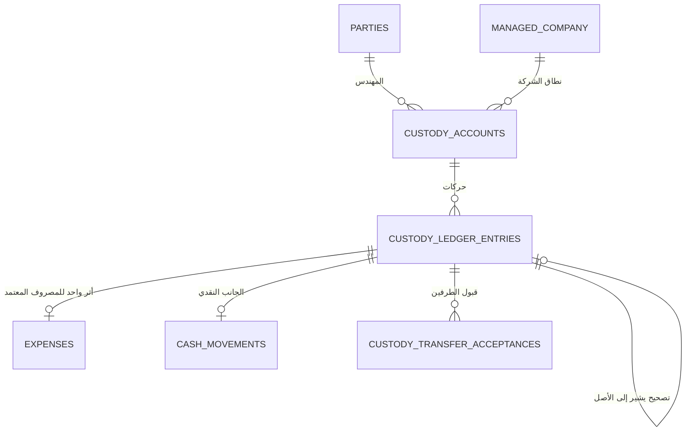

## 5.6 العلاقات والـCardinality

| العلاقة | النوع | القيد |
|---|---|---|
| `parties(Engineer)` → `custody_accounts` | **1 : N** | حساب لكل (مهندس · شركة مُدارة) |
| `custody_accounts` → `custody_ledger_entries` | **1 : N** | — |
| `expenses(Approved)` → `custody_ledger_entries` | ⭐ **1 : 1** | **أثر واحد لا أكثر** (BR-213) |
| `custody_ledger_entries` → `custody_ledger_entries` | **1 : 0..N** | التصحيح يشير إلى الأصل |

## 5.7 ⭐ الرصيد — Derived لا Stored

```
موقف العهدة = الافتتاحي
            + العهد المسلَّمة
            + التحويلات الواردة
            − المصروفات المعتمدة
            − المرتجع
            − التحويلات الصادرة
            ± التصحيحات
```

| القاعدة | التطبيق |
|---|---|
| ⛔ **لا حقل رصيد قابل للتعديل** | الرصيد **Derived (VE)** |
| **يجوز Read Model أو Snapshot للأداء** | ⚠️ **بشرط أن يُعاد بناؤه من الدفتر ولا يُعدَّل يدويًا أبدًا** |
| ⭐ **العرض بنص واضح** | موجب ⟹ **«متبقٍ مع المهندس»** · سالب ⟹ **«الشركة مدينة له»** |
| **السالب مشروع** | ⛔ **لا يمنع تسجيل مصروفات إضافية** (BR-208) |

## 5.8 المفاتيح المرشحة والقيود

| الكيان | 🔑 PK | القيود |
|---|---|---|
| `custody_accounts` | `id` | `UNIQUE(engineer_party_id, managed_company_id)` — **قيد آمن: الحساب يُنشئه النظام** |
| `custody_ledger_entries` | `id` | 🟢 ⚡ ⭐ **`UNIQUE(financial_event_id, movement_type)`** — **بديل `(source_type, source_id, movement_type)` المتعدد الأشكال** · ⭐ **ومفتاح أجنبي حقيقي يمنع الأثر المزدوج للمصروف المعتمد** · و**`amount <> 0`** · و`correction_of_entry_id` **إلزامي مع `ADJUSTMENT`/`REVERSAL`** |
| `custody_transfer_acceptances` | `id` | `UNIQUE(transfer_entry_id, party_id)` |

## 5.9 البيانات الحساسة

| الحقل | المعالجة |
|---|---|
| `financial_account_id` 🔒 | الحساب المالي المصدر — **يُسجَّل معرّفه لا رقمه الكامل** |
| المبالغ | بيانات مالية — تُعرض وفق الصلاحية |

## 5.10 أحداث التدقيق 📝

⭐ `CustodyDisbursed` · `CustodyReturned` · `CustodyTransferred` · `CustodyTransferAccepted` · `CustodyTransferDisputed` · `CustodyAdjusted` · `CustodyReversed` · `CustodyOpeningBalanceApproved`

## 5.11 مخاطر التكرار

| الخطر | الضابط |
|---|---|
| ⭐ **اعتماد المصروف مرتين ⟹ حركتا عهدة** | 🟢 **فهرس فريد على `(financial_event_id, movement_type)`** + Idempotency |
| تسليم عهدة مسجَّل مرتين | `client_generated_id` + **كشف تشابه ينبّه** |
| **305 صف مكرر تمامًا في `العهد`** 📊 | ⭐ **تحذير تشابه لا منع** (BR-106) |

## 5.12 أثر الاستيراد التاريخي 🔧 📊

| المصدر | الحجم | المعالجة |
|---|---|---|
| `العهد` (تصفية العهد) | **8,086 صفًا** | ⟹ حركات عهدة ومصروفات |
| **21 صف `عهد` = أرصدة أول المدة** | 35,531.5 | ⟹ `OPENING_BALANCE` **لا حركات** |
| `مرحل` في عمود مندوب العهدة | — | ⭐ **رصيد افتتاحي لا شخص** |
| ⭐ **صرف العهدة نفسه** | — | **ليس في `العهد` بل في `الخزينه` بـ`نوع المصروف = عهد`** (815 حركة) |
| 31 صفًا بلا مبلغ | — | ⟹ يُرفض ويُعلَّم |
| صفان فارغان في مندوب العهدة | — | ⟹ `NeedsClassification` |
| ⭐ **إشارة Excel معكوسة** | `حسابات العهد!G = D − E − F` | ⭐ **يُوثَّق تحويل الإشارة ولا تُنسخ عمياء** (BR-029) |

## 5.13 الأسئلة المفتوحة

| OQ | السؤال |
|---|---|
| **OQ-012** | `requires_dual_acceptance` مفعَّلة أم لا؟ — ⚪ **مفعَّلة افتراضيًا** · **إعداد قابل للتغيير** |
| **OQ-025** | **من يعتمد الأرصدة الافتتاحية لـ27 مندوبًا؟** |

---

# Domain 6 — Expenses and Expense Review

## 6.1 الغرض

**أكثر شاشة استخدامًا في النظام كله** — تسجيل الإنفاق الميداني بأقل خطوات ممكنة **دون فقد أي معلومة أساسية**، وبدورة مراجعة **لا رفض نهائي فيها**.

## 6.2 قواعد العمل التي يخدمها

⭐ **BR-133** · **BR-135** … **BR-139** · **BR-199** · **BR-203** … **BR-214** · **BR-219**

## 6.3 الكيانات

| الكيان | الاسم العربي | النوع | الغرض |
|---|---|---|---|
| `expenses` | المصروفات | **AR** | حركة الإنفاق الميداني |
| `expense_status_history` | سجل حالات المصروف | **CE** | كل انتقال بالمستخدم والوقت والسبب |
| `expense_reviews` | مراجعات المصروف | **CE** | سلسلة تعليقات المراجع والمهندس |
| `expense_attachments` | مرفقات المصروف | **CE** | ⭐ **0..N — اختيارية دائمًا** |
| `expense_corrections` | تصحيحات المصروف | **CE** | حركة تصحيح **مرتبطة بالأصل** |
| `expense_types` | تصنيفات المصروف | **RD** | قائمة منظمة — **⛔ لا نص حر** |
| 🟢 ⭐ `sync_submissions` | طلبات المزامنة | **AR** | ⭐ **محاولة إرسال واحدة من جهاز — لأي كيان يعمل بلا إنترنت** |
| 🟢 ⭐ `sync_exceptions` | استثناءات المزامنة | **CE** | ⭐ **كل مانع يمنع تطبيق الإرسال — بنوعه وقراره** |

## 6.4 مخطط المجال

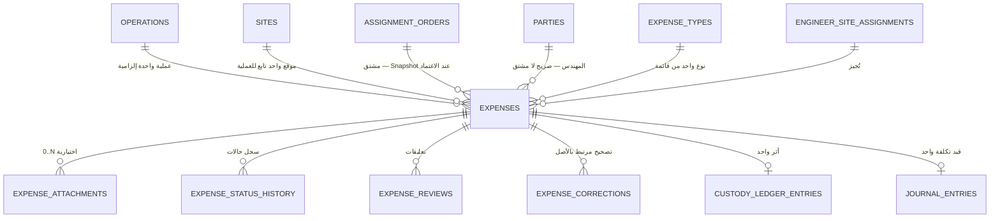

## 6.5 ⭐ الحقول الجوهرية لـ`expenses`

| الحقل | إلزامي؟ | من يملؤه | ملاحظة |
|---|---|---|---|
| `id` 🔑 | ✅ | النظام | معرّف داخلي |
| `operation_id` 🔗 | ⭐ **إلزامي من لحظة الإدخال** | المهندس أو تلقائي | (BR-135) |
| `site_id` 🔗 | ⭐ **إلزامي** | المهندس أو تلقائي | **يجب أن يتبع `operation_id`** |
| `assignment_order_id` 🔗 | ⭐ **إلزامي** | ⭐ **النظام — مشتق من العملية** | ⛔ **لا يُدخله المهندس ولا يُترك فارغًا** |
| ⭐ `assignment_order_snapshot` | إلزامي **عند الاعتماد** | النظام | ⭐ **حسم BR-214 — ADR-015** |
| `engineer_party_id` 🔗 | ✅ | النظام | ⭐ **صريح — ⛔ لا يُشتق من الموقع** |
| `expense_type_id` 🔗 | ✅ | المهندس | **من قائمة — ⛔ لا نص حر** |
| `amount` | ✅ | المهندس | **> صفر** · ⛔ **لا Float** |
| `expense_date` | ✅ | النظام (افتراضي) | ⭐ **هو تاريخ التحقق من التكليف** |
| `description` | ⭐ **إلزامي مع «أخرى» فقط** | المهندس | (BR-206) |
| `status` | ✅ | النظام | الحالات الأربع |
| `client_generated_id` ⚡ | ✅ | الجهاز | ⭐ **يمنع التكرار عند المزامنة** |
| `entry_source` | ✅ | النظام | `Online` · `OfflineSync` |
| `created_at` · `created_by` 📝 | ✅ | النظام | — |
| `submitted_at` · `approved_at` · `approved_by` 📝 | حسب الحالة | النظام | — |
| `import_batch_id` 🔗 | للمستورد | النظام | — |
| `source_import_row_id` 🔗 | للمستورد | النظام | Lineage |
| ⛔ **`payment_method`** | — | — | ⭐ **ممنوع (BR-208)** |
| ⛔ **`payment_source`** | — | — | ⭐ **ممنوع (BR-208)** |
| ⛔ **`paid_to`** | — | — | ⭐ **ممنوع (BR-208)** |

## 6.6 Lifecycle وحالات السجل

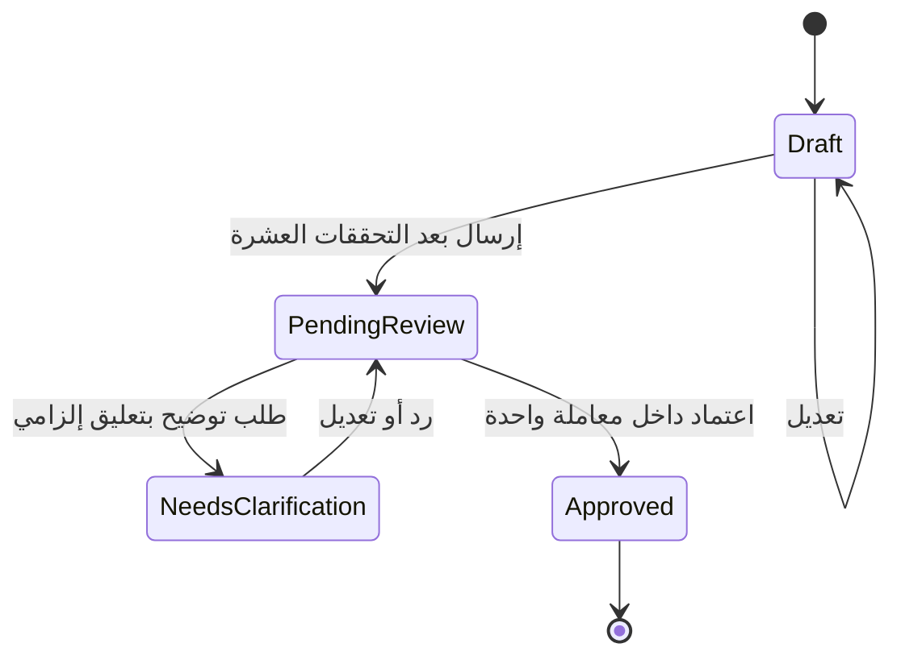

> 🟢 ⭐ **حُذفت `NeedsAdminAction` في الباتش v1.2.1.** **مشكلات المزامنة (تكليف منتهٍ · موقع غير متاح · تعارض Offline · فشل تحقق) تُمثَّل في `sync_submissions` و`sync_exceptions`** — ⛔ **ولا تغيّر الحالة المالية للمصروف**.

| الحالة | الأثر المالي | يقبل التعديل؟ |
|---|---|---|
| `Draft` | ⛔ **صفر** | ✅ |
| `PendingReview` | ⛔ **صفر** | ⚠️ المراجع فقط (العملية أو الموقع) |
| `NeedsClarification` | ⛔ **صفر** | ✅ المهندس |
| ⭐ `Approved` | ⭐ **أثر واحد في العهدة وأثر واحد في التكلفة** | ⛔ **لا — التصحيح بحركة مرتبطة** |

> ⛔ **لا `Rejected` كرفض نهائي يحذف المعاملة** (BR-209).

## 6.7 المفاتيح المرشحة والقيود

| الكيان | 🔑 PK | القيود |
|---|---|---|
| `expenses` | `id` | ⚡ **`UNIQUE(client_generated_id)` — القيد الحاسم لمنع التكرار عند المزامنة** · و**`amount > 0`** · و`description` **إلزامي شرطيًا** مع «أخرى» · و**كل FK إلزامية** (`operation_id` · `site_id` · `assignment_order_id` · `engineer_party_id` · `expense_type_id`) |
| `expense_status_history` | `id` | — |
| `expense_reviews` | `id` | `comment` **غير فارغ** |
| `expense_attachments` | `id` | ⛔ **لا حد أدنى — 0 مقبول دائمًا** |
| `expense_corrections` | `id` | `original_expense_id` **إلزامي** · و`reason` **غير فارغ** |
| `expense_types` | `id` | `UNIQUE(normalized_name)` — ⭐ **قيد آمن هنا لأن التصنيف بيان مرجعي يُدار لا اسم شخص** |
| 🟢 `sync_submissions` | `id` | ⚡ ⭐ **`UNIQUE(client_generated_id)`** — **الإرسال المكرر يُربط بالطلب القائم ⛔ ولا ينشئ ثانيًا** |
| 🟢 `sync_exceptions` | `id` | **`resolution_note` إلزامية عند `Resolved`** · ⛔ **ولا حذف** |

## 6.8 ⭐ القيود العابرة للجداول — الآلية

| القيد | لماذا لا `CHECK` | البديل |
|---|---|---|
| **الموقع يتبع العملية المختارة** | يقرأ `sites` | ⭐ **FK مركّب `(operation_id, site_id)` → `sites(operation_id, id)`** — يتحول إلى **FK حقيقي** |
| **المهندس مكلَّف بالموقع بتاريخ الحركة** | يقرأ `engineer_site_assignments` **ويعتمد على تاريخ** | ⭐ **خدمة تطبيقية داخل معاملة واحدة** + **شبكة أمان في القاعدة** — 🏗️ **Physical Design Candidate:** `CONSTRAINT TRIGGER … DEFERRABLE` |
| **أمر الإسناد يطابق أمر إسناد العملية** | يقرأ `operations` | **FK مركّب `(operation_id, assignment_order_id)`** |
| **نوع المصروف فعّال** | يقرأ `expense_types` | تحقق تطبيقي — والتعطيل لا يمنع قراءة الحركات القديمة |

> ⛔ **ولا `CHECK` عابر للجداول إطلاقًا** (BR-180 · **RISK-023**).

## 6.9 البيانات الحساسة

| الحقل | المعالجة |
|---|---|
| `amount` | بيانات مالية — وفق الصلاحية |
| المرفقات 🔒 | ⭐ **يُسجَّل وجود المرفق واسمه ومن أضافه — ⛔ لا محتواه** (BR-191) |

## 6.10 أحداث التدقيق 📝

`ExpenseDraftCreated` · `ExpenseModified` (**بالقيم قبل وبعد**) · `ExpenseSubmitted` · `ExpenseClarificationRequested` · `ExpenseClarificationAnswered` · ⭐ **`ExpenseOperationOrSiteChanged`** (المراجع قبل الاعتماد — **بالقيمة قبل وبعد والسبب**) · ⭐ **`ExpenseApproved`** · ⭐ **`CorrectionPosted`** · `SyncRejected` · `AccessDenied`

## 6.11 ⭐ مخاطر التكرار

| الخطر | الضابط | الطبقة |
|---|---|---|
| **مزامنة مكررة تُنشئ مصروفين** | ⭐ `UNIQUE(client_generated_id)` | **الطبقة 4** |
| **اعتماد مكرر يُنشئ حركتي عهدة** | **فهرس فريد جزئي على أثر العهدة** | **الطبقة 5** |
| **مصروف مسجَّل يدويًا ومستوردًا** | `source_import_row_id` + **كشف تشابه** | **الطبقة 7** |
| **ترحيل محاسبي مكرر** | 🟢 ⭐ **`UNIQUE(journal_entries.financial_event_id)`** — **قيد واحد لكل حدث** | **الطبقة 5** |

## 6.12 أثر الاستيراد التاريخي 🔧 📊

| المصدر | الحجم | المعالجة |
|---|---|---|
| `الخزينه` (بيان المصروفات) | **5,101 صفًا** · 259,069,818 | ⟹ مصروفات وحركات نقدية **حسب `نوع المصروف`** |
| `العهد` | **8,086 صفًا** | ⟹ مصروفات من العهدة |
| `هانى شاكر!المصروفات` | **128 صفًا** · 173,300 | ⟹ مصروفات مهندس · ⚠️ **3 صفوف فقط من 128 بها أمر إسناد** |
| ⭐ `بيان المصروف` | **429 قيمة في الدليل · 416 تحتاج خريطة** | ⭐ **يُفكَّك إلى: الطرف · التصنيف · حساب المراقبة · الوصف** |
| ⭐ `شرح القيد` | **216 قيمة مميزة** | ⭐ **يُفكَّك — ويحمل اسم العامل في حالة السلف** |
| `اسم الموقع` في الدفاتر | — | ⛔ **يُستبعد — `VLOOKUP` به 23 `#N/A`** |
| `امر الاسناد` في `الخزينه` | 19 صفًا فارغًا · يتيمان (`372` · `برج العرب ح3`) | 🟢 ⟹ ⭐ **`sync_exceptions` بنوع `ValidationFailed`** · **والمصروف يبقى بحالته المالية الحقيقية** |

**🔧 مشاكل ترحيل معلَنة:**

1. **الحركات التاريخية بلا تكليفات** ⟹ علامة `LegacyNoAssignment` · ⛔ **ولا يُخترع تكليف بأثر رجعي**.
2. **مصروفات بلا أمر إسناد** (19 صفًا + 125 من 128 في ملف المهندس) ⟹ **`NeedsClassification`** · ⛔ **ولا يُخترع أمر إسناد**.
3. **`مصروفات` مقابل `المصروفات`** (51 صفًا بالتهجئة الثانية) ⟹ **دمج بعد تطبيع**.

## 6.13 الأسئلة المفتوحة

| OQ | السؤال |
|---|---|
| **OQ-015** | مدة تصعيد مراجعة المصروفات — ⚪ **تنبيه 3 أيام · تصعيد 7** |
| **OQ-003** | سقف الاعتماد |
---

# Domain 7 — Workers, Attendance, Advances, Payments and Settlements

## 7.1 الغرض

⭐ **الفصل الملزم بين خمسة مفاهيم** يُخلط بينها اليوم: **حضور العامل · استحقاقه · سلفته · دفعه · تسويته** — بحيث **لا يُخصم مبلغ واحد مرتين**.

## 7.2 قواعد العمل التي يخدمها

⭐ **BR-034** … **BR-052** · **BR-162** · **BR-167** · **BR-174** … **BR-176** · **BR-223**

## 7.3 الكيانات

| الكيان | الاسم العربي | النوع | الغرض |
|---|---|---|---|
| `site_cost_resource_assignments` | ربط مورد التكلفة بالموقع | **CE** | بفترة سريان |
| `pay_rate_versions` | سياسات الأجر المؤرَّخة | **AR** | ⭐ فئة · وحدة العدد · **طريقة احتساب السهرة** |
| `attendance_entries` | سطور الحضور واليوميات | **AR** | ⭐ **بيانات تشغيلية بلا أثر مالي** |
| `payroll_periods` | كشوف الأجور | **AR** | (شركة · موقع · شهر · نوع تشغيل · إصدار) |
| `payroll_lines` | سطور الكشف | **CE** | سطر لكل مورد تكلفة |
| `payroll_deduction_lines` | سطور خصومات الكشف | **CE** | مفصَّلة لا مجمَّعة |
| `worker_advances` | سلف العمال | **AR** | ⭐ **حركة دفع فعلية** |
| `long_term_advances` | السلف المستديمة | **AR** | برصيد مُسلسل |
| `long_term_advance_installments` | أقساط السلفة المستديمة | **CE** | القسط الشهري |
| `worker_payments` | مدفوعات العمال | **AR** | دفعة معتمدة |
| `subcontract_agreements` | اتفاقات المقاولين | **AR** | سعر · وحدة قياس · سريان **بإصدارات** |
| `subcontractor_settlements` | تسويات المقاولين | **AR** | كشف دوري |
| `subcontractor_settlement_lines` | سطور التسوية | **CE** | المساحة · الخصم · السعر · نسبة الأعمال |
| `subcontractor_deductions` | خصومات المقاول | **CE** | ⭐ **ببيان وعدد وسعر ومصدر** |
| `subcontractor_retention_ledger` | دفتر تعليات المقاول | **AR** | 5% **مُسلسل عبر الشهور** |

## 7.4 ⭐ مخطط الفصل الخماسي

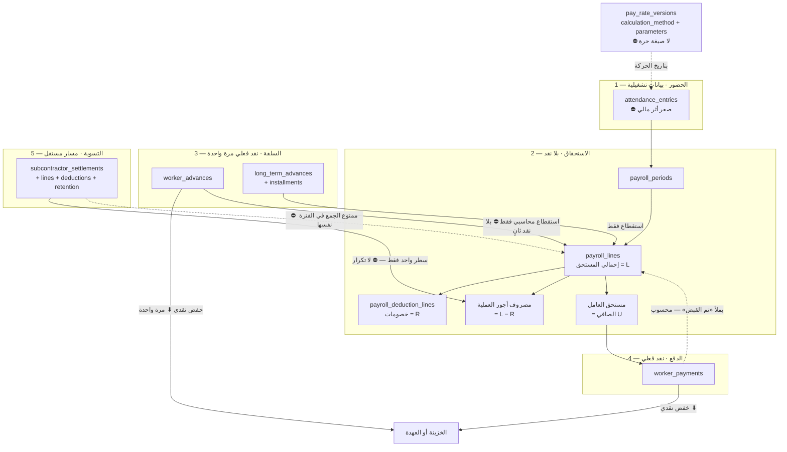

**شرح عربي:** ⭐ **الخزينة تُخفَّض في مكانين فقط**: `worker_advances` و`worker_payments`. و**اعتماد الكشف لا يُحرِّك نقدًا** — يُنشئ **مصروفًا والتزامًا**. و**السلفة تُخصم من المستحق كاستقطاع محاسبي بحت** بلا خروج نقدي ثانٍ. و`تم القبض` **حقل محسوب من مدفوعات معتمدة لا رقم يُكتب** — وهذا يُغلق ثغرة الأرقام المُقحَمة (مثل **87,637.0772** التي تُصفّر الصافي بالضبط في `حى 9 زايد` مايو).

## 7.5 العلاقات والـCardinality

| العلاقة | النوع | القيد |
|---|---|---|
| `cost_resources` → `site_cost_resource_assignments` | **1 : N مؤرَّخة** | — |
| `site_cost_resource_assignments` → `pay_rate_versions` | **1 : N** | **فترات غير متداخلة** |
| `attendance_entries` → `cost_resources` · `sites` | **N : 1** لكل منهما | — |
| `payroll_periods` → `payroll_lines` | **1 : N** | — |
| `payroll_lines` → `payroll_deduction_lines` | **1 : 0..N** | ⭐ **مفصَّلة لا مجمَّعة** |
| `worker_advances` → `payroll_lines` | **N : M** عبر استقطاع | ⭐ **بلا خفض نقدي ثانٍ** |
| `worker_payments` → `payroll_lines` | **N : M** | **`تم القبض` محسوب** |
| `subcontract_agreements` → `subcontractor_settlements` | **1 : N** | — |
| `subcontractor_settlements` → `subcontractor_retention_ledger` | **1 : N** | ⭐ **رصيد مُسلسل** |

## 7.6 Lifecycle

| الكيان | الحالات |
|---|---|
| `attendance_entries` | `Recorded` → `IncludedInPayroll` → `Corrected` — ⛔ **لا حذف** |
| `payroll_periods` | `Draft` → `PendingApproval` → `Approved` → `Cancelled` · و`Supplementary` / `Corrective` **أنواع تشغيل لا حالات** |
| `worker_advances` | `Recorded` → `PartiallyRecovered` → `FullyRecovered` — **محسوبة من الحركات** |
| `worker_payments` | `Draft` → `Approved` |
| `subcontractor_settlements` | `Draft` → `PendingApproval` → `Approved` → `Corrected` |

## 7.7 ⭐ المفاتيح المرشحة والقيود — حسم BR-174 · BR-175 · BR-176

| الكيان | 🔑 PK | ⭐ **القيد المعتمد** | لماذا |
|---|---|---|---|
| **`payroll_periods`** | `id` | ⭐ **`UNIQUE(managed_company_id, site_id, period_year, period_month, run_type, version_no)` جزئي `WHERE status <> 'Cancelled'`** | **`Unique(site, year, month)` وحده غير كافٍ** — يستحيل معه تشغيل **كشف تكميلي** أو **إعادة تشغيل بعد إلغاء** · و`run_type ∈ {Regular, Supplementary, Corrective}` |
| **`payroll_lines`** | `id` | ⭐ ⛔ **لا قيد تفرّد على (فترة، مورد)** — البديل: **معرّف داخلي + `client_generated_id` + كشف تكرار ينبّه ولا يمنع** | **المورد الواحد قد يظهر بأكثر من سطر في الفترة نفسها**: فئتا أجر · موقعان فرعيان · سطر تصحيح · بند مكافأة منفصل |
| **`attendance_entries`** | `id` | ⭐ ⛔ **لا قيد تفرّد على التركيبة** — و⛔ **`line_number` ليس هوية** — البديل: **معرّف داخلي + `client_generated_id` + `duplicate_detection` (مورد + موقع + تاريخ + كمية متقاربة) ينبّه ولا يمنع** | **`Unique(مورد، موقع، تاريخ)` يمنع حركة صحيحة**: وردية ثانية · فئتا أجر في يوم · تصحيح سطر · **واستخدام `line_number` يجعل إعادة إرسال السطر نفسه تمرّ بمجرد تغيّر ترتيبه** |
| `pay_rate_versions` | `id` | **فترات غير متداخلة** لنفس (مورد · موقع) | — |
| `worker_advances` | `id` | ⚡ `UNIQUE(client_generated_id)` | — |
| `worker_payments` | `id` | ⚡ `UNIQUE(client_generated_id)` · و**`payroll_line` يقرأ `تم القبض` منها لا العكس** | — |
| `subcontract_agreements` | `id` | فترات **غير متداخلة** لنفس (مقاول · موقع أو عملية) | — |
| `subcontractor_settlements` | `id` | 🔵 `UNIQUE(agreement_id, period_year, period_month)` — **يحتاج اختبار بيانات** | — |

## 7.8 ⭐ سياسة الأجر — لا صيغة حرة (BR-167)

| الحقل | القيم المسموحة |
|---|---|
| `calculation_method` | ⭐ **قائمة مغلقة**: `DAILY_RATE_DIVIDED` · `DAILY_RATE_FIXED_MULTIPLE` · `EXPLICIT_AMOUNT` |
| `parameters` | `divisor = 7` · `divisor = 2` · `amount = <قيمة>` |
| `unit_type` | ⭐ **إلزامي**: `DAYS` · `LUMP_SUM` · `WORKER_DAYS` · `COMPLETION_RATIO` · `OTHER` |
| `valid_from` / `valid_to` | ⭐ **إلزامي** — **15 موردًا لهم أكثر من فئة خلال 2026** |
| Snapshot في `payroll_lines` | ⭐ **الطريقة والمعاملات وقت الاحتساب** |

**الأنماط المرصودة الثلاثة تُمثَّل كلها بهذه الطرق الثلاث بلا مفسِّر صيغ:** ÷7 (**549 سطرًا · 77.4%**) · ÷2 (**129 · 18.2%**) · قيمة يدوية (**26 · 3.7%**) · وصيغة أخرى واحدة (`=152712*0.7`) **تُحوَّل إلى `EXPLICIT_AMOUNT`**.

> ⭐ **القاعدة خاصية للمورد نفسه لا لنوعه** (BR-040): `عمال سعد` و`عمال حسين القناوى` بـ÷2 كمجموعات · **وخمسة سبّاكين أفراد بـ÷2 أيضًا** · و`م/ محمد سعيد` و`عادل السواق` أفراد بـ÷7 · و`شعبان ضاحى رى` **14 يدويًا** (فئة اليوم 66.67 ⟹ النسبة 4.76). **والحرفة قد تكون معيارًا لكنه استنتاج غير مؤكد — يُخزَّن خاصيةً ولا يُبنى عليه منطق.**

> ⛔ **تخزين صيغة نصية وتنفيذها ثغرة أمنية وتُعجز التدقيق** (**RISK** مثبَّت).

## 7.9 ⭐ المعادلات الملزمة

```
إجمالي اليوميات       = فئة اليومية × العدد
إجمالي السهرات        = فئة السهرة × العدد
إحمالي المستحق   (L) = إجمالي السهرات + إجمالي اليوميات + انتقالات وتليفون + مكافآت
اجمالى الاستقطاعات (S) = السلف الحالية + الحالى من سلف مستديمة + خصومات
الصافي المستحق   (U) = L − S − الصافي المقبوض
الباقى من سلف مستديمة = الاجمالى − (المخصوم سابقًا + الحالى)

⭐ تكلفة الأجور على العملية = L − خصومات        ← أساس استحقاق
```

> ⭐ **ملاحظة حاسمة:** `اجمالى الاستقطاعات` تستخدم **`الحالى` (P)** لا `الباقى` (Q). **ولهذا لم يتأثر `الصافي المستحق` ولا تكلفة الأجور** حتى حين كانت `N` و`Q` ملوَّثتين بـ836 خطأ `#REF!`.

## 7.10 ⭐ منع الخصم المزدوج — الضوابط

| الخطر | الضابط | المرجع |
|---|---|---|
| **السلفة تُخفض النقد مرتين** | ⭐ السلفة **حركة نقدية واحدة**، وخصمها في الكشف **استقطاع محاسبي بحت** | **BR-048** · **BR-049** |
| **اليومية تخفض العهدة بمجرد تسجيلها** | ⛔ **بيانات تشغيلية بلا أثر مالي** | **BR-046** |
| **اعتماد الكشف يُحرِّك نقدًا** | ⛔ **مصروف والتزام فقط** | **BR-047** |
| ⭐ **المقاول له تسوية وسطر كشف في الفترة نفسها** | ⭐ **تحقق تطبيقي عابر للجداول يمنعه** | **BR-052** |
| **`تم القبض` رقم حر** | ⭐ **حقل محسوب من مدفوعات معتمدة** | **BR-050** |
| **الأعباء والمدفوعات تدخل تكلفة العملية** | ⛔ **الاستحقاقات وحدها تدخلها** | **BR-051** |
| **ثلاث تسويات متطابقة تُرحَّل** | ⭐ **بصمة تسوية متطابقة ⟹ تحذير قبل الاعتماد** | **BR-106** |

## 7.11 البيانات الحساسة

| الحقل | المعالجة |
|---|---|
| ⭐ **كل مبالغ الأجور** 🔒 | ⛔ **لا تُسجَّل في Serilog إطلاقًا — لا مبالغ ولا أسماء مقترنة بمبالغ** (BR-245) |
| `payroll_lines` كاملة 🔒 | تُعرض وفق `Payroll.View` |

## 7.12 أحداث التدقيق 📝

`AttendanceRecorded` · `AttendanceCorrected` · `PayRateVersionCreated` · ⭐ `PayRateOverridden` (**بالسبب والقيمة الأصلية**) · `PayrollPeriodCreated` · ⭐ **`PayrollApproved`** · `PayrollCancelled` · `WorkerAdvanceRecorded` · `LongTermAdvanceCreated` · `InstallmentApplied` · `WorkerPaymentRecorded` · `SubcontractorSettlementApproved` · `SubcontractorRetentionMovement`

## 7.13 مخاطر التكرار

| الخطر | الضابط |
|---|---|
| إعادة إرسال سطر حضور | ⚡ `client_generated_id` + **كشف تكرار** |
| سطر كشف مكرر | ⛔ **لا قيد يمنع** — **كشف تكرار ينبّه** لأن التكرار قد يكون مشروعًا |
| ⭐ **مقاول محسوب مرتين** | **تحقق تطبيقي عابر للجداول** (BR-052) — والدليل المرصود: **80,173.8** |
| **ثلاث تسويات بنفس البصمة** | **تحذير قبل الاعتماد** — والدليل: مساحة 162,712 · خصم 10,000 · سعر 0.7 · نسبة 0.75 · مستحق **80,173.80** في ثلاث تسويات |

## 7.14 أثر الاستيراد التاريخي 🔧 📊

| المصدر | الحجم | المعالجة |
|---|---|---|
| ملف الأجور — 7 كشوف مواقع × 8 أشهر | **866 سطرًا** · **108 مورد تكلفة** | ⟹ `payroll_periods` + `payroll_lines` |
| 4 تسويات مقاولين | كتل شهرية | ⟹ `subcontractor_settlements` |
| `السلف الحاليه` (M) | `SUMIFS` خارجي | ⭐ ⛔ **لا يُستورد كرقم — يُعاد بناؤه من الحركات ويُطابق** |
| `سلف مستديمة/الاجمالى` (N) | `SUMIFS` + ترحيل مُسلسل | ⭐ ⛔ **لا يُستورد — يُعاد بناؤه** |
| `الحالى` (P) | **يدوي** | ✅ **يُستورد — قيمة حقيقية** |
| `تم القبض` (T) | يدوي | ✅ يُستورد **بحالة `يحتاج مستندًا` حيث لا مستند** |
| `خصومات` (R) | يدوي | ⟹ سطر `غير مسمى` في `payroll_deduction_lines` |
| `الصافي المستحق` (C) الأول | `=U` | ⛔ **يُستبعد — تكرار عرضي** |
| `م` · `F` · `I` · `O` · `Q` · `S` · `V` | محسوبة أو عرضية | ⛔ **تُستبعد — للمطابقة لا للتخزين** |

**🔧 مشاكل ترحيل مثبتة:**

| # | المشكلة | المعالجة |
|---|---|---|
| 1 | ⭐ **خطوة الكتل الشهرية غير ثابتة بين الأوراق** (`الشيخ زايد` كل 34 صفًا · `حى 1 زايد` متغيرة) | ⛔ **أي مستورد يعتمد إزاحة ثابتة سيُتلف البيانات** ⟹ **اكتشاف الكتل بالبحث عن `عــن شهـــر:` وصف `الإجمالى`** (**RISK-017**) |
| 2 | ⭐ **`حى 1 زايد!U251` فارغة بلا صيغة** | **الفراغ في عمود محسوب لا يُقرأ صفرًا** ⟹ يُعلَّم `صيغة مفقودة` **ويُحسب من المكوّنات = −16,250.00** |
| 3 | **صافي سالب** (`حى 9 زايد` أغسطس = −21,100) | ⟹ **رصيد مدين مدوَّر على العامل** — ⛔ **لا يُصفَّر** |
| 4 | **`تم القبض` = 87,637.0772** يُصفّر الصافي بالضبط | ⚪ **plug** ⟹ `يحتاج مستندًا` |
| 5 | **بيانات `التطوير الجديد` في ديسمبر وفراغ أبريل–نوفمبر** | ⟹ علامة `تاريخ مشكوك فيه` |
| 6 | ⭐ **الربط بين ورقة التسوية وكشف الأجور يدوي وناقص** — `=152712*0.7` في الكشف مقابل `(162712 − 10000) × 0.7 × 0.75` في التسوية | **الرقمان متطابقان بالمصادفة الحسابية** · وأي تعديل **لن ينتقل** ⟹ **الربط يصبح FK حقيقيًا** |
| 7 | **`=D342*E342/30*9`** — خمسة معاملات في صيغة واحدة | ⟹ **تُفكَّك وتُحفظ الصيغة الأصلية نصًا للتدقيق** (BR-096) |
| 8 | **`احمد فتجى` في اسم الورقة مقابل `احمد فتحى` في الخلية** | ⟹ **مرشّح تشابه — ⛔ لا دمج تلقائي** |
| 9 | ⭐ **تسويتا `محمد سليم حى1` و`احمد فتحى` لا تظهران في كشف `حى 1 زايد` ليناير** | ⟹ **80,173.8 لكل منهما لم تدخل تكلفة العملية** · **OQ-023 — تُستورد بعلامة `تكرار مشتبه به` ولا تُرحَّل محاسبيًا** |
| 10 | **`استكمال العلمين` — أعمدة بأسماء نباتات** | **مصفوفة العمال أُعيد استخدامها لكميات مشتل** ⟹ ⛔ **لا تُستورد كحضور** |

## 7.15 الأسئلة المفتوحة

| OQ | السؤال |
|---|---|
| **OQ-023** | **التسويات الثلاث المتطابقة** — تُستورد بعلامة `تكرار مشتبه به` |
| **OQ-029** | **صف `حى 1 زايد!251`** — رصيد مدين أم تحصيل غير مسجَّل؟ |
| **OQ-013** | سقف السلف المستديمة وقواعد أقساطها — ⚪ **بلا سقف** |
| — | **هل الحرفة معيار فعلي لقاعدة ÷2؟** — ⚪ **الحرفة خاصية · والقاعدة لكل مورد** |
| — | **هل فئة الأجر تتبع العامل أم الموقع؟** — ⚪ **الاثنان مدعومان والأخص يفوز** |

---

# Domain 8 — Engineer Payroll

## 8.1 الغرض

⭐ **تمثيل راتب المهندس نفسه** — وهو **امتداد نطاق معتمد في 1.1.4 لم يكن ضمن المرحلة صفر** — مع **منع تحميله على أي موقع بلا سياسة توزيع معتمدة**.

## 8.2 قواعد العمل التي يخدمها

⭐ **BR-222** · **BR-223** · **BR-225** · **BR-226** · **BR-227**

## 8.3 الكيانات

| الكيان | الاسم العربي | النوع | الغرض |
|---|---|---|---|
| `engineer_salary_entries` | بنود رواتب المهندسين | **AR** | راتب شهري لمهندس — **استحقاق** |
| `engineer_salary_allocation_rules` | قواعد توزيع الراتب | **AR** | ⭐ **مُصدَّرة بتاريخ سريان** |
| `engineer_salary_allocation_rule_lines` | سطور نسب التوزيع | **CE** | للخيار «نسب محددة لكل موقع» |
| `engineer_salary_allocations` | توزيعات الراتب الفعلية | **CE** | ⭐ **ناتج تطبيق القاعدة — مع Snapshot لنسختها** |

## 8.4 مخطط المجال

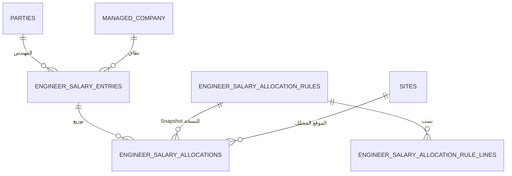

## 8.5 ⭐ خيارات قاعدة التوزيع الأربعة

| `allocation_method` | المزايا | العيوب |
|---|---|---|
| `EXPLICIT_SITE_RATIOS` | يعكس الواقع بدقة | يحتاج مراجعة واعتمادًا دوريًا |
| `EQUAL_SPLIT` | أبسط ما يمكن | **يظلم الموقع الصغير ويجمّل الكبير** |
| `BY_WORKING_DAYS` | الأقرب للعدالة | يتطلب **بيانات حضور دقيقة للمهندس نفسه** |
| ⭐ **`NO_ALLOCATION`** | ⭐ **لا يشوّه تكلفة أي موقع** | تكلفة الموقع تظهر **أقل من تكلفتها الاقتصادية** |

> ⭐ **الافتراضي عند غياب سياسة معتمدة: `NO_ALLOCATION`** — الراتب **بند إداري منفصل**، ⛔ **لا يدخل تكلفة أي موقع**، **ويُذكر ذلك صراحةً في التقرير حتى لا يُقرأ رقم تكلفة الموقع خطأً** (BR-226).

## 8.6 العلاقات والـCardinality

| العلاقة | النوع | القيد |
|---|---|---|
| `parties(Engineer)` → `engineer_salary_entries` | **1 : N** | بند لكل (مهندس · شهر · شركة) |
| `engineer_salary_allocation_rules` → `_lines` | **1 : 0..N** | فقط مع `EXPLICIT_SITE_RATIOS` · **ومجموع النسب = 100%** |
| `engineer_salary_entries` → `engineer_salary_allocations` | **1 : 0..N** | ⭐ **صفر عند `NO_ALLOCATION`** |
| `engineer_salary_allocation_rules` → `engineer_salary_allocations` | **1 : N** | ⭐ **Snapshot لرقم النسخة داخل كل توزيع** |

## 8.7 Lifecycle

| الكيان | الحالات |
|---|---|
| `engineer_salary_entries` | `Draft` → `Approved` → **`Paid`** — ⭐ **والاعتماد لا يعني الصرف** (BR-223) |
| `engineer_salary_allocation_rules` | `Draft` → `Active` → `Superseded` — **بفترات غير متداخلة داخل النطاق** |

## 8.8 المفاتيح المرشحة والقيود

| الكيان | 🔑 PK | القيود |
|---|---|---|
| `engineer_salary_entries` | `id` | `UNIQUE(engineer_party_id, managed_company_id, period_year, period_month, run_type, version_no)` **جزئي `WHERE status <> 'Cancelled'`** — **نفس منطق `payroll_periods`** |
| `engineer_salary_allocation_rules` | `id` | **فترات غير متداخلة** داخل نفس (شركة · مهندس أو نطاق) · و`version_no` |
| `_rule_lines` | `id` | `UNIQUE(rule_id, site_id)` · و**مجموع `ratio` = 1.0 بالضبط** |
| `engineer_salary_allocations` | `id` | `UNIQUE(salary_entry_id, site_id)` · و**مجموع `allocated_amount` = `salary_amount`** · ⭐ **وآخر سطر يستوعب فرق التقريب** (BR-094) |

## 8.9 البيانات الحساسة

| الحقل | المعالجة |
|---|---|
| ⭐ `salary_amount` 🔒 | ⭐ **يتطلب `Payroll.View`** · ⛔ **ولا يُسجَّل في Serilog** |

## 8.10 أحداث التدقيق 📝

`EngineerSalaryEntryCreated` · `EngineerSalaryApproved` · `EngineerSalaryPaid` · ⭐ `SalaryAllocationRuleActivated` · `SalaryAllocationApplied`

## 8.11 مخاطر التكرار

| الخطر | الضابط |
|---|---|
| راتب مسجَّل مرتين لنفس الشهر | ⭐ **القيد المركّب مع `version_no`** |
| ⭐ **توزيع الراتب على موقع بلا سياسة** | ⛔ **منع صريح** — `engineer_salary_allocations` **لا يُنشأ بلا `rule_id` نشط** |
| مجموع التوزيعات ≠ الراتب | **تحقق تطبيقي** + آخر سطر يستوعب الفرق |

## 8.12 أثر الاستيراد التاريخي 🔧

⛔ **لا مصدر في Excel** — ⭐ **راتب المهندس نفسه لم يكن ضمن نطاق المرحلة صفر** التي غطّت **يوميات العمالة وتسويات المقاولين**. **وهذا ليس تعارضًا بل امتداد نطاق معتمد.** ⟹ **إدخال يدوي عند التشغيل.**

> ⚠️ **ملاحظة:** ثلاثة موارد تكلفة مرصودة بصفة `مهندس أو مشرف` (`م/ محمد سعيد` · `م/ احمد علاء` · `م/ مصطفى`) تظهر في **كشوف الأجور** — ⛔ **وهذه ليست رواتب المهندسين المسؤولين عن المواقع** بل موارد تكلفة ميدانية. **ولا يُفترض أنها الشيء نفسه.**

## 8.13 الأسئلة المفتوحة

| # | السؤال | الحالة |
|---|---|---|
| 1 | ⭐ **أي من خيارات التوزيع الأربعة يُعتمد؟** | 🟡 **قرار المدير والمحاسب** — **والافتراضي `NO_ALLOCATION` مثبَّت** |
| 2 | هل يُدمج بند الراتب مع موارد التكلفة من صفة `مهندس`؟ | ⚪ **لا — كيانان مختلفان** |
---

# Domain 9 — Suppliers and Contractors

## 9.1 الغرض

متابعة **موقف المورد من توريد إلى سداد**، و**مسار المقاول المستقل**، و⭐ **دورة المصروف القابل للاسترداد الكاملة** التي تُنهي العيب البنيوي الثاني: **ازدواج تكلفة منهجي بلا أي قيد استرداد**.

## 9.2 قواعد العمل التي يخدمها

⭐ **BR-051** · **BR-052** · **BR-057** · **BR-073** · **BR-120** · **BR-127** · **BR-165** · **BR-169**

## 9.3 الكيانات

| الكيان | الاسم العربي | النوع | الغرض |
|---|---|---|---|
| `supply_receipts` | التوريدات | **AR** | استلام بكمية وسعر — **والمبلغ محسوب** |
| `supply_receipt_lines` | سطور التوريد | **CE** | الكمية · سعر الوحدة |
| `supply_categories` | أنواع التوريد | **RD** | مزروعات · شبكات رى · معدات · مخلفات … |
| `items` | الأصناف | **RD** | **196 صنفًا مرصودًا** |
| `supplier_invoices` | فواتير الموردين | **AR** | — |
| `supplier_payments` | دفعات الموردين | **AR** | — |
| `supplier_payment_allocations` | تخصيصات الدفعة | **CE** | **M:N** — تدعم **غير المخصَّص** |
| `cheques` | الشيكات | **AR** | 🔒 |
| `price_adjustments` | تسويات فروق الأسعار | **CE** | **78 حركة سالبة مرصودة** |
| `recoverable_expense_claims` | مطالبات الاسترداد | **AR** | ⭐ **أننا أنفقنا نيابة عن طرف ونطالبه** |
| `recoverable_expense_allocations` | تخصيصات المطالبة | **CE** | **M:N** بمصدرها |
| `recoverable_expense_recoveries` | تحصيلات الاسترداد | **CE** | **بخمس طرق** |
| `recoverable_expense_writeoffs` | شطب الاسترداد | **CE** | ⛔ **لا شطب بلا اعتماد** |
| `recoverable_expense_disputes` | نزاعات الاسترداد | **CE** | ⭐ **أثناء النزاع يُجمَّد الخصم التلقائي** |

## 9.4 ⭐ مخطط دورة المصروف القابل للاسترداد

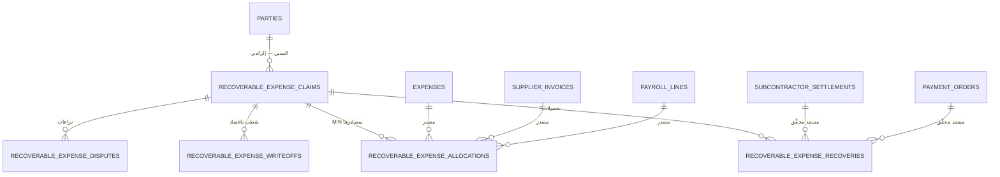

**شرح عربي:** ⭐ **سبب إضافة الدورة كاملة:** في الإصدار 1.0 اختُزل السؤال إلى **«حقل `recoverable_from_party_id` على المصروف»** — وهذا **خطأ تصميمي**: المبلغ القابل للاسترداد له **دورة حياة كاملة** (مطالبة · تخصيص · تحصيل · تسوية · نزاع · شطب) **لا يحملها حقل واحد**، وبدونها **لا يمكن الإجابة عن «كم على المقاول فلان؟»** ولا منع الازدواج المثبت: **صفر قيد استرداد في ثلاثة دفاتر** (5,101 + 8,086 + 4,902 صفًا).

## 9.5 ⭐ طرق التحصيل الخمس

| `recovery_method` | المستند المحقِّق |
|---|---|
| `DEDUCT_FROM_SETTLEMENT` | `subcontractor_settlement_id` |
| `DEDUCT_FROM_PAYMENT_ORDER` | `payment_order_id` |
| `CASH_REPAYMENT` | `treasury_movement_id` |
| `OFFSET_AGAINST_PAYABLE` | مرجع المقاصّة |
| `IN_KIND` | مستند عيني |

## 9.6 ⭐ القواعد الملزمة على الدورة

| # | القاعدة |
|---|---|
| 1 | ⭐ **المصروف يُقيَّد مرة واحدة فقط.** إنشاء مطالبة استرداد **لا ينشئ قيدًا ثانيًا للمبلغ** — بل **يعيد تصنيفه أو ينشئ ذمة مدينة مقابلة** بحسب المعالجة المعتمَدة |
| 2 | ⭐ **مسار استرداد واحد لكل مبلغ** — ⛔ **يُمنع أن يُخصم المبلغ نفسه من تسوية المقاول ومن أمر الدفع معًا** · الحماية: **فهرس على `(claim_id, allocated_source)` مع تحقق مجموع** |
| 3 | ⭐ **`مجموع التحصيلات + المشطوب ≤ recoverable_amount`** — **والزيادة تُرفض بخطأ واضح لا تُبتلع** |
| 4 | ⭐ **الرصيد لا يُخزَّن أبدًا** — `recoverable_amount − Σ recoveries − Σ writeoffs` |
| 5 | **مجموع التخصيصات لمصروف ≤ قيمة المصروف** |
| 6 | ⭐ **أثناء النزاع يُجمَّد الخصم التلقائي** |
| 7 | ⛔ **لا شطب بلا سبب ومستند ومعتمِد** |

## 9.7 العلاقات والـCardinality

| العلاقة | النوع |
|---|---|
| `parties(Supplier)` → `supply_receipts` | **1 : N** |
| `supplier_invoices` ↔ `supplier_payments` عبر `allocations` | **N : M** · ⭐ **تدعم غير المخصَّص** |
| `recoverable_expense_claims` → `parties(debtor)` | **N : 1 إلزامية** |
| `recoverable_expense_claims` ↔ المصادر عبر `allocations` | ⭐ **N : M** — **مصروف واحد قد يُقسَّم على أكثر من مدين، ومطالبة واحدة قد تجمع عدة مصروفات** |
| `recoverable_expense_claims` → `recoveries` · `writeoffs` · `disputes` | **1 : 0..N** لكل منها |

## 9.8 Lifecycle

| الكيان | الحالات |
|---|---|
| `supplier_invoices` | `Draft` → `Approved` → `PartiallyPaid` → `Paid` — **الأخيرتان محسوبتان** |
| `cheques` | `Issued` → `Presented` → `Cleared` · `Bounced` · `Cancelled` — **والفارغ في `حاله الشيك` (51 صفًا) = `قيد التحصيل`** |
| ⭐ `recoverable_expense_claims` | ⭐ **محسوبة من الحركات لا مخزَّنة**: `OPEN` · `PARTIALLY_RECOVERED` · `FULLY_RECOVERED` · `DISPUTED` · `WRITTEN_OFF` |

## 9.9 المفاتيح المرشحة والقيود

| الكيان | 🔑 PK | القيود |
|---|---|---|
| `supply_receipts` | `id` | 🔵 لا تفرّد طبيعي واضح — Idempotency |
| `supplier_invoices` | `id` | 🔵 `UNIQUE(supplier_party_id, invoice_number)` — **يحتاج اختبار** |
| `supplier_payment_allocations` | `id` | **مجموع التخصيصات ≤ مبلغ الدفعة** |
| `cheques` | `id` | ⭐ **`UNIQUE(bank_id, cheque_number)`** — **قيد آمن: 153 رقمًا مميزًا بالكامل** ✅ |
| `recoverable_expense_claims` | `id` | `debtor_party_id` **إلزامي** · و`recoverable_amount > 0` |
| `recoverable_expense_allocations` | `id` | 🟢 ⭐ **ثلاثة مفاتيح مُنمَّطة — واحد غير فارغ**: `expense_id` · `supplier_invoice_id` · `payroll_line_id` · **وفهرس على `(claim_id, المفتاح المستخدم)`** — ⛔ **بديل `allocated_source_type`/`allocated_source_id` المتعدد الأشكال (v2.0.1)** · 🏗️ **آلية «واحد فقط» قرار فيزيائي** |
| `recoverable_expense_writeoffs` | `id` | `approved_by` و`reason` و`document_ref` **إلزامية** |

## 9.10 البيانات الحساسة

| الحقل | المعالجة |
|---|---|
| `cheques.bank_account` 🔒 | ⛔ **لا يُسجَّل كاملًا** |
| `supplier_payments.amount` | وفق الصلاحية |

## 9.11 أحداث التدقيق 📝

`SupplierInvoiceCreated` · `SupplierPaymentRecorded` · `PaymentAllocated` · `ChequeIssued` · `ChequeStatusChanged` · ⭐ `RecoverableClaimCreated` · `RecoverableAllocated` · `RecoverableRecovered` · ⭐ `RecoverableWrittenOff` · `RecoverableDisputeOpened` · `RecoverableDisputeResolved`

## 9.12 ⭐ مخاطر التكرار — أخطر ما في هذا المجال

| الخطر | الدليل المرصود | الضابط |
|---|---|---|
| ⭐ **ازدواج تكلفة منهجي** | **صفر حركة استرداد** في `الخزينه` (5,101) و**10 فقط** في `العهد` كلها أرصدة أول مدة و**78** في `الموردين` كلها فروق أسعار أو افتتاحية | ⭐ **دورة الاسترداد الكاملة + الاستحقاقات وحدها تدخل التكلفة** |
| **مثال مثبَت** | `سلف مستديمة` 2,375 لـ`وليد عزت حى 11` على أمر 95 بـ`نوع المصروف = الاجور` ⟹ **دخلت تكلفة أجور العملية** · وفي ورقة تسويته **تُخصم منه 4,988 خصومات مفصّلة** ⟹ **المبلغ حُمِّل مرة واستُرد مرة والاسترداد غير مسجَّل** | ⭐ **المطالبة + التخصيص + التحصيل** |
| **خصم من مسارين** | — | ⭐ **فهرس + تحقق مجموع** |
| **مقاول له تسوية وسطر كشف** | **80,173.8 مرصود** | **تحقق تطبيقي عابر للجداول** (BR-052) |

## 9.13 أثر الاستيراد التاريخي 🔧 📊

| المصدر | الحجم | المعالجة |
|---|---|---|
| `الموردين` (تصفية الموردين) | **4,902 صفًا** · 104,890,003.53 | ⟹ توريدات وفواتير ودفعات |
| `اسم المورد` | **110 مميزًا** | يتيمان: `جمال عبدالشافى  توريد` (**بمسافتين**) · `لودر عيد مارينا` |
| `المبلغ` | `= الكمية × سعر الوحده` | ⭐ **محسوب — يُعاد حسابه ويُقارن** |
| `النوع` | مزروعات 2,141 · شبكات رى 765 · معدات 603 · مخلفات 316 · رمال 231 · ناولون 219 · عمال 159 · قص 146 · **فرق سعر 121** · **رصيد اول المدة 70** · مقاول باطن 43 | ⟹ `supply_categories` |
| **78 حركة سالبة** | — | ⟹ `price_adjustments` و`opening_balances` |
| **7 صفوف بكمية بلا سعر** | — | ⟹ **استلام غير مسعَّر بعلامة** |
| `شيكات` | **153** (الصفوف 4–194 فقط) · 50,190,000 | ⚠️ ⭐ **الصفوف 197+ ملوَّثة بجداول Pivot ملصوقة**: `البنك` يحوي `Months (تاريخ الشيك)` · `رقم الشيك` يحوي **14 تاريخًا** · `حاله الشيك` يحوي أسماء موردين ⟹ **النطاق الصالح 4–194 فقط** |
| `حاله الشيك` | `تم الصرف` 102 · **فارغ 51** | ⟹ الفارغ = `قيد التحصيل` |
| `البنك` في الشيكات | `الامارات` / `بنك الامارات` | ⟹ **دمج** |
| ⛔ **شيك الضمان 400,563** | — | ⭐ **غائب تمامًا** — 153 شيكًا **كلها صادرة لموردين** (BR-092) ⟹ **يُدخل يدويًا في `guarantees`** |
| `موردين` · `ديون` · `ح موردين` | `#REF!` | ⛔ **تقارير معطَّلة — لا تُرحَّل** |

## 9.14 الأسئلة المفتوحة

| OQ | السؤال |
|---|---|
| ⭐ **OQ-016** | **المعالجة المحاسبية للمصروف القابل للاسترداد**: ذمة مدينة من لحظة الصرف أم مصروف عملية ثم قيد استرداد؟ — ⭐ **الدورة تدعم الاثنين بلا تغيير جدول واحد؛ الفرق قيد محاسبي واحد عند لحظة الإنشاء** · ⛔ **ولا تُبنى قيود الترحيل قبل اعتماد المحاسب** |
| **OQ-023** | التسويات الثلاث المتطابقة |
| — | `خصم مساحة` في تسوية المقاول — كمي أم تجاري؟ ⚪ **كمي يقلّل المستحق** |
| — | **منع الإسناد من الباطن** — يسري على كل العقود أم هذا فقط؟ ⚪ **خاصية للعقد لا قاعدة عامة** |

---

# Domain 10 — Claims, Deductions and Payment Orders

## 10.1 الغرض

تمثيل **السلسلة الكاملة من المستخلص إلى البنك**، وإنهاء العيبين البنيويين الثالث والرابع: **تضخيم الإيراد بإعادة الإدخال** و**فوضى تسلسل المستخلصات**.

## 10.2 قواعد العمل التي يخدمها

⭐ **BR-060** … **BR-088** · **BR-144** … **BR-147** · **BR-163** … **BR-165** · **BR-173** · **BR-178** · **BR-181**

## 10.3 الكيانات

| الكيان | الاسم العربي | النوع | الغرض |
|---|---|---|---|
| `claim_series` | سلاسل المستخلصات | **RD** | ⭐ **سلسلة لكل عقد — وسلسلة `LEGACY` للتاريخي** |
| `claims` | المستخلصات | **AR** | — |
| `claim_progress` | المسارات التراكمية | **CE** | ⭐ **صف لكل مسار: أعمال · فروق · تشوينات** |
| `claim_line_progress` | كميات بنود المستخلص | **CE** | سابقة · خلال المدة · تراكمية · نسبة الصرف |
| `deduction_types` | أنواع الاستقطاع | **RD** | ⭐ **الهوية والتصنيف فقط — ⛔ بلا نسب ولا أسس ولا ترتيب** |
| `deduction_rule_versions` | نسخ قواعد الاستقطاع | **AR** | ⭐ **القاعدة المؤرَّخة بنطاقها** |
| `claim_deduction_lines` | سطور استقطاع المستخلص | **CE** | ⭐ **مفتوحة العدد + Snapshot** |
| `e_invoices` | الفواتير الإلكترونية | **AR** | ⭐ **كيان مستقل بقيمة الإجمالي** |
| `e_invoice_allocations` | تخصيصات الفاتورة | **CE** | ⭐ **M:N** |
| `payment_orders` | أوامر الدفع | **AR** | ⭐ **قيمة صريحة** |
| `payment_order_allocations` | سطور توزيع أمر الدفع | **CE** | — |
| `payment_beneficiaries` | المستفيدون البنكيون | **CE** | ⭐ **الطرف المستحق ≠ المستفيد البنكي** |
| `payment_terms` | شروط الدفع | **CE** | ⭐ **خمسة تواريخ Back-to-back** |
| `collections` | التحصيلات | **AR** | — |
| `collection_allocations` | تخصيصات التحصيل | **CE** | ⭐ **تدعم غير المخصَّص والزيادة** |

## 10.4 مخطط المجال

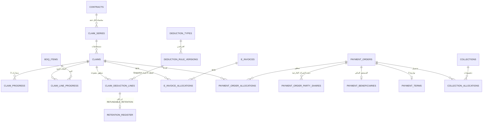

## 10.5 ⭐ سلّم المعالجة المحاسبية الثلاثي — الأخص يفوز

| الطبقة | الحقل | الدور | متى يُقرأ |
|---|---|---|---|
| **1** | `deduction_types.default_accounting_treatment` | **افتراضي** يملأ الحقول عند إنشاء قاعدة | عند إنشاء `deduction_rule_version` |
| **2** | `deduction_rule_versions.accounting_treatment` | **المقرَّرة للقاعدة في نطاقها وفترتها** — **تَجُبّ الافتراضي** | عند احتساب المستخلص |
| **3** | ⭐ **`claim_deduction_lines.accounting_treatment_snapshot`** | ⭐ **الحاكم بعد الاعتماد — نسخة مجمَّدة لا تتغير** | في الترحيل والتقارير والمحتجزات |

> ⭐ **القاعدة الملزمة:** **بعد اعتماد المستخلص، الـSnapshot وحده هو الحاكم.** تغيير الافتراضي أو تعديل القاعدة **لا يمسّ سطرًا معتمَدًا**، **وإعادة تصنيف سطر معتمَد تتم بمستند تصحيح مستقل لا بتعديل صامت**.
>
> ⭐ **وأثر ذلك على `retention_register`: دخول السطر دفتر المحتجزات يُقرَّر من الـSnapshot لا من نوع الاستقطاع.**

**الدليل على ضرورة السلّم:** عمود **`خصم عميل`** الواحد (**5,999,217.28 على 83 مستخلصًا**) يحمل **ست معالجات مختلفة**: غرامة نهائية · خصم كمية · **تعلية مشروطة** · تسوية ذمة سابقة · خصم ثابت مسعَّر · غير مصنَّف. ⭐ **نوع استقطاع واحد لا يمكن أن يحمل معالجة واحدة.**

## 10.6 العلاقات والـCardinality

| العلاقة | النوع | القيد |
|---|---|---|
| `contracts` → `claim_series` | **1 : N** | ⭐ **العملية قد يكون لها أكثر من عقد ولكل عقد سلسلته** |
| `claim_series` → `claims` | **1 : N** | — |
| `claims` → `claim_progress` | **1 : 1..3** | صف لكل مسار مستخدم |
| `claims` → `claim_deduction_lines` | ⭐ **1 : 0..N مفتوح** | ⛔ **لا أعمدة ثابتة** |
| `claim_deduction_lines` → `deduction_rule_versions` | **N : 1** | ⭐ **Snapshot مجمَّد** |
| `claims` ↔ `e_invoices` | ⭐ **N : M بمبلغ لكل تخصيص** | **فاتورة تغطي عدة مستخلصات · ومستخلص تغطيه عدة فواتير أو فاتورة + إشعار خصم** |
| `payment_orders` ↔ المستندات عبر `allocations` | **N : M** | **أمر واحد ↔ عدة مستندات** |
| `collections` ↔ `payment_orders` عبر `allocations` | **N : M** | ⭐ **القيد الوحيد: مجموع تخصيصات التحصيل ≤ مبلغه** |

## 10.7 Lifecycle

| الكيان | الحالات |
|---|---|
| `claims` | `Draft` → `Submitted` → `Approved` → **`Adjusted`** — ⛔ **ولا تعديل مباشر بعد الاعتماد** |
| `deduction_rule_versions` | `Draft` → `Active` → `Superseded` — **فترات غير متداخلة داخل النطاق** |
| `payment_orders` | `Draft` → `Issued` → `PartiallyCollected` → `Collected` · `Cancelled` |
| `collections` | `Recorded` → `PartiallyAllocated` → `FullyAllocated` · ⭐ **`Unapplied`** |
| `e_invoices` | `Recorded` → `Allocated` |

## 10.8 المفاتيح المرشحة والقيود

| الكيان | 🔑 PK | ⭐ القيد المعتمد |
|---|---|---|
| `claims` | `id` | ⭐ **`UNIQUE(contract_id, claim_series_id, claim_number)` جزئي `WHERE claim_series <> 'LEGACY'`** — **و`LEGACY` مستثناة من التفرّد ومن تحقق التسلسل، ⛔ ولا تُستثنى من المطابقة المالية** |
| | | ⭐ **«ختامي واحد لكل سلسلة» تحقق تطبيقي لا قيد فريد أعمى** |
| `claim_progress` | `id` | `UNIQUE(claim_id, progress_track)` |
| `claim_line_progress` | `id` | `UNIQUE(claim_id, boq_item_id)` |
| `deduction_types` | `id` | `UNIQUE(code)` · و`excel_column_label` **يُحفظ حرفيًا** |
| `deduction_rule_versions` | `id` | ⭐ **فترات غير متداخلة داخل `(scope_type, scope_id, deduction_type_id, vessel_type)`** |
| `claim_deduction_lines` | `id` | ⛔ **لا تفرّد** — **سطور مفتوحة** · و`accounting_treatment_snapshot` **إلزامي بعد الاعتماد** |
| `e_invoices` | `id` | 🔵 `UNIQUE(tax_number)` — **يحتاج اختبار** |
| `e_invoice_allocations` | `id` | **مجموع التخصيصات ≤ قيمة الفاتورة** |
| `payment_orders` | `id` | ⭐ **معرّف داخلي** · و**(الرقم · الجهة · السنة) مفتاح أعمال 🔵 يحتاج تحققًا — ⛔ ولا يُفرض قبله** |
| `payment_order_allocations` | `id` | **مجموع التوزيعات ≤ قيمة الأمر** |
| `collections` | `id` | ⚡ Idempotency |
| `collection_allocations` | `id` | ⭐ **مجموع التخصيصات ≤ مبلغ التحصيل** · **والزيادة تُرحَّل رصيدًا دائنًا للطرف لا تُرفض** |

## 10.9 ⭐ الأسماء الستة المعتمدة للمعالجة المحاسبية

| الاسم | ما يعنيه | مثال مرصود |
|---|---|---|
| `REFUNDABLE_RETENTION` | محتجز يُرد عند تحقق شرط | `5% ضمان اعمال` · `تعليات` |
| `PREPAID_TAX_ASSET` | ضريبة مدفوعة مقدمًا تُسوَّى بالإقرار | `ضريبه ارباح 1% و3%` |
| `FINAL_EXPENSE` | مصروف نهائي لا يُسترد | رسوم النقابات · الدمغات |
| `LIABILITY_TO_THIRD_PARTY` | مبلغ نورِّده لجهة ثالثة | `ضريبه قيمة مضافه` المستقطعة |
| `SETTLEMENT_OF_PRIOR_RECEIVABLE` | تسوية ذمة سابقة | خصم سلفة سبق صرفها |
| `UNCLASSIFIED_SUSPENSE` | **حساب معلّق لم يُصنَّف** | `خصم عميل` غير المصنَّف · `اتساع` · `شيك وموارد` |

> ⛔ **تُلغى الرموز أ/ب/ج/د/هـ** · **ولا يُستخدم رمز غير معرَّف في أي مستند** (BR-147).

## 10.10 البيانات الحساسة

| الحقل | المعالجة |
|---|---|
| `payment_beneficiaries.bank_account` 🔒 | ⛔ **لا يُسجَّل كاملًا** — ⭐ **والاختلاف عن الطرف المستحق يرفع تنبيه تدقيق** |
| قيم المستخلصات والاستقطاعات | وفق الصلاحية |

## 10.11 أحداث التدقيق 📝

`ClaimCreated` · ⭐ **`ClaimApproved`** · `ClaimAdjusted` · `DeductionRuleVersionCreated` · `DeductionRuleVersionActivated` · ⭐ **`PaymentOrderIssued`** · `PaymentOrderCancelled` · ⭐ **`CollectionAllocated`** · `EInvoiceAllocated` · `BeneficiaryMismatchFlagged`

## 10.12 ⭐ مخاطر التكرار

| الخطر | الدليل المرصود | الضابط |
|---|---|---|
| ⭐ **تضخيم إيراد بإعادة إدخال المستخلص** | **أمر 64**: مستخلص واحد 5,009,293 ظهر **ثلاث مرات** ⟹ **+7,802,857** | ⭐ `UNIQUE(عقد, سلسلة, رقم)` + ⭐ **رد التعلية والتحصيل الجزئي كيانان مستقلان لا ينشئان مستخلصًا** |
| **رد التعلية مسجَّل كإيراد** | 10 صفوف بـ12,731,150 | ⭐ **حركة في `retention_movements` لا تمسّ الإيراد** |
| **فوضى التسلسل** | **39 من 40 أمر إسناد** بها خلل · **25 صفًا مدمجًا** بـ79,362,406 | ⭐ **`السابق` = تراكمي المستخلص السابق فعليًا** + **سياسة `LEGACY`** + **علامة `مدمج`** |
| **ترحيل محاسبي مكرر** | — | 🟢 ⭐ **`UNIQUE(journal_entries.financial_event_id)`** |

## 10.13 أثر الاستيراد التاريخي 🔧 📊

| المصدر | الحجم | المعالجة |
|---|---|---|
| `العملاء` | **204 صفًا** من 982 · **52 عمودًا مستخدمًا من 143** | ⟹ مستخلصات وسطور استقطاع |
| ⭐ `رقم المستخلص` | **8 أنماط** | ⭐ **يُفكَّك إلى رقم + نوع مستند** |
| — رقم متسلسل | **133 صفًا** · 237,695,622 | `مستخلص جارٍ` |
| — `10,9` · `25-26` · `من 1 حتى7` | **25 صفًا** · 79,362,406 | ⭐ **`مدمج` — يُستثنى من تحقق التسلسل** |
| — `فروق اسعار` · `فروق ختامى` | 10 صفوف · 22,954,029 | `مستخلص فروق أسعار` |
| — `باقى 12` · `جزء 2 من م (1)` | 6 صفوف · 17,941,356 | ⭐ **`تحصيل جزئي` لا مستخلص** |
| — `16 ختامى` · `28 ختامى` | 10 صفوف · 13,555,956 | رقم + **علم `ختامي`** |
| — `رد تعليه` · `20% رد تعليه` | 10 صفوف · 12,731,150 | ⭐ **`رد محتجز` — ⛔ لا إيراد** |
| — `ضمان اعمال` · `رد خطاب ضمان نهائى` | 4 صفوف · 2,151,258 | ⭐ **`رد ضمان` — ⛔ لا إيراد** |
| — `اعادة الشى لاصلة` | 5 صفوف · 235,000 | ⭐ **`قيد عكسي`** |
| ⭐ **`خصم عميل`** (G) | 5,999,217 على 83 صفًا · **43 صيغة يدوية** | ⟹ `UNCLASSIFIED_SUSPENSE` |
| ⭐ **`تعليات`** (AD) | **109,482,419** · **24 صيغة يدوية** · **سطور متعددة مجمَّعة** | ⟹ `REFUNDABLE_RETENTION` · ⭐ **والحدود تُستخرج سطورًا تحليلية `غير مسمى` لا تُرحَّل ماليًا** |
| `5% ضمان اعمال` (AF) | 12,136,186.14 | ⭐ `REFUNDABLE_RETENTION` **مؤكد بنص العقد** |
| `استكمال تأمين نهائى` (AG) | 15,338,413.93 | ⭐ 🟡 **غير محسوم — OQ-019** |
| `تامين ازاله مخلفات` (AE) | 481,457.72 | ⭐ 🟡 **غير محسوم — OQ-019** |
| `ضريبه قيمة مضافه 14%` (V) | — | ⭐ **الاسم خاطئ — هو 20% من الضريبة المستقطعة** · البرهان: `66,793.14` و`13,358.63` ⟹ النسبة **0.2000 بالضبط** |
| `فرق الضريبة` (X) | 14,941,272 | ⭐ **ليس «فرقًا» بل الـ80% الباقية الواجب توريدها** — 🟡 **OQ-022** |
| `دمغة هندسية` / `تطبيقية` (S/R) | 0.75% لكل | ⭐ **الاسم الرسمي: نقابة المهن الهندسية / التطبيقية** |
| `دمغة نسبية` (N) | — | ⭐ **الاسم الرسمي: دمغة عادية** · و`دمغة اضافية` = **3 × العادية** |
| `صافي المستحق` (AH) | محسوب من 22 عمودًا | ⛔ **يُستبعد — يُعاد حسابه** |
| `الشركة` · `جهة الإسناد` · `الموقع` (AM/AN/AO) | `VLOOKUP` | ⛔ **تُستبعد** |
| ⭐ **الصف 985 `Total`** | جمله الاعمال **30,299,223.55** | ⭐ ⛔ **يُرفض صراحةً** — وإلا **أُضيفت مبالغ وهمية** |

**⭐ قواعد الاستقطاع تختلف بالجهة — دليل مثبت:**

| البند | جهاز العاشر من رمضان | جهاز الشيخ زايد |
|---|---|---|
| ض.ق.م | **20% من الـ14%** = 11,001.22 | **الـ14% كاملة** = 35,412.63 |
| تحيا مصر 1% | من القيمة **بدون** الضريبة | من **الإجمالي شامل** الضريبة |
| نقابة تطبيقية | 2,947 | **صفر** |
| صندوق الشهداء / ذوي الإعاقة | — | **5 ج لكل** |

⟹ ⭐ **الأساس والنسبة والانطباق خصائص للعقد/الجهة لا ثوابت عامة** (BR-067).

## 10.14 الأسئلة المفتوحة

| OQ | السؤال |
|---|---|
| **OQ-019** | `تعليات` و`استكمال تأمين نهائى` و`تامين ازاله مخلفات` — أيها `REFUNDABLE_RETENTION` فعلًا؟ **15,819,871.65 للبندين غير المحسومين** |
| **OQ-020** | `تامينات مقاولات` — **1,481,595** |
| **OQ-021** | `ضريبه ارباح 1% و3%` — **4,150,387** |
| **OQ-022** | `فرق الضريبة` — **14,941,272** · ❓ **لا افتراض** |
| **OQ-024** | **أمر الإسناد 64** — صف واحد أم ثلاثة؟ |
| **OQ-026** | `خصم عميل` — توزيعه على الفئات الست |
| **OQ-027** | **المستفيد البنكي** — ما التفويض؟ |
| **OQ-028** | **مستخلصات مدمجة** — قابلة للتفكيك؟ |
| — | `دائن حوافز` — ما هو؟ 🟡 **غير محسوم** |
| — | **دفعة مقدمة** — تُؤخذ وتُسترد؟ ⚪ **البند مدعوم ويبقى فارغًا** |

---

# Domain 11 — External Company Agreements and Shares

## 11.1 الغرض

⭐ **تمثيل الطبقة التعاقدية الغائبة تمامًا عن Excel** — اتفاق كل شركة خارجية على كل عملية، **بنسبته وأساسه ومستنده المؤيِّد مسجَّلة قبل بدء العملية**، ⛔ **بلا أي تعميم**.

## 11.2 قواعد العمل التي يخدمها

⭐ **BR-003** … **BR-012** · **BR-114** · **BR-118** · **BR-170**

## 11.3 الكيانات

| الكيان | الاسم العربي | النوع | الغرض |
|---|---|---|---|
| `party_operation_agreements` | اتفاقات الأطراف على العمليات | **AR** | الاتفاق نفسه |
| `party_operation_agreement_versions` | إصدارات الاتفاق | **AR** | ⭐ **النسبة والأساس وتاريخ السريان والمستند** |
| `agreement_documents` | مستندات الاتفاق | **CE** | ⭐ **إلزامي للتفعيل** |
| `payment_order_party_shares` | حصص الأطراف في أوامر الدفع | **CE** | ⭐ **Snapshot سباعي Immutable** |

## 11.4 ⭐ مخطط المجال

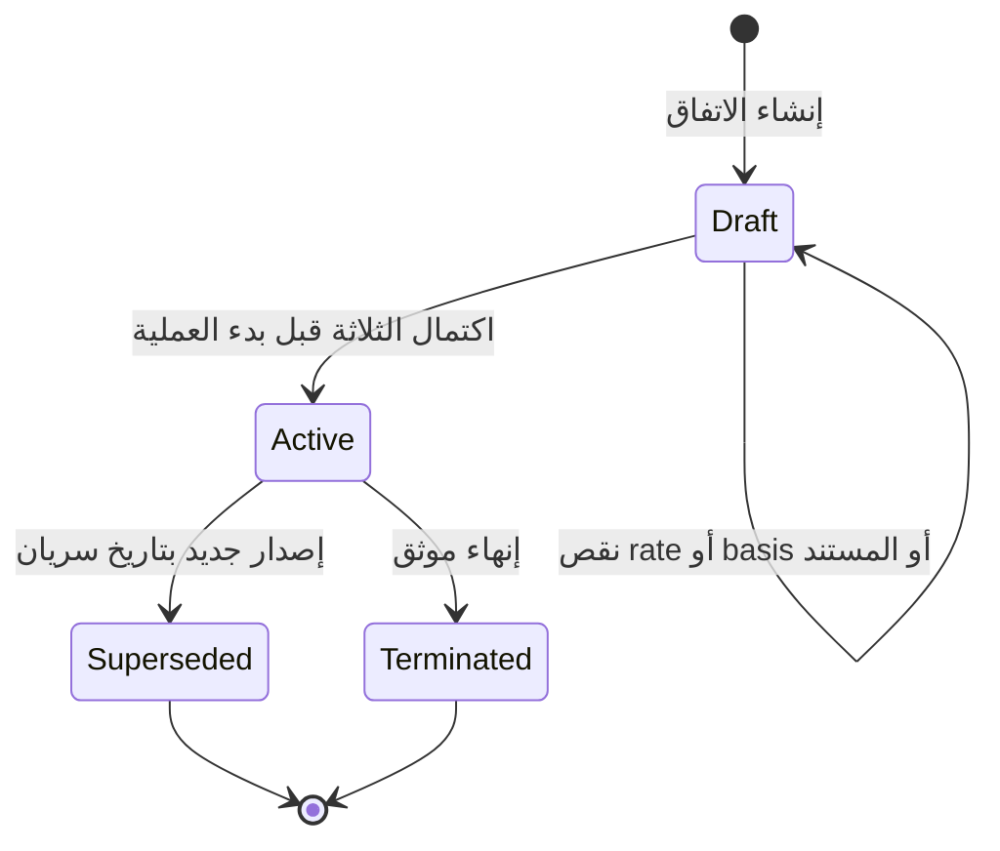

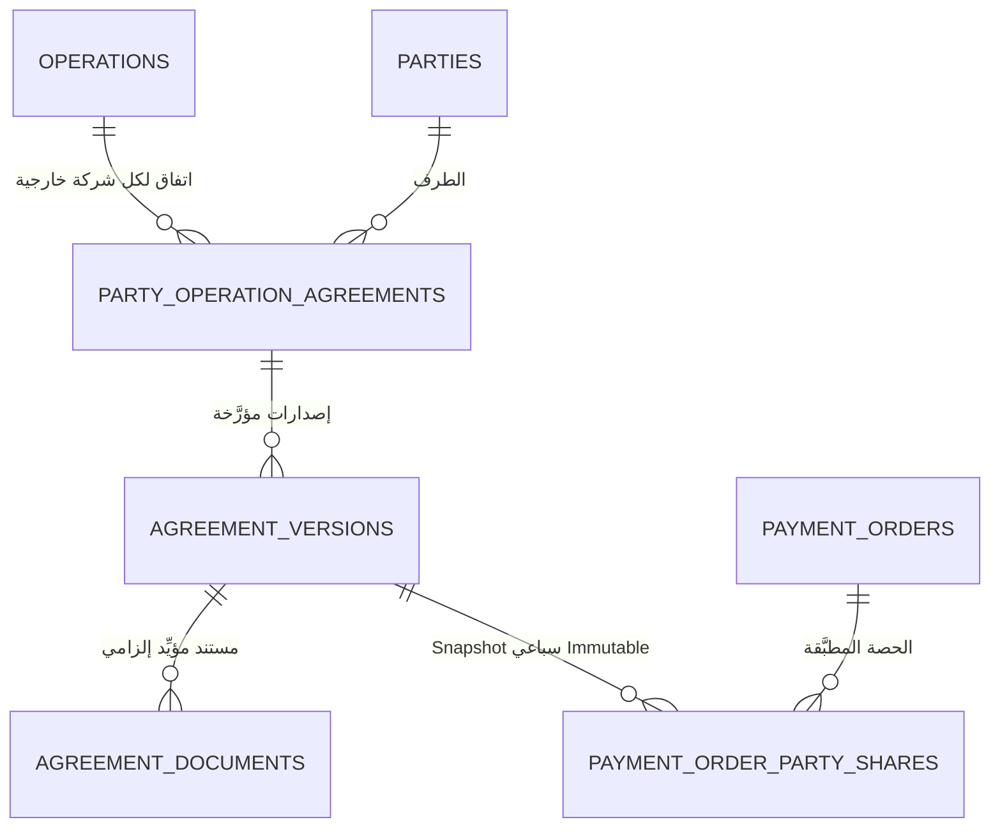

## 11.5 ⭐ حقول إصدار الاتفاق

| الحقل | إلزامي للتفعيل؟ | ملاحظة |
|---|---|---|
| `rate` | ⭐ **نعم** | ⛔ **لا قيمة افتراضية ولا وراثة** |
| `basis` | ⭐ **نعم** | **قائمة مغلقة من خمسة** |
| `document_id` 🔗 | ⭐ **نعم** | ⛔ **بلا مستند مؤيِّد لا يصبح `Active`** |
| `effective_from` | نعم | ⭐ **قبل بدء العملية** |
| `effective_to` | لا | — |
| `version_no` | نعم | — |
| `settlement_method` | نعم | `خصم مباشر` أو `مستحق ثم دفعة` |
| `contract_clause_reference` | يُفضَّل | ⭐ **رقم البند في العقد** |
| `applied_rule_note` | لا | ⭐ **القاعدة المطبَّقة فعليًا إن اختلفت عن المكتوبة** |
| `exception_approved_by` | مع الاستثناء | ⭐ **مَن اعتمد الاستثناء** |

## 11.6 ⭐ أسس الاحتساب الخمسة

`GROSS_CLAIM_AMOUNT` (إجمالي المستخلص) · `NET_CLAIM_AMOUNT` (صافي المستخلص) · `PAYMENT_ORDER_AMOUNT` (قيمة أمر الدفع) · `ACTUAL_COLLECTION_AMOUNT` (قيمة التحصيل الفعلي) · `CUSTOM_BASIS` (أساس مخصص)

> ⭐ **أي عقد قادم ينص على أساس مختلف يصبح بيانات لا كودًا.**

## 11.7 ⭐ Snapshot السباعي — Immutable

| # | العنصر |
|---|---|
| 1 | **نسخة الاتفاق** (`agreement_version_id` + `version_no`) |
| 2 | **أساس الاحتساب** |
| 3 | **النسبة** |
| 4 | **المبلغ المطبَّق عليه** |
| 5 | **قيمة النسبة** |
| 6 | **الصافي لنا** |
| 7 | **طريقة التسوية** |
| + | **تاريخ التطبيق** |

> ⭐ **تعديل الاتفاق لاحقًا لا يمسّه إطلاقًا** — وإصدار جديد **يسري على ما بعده فقط** (BR-007).

## 11.8 العلاقات والـCardinality

| العلاقة | النوع | القيد |
|---|---|---|
| `operations` → `party_operation_agreements` | **1 : 0..N** | اتفاق لكل شركة خارجية |
| `party_operation_agreements` → `_versions` | **1 : N** | ⭐ **فترات غير متداخلة** |
| `_versions` → `agreement_documents` | **1 : 1..N** | ⭐ **إلزامي للتفعيل** |
| `_versions` → `payment_order_party_shares` | **1 : N** | ⭐ **Snapshot** |

## 11.9 المفاتيح المرشحة والقيود

| الكيان | 🔑 PK | القيود |
|---|---|---|
| `party_operation_agreements` | `id` | `UNIQUE(operation_id, party_id, agreement_type)` |
| `_versions` | `id` | ⭐ **فترات غير متداخلة** لنفس الاتفاق · و`UNIQUE(agreement_id, version_no)` · و⭐ **تحقق تطبيقي: `status = Active` يتطلب `rate IS NOT NULL` و`basis IS NOT NULL` ووجود مستند** |
| `payment_order_party_shares` | `id` | `UNIQUE(payment_order_id, party_id)` · و⛔ **كل حقول الـSnapshot غير قابلة للتعديل بعد الإنشاء** |

## 11.10 ⭐ القاعدة المطلقة — لا تعميم

| # | القاعدة |
|---|---|
| 1 | ⛔ **لا تُعمَّم نسبة ولا أساس شركة خارجية على أي اتفاق آخر.** كل اتفاق **عالم قائم بذاته** |
| 2 | **كل إصدار يحمل `rate` و`basis` الخاصين به مسجَّلَين قبل بدء العملية**، ومستنده المؤيِّد |
| 3 | ⭐ **عقد التيسير وحده** يُسجَّل بـ**10% من إجمالي المستخلص** استنادًا إلى **البند الثاني + عشرة مستخلصات موقَّعة** |
| 4 | ⛔ **اتفاق بلا `rate` أو `basis` أو مستند لا يصبح `Active` ولا ينشئ تسوية مالية** — يبقى `Draft` |
| 5 | ⛔ **لا قيمة افتراضية ولا وراثة** — ⭐ **الفراغ يوقف الاتفاق ولا يملؤه النظام** |
| 6 | عملية باسم إحدى شركاتنا وتنفذها ⟹ **النسبة = صفر (لا NULL)** |

**الأثر العملي:** ⭐ **الـ42,248,762.4 من التعرض الخارجي** (التيسير 8,011,262.4 + تاله 34,237,500) **لا يُرحَّل منها شيء ماليًا قبل أن يحمل اتفاقُها `rate` و`basis` ومستندًا.**

## 11.11 البيانات الحساسة

| الحقل | المعالجة |
|---|---|
| `rate` · `basis` 🔒 | بيانات تعاقدية — وفق الصلاحية |
| مستندات الاتفاق 🔒 | ⛔ **محتواها لا يُسجَّل في أي سجل** |

## 11.12 أحداث التدقيق 📝

`AgreementCreated` · `AgreementVersionCreated` · ⭐ **`ExternalCompanyAgreementActivated`** · `AgreementTerminated` · ⭐ **`ExternalCompanyShareApplied`** · `AgreementRateChanged` (**بالقيمة قبل وبعد والسبب**)

## 11.13 مخاطر التكرار

| الخطر | الضابط |
|---|---|
| ⭐ **تعميم نسبة اتفاق على آخر** | ⛔ **منع صريح + لا قيمة افتراضية** |
| **تعديل نسبة يغيّر تسويات سابقة** | ⭐ **Snapshot سباعي Immutable** + **إصدار جديد بسريان** |
| إصداران متداخلان | ⭐ **فترات غير متداخلة** |
| تطبيق الحصة مرتين على أمر دفع | `UNIQUE(payment_order_id, party_id)` |

## 11.14 أثر الاستيراد التاريخي 🔧 📊

⛔ **الطبقة التعاقدية غائبة تمامًا عن Excel.**

| ما رُصد | الملاحظة |
|---|---|
| **صفر عمود ولا حركة تحمل «نسبة» ولا 10%** في الدفاتر الأربعة | ⭐ **يؤكد أن المكتب لا يسجّل هذا في النظام القديم** |
| `التيسير` تظهر **«موردًا»** (`نوع المصروف = موردين`) في **8 حركات خزينة** بعضها موسوم `مستخلص (13)`..`(16)` | ⭐ **والمبالغ لا تساوي 10% من أي مستخلص** |
| `التيسير` في `الوارد` **مرة واحدة** (67,350) | — |

⟹ ⭐ **كل الاتفاقات تُدخل يدويًا من المستندات الورقية.** و**التعارض بين نص العقد («من إجمالي قيمة كل مستخلص») والوصف التشغيلي (الخصم من أمر الدفع) يُخزَّن بطرفيه ولا يُسوَّى صامتًا** (BR-010): `القاعدة المكتوبة` + `القاعدة المطبَّقة` + `الاستثناء المعتمد ومَن اعتمده ومستنده`.

**الفارق الكمي المرصود للتعارض:**

| الأساس | مستخلصات التيسير 2026 | 10% |
|---|---|---|
| جمله الاعمال | 1,942,592 | **194,259** |
| صافي المستحق | 1,293,181 | **129,318** |
| **الفرق** | | ⭐ **64,941 — زيادة 50%** |

## 11.15 الأسئلة المفتوحة

| # | السؤال |
|---|---|
| 1 | ⭐ **أُغلق `أ-1` نهائيًا بقاعدة BR-170 — لا سؤال بعد اليوم لأنه لا تعميم** |
| 2 | **حد الدليل مُعلَن:** عمود «استقطاعات ومبالغ معلقة» في مستخلصات العقد **كان فارغًا في كل الصفوف المفحوصة** ⟹ المستخلصات **لا تفصل** بين «الإجمالي» و«الإجمالي بعد الاستقطاعات». **ما يُحسم قطعًا: النسبة 10% وغياب أي ضريبة من الوعاء** |
---

# Domain 12 — Retentions and Recoverable Amounts

## 12.1 الغرض

إنهاء العيب البنيوي الخامس: **ثلاثة أصناف من المال المحتجز تُعامل كخسارة** بلا دفتر ولا تنبيه استحقاق — **27,474,600.07 مسجَّلة تاريخيًا** منها **11,138,575 معلَّقة بلا تاريخ استحقاق**.

## 12.2 قواعد العمل التي يخدمها

⭐ **BR-064** … **BR-066** · **BR-086** · **BR-089** … **BR-092** · **BR-119** · **BR-125** · **BR-128** · **BR-150** · **BR-166** · **BR-171** · **BR-172** · **BR-173**

## 12.3 الكيانات

| الكيان | الاسم العربي | النوع | الغرض |
|---|---|---|---|
| `retention_register` | دفتر المحتجزات | **AR** | سطر لكل مبلغ محتجز |
| `retention_movements` | حركات المحتجز | **CE** | حجز · مطالبة · رد جزئي · رد كامل · شطب |
| `release_conditions` | شروط الرد | **RD** | ⭐ **نوع الشرط** |
| `release_condition_versions` | نسخ شرط الرد | **CE** | ⭐ **الشرط نصًا + نوعه + الحدث المحقِّق وتاريخه** |
| `guarantees` | الضمانات | **AR** | ⭐ **ثنائية الاتجاه** |
| `guarantee_events` | أحداث الضمان | **CE** | إصدار · تجديد · تعديل · مطالبة · رد · إلغاء · مصادرة |
| `guarantee_fees` | رسوم الضمان | **CE** | — |

## 12.4 مخطط المجال

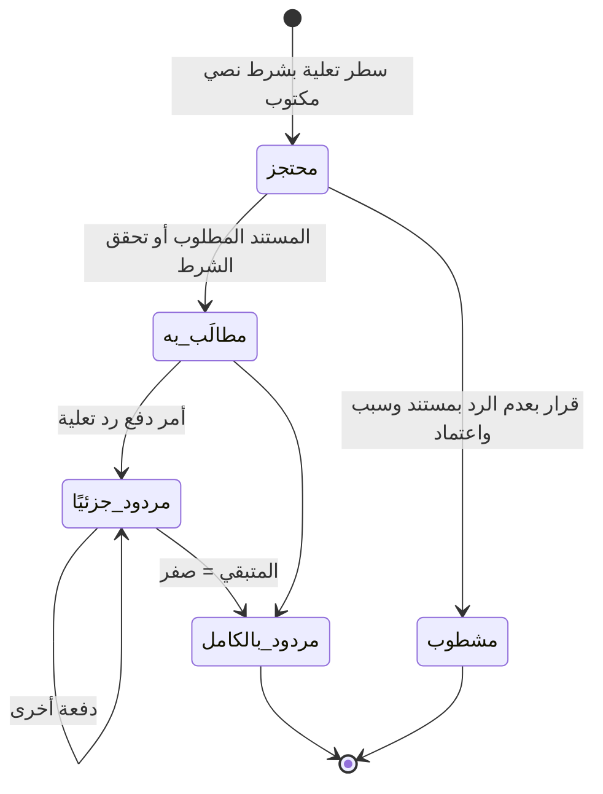

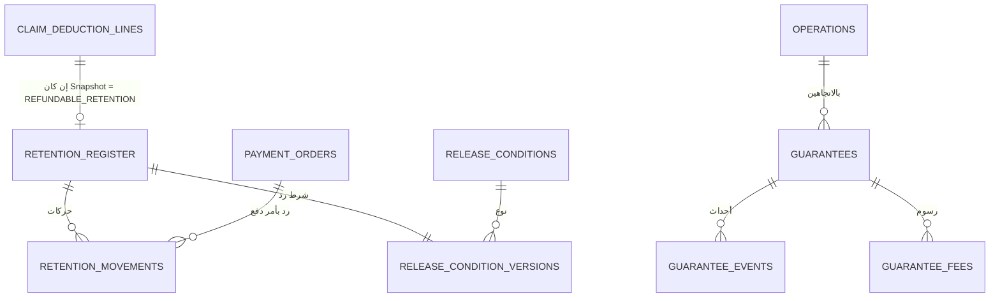

## 12.5 ⭐ أنواع شرط الرد الخمسة

| `condition_type` | المعنى |
|---|---|
| `FINAL_DELIVERY_TO_AUTHORITY` | التسليم النهائي للجهاز |
| `PROVISIONAL_DELIVERY` | التسليم الابتدائي |
| `WARRANTY_PERIOD_END` | انتهاء فترة الضمان |
| `PAYMENT_OF_INSURANCE_AND_LABOUR` | سداد التأمينات والقوى العاملة |
| `MANUAL_APPROVAL` | اعتماد يدوي |

> ⭐ **شرط الرد حدث تعاقدي لا تاريخ.** الدليل: نص العقد البند الثامن **«ولا يسترد أى مبالغ الا بعد التسليم النهائى للجهاز»** ⟹ **وتاريخ التسليم النهائي المسجَّل في الدليل مجرد تقدير له** (BR-125 · BR-166).

## 12.6 العلاقات والـCardinality

| العلاقة | النوع | القيد |
|---|---|---|
| `claim_deduction_lines` → `retention_register` | **1 : 0..1** | ⭐ **الدخول يُقرَّر من `accounting_treatment_snapshot` لا من نوع الاستقطاع** |
| `retention_register` → `retention_movements` | **1 : N** | ⭐ **مجموع المردود ≤ الرصيد المحتجز** |
| `retention_register` → `release_condition_versions` | **1 : 1** | ⭐ **إلزامي** |
| `payment_orders` → `retention_movements` | **1 : N** | رد تعلية أو رد ضمان |
| `operations` → `guarantees` | **1 : 0..N** | **بالاتجاهين** |

## 12.7 Lifecycle

| الكيان | الحالات |
|---|---|
| `retention_register` | ⭐ **محسوبة من الحركات**: `Retained` · `Claimed` · `PartiallyReleased` · `FullyReleased` · `WrittenOff` |
| `guarantees` | `Issued` → `Active` → (`Renewed` · `AmountAmended`) → (`Claimed` → `Forfeited`) · (`DueForRelease` → `Released`) · `Cancelled` |

## 12.8 المفاتيح المرشحة والقيود

| الكيان | 🔑 PK | القيود |
|---|---|---|
| `retention_register` | `id` | `UNIQUE(claim_deduction_line_id)` · و`retained_amount > 0` |
| `retention_movements` | `id` | ⭐ **مجموع `released_amount` + `written_off_amount` ≤ `retained_amount`** — **تحقق تطبيقي عابر للجداول** · و`WriteOff` يتطلب `reason` و`approved_by` و`document_ref` |
| `release_condition_versions` | `id` | `condition_type` **إلزامي** · و`condition_text` **نصًا كما ورد في المستند** |
| `guarantees` | `id` | 🔵 `UNIQUE(instrument_type, reference_number, bank_id)` — **يحتاج اختبار** · و⭐ **`instrument_type ∈ {CHEQUE, BANK_LETTER, CASH}`** · و`direction ∈ {ISSUED_BY_US, RECEIVED_FROM_PARTY}` |

## 12.9 ⭐ الفصل بين الضمانين

| البند | **أداة الضمان** | **تعلية ضمان الأعمال** |
|---|---|---|
| ما هي | شيك أو خطاب ضمان بنكي | استقطاع متراكم من المستخلصات |
| النسبة | **5% من قيمة العقد** | **5% من كل مستخلص** |
| متى | **مرة واحدة** عند التعاقد | **تتراكم شهريًا** |
| الكيان | `guarantees` | `retention_register` |
| المثال | ⭐ **شيك 400,563** = 8,011,262.40 × 5% ✅ | 12,136,186.14 مرصودة في 2026 |

> ⭐ ⛔ **ضمانان مختلفان بنسبة 5% لكل، ولا يجوز الخلط** (BR-091).

## 12.10 ⭐ حقول الضمان الإلزامية

النوع (**شيك / خطاب ضمان / نقدي**) · **الاتجاه** · الرقم · البنك والحساب · المستفيد · القيمة والعملة · تاريخا الإصدار والانتهاء · **التجديد التلقائي** · ⭐ **الهامش/الغطاء** · الرسوم · العملية والعقد · **شرط الرد** · الحالة · تاريخ الرد أو الإلغاء · المرفقات · التنبيهات.

> ⭐ **حقل الهامش/الغطاء ضروري** لأن خطاب الضمان **يحجز نقدًا أو حدًا ائتمانيًا في البنك بتكلفة مستمرة**.

## 12.11 البيانات الحساسة

| الحقل | المعالجة |
|---|---|
| `guarantees.bank_account` 🔒 | ⛔ **لا يُسجَّل كاملًا** |
| مبالغ المحتجزات | وفق الصلاحية |

## 12.12 أحداث التدقيق 📝

`RetentionRecorded` · `RetentionClaimed` · ⭐ **`RetentionReleased`** · ⭐ **`RetentionWrittenOff`** (**بالسبب والمعتمِد**) · `ReleaseConditionVersioned` · `GuaranteeIssued` · `GuaranteeRenewed` · `GuaranteeAmended` · `GuaranteeClaimed` · `GuaranteeReleased` · `GuaranteeForfeited`

## 12.13 مخاطر التكرار

| الخطر | الضابط |
|---|---|
| ⭐ **رد يتجاوز الرصيد المحتجز** | ⭐ **تحقق مجموع عابر للجداول** (BR-086) |
| **رد التعلية مسجَّل إيرادًا** | ⭐ **حركة في دفتر المحتجزات لا تمسّ الإيراد** |
| **شطب صامت** | ⛔ **سبب ومستند ومعتمِد إلزامية** |
| **محتجز مسجَّل مرتين** | `UNIQUE(claim_deduction_line_id)` |

## 12.14 أثر الاستيراد التاريخي 🔧 📊

**⭐ التوزيع بتاريخ استعلام 2026-09-16:**

| الفئة | المبلغ | الملاحظة |
|---|---|---|
| **عمليات انتهى تسليمها** | **4,792,152.37** (18 أمرًا) | ⭐ **«مبلغ محتمل مستحق المتابعة بتاريخ الاستعلام، بافتراض عدم وجود ردود غير مسجَّلة»** |
| تنتهي خلال 12 شهرًا | 11,101,022 | — |
| أبعد | 679,764 | — |
| ⭐ **بلا `تاريخ التسليم النهائى`** | **11,138,575** (5 أوامر · 11 صفًا) | ⭐ **تعبئته من العقود مهمة يدوية لمرة واحدة تساوي ملايين** |
| **الإجمالي** | **27,474,600** | ⭐ **= 5% ضمان 12,136,186.14 + استكمال تأمين نهائى 15,338,413.93** |

**⭐ الرقمان الملزمان بتسميتهما:**

| الرقم | ⛔ **لا يُقال** | ✅ **يُقال** |
|---|---|---|
| **27,474,600.07** | «رصيد محتجزات قائم مؤكد» | ⭐ **«إجمالي المبالغ التاريخية المسجَّلة في عمودي `5% ضمان اعمال` و`استكمال تأمين نهائى`»** |
| **4,792,152.37** | «مستحق الرد» · «ولا أحد يطالب بها» | ⭐ **«مبلغ محتمل مستحق المتابعة بتاريخ الاستعلام»** |

**السبب المذكور معه دائمًا:** ⭐ **الرصيد الافتتاحي غير متاح** (يحتاج `الروضه 2025.xlsm`) و**الردود السابقة غير مكتملة التسجيل** (**صفر قيمة سالبة في الأعمدة الأربعة**). ⟹ **الرصيد الحقيقي غير معلوم وقد يكون أقل.**

> ⭐ **الدليل على أن المبلغ دالة في تاريخ الاستعلام (BR-150):** نفس البيانات أعطت **4,555,238.58 على 17 أمرًا بتاريخ 2026-09-13** و**4,792,152.37 على 18 أمرًا بتاريخ 2026-09-16** — **لنضوج أمر الإسناد 271** (برج العرب · تاريخ تسليم نهائي 2026-09-14 · محتجزاته 236,913.79). **والرقمان صحيحان بتاريخيهما.**

**🔧 مشاكل ترحيل:**

| # | المشكلة | المعالجة |
|---|---|---|
| 1 | **`تعليات` 109,482,419 بها 24 صيغة يدوية وسطور مجمَّعة** | ⭐ **المبلغ المجمّع هو القيمة المرحَّلة · والصيغة تُحفظ نصًا · والحدود سطور تحليلية `غير مسمى` لا تُرحَّل ماليًا** |
| 2 | ⭐ **`استكمال تأمين نهائى` و`تامين ازاله مخلفات` غير محسومين** | 🟡 **OQ-019 — لا نص يدعمهما** ⟹ يُستوردان بعلامة **`يحتاج اعتماد المحاسب`** |
| 3 | ⭐ **شيك الضمان 400,563 غير مسجَّل** | ⟹ **إدخال يدوي** |
| 4 | `دليل!A` رقم خطاب الضمان — **خليط**: `ليس لها` · `نقدى` · `ابتدائى` · `شركة الأمل` | ⛔ **ليس مفتاحًا** · وبلا قيم ولا تواريخ انتهاء ⟹ **يُستورد نصًا خامًا بعلامة `يحتاج مراجعة`** |
| 5 | **الأحجام 2026:** محتجز `تعليات` **109,482,419** · مردود **12,731,150** | ⟹ **صافي زيادة 96,751,269** |

## 12.15 الأسئلة المفتوحة

| OQ | السؤال |
|---|---|
| **OQ-019** | ⭐ **أي البنود `REFUNDABLE_RETENTION` فعلًا؟** — **15,819,871.65 غير محسومة** |
| — | **من يتابع تجديد خطابات الضمان ورسومها؟** ⚪ **تنبيه للأدمن والمحاسب** |
| **RISK-014** | ⭐ **الرصيد الافتتاحي غير معلوم ولن يُعلم قبل `الروضه 2025.xlsm`** |

---

# Domain 13 — Reports, Snapshots and Deliveries

## 13.1 الغرض

⭐ **إنتاج صورة مالية وتشغيلية شهرية لا تتغيّر بعد إصدارها**، مصحوبة بـ**Snapshot قابل للاستعلام**، تُرسل **برسالة منفصلة لكل مستلم مخوَّل**.

## 13.2 قواعد العمل التي يخدمها

⭐ **BR-215** … **BR-246**

## 13.3 الكيانات

| الكيان | الاسم العربي | النوع | الغرض |
|---|---|---|---|
| `monthly_reports` | التقارير الشهرية | **AR** | (شهر · سنة · نطاق شركة) |
| `monthly_report_versions` | إصدارات التقرير | **AR** | ⭐ **1 · 2 · 3 … ⛔ لا يُكتب فوق سابق** |
| `monthly_report_snapshots` | لقطات البيانات | **CE** | ⭐ **إلزامية لكل إصدار** |
| `monthly_report_category_lines` | سطور التصنيف | **CE** | — |
| `monthly_report_engineer_lines` | سطور المهندس | **CE** | — |
| `monthly_report_site_lines` | سطور الموقع | **CE** | — |
| `monthly_report_operation_lines` | سطور العملية | **CE** | — |
| `monthly_report_recipients` | مستلمو التقرير | **RD** | ⭐ **بيانات مُدارة لا كود** |
| 🟢 ⭐ `monthly_report_deliveries` | سجلات الإرسال | **CE** | ⭐ **سجل منطقي واحد لكل (إصدار · مستلم)** — **بحالته وعدد محاولاته ولقطتَي المستلم وبريده** |
| `monthly_report_delivery_attempts` | محاولات الإرسال | **CE** | ⭐ **المحاولات الفعلية تحت Delivery واحد** |
| `monthly_report_schedules` | جدولة التقرير | **RD** | ⭐ **بيانات لا كود** |

## 13.4 مخطط المجال

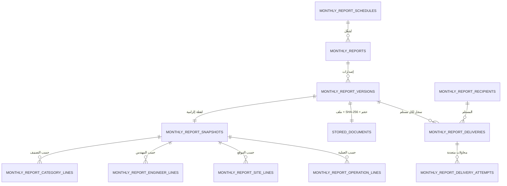

## 13.5 ⭐ الأسماء الثلاثة — لا يُخلط بينها

| الاسم | المثال | من يراه | الغرض |
|---|---|---|---|
| **Label** | **«تقرير شهر سبتمبر 2026»** | المستخدم | العرض في الشاشات والبريد |
| **File Name** | `monthly-financial-report-2026-09-v1.pdf` | النظام | التخزين والإصدارات |
| **Report ID** | معرّف داخلي | النظام | الربط والتدقيق ومنع التكرار |

**والإصدار الثاني:** Label = «تقرير شهر سبتمبر 2026 — الإصدار 2» · File Name = `…-v2.pdf`.

## 13.6 ⭐ حقول سجل التقرير

Report ID · **Label** · **File Name** · `MIME Type = application/pdf` · الشهر · السنة · **بداية الفترة ونهايتها** · **نطاق الشركة** · رقم الإصدار · **الحالة (من الثماني)** · وقت بدء التوليد وانتهائه · ⭐ **`Data As Of` (لحظة استخراج البيانات — غير وقت الإنشاء)** · Storage Reference · حجم الملف · ⭐ **SHA-256** · إجمالي المصروفات · إجمالي يوميات العمالة · إجمالي رواتب المهندسين · إجمالي تكلفة المواقع · ⭐ **إجمالي النقد المنصرف (رقم مستقل)** · رسالة الخطأ عند الفشل.

## 13.7 ⭐ محتويات Snapshot التسعة

| # | المحتوى |
|---|---|
| 1 | المصروفات **حسب التصنيف** |
| 2 | النتائج **حسب المهندس** |
| 3 | **يوميات العمالة** حسب المهندس والموقع |
| 4 | **رواتب المهندسين** |
| 5 | النتائج **حسب الموقع** |
| 6 | النتائج **حسب العملية** |
| 7 | **الإجماليات** — التكلفة والنقد المنصرف **منفصلين** |
| 8 | ⭐ **وقت استخراج البيانات (`Data As Of`)** |
| 9 | ⭐ **نسخة قواعد الحساب المستخدمة** — بما فيها **نسخة قاعدة توزيع رواتب المهندسين** |

> ⭐ **ملف PDF وحده غير كافٍ** — لأن الـPDF **صورة نهائية لا تُستعلم**. ولو سُئلنا بعد ستة أشهر «ما الأرقام لحظة إصدار تقرير سبتمبر؟» **فالإجابة يجب أن تأتي من بيانات مخزَّنة لا من قراءة بصرية لملف** (BR-228).
>
> ⭐ **ولماذا نسخة قواعد الحساب جزء من الـSnapshot؟** لأن **الرقم لا يُفسَّر بلا القاعدة التي أنتجته**. لو تغيّرت قاعدة توزيع راتب المهندس بين الإصدارين، **فالفرق ليس خطأ بل نتيجة تغيّر قاعدة — ولا يظهر ذلك إلا بحفظ النسخة**.

## 13.8 العلاقات والـCardinality

| # | العلاقة | النوع | القاعدة |
|---|---|---|---|
| 1 | `monthly_reports` → `versions` | **1 : N** | ⭐ **كل إعادة توليد إصدار جديد لا يُكتب فوق سابقه** |
| 2 | `versions` → `snapshots` | **1 : 1** | ⭐ **لا إصدار بلا Snapshot** |
| 3 | `versions` → `stored_documents` | **1 : 1** | ⭐ **الملف خارج القاعدة + بصمة + حجم** |
| 4 | `snapshots` → سطور التجميع الأربعة | **1 : N** | تصنيف · مهندس · موقع · عملية |
| 5 | 🟢 `versions` → `deliveries` | **1 : N** | ⭐ **سجل إرسال واحد لكل (إصدار · مستلم)** |
| 5.1 | 🟢 ⭐ `deliveries` → `delivery_attempts` | **1 : N** | ⭐ **المحاولات مفتوحة العدد — وإعادة المحاولة تنشئ محاولة لا سجلًا** |
| 6 | `recipients` → `deliveries` | **1 : N** | ⭐ **`Recipient Snapshot` و`Email Snapshot` يُحفظان في سجل الإرسال ⛔ ولا يُقرآن من المستلم لاحقًا** |
| 7 | `schedules` → `monthly_reports` | **إعداد يُشغّل** | ⭐ **الجدولة بيانات لا كود** |
| 8 | المصروفات المعتمدة → `snapshots` | ⭐ **قراءة فقط** | ⛔ **التقرير لا يعدّل مصروفًا ولا ينشئه** |
| 9 | يوميات العمالة ورواتب المهندسين → `snapshots` | ⭐ **قراءة فقط** | **استحقاق لا نقد** |
| 10 | قاعدة توزيع الراتب → `snapshots` | **نسخة محفوظة** | — |
| 11 | `versions` → سجل التدقيق | **حدث لكل انتقال** | — |
| 12 | `delivery_attempts` → سجل التدقيق | **حدث لكل إرسال وفشل** | ⭐ **وسجل الإرسال غير سجل التدقيق** |

## 13.9 Lifecycle

**حالات التقرير الثماني:**

| الحالة | المعنى |
|---|---|
| `Pending` | مُجدوَل ولم يبدأ |
| `WaitingForClose` | ⭐ **ينتظر إقفال الفترة المالية** |
| `Generating` | جارٍ التوليد |
| `Generated` | ⭐ **الملف والـSnapshot جاهزان ولم يُرسل بعد** |
| `Sending` | جارٍ الإرسال |
| `Sent` | وصل إلى **كل** المستلمين النشطين المخوَّلين |
| ⭐ `PartiallySent` | **نجح بعضهم وفشل بعضهم** |
| `Failed` | فشل التوليد أو فشل الإرسال للجميع |

**حالات محاولة الإرسال الخمس:** `Pending` · `Sending` · `Sent` · `Failed` · `RetryScheduled`.

> ⭐ **كل انتقال حالة يدخل سجل التدقيق** بالحالة السابقة والجديدة والسبب ومن أو ما الذي تسبب فيه.

## 13.10 المفاتيح المرشحة والقيود

| الكيان | 🔑 PK | ⭐ القيد |
|---|---|---|
| `monthly_reports` | `id` | 🟢 ⭐ **`UNIQUE(report_type, period_year, period_month, scope_type, managed_company_id, consolidated_scope_key)`** — **بدلًا من `company_scope_id` الفارغة الغامضة** · ⭐ **دلالة العمل: لا تقريران من النوع نفسه للفترة نفسها ولنفس النطاق** · 🏗️ **وآلية معالجة الفارغ قرار فيزيائي** |
| `monthly_report_versions` | `id` | ⭐ **`UNIQUE(report_id, version_no)`** — و⚡ **Idempotency Key منطقيًا = النوع + الفترة + النطاق + الإصدار** · ⛔ **كل الحقول Immutable بعد `Generated`** |
| `monthly_report_snapshots` | `id` | `UNIQUE(version_id)` · ⛔ **Immutable** |
| `monthly_report_recipients` | `id` | `UNIQUE(user_id, report_type)` |
| 🟢 ⭐ `monthly_report_deliveries` | `id` | ⚡ ⭐ **`UNIQUE(report_version_id, recipient_id)`** — **وهنا موضع منع التكرار** |
| `monthly_report_delivery_attempts` | `id` | 🟢 ⭐ **`UNIQUE(delivery_id, attempt_number)`** — ⛔ **ولا قيد يمنع تعدد المحاولات للمستلم نفسه** · ⭐ **ومنع الإرسال المتزامن المكرر آلية تنفيذية منفصلة** 🏗️ |
| `monthly_report_schedules` | `id` | `UNIQUE(report_type, company_scope_id)` **جزئي `WHERE is_active`** |

## 13.11 ⭐ الفارق الحاسم بين إعادة التوليد وإعادة الإرسال

| الفعل | Version جديد؟ | Snapshot جديد؟ | ملف جديد؟ | محاولة إرسال؟ |
|---|---|---|---|---|
| ⭐ **إعادة توليد بعد تغيّر البيانات** | ✅ **نعم** | ✅ نعم | ✅ نعم | نعم |
| ⭐ **إعادة إرسال نسخة قائمة** | ❌ **لا** | ❌ لا | ❌ لا | ✅ نعم |
| ⭐ **إرسال إلى مستلم إضافي** | ❌ **لا** | ❌ لا | ❌ لا | ✅ نعم |
| ⭐ **إعادة تشغيل المهمة بنفس المفتاح** | ❌ **لا** | ❌ لا | ❌ لا | ❌ **لا** |

## 13.12 البيانات الحساسة 🔒

| البند | المعالجة |
|---|---|
| ⭐ **التقرير كاملًا** | **مصنَّف `Confidential`** — ⭐ **لا تحميل إلا بـ`Reports.Monthly.View` و`Payroll.View` معًا** |
| ⭐ **أقسام الرواتب** | ⛔ **لا تُرسل ولا تُحمَّل لمن لا يملك `Payroll.View`** |
| ⭐ **عناوين البريد** | ⛔ **لا تُكشف لمستلم آخر** — **رسالة منفصلة لكل مستلم** |
| `Email Snapshot` | **العنوان وقت الإرسال لا العنوان الحالي** |
| ⭐ **محتويات الرواتب في Serilog** | ⛔ **ممنوعة منعًا باتًا** |
| **الرابط المؤقت** | ⛔ **لا Public URL دائم** — مؤقت ومرتبط بالمستخدم **وكل فتح له حدث تدقيق** |

## 13.13 أحداث التدقيق 📝 — عشرة + واحد

`MonthlyReportGenerated` · `BackgroundJobResult` · **كل انتقال حالة** · `MonthlyReportVersionCreated` · ⭐ **`MonthlyReportDownloaded`** (**ومن حمّله ومتى**) · `RecipientAdded` / `RecipientRemoved` · `MonthlyReportSent` · `MonthlyReportResent` · `MonthlyReportDeliveryFailed` · `ScheduleChanged` · ⭐ **`RecipientPermissionChanged`** (**منح أو سحب `Payroll.View`**) · ⭐ **`AccessDenied`**

## 13.14 مخاطر التكرار

| الخطر | الضابط |
|---|---|
| ⭐ **إعادة تشغيل المهمة تنتج تقريرًا مكررًا** | ⚡ **Idempotency Key** على (النوع · الفترة · النطاق · الإصدار) |
| ⭐ **بريد مكرر لنفس المستلم** | ⚡ **Idempotency Key + المستلم** |
| **ملف PDF مكرر** | `UNIQUE(version_id)` على `stored_documents` |
| ⭐ **إعادة الإرسال تنشئ إصدارًا** | ⛔ **منع صريح** — الإرسال يكتب في `delivery_attempts` فقط |

## 13.15 أثر الاستيراد التاريخي

⛔ **لا استيراد لهذا المجال إطلاقًا.** ⭐ **التقرير الشهري متطلب جديد معتمد من صاحب المشروع — لا اكتشاف من إكسل ولا من العقد.** وأول إصدار يُنتج بعد التشغيل.

## 13.16 الأسئلة المفتوحة

| OQ | السؤال |
|---|---|
| **OQ-007** | آلية المهام الخلفية (Hangfire أو بديلها) — 🔵 **التصميم الفيزيائي** |
| **OQ-008** | آلية Idempotency (فهرس · قيد · مفتاح) — 🔵 **والمبدأ ملزم الآن** |
| **OQ-009** | شكل التخزين الخاص ومدة الرابط المؤقت — 🔵 |
| **FS-01** | **النسخة المختصرة بلا رواتب** — 🔮 **مؤجَّلة ولا يُفترض وجودها الآن** |
| **FS-02** | **`Opened At`** — 🔮 **فقط إذا دعمه المزوّد ويُعامل مؤشرًا لا إثباتًا** |
| ⭐ 🟡 | **قاعدة توزيع راتب المهندس** — قرار المدير والمحاسب · **والافتراضي «بلا توزيع»** |

---

# Domain 14 — Files and Attachments

## 14.1 الغرض

⭐ **حفظ الملفات خارج قاعدة البيانات** مع ميتاداتا وبصمة وحجم ومرجع، ⛔ **بلا Public URL دائم**.

## 14.2 قواعد العمل التي يخدمها

⭐ **BR-191** · **BR-207** · **BR-231** · **BR-232** · **BR-233**

## 14.3 الكيانات

| الكيان | الاسم العربي | النوع | الغرض |
|---|---|---|---|
| `stored_documents` | المستندات المخزَّنة | **AR** | ⭐ **المرجع والميتاداتا والبصمة — ⛔ لا المحتوى** |
| `document_links` | روابط المستند بالكيانات | **CE** | ربط عام Polymorphic |
| `document_access_log` | سجل الوصول للملفات | **CE** | ⭐ **كل تحميل حدث** |

## 14.4 ⭐ حقول `stored_documents`

| الحقل | إلزامي؟ | ملاحظة |
|---|---|---|
| `id` 🔑 | ✅ | — |
| `storage_reference` | ✅ | ⭐ **مرجع في التخزين الخاص** |
| `original_file_name` | ✅ | **حرفيًا كما رفعه المستخدم** |
| `mime_type` | ✅ | — |
| `file_size_bytes` | ✅ | — |
| ⭐ `sha256` | ✅ | ⭐ **إثبات أن المحمَّل هو المُخزَّن** |
| `uploaded_by` 🔗 📝 | ✅ | — |
| `uploaded_at` 📝 | ✅ | — |
| `classification` | ✅ | `Public` · `Internal` · ⭐ **`Confidential`** |
| ⛔ **`content` / `binary_data`** | — | ⭐ **غير موجود — ⛔ لا Binary في القاعدة** |

## 14.5 العلاقات والـCardinality

| العلاقة | النوع |
|---|---|
| `stored_documents` ↔ الكيانات عبر `document_links` | **N : M Polymorphic** |
| `expenses` → `expense_attachments` → `stored_documents` | ⭐ **1 : 0..N — اختيارية دائمًا** |
| `monthly_report_versions` → `stored_documents` | **1 : 1** |
| `agreement_versions` → `agreement_documents` → `stored_documents` | ⭐ **1 : 1..N — إلزامي للتفعيل** |

## 14.6 ⭐ القواعد الملزمة

| # | القاعدة |
|---|---|
| 1 | ⛔ **لا يُخزَّن الـBinary داخل PostgreSQL في النموذج الموصى به** · والبديل **غير موصى به ولا يُعتمد إلا بقرار صريح يقبل آثاره الأربعة: حجم القاعدة · النسخ الاحتياطية · الاسترجاع · الأداء** |
| 2 | ⛔ **لا Public URL دائم** · **وكل وصول يمر بفحص الصلاحيات** |
| 3 | **الرابط إن استُخدم مؤقت المدة ومرتبط بالمستخدم** |
| 4 | ⭐ **يُسجَّل وجود المرفق واسمه ومن أضافه — ⛔ لا محتواه** في أي سجل |
| 5 | ⛔ **لا يُحذف ولا يُستبدل ملف تقرير سبق إرساله** |
| 6 | ⭐ **النسخ الاحتياطي للتخزين الخاص بمعزل عن قاعدة البيانات** |

## 14.7 Lifecycle

| الكيان | الحالات |
|---|---|
| `stored_documents` | `Uploaded` → `Linked` → `Archived` · **و`Deleted` للمرفقات غير المالية فقط قبل الاعتماد** |

## 14.8 المفاتيح والقيود

| الكيان | 🔑 PK | القيود |
|---|---|---|
| `stored_documents` | `id` | `sha256` **غير فريد إلزاميًا** (ملفان متطابقان مشروعان) — و**فهرس عليه للكشف** |
| `document_links` | `id` | `UNIQUE(document_id, entity_type, entity_id)` |

## 14.9 أحداث التدقيق 📝

`DocumentUploaded` · `DocumentLinked` · ⭐ **`DocumentDownloaded`** · `DocumentDeleted` (**قبل الاعتماد فقط**) · `AccessDenied`

## 14.10 أثر الاستيراد التاريخي

⛔ **لا مرفقات في Excel.** المستندات الورقية الثمانية (عقد 18 صفحة · أمر إسناد · خمس تسويات · أمرا دفع) ⟹ **تُرفع يدويًا وتُربط بكياناتها**.

---

# Domain 15 — Audit Trail

## 15.1 الغرض

⭐ **إثبات من فعل ماذا ومتى ولماذا** — إثباتًا **لا يقبل التعديل ولا الحذف**، **ومستقلًا عن السجل التشغيلي**، ⛔ **ولا يُحسب منه رصيد**.

## 15.2 قواعد العمل التي يخدمها

⭐ **BR-182** … **BR-195** · **BR-243** · **BR-246**

## 15.3 الكيانات

| الكيان | الاسم العربي | النوع | الغرض |
|---|---|---|---|
| `audit_events` | أحداث التدقيق | **AR** | ⭐ **الوحدة الأساسية للإثبات** |
| `audit_event_changes` | فروق الحقول | **CE** | القيمة قبل وبعد لكل حقل تغيّر |
| `audit_event_links` | روابط الأحداث | **CE** | ⭐ **ربط التصحيح بالأصل** |
| `audit_retention_policies` | سياسات الاحتفاظ | **RD** | ⛔ **لا حذف بلا سياسة معتمدة** |

> ⭐ ⛔ **ولا يُضاف عمود تدقيق داخل جداول العمل** — سجل التدقيق **نظام مستقل لا حقول ملحقة**.

## 15.4 ⭐ حقول `audit_events`

| المجموعة | الحقول |
|---|---|
| **الهوية** | `id` |
| **الزمن** | ⭐ **`occurred_at_utc` من السيرفر** |
| **الفاعل** | `actor_user_id` · ⭐ **`actor_role_code` (الدور وقت التنفيذ)** |
| **الفعل** | `action_type` |
| **الهدف** | `entity_type` · `entity_id` · ⭐ **`business_document_number`** |
| **السياق** | `managed_company_id` · `operation_id` · `site_id` — عند الحاجة |
| **التغيير** | `previous_status` · `new_status` |
| **التبرير** | `reason` — عند الحاجة |
| **الاعتماد** | `approved_by_user_id` — عند اختلافه عن المنشئ |
| **الربط** | ⭐ **`correlation_id`** · **`causation_id`** |
| **المصدر** | ⭐ `source ∈ {Web, PWA, OfflineSync, Import, SystemJob}` |
| **منع التكرار** | ⚡ `idempotency_key` / `client_event_id` |
| **البيئة** | `ip_address` · `user_agent` — 🔒 **عند الحاجة فقط** |
| **النسخة** | ⭐ **`schema_version`** |

## 15.5 ⭐ حسم OQ-011 — شكل تخزين فروق الحقول

| البديل | المزايا | العيوب | القرار |
|---|---|---|---|
| **أ) سطر لكل حقل تغيّر** (`audit_event_changes`) | استعلام دقيق على حقل بعينه · حجم أصغر للتغييرات الصغيرة | عدد صفوف كبير للتغييرات الواسعة | ✅ **المعتمَد أساسًا** |
| ب) لقطة كاملة JSON | بسيط | **لا يُستعلم بسهولة** · حجم متضخم · **وحجب الحساس أصعب** | ❌ |
| ج) الاثنان | أقصى مرونة | تكرار بلا حاجة مثبتة | ⚠️ **متاح لأحداث محدَّدة فقط** عبر حقل لقطة اختياري على `audit_events` |

**القرار:** ⭐ **سطر لكل حقل في `audit_event_changes`** — مع **حقل لقطة اختياري** على الحدث للحالات التي تتطلب صورة كاملة (اعتماد مستند مثلًا). **والفهرسة قرار التصميم الفيزيائي.**

## 15.6 ⭐ القواعد الحاكمة

| # | القاعدة |
|---|---|
| 1 | ⭐ **Append Only** — ⛔ **لا تعديل ولا حذف مباشر · ولا لمستخدم عادي ولا لأدمن** · **والواجهة للقراءة فقط** |
| 2 | ⭐ **الذرّية** — يُكتب **داخل نفس معاملة العملية**، و**فشله يُفشلها ويحدث Rollback** |
| 3 | ⛔ **لا يُكتب في طابور خارجي ولا ملف ولا خدمة خارجية** — لأن ذلك **يجعل نجاحه احتماليًا** |
| 4 | ⛔ **لا يُحسب منه رصيد ولا مجموع مالي** |
| 5 | ⛔ **يُمنع استخدامه طريقًا لإخفاء تعديل مباشر** — التصحيح **بحركة تصحيح مستقلة** |
| 6 | ⭐ **مستويان إلزاميان معًا**: تدقيق عام لتغيّر البيانات + **أحداث أعمال صريحة** |
| 7 | ⭐ **الحجب قبل الكتابة لا عند العرض** — **ولقطات القيم قبل وبعد تخضع لنفس القواعد** |
| 8 | ⭐ **القراءة هي الصلاحية القصوى** — **والفريق التقني لا يصل إلى محتوى الأحداث المالية** |
| 9 | ⛔ **لا حذف بلا سياسة احتفاظ معتمدة** موثَّقة بمعتمِدها وتاريخها · **والأرشفة نقل لا إتلاف** |

## 15.7 المفاتيح والقيود

| الكيان | 🔑 PK | القيود |
|---|---|---|
| `audit_events` | `id` | ⚡ ⭐ **`UNIQUE(idempotency_key)` جزئي `WHERE idempotency_key IS NOT NULL`** — **يمنع حدث تدقيق مكررًا من المزامنة والاستيراد** · و⛔ **منع UPDATE وDELETE على مستوى صلاحيات قاعدة البيانات (التصميم الفيزيائي)** |
| `audit_event_changes` | `id` | `UNIQUE(event_id, field_name)` |
| `audit_event_links` | `id` | `UNIQUE(source_event_id, target_event_id, link_type)` · و⭐ **`link_type ∈ {CORRECTION_OF, REVERSAL_OF, CAUSED_BY}`** |
| `audit_retention_policies` | `id` | `UNIQUE(event_type)` · و`approved_by` و`approved_at` **إلزاميان** |

## 15.8 البيانات الحساسة 🔒

⛔ **ممنوع تسجيله — في التدقيق وSerilog معًا:** كلمات المرور · رموز الوصول والتجديد · الأسرار والمفاتيح · سلاسل الاتصال · ⭐ **بيانات الحسابات البنكية كاملة** · ⭐ **محتويات المرفقات** · أي بيانات مالية أو شخصية حساسة **دون حجب**.

## 15.9 مخاطر التكرار

| الخطر | الضابط |
|---|---|
| حدث مكرر من إعادة المزامنة | ⚡ `UNIQUE(idempotency_key)` |
| حدث مكرر من إعادة تشغيل مهمة | نفسه |
| **تدقيق عام + حدث أعمال لنفس التغيير** | ✅ **مقصود — مستويان مختلفان بمعنيين مختلفين** |

## 15.10 أثر الاستيراد التاريخي 🔧

| البند | المعالجة |
|---|---|
| **حركات 2026 المستوردة** | ⟹ **حدث تدقيق واحد لكل دفعة استيراد** بمصدرها ونتيجتها — ⛔ **ولا يُخترع حدث تدقيق تاريخي لكل صف كأنه وقع وقتها** |
| **إعادة معالجة بيانات مستوردة** | ⭐ **حدث تدقيق مستقل يشير إلى الاستيراد الأصلي** |

## 15.11 ما يُحسم في التصميم الفيزيائي

فهرسة البحث والتصفية والتصدير · **الآلية التقنية لمنع التعديل والحذف على مستوى قاعدة البيانات** · **آلية الاعتراض العام** (EF Core Interceptor أو مكافئ) · **التقسيم والأرشفة الزمنية**.

## 15.12 الأسئلة المفتوحة

| OQ | السؤال |
|---|---|
| **OQ-001** | ⭐ **مدة الاحتفاظ لكل نوع حدث، ومن يعتمد أي حذف أو أرشفة** — 🟡 **قرار المدير والمحاسب** |
| **OQ-010** | آلية الاعتراض العام — 🔵 التصميم الفيزيائي |

---

# Domain 16 — Notifications

## 16.1 الغرض

⭐ **التنبيه بيانات لا كود** — قاعدة التنبيه وشرطها وعتبتها ومستلمها وقناتها **كلها قابلة للتغيير بلا تعديل برمجي**.

## 16.2 الكيانات

| الكيان | النوع | الغرض |
|---|---|---|
| `notification_rules` | **RD** | ⭐ **الشرط · العتبة · المستلم · القناة** |
| `notifications` | **AR** | التنبيه المولَّد |
| `notification_deliveries` | **CE** | محاولة إيصال لكل قناة |
| `notification_channels` | **RD** | بريد · داخل التطبيق |

## 16.3 قواعد التنبيه المطلوبة

| # | القاعدة | العتبة المقترحة |
|---|---|---|
| 1 | ⭐ **اقتراب استحقاق رد محتجز** | 🔵 **30 يومًا** |
| 2 | ⭐ **اقتراب انتهاء ضمان** | 🔵 **30 يومًا** |
| 3 | **تصعيد مراجعة مصروف** | 🔵 **تنبيه 3 أيام · تصعيد 7** |
| 4 | **مرشّح تشابه أطراف جديد** | فوري |
| 5 | ⭐ **بصمة تسوية متطابقة** | ⭐ **قبل الاعتماد** |
| 6 | **صافي سالب** | فوري — **تقرير استثناءات** |
| 7 | ⭐ **إنذار ثانٍ على عقد** | فوري — **والثالث يعني حق سحب الأعمال** |
| 8 | ⭐ **مقاول من الباطن تحت عقد يمنعه** | فوري |
| 9 | ⭐ **اختلاف المستفيد البنكي عن الطرف المستحق** | فوري — **تنبيه تدقيق** |
| 10 | **فشل مهمة خلفية أو إرسال** | فوري |
| 11 | **عملية منتهية وعليها مصروفات** | دوري |

## 16.4 المفاتيح والقيود

| الكيان | 🔑 PK | القيود |
|---|---|---|
| `notification_rules` | `id` | `UNIQUE(rule_code)` · و`is_active` |
| `notifications` | `id` | ⚡ **`UNIQUE(rule_code, entity_type, entity_id, trigger_date)`** — ⭐ **يمنع تنبيهًا مكررًا من إعادة تشغيل المهمة** |
| `notification_deliveries` | `id` | `UNIQUE(notification_id, channel_id, recipient_id)` |

## 16.5 أحداث التدقيق 📝

`NotificationRuleChanged` (⭐ **تغيير عتبة أو مستلم**) · `NotificationSent` · `NotificationFailed`

---

# Domain 17 — Imports and Reconciliation

## 17.1 الغرض

⭐ **ترحيل قابل للمطابقة وغير قابل للمضاعفة**، مع **تتبّع كل سجل إلى صفه الأصلي في ملفه ببصمته**.

## 17.2 قواعد العمل التي يخدمها

⭐ **BR-096** · **BR-103** · **BR-151** … **BR-155** · **BR-181** · **BR-188**

## 17.3 الكيانات

| الكيان | النوع | الغرض |
|---|---|---|
| `import_batches` | **AR** | ⭐ **الدفعة — والبصمة تُخزَّن هنا فقط** |
| `import_rows` | **CE** | صف مصدر بقيمه الأصلية والمطبَّعة |
| `record_lineage` | **CE** | ربط كل سجل تشغيلي بصفه الأصلي |
| `import_resolutions` | **CE** | قرار معالجة كل صف مرفوض |
| `column_mappings` | **RD** | ⭐ **خريطة التحويل بنسختها** |
| `reconciliation_checks` | **CE** | نتيجة كل فحص مطابقة |

## 17.4 ⭐ حقول `import_batches`

`id` 🔑 · `source_file_name` · ⭐ **`file_sha256` (البصمة الأساسية)** · `file_md5` (اختياري للتوافق) · `file_size` · `imported_at` · `imported_by` 📝 · ⭐ **`mapping_version`** · `status` · `total_rows` · `accepted_rows` · `rejected_rows` · ⭐ **`control_total_source`** · ⭐ **`control_total_imported`** · `reconciliation_result`

## 17.5 ⭐ حقول `import_rows`

`id` 🔑 · `import_batch_id` 🔗 · `source_sheet` · `source_row` · ⭐ **`source_record_hash`** · `mapping_version` · `validation_status` · `raw_payload` (القيم الأصلية) · `normalized_payload` (القيم المطبَّعة) · `error_message` · ⭐ **`source_formula`** (نص الصيغة الأصلية للمبالغ المركبة) · ⭐ **`source_name`** (الاسم قبل التطبيع) · `imported_record_type` · `imported_record_id`

## 17.6 ⭐ قواعد الاستيراد الملزمة

| # | القاعدة |
|---|---|
| 1 | ⛔ **لا بدء دفعة لملف بلا `SHA-256` محسوبة ومخزَّنة** |
| 2 | ⭐ **البصمة في `import_batches` فقط** — ⛔ **ويُمنع تكرار `file_md5` في أي جدول تشغيلي**، والبصمة **تُستنتج بالانضمام** |
| 3 | ⭐ **كل سجل تشغيلي مستورد يرتبط بـ`source_import_row_id`** |
| 4 | ⭐ **يُرفض أي صف قيمة عمود التسلسل فيه ليست رقمًا** |
| 5 | ⭐ **يُرفض أي صف صيغته `SUBTOTAL` أو `AGGREGATE`** |
| 6 | ⭐ **مطابقة إلزامية: مجموع الصفوف المستوردة = مجموع الورقة المحسوب مستقلًا — وإلا تُوقَف الدفعة** |
| 7 | ⭐ **يُعاد حساب كل عمود محسوب من مكوّناته ويُقارن** — ⛔ **والفراغ لا يُقرأ صفرًا بل يُعلَّم `صيغة مفقودة` ويُحسب** |
| 8 | ⭐ **المبلغ المجمّع هو القيمة المرحَّلة · والصيغة تُحفظ نصًا · والحدود سطور تحليلية `غير مسمى` لا تُرحَّل ماليًا** |
| 9 | ⭐ **إعادة استيراد الملف نفسه لا تضاعف أي بيانات** |
| 10 | ⭐ **إعادة المعالجة حدث تدقيق مستقل يشير إلى الاستيراد الأصلي** |
| 11 | ⛔ **لا يُحذف صف مرفوض** — يبقى بقراره في `import_resolutions` |
| 12 | ⭐ **اكتشاف الكتل الشهرية بالبحث النصي لا بالإزاحة الثابتة** |
| 🟢 **13** | ⭐ **الأرصدة الافتتاحية تُدخل مجمَّعة** بحدث `OpeningBalance` **ومستند `accounting_adjustments` معتمَد** — **مع الاحتفاظ بالدفعة والمصدر والبصمة** |
| 🟢 **14** | ⭐ **المعاملات التاريخية التفصيلية تُستورد سجلات تشغيلية تفصيلية** — ⛔ **ولا تُختزل في رصيد** |
| 🟢 **15** | ⛔ **لا تُخترع أحداث تدقيق تاريخية كأنها وقعت وقتها** — **حدث استيراد واحد لكل دفعة بمصدره ونتيجته** |
| 🟢 **16** | ⭐ **يجوز ترحيل قيود مجمَّعة بأبعادها**: `(managed_company, fiscal_period, account, operation, site, party)` — ⛔ **ولا قيد واحد ضخم للملف كله يفقد الأبعاد** |
| 🟢 **17** | ⭐ **كل قيد مجمَّع مرتبط بصفوف الاستيراد الداخلة فيه عبر `record_lineage`** — **فالمطابقة تبقى ممكنة بين Excel والسجل التشغيلي والقيد** |
| 🟢 **18** | ⭐ **إعادة الاستيراد لا تضاعف الأثر المالي** — **مفتاح منع التكرار على الحدث المالي لا على الصف وحده** |

## 17.7 المفاتيح والقيود

| الكيان | 🔑 PK | القيود |
|---|---|---|
| `import_batches` | `id` | 🔵 **`UNIQUE(file_sha256, mapping_version)`** — **يمنع إعادة استيراد نفس الملف بنفس الخريطة عن غير قصد** · ⚠️ **وإعادة الاستيراد المقصودة تتطلب خريطة جديدة أو علمًا صريحًا** |
| `import_rows` | `id` | `UNIQUE(import_batch_id, source_sheet, source_row)` |
| `record_lineage` | `id` | `UNIQUE(entity_type, entity_id, import_row_id)` |
| `column_mappings` | `id` | `UNIQUE(source_file_type, source_sheet, source_column, mapping_version)` · ⭐ **و`excel_label` يُحفظ حرفيًا** |

## 17.8 فحوص المطابقة

**RC-01 … RC-22** — التفاصيل في `system-specification-and-team-reference-ar.md` §25.3 و`database-integrity-rules-ar.md`.

## 17.9 أحداث التدقيق 📝

`ImportBatchStarted` · `ImportBatchCompleted` · `ImportBatchAborted` (⭐ **عند فشل المطابقة**) · `ImportRowRejected` · `ImportRowResolved` · ⭐ **`ImportReprocessed`** · `OpeningBalanceApproved`

## 17.10 الأسئلة المفتوحة

| OQ | السؤال |
|---|---|
| **OQ-017** | مدى الترحيل |
| **OQ-018** | التصحيح بأثر رجعي أم من تاريخ التشغيل |
| **OQ-030** | ⭐ **بصمات الملفات الناقصة** — ⛔ **لا يُرحَّل ملف بلا بصمة** |

---

# Domain 18 — Reference Data

## 18.1 الغرض

> 🟢 ⭐ **تنبيه الباتش v1.2.1:** **ثلاثة بيانات مرجعية انتقلت إلى مجاليها الصحيحين** — `chart_of_accounts` و`fiscal_periods` ⟸ **المجال 19** · و`treasury_accounts` ⟸ **المجال 20**. ⛔ **ولم تُحذف ولم تتغيّر قواعدها — تغيّر موضعها التنظيمي فقط.**

البيانات المشتركة التي **تُدار وتُعطَّل ولا تُحذف**، **والتحليل يعتمد على معرّفاتها لا على أسمائها المكتوبة**.

## 18.2 الكيانات

| الكيان | الاسم العربي | مصدر Excel 📊 | ملاحظة |
|---|---|---|---|
| `expense_types` | تصنيفات المصروف | `دليل!O` **429 قيمة** + `دليل!R/U` 7 قيم | ⭐ **يجوز دمج التصنيف والفرعي في اختيار واحد** · و**«أخرى» تُلزم البيان** |
| `deduction_types` | أنواع الاستقطاع | 22 عمودًا في `العملاء` | ⭐ **الهوية والتصنيف فقط** |
| `supply_categories` | أنواع التوريد | `الموردين!J` 11 قيمة | — |
| `items` | الأصناف | `دليل 2` **196 صنفًا** | — |
| `awarding_authorities` | جهات الإسناد | `دليل!E` **20 مميزة** | ⭐ **`القاهرة الجديدة` و`مدينة القاهرة الجديدة` ⟹ دمج** |
| `treasury_accounts` | الحسابات المالية | `الوارد` + `دليل!L` **38 قيمة** | ➡️ 🟢 ⭐ **مُنقول إلى المجال 20 (الخزينة)** — **وهو سيد حسابات الخزينة** · ⚠️ **وبه مبالغ رقمية في بعض الصفوف ⟹ تُرفض** |
| `unit_types` | وحدات القياس | ملف الأجور | `DAYS` · `LUMP_SUM` · `WORKER_DAYS` · `COMPLETION_RATIO` · `OTHER` |
| `accounting_treatments` | المعالجات المحاسبية | — | ⭐ **الستة المعتمدة فقط** |
| `cost_centers` | مراكز التكلفة | — | ⭐ **العملية مركز تكلفة أساسي** |
| `chart_of_accounts` | دليل الحسابات | — | ➡️ 🟢 ⭐ **مُنقول إلى المجال 19 (المحاسبة)** |
| `fiscal_periods` | الفترات المالية | — | ➡️ 🟢 ⭐ **مُنقول إلى المجال 19 (المحاسبة)** · `Open` · `Closed` · `Reopened` |
| `overhead_allocation_rules` + `_versions` | قواعد تحميل المصاريف العامة | — | ⭐ **مؤرَّخة ومنسوخة بنطاق** |

## 18.3 ⭐ القواعد الملزمة

| # | القاعدة |
|---|---|
| 1 | ⭐ **كل بيان مرجعي يُعطَّل ولا يُحذف** متى كانت له حركات |
| 2 | ⭐ **التحليل بمعرّف البيان لا باسمه المكتوب** |
| 3 | ⭐ **إنشاؤها وتعديلها وتعطيلها من صلاحيات الإدارة ويدخل سجل التدقيق** |
| 4 | ⭐ **الاسم العربي للعرض واسم عمود Excel يُحفظان مستقلين عن الاسم التقني** |
| 5 | ⭐ **`overhead_allocation_rules` مؤرَّخة ومنسوخة بنطاق** (`managed_company_id` · `scope` · فترة سريان) · **بقاعدة فعّالة واحدة فقط داخل النطاق نفسه** — ⛔ **لا تعريف واحد عالميًا** |

## 18.4 المفاتيح والقيود

| الكيان | القيود |
|---|---|
| `expense_types` | `UNIQUE(normalized_name)` · ⭐ **قيد آمن — بيان مرجعي يُدار لا اسم شخص** · و`is_active` |
| `awarding_authorities` | `UNIQUE(normalized_name)` **بعد الدمج** |
| `treasury_accounts` | `UNIQUE(managed_company_id, account_code)` |
| `fiscal_periods` | `UNIQUE(managed_company_id, period_year, period_month)` |
| `overhead_allocation_rule_versions` | ⭐ **فترات غير متداخلة داخل `(managed_company_id, scope_type, scope_id)`** |

## 18.5 أحداث التدقيق 📝

`ReferenceItemCreated` · `ReferenceItemModified` · ⭐ **`ReferenceItemDeactivated`** · ⭐ **`FinancialPeriodClosed`** · ⭐ **`FinancialPeriodReopened`** · `OverheadAllocationRuleVersioned`

## 18.6 أثر الاستيراد التاريخي 🔧 📊

| المشكلة | المعالجة |
|---|---|
| ⭐ **`مصروفات` مقابل `المصروفات`** (51 صفًا بالثانية) | ⟹ **دمج بعد تطبيع** |
| ⭐ **`القاهرة الجديدة` مقابل `مدينة القاهرة الجديدة`** | ⟹ **دمج** |
| ⭐ **`الامارات` مقابل `بنك الامارات`** | ⟹ **دمج** |
| ⭐ **`اسيوط` في عمود `نسبة الضريبة`** | ⟹ **خطأ نوع — يُرفض ويُعلَّم** |
| ⭐ **`دليل!L` البنك به مبالغ رقمية** | ⟹ **تُرفض وتُعلَّم** |
| **`دليل!N` — 133 اسم مورد ميت من 243** | ⟹ يُستوردون `Inactive` |
| ⭐ **الدليل مكرر 4 مرات** وانحرف في **خلية واحدة** (الصف 102 العمود C) | ⭐ **`دليل الحسابات` في `الروضه` هو الأصل — والباقي نسخ تُهمَل** |
| ⭐ **`دليل الحسابات` ثماني قوائم في ورقة واحدة** | ⟹ **يُفكَّك إلى ثمانية جداول** |

---

# Domain 19 — Accounting Ledger

> 🟢 ⭐ **مجال جديد في الباتش v1.2.1** — **يغلق أخطر ثغرة في النموذج: `journal_entries` كان مستخدمًا بلا تعريف.**

## 19.1 الغرض

⭐ **دفتر أستاذ عام صحيح وآمن بالحد الذي يحتاجه Contractra** — ⛔ **لا ERP محاسبيًا ضخمًا** — بحيث **يصبح لكل رقم مالي في النظام أثر محاسبي واحد لا يتكرر ولا يُعدَّل صامتًا**.

> ⭐ **هذا المجال يعرّف البنية.** ⛔ **أما محتوى شجرة الحسابات وقواعد الترحيل — أي حساب يُدين وأيه يُدان — فبيانات يعتمدها المحاسب** (**OQ-016** · **OQ-031** 🟡).

## 19.2 قواعد العمل التي يخدمها

**BR-051** · **BR-161** · **BR-180** · **BR-183** · **BR-186** · BR-045 · BR-047 · BR-049 · BR-169 · BR-224

## 19.3 الكيانات

| الكيان | الاسم العربي | النوع | الغرض |
|---|---|---|---|
| `chart_of_accounts` | دليل الحسابات | **RD** | الحساب ورمزه ونوعه وطبيعته ومستواه — ➡️ **مُنقول من المجال 18** |
| `fiscal_periods` | الفترات المالية | **RD** | الفترة وحالتها بنطاق الشركة — ➡️ **مُنقول من المجال 18** |
| `currencies` | العملات | **RD** | الرمز والدقة — ⚪ **`EGP` هي الافتراضية العاملة** |
| ⭐ `financial_events` | الأحداث المالية | **AR** | ⭐ **سجل موحد لكل حدث مالي قابل للترحيل — ونقطة الربط بين المستند والقيد والحركة النقدية** |
| `posting_rules` | قواعد الترحيل | **RD** | هوية القاعدة لنوع حدث |
| `posting_rule_versions` | نسخ قواعد الترحيل | **AR** | ⭐ **الحسابات والاتجاهات وفترة السريان — مؤرَّخة** |
| ⭐ `journal_entries` | القيود المحاسبية | **AR** | ⭐ **القيد المتوازن** |
| `journal_entry_lines` | سطور القيد | **CE** | الحساب · المدين · الدائن · الأبعاد |
| `ledger_period_balances` | أرصدة الفترات | **VE** | ⭐ **قراءة فقط — تُعاد بناؤها من السطور المرحَّلة** ⛔ **ولا تُعدَّل** |
| 🟢 ⭐ `accounting_adjustments` | مستندات التصحيح المحاسبي | **AR** | ⭐ **المستند الرسمي لأي رصيد افتتاحي أو تصحيح أو إعادة تصنيف أو تسوية يدوية** — **باتش v2.0.1** |

## 19.4 مخطط المجال

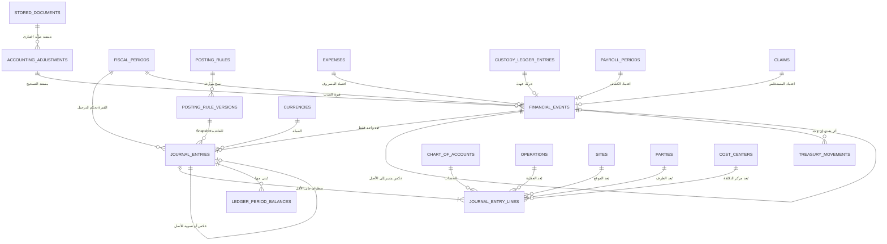

**شرح عربي:** ⭐ **لا قيد بلا حدث مالي، ولا حركة نقدية بلا حدث مالي.**
🟢 ⭐ **والصياغة الدقيقة (تصحيح v2.0.1):** ⛔ **يستحيل ترحيل حدث مالي قبل اكتمال الآثار المطلوبة لنوعه** (§19.6.1) — ⭐ **وقد يكون الحدث محاسبيًا بلا أي حركة نقدية إذا كان استحقاقًا غير مدفوع** (اعتماد مستخلص · فاتورة مورد آجلة · اعتماد كشف أجور).
🟢 ⭐ **وكل حدث مرحَّل له قيد واحد فقط** — **والتصحيح لا يضيف قيدًا ثانيًا على الحدث نفسه، بل ينشئ حدثًا مستقلًا بقيده المستقل، ويربط الاثنين مستندُ `accounting_adjustments`.**

## 19.5 ⭐ `financial_events` — الحقول الجوهرية

| الحقل | إلزامي؟ | ملاحظة |
|---|---|---|
| `id` 🔑 | ✅ | — |
| ⭐ `event_type` | ✅ | **قائمة مغلقة بواحد وعشرين نوعًا** — التفصيل في `logical-model-patch-v1.2.1-ar.md` §3.2 |
| ⭐ `occurred_on` | ✅ | **التاريخ المالي** — ⛔ **غير `created_at`** |
| `managed_company_id` 🔗 | ✅ | نطاق الشركة |
| `fiscal_period_id` 🔗 | ✅ | ⭐ **تُشتق من `occurred_on` وتُثبَّت** |
| ⭐ **المفاتيح المصدرية المُنمَّطة** | ⭐ **واحد فقط غير فارغ** | `expense_id` · `custody_ledger_entry_id` · `payroll_period_id` · `worker_advance_id` · `worker_payment_id` · `subcontractor_settlement_id` · `supplier_invoice_id` · `supplier_payment_id` · `claim_id` · `payment_order_id` · `collection_id` · `retention_movement_id` · `recoverable_claim_id` · `recoverable_recovery_id` · `treasury_transfer_id` · `import_batch_id` |
| ⭐ `settlement_mode` | ✅ | 🟢 **`Custody` · `Treasury` · `OnAccount` · `NonCash`** — ⭐ **قيمة نظامية يحددها مسار الاعتماد** ⛔ **لا يكتبها المهندس ولا يراها** · **وهي ما يقرر وجود حركة نقدية من عدمه** |
| 🟢 `accounting_adjustment_id` 🔗 | **مشروط** | ⭐ **إلزامي مع أحداث التصحيح والعكس والرصيد الافتتاحي** |
| 🟢 `reverses_financial_event_id` 🔗 | **مشروط** | ⭐ **إلزامي مع حدث العكس — ويشير إلى الحدث الأصلي** |
| ⚡ `idempotency_key` | ✅ | ⭐ **يمنع الحدث المكرر لنفس المصدر والنوع** |
| `status` | ✅ | `Pending` → `Posted` → `Reversed` |
| `posted_at` · `posted_by` 📝 | حسب الحالة | — |
| `correlation_id` | ✅ | ⭐ **يربط كل آثار المعاملة الواحدة** |

## 19.6 ⭐ القواعد الملزمة

| # | القاعدة |
|---|---|
| 1 | ⭐ **كل قيد متوازن: `Σ debit = Σ credit`** — ⛔ **ولا يُرحَّل غير المتوازن** |
| 2 | ⛔ **القيد `Posted` لا يُعدَّل ولا يُحذف** |
| 3 | ⭐ **التصحيح بـ`Reversal` أو `Adjustment` مرتبط بالأصل بسبب إلزامي** |
| 4 | 🟢 ⚡ ⭐ **قيد واحد فقط لكل حدث مرحَّل** — **`UNIQUE(journal_entries.financial_event_id)`** · ⛔ **و`posting_sequence` أُلغي** · ⭐ **وكل أثر مستقل يحصل على حدث مالي مستقل** |
| 5 | ⭐ **الفترة `Closed` تمنع الترحيل العادي** · **وإعادة الفتح بصلاحية وسبب وحدث تدقيق** 📝 |
| 6 | ⛔ **لا رصيد محاسبي مخزَّن قابل للتعديل** — **والأرصدة مشتقة** |
| 7 | ⭐ **التقارير المالية تقرأ المرحَّل فقط** — ⛔ **لا `Draft`** |
| 8 | ⛔ **`Draft` و`PendingReview` لا ينشئان أثرًا محاسبيًا** |
| 9 | ⭐ **الترحيل وحدث تدقيقه داخل معاملة واحدة — وفشل أحدهما يُفشل الآخر** (BR-183) |
| 10 | ⭐ **`posting_rule_version_id` يُحفظ على القيد** — **فالرقم يبقى مفسَّرًا بقاعدته** |
| 11 | 🟡 ⛔ **محتوى قواعد الترحيل لا يُخترع** — **بيانات يعتمدها المحاسب** |
| 🟢 **12** | ⭐ ⛔ **لا يتحوّل الحدث إلى `Posted` قبل اكتمال كل الآثار المطلوبة لنوعه** — **§19.6.1** · **وفشل إنشاء أي أثر مطلوب يُفشل المعاملة كلها** |
| 🟢 **13** | ⭐ **كل تصحيح أو عكس أو رصيد افتتاحي له مستند `accounting_adjustments` معتمَد** — ⛔ **ولا ترحيل قبل الاعتماد** |

### 19.6.1 ⭐ مصفوفة آثار الحدث المالي — Financial Event Effects Matrix

> ⭐ **قاعدة Domain ثابتة** — ⛔ **لا جدول إعدادات لها** · **تُفرض في خدمة التطبيق داخل معاملة واحدة، وتدعمها قيود قاعدة البيانات الممكنة، وتُراجَع بفحص مطابقة دوري كشبكة أمان.**

| `event_type` | القيد؟ | حركات الخزينة | حركة العهدة؟ | التدقيق؟ | المستند المصدر | ⭐ شرط `Posted` |
|---|---|---|---|---|---|---|
| **`CustodyDisbursement`** تسليم عهدة | ✅ **مطلوب** | ⭐ **واحدة صادرة** | ✅ **واردة للمهندس** | ✅ | طلب صرف عهدة | **قيد + حركة خزينة + حركة عهدة + تدقيق** |
| **`CustodyReturn`** رد عهدة | ✅ | **واحدة واردة** | ✅ **صادرة من المهندس** | ✅ | إيصال إيداع | نفسه بالاتجاه العكسي |
| **`CustodyTransfer`** تحويل عهدة | ✅ | ⛔ **ممنوعة** | ✅ **حركتان: صادرة وواردة** | ✅ | أمر تحويل | **قيد + حركتا عهدة + تدقيق** |
| ⭐ **`ExpenseApproved`** اعتماد مصروف من عهدة | ✅ | ⛔ **ممنوعة** | ✅ **حركة مصروف واحدة** | ✅ | المصروف المعتمد | **قيد + حركة عهدة + تدقيق** — ⛔ **ولا حركة خزينة** |
| **`ExpenseApproved`** مصروف مباشر من الخزينة | ✅ | ⭐ **واحدة صادرة** | ⛔ **لا** | ✅ | المصروف المعتمد | **قيد + حركة خزينة + تدقيق** |
| **`SupplierInvoiceApproved`** اعتماد فاتورة مورد آجلة | ✅ | ⛔ **ممنوعة** | ⛔ | ✅ | فاتورة المورد | **قيد + تدقيق** (`OnAccount`) |
| **`SupplierPaymentPaid`** دفع مورد | ✅ | **واحدة صادرة** | ⛔ | ✅ | دفعة المورد | **قيد + حركة خزينة + تدقيق** |
| **`ClaimApproved`** اعتماد مستخلص عميل | ✅ | ⛔ **ممنوعة** | ⛔ | ✅ | المستخلص | **قيد + تدقيق** (`NonCash`) |
| **`CollectionReceived`** تحصيل من عميل | ✅ | **واحدة واردة** | ⛔ | ✅ | إشعار التحصيل | **قيد + حركة خزينة + تدقيق** |
| **`TreasuryTransfer`** تحويل بين حسابين | ✅ | ⭐ **حركتان متساويتان: صادرة وواردة** | ⛔ | ✅ | أمر التحويل | **قيد + حركتان + تدقيق** |
| **`PayrollApproved`** اعتماد كشف الأجور | ✅ | ⛔ **ممنوعة** | ⛔ | ✅ | الكشف المعتمد | **قيد + تدقيق** (`NonCash`) |
| **`WorkerAdvancePaid`** سلفة عامل | ✅ | **واحدة صادرة** | ⛔ **أو من العهدة بحسب المسار** | ✅ | سند السلفة | **قيد + الأثر النقدي المطابق للمسار + تدقيق** |
| **`WorkerPaymentPaid`** دفعة عامل | ✅ | **واحدة صادرة** | ⛔ **أو من العهدة** | ✅ | سند الدفع | نفسه |
| **`SubcontractorSettlementApproved`** تسوية مقاول | ✅ | ⛔ **ممنوعة** | ⛔ | ✅ | التسوية المعتمدة | **قيد + تدقيق** (`OnAccount`) |
| **`RetentionRecorded`** حجز تعلية | ✅ | ⛔ **ممنوعة** | ⛔ | ✅ | سطر الاستقطاع | **قيد + تدقيق** (`NonCash`) |
| **`RetentionReleased`** رد تعلية | ✅ | **واحدة واردة عند التحصيل الفعلي** | ⛔ | ✅ | أمر الدفع | **قيد + تدقيق** · **والحركة عند التحصيل** |
| **`PaymentOrderIssued`** إصدار أمر دفع | ✅ | ⛔ **ممنوعة** | ⛔ | ✅ | أمر الدفع | **قيد + تدقيق** |
| **`ExternalShareApplied`** حصة شركة خارجية | ✅ | ⛔ **ممنوعة** | ⛔ | ✅ | Snapshot الحصة | **قيد + تدقيق** |
| **`RecoverableClaimCreated`** مطالبة استرداد | ✅ | ⛔ **ممنوعة** | ⛔ | ✅ | المطالبة | **قيد + تدقيق** |
| **`RecoverableRecovered`** تحصيل استرداد | ✅ | **بحسب طريقة التحصيل** | ⛔ | ✅ | مستند التحصيل | **قيد + الأثر المطابق + تدقيق** |
| ⭐ **`OpeningBalance`** رصيد افتتاحي | ✅ | **صفر أو واحدة** | **بحسب الحساب** | ✅ | ⭐ **`accounting_adjustments` معتمَد** | **قيد + مستند التصحيح المعتمد + تدقيق** |
| ⭐ **`Reversal`** عكس حدث | ✅ | ⭐ **طبقًا للحركة الأصلية** | ⭐ **طبقًا للأصل** | ✅ | ⭐ **`accounting_adjustments`** + `reverses_financial_event_id` | **قيد عكسي مطابق + الأثر المعاكس المطابق + تدقيق** |
| ⭐ **`Correction`** تصحيح | ✅ | **بحسب الأثر المصحَّح** | **بحسب الأثر** | ✅ | ⭐ **`accounting_adjustments`** | **الحدث العكسي والحدث الصحيح مستقلان ومرتبطان بنفس المستند** |

> ⛔ **ما يمنعه هذا الجدول صراحةً:** **حدث `Posted` بلا قيده** · **حدث `Treasury` بلا حركته** · ⭐ **حدث عهدة بحركة خزينة مصاحبة (خصم مزدوج)** · **تحويل بحركة واحدة** · **تصحيح بلا مستند معتمَد**.

## 19.7 Lifecycle

| الكيان | الحالات |
|---|---|
| `financial_events` | `Pending` → `Posted` → `Reversed` |
| `journal_entries` | `Draft` → `Posted` → `Reversed` — ⛔ **لا حذف** |
| `fiscal_periods` | `Open` → `Closed` → `Reopened` 📝 |
| `posting_rule_versions` | `Draft` → `Active` → `Superseded` — **فترات غير متداخلة** |

## 19.8 المفاتيح المرشحة والقيود

| الكيان | 🔑 PK | القيود |
|---|---|---|
| `financial_events` | `id` | ⚡ ⭐ **`UNIQUE(idempotency_key)`** · ⭐ **«حقل مصدري واحد فقط غير فارغ»** — 🏗️ **آلية الفرض قرار فيزيائي** |
| `journal_entries` | `id` | 🟢 ⭐ **`UNIQUE(financial_event_id)`** — **قيد واحد فقط لكل حدث** · **`UNIQUE(fiscal_period_id, entry_no)`** · **و`Σ debit = Σ credit`** · ⭐ **و`reverses_entry_id` إلزامي مع `Reversal`/`Adjustment`** · ⛔ **و`posting_sequence` أُلغي في v2.0.1** |
| `journal_entry_lines` | `id` | 🟢 ⭐ **`debit_amount >= 0` و`credit_amount >= 0`** · ⭐ **وواحد فقط موجب**: `(debit > 0 وcredit = 0)` **أو** `(credit > 0 وdebit = 0)` · ⛔ **يُمنع أن يكونا صفرين معًا** · ⛔ **ويُمنع أن يكونا موجبين معًا** · ⛔ **ولا قيمة سالبة إطلاقًا** · ⭐ **وسطران على الأقل لكل قيد مرحَّل** · ⛔ **و`line_no` عرض لا هوية** |
| 🟢 ⭐ `accounting_adjustments` | `id` | **`reason` غير فارغ** · ⭐ **و`approved_by` و`approved_at` إلزامية قبل `Posted`** · ⛔ **ولا تعديل ولا حذف بعد الترحيل** |
| `chart_of_accounts` | `id` | `UNIQUE(managed_company_id, account_code)` · ⛔ **لا حذف مع وجود حركة** |
| `fiscal_periods` | `id` | `UNIQUE(managed_company_id, period_year, period_month)` |
| `posting_rule_versions` | `id` | ⭐ **فترات غير متداخلة داخل `(event_type, scope)`** · `UNIQUE(rule_id, version_no)` |
| `currencies` | `id` | `UNIQUE(code)` |
| `ledger_period_balances` | `id` | `UNIQUE(fiscal_period_id, account_id, dimensions_key)` — ⭐ **قراءة تُعاد بناؤها** |

## 19.9 البيانات الحساسة

| الحقل | المعالجة |
|---|---|
| مبالغ القيود 🔒 | تُعرض وفق الصلاحية — **وسطور الرواتب تتطلب `Payroll.View`** |
| `memo` على السطر 🔒 | ⛔ **لا أسماء مقترنة بمبالغ رواتب في السجلات** (BR-245) |

## 19.10 أحداث التدقيق 📝

`FinancialEventCreated` · ⭐ **`JournalEntryPosted`** · ⭐ **`JournalEntryReversed`** · `PostingRuleVersionActivated` · ⭐ **`FinancialPeriodClosed`** · ⭐ **`FinancialPeriodReopened`** (**بالسبب والمعتمِد**) · `LedgerBalancesRebuilt`

## 19.11 مخاطر التكرار

| الخطر | الضابط |
|---|---|
| ⭐ **ترحيل مكرر لنفس الحدث** | 🟢 ⚡ ⭐ **`UNIQUE(journal_entries.financial_event_id)`** |
| ⭐ **حدث مالي مكرر من إعادة الطلب** | ⚡ **`UNIQUE(idempotency_key)`** |
| **قيد غير متوازن يمر** | **تحقق داخل المعاملة قبل `Posted`** |
| **ترحيل إلى فترة مقفلة** | **منع بالحالة + حدث تدقيق عند المحاولة** |

## 19.12 أثر الاستيراد التاريخي 🔧

⛔ **لا قيود محاسبية في Excel إطلاقًا.**

🟢 ⭐ **تصحيح v2.0.1 — التفريق بين حالتين** (**وكانت الصياغة السابقة «قيد واحد لكل دفعة» مختزِلة**):

| الحالة | المعالجة | ⭐ لماذا |
|---|---|---|
| ⭐ **الأرصدة الافتتاحية** | **تُدخل مجمَّعة بحدث `OpeningBalance` + مستند `accounting_adjustments` معتمَد** — **مع الدفعة والمصدر والبصمة** | **لا تفصيل تاريخيًا لها أصلًا · والرصيد الافتتاحي غير متاح لبعض الدفاتر** (RISK-014) |
| ⭐ **المعاملات التاريخية التفصيلية** | **تُستورد سجلات تشغيلية تفصيلية مرتبطة بصف Excel الأصلي** · ⭐ **وقيودها يجوز أن تُرحَّل مجمَّعة بأبعاد** `(شركة · فترة · حساب · عملية · موقع · طرف)` | ⛔ **قيد واحد ضخم للملف كله يفقد الأبعاد فيستحيل استخراج تكلفة عملية أو موقع** |

⭐ **وفي الحالتين:** **كل قيد مجمَّع مرتبط بصفوف الاستيراد الداخلة فيه عبر `record_lineage`** · ⛔ **ولا تُخترع أحداث تدقيق تاريخية** · ⭐ **والمطابقة تبقى ممكنة بين Excel والسجل التشغيلي والقيد** · ⛔ **وإعادة الاستيراد لا تضاعف الأثر المالي**.

## 19.13 🟢 ⭐ `accounting_adjustments` — مستند التصحيح المحاسبي

> ⭐ **الكيان الوحيد المضاف في الباتش v2.0.1.** **الضرورة المانعة: ⛔ لا يجوز تصحيح حركة مالية معتمدة بلا مستند معتمَد يحمل السبب والمعتمِد — وبدونه يصبح العكس المالي تعديلًا صامتًا.**

### 19.13.1 الحقول

| الحقل | إلزامي؟ | ملاحظة |
|---|---|---|
| `id` 🔑 | ✅ | — |
| `managed_company_id` 🔗 | ✅ | نطاق الشركة |
| ⭐ `adjustment_type` | ✅ | **`OpeningBalance` · `Correction` · `Reclassification` · `ManualAdjustment`** |
| `original_financial_event_id` 🔗 | **مشروط** | ⭐ **إلزامي مع `Correction` و`Reclassification`** · ⛔ **وفارغ مع `OpeningBalance`** |
| ⭐ `reason` | ✅ | ⛔ **لا تصحيح بلا سبب مكتوب** |
| `status` | ✅ | `Draft` · `PendingApproval` · `Approved` · `Posted` · `Cancelled` |
| `requested_by` · `requested_at` 📝 | ✅ | من طلب ومتى |
| ⭐ `approved_by` · `approved_at` 📝 | **مشروط** | ⭐ **إلزامية قبل `Approved`** — ⛔ **ولا ترحيل قبل الاعتماد** |
| `supporting_document_id` 🔗 | ⛔ | **اختياري — ويُسجَّل عند وجوده** |
| `correlation_id` | ✅ | يربط آثار التصحيح كلها |

### 19.13.2 ⭐ القواعد الملزمة

| # | القاعدة |
|---|---|
| 1 | ⛔ **لا ترحيل قبل الاعتماد** — **و`Posted` لا تأتي إلا من `Approved`** |
| 2 | ⛔ **لا تعديل ولا حذف للمستند بعد ترحيله** |
| 3 | ⛔ **لا يُعدَّل القيد الأصلي إطلاقًا** |
| 4 | ⭐ **قيد العكس مطابق للقيد الأصلي بعكس المدين والدائن** — **سطرًا بسطر** |
| 5 | ⭐ **لاستبدال قيمة**: **حدث عكس مستقل** + **حدث صحيح مستقل** — ⭐ **وكلاهما مرتبطان بنفس `accounting_adjustment`** |
| 6 | ⭐ **كل حدث ناتج عن المستند يحمل `accounting_adjustment_id`** · **وحدث العكس يحمل `reverses_financial_event_id`** |
| 7 | ⭐ **قاعدة المصدر الواحد باقية**: **مصدر الحدث العكسي هو مستند التصحيح** — ⛔ **ولا يحمل مفتاحًا مصدريًا تشغيليًا ثانيًا** |
| 8 | ⭐ **الرصيد الافتتاحي مستند تصحيح معتمَد** — ⛔ **ولا يُدخل حركةً مجهولة المصدر** |

### 19.13.3 Lifecycle

`Draft` → `PendingApproval` → `Approved` → `Posted` · و`Cancelled` **قبل الترحيل فقط** — ⛔ **ولا حذف**.

## 19.14 الأسئلة المفتوحة

| OQ | السؤال |
|---|---|
| **OQ-016** | **المعالجة المحاسبية للمصروف القابل للاسترداد** — ⭐ **والبنية تحتمل الخيارين** |
| ⭐ **OQ-031** | 🟡 ⭐ **محتوى شجرة الحسابات وقواعد الترحيل** — ⛔ **بيانات لا بنية · ولا تُخترع** |

---

# Domain 20 — Treasury and Cash Management

> 🟢 ⭐ **مجال جديد في الباتش v1.2.1** — **يغلق الثغرة الثانية: `cash_movements` كان مستخدمًا بلا تعريف.**

## 20.1 الغرض

⭐ **تتبّع النقد الفعلي**: أين هو · ومن أخرجه · ولأي مستند · وهل طُوبق — بحيث **يصبح رصيد كل خزينة وحساب ومحفظة مشتقًا من حركاته ومطابَقًا مع الأستاذ العام**.

## 20.2 قواعد العمل التي يخدمها

**BR-048** · **BR-049** · **BR-140** … **BR-143** · **BR-191** · **BR-208** · **BR-213** · BR-224

## 20.3 الكيانات

| الكيان | الاسم العربي | النوع | الغرض |
|---|---|---|---|
| `treasury_accounts` | الحسابات المالية | **RD** | ⭐ **خزينة نقدية · حساب بنكي · محفظة** — ➡️ **مُنقول من المجال 18** |
| `banks` | البنوك والمحافظ | **RD** | ⭐ **الجهة المالية** — **ويغلق ثغرة `cheques.bank_id` الذي كان يشير إلى جدول غير معرَّف** |
| ⭐ `treasury_movements` | حركات الخزينة | **AR** | ⭐ **كل دخول أو خروج نقدي فعلي** — **ويحل محل `cash_movements` غير المعرَّف** |
| `treasury_movement_allocations` | تخصيصات الحركة | **CE** | 🟢 ⭐ **توزيع الحركة على أحداث مالية** — ⛔ **بمفتاح أجنبي حقيقي لا بمرجع متعدد الأشكال** |
| `treasury_transfers` | التحويلات بين الحسابات | **AR** | ⭐ **حركتان مرتبطتان: صادرة وواردة** |
| `treasury_reconciliations` | المطابقات | **AR** | مطابقة كشف الحساب بالحركات |
| `treasury_reconciliation_lines` | سطور المطابقة | **CE** | حالة كل حركة في المطابقة |

> ⭐ **لماذا لا جداول «مقبوضات» و«مدفوعات» منفصلة:** **القبض والدفع اتجاهان لحركة واحدة** — ⛔ **وإنشاء جدولين يكرر المفهوم ويفتح باب رصيدين متعارضين**. **والمستندات (تحصيلات · دفعات موردين · مدفوعات عمال) موجودة أصلًا في مجالاتها وتُربط بالحركة عبر التخصيص.**

## 20.4 مخطط المجال

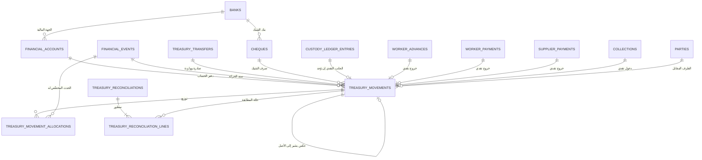

**شرح عربي:** ⭐ **الخزينة تُخفَّض في مواضع محدَّدة معلَنة فقط** — **تسليم العهدة · سلفة عامل · دفعة عامل · دفعة مورد · تحويل صادر · مصروف مدفوع مباشرة من الخزينة**. ⛔ **واعتماد مصروف من عهدة المهندس لا يُنشئ حركة خزينة إطلاقًا** — **لأن النقد خرج عند تسليم العهدة، وإنشاؤها هنا خصم مزدوج** (§20.7).

## 20.5 ⭐ `treasury_movements` — الحقول الجوهرية

| الحقل | إلزامي؟ | ملاحظة |
|---|---|---|
| `financial_account_id` 🔗 | ✅ | **الحساب الذي تحرّك فعلًا** |
| ⭐ `direction` | ✅ | `IN` · `OUT` — ⭐ **والمبلغ موجب دائمًا ⛔ لا إشارة سالبة** |
| ⭐ `movement_type` | ✅ | `RECEIPT` · `PAYMENT` · `TRANSFER_IN` · `TRANSFER_OUT` · `OPENING_BALANCE` · `ADJUSTMENT` · `REVERSAL` |
| `amount` | ✅ | **> صفر** · ⛔ **لا Float** |
| `currency_code` 🔗 | ✅ | — |
| `transaction_date` · `value_date` | ✅ | ⭐ **تاريخان بمعنيين مختلفين** |
| `counterparty_party_id` 🔗 | ⛔ | الطرف المقابل |
| 🟢 `instrument` | **مشروط** | ⭐ **إلزامي في الحركات النقدية الفعلية فقط**: `RECEIPT` · `PAYMENT` · `TRANSFER_IN` · `TRANSFER_OUT` · **وقيمه**: `Cash` · `BankTransfer` · `Cheque` · `Wallet` · ⭐ **ويجوز أن يكون فارغًا مع `OPENING_BALANCE` و`ADJUSTMENT` والأحداث غير النقدية** — **§20.6.1** |
| `cheque_id` 🔗 | ⭐ **إلزامي مع `Cheque`** | 🔒 |
| ⭐ `financial_event_id` 🔗 | ✅ | ⭐ **لا حركة نقدية يتيمة بلا سند** |
| `status` | ✅ | `Recorded` → `Confirmed` → `Reconciled` · `Reversed` |
| `reverses_movement_id` 🔗 | مع العكس | — |
| ⚡ `idempotency_key` | ✅ | ⭐ **يمنع خصمًا نقديًا مكررًا** |
| `correlation_id` · `created_by` 📝 | ✅ | — |

## 20.6 ⭐ القواعد الملزمة

| # | القاعدة |
|---|---|
| 1 | ⛔ **لا رصيد خزينة مخزَّن** — **مشتق من الحركات المعتمدة** |
| 2 | ⛔ **لا حذف ولا تعديل لحركة معتمدة** — **التصحيح بحركة عكسية مرتبطة** |
| 3 | ⚡ ⭐ **كل حركة تحمل مفتاح منع تكرار** |
| 4 | ⭐ **التحويل = حركتان مرتبطتان ومجموعهما صفر** |
| 5 | ⭐ **مجموع تخصيصات الحركة ≤ مبلغها** — **والفائض `Unallocated` معلَن** |
| 6 | ⭐ **كل حركة مرتبطة بحدث مالي** |
| 7 | ⭐ **رصيد الخزينة يُطابق حساب النقدية في الأستاذ** — **والفرق استثناء يُرفع ⛔ ولا يُبتلع** |
| 8 | 🔒 ⛔ **لا يُسجَّل رقم الحساب البنكي كاملًا في أي سجل** (BR-191) |
| 9 | ⭐ **كل حركة نقدية لها حدث تدقيق داخل المعاملة نفسها** 📝 |

### 20.6.1 🟢 ⭐ قاعدة أداة الدفع `instrument` — موحَّدة

| الحالة | `instrument` | الشرط المرافق |
|---|---|---|
| `RECEIPT` · `PAYMENT` · `TRANSFER_IN` · `TRANSFER_OUT` | ⭐ **إلزامي** | — |
| `Cheque` | — | ⭐ **`cheque_id` إلزامي** |
| `BankTransfer` | — | ⭐ **حساب خزينة من نوع بنك** |
| `Wallet` | — | ⭐ **حساب خزينة من نوع محفظة** |
| `Cash` | — | ⭐ **حساب خزينة نقدية** |
| `OPENING_BALANCE` · `ADJUSTMENT` · **الأحداث غير النقدية** | ✅ **يجوز أن يكون فارغًا** | — |
| `REVERSAL` | ⭐ **يرث أداة الحركة الأصلية أو يشير إليها** | — |

> ⛔ **ولا يُضاف هذا الحقل إلى نموذج المصروف الخاص بالمهندس إطلاقًا** — **المهندس لا يختار أداة دفع ولا مصدر تمويل** (BR-208 · **BR-263**).

## 20.7 ⭐ مواضع الخصم النقدي — معلَنة وحصرية

| الحدث | حركة خزينة؟ | ⭐ لماذا |
|---|---|---|
| **تسليم عهدة للمهندس** | ✅ **صادرة** | **النقد خرج فعلًا من الخزينة** |
| ⭐ **اعتماد مصروف من العهدة** | ⛔ **لا** | ⭐ **النقد خرج سابقًا — وإنشاؤها هنا خصم مزدوج** |
| **مصروف مدفوع مباشرة من الخزينة** | ✅ **صادرة** | **هنا فقط يخرج النقد لحظة المصروف** |
| **اعتماد كشف الأجور** | ⛔ **لا** | ⭐ **استحقاق لا نقد** (BR-047) |
| **سلفة عامل** | ✅ **صادرة** | **نقد فعلي مرة واحدة** |
| **دفعة عامل** | ✅ **صادرة** | — |
| **خصم السلفة في الكشف** | ⛔ **لا** | ⭐ **استقطاع محاسبي بحت** (BR-049) |
| **دفعة مورد** | ✅ **صادرة** | — |
| **تحصيل** | ✅ **واردة** | — |
| **رد محتجز** | ✅ **واردة عند التحصيل الفعلي** | ⛔ **وليس عند قيده** |

## 20.8 المفاتيح المرشحة والقيود

| الكيان | 🔑 PK | القيود |
|---|---|---|
| `treasury_movements` | `id` | ⚡ ⭐ **`UNIQUE(idempotency_key)`** · **`amount > 0`** · ⭐ **و`financial_event_id` إلزامي** |
| `treasury_transfers` | `id` | ⭐ **حركتان بالضبط: صادرة وواردة** · **ومبلغاهما متساويان** |
| 🟢 `treasury_movement_allocations` | `id` | ⭐ **`UNIQUE(treasury_movement_id, allocated_financial_event_id)`** · **و`allocated_amount > 0`** · **ومجموع التخصيصات ≤ مبلغ الحركة** · ⛔ **و`document_type`/`document_id` أُلغيا في v2.0.1 — مرجع متعدد الأشكال غير قابل للتحقق** |
| `treasury_accounts` | `id` | `UNIQUE(managed_company_id, account_code)` · ⭐ **و`bank_id` إلزامي لغير النقدية** |
| `banks` | `id` | `UNIQUE(normalized_name)` — ⭐ **بعد دمج `الامارات` و`بنك الامارات`** |
| `treasury_reconciliations` | `id` | `UNIQUE(financial_account_id, period_start, period_end)` |

## 20.9 Lifecycle

| الكيان | الحالات |
|---|---|
| `treasury_movements` | `Recorded` → `Confirmed` → `Reconciled` · `Reversed` |
| `treasury_transfers` | `Draft` → `Executed` · `Reversed` |
| `treasury_reconciliations` | `Open` → `Completed` · `WithExceptions` |

## 20.10 أحداث التدقيق 📝

`TreasuryMovementRecorded` · ⭐ **`TreasuryMovementReversed`** · `TreasuryTransferExecuted` · `TreasuryMovementAllocated` · `ReconciliationCompleted` · ⭐ **`ReconciliationExceptionRaised`**

## 20.11 مخاطر التكرار

| الخطر | الضابط |
|---|---|
| ⭐ **خصم نقدي مرتين لنفس الطلب** | ⚡ **`UNIQUE(idempotency_key)`** |
| ⭐ **حركة خزينة عند اعتماد مصروف العهدة** | ⛔ **منع صريح بنوع الحدث ومصدر تمويله** |
| **تحويل ينشئ حركة واحدة** | ⭐ **قيد الحركتين المتساويتين** |
| **حركة بلا سند** | ⭐ **`financial_event_id` إلزامي** |

## 20.12 أثر الاستيراد التاريخي 🔧 📊

| المصدر | المعالجة |
|---|---|
| `الخزينه` **5,101 صفًا** | ⟹ ⭐ **حركات خزينة بأحداثها المالية** — **و`نوع المصروف = عهد` (815 حركة) ⟹ تسليم عهدة لا مصروف** |
| `الوارد` + `دليل!L` **38 قيمة** | ⟹ `treasury_accounts` · ⚠️ **والمبالغ الرقمية في العمود تُرفض وتُعلَّم** |
| `شيكات` **153 (الصفوف 4–194)** | ⟹ `cheques` + `banks` · ⚠️ **والصفوف 197+ ملوَّثة تُستبعد** |
| **الأرصدة الافتتاحية** | ⟹ ⭐ **حركة `OPENING_BALANCE` باعتماد موثَّق** (OQ-025) |

## 20.13 الأسئلة المفتوحة

| # | السؤال |
|---|---|
| 1 | 🟡 **الأرصدة الافتتاحية للخزائن والحسابات — من يعتمدها؟** (OQ-025) |
| 2 | ⚪ **دورية المطابقة البنكية** — **شهرية افتراضًا · قابلة للتغيير** |

---

# ملحق أ — إحصاء النموذج المنطقي

> 🟢 ⭐ **محدَّث بعد الباتش v1.2.1** — **والعدّ صار شاملًا: يشمل البيانات المرجعية التي كانت خارج الإحصاء سابقًا.**

| البند | قبل الباتش | ⭐ بعد الباتش |
|---|---|---|
| **المجالات** | **18** | ⭐ **20** |
| **الكيانات المسمّاة في الوثيقة** | **132** | ⭐ **149** |
| — **المعلَن سابقًا في هذا الملحق** | **125** | ⭐ **صُحِّح: كان يستثني سبعة بيانات مرجعية بلا عمود «النوع»** |
| منها **Aggregate Roots** | **48** | **57** |
| منها **Child Entities** | **56** | **63** |
| منها **Reference Data** | **21** | **26** |
| منها **Derived/Value** | — | **3** |
| **العلاقات المنطقية الموثَّقة** | **142** | ⭐ **يُعاد حسابها آليًا في `database-design-ar.md` §8** |
| ⭐ **كيانات مستخدمة بلا تعريف** | **2** | 🟢 **صفر** |
| **القيود الفريدة المعتمدة** | **39** | ⭐ **52** |
| ⭐ **القيود الفريدة المرفوضة صراحةً مع سببها** | **9** | **9** |
| **القيود الزمنية (فترات غير متداخلة)** | **11** | **13** |
| ⭐ **الكيانات ذات Idempotency إلزامي** | **14** | ⭐ **18** |
| ⭐ **الكيانات ذات Snapshot إلزامي** | **6** | **8** |
| **الكيانات المحسوبة (لا تُخزَّن)** | **7** | **9** |
| **أحداث التدقيق الموثَّقة** | **96** | ⭐ **110** |
| 🏗️ **المرشحات الفيزيائية الموسومة** | — | ⭐ **10** |

# ملحق ب — القيود الفريدة المرفوضة ولماذا

| # | القيد المرفوض | لماذا | البديل |
|---|---|---|---|
| 1 | `parties.normalized_name` فريد | **تشابه الأسماء في مصر شائع** — كان سيدمج شخصين حقيقيين | **معرّفات رسمية + كشف تشابه** |
| 2 | `party_aliases.alias` فريد عالميًا | الاسم البديل الواحد قد يخص طرفين | `UNIQUE(party_id, alias)` |
| 3 | `party_identifiers(type, value)` عالميًا | **المعرّف لا معنى له خارج نطاق إصداره** | **+ الدولة + الجهة المصدرة** |
| 4 | `cost_resources(name, site)` | الاسم نفسه قد يتكرر لمَورِدين حقيقيين | معرّف داخلي + كشف تشابه |
| 5 | `payroll_periods(site, year, month)` | **يمنع الكشف التكميلي وإعادة التشغيل** | **+ الشركة + نوع التشغيل + النسخة، جزئي** |
| 6 | `payroll_lines(period, resource)` | **المورد قد يظهر بأكثر من سطر مشروع** | ⛔ **لا قيد — كشف تكرار ينبّه** |
| 7 | `attendance(resource, site, date)` | **يمنع الوردية الثانية وفئتي الأجر والتصحيح** | ⛔ **لا قيد — Idempotency + كشف** |
| 8 | `attendance(… , shift_no, line_number)` | ⭐ **`line_number` رقم عرض لا هوية** — إعادة إرسال السطر تمرّ بتغيّر ترتيبه | ⛔ **لا قيد — Idempotency** |
| 9 | `journal_entries(source_type, source_id)` | **المصدر الواحد يولّد عدة أحداث ترحيل مشروعة** | 🟢 ⭐ **حُسم نهائيًا في v2.0.1: `UNIQUE(financial_event_id)`** — **وكل أثر مستقل حدثٌ مستقل** ⛔ **و`posting_event`/`posting_sequence` أُلغيا** |

# ملحق د — ⭐ دلالة الغياب (`NULL`) في قيود التفرّد

> ⛔ **PostgreSQL لا يعامل `NULL` قيمةً واحدة داخل `UNIQUE` افتراضيًا** — ⭐ **فكل قيد يحتوي عمودًا اختياريًا يجب أن يعلن دلالته بلغة العمل أولًا.**
> ⭐ **القاعدة العامة: كل قيد تفرّد يجب أن تُكتب له جملة «لا يوجد أكثر من … لنفس …».** ⛔ **وما لا تُكتب له — قيد غامض ولا يُعتمد.**

| # | القيد | ⭐ دلالة الغياب | القرار |
|---|---|---|---|
| 1 | `party_identifiers(type, value, country, issuing_authority)` | **الفارغة = «نوع لا جهة مُصدِرة له» — نطاق واحد محدَّد ⛔ لا مجهول** | 🟢 **تُعامل قيمةً واحدة** |
| 2 | `monthly_reports(type, year, month, scope)` | ⚠️ **كانت الفارغة تعني «مجمّع» ضمنيًا — مفتاح غامض** | 🟢 ⭐ **`scope_type` + `managed_company_id` + `consolidated_scope_key`** |
| 3 | `operations.assignment_order_id` | **الفارغ = «لم يُربط بعد» والعملية `مسودة` حتمًا** | 🟢 **لا يدخل حساب التفرّد** |
| 4 | `party_bank_accounts(bank_code, account_number)` | **الفارغ = حساب غير مكتمل** | 🔵 **لا يدخل التفرّد — معلَّق حتى اختبار البيانات** |
| 5 | `guarantees(instrument_type, reference_number, bank_id)` | **`bank_id` الفارغ = أداة نقدية بلا بنك — نطاق محدَّد** | 🔵 **تُعامل قيمةً واحدة بعد الاختبار** |
| 6 | `cheques(bank_id, cheque_number)` | ⭐ **`bank_id` صار إلزاميًا بعد إنشاء `banks`** | 🟢 **لا `NULL` بعد اليوم** |
| 7 | **فترات السريان** (`effective_to` · `end_date`) | **الفارغة = «سارية إلى الآن» ⛔ لا «مجهولة»** | 🟢 **نهاية مفتوحة في اختبار التداخل** |
| 8 | `monthly_report_schedules(report_type, scope)` | نفس مشكلة النطاق | 🟢 **يتبع الصف 2** |
| 9 | `deduction_rule_versions(scope_type, scope_id, …)` | **`scope_id` الفارغ = قاعدة عامة على مستوى النوع** | 🟢 **دلالة معلَنة** |
| 10 | `overhead_allocation_rule_versions(company, scope_type, scope_id)` | نفسه | 🟢 **نفس المعالجة** |

🏗️ **Physical Design Candidates — Not Yet Approved:** `NULLS NOT DISTINCT` · **عمود مفتاح نطاق مولَّد** · **فهارس فريدة جزئية** · **فهارس تعبيرية** · **فصل النطاقات في جداول**. ⛔ **والاختيار للتصميم الفيزيائي.**

---

# ملحق هـ — 🏗️ المرشحات الفيزيائية الموسومة

> ⭐ **الأفكار محفوظة ⛔ لكنها ليست قرارات.**

| # | المرشَّح | يخدم |
|---|---|---|
| 1 | `EXCLUDE` مع `btree_gist` | **13 علاقة بفترات غير متداخلة** |
| 2 | **فهارس فريدة جزئية** | **التفرّد المشروط** |
| 3 | `CONSTRAINT TRIGGER … DEFERRABLE` | **تحقق التكليف بتاريخ الحركة** |
| 4 | **مفاتيح أجنبية مركّبة** | **الموقع يتبع العملية · وأمر الإسناد يطابق عملية المصروف** |
| 5 | `NULLS NOT DISTINCT` | **دلالة الغياب — ملحق د** |
| 6 | **أعمدة مولَّدة لمفتاح النطاق** | **نطاق التقارير** |
| 7 | `num_nonnulls(...) = 1` | **حقل مصدري واحد في `financial_events`** |
| 8 | **منع `UPDATE`/`DELETE` بصلاحيات القاعدة** | **التدقيق والقيود المرحَّلة** |
| 9 | **التقسيم الزمني** | `audit_events` · `journal_entry_lines` · `treasury_movements` |
| 10 | **قفل استشاري** | **منع الإرسال المتزامن المكرر** |

---

# ملحق ج — ما يُحسم في التصميم الفيزيائي

| # | البند |
|---|---|
| 1 | **أنواع PostgreSQL** ودقة المبالغ النهائية |
| 2 | **الفهارس** وخطط الاستعلام |
| 3 | 🏗️ **آلية القيود العابرة للجداول**: FK مركّب · `CONSTRAINT TRIGGER … DEFERRABLE` · `EXCLUDE` مع `btree_gist` · فهرس فريد جزئي · `NULLS NOT DISTINCT` · `num_nonnulls(...) = 1` — ⛔ **ولا `CHECK` عابر** |
| 4 | **آلية منع UPDATE وDELETE على جداول التدقيق** |
| 5 | **آلية الاعتراض العام** للتدقيق |
| 6 | **التقسيم والأرشفة الزمنية** |
| 7 | **PostgreSQL schemas** لفرض حدود الوحدات |
| 8 | **آلية Idempotency** (فهرس · قيد · مفتاح) |
| 9 | **آلية المهام الخلفية** |
| 10 | **شكل التخزين الخاص ومدة الرابط المؤقت** |

> ⛔ **ولا يبدأ أي SQL أو DDL أو Migrations قبل موافقة صريحة على هذا النموذج.**
