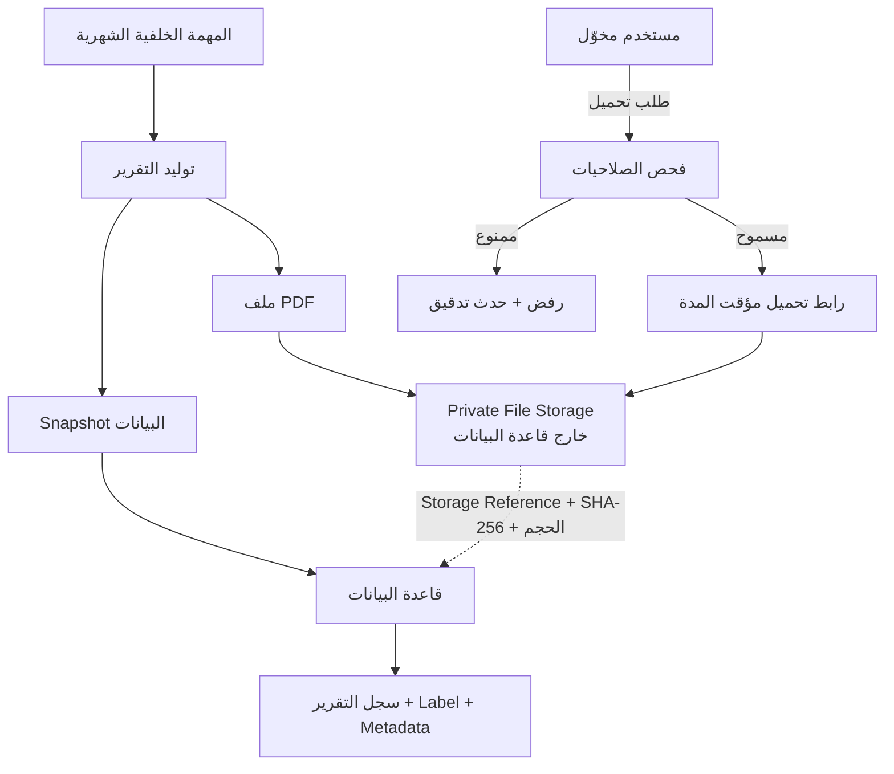
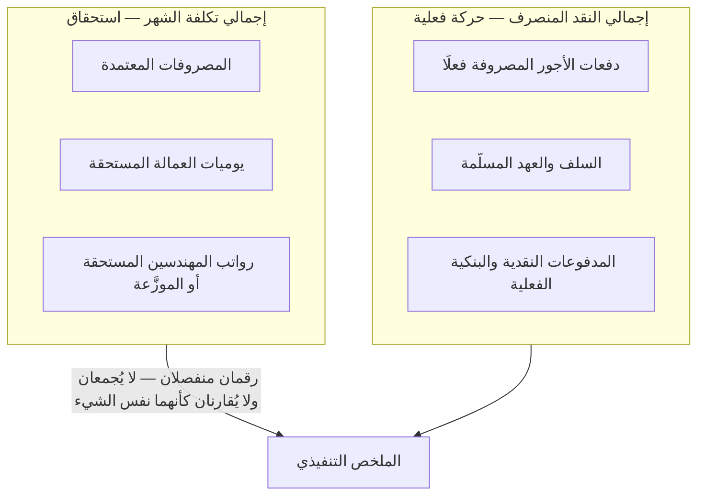
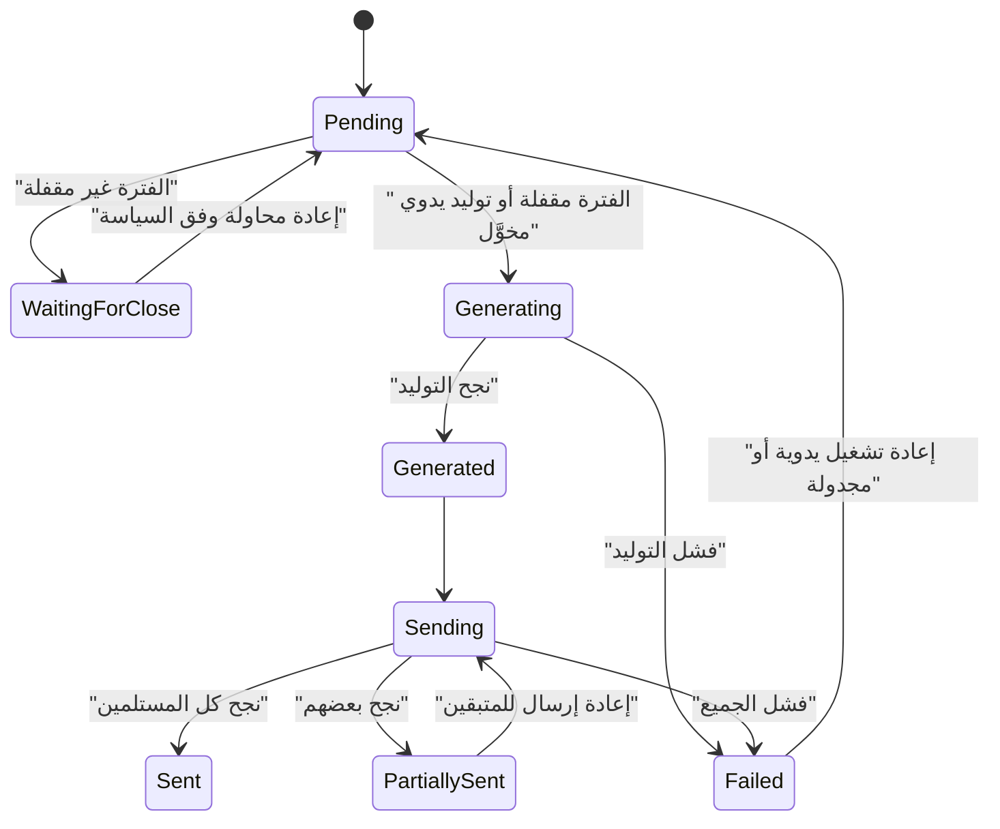
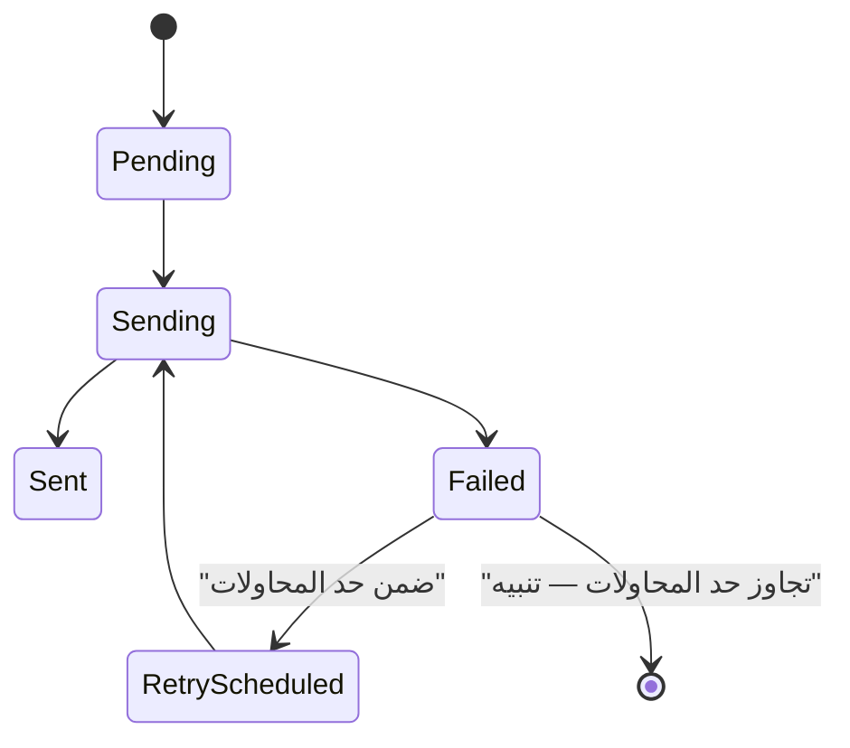

# ملحق التقرير الشهري المالي والتشغيلي — Contractra

**الإصدار:** 1.1.4 · **التاريخ:** 2026-09-17
**يُقرأ مع:** `phase-zero-patch-v1.1.4-ar.md` (أعلى أولوية) · `operations-sites-and-expense-entry-addendum-ar.md` · `audit-and-operational-logging-addendum-ar.md` · `phase-zero-patch-v1.1.2-ar.md` · `phase-zero-patch-v1.1.1-ar.md` · `phase-zero-errata-v1.1-ar.md`
**الحالة:** 🟢 **متطلب جديد معتمد من صاحب المشروع** — وليس استنتاجًا من إكسل ولا من العقد.
**النطاق:** توثيق ونموذج مفاهيمي فقط. **لا كود · لا SQL · لا DDL · لا Migrations · لا تصميم فيزيائي.**

---

## 0. تصنيف المصدر — بيان صريح

| البند | المصدر |
|---|---|
| وجود التقرير الشهري ومحتواه وأقسامه | 🟢 **قرار صاحب المشروع** (هذه الجولة) |
| فصل التكلفة عن النقد المنصرف | 🟢 قرار صاحب المشروع — **ومتسق** مع ح-108…ح-115 وطبقات منع الازدواج السبع |
| اعتماد المصروف شرطًا لدخول الإجمالي الرسمي | ✅ **مشتق من قاعدة قائمة** — ح-209 · ح-213 |
| العملية والموقع وأمر الإسناد كمحاور تجميع | ✅ **مشتق من** ح-196…ح-201 |
| كل ما يتعلق بسجل التدقيق | ✅ **مشتق من** `audit-and-operational-logging-addendum-ar.md` — **ولا يُعاد تعريفه هنا** |
| Hangfire كتوصية لآلية المهام الخلفية | 🔵 **اقتراح تقني** — يُحسم في التصميم الفيزيائي |

> ⛔ **لم تُعدَّل `evidence-matrix-ar.md`**، لأن لا شيء في هذا الملحق مستخرَج من ملفات إكسل ولا من العقد.

---

## 1. الهدف

ينتج النظام **تلقائيًا**، في نهاية كل شهر، **تقريرًا ماليًا وتشغيليًا واحدًا بصيغة PDF** يجيب على سؤال واحد:

> **ماذا كلّفنا هذا الشهر — لمن، وأين، وكم منه خرج نقدًا فعلًا؟**

ويُرسل إلى أكثر من مسؤول، ويبقى محفوظًا في النظام كسجل **لا يتغيّر** حتى لو تغيّرت البيانات بعده.

**ويحتوي على عشرة محاور:**

| # | المحور |
|---|---|
| 1 | المصروفات **المعتمدة** خلال الشهر |
| 2 | تجميع المصروفات حسب **التصنيف** (Category) |
| 3 | مصروفات **كل مهندس** |
| 4 | **يوميات العمالة** في المواقع التي يديرها كل مهندس |
| 5 | **رواتب المهندسين** أنفسهم |
| 6 | إجمالي تكلفة **كل موقع** خلال الشهر |
| 7 | إجمالي تكلفة **كل عملية** خلال الشهر |
| 8 | **إجمالي الشهر** بالكامل |
| 9 | المصروفات **تحت المراجعة** — في قسم منفصل خارج الإجمالي الرسمي |
| 10 | **التصحيحات والعكوس** التي أثّرت على الشهر |

---

## 2. اسم التقرير والـLabel واسم الملف

**ثلاثة أسماء مختلفة لا يُخلط بينها:**

| الاسم | المثال | من يراه | الغرض |
|---|---|---|---|
| **Label** | «**تقرير شهر سبتمبر 2026**» | المستخدم | العرض في الشاشات والبريد |
| **File Name** | `monthly-financial-report-2026-09-v1.pdf` | النظام | التخزين والإصدارات |
| **Report ID** | معرّف داخلي | النظام | الربط والتدقيق ومنع التكرار |

**والإصدار الثاني من نفس الشهر:**
Label = «تقرير شهر سبتمبر 2026 — الإصدار 2» · File Name = `monthly-financial-report-2026-09-v2.pdf`.

### 2.1 بيانات سجل التقرير — مفاهيميًا

> ⛔ **بلا أنواع أعمدة PostgreSQL** — الأنواع تُحدَّد في النموذج المنطقي.

| البيان | الغرض |
|---|---|
| Report ID | المعرّف الفريد |
| **Label** | الاسم العربي الظاهر |
| **File Name** | اسم الملف الداخلي |
| MIME Type = `application/pdf` | نوع المحتوى — ثابت في هذه النسخة |
| الشهر · السنة | الفترة المنطقية |
| **بداية الفترة · نهاية الفترة** | الحدّان الفعليان المستخدمان في الاستخراج |
| **الشركة أو نطاق التقرير** | الروضة · الأقصى · الأمل · أو نطاق مجمَّع |
| رقم الإصدار | 1، 2، 3 … |
| **حالة التقرير** | إحدى الحالات الثماني (§10) |
| وقت إنشاء التقرير | متى بدأ التوليد وانتهى |
| **Data As Of** | **لحظة استخراج البيانات** — وهي غير وقت الإنشاء |
| Storage Reference | مرجع الملف في التخزين الخاص |
| حجم الملف | بالبايت |
| **SHA-256 Hash** | إثبات أن الملف المحمَّل هو الملف المُصدَر |
| إجمالي المصروفات | مجمَّع |
| إجمالي يوميات العمالة | مجمَّع |
| إجمالي رواتب المهندسين | مجمَّع |
| إجمالي تكلفة المواقع | مجمَّع |
| **إجمالي النقد المنصرف** | **رقم مستقل لا يُجمع مع ما سبق** |
| رسالة الخطأ عند الفشل | آخر سبب فشل |

---

## 3. تخزين ملف PDF

### 3.1 النموذج الموصى به

**القواعد:**

1. **ملف PDF الفعلي يُحفظ في Private File Storage** — لا في قاعدة البيانات.
2. **قاعدة البيانات تحفظ:** سجل التقرير · الـLabel · مرجع الملف · الميتاداتا · البصمة · الحجم.
3. ⛔ **لا Public URL دائم** — ولا رابط يعمل بلا صلاحية.
4. **كل وصول يمر بفحص الصلاحيات** — والرابط، إن استُخدم، **مؤقت المدة ومرتبط بالمستخدم**.
5. ⛔ **لا يُحذف ولا يُستبدل تقرير سبق إرساله.**
6. **أي إعادة إصدار تنشئ Version جديدة** — ولا تكتب فوق القديمة.

### 3.2 البديل غير الموصى به — تخزين الـBinary داخل PostgreSQL

| الأثر | التفصيل |
|---|---|
| **حجم قاعدة البيانات** | ينمو بمعدل حجم كل تقرير × عدد الإصدارات × عدد الشركات — نمو خطي لا علاقة له بالبيانات المالية |
| **النسخ الاحتياطية** | كل نسخة احتياطية تحمل كل الملفات ⟹ زمن أطول ومساحة أكبر وتكلفة أعلى |
| **الاسترجاع** | استرجاع القاعدة يصبح أبطأ، و**استرجاع جزئي لملف واحد غير عملي** |
| **الأداء** | ضغط على الذاكرة المؤقتة وعمليات الإدخال/الإخراج ومسارات النسخ المنطقي |

> **الحكم:** يُذكر كبديل **غير موصى به**، ولا يُعتمد إلا بقرار صريح موثَّق يقبل الآثار الأربعة أعلاه.

---

## 4. Snapshot التقرير — ملف PDF وحده غير كافٍ

**السبب:** الـPDF صورة نهائية لا تُستعلم. لو سُئلنا بعد ستة أشهر «ما الأرقام التي كانت موجودة لحظة إصدار تقرير سبتمبر؟»، فالإجابة يجب أن تأتي من **بيانات مخزَّنة**، لا من قراءة بصرية لملف.

**ولذلك يُحفظ مع كل إصدار Snapshot يتضمن على الأقل:**

| # | محتوى الـSnapshot |
|---|---|
| 1 | المصروفات **حسب التصنيف** |
| 2 | النتائج **حسب المهندس** |
| 3 | **يوميات العمالة** حسب المهندس والموقع |
| 4 | **رواتب المهندسين** |
| 5 | النتائج **حسب الموقع** |
| 6 | النتائج **حسب العملية** |
| 7 | **الإجماليات** — التكلفة والنقد المنصرف منفصلين |
| 8 | **وقت استخراج البيانات** (Data As Of) |
| 9 | **نسخة قواعد الحساب المستخدمة** — بما فيها نسخة قاعدة توزيع رواتب المهندسين |

### 4.1 القاعدة الحاكمة

> **إذا تغيّرت البيانات بعد إصدار التقرير، لا يُعدَّل التقرير القديم — لا ملفه ولا Snapshot الخاص به.**
> **يصدر تقرير جديد:**
> - تقرير شهر سبتمبر 2026 — الإصدار 1
> - تقرير شهر سبتمبر 2026 — الإصدار 2

**والإصداران يبقيان معًا**، ويظهر الفرق بينهما عند الحاجة.

### 4.2 لماذا نسخة قواعد الحساب جزء من الـSnapshot

لأن الرقم لا يُفسَّر بلا القاعدة التي أنتجته. لو تغيّرت قاعدة توزيع راتب المهندس بين الإصدار 1 والإصدار 2، فالفرق بين الرقمين **ليس خطأ** — بل نتيجة تغيّر قاعدة، ولا يظهر ذلك إلا بحفظ النسخة.
*(نفس المبدأ المعتمد في سلّم المعالجة المحاسبية الثلاثي — ح-147 — وفي `deduction_rule_versions`.)*

---

## 5. محتوى ملف PDF — سبعة أقسام

### القسم 1 — صفحة العنوان

اسم التقرير (Label) · الشهر والسنة · الشركة أو نطاق التقرير · تاريخ ووقت الإنشاء · رقم الإصدار · **حالة الفترة المالية (مقفلة / غير مقفلة)**.

> **وإن كانت الفترة غير مقفلة، يظهر تنبيه واضح على صفحة العنوان: «أرقام غير نهائية — الفترة لم تُقفل بعد».**

### القسم 2 — الملخص التنفيذي

| البند | ملاحظة |
|---|---|
| إجمالي المصروفات المعتمدة | المعتمدة فقط |
| إجمالي يوميات العمالة | مستحقة |
| إجمالي رواتب المهندسين | مستحقة أو موزَّعة |
| إجمالي تكلفة المواقع | مجمَّع |
| **إجمالي النقد المنصرف** | **رقم مستقل** |
| الحركات تحت المراجعة | **خارج الإجمالي الرسمي** — عدد ومبلغ |

### القسم 3 — المصروفات حسب التصنيف

اسم التصنيف · عدد الحركات · إجمالي المبلغ · **النسبة من إجمالي المصروفات**.

> التجميع **بمعرّف التصنيف لا باسمه المكتوب** (ح-206)، والتصنيفات المعطَّلة تظهر إن كان لها حركات في الشهر.

### القسم 4 — التفاصيل حسب المهندس

اسم المهندس · العمليات والمواقع المسؤول عنها · المصروفات المسجَّلة والمعتمدة · يوميات العمالة التابعة لمواقعه · راتب المهندس · إجمالي التكلفة المرتبطة به.

### القسم 5 — التفاصيل حسب الموقع

العملية · **أمر الإسناد** · الموقع · المصروفات · يوميات العمالة · **راتب المهندس الموزَّع على الموقع إن وُجدت قاعدة توزيع معتمدة** · إجمالي تكلفة الموقع.

### القسم 6 — التفاصيل حسب العملية

العملية · أمر الإسناد · إجمالي المواقع · إجمالي المصروفات · إجمالي يوميات العمالة · إجمالي رواتب المهندسين الموزَّعة · الإجمالي النهائي.

### القسم 7 — الحركات المعلقة والاستثناءات

المصروفات تحت المراجعة · الحركات التي تحتاج توضيحًا · **التصحيحات والعكوس** · **المشاكل التي تمنع اكتمال التقرير**.

> **القاعدة:** ما في هذا القسم **لا يدخل أي إجمالي رسمي** في الأقسام 2…6 — ويُعرض بعدده ومبلغه حتى يعرف المدير حجم ما هو معلَّق.

---

## 6. الفرق بين التكلفة والنقد المنصرف — القاعدة الحاسمة

**ثلاث قواعد لا تُخالف:**

1. **تسجيل يومية العامل لا يعني دفع الأجر.** اليومية **استحقاق**؛ والدفع حركة نقدية مستقلة قد تقع في شهر آخر.
2. **اعتماد راتب المهندس لا يعني بالضرورة أنه صُرف.** الاستحقاق والصرف حدثان منفصلان.
3. **يُمنع حساب اليومية أو السلفة أو دفعة الأجر مرتين** — ويستند التقرير إلى **طبقات منع الازدواج السبع** القائمة (قسم «س» في سجل القواعد)، **ولا ينشئ طبقة ثامنة خاصة به**.

> ⚠️ **الخطأ الذي يمنعه هذا الفصل هو بعينه خطأ إكسل 2026:** الازدواج المثبَت عبر ثلاثة دفاتر بلا قيود استرداد. الجمع بين الاستحقاق والنقد في رقم واحد يعيد إنتاج نفس الخطأ في تقرير رسمي يُرسل بالبريد.

---

## 7. توزيع راتب المهندس

### 7.1 القاعدة الأساسية

> ⛔ **لا يُوزَّع راتب المهندس على أي موقع بلا سياسة توزيع معتمدة.**
> **وإن لم توجد سياسة، يظهر الراتب بندًا منفصلًا ولا يُحمَّل على موقع عشوائي.**

### 7.2 الحالتان

| الحالة | المعالجة |
|---|---|
| **مسؤول عن موقع واحد** | يجوز تحميل راتبه على ذلك الموقع **وفق السياسة المعتمدة** — وليس تلقائيًا بلا سياسة |
| **مسؤول عن عدة مواقع** | يلزم **قاعدة توزيع معتمدة** من الخيارات الأربعة أدناه |

### 7.3 خيارات قاعدة التوزيع

| الخيار | المزايا | العيوب والمخاطر |
|---|---|---|
| **نسب محددة لكل موقع** | يعكس الواقع بدقة | يحتاج مراجعة واعتمادًا دوريًا |
| **توزيع بالتساوي** | أبسط ما يمكن | يظلم الموقع الصغير ويجمّل الكبير |
| **توزيع حسب أيام العمل** | الأقرب للعدالة | يتطلب بيانات حضور دقيقة للمهندس نفسه |
| **عدم التوزيع — مصروف إداري منفصل** | **لا يشوّه تكلفة أي موقع** | تكلفة الموقع تظهر أقل من تكلفتها الاقتصادية |

**الافتراضي عند غياب سياسة معتمدة:** **الخيار الرابع** — الراتب بندًا إداريًا منفصلًا في القسمين 4 و2، **ولا يدخل تكلفة أي موقع**، ويُذكر ذلك صراحةً في التقرير حتى لا يُقرأ رقم تكلفة الموقع خطأً.

### 7.4 نسخة القاعدة

**قاعدة التوزيع مُصدَّرة (versioned) بتاريخ سريان**، **وتُحفظ نسختها المستخدمة داخل Snapshot** — على نفس مبدأ `deduction_rule_versions` و`overhead_allocation_rule`.

### 7.5 نقطة تنتقل إلى النموذج المنطقي

**تمثيل راتب المهندس نفسه** (بند رواتب شهرية للموظف الفني) **لم يكن ضمن نطاق المرحلة صفر**، التي غطّت **يوميات العمالة** و**تسويات المقاولين**. وهذا **ليس تعارضًا** — بل امتداد نطاق معتمد بهذه الجولة، ويُستكمل تمثيله في النموذج المنطقي. **والتقرير يقرأه ولا يعرّفه.**

---

## 8. المهمة الخلفية (Background Job)

### 8.1 الوظيفة

مهمة **متكررة شهريًا** تنشئ التقرير وتولّد الـPDF وتحفظ الـSnapshot ثم تسلّم الإرسال.

### 8.2 التوصية التقنية — 🔵 اقتراح لا قرار نهائي

**Hangfire أو آلية Persistent Background Jobs مكافئة** في ASP.NET Core، لأنها تدعم:

- المهام المتكررة (Recurring Jobs)
- إعادة المحاولة التلقائية
- حفظ حالة التنفيذ بعد إعادة تشغيل التطبيق
- منع التنفيذ المزدوج
- متابعة حالات الفشل

> ⛔ **ولا يُكتب كود Hangfire في هذه الجولة**، والاختيار النهائي قرار التصميم الفيزيائي.

### 8.3 الجدولة

**قابلة للإعداد** — لا ثابتة في الكود. المقترح:

> **اليوم الأول من الشهر التالي · الساعة 08:00 صباحًا · بتوقيت القاهرة.**

**وتغيير الجدولة يدخل سجل التدقيق.**

### 8.4 العلاقة بإقفال الفترة المالية

**القواعد:**

1. **الأفضل إصدار التقرير النهائي بعد إقفال الفترة المالية.**
2. **إن لم تكن مقفلة ⟹ `WaitingForClose`**، ويعيد النظام المحاولة **وفق سياسة محددة** (عدد محاولات وفاصل زمني وحد أقصى ثم تنبيه).
3. **يجوز التوليد اليدوي قبل الإقفال بصلاحية**، ويُوسَم التقرير حينها **«أرقام غير نهائية»** على صفحة العنوان.

---

## 9. منع التكرار

**إعادة تشغيل المهمة الخلفية — لأي سبب — يجب ألا تنتج:**

- ❌ تقريرًا مكررًا لنفس الشهر ونفس الإصدار
- ❌ ملف PDF مكررًا
- ❌ بريدًا مكررًا لنفس المستلم

**Idempotency Key منطقيًا يتكوّن من:**

| للتقرير | للإرسال |
|---|---|
| نوع التقرير | نوع التقرير |
| الفترة (الشهر والسنة) | الفترة |
| نطاق الشركة | نطاق الشركة |
| رقم الإصدار | رقم الإصدار |
| — | **المستلم** |

> ⛔ **لا يُحدَّد شكل الفهرس ولا صيغة SQL في هذه المرحلة** — الآلية قرار التصميم الفيزيائي، والمبدأ ملزم الآن.
> وهذا **امتداد لنفس مبدأ `Client Event ID` / `Idempotency Key`** المعتمد في مزامنة المصروفات (ح-212) وفي الاستيراد.

---

## 10. حالات التقرير

| الحالة | المعنى |
|---|---|
| `Pending` | مُجدوَل ولم يبدأ |
| `WaitingForClose` | ينتظر إقفال الفترة المالية |
| `Generating` | جارٍ التوليد |
| `Generated` | الملف والـSnapshot جاهزان ولم يُرسل بعد |
| `Sending` | جارٍ الإرسال |
| `Sent` | وصل إلى **كل** المستلمين النشطين المخوَّلين |
| `PartiallySent` | نجح بعض المستلمين وفشل بعضهم |
| `Failed` | فشل التوليد أو فشل الإرسال للجميع |

> **كل انتقال حالة يدخل سجل التدقيق** — بالحالة السابقة والجديدة والسبب ومن أو ما الذي تسبب فيه.

---

## 11. مستلمو البريد الإلكتروني

### 11.1 القاعدة

> ⛔ **لا تُكتب عناوين البريد داخل الكود.**
> **يحتفظ النظام بقائمة مستلمي التقرير الشهري كبيانات مُدارة**، وتعديلها يدخل سجل التدقيق.

### 11.2 بيانات كل مستلم

| البيان |
|---|
| User ID |
| Email |
| Is Active |
| Receive Monthly Report |
| صلاحية قراءة التقارير |
| **صلاحية الاطلاع على الرواتب** |

### 11.3 الصلاحيات

| الصلاحية | ما تمنحه |
|---|---|
| `Reports.Monthly.View` | فتح شاشة التقارير وتحميل التقرير |
| `Reports.Monthly.Receive` | أن يصل التقرير إلى بريده |
| **`Payroll.View`** | **رؤية بيانات الرواتب داخل التقرير** |

> ⚠️ **وجود المستخدم في دور Admin وحده لا يعني تلقائيًا السماح له باستلام بيانات الرواتب.**
> **`Payroll.View` صلاحية مستقلة تُمنح صراحةً**، ومنحها أو سحبها يدخل سجل التدقيق.

### 11.4 المستلم بلا `Payroll.View`

**لا يُرسل إليه التقرير الكامل، ولا يستطيع تحميله.** وإن أُريد تزويده بشيء، فبنسخة **لا تحتوي أقسام الرواتب** — و**هذه النسخة المختصرة خيار مؤجَّل لا يُفترض وجوده الآن**؛ والسلوك الافتراضي: **لا إرسال ولا تحميل**.

---

## 12. طريقة إرسال البريد

> **رسالة منفصلة لكل مستلم — ولا يوضع جميع المستلمين في خانة To.**

**الأسباب الأربعة:**

1. **عدم كشف عناوين البريد** للمستلمين الآخرين.
2. **تسجيل نجاح أو فشل كل رسالة على حدة.**
3. **إمكانية إعادة الإرسال لمستلم واحد** دون إزعاج الباقين.
4. **معرفة من استلم التقرير فعلًا.**

### 12.1 محتوى الرسالة

عنوان التقرير (Label) · الشهر والسنة · **ملخص مختصر** (الإجماليات الرئيسية) · **ملف PDF مرفق** · رقم الإصدار · تاريخ الإنشاء · **تنبيه صريح بأن التقرير سري لاحتوائه بيانات رواتب**.

### 12.2 عند تجاوز حجم المرفق

**يدعم التصميم لاحقًا إرسال رابط تحميل آمن ومؤقت بدل المرفق** — **ويظل الرابط**: مؤقت المدة · مرتبط بالمستخدم · خاضعًا لفحص الصلاحيات · **وليس Public URL دائمًا**. وكل فتح له يدخل سجل التدقيق.

---

## 13. تسجيل عمليات الإرسال

**سجل مستقل لكل مستلم في كل إصدار:**

| البيان | الغرض |
|---|---|
| Report ID | التقرير والإصدار |
| User ID | المستلم |
| **Email Snapshot** | **العنوان وقت الإرسال** — لا العنوان الحالي |
| Delivery Status | الحالة |
| Number Of Attempts | عدد المحاولات |
| Sent At | وقت النجاح |
| Email Provider Message ID | للتتبع مع مزوّد البريد |
| Last Error | آخر سبب فشل |
| Next Retry At | موعد المحاولة التالية |
| Opened At | **فقط إذا كانت خدمة البريد تدعمه بصورة معتمدة** — ويُعامل كمؤشر لا كإثبات |

**حالات الإرسال:**

> **فشل الإرسال إلى مستلم واحد لا يمنع الإرسال إلى باقي المستلمين** — والتقرير ينتقل إلى `PartiallySent` لا إلى `Failed`.

### 13.1 ثلاثة سجلات لا يحل أحدها محل الآخر

| السجل | يجيب على |
|---|---|
| **الدفاتر المالية** | كم الرصيد وكم التكلفة |
| **سجل التدقيق** | من فعل ماذا ومتى |
| **سجل الإرسال** | هل وصل التقرير إلى فلان، ومتى، وبكم محاولة |

> ⛔ **سجل التدقيق ليس بديلًا عن سجل الإرسال، وSerilog ليس بديلًا عن أيٍّ منهما.**

---

## 14. إعادة الإصدار وإعادة الإرسال

**المستخدم المخوَّل يستطيع:**

| الإجراء | الأثر على الإصدار |
|---|---|
| إنشاء التقرير يدويًا | إصدار جديد إن لم يوجد |
| **إعادة إصدار التقرير بعد تصحيح البيانات** | ✅ **Version جديدة** |
| **إعادة إرسال نفس النسخة** | ❌ **لا Version جديدة** |
| إرسال التقرير إلى مستلم إضافي مخوَّل | ❌ لا Version جديدة — ومحاولة إرسال جديدة |
| تحميل النسخ السابقة | ❌ لا تغيير |

> ⛔ **لا تُحذف النسخة القديمة ولا يُكتب فوقها — في أي حال.**

---

## 15. سجل التدقيق وSerilog

> **هذا القسم يُطبّق `audit-and-operational-logging-addendum-ar.md` على التقرير الشهري — ولا يعيد تعريف أيٍّ من النظامين.**

### 15.1 ما يدخل سجل التدقيق

| # | الحدث |
|---|---|
| 1 | إنشاء التقرير |
| 2 | نتيجة المهمة الخلفية (نجاح أو فشل) |
| 3 | إصدار نسخة جديدة |
| 4 | **تحميل التقرير** — ومن حمّله ومتى |
| 5 | إضافة أو حذف مستلم |
| 6 | إرسال التقرير |
| 7 | إعادة الإرسال |
| 8 | فشل الإرسال |
| 9 | تغيير الجدولة |
| 10 | **تغيير صلاحيات المستلمين** — ومنح أو سحب `Payroll.View` |

**وكل انتقال حالة للتقرير** (§10) داخل في التدقيق.

### 15.2 ما يسجّله Serilog

أخطاء توليد الـPDF · أخطاء المهمة الخلفية · أخطاء التخزين · أخطاء مزوّد البريد · **زمن إنشاء التقرير** · عدد محاولات التنفيذ · **Correlation ID**.

### 15.3 القاعدة الفاصلة — بلا تغيير عن 1.1.2

| | سجل التدقيق | Serilog |
|---|---|---|
| **ذرّي مع المعاملة** | ✅ فشله ⟹ Rollback | ❌ فشله **لا يُفشل** العملية |
| **مصدر إثبات** | ✅ | ❌ |
| **يحتوي بيانات رواتب** | محجوبة وفق §16 | ⛔ **ممنوع تمامًا** |

> **ولا تُحسب من سجل التدقيق ولا من Serilog أي أرقام مالية** — الأرقام من الدفاتر وحدها، والـSnapshot يوثّق ما كانت عليه لحظة الإصدار.

---

## 16. الأمان والخصوصية

**لأن التقرير يحتوي بيانات رواتب:**

1. **يُصنَّف التقرير `Confidential`.**
2. **لا يُحمَّل إلا لمستخدم مخوَّل** — `Reports.Monthly.View` **و**`Payroll.View` معًا للنسخة الكاملة.
3. ⛔ **لا Public Permanent URL** — بأي شكل.
4. ⛔ **لا تُسجَّل محتويات الرواتب في Serilog** — ولا مبالغ ولا أسماء مقترنة بمبالغ.
5. **لا يظهر التقرير في بريد مستخدم غير مخوَّل** — ولا حتى كملخص يكشف أرقامًا.
6. **تُخزَّن بيانات المستلم وقت الإرسال كـSnapshot** — حتى لو تغيّر بريده أو صلاحيته لاحقًا.
7. **كل تحميل أو إرسال أو إعادة إرسال يدخل سجل التدقيق** — ومحاولة وصول مرفوضة تُسجَّل أيضًا.

**ويبقى الممنوع تسجيله كما هو في 1.1.2:** كلمات المرور · الرموز · الأسرار · سلاسل الاتصال · **بيانات الحسابات البنكية الكاملة** · محتويات المرفقات.

---

## 17. الكيانات المفاهيمية

> ⛔ **أسماء مفاهيمية قابلة للتحسين — لا جداول SQL ولا أنواع أعمدة.**

| الكيان المفاهيمي | مسؤوليته |
|---|---|
| **MonthlyReport** | التقرير المنطقي لشهر ونطاق شركة — الهوية والفترة |
| **MonthlyReportVersion** | إصدار محدد: الحالة · الملف · البصمة · الحجم · Data As Of · رسالة الخطأ |
| **MonthlyReportSnapshot** | البيانات المجمَّدة التي أُنتج منها الإصدار + نسخة قواعد الحساب |
| **MonthlyReportCategoryLine** | سطر التجميع حسب التصنيف |
| **MonthlyReportEngineerLine** | سطر التجميع حسب المهندس |
| **MonthlyReportSiteLine** | سطر التجميع حسب الموقع |
| **MonthlyReportOperationLine** | سطر التجميع حسب العملية |
| **MonthlyReportRecipient** | المستلم المعتمد وصلاحياته وحالة تفعيله |
| **MonthlyReportDeliveryAttempt** | محاولة إرسال واحدة لمستلم واحد في إصدار واحد |
| **MonthlyReportSchedule** | إعداد الجدولة والتوقيت وسياسة إعادة المحاولة |
| **StoredDocument / FileReference** | مرجع الملف في التخزين الخاص + النوع + الحجم + البصمة |

**والعلاقات في `conceptual-data-model-ar.md` §11.**

---

## 18. حالات القبول — ق-30 … ق-49

| # | الحالة |
|---|---|
| ق-30 | **بعد إقفال الشهر ينشئ النظام تقرير PDF تلقائيًا** |
| ق-31 | **يظهر التقرير باسم «تقرير شهر سبتمبر 2026»** |
| ق-32 | **يمكن تحميل الـPDF من شاشة التقارير** |
| ق-33 | **يحتوي التقرير على المصروفات حسب التصنيف** |
| ق-34 | **يحتوي على يوميات العمالة المرتبطة بكل مهندس** |
| ق-35 | **يحتوي على رواتب المهندسين** |
| ق-36 | **يحتوي على إجمالي كل موقع وكل عملية** |
| ق-37 | **يفرّق بين التكلفة والاستحقاق والنقد المنصرف** |
| ق-38 | **لا تدخل المصروفات غير المعتمدة في الإجمالي الرسمي** |
| ق-39 | **التقرير المرسل يطابق Snapshot المحفوظ** |
| ق-40 | **يُرسل التقرير إلى جميع المستلمين النشطين والمخوَّلين** |
| ق-41 | **فشل مستلم واحد لا يمنع الباقين** |
| ق-42 | **يمكن إعادة إرسال التقرير لمستلم واحد** |
| ق-43 | **إعادة تشغيل المهمة لا ترسل رسائل مكررة** |
| ق-44 | **تغيّر البيانات بعد الإصدار لا يغيّر الـPDF القديم** |
| ق-45 | **إعادة التوليد تنشئ Version جديدة** |
| ق-46 | **إعادة الإرسال لا تنشئ Version جديدة** |
| ق-47 | **لا يستطيع مستخدم بلا `Payroll.View` تحميل التقرير الكامل** |
| ق-48 | **جميع عمليات الإنشاء والإرسال تدخل سجل التدقيق** |
| ق-49 | **عدم توفر مزوّد البريد لا يفقد التقرير المحفوظ** — يبقى `Generated` ويُعاد الإرسال لاحقًا |

---

## 19. المخاطر والضوابط

| # | الخطر | الضابط |
|---|---|---|
| 1 | **تسريب بيانات رواتب** عبر بريد أو رابط | `Payroll.View` مستقلة · رسالة لكل مستلم · لا Public URL · تدقيق كل تحميل |
| 2 | **قراءة رقم تكلفة الموقع خطأً** لأن راتب المهندس غير موزَّع | بيان صريح في التقرير عند غياب سياسة التوزيع (§7.3) |
| 3 | **الخلط بين التكلفة والنقد** في قرار إداري | رقمان منفصلان ولا يُجمعان (§6) |
| 4 | **تقرير على فترة غير مقفلة يُقرأ كأنه نهائي** | وسم «أرقام غير نهائية» على صفحة العنوان |
| 5 | **تكرار الإرسال** بعد إعادة تشغيل | Idempotency Key بالمستلم (§9) |
| 6 | **ضياع التقرير عند عطل مزوّد البريد** | الملف والـSnapshot محفوظان قبل الإرسال — ق-49 |
| 7 | **نمو قاعدة البيانات** لو خُزِّن الـBinary فيها | النموذج الموصى به يفصل الملف عن القاعدة (§3) |
| 8 | **تفسير فرق بين إصدارين على أنه خطأ** | نسخة قواعد الحساب داخل Snapshot (§4.2) |

---

## 20. ما ينتقل إلى النموذج المنطقي والتصميم الفيزيائي

| # | النقطة | الحالة |
|---|---|---|
| 1 | **تمثيل راتب المهندس نفسه** كبند رواتب | 🔵 امتداد نطاق معتمد — يُستكمل في النموذج المنطقي (§7.5) |
| 2 | **قاعدة التوزيع المعتمدة** — أي الخيارات الأربعة | 🟡 **قرار المدير والمحاسب** — والافتراضي «بلا توزيع» حتى تُعتمد |
| 3 | آلية Idempotency (فهرس · قيد · مفتاح) | 🔵 التصميم الفيزيائي |
| 4 | Hangfire أو بديلها | 🔵 التصميم الفيزيائي |
| 5 | شكل التخزين الخاص (نظام ملفات · تخزين كائني) | 🔵 التصميم الفيزيائي |
| 6 | مدة صلاحية رابط التحميل المؤقت | 🔵 التصميم الفيزيائي |
| 7 | النسخة المختصرة بلا رواتب | 🔵 **مؤجَّلة — لا تُفترض الآن** (§11.4) |
| 8 | دعم `Opened At` | 🔵 مرهون بمزوّد البريد — مؤشر لا إثبات |

---

## 21. ما لم يتغيّر بهذا الملحق

- **لم تُغيَّر أي قاعدة مالية قائمة** — لا الاستقطاعات ولا المحتجزات ولا المستخلصات ولا العهدة ولا الأجور ولا الطبقة التعاقدية.
- **لم تُغيَّر دورة المصروف** (ح-196…ح-214) — التقرير **يقرأ** المصروفات المعتمدة ولا يعرّفها.
- **لم يُغيَّر سجل التدقيق ولا Serilog** (ح-182…ح-195) — التقرير **يستهلكهما** ويضيف أحداثه إليهما.
- **لم تُعدَّل `evidence-matrix-ar.md`** — هذا متطلب معتمد لا اكتشاف من إكسل.
- **Modular Monolith · قاعدة بيانات واحدة** — كما هي؛ والتقرير **وحدة داخل نفس المنظومة** لا خدمة مستقلة.
- ⛔ **لم يُكتب كود ولا SQL ولا DDL ولا Migrations.**
