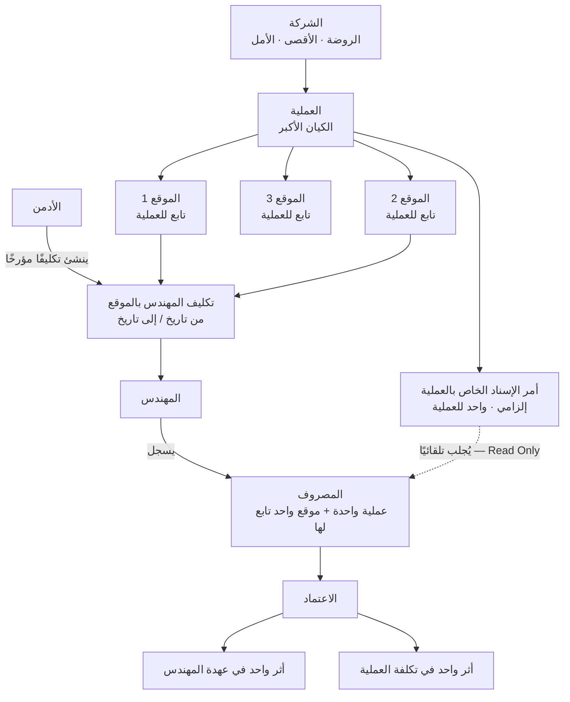
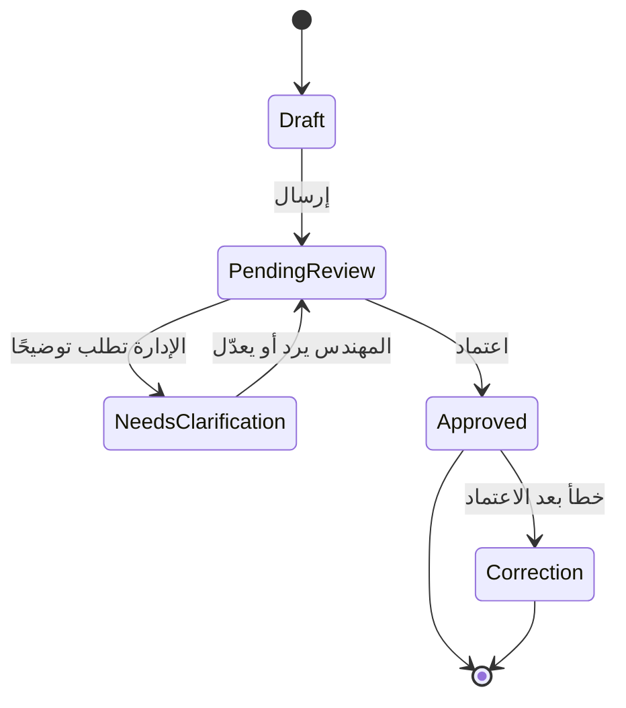

# ملحق العمليات والمواقع وتسجيل المصروف

**الإصدار:** 1.1.3 · **التاريخ:** 2026-09-17
**الحالة:** قرارات تشغيلية معتمدة من صاحب المشروع — **توثيق فقط · لا كود ولا SQL ولا DDL ولا Migrations ولا تصميم فيزيائي**
**الأولوية:** هذا المستند **هو المرجع المباشر** لكل ما يخص العلاقة بين العملية والموقع وأمر الإسناد، ولنموذج تسجيل المصروف. **وعند أي اختلاف مع أي مستند سابق، يُعمَل بما هنا.**
**يُقرأ مع:** `phase-zero-patch-v1.1.3-ar.md` · `audit-and-operational-logging-addendum-ar.md` · `confirmed-business-rules-ar.md`

---

## 1. التصحيح الجوهري — اتجاه العلاقة

### ❌ الفهم الخاطئ السابق

كان بعض التوثيق يعامل **الموقع** كأنه كيان مستقل تتفرع منه العمليات، ويسمح ببدء المصروف من الموقع ثم تحديد العملية لاحقًا.

### ✅ العلاقة الصحيحة

> **العملية هي الكيان الأكبر. المواقع توجد داخل العملية.**



**الشرح:** الشركة تملك العمليات · كل عملية لها **أمر إسناد إلزامي** · العملية تحتوي على **موقع أو أكثر** · **الموقع يتبع عملية واحدة** · الأدمن يكلّف المهندسين بالمواقع بتكليف مؤرخ · المهندس يسجل المصروف على **عملية واحدة وموقع واحد تابع لها** · وأمر الإسناد **يُجلب من العملية تلقائيًا ولا يُكتب يدويًا**.

---

## 2. العملية وأمر الإسناد — 12 قاعدة

| # | القاعدة |
|---|---|
| 1 | **كل عملية يجب أن يكون لها أمر إسناد — إلزامي** |
| 2 | **لا يجوز وجود عملية فعّالة بلا أمر إسناد** |
| 3 | **أمر الإسناد يرتبط بالعملية**، لا بالموقع ولا بالمهندس |
| 4 | **المواقع توجد داخل العملية** |
| 5 | العملية الواحدة قد تحتوي على **موقع واحد أو عدة مواقع** |
| 6 | **الموقع يتبع عملية محددة** |
| 7 | **رقم أمر الإسناد لا يكتبه المهندس يدويًا** |
| 8 | عند اختيار العملية، **يجلب النظام أمر الإسناد تلقائيًا** |
| 9 | يظهر أمر الإسناد للمهندس **بيانًا للقراءة فقط (Read Only)** |
| 10 | **لا يجوز ترك أمر الإسناد فارغًا في المصروف** |
| 11 | **لا يجوز تغيير ارتباط العملية بأمر الإسناد بعد وجود حركات مالية معتمدة** إلا بإجراء إداري موثق ومدقق |
| 12 | **التعديلات والتصحيحات على بيانات أمر الإسناد تدخل في سجل التدقيق** |

---

## 3. تكليف المهندس بالمواقع — 11 قاعدة

| # | القاعدة |
|---|---|
| 1 | **الأدمن هو المسؤول** عن ربط المهندس بالمواقع |
| 2 | يمكن تكليف المهندس **بموقع واحد أو عدة مواقع** |
| 3 | المواقع المكلف بها قد تكون **داخل عملية واحدة أو عدة عمليات** |
| 4 | **المهندس لا يرى جميع العمليات والمواقع الموجودة في النظام** |
| 5 | يرى **فقط العمليات التي تحتوي على موقع واحد على الأقل مكلف به** |
| 6 | بعد اختيار العملية، يرى **فقط المواقع المكلف بها داخل هذه العملية** |
| 7 | لكل تكليف **تاريخ بداية**، وقد يكون له **تاريخ نهاية** |
| 8 | **التكليف القديم لا يُحذف** — يُغلق بتاريخ نهاية |
| 9 | **الحركات القديمة تظل مرتبطة بالتكليف الذي كان ساريًا وقت تسجيلها** |
| 10 | **الأدمن وحده** ينشئ التكليف أو ينهيه أو يعدّله |
| 11 | **إنشاء التكليف وإنهاؤه وتعديله يدخل في سجل التدقيق** |

---

## 4. نموذج المصروف — الترتيب والهدف

**الهدف:** أن يسجّل المهندس المصروف **بأقل عدد ممكن من الخطوات والكتابة**، **دون فقد أي معلومة أساسية** يحتاجها الحساب والتحليل.

### ترتيب النموذج

| # | الحقل | الحالة |
|---|---|---|
| 1 | **العملية** | إلزامية — وقد تُحدَّد تلقائيًا |
| 2 | **الموقع داخل العملية** | إلزامي — وقد يُحدَّد تلقائيًا |
| 3 | **أمر الإسناد** | **يظهر تلقائيًا — Read Only** |
| 4 | **نوع المصروف** | إلزامي — من قائمة |
| 5 | **المبلغ** | إلزامي — أكبر من صفر |
| 6 | **إرفاق فاتورة أو صورة** | **اختياري دائمًا** |
| 7 | **بيان أو ملاحظة** | اختياري — **إلا عند اختيار «أخرى» فيصبح إلزاميًا** |
| 8 | **الإرسال للمراجعة** | — |

---

## 5. سلوك اختيار العملية والموقع

| الحالة | سلوك النظام |
|---|---|
| المهندس مكلف بمواقع داخل **عملية فعّالة واحدة فقط** | **يحدد النظام العملية تلقائيًا** — ولا يحتاج المهندس لاختيارها. ويظهر اسم العملية وأمر الإسناد **كتأكيد مختصر** |
| المهندس مكلف بمواقع داخل **أكثر من عملية** | يظهر **Dropdown بالعمليات المسموح بها فقط** — ويختار العملية أولًا |
| **بعد تحديد العملية** | تظهر **المواقع المكلف بها داخل هذه العملية فقط** |
| داخل العملية **موقع واحد فقط** مكلف به | **يحدد النظام الموقع تلقائيًا** |
| داخل العملية **أكثر من موقع** مكلف به | يختار الموقع من Dropdown |
| **أمر الإسناد** | **يُجلب تلقائيًا من العملية** · **لا يستطيع المهندس تعديله** · يظهر **سطر تأكيد واضح لا حقل إدخال كبير** |

### مثال العرض في الشاشة

```
العملية:      صيانة وتطوير أحياء الشيخ زايد
أمر الإسناد:  137
الموقع:       الحي الحادي عشر
```

---

## 6. الأعمدة الأساسية للمصروف — وما يدخله المهندس

### 6.1 ما يحتاجه سجل المصروف

التاريخ · المهندس · **العملية** · **أمر الإسناد** · **الموقع** · نوع المصروف · المبلغ · بيان المصروف إن وُجد · المرفق إن وُجد · الحالة · تاريخ الإنشاء · تاريخ الإرسال · **مصدر الإدخال** (Online / Offline Sync) · **المعرّف المانع للتكرار عند المزامنة** · بيانات التدقيق اللازمة.

### 6.2 ما يدخله المهندس فعليًا

| يدخله | متى |
|---|---|
| **العملية** | **فقط إذا كان لديه أكثر من عملية** |
| **الموقع** | **فقط إذا كان لديه أكثر من موقع داخل العملية** |
| **نوع المصروف** | دائمًا |
| **المبلغ** | دائمًا |
| *إرفاق صورة* | **اختياري** |
| *ملاحظة* | **اختياري** (إلزامي مع «أخرى» فقط) |

### 6.3 ما يملؤه النظام تلقائيًا

التاريخ الافتراضي · معرّف المهندس · **أمر الإسناد** · الحالة · تاريخ ووقت الإنشاء · بيانات المزامنة · بيانات التدقيق.

### 6.4 الرحلة المعتادة

```
العملية → الموقع → نوع المصروف → المبلغ → إرسال
```

**وفي حالة عملية واحدة أو موقع واحد، يقل عدد الاختيارات تلقائيًا** — وقد تصل الرحلة إلى: **نوع المصروف → المبلغ → إرسال**.

---

## 7. نوع المصروف — قائمة لا كتابة حرة

| # | القاعدة |
|---|---|
| 1 | **نوع المصروف يُختار من قائمة منظمة** |
| 2 | **لا يكتب المهندس نوع المصروف كنص حر** |
| 3 | يجوز أن تجمع القائمة **التصنيف والتصنيف الفرعي في اختيار واحد**: `وقود — سولار` · `خامات — أدوات ري` · `نقل — نقلات موقع` · `صيانة — معدات` |
| 4 | **اختيار «أخرى» مسموح** |
| 5 | **عند اختيار «أخرى» يصبح بيان المصروف إجباريًا** |
| 6 | في باقي الأنواع **البيان اختياري** |
| 7 | **التحليل والتقارير تعتمد على المعرّفات الداخلية للتصنيفات، لا على الاسم المكتوب** |
| 8 | **التصنيفات القديمة المستخدمة لا تُحذف** — تُعطَّل للحركات الجديدة فقط |
| 9 | إنشاء التصنيفات وتعديلها وتعطيلها **من صلاحيات الإدارة، ويدخل في سجل التدقيق** |

---

## 8. الفاتورة والمرفقات — قاعدة نهائية وملزمة

> ### **تصوير أو إرفاق الفاتورة اختياري دائمًا.**

| # | القاعدة |
|---|---|
| 1 | المرفق **اختياري دائمًا** بلا استثناء |
| 2 | **لا يصبح إجباريًا** بسبب: **قيمة المصروف** · **نوع المصروف** · **الموقع** · **العملية** |
| 3 | **عدم وجود فاتورة لا يمنع:** حفظ المصروف · إرساله · مراجعته · **اعتماده** |
| 4 | يظهر الزر باسم واضح: **«إرفاق فاتورة أو صورة — اختياري»** |
| 5 | **يستطيع المراجع طلب صورة أو توضيح** — لكن النظام **لا يحوّل المرفق إلى شرط تقني إجباري** |
| 6 | **يُمنع وضع حد مبلغ (Threshold) يجعل الفاتورة مطلوبة بعده** |
| 7 | المرفقات تدخل في **سياسة الأمان والصلاحيات وسجل التدقيق** المناسبة |

---

## 9. حقول محذوفة من نموذج المهندس

**لا تُضاف الحقول التالية إلى نموذج تسجيل المصروف الخاص بالمهندس:**

- ❌ **طريقة الدفع**
- ❌ **مصدر الدفع**
- ❌ **المدفوع إليه**

**السبب:** كل مصروف معتمد **يُحمَّل على حساب عهدة المهندس تلقائيًا**. وإذا تجاوزت المصروفات المعتمدة العهدة المستلمة، **يصبح رصيده سالبًا — أي أن الشركة مدينة له**.

**ولا حاجة إلى حقل «دفعت من مالي»** — الرصيد ينتج تلقائيًا من:

```
العهدة المستلمة − المصروفات المعتمدة ± المرتجعات والتحويلات والتصحيحات
```

---

## 10. حالات المصروف



| الحالة | المعنى |
|---|---|
| **Draft** | محفوظ ولم يُرسل |
| **PendingReview** | أُرسل وينتظر مراجعة الإدارة |
| **NeedsClarification** | الإدارة طلبت توضيحًا أو تعديلًا |
| **Approved** | **حركة مالية رسمية** أثّرت في العهدة وتكلفة العملية |

> ⛔ **لا تُستخدم `Rejected` كرفض نهائي في الدورة الأساسية.**
> و**المصروف المعتمد لا يُعدَّل مباشرة** — التصحيح بحركة `Correction` مرتبطة بالأصل.

---

## 11. التحقق المطلوب — في الخادم لا الواجهة

**لا يُعتمد على الواجهة (Frontend) وحدها.** الخادم (Backend) يتحقق من:

| # | التحقق |
|---|---|
| 1 | **العملية فعّالة** |
| 2 | **العملية لها أمر إسناد** |
| 3 | **الموقع تابع للعملية المختارة** |
| 4 | **المهندس مكلف بالموقع** |
| 5 | **التكليف ساري في تاريخ المصروف** |
| 6 | **نوع المصروف فعّال** |
| 7 | **المبلغ أكبر من صفر** |
| 8 | **البيان موجود عند اختيار «أخرى»** |
| 9 | **عدم تكرار المصروف عند المزامنة** |
| 10 | **المستخدم يملك صلاحية إنشاء المصروف** |

### يُمنع إرسال أو اعتماد مصروف

❌ بلا عملية · ❌ بلا أمر إسناد · ❌ بلا موقع · ❌ على موقع **لا يتبع العملية** · ❌ على موقع **غير مكلف به المهندس** · ❌ بلا نوع مصروف · ❌ بلا مبلغ صحيح.

> **ملاحظة تقنية مُثبَّتة سابقًا (ح-180):** هذه تحققات **عابرة للجداول** ولا تُنفَّذ كـ`CHECK` عادي — **الآلية تُحسم في التصميم الفيزيائي** (خدمة داخل معاملة واحدة + شبكة أمان في قاعدة البيانات).

---

## 12. العمل بدون إنترنت

| # | القاعدة |
|---|---|
| 1 | يستخدم التطبيق **آخر نسخة متزامنة** من: عمليات المهندس · أوامر الإسناد · المواقع المكلف بها · أنواع المصروفات |
| 2 | **لا يُسمح بإنشاء مصروف بلا عملية وموقع وأمر إسناد معروفين** من البيانات المخزَّنة |
| 3 | عند عودة الإنترنت **يعيد الخادم التحقق من العلاقات والتكليف** |
| 4 | **يُستخدم تاريخ المصروف للتحقق من سريان التكليف، لا تاريخ المزامنة** |
| 5 | إذا تغيّرت البيانات وأصبحت الحركة تحتاج مراجعة: **لا تُحذف · لا تُكرَّر · تنتقل إلى حالة تحتاج تدخل الإدارة** |
| 6 | **`Client Event ID` أو `Idempotency Key`** يمنع إنشاء نفس المصروف مرتين |

---

## 13. سجل التدقيق لدورة المصروف

يسجّل سجل التدقيق **على الأقل**:

إنشاء المسودة · تعديل المصروف · إرسال المصروف · طلب التوضيح · رد المهندس · **تغيير العملية أو الموقع قبل الاعتماد** · اعتماد المصروف · **أي تصحيح أو عكس بعد الاعتماد**.

ومع كل حدث: **المستخدم** · **الوقت** · **القيم السابقة والجديدة** · **السبب عند الحاجة** · **`CorrelationId`** · **مصدر الحركة** (Online / Offline Sync).

> **المصروف المعتمد لا يُعدَّل مباشرة.** وإذا ظهر خطأ بعد الاعتماد، **يُنشأ تصحيح أو عكس مرتبط بالأصل**.

*(القواعد الحاكمة لسجل التدقيق نفسه في `audit-and-operational-logging-addendum-ar.md` — ح-182 … ح-195.)*

---

## 14. العلاقات المنطقية المثبَّتة

**تُثبَّت في النموذج المفاهيمي والمنطقي — بلا SQL:**

| # | العلاقة |
|---|---|
| 1 | **العملية لها أمر إسناد إلزامي** |
| 2 | **العملية تحتوي على موقع واحد أو أكثر** |
| 3 | **الموقع يتبع عملية واحدة** |
| 4 | **المهندس يرتبط بالمواقع من خلال تكليف مؤرَّخ** |
| 5 | **المصروف يخص مهندسًا واحدًا** |
| 6 | **المصروف يخص عملية واحدة** |
| 7 | **المصروف يخص موقعًا واحدًا تابعًا للعملية** |
| 8 | **أمر الإسناد الخاص بالمصروف يأتي من العملية** |
| 9 | **المصروف له نوع واحد أساسي** |
| 10 | **المصروف قد يحتوي على صفر أو أكثر من المرفقات** |
| 11 | **المصروف له سجل حالات وتعليقات ومراجعات** |
| 12 | **المصروف المعتمد ينتج أثرًا واحدًا في دفتر العهدة وأثرًا واحدًا في تكلفة العملية** |

### قرار ينتقل إلى المرحلة التالية

> **لا تُكرَّر البيانات دون حاجة، لكن يجب أن يبقى ممكنًا معرفة أمر الإسناد الصحيح تاريخيًا.**
>
> إذا تغيّر ارتباط العملية بأمر الإسناد لاحقًا (بالإجراء الإداري الموثَّق في §2 قاعدة 11)، فلا يجوز أن تتغيّر قراءة المصروفات القديمة بأثر رجعي.
>
> **الحل — Snapshot أو Versioning — قرار يُحسم في النموذج المنطقي ثم التصميم الفيزيائي.** والمبدأ الملزم الآن: **قراءة المصروف تاريخيًا يجب أن تعطي أمر الإسناد الذي كان ساريًا وقت الاعتماد.**

---

## 15. حالات القبول

| # | الحالة |
|---|---|
| **ق-16** | مهندس لديه **عملية واحدة وموقع واحد** ⟹ يفتح النموذج فتُحدَّد **العملية والموقع وأمر الإسناد تلقائيًا** |
| **ق-17** | مهندس لديه **عملية واحدة وعدة مواقع** ⟹ تُحدَّد العملية وأمر الإسناد تلقائيًا، **ويختار الموقع** |
| **ق-18** | مهندس لديه **عدة عمليات** ⟹ يختار العملية، **ثم تظهر مواقعه داخلها فقط** |
| **ق-19** | **تغيير العملية** ⟹ يغيّر قائمة المواقع **ويغيّر أمر الإسناد تلقائيًا** |
| **ق-20** | **لا يمكن اختيار موقع تابع لعملية مختلفة** |
| **ق-21** | **لا يمكن اختيار موقع غير مكلف به المهندس** |
| **ق-22** | **لا يمكن إرسال المصروف بلا عملية أو موقع أو أمر إسناد** |
| **ق-23** | **يمكن إرسال واعتماد المصروف دون فاتورة** |
| **ق-24** | **اختيار «أخرى» يتطلب بيانًا** |
| **ق-25** | **المصروف العادي لا يتطلب كتابة بيان** |
| **ق-26** | **المرفق يظل اختياريًا مهما كانت قيمة المصروف** |
| **ق-27** | **اعتماد المصروف يخصم المبلغ مرة واحدة من عهدة المهندس** |
| **ق-28** | **تكرار المزامنة لا ينشئ مصروفًا ولا حدث تدقيق مكررًا** |
| **ق-29** | **المصروف المعتمد لا يتغيّر مباشرة** |

---

## 16. القواعد القديمة المحذوفة أو المصحَّحة

| # | ما كان مكتوبًا | ✅ التصحيح |
|---|---|---|
| 1 | **`operation_id` أو أمر الإسناد اختياري في المسودة الميدانية** (ح-134) | **مُلغاة** — العملية **إلزامية من أول لحظة**، وأمر الإسناد **يُجلب منها تلقائيًا ولا يُترك فارغًا** |
| 2 | «الموقع إجباري من أول لحظة، أما العملية فيجوز تأجيلها» | **مُلغاة** — **العملية أولًا ثم الموقع**، والاثنان إلزاميان |
| 3 | «المراجع يحدد العملية» كقاعدة أساسية (ح-136) | **صارت استثناءً لا قاعدة** — المهندس يحدد العملية والموقع؛ وتغيير المراجع لهما **قبل الاعتماد** يبقى ممكنًا **بسجل تدقيق**، لكنه **ليس المسار الطبيعي** |
| 4 | الموقع كيان مستقل تتفرع منه العمليات | **مُلغاة** — **العملية هي الأكبر والمواقع داخلها** |
| 5 | المهندس يكتب رقم أمر الإسناد | **مُلغاة** — **لا يكتبه يدويًا إطلاقًا** |

**ولم يُرصَد في أي مستند:** فاتورة إجبارية بحد مبلغ · فاتورة إجبارية بنوع مصروف · حقل طريقة الدفع · حقل مصدر الدفع · حقل المدفوع إليه · «المهندس يرى كل المواقع». **وقد ثُبِّت منعها صراحةً هنا لئلا تُضاف لاحقًا.**

---

## 17. ما لم يتغيّر

- **لم تتغيّر أي قاعدة مالية** — المستخلصات والاستقطاعات والمحتجزات والأجور والعهدة كما هي.
- **لم يُعَد فحص أي ملف Excel ولا أي عقد** — هذه **قرارات تشغيلية معتمدة من صاحب المشروع**.
- **لم تُفتح أسئلة جديدة.**
- **المعمارية تبقى Modular Monolith.**
- **لم يُكتب كود ولا SQL ولا DDL ولا Migrations، ولم يبدأ التصميم الفيزيائي.**
