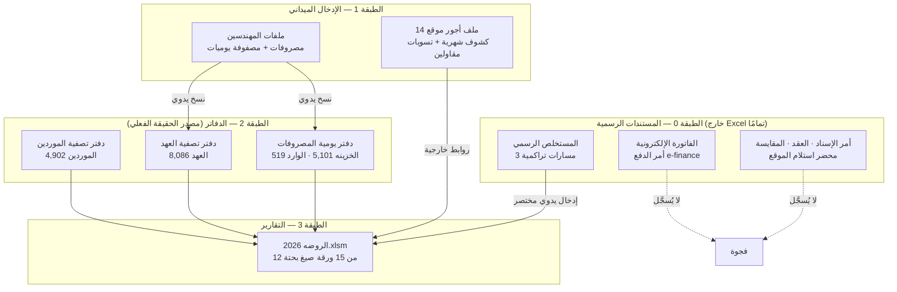
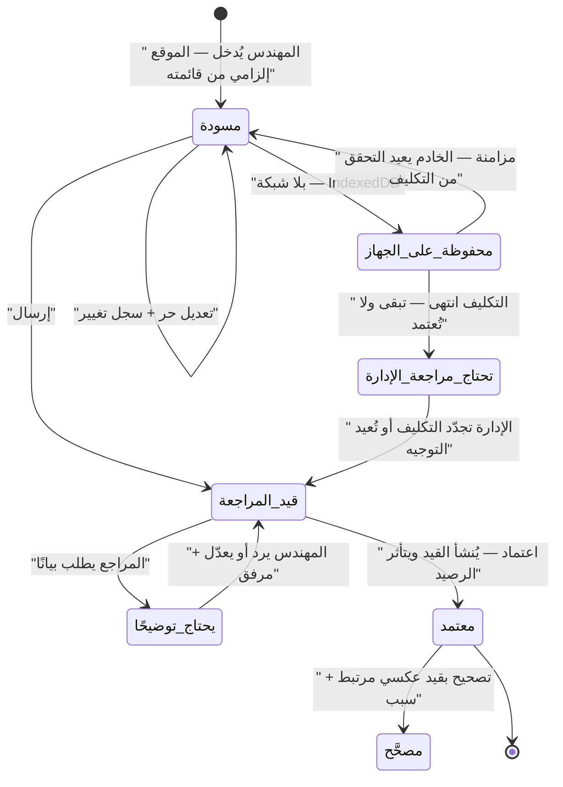

# تقرير المرحلة صفر النهائي — منظومة الروضة المالية والتشغيلية

**الإصدار:** 1.1.4 (يَنسخ كل الإصدارات السابقة) · **تاريخ الإصدار الأول:** 2026-09-16 · **تاريخ التعديل:** 2026-09-17
**يُقرأ مع:** `phase-zero-patch-v1.1.4-ar.md` (أعلى أولوية) · `monthly-financial-report-addendum-ar.md` · `phase-zero-patch-v1.1.3-ar.md` · `operations-sites-and-expense-entry-addendum-ar.md` · `audit-and-operational-logging-addendum-ar.md` · `phase-zero-patch-v1.1.2-ar.md` · `phase-zero-patch-v1.1.1-ar.md` · `phase-zero-errata-v1.1-ar.md` — وعند أي اختلاف، **الترتيب أعلاه هو الحاكم**.

**الحالة:** اكتشاف وتوثيق — **لم يُكتب كود ولا SQL ولا Migrations**

| المستند | الغرض |
|---|---|
| **`phase-zero-final-report-ar.md`** (هذا) | المرجع الجامع |
| `confirmed-business-rules-ar.md` | القرارات المؤكدة ومصادرها |
| `open-questions-ar.md` | الأسئلة مصنَّفة بالخطورة |
| `conceptual-data-model-ar.md` | النموذج المفاهيمي والوحدات |
| `excel-source-mapping-ar.md` | خريطة Excel → الكيانات |
| `contracts-and-payments-addendum-ar.md` | العقود والمستخلصات وأوامر الدفع والضمانات |
| `wages-and-subcontractors-addendum-ar.md` | الأجور واليوميات وتسويات المقاولين |
| `evidence-matrix-ar.md` | مصفوفة الأدلة |
| `phase-zero-closure-checklist-ar.md` | قائمة إغلاق المرحلة |
| **`phase-zero-errata-v1.1-ar.md`** 🆕 | تصويبات الإصدار 1.1 — **تَجُبّ ما يخالفها** |
| **`reconciliation-exceptions-ar.md`** 🆕 | مصالحات الأجور والمحتجزات والبصمات |
| **`consistency-matrix-ar.md`** 🆕 | القاعدة ↔ النموذج ↔ الخريطة ↔ السؤال |
| **`diff-summary-v1.1-ar.md`** 🆕 | ملخص الفروق 1.0 → 1.1 |
| **`phase-zero-patch-v1.1.1-ar.md`** | Patch توثيقي v1.1.1 |
| **`audit-and-operational-logging-addendum-ar.md`** 🆕 **(1.1.2)** | التدقيق المالي والتسجيل التشغيلي — الفصل الثلاثي الملزم |
| **`phase-zero-patch-v1.1.2-ar.md`** | Patch توثيقي v1.1.2 |
| **`operations-sites-and-expense-entry-addendum-ar.md`** 🆕 **(1.1.3)** | العمليات والمواقع وتسجيل المصروف — **المرجع المباشر** |
| **`phase-zero-patch-v1.1.3-ar.md`** **(1.1.3)** | Patch توثيقي v1.1.3 |
| **`monthly-financial-report-addendum-ar.md`** 🆕 **(1.1.4)** | التقرير الشهري المالي والتشغيلي — **المرجع المباشر** |
| **`phase-zero-patch-v1.1.4-ar.md`** 🆕 **(1.1.4)** | Patch توثيقي v1.1.4 — **أعلى أولوية** |
| `business-validation-pack-ar.md` | وثيقة مراجعة واعتماد دورات العمل — للاجتماع |

**عدد مستندات المرحلة صفر: 13**، ويُضاف إليها ملحق التدقيق (1.1.2) وملحق العمليات والمصروف (1.1.3) و**ملحق التقرير الشهري (1.1.4)** وPatch كل إصدار، ووثيقة الاجتماع.

**ترتيب الأولوية عند أي اختلاف:** `phase-zero-patch-v1.1.4-ar.md` ← `monthly-financial-report-addendum-ar.md` ← `phase-zero-patch-v1.1.3-ar.md` ← `operations-sites-and-expense-entry-addendum-ar.md` ← `audit-and-operational-logging-addendum-ar.md` ← `phase-zero-patch-v1.1.2-ar.md` ← `phase-zero-patch-v1.1.1-ar.md` ← `phase-zero-errata-v1.1-ar.md` ← بقية المستندات.

---

## 1. الملفات والمستندات المفحوصة فعليًا

### 1.1 ملفات Excel

| # | الملف | الحجم | MD5 | فُتح؟ | ملاحظة |
|---|---|---:|---|---|---|
| 1 | `الروضه 2026.xlsm` | 1,779,942 | `9cabb8f0a5a4f5583e1f4245b5feb765` | ✅ بعد معالجة | رفضه openpyxl بسبب `<family val="18"/>` في `xl/styles.xml` (الحد 14). عُدِّلت السمة في **نسخة تحليلية** (4 مواضع، خط فقط). **الأصل لم يُمَس** |
| 2 | `دفتر تصفية العهد 2026.xlsx` | 1,537,750 | `4ca2aac07e192b5cde62c8ef9b3623a5` | ✅ | — |
| 3 | `دفتر يومية المصروفات 2026.xlsx` | 1,233,457 | `a271ff05fc6385fca84fb42c18c7180b` | ✅ | — |
| 4 | `دفتر تصفية الموردين 2026.xlsx` | 1,005,469 | **MD5 `6739c70e177e0772e7f7e7d9106f768b`** **SHA-256 `b701435237260fdef3ed4843d1897ec369d185f0eb7fbeefd858e1884a1340a3`** | ✅ | **البصمة كانت ناقصة — حُسبت وأُضيفت في 1.1.1** |
| 5 | `هانى شاكر.xlsx` | 207,306 | `bdaaa6208cb0eecb1cb42fa2bef3fd08` | ✅ | ملف مهندس — أغسطس 2026 فقط |
| 6 | `الشيخ زايد 2026.xlsx` (نسخة 14 سبتمبر) | 986,687 | `0a17768f15f8de91fddf24fe03453a97` | ✅ | **بها 836 خلية `#REF!`** |
| **7** | **`الشيخ زايد 2026.xlsx` (نسخة 16 سبتمبر — المعتمدة)** | **985,492** | **`c3674d67ccbe99d3a0e6d24c25680a99`** | ✅ | **صفر `#REF!`** · أغسطس محدَّث |

> ⚠️ **الملفان 6 و7 بنفس الاسم ومختلفان.** قارنتهما خلية بخلية: الصيغ متطابقة تقريبًا، لكن **836 خلية `#REF!` أصبحت قيمًا صحيحة**، و**23 كتلة شهرية تغيّرت مجاميعها** (أغسطس في 5 مواقع — لأن `تم القبض` مُلئ بينهما).
>
> **درس ملزم للترحيل:** الملف حيّ يتغيّر يوميًا. **كل استيراد لقطة زمنية ببصمة Hash**، وأي إعادة استيراد يجب أن تكتشف الفروق ولا تكرّرها.

### 1.2 المستندات الورقية (صور و PDF)

| # | المستند | ما أثبته |
|---|---|---|
| 1 | تسوية مستخلص **13** — أمر إسناد 137 | البنية التراكمية · بند التعلية بنصه |
| 2 | تسوية مستخلص **12** — أمر إسناد 137 | **السلسلة التراكمية مؤكدة** · كل الأسس الحسابية |
| 3 | تسوية مستخلص **15 ختامى** — المحاور | المسارات الثلاثة · دفعة مقدمة · دائن حوافز |
| 4 | تسوية مستخلص **فروق أسعار** — أمر 64 | **مطابقة تامة لصف Excel** |
| 5 | تسوية مستخلص **4** — أمر 89 + خطاب القوى العاملة | `خصم عميل` بأسبابه · صافي سالب · سبب التعلية |
| 6 | **أمر إسناد 137** | القيمة والمدة والقانون الحاكم |
| 7 | **عقد مقاولة التيسير ↔ الأقصى** (18 صفحة) | **نسبة الشركة الخارجية 10% بنصها** · المقايسة · الغرامات · الضمان |
| 8 | **أمرا دفع e-finance** | السلسلة إلى البنك · الفاتورة الإلكترونية |

### 1.3 ما لم أستطع الوصول إليه

| البند | الأثر |
|---|---|
| **13 ملف أجور موقع** (الادارة · القاهرة الجديدة · بدر · العاشر · السادات · برج العرب · العلمين · مارينا · ملوى · النرجس · سوهاج · النوبارية) | **بيانات** 13 موقعًا غير قابلة للترحيل — **المنهج معروف بالكامل** |
| `الروضه 2025.xlsm` | أرصدة `ديون[مرحل]` ومحتجزات ما قبل 2026 |
| ~~صفحات 9–18 من العقد~~ | ✅ **فُحصت كاملة في الإصدار 1.1** — تبيّن أنها **عشرة مستخلصات جارية (1…10)** لا بنود عقد، وأنها **تؤكد** نسبة 10% بخمس عمليات حسابية مستقلة. التفصيل في `phase-zero-errata-v1.1-ar.md` §2 |
| `xl/model/item.data` (Power Pivot) | تنسيق ثنائي — لم يُفك؛ يُرجَّح أنه نسخة من الجداول |
| ملفات مهندسين غير `هانى شاكر` | 26 مندوب عهدة آخرين — بنية ملفاتهم غير مؤكدة |

---

## 2. البنية المعمارية الحقيقية

**شرح:** المنظومة أربع طبقات، أدناها فقط مؤتمتة. **الطبقة 0 — كل المستندات الرسمية — خارج Excel بالكامل**: لا عقود ولا مقايسات ولا فواتير إلكترونية ولا أوامر دفع. ما يدخل Excel من المستخلص الرسمي هو **رقم واحد مختصر** (`جمله الاعمال`) يفقد المسارات التراكمية الثلاثة وسطور الاستقطاع. والطبقة 1 تصل الطبقة 2 **بالنسخ اليدوي فقط** — لا رابط آلي. و`الروضه 2026.xlsm` ليس دفترًا بل لوحة تقارير: **12 من 15 ورقة لا تحتوي معاملة أصلية واحدة**.

---

## 3. الدفاتر — الأحجام والمحتوى

| الدفتر | الجدول | صفوف حقيقية | الإجمالي | الفترة |
|---|---|---:|---:|---|
| دفتر يومية المصروفات | `الخزينه` | **5,101** | 259,069,818 | 2026-01-01 → 2026-08-09 |
| دفتر يومية المصروفات | `الوارد` | 519 | 1,036,800,827 | 2026 |
| دفتر تصفية العهد | `العهد` | **8,086** | ~19,100,000 | 2026-01-01 → 2026-07-31 |
| دفتر تصفية الموردين | `الموردين` | **4,902** | 104,890,003.53 | 2026-01-01 → 2026-09-08 |
| الروضه / `العملاء` | المستخلصات | **204** | جمله 387,126,778 · صافي 207,525,516 | 2026 |
| الروضه / `شيكات` | الشيكات | **153** | 50,190,000 | 2025-07 → 2027-09 |
| ملف الأجور | 7 كشوف × 8 أشهر | **866 سطرًا** · 108 مورد تكلفة | إحمالي المستحق 8,502,043.69 | 2026-01 → 2026-08 |

**تصنيف `نوع المصروف` في `الخزينه`:** مصروفات 1,491 · موردين 1,383 · الاجور 1,141 · عهد 815 · ح/ المدينون 214 · **المصروفات 51 (تهجئة مكررة)** · تأمين عمليات 5

---

## 4. العيوب البنيوية الستة

### 4.1 ⛔ العمودان النصّيان متعددا المعاني

`بيان المصروف` و`شرح القيد` في `الخزينه` و`العهد` — عمودان نصّيان حرّان **يحملان معًا هوية الطرف** بلا FK ولا تحقق إملائي.

| المعنى | مثال | الدليل |
|---|---|---|
| تصنيف مصروف | `م. متنوعة` (533) | `دليل!O` |
| مندوب عهدة | `هانى شاكر` (62) | `حسابات العهد!E6` |
| اسم مورد | `محمود حنفى مخلفات` (43) | `حسابات الموردين!D4` |
| حساب سلف موقع | `سلف الشيخ زايد` (63) | `حسابات الأجور!J5` |
| حساب مراقبة | `ح/ المدينون` (215) · `دين قديم` (46) | `ديون!E5` |
| **اسم العامل** (في `شرح القيد`) | مفتاح ربط السلفة بالعامل | `الشيخ زايد!M8` |

### 4.2 ⛔ ازدواج تكلفة منهجي — مُثبت

ما يصرفه المكتب نيابة عن المقاولين يُحمَّل **تكلفةً على العملية** ثم يُخصم من مستحقاتهم **بلا أي قيد استرداد**:

| الدفتر | حركات سالبة (استرداد) |
|---|---|
| `الخزينه` (5,101) | **صفر** |
| `العهد` (8,086) | 10 — كلها أرصدة أول مدة |
| `الموردين` (4,902) | 78 — كلها `فرق سعر` أو أرصدة افتتاحية |

**مثال:** `سلف مستديمة` 2,375 لـ`وليد عزت حى 11` على أمر الإسناد 95 بـ`نوع المصروف = الاجور` ⟹ دخلت تكلفة أجور العملية. وفي ورقة تسويته تُخصم منه 4,988 خصومات مفصّلة. **المبلغ حُمِّل مرة واستُرد مرة — والاسترداد غير مسجَّل.**

### 4.3 ⛔ تضخيم إيراد بإعادة إدخال المستخلص

**أمر الإسناد 64** — مستخلص واحد قيمته 5,009,293 ظهر ثلاث مرات:

| صف | `رقم المستخلص` | جمله الاعمال | تعليات | صافي |
|---|---|---:|---:|---:|
| 180 | `فروق اسعار` | 5,009,293.55 | 3,053,563.44 | 1,000,000.55 |
| 182 | `فروق ختامى` | 5,009,293.00 | 260,000.00 | 3,793,563.44 |
| 156 | `باقى فروق الاسعار` | 2,793,563.44 | 0 | 2,793,563.44 |
| | **المسجَّل** | **12,812,150** | | |

**السبب:** لا مكان لتسجيل **رد التعلية** ولا **التحصيل الجزئي**، فأُعيد إدخال المستخلص كاملًا. **تضخيم 7,802,857 على عملية واحدة.**

### 4.4 ⛔ فوضى تسلسل المستخلصات

**39 من 40 أمر إسناد به مشكلة:**

| النوع | صفوف | جمله الاعمال |
|---|---:|---:|
| رقم عادي سليم | 133 | 237,695,622 |
| **مستخلصات مدمجة** (`10,9` · `20+21+22+23` · `من 1 حتى7`) | 25 | **79,362,406** |
| فروق أسعار وتعويضات | 10 | 22,954,029 |
| جزء/باقى مستخلص | 6 | 17,941,356 |
| مستخلص ختامى | 10 | 13,555,956 |
| رد تعليه | 10 | 12,731,150 |
| رد ضمان أعمال / خطاب | 4 | 2,151,258 |
| إعادة الشىء لأصله (عكس) | 5 | 235,000 |

**فجوات وتكرارات:** `189/ البرج` من 10 إلى 18 (فجوة 9) · `271` فجوة 10 · `298` **المستخلص 16 مكرر**.

### 4.5 ⛔ ثلاثة أصناف من المال المحتجز تُعامل كخسارة

| البند | المبلغ 2026 | المعالجة في Excel | الصحيحة |
|---|---:|---|---|
| **تعليات** | 109,482,419 | يُنقص الإيراد | محتجز مشروط قابل للرد |
| استكمال تأمين نهائى | 15,338,414 | يُنقص الإيراد | 🟡 يُرجَّح محتجز |
| ضمان تنفيذ الأعمال 5% | 12,136,186 | يُنقص الإيراد | ✅ **محتجز يُرد عند التسليم** (مؤكد منك) |
| تأمين رفع مخلفات | 481,458 | يُنقص الإيراد | 🟡 يُرجَّح محتجز |
| ض.ق.م المستقطعة | 11,424,400 | يُنقص الإيراد | التزام ضريبي |
| ضريبة أرباح 1% + 3% | 4,150,387 | يُنقص الإيراد | مسدد مقدمًا |

**و27,474,600.07 هي «إجمالي المبالغ التاريخية المسجَّلة في عمودي `5% ضمان اعمال` و`استكمال تأمين نهائى`» — وليست رصيدًا محتجزًا قائمًا مؤكدًا** (الرصيد الافتتاحي غير متاح والردود السابقة غير مكتملة التسجيل — ح-171). **ومنها 4,792,152.37 على 18 أمر إسناد انتهى تسليمها النهائي، توصَف بأنها «مبلغ محتمل مستحق المتابعة بتاريخ الاستعلام 2026-09-16، بافتراض عدم وجود ردود غير مسجَّلة» (ح-172).** *(كانت 4,555,238.58 على 17 أمرًا بتاريخ 2026-09-13؛ الرقمان صحيحان بتاريخيهما — ح-150.)* **ولا يُقال إن أحدًا لا يطالب بها — لا دليل على ذلك.**

### 4.6 ⛔ العمليات لا تُقفل

من 68 عملية لها `تاريخ التسليم النهائى`، **47 انتهى تاريخها**. ومع ذلك **29 عملية بها 561 حركة بـ18,897,738 بعد التسليم** — منها `اسناد 2` المسلَّمة في **يونيو 2024** ومازالت تُنفق في 2026.

---

## 5. دورة المصروف — الواقع والمستهدف

**شرح:** الفارق الجوهري عن Excel أن **الأثر المالي لا يقع إلا عند `معتمد`** — المسودة والمراجعة لا تمسّان رصيد العهدة ولا الخزينة. و**لا حذف بعد الاعتماد**: التصحيح معاملة عكسية مرتبطة بالأصل بسبب ومستخدم وتاريخ. وحالة `تحتاج مراجعة الإدارة` تعالج الحالة الواقعية التي ينتهي فيها تكليف المهندس قبل مزامنة مسودته — فلا تُفقد ولا تُعتمد.

**الواقع الحالي:** في ملف `هانى شاكر`، **125 من 128 صف بلا أمر إسناد** (98%) — التخصيص يقع عند النسخ في الإدارة. في `الخزينه` 19 صفًا فقط بلا أمر إسناد. ⟹ القرار المعتمد (ح-1) يعكس هذا: **الموقع إلزامي عند الإدخال من قائمة مقيَّدة**.

---

## 6. التعارضات المعروضة صراحةً — بلا حسم صامت

| # | التعارض | المصدر أ | المصدر ب | الحالة |
|---|---|---|---|---|
| **ت-1** | **أساس نسبة الشركة الخارجية** | **العقد:** «10% من **إجمالي** قيمة كل مستخلص» | **قولك:** «أمر الدفع بعد الضرائب والاستقطاعات ويتم خصم النسبة منه» ⟹ الصافي | 🔴 **مفتوح** — الفرق 64,941 على التيسير 2026 وحدها |
| **ت-2** | `ضريبه قيمة مضافه 14%` | العاشر من رمضان: **20% من الـ14%** | الشيخ زايد: **الـ14% كاملة** | ✅ ليس تعارضًا — **قاعدة تختلف بالجهة** |
| **ت-3** | أساس `صندوق تحيا مصر 1%` | العاشر: من **بدون** الضريبة | الشيخ زايد: من **الإجمالي شامل** | ✅ **تختلف بالجهة** |
| **ت-4** | مدة العقد | «(24 شهر)» | «أربعة عشر شهرًا» — في **نفس البند** | 🟡 خطأ صياغة في العقد |
| **ت-5** | ترقيم بنود العقد | البند 13 | البند **15** — البند 14 مفقود | 🟡 خطأ صياغة |
| **ت-6** | اسم المستفيد البنكي | أمر الدفع: **إبراهيم كامل إبراهيم سلامه** (شخص طبيعي) | العقد: الأقصى = **محمد كامل إبراهيم سلامه** | 🔴 **سؤال تدقيق** — §7 |
| **ت-7** | رقم تعريف المستفيد | بدر: **9015** | العاشر من رمضان: **229656862** | 🟡 المعرّف **لكل جهة**، لا وطني |
| **ت-8** | تسويات مقاولين متطابقة | `محمد سليم حى 1` · `احمد فتجى حى 1` · `محمود حنفى (حى 9)` — أرقام يناير **متطابقة حرفيًا** | — | 🔴 اشتباه قالب منسوخ |
| **ت-9** | نسخة ملف الأجور | 14 سبتمبر: 836 `#REF!` | 16 سبتمبر: صفر + أغسطس محدَّث | ✅ **الأحدث معتمد** |
| ~~ت-10~~ | ~~قيمة أمر الإسناد 137~~ | ~~11.6 مقابل 16.1 مليون~~ | **مُلغى — خطأ قراءتي للصورة.** القيمة 16,138,043.20 في المستند وExcel معًا | ✅ **لا تعارض** |

---

## 7. 🔴 سؤال تدقيق: المستفيد البنكي

| البند | القيمة |
|---|---|
| المستفيد في أمرَي الدفع | **إبراهيم كامل إبراهيم سلامه — الروضة** (شخص طبيعي) |
| الحساب في الأمرين | **0021614715001** — البنك المصري الخليجي، فرع الشيخ زايد |
| الجهتان | جهاز بدر (رقم مؤسسي 40701003) · جهاز العاشر من رمضان (40701014) |
| مالك شركة الأقصى في العقد | **محمد كامل إبراهيم سلامه** — شخص مختلف |

⟹ أوامر دفع من **جهتين مختلفتين** تصبّ في **حساب واحد** باسم **شخص طبيعي**. هذا **ليس بالضرورة خطأ** — كثير من شركات المقاولات المصرية منشآت فردية. لكنه يستوجب في التصميم **فصل خمسة مفاهيم**: الطرف المستحق · المستفيد البنكي · الحساب البنكي · الشركة المالكة للحساب · **سبب اختلاف المستفيد + التفويض + المستند**. وأي اختلاف بينها يُرفع **تنبيه تدقيق**، لا يُمرَّر صامتًا.

---

## 8. مجاميع الرقابة المعتمدة للترحيل

### 8.1 الأجور (الملف المعتمد — 7 مواقع × 8 أشهر)

| البند | الإجمالي |
|---|---:|
| إحمالي المستحق | **8,502,043.69** |
| السلف الحاليه | 1,659,128.00 |
| الحالى من سلف مستديمة | 131,220.58 |
| خصومات | 101,446.69 |
| تم القبض | 2,500,987.02 |
| الصافي المستحق | ~~4,125,511.41~~ ⟵ **قيمة Excel خاطئة** · ✅ **الصحيح 4,109,261.41** |
| **تكلفة الأجور على العمليات (L − R)** | **8,400,597.00** |

### 8.2 المستخلصات 2026

| البند | الإجمالي |
|---|---:|
| جمله الاعمال | 387,126,778 |
| صافي المستحق | 207,525,516 |
| إجمالي الاستقطاعات | 179,601,261 (46%) |

### 8.3 الدفاتر

`الخزينه` 259,069,818 · `الوارد` 1,036,800,827 · `الموردين` 104,890,003.53 · `شيكات` 50,190,000

---

## 9. الخلاصة

| المجال | الحالة |
|---|---|
| البنية والعلاقات بين الملفات | ✅ مفهومة ومُثبتة بالصيغ |
| دورة العهدة | ✅ مفهومة · اتجاه الإشارة محسوم |
| دورة المصروف | ✅ مفهومة · إلزام الموقع محسوم |
| **دورة الأجور** | ✅ **مفهومة بالكامل** — 866 سطرًا، كل معادلة متحقَّق منها |
| **تسويات المقاولين** | ✅ **مسار مستقل مفهوم** بمعادلاته وتعلياته |
| دورة المستخلص | ✅ **ثلاثة مسارات تراكمية** — مثبتة بمستندين متتاليين |
| أمر الدفع والتحصيل | ✅ **السلسلة كاملة موثَّقة** إلى الحساب البنكي |
| نسبة الشركة الخارجية | ⚠️ القاعدة والنسبة محسومتان · **الأساس مفتوح (ت-1)** |
| الضمانات والتعليات | ✅ مصمَّمة · **غائبة تمامًا عن Excel** |
| دورة المورد | ⚠️ توريدات فقط — **لا فواتير ولا تخصيص دفعات** |
| المحاسبة مزدوجة القيد | ❌ **غير موجودة** — تُبنى من الصفر |

---

## § الإصدار 1.1 — ملخص ما تغيّر

**التفصيل الكامل في `phase-zero-errata-v1.1-ar.md`. هذا ملخص تنفيذي فقط.**

### ما تغيّر في الحقائق

| # | 1.0 | **1.1** |
|---|---|---|
| 1 | العقد: **فحص جزئي** (ص1–8) + تناقض داخلي | ✅ **فحص كامل** (18 صفحة) — وص9–18 **عشرة مستخلصات** لا بنود |
| 2 | صافي الأجور **4,125,511.41** «مؤكد» مع فرق مفتوح 16,250.01 | ✅ **4,109,261.41** — والفرق **16,250.00** مُغلق بخلية واحدة |
| 3 | تكلفة الأجور 8,400,597.01 | ✅ **8,400,597.00** |
| 4 | أ-1 مفتوح بلا دليل مستندي | 🟡 **مضيَّق** — الأساس محسوم لعقد التيسير بخمس عمليات حسابية، والسؤال الباقي: هل يُعمَّم؟ |
| 5 | 112 قاعدة | **169 قاعدة** — 57 جديدة، منها **18 من نص العقد** |
| 6 | علاقة أرقام المحتجزات غامضة | ✅ **27,474,600 = 12,136,186 + 15,338,414** — والتعليات والمخلفات **خارجها** |
| 7 | ج-14 مفتوح | ✅ **مُغلق بنص العقد** البند السادس |
| 8 | لا بصمة لدفتر الموردين | ✅ **حُسبت** + SHA-256 لكل الملفات الثمانية |

### ما تغيّر في النموذج

| المجال | التغيير |
|---|---|
| **الأطراف** | أُلغي التفرد على الاسم والاسم البديل · أُضيفت `party_identifiers` · `party_similarity_candidates` · `managed_company_links` · **`operation_party_roles`** بخمسة أدوار |
| **المصروف القابل للاسترداد** | من حقل واحد إلى **دورة بستة كيانات** |
| **الاستقطاعات** | فصل ثلاثي (`deduction_types` / `deduction_rule_versions` / `claim_deduction_lines`) + **إلغاء الرموز أ/ب/ج/د/هـ** |
| **العهدة** | أربعة أنواع مفصولة — والتسليم من الإدارة **لا يحتاج تأكيد المهندس** |
| **سبعة قيود خاطئة** | صُحِّحت: القيد المحاسبي · الحضور · المستخلصات · الفواتير · التحصيلات · رد المحتجز · سياسة الأجر |
| **الترحيل** | SHA-256 · بصمة واحدة في `import_batches` · `record_lineage` · منع تكرار `file_md5` |
| **قاعدة البيانات** | PostgreSQL واحدة · Modular Monolith · schemas ممكنة · `managed_company_id` حيث يلزم · **لا Multi-tenancy** |

### ما لم يتغير

القيود الأصلية كلها قائمة: **لا كود · لا SQL · لا Migrations · لا تصميم فيزيائي · لا تشغيل Macros · لا تعديل ملفات أصلية · لا افتراض ملكية شركة لم تُذكر · لا تسوية تعارض بصمت.**

### الأرقام المرجعية المعتمدة في 1.1

| الرقم | القيمة | الحالة |
|---|---|---|
| إحمالي المستحق للأجور | 8,502,043.69 | ✅ مؤكد |
| **صافي الأجور** | **4,109,261.41** | ✅ **مؤكد بعد المصالحة** |
| تكلفة الأجور | 8,400,597.00 | ✅ مؤكد |
| تعليات | 109,482,418.69 | ✅ مؤكد |
| مردود التعليات 2026 | 12,731,150.45 | ✅ مؤكد |
| 5% ضمان أعمال | 12,136,186.14 | ✅ مؤكد |
| استكمال تأمين نهائى | 15,338,413.93 | ✅ مؤكد (التصنيف مفتوح) |
| تامين ازاله مخلفات | 481,457.72 | ✅ مؤكد (التصنيف مفتوح) |
| **محتجزات قائمة** | **27,474,600.07** | ✅ مؤكد = مجموع البندين |
| مستحق الرد **بتاريخ 2026-09-16** | 4,792,152.37 (18 أمرًا) | ✅ مؤكد **بتاريخه** |
| محبوس لغياب تاريخ التسليم | 11,138,575.17 (5 أوامر) | ✅ مؤكد |
| قيمة عقد التيسير | 8,011,262.40 | ✅ مؤكد مستنديًا |
| غير مصنَّف ينتظر المحاسب | 21,819,378.93 | ⛔ مفتوح |

---

## § الإصدار 1.1.2 — التدقيق المالي والتسجيل التشغيلي

**قرار معماري ورقابي من صاحب المشروع — لا اكتشاف من ملفات Excel أو العقود.**

أُضيف إلى المنظومة **فصل ملزم بين ثلاثة أنظمة**:

| النظام | يجيب عن |
|---|---|
| **الدفاتر والقيود** | كم الرصيد؟ — **المصدر الوحيد لأي رقم** |
| **سجل التدقيق المالي** | **من فعل · ماذا تغيّر · متى · لماذا** — ولا يُحسب منه رقم |
| **Serilog** | لماذا تعطّل التطبيق؟ — **وليس إثباتًا ماليًا** |

**أبرز ما يترتب عليه:**

- **حدث التدقيق يُكتب داخل نفس معاملة العملية المالية، وفشله يُفشلها ويحدث Rollback** — بينما **فشل إرسال سجلات Serilog لا يمس معاملة ناجحة** (فرق مقصود).
- **سجل التدقيق Append Only** — لا تعديل ولا حذف، ولا حتى للأدمن، والواجهة للقراءة فقط.
- **مستويان إلزاميان معًا**: تدقيق عام لتغيّر البيانات + أحداث أعمال صريحة تشرح المعنى التجاري.
- **نطاق إلزامي بحد أدنى** يغطي المصروفات والعهدة والأجور والمقاولين والموردين والمستخلصات وأوامر الدفع والتحصيل والمحتجزات والاتفاقات والإقفال والصلاحيات والاستيراد والمزامنة.
- **ممنوع تسجيل** كلمات المرور والرموز والأسرار وسلاسل الاتصال وبيانات الحسابات البنكية كاملة ومحتويات المرفقات، وأي بيانات حساسة **دون حجب قبل الكتابة**.
- **سياسة احتفاظ معتمدة** — لا حذف سجل مالي بدونها، والأرشفة **نقل لا إتلاف**.

**ما لم يتغيّر:** **لم تتبدّل أي قاعدة عمل مالية قائمة (ح-1 … ح-181)**، ولم تُفتح أي أسئلة مالية مغلقة، ولم يُعَد فحص أي ملف أو عقد، والمعمارية تبقى **Modular Monolith**.

**التفصيل الكامل — 17 قسمًا و15 حالة قبول — في `audit-and-operational-logging-addendum-ar.md`، والقواعد ح-182 … ح-195 في `confirmed-business-rules-ar.md` القسم «م».**

---

## § الإصدار 1.1.3 — العمليات والمواقع وتسجيل المصروف

**قرارات تشغيلية معتمدة من صاحب المشروع — لا اكتشاف من ملفات Excel أو العقود.**

### التصحيح الجوهري

> **العملية هي الكيان الأكبر، والمواقع توجد داخلها.**
>
> الشركة → **العملية** → أمر إسناد العملية → المواقع التابعة → تكليفات المهندسين → المصروفات.
>
> **وليس: الموقع → العمليات.**

### ما تغيّر

| البند | قبل | **بعد 1.1.3** |
|---|---|---|
| اتجاه العلاقة | «الموقع كيان مستقل» | **الموقع يتبع عملية واحدة** |
| العملية في المسودة | **اختيارية** يحددها المراجع لاحقًا | **إلزامية من أول لحظة** |
| أمر الإسناد | قد يُترك فارغًا | **إلزامي · يُجلب من العملية تلقائيًا · Read Only · لا يكتبه المهندس** |
| ترتيب النموذج | الموقع أولًا | **العملية → الموقع → أمر إسناد تلقائي → النوع → المبلغ → إرسال** |
| نوع المصروف | — | **من قائمة منظمة، لا نص حر · و«أخرى» تُلزم البيان** |
| المرفق | — | **اختياري دائمًا — بلا حد مبلغ ولا شرط نوع، ولا يمنع الاعتماد** |
| حقول الدفع | — | **ممنوعة**: طريقة الدفع · مصدر الدفع · المدفوع إليه |
| رؤية المهندس | — | **عملياته ومواقعه فقط** — لا يرى النظام كله |
| التحقق | الواجهة | **عشرة تحققات في الخادم** (ح-210) |

### القواعد الجديدة

**ح-196 … ح-214 — تسع عشرة قاعدة** في `confirmed-business-rules-ar.md` القسم «ن».
**وأربع عشرة حالة قبول — ق-16 … ق-29** في الملحق §15.

### قرار ينتقل إلى النموذج المنطقي

**قراءة المصروف تاريخيًا يجب أن تعطي أمر الإسناد الذي كان ساريًا وقت الاعتماد** (ح-214) — والآلية (Snapshot أو Versioning) تُحسم لاحقًا، والمبدأ ملزم الآن.

**التفصيل الكامل في `operations-sites-and-expense-entry-addendum-ar.md`.**

---

## § الإصدار 1.1.4 — التقرير الشهري المالي والتشغيلي

**المصدر:** 🟢 **متطلب جديد معتمد من صاحب المشروع** — لا اكتشاف من إكسل ولا من العقد. **ولم تُعدَّل `evidence-matrix-ar.md`.**

**ما أُضيف:**

| البند | التفصيل |
|---|---|
| **تقرير PDF شهري تلقائي** | عشرة محاور · سبعة أقسام · Label عربي («تقرير شهر سبتمبر 2026») واسم ملف داخلي (`monthly-financial-report-2026-09-v1.pdf`) |
| **Snapshot إلزامي** | الـPDF وحده لا يكفي — تُحفظ البيانات المجمَّدة **ونسخة قواعد الحساب** معها |
| **إصدارات لا تُعدَّل** | تغيّر البيانات ⟹ **إصدار جديد** · وإعادة الإرسال **لا تنشئ إصدارًا** · ولا حذف ولا كتابة فوق القديم |
| **فصل التكلفة عن النقد** | **رقمان منفصلان لا يُجمعان** — الاستحقاق شيء والصرف شيء آخر |
| **توزيع راتب المهندس** | **لا توزيع بلا سياسة معتمدة** — والافتراضي بند إداري منفصل لا يُحمَّل على موقع |
| **التخزين** | Private File Storage + مرجع وبصمة وحجم في القاعدة · ⛔ **لا Public URL دائم** · والبديل (Binary في القاعدة) **غير موصى به** بآثاره الأربعة |
| **المستلمون** | قائمة بيانات لا كود · **`Payroll.View` صلاحية مستقلة — ودور Admin وحده لا يكفي** |
| **الإرسال** | **رسالة منفصلة لكل مستلم** · سجل محاولات بحالاته الخمس · فشل واحد ⟹ `PartiallySent` لا `Failed` |
| **منع التكرار** | Idempotency Key = النوع + الفترة + النطاق + الإصدار (+ المستلم) |
| **القواعد** | **ح-215 … ح-246** (32 قاعدة) |
| **حالات القبول** | **ق-30 … ق-49** (20 حالة) — الإجمالي **49** |
| **الكيانات المفاهيمية** | 11 كيانًا — `conceptual-data-model-ar.md` §11 |

**ما لم يتغيّر:** أي قاعدة مالية قائمة · دورة المصروف (ح-196…ح-214) · سجل التدقيق وSerilog (ح-182…ح-195) · Modular Monolith وقاعدة بيانات واحدة.

**نقطة نطاق معلَنة:** **تمثيل راتب المهندس نفسه** كبند رواتب شهرية **امتداد نطاق معتمد بهذه الجولة**، لم يكن ضمن المرحلة صفر التي غطّت يوميات العمالة وتسويات المقاولين — **ويُستكمل في النموذج المنطقي**. والتقرير **يقرأه ولا يعرّفه**.

**التفصيل الكامل في `monthly-financial-report-addendum-ar.md`.**
