# Contractra — مواصفة النظام ومرجع الفريق

# System Specification & Team Reference

---

## 1. إدارة الوثيقة

### 1.1 بطاقة الوثيقة

| البند | القيمة |
|---|---|
| **اسم المشروع** | **Contractra** — منظومة الإدارة المالية والتشغيلية لمقاولات الصيانة والتشجير |
| **اسم الوثيقة** | مواصفة النظام ومرجع الفريق (System Specification & Team Reference) |
| **المعرّف** | `system-specification-and-team-reference-ar` |
| **الإصدار** | **2.0.1** |
| **الحالة** | 🟢 **معتمدة للمراجعة الإدارية** — Living Document |
| **تاريخ الإصدار الأول** | 2026-09-17 |
| **تاريخ آخر تحديث** | 2026-09-17 |
| **مالك الوثيقة** | صاحب المشروع (Product Owner) — **لم يُسجَّل اسم في أي مستند سابق، ولا يُخترع هنا** |
| **مُعِدّ الوثيقة** | فريق التحليل والتوثيق |
| **الجمهور** | المدير · المحاسب · موظف الإدارة · المهندس · المطور · المختبر · مسؤول قاعدة البيانات |
| **يَنسخ** | لا شيء — هذه **أول** وثيقة مواصفة في المشروع |
| **لا يَنسخ** | مستندات المرحلة صفر — **تبقى كلها سارية بوصفها مصادر**، وهذه الوثيقة تُبنى عليها ولا تحلّ محلها |
| **النطاق التقني** | ⛔ **لا SQL · لا DDL · لا Migrations · لا تصميم فيزيائي · لا كود Backend أو Frontend** |

### 1.2 الغرض

هذه الوثيقة هي **المرجع الرسمي الوحيد لفريق Contractra**. وهي تؤدي — عمليًا — وظيفة وثيقة SRS كاملة، وتزيد عليها بأنها مكتوبة بلغة يفهمها المدير والمحاسب كما يفهمها المطور والمختبر.

وهي المصدر الذي يُبنى عليه:

1. **النموذج المنطقي لقاعدة البيانات** ثم التصميم الفيزيائي.
2. **قدرات الـAPI** ثم نقاط النهاية التفصيلية.
3. **شاشات الواجهة** وتجربة المستخدم.
4. **حالات الاختبار** والقبول.
5. **خطة الترحيل** من Excel.

### 1.3 ما هذه الوثيقة وما ليست

| هي | ليست |
|---|---|
| مواصفة متطلبات قابلة للاختبار والتتبع | ملخصًا لمستندات المرحلة صفر |
| مرجعًا حاكمًا عند الخلاف داخل الفريق | بديلًا عن سجل قواعد العمل المؤكدة |
| وثيقة حيّة تُحدَّث بإصدارات | وثيقة تُكتب مرة وتُجمَّد |
| مصدرًا للتصميم | تصميمًا فيزيائيًا |

### 1.4 الجمهور المستهدف وكيف يقرأ كلٌّ منه

| الدور | يقرأ أولًا | ويتجاهل مبدئيًا |
|---|---|---|
| **المدير** | §2 الملخص التنفيذي · §3 المصطلحات · §9 قواعد العمل · §32 القرارات المفتوحة · §33 المخاطر | §16…§19 · §26 |
| **المحاسب** | §3 · §9 · §12 دورات العمل · §24 الاستيراد · §25 المطابقة · §32 | §26 · §27 · §30 |
| **موظف الإدارة** | §7 الأدوار · §11 حالات الاستخدام · §12 دورات العمل | §16…§21 |
| **المهندس** | §11 (UC-009…UC-021) · §23 العمل بلا إنترنت | كل ما عدا ذلك |
| **المطور** | §8 الوحدات · §10 المتطلبات · §16…§19 البيانات · §26 API · §31 ADR | — |
| **المختبر** | §10 · §11 · §28 الاختبارات · §29 مصفوفة التتبع | §30 |
| **مسؤول قاعدة البيانات** | §16…§19 · `logical-data-model-ar.md` · `database-integrity-rules-ar.md` | §27 |

### 1.5 طريقة اعتماد التعديلات

| # | القاعدة |
|---|---|
| 1 | **لا تعديل بلا مصدر.** كل تغيير في قاعدة أو متطلب يحمل مصدره: قرار صاحب المشروع · نص مستند رسمي · دليل بيانات يُعاد حسابه. |
| 2 | **لا يُرقّى مقترح إلى قاعدة مؤكدة** إلا بقرار صريح مسجَّل بتاريخه. |
| 3 | **الاقتراح التصميمي ليس مصدرًا** يجعل القاعدة مؤكدة (قاعدة مثبَّتة في `confirmed-business-rules-ar.md` §تصحيح 1.1). |
| 4 | **كل تعديل يُسجَّل في §35 Change Log** برقم إصدار وتاريخ وسبب وموضع. |
| 5 | **المعرّفات لا يُعاد استخدامها.** المتطلب المحذوف يُوسَم `Superseded` ويبقى معرّفه محجوزًا إلى الأبد. |
| 6 | **ترقيم الإصدار:** `MAJOR.MINOR.PATCH` — MAJOR لتغيير بنيوي في النموذج · MINOR لإضافة مجال أو متطلبات · PATCH لتصحيح توثيقي. |
| 7 | **تعديل قاعدة مالية مؤكدة (BR) يتطلب موافقة صاحب المشروع كتابةً**، ولا يكفي قرار الفريق التقني. |
| 8 | **تعديل هذه الوثيقة لا يعدّل مستندات المرحلة صفر** — ولا العكس. عند تعارضهما يُطبَّق ترتيب الأولوية في §1.6. |

### 1.6 ترتيب أولوية المصادر — الحاكم عند أي تعارض

```
1.  phase-zero-patch-v1.1.4-ar.md              ← أعلى Patch
2.  monthly-financial-report-addendum-ar.md
3.  phase-zero-patch-v1.1.3-ar.md
4.  operations-sites-and-expense-entry-addendum-ar.md
5.  audit-and-operational-logging-addendum-ar.md
6.  phase-zero-patch-v1.1.2-ar.md
7.  phase-zero-patch-v1.1.1-ar.md
8.  phase-zero-errata-v1.1-ar.md
9.  confirmed-business-rules-ar.md              ← سجل ح-1…ح-246
10. المستند المتخصص في المجال
    (contracts-and-payments · wages-and-subcontractors · excel-source-mapping)
11. conceptual-data-model-ar.md
12. phase-zero-final-report-ar.md
13. الأدلة المستخرجة من Excel والعقود
    (evidence-matrix · reconciliation-exceptions · consistency-matrix)
14. الافتراضات والمقترحات القديمة (open-questions · diff-summary)
15. ملفات الجولة السابقة بالأسماء العربية خارج docs/ — Superseded
```

**قاعدة ملزمة:** **لا يُستخدم تاريخ تعديل الملف وحده لتحديد الأولوية.** الحاكم هو رقم الإصدار ونوع المستند ونص القرار.

**موضع هذه الوثيقة في الترتيب:** هذه الوثيقة **مشتقة** من المصادر أعلاه. وعند اختلافها معها **يُعمَل بالمصدر**، ويُسجَّل الخلاف بوصفه خطأً في هذه الوثيقة يجب تصحيحه في الإصدار التالي — **لا بوصفه تغييرًا في القاعدة**.

### 1.7 تصنيف كل معلومة داخل هذه الوثيقة

| الرمز | التصنيف | المعنى | هل يُبنى عليه؟ |
|---|---|---|---|
| 🟢 | **Confirmed** | قاعدة مؤكدة معتمدة بمصدر | ✅ نعم |
| 🔵 | **Proposed** | مقترح يحتاج اعتمادًا | ⚠️ للتخطيط فقط |
| 🟡 | **Open Decision** | قرار لم يُحسم | ❌ لا |
| ⚪ | **Assumption** | افتراض مؤقت معلَّم | ⚠️ قابل للنقض |
| 📊 | **Historical Evidence** | حقيقة مستخرجة من الملفات القديمة | ✅ كدليل لا كمتطلب |
| 🔧 | **Migration Issue** | مشكلة تخص ترحيل البيانات التاريخية | ✅ في خطة الترحيل فقط |
| 🔮 | **Future Scope** | خارج النسخة الحالية | ❌ لا |
| ⛔ | **Superseded** | قاعدة قديمة استُبدلت بأحدث | ❌ لا — تبقى للتاريخ |

**قواعد التحويل — ملزمة:**

- ❌ لا يتحول 🔵 إلى 🟢 بلا قرار صريح.
- ❌ لا يتحول ⚪ إلى 🟢.
- ❌ لا يتحول 📊 (سلوك Excel القديم) إلى متطلب جديد تلقائيًا.
- ❌ لا تتحول 🔧 (مشكلة بيانات قديمة) إلى قاعدة عمل مستقبلية.
- ❌ لا يتحول التقرير التاريخي إلى مصدر معاملات.

### 1.8 نظام المعرّفات

| البادئة | المجال | النطاق المستخدم |
|---|---|---|
| `BR-XXX` | قواعد العمل | ⭐ **BR-001 … BR-272** |
| `FR-XXX` | متطلبات وظيفية عامة (الشركات · العمليات · المواقع · التكليفات · الملفات) | FR-001 … |
| `FR-AUTH-XXX` | المستخدمون والصلاحيات | FR-AUTH-001 … |
| `FR-EXP-XXX` | المصروفات | FR-EXP-001 … |
| `FR-CUS-XXX` | العهد | FR-CUS-001 … |
| `FR-WRK-XXX` | العمال واليوميات والسلف | FR-WRK-001 … |
| `FR-PAY-XXX` | رواتب المهندسين | FR-PAY-001 … |
| `FR-CLM-XXX` | المستخلصات وأوامر الدفع والمحتجزات | FR-CLM-001 … |
| `FR-SUP-XXX` | الموردون والمقاولون | FR-SUP-001 … |
| `FR-REP-XXX` | التقارير | FR-REP-001 … |
| `FR-IMP-XXX` | الاستيراد والمطابقة | FR-IMP-001 … |
| `FR-AUD-XXX` | التدقيق | FR-AUD-001 … |
| `NFR-SEC-XXX` | الأمان والخصوصية | — |
| `NFR-PERF-XXX` | الأداء | — |
| `NFR-REL-XXX` | الاعتمادية وسلامة البيانات | — |
| `NFR-OFF-XXX` | العمل بدون إنترنت والمزامنة | — |
| `NFR-OPS-XXX` | التشغيل والنشر والنسخ الاحتياطي | — |
| `NFR-USE-XXX` | قابلية الاستخدام · RTL · الموبايل | — |
| `AC-XXX` | معايير القبول | AC-001 … |
| `UC-XXX` | حالات الاستخدام | UC-001 … UC-032 |
| `ADR-XXX` | القرارات المعمارية | ADR-001 … |
| `OQ-XXX` | الأسئلة المفتوحة | OQ-001 … |
| `RISK-XXX` | المخاطر | RISK-001 … |
| `TEST-XXX` | الاختبارات | TEST-001 … |

> **⚠️ إضافة معلَنة على قائمة البادئات المطلوبة:** أُضيفت البادئة **`NFR-USE-XXX`** لقابلية الاستخدام (RTL · الموبايل)، لأن حشرها تحت `NFR-OPS` كان سيخلط بين تشغيل النظام وتجربة مستخدميه. **وهذه إضافة موثَّقة لا انحراف صامت.**

### 1.9 العلاقة بين `BR-XXX` و`ح-NNN`

> ## **BR-001 … BR-246 ≡ ح-1 … ح-246 — تطابق تام رقمًا برقم.**

**السبب:** ترقيم مستقل كان سيُنشئ مرجعين لقاعدة واحدة، وهو بالضبط ما تجنّبه المشروع طوال المرحلة صفر. ولذلك:

- `BR-070` **هو** `ح-70` (`خصم عميل` حقل متعدد المعاني) — لا قاعدة جديدة ولا صياغة جديدة.
- أي قاعدة جديدة تُضاف بعد هذه الوثيقة تأخذ **`BR-247` فصاعدًا**، وتُضاف بالتوازي إلى `confirmed-business-rules-ar.md` بالرقم `ح-247`.
- **القواعد المشطوبة تبقى محجوزة:** `BR-134` ملغاة (⛔ Superseded) ولا يُعاد استخدام رقمها.

### 1.10 قواعد كتابة المتطلبات في هذه الوثيقة

| # | القاعدة |
|---|---|
| 1 | كل متطلب **التزام واحد** قابل للاختبار — لا يجمع التزامين مستقلين. |
| 2 | **ممنوع** استخدام «سريع» · «سهل» · «مرن» · «آمن» بلا معيار قابل للقياس. |
| 3 | المتطلب **لا يصف طريقة تنفيذ** إلا إذا كانت **قيدًا معماريًا معتمدًا** (وحينها يُشار إلى ADR). |
| 4 | **لا يُكرَّر وصف قاعدة في أكثر من موضع** — يُشار إلى معرّفها. |
| 5 | كل متطلب مالي **يحمل أثرًا ماليًا وأثر Audit صريحين**، أو يُصرَّح بأنه بلا أثر. |
| 6 | كل متطلب يحمل **مصدره**: BR أو مستند أو دليل. |
| 7 | **المتطلب اليتيم ممنوع** — لا متطلب بلا قاعدة عمل أو قرار مصدر، ولا قاعدة عمل بلا متطلب يطبّقها (والاستثناءات مُعلَنة في §29). |

---

## 2. الملخص التنفيذي

### 2.1 المشكلة

تُدار اليوم منظومة مالية وتشغيلية بحجم **مئات الملايين من الجنيهات سنويًا** عبر ملفات Excel مترابطة يدويًا. والفحص الكامل للمرحلة صفر أثبت **ستة عيوب بنيوية** — لا أخطاء فردية:

| # | العيب | الأثر المُثبت بالدليل |
|---|---|---|
| 1 | **عمودان نصّيان حرّان يحملان معًا هوية الطرف** (`بيان المصروف` و`شرح القيد`) بلا مفتاح ولا تحقق إملائي | استحالة الإجابة عن «كم على فلان؟» · 216 قيمة نصية مميزة في عمود واحد |
| 2 | **ازدواج تكلفة منهجي** — ما يُصرف نيابةً عن المقاولين يُحمَّل تكلفةً ثم يُخصم من مستحقاتهم **بلا أي قيد استرداد** | **صفر** حركة استرداد في 5,101 صف خزينة · 8,086 صف عهد · 4,902 صف موردين |
| 3 | **تضخيم إيراد بإعادة إدخال المستخلص** لعدم وجود مكان لتسجيل رد التعلية والتحصيل الجزئي | **+7,802,857** على أمر إسناد واحد (64) |
| 4 | **فوضى تسلسل المستخلصات** — نصوص في حقل الرقم ومستخلصات مدمجة | **39 من 40** أمر إسناد به خلل ترقيم · 25 صفًا مدمجًا بـ79,362,406 |
| 5 | **ثلاثة أصناف من المال المحتجز تُعامل كخسارة** بلا دفتر ولا تنبيه استحقاق | **27,474,600.07** مسجَّلة تاريخيًا · منها **11,138,575** معلَّقة لأن `تاريخ التسليم النهائى` فارغ |
| 6 | **العمليات لا تُقفل ماليًا** | 29 عملية بها **561 حركة بـ18,897,738** بعد التسليم |

### 2.2 ما الذي يحلّه النظام

| # | المشكلة | الحل في Contractra |
|---|---|---|
| 1 | هوية الطرف نصّية | **Party Model** موحَّد بمعرّف داخلي · `party_identifiers` · `party_aliases` · **كشف تشابه ينبّه ولا يدمج** (BR-053 · BR-100) |
| 2 | ازدواج التكلفة | **سبع طبقات منع ازدواج** (BR-100…BR-106) + **دورة مصروف قابل للاسترداد كاملة** بستة كيانات |
| 3 | تضخيم الإيراد | **رد التعلية والتحصيل الجزئي كيانان مستقلان** لا يمسّان الإيراد |
| 4 | فوضى التسلسل | تفرّد على **(العقد/أمر الإسناد · السلسلة · رقم المستخلص)** + **سياسة `LEGACY`** للتاريخي (BR-181) |
| 5 | المحتجزات المنسية | **`retention_register`** مربوط بـ**شرط رد تعاقدي** لا بتاريخ (BR-125 · BR-166) + تنبيه قبل الاستحقاق |
| 6 | العمليات المفتوحة للأبد | **دورة حياة أربع حالات** — الحالة **تُصنِّف الإنفاق ولا تمنعه** (BR-107 · BR-108) |
| 7 | لا أحد يعرف من فعل ماذا | **سجل تدقيق مالي Append-only** داخل نفس المعاملة (BR-182…BR-195) |
| 8 | لا صورة شهرية موثوقة | **تقرير PDF شهري بإصدارات لا تُعدَّل وSnapshot** (BR-215…BR-246) |

### 2.3 المستخدمون

| الدور | العدد التقريبي المرصود | ما يفعله جوهريًا |
|---|---|---|
| **المهندس / مندوب العهدة** | **27 مندوب عهدة** مرصودًا في دفتر العهد | يسجّل المصروف واليومية في مواقعه المكلَّف بها فقط |
| **موظف الإدارة** | — | يراجع ويعتمد ويطلب التوضيح · يسجّل تسليم العهدة |
| **المحاسب** | — | يصنّف ويرحّل ويقفل الفترات ويعتمد المعالجات |
| **المدير** | — | صلاحية كاملة · يمنح الصلاحيات · يقرأ التقارير |

### 2.4 القيمة المتوقعة

| # | القيمة | الأساس الكمي |
|---|---|---|
| 1 | **إيقاف ازدواج التكلفة** | التعرض المُثبت في 2026 عبر ثلاثة دفاتر |
| 2 | **استرداد محتجزات منسية** | **4,792,152.37** مبلغ محتمل مستحق المتابعة بتاريخ استعلام 2026-09-16 (BR-172) · و**11,138,575** معلَّقة تحتاج تعبئة تاريخ واحدة |
| 3 | **إيقاف تضخيم الإيراد** | 7,802,857 على عملية واحدة — والنمط قابل للتكرار |
| 4 | **صورة شهرية موثوقة** | تقرير واحد يفصل **التكلفة عن النقد المنصرف** ولا يُعاد كتابته |
| 5 | **إثبات المسؤولية** | سجل تدقيق لا يقبل التعديل ولا الحذف |
| 6 | **تقليص زمن الإدخال الميداني** | نموذج مصروف من **حقلين إلى أربعة** حسب حالة المهندس (BR-203…BR-205) |

### 2.5 ثلاثة أرقام لا تُخلط أبدًا — قاعدة تنفيذية

| الرقم | ما يعنيه | ما لا يعنيه |
|---|---|---|
| **إجمالي تكلفة الشهر** | استحقاق: مصروفات معتمدة + يوميات مستحقة + رواتب مستحقة | ليس ما خرج من الخزينة |
| **إجمالي النقد المنصرف** | حركة نقدية فعلية خلال الشهر | ليس تكلفة الشهر |
| **الحركات تحت المراجعة** | غير معتمدة — **خارج كل إجمالي رسمي** | ليست مصروفًا بعد |

> ⛔ **يُمنع جمع الأول مع الثاني، ويُمنع إدراج الثالث في أيٍّ منهما** (BR-219 · BR-222).

---

## 3. قاموس المصطلحات

**قاعدة القراءة:** المصطلح العربي هو الاسم المعتمد في الواجهة والتقارير. والاسم الإنجليزي بجواره هو الاسم التقني في النموذج المنطقي والـAPI. **ولا يُستبدل أحدهما بالآخر.**

### 3.1 الكيانات التنظيمية

| المصطلح | Technical Name | التعريف الملزم | المرجع |
|---|---|---|---|
| **الشركة المُدارة** | Managed Company | شركة نملكها ونديرها محاسبيًا داخل النظام. والقائمة الحالية: **الروضة · الأقصى · الأمل**. وتُمثَّل بعلاقة ملكية/إدارة مؤرَّخة على `parties` لا بجدول هوية منفصل | BR-001 · BR-160 |
| **الشركة الخارجية** | External Company | شركة لا نملكها، وقد ننفّذ عمليات بأوراقها. **تُعامل طرفًا (`party`) لا شركة مُدارة، ولا Tenant ولا قاعدة بيانات مستقلة**. المرصود: التيسير · تاله | BR-002 · BR-159 |
| **جهة الإسناد** | Awarding Authority | الجهة الحكومية أو المالكة التي أسندت العملية (أجهزة المدن · هيئات) | BR-006 |
| **العملية** | Operation | **الكيان الأكبر في النظام** ومركز التكلفة الأساسي. ⭐ **لها أمر إسناد واحد إلزامي (`1 : 1`)** وتحتوي موقعًا أو أكثر | **BR-196** · BR-197 · **BR-247** |
| **الموقع** | Site | مكان تنفيذ داخل العملية. **يتبع عملية واحدة فقط**، واسمه **ليس مفتاحًا** (96 اسمًا مميزًا من 116) | **BR-198** |
| **أمر الإسناد** | Assignment Order | المستند الرسمي الذي أسند العملية. **إلزامي لكل عملية** · يرتبط بالعملية لا بالموقع ولا بالمهندس · **يُجلب تلقائيًا ولا يكتبه المهندس ولا يُترك فارغًا** | **BR-197** · BR-199 |
| **تكليف المهندس بالموقع** | Engineer Site Assignment | علاقة **مؤرَّخة** (من تاريخ / إلى تاريخ) ينشئها **الأدمن وحده**، وهي ما يحدد ما يراه المهندس. **لا تُحذف — تُغلق بتاريخ** | BR-017 · BR-020 · BR-202 |

### 3.2 المصطلحات المالية والتشغيلية

| المصطلح | Technical Name | التعريف الملزم | المرجع |
|---|---|---|---|
| **العهدة** | Custody | مبلغ يُسلَّم للمهندس ليُنفق منه ميدانيًا. مرتبطة بـ**المهندس والشركة المُدارة**، وتغطي مصروفاته في **أكثر من موقع**. **رصيدها يُحتسب من دفتر الحركات ولا يُخزَّن رقمًا قابلًا للتعديل** | BR-024 · BR-026 · **BR-028** |
| **المصروف** | Expense | حركة إنفاق ميدانية يسجّلها المهندس على **عملية واحدة وموقع واحد تابع لها**. لا تؤثر ماليًا قبل الاعتماد | BR-203 · BR-209 · BR-213 |
| **المستخلص** | Claim (Interim Payment Certificate) | مستند دوري يُثبت ما نُفِّذ من أعمال ويُحتسب عليه المستحق. له **ثلاثة مسارات تراكمية متوازية**: الأعمال · الفروق · التشوينات | BR-060 |
| **أمر الدفع** | Payment Order | **مستند مستقل بقيمة صريحة** — و**قيمته ليست بالضرورة مساوية لصافي المستخلص** | BR-078 · **BR-079** |
| **الاستقطاع** | Deduction | مبلغ يُخصم من المستخلص. **سطر قابل للتوسع لا عمود ثابت**، ويحمل Snapshot للقاعدة المطبَّقة | BR-144…BR-146 |
| **التعلية** | Conditional Retention (Withholding) | **حجز مشروط** لباقي المستحقات، شرطه يُكتب نصًّا، ويُرد عند تحققه. أسباب مرصودة: سداد التأمينات والقوى العاملة · تلافي الملاحظات · غرامة تأخير معلّاة | **BR-065** · BR-066 |
| **المحتجز** | Retention | كل مبلغ محجوز يُرد عند تحقق شرط، ويدخل `retention_register`. **دخوله يُقرَّر من `accounting_treatment_snapshot` لا من نوع الاستقطاع** | BR-064 · **BR-173** |
| **ضمان تنفيذ الأعمال** | Works Performance Retention (5%) | يُخصم من **كل مستخلص** ويُسترد مع التسليم النهائي. **يُفصَل عن أداة الضمان (شيك أو خطاب)** — ضمانان مختلفان بنسبة 5% لكل | BR-064 · **BR-091** |
| **اليومية** | Daily Attendance / Day-Wage Entry | **بيانات تشغيلية بلا أثر مالي** عند تسجيلها. تسجيلها **لا يعني دفع الأجر** | **BR-046** · BR-223 |
| **السهرة** | Overtime (Evening Shift) | وردية إضافية. **لا قاعدة واحدة لحسابها** — القاعدة **خاصية للمورد نفسه**: ÷7 (549 سطرًا) · ÷2 (129) · مبلغ يدوي (26) | **BR-039** · BR-040 |
| **السلفة** | Advance | **حركة دفع فعلية** تخفض الخزينة أو العهدة **مرة واحدة** وتُثبت سلفة على العامل. وعند اعتماد الكشف تُخصم من المستحق **بلا خفض نقدي ثانٍ** | BR-048 · **BR-049** |
| **السلفة المستديمة** | Long-Term Advance | سلفة تُستقطع على أقساط شهرية · لها رصيد مُسلسل عبر الشهور | BR-038 |
| **التسوية** | Settlement | كشف دوري يحسب مستحق المقاول وخصوماته وتعلياته. **مسار مستقل عن كشف الأجور، ولا يجتمعان للمورد نفسه في الفترة نفسها** | **BR-052** |
| **الاستحقاق** | Accrual | إثبات التكلفة أو الإيراد وقت نشوئه بغض النظر عن الدفع. **تكلفة الأجور على العملية = `إحمالي المستحق − خصومات`** | **BR-045** · BR-051 |
| **النقد المنصرف** | Cash Disbursed | ما خرج فعليًا من خزينة أو حساب بنكي أو عهدة خلال الفترة. **رقم مستقل لا يُجمع مع التكلفة** | **BR-222** |
| **مورد التكلفة** | Cost Resource | ما تُحمَّل عليه تكلفة الموقع. **ليس مرادفًا للطرف** — **30 من 108** موردًا مرصودًا ليسوا أشخاصًا | BR-030 · BR-056 |
| **الحساب التجميعي** | Aggregate Cost Account | حساب تكلفة لا يقابله شخص طبيعي: لوادر · شقق سكن · `الغفر`. **يُمنع تحويله تلقائيًا إلى عامل أو مستخدم أو حساب عهدة أو أصل** | **BR-030** · **BR-031** |
| **نسبة الشركة الخارجية** | External Company Share | حصة تعاقدية للشركة صاحبة الورق. **لا تُعمَّم على اتفاق آخر**، ولكل اتفاق `rate` و`basis` ومستند مؤيِّد مسجَّلة **قبل بدء العملية** | **BR-170** · BR-005 |

### 3.3 المصطلحات التقنية المعتمدة

| المصطلح | التعريف الملزم | المرجع |
|---|---|---|
| **Snapshot** | نسخة **مجمَّدة** من قيمة أو قاعدة وقت الاعتماد، **لا تتغير بتغيّر أصلها لاحقًا**. مستخدمة في: سطور الاستقطاع · حصص الشركات الخارجية · طرق احتساب الأجر · إصدارات التقرير الشهري | BR-008 · BR-146 · BR-228 |
| **Audit Trail** | **سجل التدقيق المالي/التجاري** — يثبت **من فعل ماذا ومتى ولماذا**. **Append-only** · يُكتب **داخل نفس معاملة** العملية · **وفشله يُفشلها** · **ولا يُحسب منه رصيد ولا مجموع** | **BR-182** · BR-184 · BR-186 · BR-187 |
| **Operational Log** | **Serilog** — تشخيص تقني للتطبيق. **ليس نظام تدقيق** · خارج معاملة العملية · **وفشله لا يُفشلها** · **ويُمنع أن يحتوي بيانات مالية أو رواتب أو أسرارًا** | **BR-183** · BR-191 · BR-194 |
| **الدفاتر والقيود** | **المصدر الوحيد لأي رقم مالي** — الأرصدة والمجاميع والتكلفة والربحية | BR-184 · BR-246 |
| **Idempotency Key / Client Event ID** | مفتاح يمنع أن يُنشئ الطلب المكرر أثرًا ماليًا ثانيًا. إلزامي في: المزامنة · الاستيراد · المهام الخلفية | **BR-103** · BR-188 · BR-212 · BR-241 |
| **Ledger (دفتر الحركات)** | جدول حركات مؤرَّخة **يُشتق منه الرصيد**. **لا يوجد حقل رصيد قابل للتعديل** في أي دفتر مالي | **BR-028** |
| **Reversal / Adjustment** | حركة تصحيح **مستقلة ومرتبطة بالأصل** — **لا تعدّل الأصل ولا تحذفه** | BR-143 · **BR-178** · BR-213 |
| **Accounting Treatment** | المعالجة المحاسبية للسطر. **سلّم ثلاثي: افتراضي النوع → نسخة القاعدة → Snapshot السطر**، **والأخير هو الحاكم بعد الاعتماد** | **BR-173** |
| **Private File Storage** | تخزين ملفات خارج قاعدة البيانات، **بلا Public URL دائم**، وكل وصول يمر بفحص صلاحيات | **BR-232** · BR-233 |
| **LEGACY** | سلسلة مستخلصات مخصَّصة للسجلات التاريخية المرحَّلة. **تُستثنى من تحقق التسلسل الطبيعي ولا تُستثنى من المطابقة المالية** | **BR-181** |

### 3.4 المعالجات المحاسبية الست المعتمدة

> **قاعدة ملزمة:** أُلغيت الرموز `أ/ب/ج/د/هـ` نهائيًا. **ولا يُستخدم رمز معالجة غير معرَّف في أي مستند** (BR-147).

| الاسم | المعنى | مثال مرصود |
|---|---|---|
| `REFUNDABLE_RETENTION` | محتجز يُرد عند تحقق شرط | `5% ضمان اعمال` · `تعليات` |
| `PREPAID_TAX_ASSET` | ضريبة مدفوعة مقدمًا تُسوَّى بالإقرار | `ضريبه ارباح 1% و3%` |
| `FINAL_EXPENSE` | مصروف نهائي لا يُسترد | رسوم النقابات · الدمغات |
| `LIABILITY_TO_THIRD_PARTY` | مبلغ نورِّده لجهة ثالثة | `ضريبه قيمة مضافه` المستقطعة |
| `SETTLEMENT_OF_PRIOR_RECEIVABLE` | تسوية ذمة سابقة | خصم سلفة سبق صرفها |
| `UNCLASSIFIED_SUSPENSE` | **حساب معلّق لم يُصنَّف بعد** | `خصم عميل` غير المصنَّف · `اتساع` · `شيك وموارد` |

---

## 4. نطاق النظام

### 4.1 النطاق الوظيفي — داخل النسخة الأولى

| # | المجال | يشمل |
|---|---|---|
| 1 | **الهوية والصلاحيات** | مستخدمون · أدوار · صلاحيات دقيقة · تعطيل · سجل تدقيق للصلاحيات |
| 2 | **الأطراف** | أشخاص وشركات في نموذج موحَّد · أدوار مؤرَّخة · أسماء بديلة · معرّفات رسمية · كشف تشابه |
| 3 | **الشركات المُدارة والخارجية** | علاقة ملكية مؤرَّخة · أدوار الطرف على العملية الخمسة |
| 4 | **العمليات وأوامر الإسناد** | عملية · ⭐ **أمر إسناد واحد إلزامي `1 : 1`** · مقايسة · تواريخ وامتدادات · دورة حياة |
| 5 | **المواقع وتكليفات المهندسين** | موقع داخل عملية · تكليف مؤرَّخ ينشئه الأدمن |
| 6 | **العهدة** | تسليم · مرتجع · تحويل · تصحيح · دفتر حركات · رصيد مشتق |
| 7 | **المصروفات** | تسجيل ميداني · مراجعة · توضيح · اعتماد · تصحيح · مرفقات اختيارية |
| 8 | **العمال والأجور** | موارد التكلفة · سياسات أجر مؤرَّخة · حضور · كشوف · سلف · مدفوعات · تسويات |
| 9 | **رواتب المهندسين** | بند رواتب شهرية + قاعدة توزيع مُصدَّرة (والافتراضي «بلا توزيع») |
| 10 | **الموردون والمقاولون** | موردون · توريدات · فواتير · دفعات · شيكات · اتفاقات مقاولين · تسوياتهم |
| 11 | **المستخلصات والاستقطاعات** | ثلاثة مسارات · سطور استقطاع مفتوحة · فواتير إلكترونية M:N |
| 12 | **أوامر الدفع والتحصيل** | أنواع ستة · سطور توزيع · تحصيلات وتخصيصاتها · غير المخصَّص والزيادة |
| 13 | **اتفاقات الشركات الخارجية** | اتفاق مؤرَّخ منسوخ · نسبة وأساس ومستند · Snapshot عند التطبيق |
| 14 | **المحتجزات والضمانات** | دفتر محتجزات بشرط رد · ضمانات ثنائية الاتجاه بأنواع أدوات |
| 15 | **التقارير والـSnapshots** | تقرير شهري PDF بإصدارات · Snapshot · سجل إرسال لكل مستلم |
| 16 | **الملفات والمرفقات** | تخزين خاص · بصمة · حجم · ميتاداتا · صلاحيات |
| 17 | **سجل التدقيق** | Append-only داخل المعاملة · مستويان · سياسة احتفاظ |
| 18 | **التنبيهات** | قواعد تنبيه **بيانات لا كود** |
| 19 | **الاستيراد والمطابقة** | دفعات · صفوف · بصمات · أخطاء · مطابقة مالية |
| 20 | **البيانات المرجعية** | تصنيفات مصروف · أنواع استقطاع · حسابات مالية · جهات إسناد |

### 4.2 النطاق التقني

| البند | القرار | المرجع |
|---|---|---|
| قاعدة البيانات | **PostgreSQL واحدة لكل النظام** — لا قاعدة لكل شركة | BR-156 · ADR-001 |
| المعمارية | **Modular Monolith** — فصل **منطقي** للوحدات · يجوز استخدام PostgreSQL schemas لفرض الحدود | BR-157 · ADR-002 |
| Backend | **ASP.NET Core** | ADR-003 |
| Frontend | **React PWA** — يدعم مسودات بلا إنترنت | ADR-004 |
| التخزين | **Private File Storage** خارج قاعدة البيانات | BR-232 · ADR-005 |
| Multi-tenancy | ❌ **لا يوجد** — الشركات الخارجية `parties` | BR-159 |
| نطاق الشركة | `managed_company_id` على المستندات والحسابات التي تحتاجه — **لا على كل جدول** | BR-158 |

### 4.3 نطاق البيانات والترحيل

| البند | القرار | الحالة |
|---|---|---|
| مدى الترحيل | **2026 كاملًا + أرصدة افتتاحية** · و2022–2025 مسار «قراءة فقط» موسوم `تاريخي غير مدقق` | ⚪ افتراض عامل — OQ-017 |
| الملفات المصدرية | ستة ملفات Excel متاحة ببصماتها · و**13 ملف أجور موقع + `الروضه 2025.xlsm` غير متاحة** | 📊 مُعلَن |
| المستندات الورقية | ثمانية مستندات مفحوصة (عقد 18 صفحة · أمر إسناد · خمس تسويات · أمرا دفع) | 📊 مُعلَن |

---

## 5. ما هو خارج النطاق

> **قاعدة:** ما في هذا القسم **لا يُصمَّم له جدول ولا متطلب**. وإدراج بند هنا ليس رفضًا دائمًا — بل إعلان أنه **ليس جزءًا من النسخة الأولى**.

### 5.1 خارج النطاق — بقرار معماري

| # | البند | السبب |
|---|---|---|
| 1 | **Microservices** | Modular Monolith قرار معتمد لا يُعاد فتحه (BR-157 · ADR-002) |
| 2 | **قاعدة بيانات لكل شركة أو Multi-tenancy** | BR-156 · BR-159 |
| 3 | **تخزين ملفات PDF كـBinary داخل PostgreSQL** | غير موصى به وله أربعة آثار موثَّقة (BR-233) — ولا يُعتمد إلا بقرار صريح يقبلها |
| 4 | **Public Permanent URL لأي ملف** | BR-232 · BR-245 |
| 5 | **اعتبار Serilog مصدر إثبات مالي** | BR-183 |
| 6 | **حساب أي رصيد من سجل التدقيق** | BR-184 · BR-246 |
| 7 | **تخزين صيغة حسابية حرة وتنفيذها** | ثغرة أمنية وتُعجز التدقيق (BR-167) |
| 8 | **`CHECK` عابر للجداول في PostgreSQL** | لا يعمل تقنيًا — يُقيَّم على صف الجدول وحده (BR-180) |

### 5.2 خارج النطاق — وظيفيًا في النسخة الأولى

| # | البند | الحالة |
|---|---|---|
| 1 | **العمل الكامل بلا إنترنت** (غير المسودات) | 🔮 — المدعوم: **مسودات فقط** (ADR-008) |
| 2 | **نسخة مختصرة من التقرير الشهري بلا أقسام الرواتب** | 🔮 **مؤجَّل — ولا يُفترض وجوده الآن** (BR-245 · §11.4 من ملحق التقرير) |
| 3 | **`Opened At` لتتبع فتح البريد** | 🔮 — يُدعم فقط إذا دعمه المزوّد **ويُعامل مؤشرًا لا إثباتًا** (BR-238) |
| 4 | **مسار التشوينات في المستخلص** | ⛔ **غير مستخدم لديكم** — يبقى في النموذج **معطَّلًا** (BR-062) |
| 5 | **مطابقة بنكية إلكترونية آلية** | 🔮 — المطابقة يدوية أولًا (OQ) |
| 6 | **إدارة الأصول والمعدات كأصول ثابتة** | 🔮 — الحساب التجميعي **يجوز ربطه بأصل لاحقًا بقرار الإدارة** (BR-032) |
| 7 | **تكامل مع e-finance أو منظومة الفاتورة الإلكترونية** | 🔮 — الفاتورة وأمر الدفع يُسجَّلان **يدويًا كمرجع** |
| 8 | **حساب ضريبي أو إقرارات ضريبية** | 🔮 — النظام يسجّل الاستقطاع ولا يُعدّ الإقرار |
| 9 | **تطبيق موبايل أصلي (Native)** | 🔮 — React PWA يغطي الموبايل (ADR-004) |
| 10 | **تعدد العملات** | 🔮 — العملة حقل موجود، والنظام أحادي العملة في النسخة الأولى |
| 11 | **توقيع إلكتروني معتمد** | 🔮 — الاعتماد داخل النظام `approved_by` + `approved_at` |
| 12 | **إشعارات Push في الموبايل** | 🔮 — التنبيه بالبريد وداخل التطبيق |

### 5.3 خارج النطاق — لأن البيانات غير متاحة

| # | البند | ما يحجبه |
|---|---|---|
| 1 | **بيانات أجور 13 موقعًا** | الملفات غير متاحة — **والمنهج معروف بالكامل** ويُستورد عند توفرها |
| 2 | **أرصدة ما قبل 2026** | `الروضه 2025.xlsm` غير متاح · **ورصيد المحتجزات الافتتاحي غير معلوم** |
| 3 | **كراسة الشروط والمواصفات · جداول نسب الأداء الشهري · كشف حصر المزروعات** | يعتبرها العقد جزءًا منه ولم تصل — **ولا تُفترض محتوياتها** |

---

## 6. الافتراضات والاعتماديات

### 6.1 الافتراضات المؤقتة — ⚪ معلَّمة وقابلة للنقض

| # | الافتراض | الأثر إن سقط | البديل |
|---|---|---|---|
| ASM-01 | **راتب المهندس لا يُوزَّع على المواقع** حتى تُعتمد قاعدة توزيع | تكلفة الموقع تظهر أقل من تكلفتها الاقتصادية — **ويُذكر ذلك صراحةً في التقرير** | اعتماد إحدى الخيارات الأربعة (BR-226) |
| ASM-02 | المعالجة المحاسبية للمصروف القابل للاسترداد: **ذمة مدينة من لحظة الصرف** | يتغيّر **قيد الإنشاء فقط** — لا جدول واحد | مصروف عملية ثم قيد استرداد — **والدورة تدعم الاثنين** |
| ASM-03 | `تامينات مقاولات` = `LIABILITY_TO_THIRD_PARTY` | تصنيف **1,481,595** | يحتاج اعتماد المحاسب |
| ASM-04 | `ضريبه ارباح 1% و3%` = `PREPAID_TAX_ASSET` | تصنيف **4,150,387** | يحتاج اعتماد المحاسب |
| ASM-05 | مدى الترحيل: **2026 + أرصدة افتتاحية** | حجم المشروع وزمنه | توسيعه إلى 2025 وما قبلها |
| ASM-06 | `requires_dual_acceptance` لتحويل العهدة **مفعَّلة افتراضيًا** | خطوة إضافية في تحويل العهدة | إعداد قابل للتغيير (BR-141) |
| ASM-07 | سقف مبلغ لاعتماد موظف الإدارة ثم تصعيد للمدير | من يعتمد المبالغ الكبيرة | اعتماد بلا سقف |
| ASM-08 | فترة الضمان **سنة من التسليم الابتدائي** ما لم ينص العقد | تصنيف مصروفات فترة الضمان | من العقد لكل عملية |
| ASM-09 | جدولة التقرير الشهري: **اليوم الأول من الشهر التالي · 08:00 · توقيت القاهرة** | موعد وصول التقرير | **الجدولة بيانات لا كود** وتُغيَّر بلا تعديل برمجي (BR-216) |
| ASM-10 | **الصافي السالب يُرحَّل رصيدًا مدينًا مدوَّرًا** على العامل ولا يُصفَّر | ثلاث حالات مرصودة: −21,100 · −37,823.77 · −16,250 | — |

### 6.2 الاعتماديات الخارجية

| # | الاعتمادية | النوع | إن لم تتوفر |
|---|---|---|---|
| DEP-01 | **PostgreSQL** | بنية تحتية | النظام لا يعمل |
| DEP-02 | **Private File Storage** (تخزين كائنات أو نظام ملفات مؤمَّن) | بنية تحتية | التقارير والمرفقات تفشل — **والتقرير لا يُرسل قبل حفظه** |
| DEP-03 | **مزوّد بريد إلكتروني (SMTP أو API)** | خدمة | **التقرير يبقى `Generated` ولا يُفقد** ويُعاد الإرسال لاحقًا (BR-242) |
| DEP-04 | **آلية مهام خلفية دائمة** (Hangfire أو مكافئ) | مكتبة | التقرير الشهري لا يُولَّد تلقائيًا — ويبقى التوليد اليدوي بصلاحية |
| DEP-05 | **منصة تجميع سجلات** (Seq · OpenTelemetry · مكافئ) | خدمة | **لا أثر على أي معاملة مالية** (BR-194) — تشخيص أصعب فقط |
| DEP-06 | **الملفات المصدرية ببصماتها** | بيانات | **لا يُرحَّل ملف بلا بصمة SHA-256 مسجَّلة** (BR-155) |
| DEP-07 | **تعبئة `تاريخ التسليم النهائى` للعقود الناقصة** | عمل بشري لمرة واحدة | **11,138,575** تبقى معلَّقة بلا تاريخ استحقاق رد |
| DEP-08 | **تصنيف الـ108 مورد تكلفة** | عمل بشري لمرة واحدة | موارد التكلفة تبقى بحالة `يحتاج تصنيفًا` |
| DEP-09 | **اعتماد المحاسب للمعالجات المحاسبية** | قرار | البنود تبقى `UNCLASSIFIED_SUSPENSE` — **ولا يُخترع تصنيف** |
| DEP-10 | **اعتماد الأرصدة الافتتاحية** (27 مندوبًا · 110 موردًا · محتجزات ما قبل 2026) | قرار | **نقطة بداية كل الأرصدة غير مثبتة** |

### 6.3 القيود المفروضة

| # | القيد | المصدر |
|---|---|---|
| CON-01 | **لا Soft Delete عام على المعاملات المالية المعتمدة** — التصحيح بعكس أو تسوية موثَّقة | BR-187 · BR-213 |
| CON-02 | **لا Float ولا Double للمبالغ المالية** إطلاقًا | BR-093 |
| CON-03 | **البيانات المرجعية تُعطَّل ولا تُحذف** عند وجود حركات | BR-206 |
| CON-04 | **الأسماء التقنية إنجليزية واضحة ثابتة**، والأسماء العربية تبقى للعرض والترحيل | §11 من الطلب · BR-144 |
| CON-05 | **لا اسم طرف نصي حر في أي جدول معاملات** — `party_id` فقط | **BR-053** |
| CON-06 | **لا يُستخدم `line_number` هوية ثابتة** | **BR-176** |
| CON-07 | **لا يُفرض Unique Constraint على بيانات تاريخية قبل اختبارها** | BR-102 · BR-082 |
| CON-08 | **حدث التدقيق داخل معاملة العملية، وفشله يُفشلها** | **BR-186** |
| CON-09 | **كل مصروف معتمد يؤثر مرة واحدة فقط في دفتر العهدة** ومرة واحدة في تكلفة العملية | **BR-213** |
| CON-10 | **الرصيد يُعرض بنص واضح** ولا يُعتمد على الإشارة وحدها | **BR-027** |
---

## 7. المستخدمون والأدوار والصلاحيات

### 7.1 الأدوار الأربعة

| الدور | Technical Role | المسؤولية الجوهرية | ما لا يفعله |
|---|---|---|---|
| **المهندس** | `Engineer` | إدخال ميداني: مصروفات ويوميات **في مواقعه المكلَّف بها فقط** | ❌ لا يرى تكلفة العملية ولا ربحيتها · ❌ لا يضيف عهدة لنفسه · ❌ لا يؤكد استلام العهدة · ❌ لا يكتب أمر الإسناد · ❌ لا يعتمد مصروفًا |
| **موظف الإدارة** | `OfficeStaff` | المراجعة والاعتماد وطلب التوضيح · تسجيل تسليم العهدة ومرتجعها | ❌ لا يمنح صلاحيات · ❌ لا يقفل الفترة المالية · ❌ لا يربط المهندس بالمواقع |
| **المحاسب** | `Accountant` | التصنيف والترحيل وإقفال الفترات واعتماد المعالجات المحاسبية والأرصدة الافتتاحية | ❌ لا يمنح صلاحيات · ❌ لا يعدّل سجل تدقيق |
| **المدير / الأدمن** | `Admin` | صلاحية كاملة · **منح الصلاحيات** · **ربط المهندس بالمواقع** · إدارة البيانات المرجعية | ❌ **لا يعدّل ولا يحذف سجل تدقيق** · ❌ **لا يرى بيانات الرواتب بمجرد كونه أدمن** |

> ### ⚠️ **قاعدة حاسمة: دور `Admin` وحده لا يكفي لرؤية بيانات الرواتب.**
> صلاحية **`Payroll.View` مستقلة تُمنح صراحةً**، ومنحها أو سحبها يدخل سجل التدقيق (**BR-235**).

### 7.2 الدور التقني — ليس دورًا في النظام

| الدور | سجل التدقيق | Serilog | البيانات المالية |
|---|---|---|---|
| **الفريق التقني** | ❌ **لا وصول إلى محتوى الأحداث المالية** | ✅ وصول تشغيلي | ❌ لا وصول تطبيقي |

### 7.3 قائمة الصلاحيات الدقيقة — 🔵 مقترحة قابلة للتوسع

**قاعدة التسمية:** `<Domain>.<Entity>.<Action>` · والأفعال المعتمدة: `View` · `Create` · `Edit` · `Submit` · `Approve` · `Correct` · `Manage` · `Export` · `Receive`.

| المجال | الصلاحية | الوصف | Admin | Accountant | OfficeStaff | Engineer |
|---|---|---|---|---|---|---|
| **الهوية** | `Users.Manage` | إنشاء المستخدمين وتعطيلهم وتغيير أدوارهم | ✅ | ❌ | ❌ | ❌ |
| | `Permissions.Grant` | منح الصلاحيات وسحبها | ✅ | ❌ | ❌ | ❌ |
| | `Roles.Manage` | تعريف الأدوار | ✅ | ❌ | ❌ | ❌ |
| **الأطراف** | `Parties.View` | عرض الأطراف | ✅ | ✅ | ✅ | ⚠️ في نطاقه |
| | `Parties.Manage` | إنشاء وتعديل الأطراف وأدوارهم | ✅ | ✅ | ⚠️ محدود | ❌ |
| | `Parties.Merge.Review` | مراجعة مرشحي التشابه | ✅ | ✅ | ❌ | ❌ |
| **العمليات** | `Operations.View` | عرض العمليات | ✅ | ✅ | ✅ | ⚠️ عملياته |
| | `Operations.Manage` | إنشاء وتعديل العملية وأمر الإسناد والمواقع | ✅ | ⚠️ | ❌ | ❌ |
| | `Operations.Close` | إقفال العملية ماليًا وإعادة فتحها | ✅ | ✅ | ❌ | ❌ |
| | `Assignments.Manage` | **ربط المهندس بالمواقع وإنهاء التكليف** | ✅ | ❌ | ❌ | ❌ |
| **العهدة** | `Custody.Disburse` | تسجيل تسليم عهدة | ✅ | ✅ | ✅ | ❌ |
| | `Custody.Return` | تسجيل مرتجع عهدة | ✅ | ✅ | ✅ | ❌ |
| | `Custody.Transfer` | تحويل عهدة بين مهندسين | ✅ | ✅ | ✅ | ⚠️ قبول فقط |
| | `Custody.Correct` | تصحيح حركة عهدة | ✅ | ✅ | ❌ | ❌ |
| | `Custody.ViewBalance` | عرض رصيد العهدة | ✅ | ✅ | ✅ | ⚠️ رصيده |
| **المصروفات** | `Expenses.Create` | إنشاء مصروف | ✅ | ❌ | ❌ | ✅ |
| | `Expenses.Submit` | إرسال للمراجعة | ✅ | ❌ | ❌ | ✅ |
| | `Expenses.Review` | طلب توضيح | ✅ | ✅ | ✅ | ❌ |
| | `Expenses.Approve` | **اعتماد المصروف** | ✅ | ✅ | ⚠️ حتى السقف | ❌ |
| | `Expenses.ApproveAboveLimit` | اعتماد فوق السقف | ✅ | ⚠️ | ❌ | ❌ |
| | `Expenses.Correct` | تصحيح مصروف معتمد | ✅ | ✅ | ❌ | ❌ |
| | `Expenses.ViewAll` | عرض كل المصروفات | ✅ | ✅ | ✅ | ❌ |
| **العمالة** | `Attendance.Create` | تسجيل يومية | ✅ | ❌ | ⚠️ | ✅ |
| | `Payroll.Prepare` | إعداد كشف الأجور | ✅ | ✅ | ✅ | ❌ |
| | `Payroll.Approve` | اعتماد كشف الأجور | ✅ | ✅ | ❌ | ❌ |
| | `Payroll.RateOverride` | تعديل يدوي لفئة الأجر | ✅ | ✅ | ❌ | ❌ |
| | `WorkerAdvances.Manage` | تسجيل سلف العمال | ✅ | ✅ | ✅ | ❌ |
| | `WorkerPayments.Manage` | تسجيل مدفوعات العمال | ✅ | ✅ | ✅ | ❌ |
| | **`Payroll.View`** | **رؤية بيانات الرواتب** — مستقلة تمامًا | ⚠️ **تُمنح صراحةً** | ⚠️ | ⚠️ | ❌ |
| **الموردون** | `Suppliers.Manage` | الموردون والتوريدات | ✅ | ✅ | ✅ | ❌ |
| | `SupplierPayments.Manage` | دفعات الموردين والشيكات | ✅ | ✅ | ⚠️ | ❌ |
| | `Subcontractors.Settle` | تسويات المقاولين | ✅ | ✅ | ⚠️ | ❌ |
| **المستخلصات** | `Claims.Manage` | إنشاء وتعديل المستخلص | ✅ | ✅ | ⚠️ | ❌ |
| | `Claims.Approve` | اعتماد المستخلص | ✅ | ✅ | ❌ | ❌ |
| | `Deductions.Manage` | إدارة أنواع الاستقطاع وقواعدها | ✅ | ✅ | ❌ | ❌ |
| | `PaymentOrders.Manage` | أوامر الدفع | ✅ | ✅ | ⚠️ | ❌ |
| | `Collections.Manage` | التحصيلات وتخصيصها | ✅ | ✅ | ⚠️ | ❌ |
| | `Retentions.Release` | رد المحتجز | ✅ | ✅ | ❌ | ❌ |
| | `Retentions.WriteOff` | شطب المحتجز | ✅ | ⚠️ | ❌ | ❌ |
| **الاتفاقات** | `Agreements.Manage` | اتفاقات الشركات الخارجية | ✅ | ✅ | ❌ | ❌ |
| | `Agreements.Activate` | **تفعيل الاتفاق** | ✅ | ⚠️ | ❌ | ❌ |
| **المحاسبة** | `Periods.Close` | إقفال الفترة المالية | ✅ | ✅ | ❌ | ❌ |
| | `Periods.Reopen` | إعادة فتح الفترة | ✅ | ⚠️ | ❌ | ❌ |
| | `OpeningBalances.Approve` | اعتماد الأرصدة الافتتاحية | ✅ | ✅ | ❌ | ❌ |
| **التقارير** | `Reports.View` | التقارير العامة | ✅ | ✅ | ✅ | ⚠️ نطاقه |
| | **`Reports.Monthly.View`** | فتح شاشة التقرير الشهري وتحميله | ✅ | ⚠️ | ⚠️ | ❌ |
| | **`Reports.Monthly.Receive`** | استلام التقرير الشهري بالبريد | ⚠️ | ⚠️ | ⚠️ | ❌ |
| | `Reports.Monthly.Generate` | توليد يدوي للتقرير | ✅ | ⚠️ | ❌ | ❌ |
| | `Reports.Monthly.ManageRecipients` | إدارة قائمة المستلمين | ✅ | ❌ | ❌ | ❌ |
| | `Reports.Monthly.ManageSchedule` | تغيير الجدولة | ✅ | ❌ | ❌ | ❌ |
| **الاستيراد** | `Imports.Run` | تشغيل دفعة استيراد | ✅ | ✅ | ❌ | ❌ |
| | `Imports.Resolve` | معالجة أخطاء الاستيراد | ✅ | ✅ | ⚠️ | ❌ |
| **التدقيق** | `Audit.View` | قراءة سجل التدقيق | ✅ | ✅ | ⚠️ **نطاقه فقط** | ❌ |
| | `Audit.Export` | تصدير سجل التدقيق | ✅ | ⚠️ | ❌ | ❌ |
| | — | **تعديل أو حذف سجل تدقيق** | ❌ | ❌ | ❌ | ❌ |

**قراءة الرموز:** ✅ ممنوحة افتراضيًا · ⚠️ تُمنح صراحةً أو مقيَّدة بنطاق · ❌ ممنوعة.

### 7.4 قواعد الصلاحيات الملزمة

| # | القاعدة | المرجع |
|---|---|---|
| 1 | **الأدمن وحده** يمنح الصلاحيات ويربط المهندس بالمواقع | BR-017 · BR-131 |
| 2 | **`Payroll.View` مستقلة** ولا تُشتق من دور Admin | **BR-235** |
| 3 | **لا يُعتمد على إخفاء العنصر في الواجهة** — الخادم يتحقق عند الحفظ والإرسال والاعتماد | **BR-018** · BR-138 |
| 4 | **قراءة سجل التدقيق هي الصلاحية القصوى** — ولا أحد يملك التعديل أو الحذف | **BR-192** |
| 5 | **الفريق التقني لا يصل إلى محتوى الأحداث المالية** | BR-192 |
| 6 | **موظف الإدارة يقرأ سجل التدقيق في نطاقه فقط** (مواقعه ومصروفاته) | ملحق التدقيق §10 |
| 7 | **تصدير جماعي أو تصدير بيانات حساسة من سجل التدقيق = حدث تدقيق بذاته** | ملحق التدقيق §10 |
| 8 | **كل تغيير في دور أو صلاحية يدخل سجل التدقيق** | BR-195 · BR-243 |
| 9 | **المستخدم يُعطَّل ولا يُحذف** | 🔵 مقترح — مشتق من CON-03 |

### 7.5 سقف الاعتماد — ⚪ ASM-07

| البند | القيمة |
|---|---|
| الحالة | 🟡 **Open Decision — OQ-003** |
| الافتراض العامل | **سقف مبلغ لاعتماد موظف الإدارة، وما فوقه يُصعَّد للمدير** |
| السبب | يوازن بين سرعة الاعتماد الصغير والرقابة على الكبير |
| ما يحتاجه | **رقم يحدده المدير** — ويُخزَّن **بيانات قابلة للتغيير لا ثابتًا في الكود** |
| أثر عدم الحسم | **لا أثر بنيوي** — الحقل موجود، والقيمة `NULL` تعني «بلا سقف» |

---

## 8. سياق النظام والوحدات

### 8.1 مخطط السياق — System Context

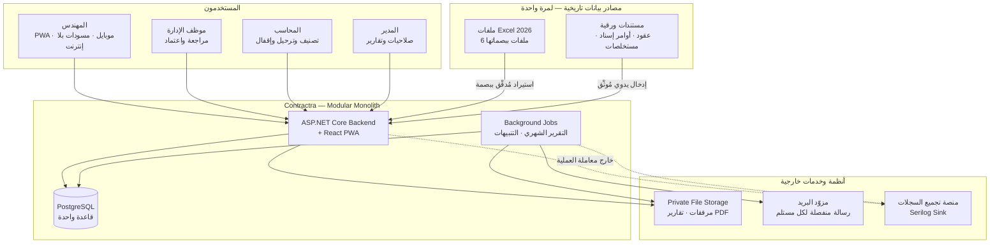

**الشرح:** النظام **صندوق واحد** (Modular Monolith) على **قاعدة بيانات واحدة**. المستخدمون الأربعة يصلون عبر واجهة واحدة تتكيّف مع الدور. وثلاث خدمات خارجية فقط: تخزين خاص للملفات · مزوّد بريد · منصة سجلات. **والفارق الحاسم في اتجاه الأسهم:** السهم إلى منصة السجلات **منقّط** لأن فشله لا يمس أي معاملة مالية (BR-194)، بينما كل ما يكتب في قاعدة البيانات داخل المعاملة نفسها (BR-186). وملفات Excel والمستندات الورقية **مصادر لمرة واحدة** لا تكاملات دائمة.

### 8.2 الوحدات داخل الـModular Monolith

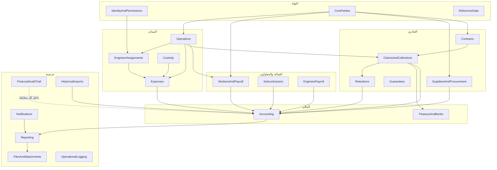

### 8.3 جدول الوحدات — ما تملك وما لا تملك

| الوحدة | تملك | **لا تملك** | تنشر |
|---|---|---|---|
| `IdentityAndPermissions` | المستخدمون · الأدوار · الصلاحيات الدقيقة | الأطراف التجارية | أحداث الدخول وتغيّر الصلاحيات |
| `CoreParties` | الأطراف · أدوارهم · أسماؤهم البديلة · معرّفاتهم · حساباتهم | **الأرصدة المحاسبية** | إنشاء طرف · مرشح تشابه |
| `ReferenceData` | تصنيفات المصروف · أنواع الاستقطاع · وحدات القياس · جهات الإسناد | المعاملات | تعطيل بيان مرجعي |
| `Operations` | العمليات · المواقع · أوامر الإسناد · المقايسات · التواريخ ودورة الحياة | **المستخلصات** | تغيّر حالة العملية |
| `EngineerAssignments` | تكليفات المهندسين بالمواقع | **المصروفات** | بدء/إنهاء تكليف |
| `Custody` | دفتر حركات العهدة بأنواعه الأربعة | **المصروفات نفسها** | تغيّر رصيد العهدة |
| `Expenses` | المصروفات ومسوداتها ودورة المراجعة والمرفقات | **القيود المحاسبية** | اعتماد مصروف |
| `WorkersAndPayroll` | موارد التكلفة · سياسات الأجر · الحضور · الكشوف · السلف · المدفوعات | **تسويات المقاولين** | اعتماد كشف · دفعة عامل |
| `EngineerPayroll` | رواتب المهندسين · قواعد التوزيع المُصدَّرة | يوميات العمالة | اعتماد راتب |
| `Subcontractors` | اتفاقات المقاولين · كشوف التسوية · خصوماتها · تعلياتها | **كشوف الأجور** | اعتماد تسوية |
| `Contracts` | عقود الشركات الخارجية · اتفاقات العمليات وإصداراتها · جداول الغرامات · الإنذارات | **الحركات المالية** | تفعيل اتفاق · إصدار جديد |
| `ClaimsAndCollections` | المستخلصات ومساراتها · سطور الاستقطاع · الفواتير الإلكترونية · أوامر الدفع · التحصيلات | **العهدة** | إصدار مستخلص · تحصيل |
| `Retentions` | دفتر المحتجزات وحركاته وشروط الرد | **الاستقطاعات نفسها** | استحقاق رد · رد |
| `Guarantees` | الضمانات بالاتجاهين · رسومها · أحداثها · تنبيهاتها | **الشيكات التجارية** | اقتراب انتهاء · رد |
| `SuppliersAndProcurement` | الموردون · التوريدات · الفواتير · الدفعات وتخصيصها · الشيكات | **الأجور** | فاتورة · دفعة |
| `TreasuryAndBanks` | الحسابات المالية · حركات النقد · المطابقة البنكية | **التصنيفات** | حركة نقدية |
| `Accounting` | دليل الحسابات · الفترات · القيود · قواعد الترحيل · مراكز التكلفة | **المعاملات المصدرية** | ترحيل قيد · إقفال فترة |
| `Reporting` | التقارير والـSnapshots والإصدارات وسجل الإرسال | **أي مبلغ** — يقرأ ولا يعرّف | إصدار تقرير · نتيجة إرسال |
| `FilesAndAttachments` | مراجع الملفات وبصماتها وأحجامها وميتاداتاها | **محتوى الملف داخل القاعدة** | رفع ملف |
| `FinancialAuditTrail` | أحداث التدقيق وفروق الحقول وروابطها وسياسات الاحتفاظ | **الأرصدة والمجاميع** · **السجلات التشغيلية** | **لا تنشر — تُكتب داخل معاملة العملية** |
| `OperationalLogging` | Serilog: الطلبات · الأخطاء · الأداء · المهام الخلفية | **أي إثبات مالي** | تُرسَل خارج المعاملة |
| `Notifications` | التنبيهات وقواعدها وقنواتها | — | إرسال تنبيه |
| `HistoricalImports` | دفعات الاستيراد · الصفوف · الخرائط · المطابقة · النسب | **الإنتاج** | نتيجة استيراد |

### 8.4 قواعد حدود الوحدات

| # | القاعدة | المرجع |
|---|---|---|
| 1 | **لا تقرأ وحدة جداول وحدة أخرى مباشرة** — التواصل عبر واجهات وأحداث | BR-157 |
| 2 | يجوز فرض الحدود بـ**PostgreSQL schemas** — **قرار التصميم الفيزيائي** ولا يغيّر النموذج المنطقي | BR-157 |
| 3 | **بوابة واحدة لكل نوع تكلفة** تصبّ في `journal_entries` | **BR-105** |
| 4 | **كاتب واحد لكل مبلغ** — جدول مالك واحد، والباقي Views | **BR-101** |
| 5 | **`FinancialAuditTrail` لا تنشر أحداثًا** ولا تُستدعى من طابور خارجي | BR-186 |

### 8.5 التسلسل الهرمي للكيانات — Company → Operation → Site

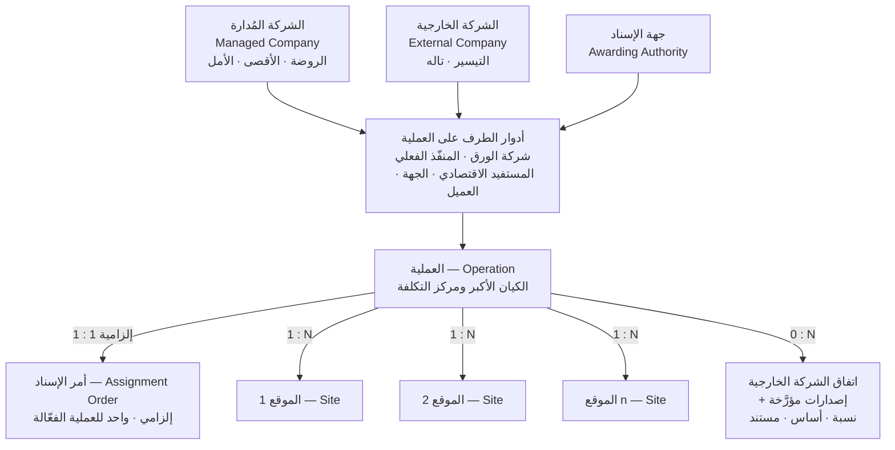

**الشرح النصي والـCardinality:**

| العلاقة | النوع | القيد |
|---|---|---|
| Managed Company → Operation | **1 : N** | الشركة تملك عمليات · والعملية لها شركة ورق واحدة في لحظة |
| Operation → Assignment Order | **1 : 1 إلزامية** | **لا عملية فعّالة بلا أمر إسناد** (BR-197) |
| Operation → Site | **1 : N** (N ≥ 1) | العملية تحتوي موقعًا واحدًا أو أكثر (BR-198) |
| Site → Operation | **N : 1 إلزامية** | **الموقع يتبع عملية واحدة** — و**ليس كيانًا أعلى منها** (BR-196 · BR-198) |
| Operation → Party (roles) | **N : M مؤرَّخة** | **طرف واحد يجوز له أكثر من دور على العملية نفسها** |
| Operation → External Agreement | **1 : N** | اتفاق لكل شركة خارجية · بإصدارات مؤرَّخة (BR-004 · BR-170) |

> ⛔ **تصحيح ملزم مثبَّت:** كان بعض التوثيق يعامل **الموقع** كأنه كيان مستقل تتفرع منه العمليات. **هذا خطأ مُلغى** — والصحيح أن **العملية هي الكيان الأكبر والمواقع داخلها** (BR-196). وتكرار **اسم** الموقع عبر أوامر إسناد مختلفة (12 اسمًا مكررًا من 116) **لا يعني أن الموقع أعلى** — بل أن **الاسم ليس مفتاحًا**.

---

## 9. قواعد العمل

> **هذا القسم هو السجل المرجعي الحاكم داخل هذه الوثيقة.** ونصوص القواعد الكاملة بأدلتها ومصادرها الحرفية في `confirmed-business-rules-ar.md`. **وعند أي اختلاف بين الصياغة هنا والصياغة هناك، المصدر هو الحاكم** (§1.6).
>
> **BR-XXX ≡ ح-XXX** — تطابق رقمي تام (§1.9).

### 9.1 الشركات والاتفاقات — BR-001 … BR-014

| ID | القاعدة | الحالة |
|---|---|---|
| **BR-001** | الشركات المُدارة محاسبيًا: **الروضة · الأقصى · الأمل** | 🟢 |
| **BR-002** | **التيسير · تاله** وأي شركة لا نملكها = **شركة خارجية**، ولو دخلنا العملية بأوراقها | 🟢 |
| **BR-003** | عملية باسم إحدى شركاتنا وتنفذها ⟹ **كامل الربح لنا**، ونسبة الشركة الخارجية = **صفر** (لا NULL) | 🟢 |
| **BR-004** | عملية باسم شركة خارجية ⟹ **نسخة اتفاق مؤرَّخة قبل بداية العملية** تشمل النسبة وأساسها وطريقة التسوية | 🟢 |
| **BR-005** | النسبة **ليست ثابتة ولا تُثبَّت في الكود** · المرصود في عقد التيسير = **10%** | 🟢 |
| **BR-006** | يُفصَل: **الشركة الرسمية · المنفِّذة فعليًا · المستفيدة اقتصاديًا · جهة الإسناد · العميل** | 🟢 |
| **BR-007** | تعديل الاتفاق لاحقًا **لا يغيّر** أوامر الدفع والتسويات السابقة — **إصدار جديد بسريان** | 🟢 |
| **BR-008** | **Snapshot سباعي** في كل تسوية أو أمر دفع: نسخة الاتفاق · الأساس · النسبة · المبلغ المطبَّق عليه · قيمة النسبة · الصافي لنا · طريقة التسوية | 🟢 |
| **BR-009** | أسس الاحتساب المدعومة: إجمالي المستخلص · صافي المستخلص · قيمة أمر الدفع · قيمة التحصيل الفعلي · أساس مخصص | 🟢 |
| **BR-010** | يُفصَل صراحةً بين **القاعدة المكتوبة في العقد** و**المطبَّقة فعليًا** و**الاستثناء المعتمد** و**مَن اعتمده** و**المستند المؤيد** | 🟢 |
| **BR-011** | النسبة تُسجَّل **مصروف عملية** بطريقة تسوية: `خصم مباشر` أو `مستحق ثم دفعة` | 🟢 |
| **BR-012** | اتجاهان بنفس البنية: طرف صاحب ورق خارجي · طرف ينفّذ باسمنا | 🟢 |
| **BR-013** | الدفع للمقاول مشروط بتحصيل الشركة الخارجية من الجهاز (**Back-to-back**) — **ويُفصَل** تاريخ الاعتراف المحاسبي عن تاريخ حلول الدفع | 🟢 |
| **BR-014** | تأخر تحصيل الشركة الخارجية **لا يؤجل** إثبات الإيراد أو التكلفة محاسبيًا | 🟢 |

### 9.2 المهندسون والمواقع — BR-015 … BR-023

| ID | القاعدة | الحالة |
|---|---|---|
| **BR-015** | `اسم الموقع` **إلزامي عند إنشاء المصروف**، من قائمة | 🟢 |
| **BR-016** | المهندس يرى **فقط** المواقع ذات تكليف فعّال | 🟢 |
| **BR-017** | **الأدمن وحده** يحدد عدد وأسماء المواقع لكل مهندس | 🟢 |
| **BR-018** | القيد يُطبَّق في **Backend وقاعدة البيانات**، لا في الواجهة فقط | 🟢 |
| **BR-019** | عند مزامنة Offline يعيد الخادم **التحقق من التكليف** · والتكليف المنتهي ⟹ المسودة تبقى ولا تُعتمد | 🟢 |
| **BR-020** | التكليفات التاريخية **لا تُحذف** — تُغلق بتاريخ نهاية | 🟢 |
| **BR-021** | القيد نفسه يسري على **اليوميات والسلف وكل حركة ميدانية** | 🟢 |
| **BR-022** | يجوز: مهندس ↔ عدة مواقع · موقع ↔ عدة مهندسين | 🟢 |
| **BR-023** | التحقق يستخدم **تاريخ الحركة** لا تاريخ الإرسال | 🔵 استنتاج تصميمي — مؤكَّد لاحقًا بـBR-137 |

### 9.3 العهدة — BR-024 … BR-029

| ID | القاعدة | الحالة |
|---|---|---|
| **BR-024** | العهدة مرتبطة بـ**المهندس والشركة المُدارة**، وتُوزَّع مصروفاتها على **عدة مواقع** | 🟢 |
| **BR-025** | **الإدارة** تسجل تسليم العهدة (كاش · تحويل · InstaPay) · و**المهندس لا يؤكد الاستلام ولا يضيف عهدة لنفسه** | 🟢 |
| **BR-026** | `موقف العهدة = الافتتاحي + العهد المسلَّمة − المصروفات المعتمدة − المرتجع ± التصحيحات` | 🟢 |
| **BR-027** | **موجب** = متبقٍ مع المهندس · **سالب** = الشركة مدينة له · **ولا يُعرض رقم بلا وصف** | 🟢 |
| **BR-028** | الرصيد **يُحتسب من دفتر الحركات ولا يُخزَّن رقمًا قابلًا للتعديل** | 🟢 |
| **BR-029** | إشارة Excel **معكوسة** ⟹ **يُوثَّق تحويل الإشارة عند الاستيراد ولا تُنسخ عمياء** | 🟢 📊 |

### 9.4 اللوادر والحسابات التجميعية — BR-030 … BR-033

| ID | القاعدة | الحالة |
|---|---|---|
| **BR-030** | أسماء اللوادر = **حسابات تكلفة تجميعية** | 🟢 |
| **BR-031** | **يُمنع** تحويلها تلقائيًا إلى: عامل · مهندس · مستخدم · حساب عهدة · أصل معدات | 🟢 |
| **BR-032** | الحساب التجميعي يُربط بالموقع والعملية ومركز التكلفة · **وربطه بأصل معدات لاحقًا بقرار الإدارة** | 🟢 |
| **BR-033** | ينطبق التصنيف نفسه على: `شقة م/ عز` · `شقة حمدان` · `شقة الصعايدة` · `شقة عوض` · `شقة عمال سعد` · `الغفر` · `سيارة زايد 2/4و5/6` · `جرار حسين جادور` | 🟢 📊 |

### 9.5 الأجور واليوميات — BR-034 … BR-045

| ID | القاعدة | الحالة |
|---|---|---|
| **BR-034** | `إجمالي اليوميات = فئة × العدد` · `إجمالي السهرات = فئة السهرة × العدد` | 🟢 📊 |
| **BR-035** | `إحمالي المستحق = إجمالي اليوميات + إجمالي السهرات + انتقالات وتليفون + مكافآت` | 🟢 📊 |
| **BR-036** | `اجمالى الاستقطاعات = السلف الحالية + الحالى من سلف مستديمة + خصومات` | 🟢 📊 |
| **BR-037** | `الصافي المستحق = إحمالي المستحق − اجمالى الاستقطاعات − تم القبض` | 🟢 📊 |
| **BR-038** | `الباقى من سلف مستديمة = الاجمالى − (المخصوم سابقًا + الحالى)` | 🟢 📊 |
| **BR-039** | ⛔ **ممنوع تثبيت قاعدة واحدة للسهرات.** المرصود: ÷7 (549) · ÷2 (129) · يدوي (26) · أخرى (1) | 🟢 📊 |
| **BR-040** | القاعدة **خاصية للمورد نفسه لا لنوعه** | 🟢 📊 |
| **BR-041** | **سياسة أجر مؤرَّخة** لكل عامل/مجموعة داخل الموقع، يحددها الأدمن أو موظف الأجور | 🟢 |
| **BR-042** | المهندس يسجّل **العدد فقط** · والنظام يحسب الفئة والإجمالي · والتعديل اليدوي يحتاج **صلاحية وسببًا وSnapshot** | 🟢 |
| **BR-043** | `العدد` وحدته تختلف: أيام (341) · مقطوع=1 (104) · عامل-يوم>40 (81) · نسبة إنجاز≤1 (20) · أخرى (144) ⟹ **حقل `وحدة العدد` إلزامي** | 🟢 📊 |
| **BR-044** | **15 موردًا** لهم أكثر من فئة يومية خلال 2026 ⟹ **`valid_from`/`valid_to` إلزامي** | 🟢 📊 |
| **BR-045** | **تكلفة الأجور على العملية = `إحمالي المستحق − خصومات`** — **أساس استحقاق** | 🟢 📊 |

### 9.6 منع الخصم المزدوج — BR-046 … BR-052

| ID | القاعدة | الحالة |
|---|---|---|
| **BR-046** | اليومية والسهرات **بيانات تشغيلية** — لا تخفض الخزينة ولا العهدة بمجرد تسجيلها | 🟢 |
| **BR-047** | عند اعتماد كشف الأجر يُثبت **مصروف الأجر ومستحق العامل** — **بلا حركة نقدية** | 🟢 |
| **BR-048** | السلفة **حركة دفع فعلية** تخفض الخزينة/العهدة **مرة واحدة** وتُثبت سلفة على العامل | 🟢 |
| **BR-049** | عند اعتماد الكشف تُخصم السلفة من المستحق **بلا خفض نقدي ثانٍ** | 🟢 📊 |
| **BR-050** | `تم القبض` **يرتبط بدفعة فعلية معتمدة** ولا يكون رقمًا حرًا | 🟢 |
| **BR-051** | **الاستحقاقات وحدها** تدخل تكلفة العملية · والأعباء والمدفوعات **لا تدخلها إطلاقًا** | 🔵 تصميم لمنع الازدواج |
| **BR-052** | مورد نوعه `مقاول` **يُمنع** أن يجمع سطر كشف أجور واستحقاق تسوية **في الفترة نفسها** | 🔵 تصميم |

### 9.7 الأطراف — BR-053 … BR-059

| ID | القاعدة | الحالة |
|---|---|---|
| **BR-053** | ⛔ **لا اسم طرف نصي حر في أي جدول معاملات** — `party_id` فقط | 🔵 تصميم |
| **BR-054** | النموذج الداخلي: `parties` · `party_roles` · `party_aliases` · `party_accounts` · `party_identifiers` · `managed_company_links` · `operation_party_roles` | 🟢 |
| **BR-055** | **الواجهة تعرض شاشات مألوفة** (المهندسون · العمال · المقاولون · الموردون · المدينون · الشركات) — **ولا تُجبر المستخدم على مصطلح Party** | 🟢 |
| **BR-056** | يُفصَل بين: فرد · مجموعة عمال · مهندس/مشرف · مقاول/رئيس مجموعة · حساب سيارة أو جرار أو سكن · حساب تكلفة تجميعي | 🟢 |
| **BR-057** | الطرف المستفيد داخل مورد التكلفة **اختياري** | 🟢 |
| **BR-058** | الأسماء التاريخية غير المحسومة تُستورد بحالة **`يحتاج تصنيفًا`** برصيد موثَّق المصدر، **يراجعها المحاسب لا المهندس** | 🟢 |
| **BR-059** | **تطبيع الأسماء إلزامي** (مسافات · همزات · `ى/ي` · `ة/ه`) **مع حفظ الأصل في `aliases`** | 🟢 📊 |

### 9.8 المستخلصات والاستقطاعات — BR-060 … BR-073

| ID | القاعدة | الحالة |
|---|---|---|
| **BR-060** | المستخلص له **ثلاثة مسارات تراكمية متوازية**: الأعمال · الفروق · التشوينات | 🟢 |
| **BR-061** | `حركة المدة = التراكمي − التراكمي السابق` لكل مسار | 🟢 📊 |
| **BR-062** | **التشوينات غير مستخدمة** — يبقى المسار **معطَّلًا** في النموذج | 🟢 |
| **BR-063** | «ختامى» **صفة على المستخلص** ضمن التسلسل نفسه، **لا سلسلة ترقيم ثانية** | 🟢 📊 |
| **BR-064** | `5% ضمان اعمال` **يُخصم من كل مستخلص ويُسترد مع التسليم النهائي** | 🟢 |
| **BR-065** | `تعلية` = **حجز مشروط** لباقي المستحقات · الشرط يُكتب نصًا · وتُرد عند تحققه | 🟢 |
| **BR-066** | أسباب تعلية مرصودة: سداد التأمينات والقوى العاملة · تلافي الملاحظات واستكمال الترقيمات · غرامة تأخير معلّاة | 🟢 📊 |
| **BR-067** | `أساس الاحتساب` **خاصية للجهة/العقد لا ثابت عام** | 🟢 📊 |
| **BR-068** | أسس مرصودة: الإجمالي شامل الضريبة · القيمة بدون الضريبة · مبلغ الضريبة · مبلغ ثابت · نسبة من استقطاع آخر · تقديري بقرار الجهة | 🟢 📊 |
| **BR-069** | `صافي المستخلص` **يمكن أن يكون سالبًا** ⟹ يُرحَّل أو يُنشئ مديونية، **ولا يُرفض** | 🟢 📊 |
| **BR-070** | `خصم عميل` **حقل تاريخي متعدد المعاني** — **لا يُفترض أن كل قيمه غرامات** | 🟢 **تصحيح ملزم** |
| **BR-071** | جدول غرامات مسعَّر تعاقديًا: جرار **600**/يوم · ماكينة قص **400**/يوم · عامل زراعي **150**/يوم · سيارة مخلفات **400**/نقلة — «قيمة جبرية غير قابلة للتفاوض» | 🟢 |
| **BR-072** | كل خصم/تعلية يحمل: **السبب النصي · الكمية · الفئة · المهندس المسؤول · مستوى الاعتماد** | 🟢 |
| **BR-073** | **كل خصومات الجهاز تُمرَّر إلينا بالكامل** (pass-through) | 🟢 |

### 9.9 المقايسة وبنودها — BR-074 … BR-077

| ID | القاعدة | الحالة |
|---|---|---|
| **BR-074** | المقايسة طبقة تحت المستخلص: `البند · الوحدة · الكمية · الفئة · الإجمالي` | 🟢 |
| **BR-075** | البنود نوعان: **شهري متكرر** و**لمرة واحدة** | 🟢 📊 |
| **BR-076** | **القيد `التراكمي ≤ كمية المقايسة` يسري على البند الذي يُنفَّذ مرة واحدة فقط** | 🟢 **تصحيح ملزم** |
| **BR-077** | البند المتكرر يحتاج: طريقة التسعير · دورية الاحتساب · كمية الفترة · عدد الفترات · **الكمية التعاقدية القصوى** · بداية ونهاية السريان | 🟢 |

### 9.10 أوامر الدفع والتحصيل — BR-078 … BR-088

| ID | القاعدة | الحالة |
|---|---|---|
| **BR-078** | أمر الدفع **مستند مستقل بقيمة صريحة** | 🟢 |
| **BR-079** | **`قيمة أمر الدفع = صافي المستخلص` ليست قاعدة عامة** — مثبتة للعينة المفحوصة فقط | 🟢 **تصحيح ملزم** |
| **BR-080** | أنواع أوامر الدفع: صرف مستخلص · صرف جزئي · رد تعلية · رد ضمان · تسوية · تصحيح | 🟢 |
| **BR-081** | أمر الدفع قد يرتبط بمستخلص أو فاتورة إلكترونية أو تعلية **أو أكثر من مستند** عبر **سطور توزيع** | 🟢 |
| **BR-082** | **رقم أمر الدفع لا يُفترض فريدًا** عالميًا ولا داخل الجهة **قبل اختبار البيانات** — معرّف داخلي + (الرقم، الجهة، السنة) مفتاح أعمال **يحتاج تحققًا** | 🟢 **تصحيح ملزم** |
| **BR-083** | **الفاتورة الإلكترونية** كيان ثالث بين المستخلص وأمر الدفع، **بقيمة الإجمالي لا الصافي** | 🟢 📊 |
| **BR-084** | **Payment Waterfall** قابل للتهيئة بترتيب صريح من الإجمالي إلى التحصيل | 🟢 |
| **BR-085** | كل نسبة/استقطاع يملك: **أساس الاحتساب · الترتيب · النسبة أو المبلغ · قاعدة التقريب · تاريخ السريان · نسخة القاعدة المستخدمة** | 🟢 |
| **BR-086** | كل رد تعلية أو ضمان **يُربط بالمبالغ المحتجزة الأصلية** · و**يُمنع تجاوز مجموع المردود للرصيد المحتجز** | 🟢 |
| **BR-087** | يُفصَل: الطرف المستحق · المستفيد البنكي · الحساب البنكي · الشركة المالكة · سبب الاختلاف · التفويض · المستند — **والاختلاف سؤال تدقيق** | 🟢 |
| **BR-088** | Back-to-back يفصل **خمسة تواريخ**: الاعتراف المحاسبي · حلول الدفع · شرط الحلول · تحقق الشرط · التحصيل المحقِّق | 🟢 |

### 9.11 الضمانات — BR-089 … BR-092

| ID | القاعدة | الحالة |
|---|---|---|
| **BR-089** | سجل ضمانات **ثنائي الاتجاه**: مقدَّم منا · مستلَم من طرف | 🟢 |
| **BR-090** | حقوله: النوع (شيك/خطاب/نقدي) · الاتجاه · الرقم · البنك والحساب · المستفيد · القيمة والعملة · الإصدار والانتهاء · التجديد التلقائي · **الهامش/الغطاء** · الرسوم · العملية والعقد · شرط الرد · الحالة · تاريخ الرد أو الإلغاء · المرفقات · التنبيهات | 🟢 |
| **BR-091** | **يُفصَل** بين **أداة الضمان** و**تعليات ضمان الأعمال المتراكمة** — **ضمانان مختلفان بنسبة 5% لكل** | 🟢 |
| **BR-092** | شيك الضمان **400,563 غير مسجَّل** في ورقة `شيكات` — 153 شيكًا كلها صادرة لموردين | 🟢 📊 |

### 9.12 التقريب والدقة — BR-093 … BR-095

| ID | القاعدة | الحالة |
|---|---|---|
| **BR-093** | الأسعار والفئات والنسب بدقة عالية **ولا تُقرَّب** · والمبالغ تُقرَّب **مرة واحدة عند حفظ المعاملة** بقاعدة `half-up` · ⛔ **ولا Float ولا Double** | 🔵 تصميم — والدقة الفيزيائية تُحسم لاحقًا |
| **BR-094** | ⛔ **لا يُعاد تقريب مجموع** · والتوزيعات: **آخر بند يستوعب الفرق** · وحساب `فروق تقريب` كل قرش فيه مُفسَّر | 🔵 تصميم |
| **BR-095** | **26% من قيم المستخلصات (162 من 634) بكسور أكثر من منزلتين** ⟹ القاعدة ضرورية اليوم لا غدًا | 🟢 📊 |

### 9.13 الصيغ التاريخية المركبة — BR-096 · BR-097

| ID | القاعدة | الحالة |
|---|---|---|
| **BR-096** | المبلغ المجمّع هو **القيمة المالية المرحَّلة** · والصيغة **تُحفظ نصًا للتدقيق** · والحدود تُستخرج سطورًا تحليلية `غير مسمى` **لا تُرحَّل ماليًا** | 🟢 |
| **BR-097** | العمليات الجديدة **تمنع الصيغة الحسابية داخل حقل المبلغ** | 🟢 |

### 9.14 الحسابات المالية — BR-098 · BR-099

| ID | القاعدة | الحالة |
|---|---|---|
| **BR-098** | أسماء البنوك في `الوارد` = **حسابات مالية منفصلة**: خزينة نقدية · حساب بنكي · محفظة/InstaPay | 🟢 |
| **BR-099** | الأدمن ينشئ الحسابات ويربطها بالشركة المُدارة · **والمهندس لا يختار حسابًا لا يخصّ حركته** | 🟢 |

### 9.15 ⭐ سبع طبقات منع الازدواج — BR-100 … BR-106

> **هذه الطبقات السبع هي العمود الفقري لسلامة النظام المالي. ولا تُضاف طبقة ثامنة** (BR-224).

| ID | الطبقة | القاعدة |
|---|---|---|
| **BR-100** | **1 — هوية واحدة** | `parties` + `aliases` + `party_identifiers`. ⛔ **لا تفرّد على الاسم المطبَّع** — التفرّد على المعرّف الرسمي عند وجوده، **وما عداه كشف تشابه ينبّه ولا يدمج** |
| **BR-101** | **2 — كاتب واحد لكل مبلغ** | جدول مالك واحد، والباقي Views |
| **BR-102** | **3 — تفرّد طبيعي** | UNIQUE يُفرض **فقط حيث يستحيل أن يخالفه واقع صحيح**. وأي قيد قد يدمج كيانين حقيقيين أو يمنع حركة صحيحة **يُستبدل** بفهرس فريد جزئي أو بكشف تشابه |
| **BR-103** | **4 — Idempotency** | `client_generated_id` + (دفعة، ملف، ورقة، صف) + `source_record_hash`. **وهو — لا تفرّد المصدر — خط الدفاع ضد الترحيل المكرر** |
| **BR-104** | **5 — ترحيل مرة واحدة** | ~~`UNIQUE(source_type, source_id, posting_event, posting_sequence)`~~ — 🟢 ⭐ **الآلية صُحِّحت في v2.0.1 إلى `UNIQUE(journal_entries.financial_event_id)`** · ⭐ **والقاعدة نفسها باقية: المصدر الواحد يولّد عدة آثار مشروعة (استحقاق · دفع · عكس · تسوية · إعادة تصنيف)** — **لكن كل أثر منها حدثٌ ماليّ مستقل بقيده الواحد** (BR-265) |
| **BR-105** | **6 — مسار تكلفة واحد** | **بوابة واحدة لكل نوع تكلفة** · وتعريف **واحد** لتحميل الموقع العام بتاريخ سريان |
| **BR-106** | **7 — كشف التشابه** | **تحذير لا منع** (بصمة تسوية متطابقة · حركة شبه مكررة · صافي سالب) |

### 9.16 دورة حياة العملية — BR-107 … BR-112

| ID | القاعدة | الحالة |
|---|---|---|
| **BR-107** | أربع حالات: `جارية` → `أعمال منتهية` → `فترة ضمان` → `مقفلة ماليًا` | 🔵 تصميم |
| **BR-108** | **الحالة تُصنِّف الإنفاق ولا تمنعه** — لأن المنع يدفع لتحميل المصروف على عملية أخرى | 🔵 تصميم |
| **BR-109** | لا تُقفل العملية ماليًا إلا بـ: **رد كل المحتجزات · تحصيل كل مستحق · تسوية كل طرف** | 🔵 تصميم |
| **BR-110** | أربعة تواريخ + مدد امتداد: بدء المشروع · النهو الأصلي · انتهاء الوثيقة · الامتداد | 🟢 |
| **BR-111** | `النهو المقرر = تاريخ استلام الموقع + مدة التنفيذ` — قابل للحساب | 🟢 📊 |
| **BR-112** | **3 خطابات ملاحظات = حق سحب الأعمال** ⟹ **عدّاد إنذارات لكل عقد** | 🟢 |

### 9.17 قواعد عقد التيسير — BR-113 … BR-130

| ID | القاعدة | الحالة |
|---|---|---|
| **BR-113** | قيمة العقد **8,011,262.40 ج** — وتساوي المقايسة بالضبط | 🟢 |
| **BR-114** | **نسبة الشركة الخارجية 10% «من إجمالي قيمة كل مستخلص»** · والأسعار ثابتة طوال مدة التعاقد | 🟢 |
| **BR-115** | **بند المقايسة قد يكون شهريًا متكررًا** — دليل مستندي على تصحيح BR-076 | 🟢 |
| **BR-116** | مدة التنفيذ **24 شهرًا من استلام الموقع** ⟹ النهو 2027/3/24 | 🟢 |
| **BR-117** | المحاسبة على أساس **المستخلصات الشهرية الصادرة من جهة الإدارة** وفقًا لجداول نسب الأداء الشهري | 🟢 |
| **BR-118** | **Back-to-back صريح**: المحاسبة **بعد صرف مستحقات الشركة من الجهاز** | 🟢 |
| **BR-119** | **تعلية 5% ضمان أعمال من «إجمالي أعمال كل مستخلص»** — ولا تُصرف إلا عقب تسليم الأعمال | 🟢 |
| **BR-120** | **تمرير الخصومات**: استنزال **كافة الخصومات المقررة على الشركة من قبل الجهاز** من مستحقات المقاول | 🟢 |
| **BR-121** | **جدول غرامات مسعَّر غير قابل للتفاوض** عند غياب المعدة أو العامل | 🟢 |
| **BR-122** | القيمة التعاقدية **تشمل** الأجور ومصاريف العمال وإقامتهم وسفرهم والتأمين عليهم | 🟢 |
| **BR-123** | **المزروعات في عهدة المقاول** طوال مدة التعاقد | 🟢 |
| **BR-124** | **ثلاثة خطابات ملاحظات = حق إلغاء العقد وسحب الأعمال** + حق التشغيل خصمًا من مستحقات المقاول · **ولا يُسترد أي مبلغ إلا بعد التسليم النهائي للجهاز** | 🟢 |
| **BR-125** | **شرط رد المحتجز حدثٌ تعاقدي لا تاريخ** — والتاريخ المسجَّل في الدليل **تقدير** له | 🟢 |
| **BR-126** | إيقاف الأعمال المسندة للشركة ⟹ **حق الشركة في إلغاء العقد دون تعويض للمقاول** | 🟢 |
| **BR-127** | **يُمنع على المقاول الإسناد من الباطن** كليًا أو جزئيًا ⟹ **النظام يرفع تنبيهًا** عند رصد مخالفة | 🟢 |
| **BR-128** | **ضمان بشيك لا بخطاب ضمان**: شيك **400,563 ج** = 5% من قيمة الأعمال ⟹ `instrument_type` يميّز **شيك ضمان** عن **خطاب ضمان بنكي** | 🟢 |
| **BR-129** | تسري أحكام **اللائحة التنفيذية للجهة المالكة** على العملية | 🟢 |
| **BR-130** | **العقد لا يتضمن بند اختصاص قضائي ولا تحكيم**، و**البند الرابع عشر مفقود** ⟹ **عيب توثيقي يحتاج مراجعة قانونية — ولا يُفترض بند غائب** | 🟢 |

### 9.18 مصروفات المهندس — BR-131 … BR-139

| ID | القاعدة | الحالة |
|---|---|---|
| **BR-131** | **الأدمن وحده** يربط المهندس بالمواقع — لا المهندس ولا المراجع | 🟢 |
| **BR-132** | المهندس يرى **المواقع ذات التكليف الفعّال فقط بتاريخ الحركة** | 🟢 |
| **BR-133** | **الموقع إلزامي عند الإدخال** — لا مسودة بلا موقع | 🟢 |
| **BR-134** | ⛔ ~~`operation_id` أو أمر الإسناد اختياري في المسودة الميدانية~~ — **مُلغاة في 1.1.3.** انظر BR-196…BR-199. **والرقم محجوز ولا يُعاد استخدامه** | ⛔ **Superseded** |
| **BR-135** | العملية/مركز التكلفة **إلزامي من لحظة الإدخال** — لا قبل الاعتماد فقط | 🟢 |
| **BR-136** | المراجع **يستطيع** تغيير العملية أو الموقع **قبل الاعتماد** مع سجل تدقيق — و**هذا استثناء لا قاعدة أساسية** | 🟢 |
| **BR-137** | **الـBackend يعيد التحقق عند المزامنة باستخدام تاريخ الحركة** لا تاريخ الإرسال | 🟢 |
| **BR-138** | ⛔ **لا يُعتمد على واجهة المستخدم وحدها** | 🟢 |
| **BR-139** | التحقق **عابر للجداول ولا يُنفَّذ كـ`CHECK` عادي** — الآلية: خدمة داخل معاملة واحدة + شبكة أمان في قاعدة البيانات | 🔵 **الآلية تُحسم في التصميم الفيزيائي** |

### 9.19 أنواع حركة العهدة — BR-140 … BR-143

| ID | القاعدة | الحالة |
|---|---|---|
| **BR-140** | **`custody_disbursement`** — تسليم من الإدارة إلى المهندس · **لا يحتاج تأكيد المهندس**، يكفي معتمِد الصرف | 🟢 **تصحيح ملزم** |
| **BR-141** | **`custody_transfer`** — تحويل بين مهندسين · **يجوز اشتراط قبول الطرفين** (`requires_dual_acceptance`) مع `معلَّق` و`متنازع عليه` | 🟢 |
| **BR-142** | **`custody_return`** — مرتجع إلى الخزينة **بمستند إيداع** | 🟢 |
| **BR-143** | **`custody_adjustment` / `custody_reversal`** — تصحيح موثَّق يشير إلى الأصل بسبب ومعتمِد، **ولا يعدّل الحركة الأصلية** | 🟢 |

### 9.20 الاستقطاعات — الفصل الثلاثي — BR-144 … BR-147

| ID | القاعدة | الحالة |
|---|---|---|
| **BR-144** | **`deduction_types`** تحمل **الهوية والتصنيف فقط** — **بلا نسب ولا أسس ولا ترتيب** | 🟢 |
| **BR-145** | **`deduction_rule_versions`** تحمل القاعدة المؤرَّخة بنطاقها — **بفترات غير متداخلة داخل النطاق** | 🟢 |
| **BR-146** | **`claim_deduction_lines`** تحمل **Snapshot للقاعدة المطبَّقة فعلًا** — **وتغيير القاعدة لاحقًا لا يمسّ سطرًا مرحَّلًا** | 🟢 |
| **BR-147** | ⛔ **تُلغى الرموز أ/ب/ج/د/هـ** وتحل محلها **الأسماء الستة الصريحة** · **ولا يُستخدم رمز غير معرَّف** | 🟢 |

### 9.21 الافتراضات المحاسبية — BR-148 … BR-150

| ID | القاعدة | الحالة |
|---|---|---|
| **BR-148** | `اتساع` (320 ج) و`شيك وموارد` (69 ج) ⟹ **`UNCLASSIFIED_SUSPENSE`** · **صِغَر المبلغ ليس مبررًا لتصنيف محاسبي** | 🟢 **تصحيح** |
| **BR-149** | كل معالجة تخص **الإيراد أو الضرائب أو المحتجزات أو المصروفات القابلة للاسترداد** تُوسَم **`يحتاج اعتماد المحاسب`** | 🟢 |
| **BR-150** | **المبلغ المستحق الرد من المحتجزات دالة في تاريخ الاستعلام** — **ولا يُنشر رقم «مستحق» بلا تاريخ استعلام مرفق** | 🟢 📊 |

### 9.22 الترحيل والبصمات — BR-151 … BR-155

| ID | القاعدة | الحالة |
|---|---|---|
| **BR-151** | **SHA-256 هي البصمة الأساسية** · وMD5 اختياري للتوافق | 🟢 |
| **BR-152** | البصمة تُخزَّن **مرة واحدة في `import_batches`** · و**يُمنع تكرار `file_md5` في الجداول التشغيلية** | 🟢 |
| **BR-153** | `import_rows` تحمل: `source_sheet` · `source_row` · `source_record_hash` · `mapping_version` | 🟢 |
| **BR-154** | كل سجل تشغيلي مُستورد يرتبط بـ**`source_import_row_id`** أو بجدول Lineage عام | 🟢 |
| **BR-155** | ⛔ **لا تُعتمد نتائج ملف لم تُحفظ بصمته ولم يُتحقق من وجوده** | 🟢 |

### 9.23 قرارات قاعدة البيانات — BR-156 … BR-160

| ID | القاعدة | الحالة |
|---|---|---|
| **BR-156** | **PostgreSQL واحدة لكل النظام** — لا قاعدة لكل شركة | 🟢 |
| **BR-157** | **Modular Monolith** بفصل **منطقي** · ويجوز استخدام **PostgreSQL schemas** لفرض الحدود | 🟢 |
| **BR-158** | **`managed_company_id`** على المستندات والحسابات التي تحتاج نطاق شركة — **لا على كل جدول** | 🟢 |
| **BR-159** | الشركات الخارجية **`parties`** — **لا Tenants ولا Multi-tenancy** | 🟢 |
| **BR-160** | «شركاتنا» تُمثَّل بـ**علاقة ملكية/إدارة مؤرَّخة** على `parties`، **لا بجدول هوية منفصل** | 🟢 |

### 9.24 قيود صُحِّحت — BR-161 … BR-169

| ID | القيد الخاطئ | التصحيح |
|---|---|---|
| **BR-161** | `journal_entries UNIQUE(source_type, source_id)` | 🟢 ⭐ **`UNIQUE(financial_event_id)`** — **حُسم نهائيًا في v2.0.1** ⛔ **و`posting_event`/`posting_sequence` أُلغيا** |
| **BR-162** | `attendance Unique(مورد، موقع، تاريخ)` | `+ وردية + رقم سطر` **ثم صُحِّح مرة أخرى في BR-176** |
| **BR-163** | `claims Unique(عملية، رقم المستخلص، نوع الوعاء)` | `Unique(عقد/أمر إسناد، سلسلة، رقم المستخلص)` + **ختامي واحد لكل سلسلة** |
| **BR-164** | `e_invoices` 1:1 مع المستخلص | كيان مستقل + **`e_invoice_allocations` M:N** بمبلغ لكل تخصيص |
| **BR-165** | `collections`: مجموع التحصيلات ≤ الصافي | تحصيل مستقل + تخصيصات · دعم **`unapplied`** و**الزيادة** و**تسويات التحصيل** |
| **BR-166** | تاريخ رد المحتجز = `final_delivery_date` | **`release_condition_version`** بنوع الشرط وحدثه المحقِّق وتاريخه |
| **BR-167** | `pay_rate_versions` تحمل «صيغة» | **`calculation_method` + `parameters` + Snapshot** — ⛔ **لا تُخزَّن صيغة حرة ولا تُنفَّذ** |
| **BR-168** | `parties.normalized_name` فريد · `party_aliases.alias` فريد عالميًا | **أُلغي القيدان** — التفرّد على `party_identifiers`، وما عداه كشف تشابه |
| **BR-169** | أ-2 = حقل واحد على المصروف | **دورة كاملة بستة كيانات** |

### 9.25 قواعد الإصدار 1.1.1 — BR-170 … BR-181

| ID | القاعدة | الحالة |
|---|---|---|
| **BR-170** | ⭐ **لا تُعمَّم نسبة ولا أساس شركة خارجية على أي اتفاق آخر.** كل إصدار اتفاق يحمل `rate` و`basis` ومستندَه **مسجَّلة قبل بدء العملية** · و**اتفاق بلا أيٍّ منها لا يصبح `Active` ولا ينشئ تسوية مالية** · **ولا قيمة افتراضية ولا وراثة** | 🟢 |
| **BR-171** | **27,474,600.07 لا يُوصف بأنه «رصيد محتجزات قائم مؤكد»** — اسمه الملزم: «إجمالي المبالغ التاريخية المسجَّلة في عمودي `5% ضمان اعمال` و`استكمال تأمين نهائى`» | 🟢 |
| **BR-172** | **4,792,152.37 يُوصف بأنه «مبلغ محتمل مستحق المتابعة بتاريخ الاستعلام، بافتراض عدم وجود ردود غير مسجَّلة»** · ⛔ **ولا يُقال «ولا أحد يطالب بها» بلا دليل** | 🟢 |
| **BR-173** | ⭐ **سلّم المعالجة المحاسبية ثلاثي** — والـ**Snapshot هو الحاكم بعد الاعتماد** · ودخول `retention_register` يُقرَّر من الـSnapshot لا من النوع | 🟢 |
| **BR-174** | `payroll_periods` لا يكون `Unique(site, year, month)` فقط — **والصيغة النهائية تُحسم في النموذج المنطقي** | 🟢 → **حُسم في §17.8** |
| **BR-175** | `payroll_lines` **لا قيد تفرّد على (فترة، مورد)** — البديل: معرّف داخلي + Idempotency + **كشف تكرار ينبّه ولا يمنع** | 🟢 |
| **BR-176** | `attendance_entries` **لا تستخدم `line_number` لمنع التكرار** — **رقم العرض ليس هوية** | 🟢 **يصحّح BR-162** |
| **BR-177** | `party_identifiers` **لا تفرّد عالمي** — التفرّد **داخل نطاق المعرّف الصحيح** | 🟢 → **حُسم في §17.2** |
| **BR-178** | ⛔ **تُحذف عبارة «التراكمي لا ينقص»** — البديل: **المستخلص المعتمد لا يُعدَّل مباشرة؛ التصحيح بمستند `adjustment`/`reversal` مستقل** | 🟢 |
| **BR-179** | `overhead_allocation_rule` **مؤرَّخ ومنسوخ بنطاق** — **قاعدة فعّالة واحدة داخل النطاق نفسه**، لا تعريف واحد عالميًا | 🟢 |
| **BR-180** | ⛔ **التحقق العابر للجداول لا يُنفَّذ كـ`CHECK`** — الصياغة المعتمدة: **Backend transactional validation + database safety mechanism determined in physical design** | 🟢 |
| **BR-181** | ⭐ **سياسة `LEGACY` معتمدة** بستة بنود · **ولا يُخترع رقم مستخلص تجاري** · والسجلات `LEGACY` **تُستثنى من تحقق التسلسل لا من المطابقة المالية** | 🟢 |

### 9.26 التدقيق المالي والتسجيل التشغيلي — BR-182 … BR-195

| ID | القاعدة | الحالة |
|---|---|---|
| **BR-182** | ⭐ **ثلاثة أنظمة منفصلة إلزاميًا**: تدقيق مالي · تسجيل تشغيلي · دفاتر وقيود | 🟢 |
| **BR-183** | ⛔ **Serilog ليس نظام تدقيق** — ويُمنع الاستدلال بغيابه أو وجوده على وقوع حركة مالية | 🟢 |
| **BR-184** | ⛔ **سجل التدقيق ليس بديلًا عن الدفاتر** — **لا يُحسب منه رصيد ولا مجموع** | 🟢 |
| **BR-185** | **مستويان إلزاميان معًا**: تدقيق عام لتغيّر البيانات + **أحداث أعمال صريحة** · **ولا يُعتمد على الاعتراض العام وحده** | 🟢 |
| **BR-186** | ⭐ **الذرّية**: حدث التدقيق **داخل نفس معاملة قاعدة البيانات** · و**فشل كتابته يُفشل العملية المالية ويحدث Rollback** · ⛔ **ولا يُكتب في طابور خارجي ولا ملف ولا خدمة خارجية** | 🟢 |
| **BR-187** | ⭐ **Append Only** — لا تعديل ولا حذف · **ولا لأدمن** · والواجهة للقراءة فقط · **ويُمنع استخدامه طريقًا لإخفاء تعديل مباشر** | 🟢 |
| **BR-188** | **Idempotency Key للمزامنة والاستيراد** — وتكراره **لا يُنشئ معاملة ولا حدث تدقيق مكررًا** | 🟢 |
| **BR-189** | **محتوى حدث التدقيق — قائمة مفاهيمية لا أعمدة** | 🟢 |
| **BR-190** | **الاحتفاظ والأرشفة بسياسة معتمدة** · والأرشفة **نقل لا إتلاف** | 🟢 |
| **BR-191** | ⛔ **ممنوعات التسجيل**: كلمات المرور · الرموز · الأسرار · سلاسل الاتصال · **بيانات الحسابات البنكية كاملة** · **محتويات المرفقات** · أي بيانات حساسة **دون حجب** · **والحجب قبل الكتابة لا عند العرض** | 🟢 |
| **BR-192** | **القراءة هي الصلاحية القصوى** — و**الفريق التقني لا يصل إلى محتوى الأحداث المالية** | 🟢 |
| **BR-193** | **نطاق Serilog** وStructured Logging الإلزامي والإثراء المطلوب | 🟢 |
| **BR-194** | **وجهة السجلات قابلة للإعداد** · و⛔ **فشل إرسال Serilog لا يجوز أن يُفسد معاملة مالية ناجحة** — **عكس BR-186 عمدًا** | 🟢 · 🔵 اختيار الخدمة غير محسوم |
| **BR-195** | **نطاق التدقيق الإلزامي — 11 مجموعة أحداث · حد أدنى لا سقف** | 🟢 |

### 9.27 العمليات والمواقع وتسجيل المصروف — BR-196 … BR-214

| ID | القاعدة | الحالة |
|---|---|---|
| **BR-196** | ⭐ **العملية هي الكيان الأكبر والمواقع توجد داخلها** — **وليس: الموقع → العمليات** | 🟢 |
| **BR-197** | ⭐ **كل عملية لها أمر إسناد إلزامي** · **ولا عملية فعّالة بلا أمر إسناد** · وأمر الإسناد **يرتبط بالعملية** لا بالموقع ولا بالمهندس | 🟢 |
| **BR-198** | **الموقع يتبع عملية واحدة محددة** · والعملية قد تحتوي موقعًا أو أكثر | 🟢 |
| **BR-199** | ⭐ **رقم أمر الإسناد لا يكتبه المهندس** · **يُجلب تلقائيًا · Read Only · ولا يُترك فارغًا** | 🟢 |
| **BR-200** | ⛔ **لا تغيير لارتباط العملية بأمر الإسناد بعد حركات معتمدة** إلا بإجراء إداري موثق ومدقق | 🟢 |
| **BR-201** | المهندس **لا يرى جميع العمليات ولا جميع المواقع** — يرى **العمليات التي تحتوي موقعًا مكلَّفًا به على الأقل**، ثم **مواقعه داخلها فقط** | 🟢 |
| **BR-202** | **الحركات القديمة تظل مرتبطة بالتكليف الساري وقت تسجيلها** · والتكليف **يُغلق بتاريخ ولا يُحذف** · **والأدمن وحده** ينشئه أو ينهيه أو يعدّله، **ويدخل سجل التدقيق** | 🟢 |
| **BR-203** | **ترتيب النموذج الثماني**: العملية → الموقع → أمر الإسناد (تلقائي Read Only) → نوع المصروف → المبلغ → مرفق اختياري → بيان اختياري → إرسال | 🟢 |
| **BR-204** | **التحديد التلقائي**: عملية واحدة ⟹ تُحدَّد تلقائيًا · موقع واحد ⟹ يُحدَّد تلقائيًا · **وتغيير العملية يغيّر قائمة المواقع وأمر الإسناد تلقائيًا** | 🟢 |
| **BR-205** | **ما يدخله المهندس**: العملية (إن تعددت) · الموقع (إن تعدد) · نوع المصروف · المبلغ · و**اختياريًا** مرفق وملاحظة. **وما عداه يملؤه النظام** | 🟢 |
| **BR-206** | **نوع المصروف من قائمة منظمة — لا نص حر** · و«أخرى» **تجعل البيان إجباريًا** · **والتحليل بمعرّفات التصنيفات لا بالاسم المكتوب** · والتصنيفات القديمة **تُعطَّل ولا تُحذف** | 🟢 |
| **BR-207** | ⭐ **إرفاق الفاتورة اختياري دائمًا بلا استثناء** · **لا يصبح إجباريًا** بقيمة ولا نوع ولا موقع ولا عملية · ⛔ **ويُمنع وضع حد مبلغ يجعله مطلوبًا** · وغيابه **لا يمنع الحفظ ولا الإرسال ولا المراجعة ولا الاعتماد** | 🟢 |
| **BR-208** | ⛔ **يُمنع وجود حقول: طريقة الدفع · مصدر الدفع · المدفوع إليه** في نموذج المهندس · **وكل مصروف معتمد يُحمَّل على عهدته تلقائيًا** · والرصيد السالب يعني **أن الشركة مدينة له** | 🟢 |
| **BR-209** | **دورة الحالات**: `Draft` → `PendingReview` → `NeedsClarification` → `Approved` · ⛔ **ولا `Rejected` كرفض نهائي** · و`Approved` تعني **حركة مالية رسمية** | 🟢 |
| **BR-210** | **الخادم يتحقق من عشرة شروط** — لا الواجهة وحدها | 🟢 |
| **BR-211** | **يُمنع إرسال أو اعتماد مصروف**: بلا عملية · بلا أمر إسناد · بلا موقع · على موقع لا يتبع العملية · على موقع غير مكلَّف به · بلا نوع · بلا مبلغ صحيح | 🟢 |
| **BR-212** | **قواعد وضع عدم الاتصال**: آخر نسخة متزامنة · **لا مصروف بلا عملية وموقع وأمر إسناد معروفين** · وإعادة التحقق **بتاريخ المصروف** · والحركة المتأثرة **لا تُحذف ولا تُكرَّر** بل تنتقل إلى **تحتاج تدخل الإدارة** · و**`Client Event ID` يمنع الإنشاء المزدوج** | 🟢 |
| **BR-213** | ⭐ **المصروف المعتمد ينتج أثرًا واحدًا في دفتر العهدة وأثرًا واحدًا في تكلفة العملية** · **ولا يُعدَّل مباشرة بعد الاعتماد** | 🟢 |
| **BR-214** | **قراءة المصروف تاريخيًا تعطي أمر الإسناد الساري وقت الاعتماد** — **ولا تتغيّر بأثر رجعي** · **والآلية تُحسم في النموذج المنطقي** | 🟢 · 🔵 الآلية → **حُسمت في §17.4** |

### 9.28 التقرير الشهري المالي والتشغيلي — BR-215 … BR-246

| ID | القاعدة | الحالة |
|---|---|---|
| **BR-215** | التقرير **كيان مسجَّل مستقل**: **Label عربي** + **اسم ملف داخلي** + **Report ID** + **رقم إصدار** — **والثلاثة لا يُخلط بينها** | 🟢 |
| **BR-216** | **مهمة خلفية شهرية** + إنشاء يدوي بصلاحية · **والجدولة بيانات لا كود** · وتغييرها يدخل سجل التدقيق | 🟢 |
| **BR-217** | `WaitingForClose` عند عدم إقفال الفترة · **والتوليد قبل الإقفال يُوسم «أرقام غير نهائية»** | 🟢 |
| **BR-218** | **أقسام الـPDF السبعة إلزامية** | 🟢 |
| **BR-219** | ⭐ **غير المعتمد خارج الإجمالي الرسمي** — ويُعرض في **قسم منفصل** | 🟢 |
| **BR-220** | **التصحيحات والعكوس في قسم مستقل** — **ولا تُدمج صامتة** | 🟢 |
| **BR-221** | **التجميع بمعرّف التصنيف لا باسمه** | 🟢 |
| **BR-222** | ⭐ **رقمان منفصلان لا يُجمعان**: تكلفة الشهر · النقد المنصرف | 🟢 |
| **BR-223** | **اليومية ≠ دفع الأجر** · **اعتماد الراتب ≠ صرفه** | 🟢 |
| **BR-224** | ⛔ **لا طبقة منع ازدواج ثامنة** — يُستند إلى السبع القائمة | 🟢 |
| **BR-225** | ⭐ ⛔ **لا توزيع لراتب المهندس بلا سياسة معتمدة** — **ولا تحميل على موقع عشوائي** | 🟢 |
| **BR-226** | **أربعة خيارات توزيع** · **والافتراضي «بلا توزيع»** | 🟢 |
| **BR-227** | قاعدة التوزيع **مُصدَّرة** وتُحفظ نسختها في Snapshot | 🟢 |
| **BR-228** | ⭐ **Snapshot إلزامي** بمحتوياته التسعة — **والـPDF وحده لا يكفي** | 🟢 |
| **BR-229** | ⭐ ⛔ **التقرير المُصدَر لا يُعدَّل ولا يُحذف ولا يُكتب فوقه** | 🟢 |
| **BR-230** | ⭐ **إعادة التوليد ⟹ إصدار جديد · إعادة الإرسال ⟹ لا إصدار** | 🟢 |
| **BR-231** | الملف المُرسل **يطابق Snapshot** ويُثبَّت بـ**SHA-256** | 🟢 |
| **BR-232** | **Private File Storage** · ⛔ **لا Public URL دائم** · والرابط إن استُخدم **مؤقت ومرتبط بالمستخدم** | 🟢 |
| **BR-233** | ⛔ **لا Binary داخل PostgreSQL** في النموذج الموصى به — والبديل بآثاره الأربعة | 🟢 |
| **BR-234** | **قائمة المستلمين بيانات مُدارة لا كود** | 🟢 |
| **BR-235** | ⭐ **`Payroll.View` مستقلة** — ⚠️ **ودور Admin وحده لا يكفي** | 🟢 |
| **BR-236** | **بريد منفصل لكل مستلم** — **لا To مشتركة** | 🟢 |
| **BR-237** | محتوى الرسالة + **تنبيه السرّية** + بديل الرابط المؤقت عند تجاوز الحجم | 🟢 |
| **BR-238** | **سجل إرسال لكل مستلم** بحالاته الخمس + **`Email Snapshot`** | 🟢 |
| **BR-239** | ⭐ **فشل مستلم واحد لا يمنع الباقين** ⟹ `PartiallySent` | 🟢 |
| **BR-240** | **حالات التقرير الثماني** · وكل انتقال في سجل التدقيق | 🟢 |
| **BR-241** | **Idempotency Key** = النوع + الفترة + النطاق + الإصدار (+ المستلم) | 🟢 · 🔵 الآلية مؤجَّلة |
| **BR-242** | **عطل مزوّد البريد لا يفقد التقرير المحفوظ** | 🟢 |
| **BR-243** | **عشرة أحداث تدقيق للتقرير** + محاولة الوصول المرفوضة | 🟢 |
| **BR-244** | ⭐ **ثلاثة سجلات لا يحل أحدها محل الآخر**: الدفاتر · التدقيق · **الإرسال** | 🟢 |
| **BR-245** | التقرير **`Confidential`** بحمايته السبعة | 🟢 |
| **BR-246** | ⛔ **لا رقم مالي يُحسب من التدقيق أو Serilog** | 🟢 |

### 9.29 ⭐ قواعد الباتش v1.2.1 — BR-247 … BR-262

> ⭐ **مصدر هذه القواعد: قرار صاحب المشروع في باتش `logical-model-patch-v1.2.1-ar.md`.**
> ⛔ **ولم تُحذف ولم تُعدَّل قاعدة واحدة من BR-001 … BR-246.**

| # | القاعدة | الحالة |
|---|---|---|
| **BR-247** | ⭐ **العملية وأمر الإسناد `1 : 1`** — **كل عملية أمر إسناد واحد إلزامي · وأمر الإسناد الواحد لا يرتبط بأكثر من عملية** | 🟢 |
| **BR-248** | ⭐ **العملية `مسودة` يجوز إنشاؤها بلا أمر إسناد** — ⛔ **ولا تصبح `جارية` قبل وجوده مكتملًا** | 🟢 |
| **BR-249** | ⭐ **أمر الإسناد يُملأ تلقائيًا للمهندس للقراءة فقط** — ⛔ **ولا يكتبه يدويًا** · **واختيار الموقع يحدد العملية والعملية تحدد أمر الإسناد** | 🟢 |
| **BR-250** | ⭐ **كل حدث مالي قابل للترحيل يُسجَّل في `financial_events` بمفتاح منع تكرار** — ⛔ **ولا قيد ولا حركة نقدية بلا حدث** | 🟢 |
| **BR-251** | ⭐ **كل قيد محاسبي متوازن `Σ مدين = Σ دائن`** — ⛔ **ولا يُرحَّل غير المتوازن** | 🟢 |
| **BR-252** | ⛔ **القيد المرحَّل لا يُعدَّل ولا يُحذف** — **والتصحيح بقيد عكس أو تسوية مرتبط بالأصل بسبب إلزامي** | 🟢 |
| **BR-253** | ⭐ **الفترة المالية المقفلة تمنع الترحيل** — **وإعادة فتحها بصلاحية وسبب وحدث تدقيق** | 🟢 |
| **BR-254** | ⛔ **لا رصيد محاسبي ولا رصيد خزينة مخزَّن قابل للتعديل** — **الأرصدة مشتقة من السطور المرحَّلة ومن حركات الخزينة** | 🟢 |
| **BR-255** | ⭐ **رصيد الخزينة يُطابق حساب النقدية في الأستاذ العام** — **والفرق استثناء يُرفع ⛔ ولا يُبتلع** | 🟢 |
| **BR-256** | ⭐ ⛔ **اعتماد مصروف من عهدة المهندس لا يُنشئ حركة خزينة** — **لأن النقد خرج عند تسليم العهدة · وإنشاؤها خصم نقدي مزدوج** | 🟢 |
| **BR-257** | ⭐ **صرف العهدة ينشئ — داخل معاملة واحدة — حدثًا ماليًا وحركة خزينة وحركة عهدة وقيدًا وحدث تدقيق** — **وفشل أيها يُفشل المعاملة كلها** | 🟢 |
| **BR-258** | ⭐ **حالات المصروف أربع فقط**: `Draft` · `PendingReview` · `NeedsClarification` · `Approved` | 🟢 |
| **BR-259** | ⭐ **مشكلات المزامنة والتحقق تُمثَّل في `sync_submissions` و`sync_exceptions`** — ⛔ **ولا تغيّر الحالة المالية للمصروف · ولا يُنشأ مصروف جديد بعد حلها** | 🟢 |
| **BR-260** | ⭐ **سجل إرسال التقرير واحد لكل (إصدار · مستلم) ومحاولاته مفتوحة العدد** — ⛔ **ولا قيد يمنع إعادة المحاولة** | 🟢 |
| **BR-261** | ⭐ **كل قيد تفرّد يحمل دلالة غياب معلَنة بلغة العمل** — ⛔ **ولا مفتاح غامض يعتمد على `NULL` ضمنيًا** | 🟢 |
| **BR-262** | ⭐ **نطاق التقرير يُمثَّل بـ`scope_type` صريح** — ⛔ **ولا يُستدل على «المجمّع» من حقل فارغ** | 🟢 |

### 9.29.1 🟢 ⭐ قواعد الباتش v2.0.1 — BR-263 … BR-272

> ⭐ **مصدرها: قرار صاحب المشروع في `logical-model-correction-patch-v2.0.1-ar.md`.**

| # | القاعدة | الحالة |
|---|---|---|
| **BR-263** | ⭐ **طريقة التسوية `settlement_mode` قيمة نظامية** (`Custody` · `Treasury` · `OnAccount` · `NonCash`) **يحددها مسار الاعتماد** — ⛔ **ولا يراها المهندس ولا يختار طريقة دفع ولا مصدر تمويل** | 🟢 |
| **BR-264** | ⭐ **لا يتحوّل الحدث المالي إلى `Posted` قبل اكتمال كل الآثار المطلوبة لنوعه** — **بحسب مصفوفة آثار الحدث** · **وفشل أي أثر يُفشل المعاملة كلها** | 🟢 |
| **BR-265** | ⭐ **كل حدث مالي مرحَّل له قيد محاسبي واحد فقط** — **والقيد الواحد يحتمل سطورًا متعددة** · ⛔ **وكل أثر مستقل حدثٌ مستقل** | 🟢 |
| **BR-266** | ⭐ **كل تصحيح أو عكس أو رصيد افتتاحي له مستند `accounting_adjustments` معتمَد بسبب مكتوب** — ⛔ **ولا ترحيل قبل الاعتماد** | 🟢 |
| **BR-267** | ⭐ **قيد العكس مطابق للأصل بعكس المدين والدائن** · **واستبدال القيمة = حدث عكس + حدث صحيح تحت المستند نفسه** — ⛔ **ولا يُعدَّل القيد الأصلي** | 🟢 |
| **BR-268** | ⭐ **تخصيص حركة الخزينة يشير إلى حدث مالي بمفتاح أجنبي حقيقي** — ⛔ **ولا مرجع متعدد الأشكال** · **والفائض يظهر `Unallocated`** | 🟢 |
| **BR-269** | ⭐ **أداة الدفع `instrument` إلزامية في الحركات النقدية الفعلية فقط** — **بقواعدها الشرطية** · ✅ **وتجوز فارغة مع الرصيد الافتتاحي والتسويات وغير النقدي** | 🟢 |
| **BR-270** | ⭐ **الأرصدة الافتتاحية تُدخل مجمَّعة بحدث `OpeningBalance`** — **مع الدفعة والمصدر والبصمة** | 🟢 |
| **BR-271** | ⭐ **المعاملات التاريخية تُستورد تفصيلية مرتبطة بصف Excel** · **وقيودها تُرحَّل مجمَّعة بأبعادها** — ⛔ **ولا قيد واحد ضخم يفقد الأبعاد** | 🟢 |
| **BR-272** | ⭐ **سطر القيد يحمل مدينًا موجبًا أو دائنًا موجبًا — واحدًا فقط** — ⛔ **ولا صفرين ولا موجبين معًا ولا قيمة سالبة** | 🟢 |

### 9.30 إحصاء القواعد

| البند | العدد |
|---|---|
| إجمالي القواعد المسجَّلة | ⭐ **272** |
| منها 🟢 **Confirmed** | ⭐ **262** |
| منها 🔵 **Proposed / تصميم** | **9** (BR-023 · BR-051 · BR-052 · BR-053 · BR-093 · BR-094 · BR-107 · BR-108 · BR-109) |
| منها ⛔ **Superseded** | **1** (BR-134) |
| ⭐ **قواعد الباتش v1.2.1** | **16** (BR-247 … BR-262) |
| 🟢 ⭐ **قواعد الباتش v2.0.1** | **10** (BR-263 … BR-272) |
| قواعد جديدة تُضاف مستقبلًا | **BR-273 فصاعدًا** |
---

## 10. المتطلبات الوظيفية

### 10.0 كيف يُقرأ هذا القسم

- **المتطلبات الحرجة** (الموسومة ⭐) مكتوبة بالقالب الكامل ذي العشرين حقلًا.
- **باقي المتطلبات** مكتوبة بجداول مضغوطة تحمل الحد الأدنى الملزم: المعرّف · الوصف · الحالة · الأولوية · الدور · قواعد العمل · معايير القبول · المصدر.
- **لا يُكرَّر وصف قاعدة عمل هنا** — يُشار إلى `BR-XXX`.
- **الأولوية** بمقياس MoSCoW: **Must** · **Should** · **Could** · **Won't** (في هذه النسخة).

---

### 10.1 المستخدمون والصلاحيات — FR-AUTH

| ID | الاسم | الوصف (التزام واحد) | الحالة | الأولوية | الدور | BR | AC | TEST |
|---|---|---|---|---|---|---|---|---|
| **FR-AUTH-001** | تسجيل الدخول | يتحقق النظام من هوية المستخدم قبل إتاحة أي شاشة أو استدعاء API | 🟢 | Must | الكل | — | AC-050 | TEST-001 |
| **FR-AUTH-002** | رفض الدخول الفاشل | يسجّل النظام كل محاولة دخول فاشلة في **Serilog** ولا يكشف أي المدخلين كان خاطئًا | 🟢 | Must | الكل | BR-193 | AC-051 | TEST-002 |
| **FR-AUTH-003** | إنشاء مستخدم | ينشئ حامل `Users.Manage` مستخدمًا بدور واحد على الأقل | 🟢 | Must | Admin | BR-195 | AC-052 | TEST-003 |
| **FR-AUTH-004** | تعطيل مستخدم | يعطّل حامل `Users.Manage` المستخدم **ولا يحذفه**، فتبقى حركاته التاريخية مرتبطة به | 🟢 | Must | Admin | CON-03 | AC-053 | TEST-004 |
| **FR-AUTH-005** | منح صلاحية وسحبها | يمنح حامل `Permissions.Grant` صلاحية دقيقة لمستخدم أو دور ويسحبها | 🟢 | Must | Admin | BR-195 | AC-054 | TEST-005 |
| **FR-AUTH-006** | ⭐ استقلال `Payroll.View` | **لا يمنح النظام `Payroll.View` ضمنيًا لأي دور** — بما فيه `Admin` — وتُمنح صراحةً لكل مستخدم | 🟢 | **Must** | Admin | **BR-235** | **AC-047** | TEST-006 |
| **FR-AUTH-007** | تدقيق تغيّر الصلاحيات | يكتب النظام حدث تدقيق عند كل منح أو سحب لصلاحية أو دور، داخل معاملة التغيير | 🟢 | Must | النظام | BR-186 · BR-195 | AC-055 | TEST-007 |
| **FR-AUTH-008** | التحقق في الخادم | يتحقق الخادم من الصلاحية عند **كل** استدعاء يعدّل بيانات، **بصرف النظر عن حالة الواجهة** | 🟢 | Must | النظام | **BR-018** · BR-138 | AC-056 | TEST-008 |
| **FR-AUTH-009** | نطاق موظف الإدارة في التدقيق | يعرض النظام لحامل `Audit.View` من دور `OfficeStaff` أحداث **نطاقه فقط** (مواقعه ومصروفاته) | 🟢 | Should | OfficeStaff | BR-192 | AC-057 | TEST-009 |
| **FR-AUTH-010** | منع وصول الفريق التقني | لا يتيح النظام لأي حساب تقني قراءة **محتوى** أحداث التدقيق المالية عبر واجهة التطبيق | 🟢 | Must | النظام | BR-192 | AC-058 | TEST-010 |
| **FR-AUTH-011** | سقف الاعتماد | يخزّن النظام **سقف مبلغ اعتماد** لكل دور كبيان قابل للتغيير، وقيمته الفارغة تعني «بلا سقف» | 🟡 | Should | Admin | ASM-07 · OQ-003 | AC-059 | TEST-011 |

---

### 10.2 الأطراف والبيانات المرجعية — FR-001 … FR-014

| ID | الاسم | الوصف | الحالة | الأولوية | الدور | BR | AC | TEST |
|---|---|---|---|---|---|---|---|---|
| **FR-001** | إنشاء طرف | ينشئ حامل `Parties.Manage` طرفًا بمعرّف داخلي، **بلا اشتراط وجود معرّف رسمي** | 🟢 | Must | Accountant | BR-054 | AC-060 | TEST-012 |
| **FR-002** | أدوار الطرف المؤرَّخة | يسند النظام للطرف دورًا أو أكثر، **لكل دور فترة سريان** | 🟢 | Must | Accountant | BR-054 | AC-061 | TEST-013 |
| **FR-003** | الأسماء البديلة | يحفظ النظام كل تهجئة تاريخية للطرف في `aliases` **مع الاسم الأصلي حرفيًا** | 🟢 | Must | النظام | **BR-059** | AC-062 | TEST-014 |
| **FR-004** | ⭐ تطبيع الاسم بلا تفرّد | يطبّع النظام الاسم (مسافات · همزات · `ى/ي` · `ة/ه`) **لأغراض البحث والتشابه فقط**، و**لا يفرض تفرّدًا على الاسم المطبَّع** | 🟢 | **Must** | النظام | **BR-100** · BR-168 | AC-063 | TEST-015 |
| **FR-005** | ⭐ كشف التشابه ينبّه ولا يدمج | ينتج النظام **مرشّح تشابه** للمراجعة البشرية عند تطابق اسم مطبَّع أو معرّف جزئي أو حساب بنكي، **ولا يدمج طرفين تلقائيًا ولا يمنع الإنشاء** | 🟢 | **Must** | النظام | **BR-106** · BR-100 | AC-064 | TEST-016 |
| **FR-006** | المعرّفات الرسمية | يسجّل النظام معرّف الطرف الرسمي مع **نوعه والدولة والجهة المصدرة وفترة سريانه** | 🟢 | Must | Accountant | **BR-177** | AC-065 | TEST-017 |
| **FR-007** | منع الاسم الحر في المعاملات | **لا يقبل النظام اسم طرف نصيًا حرًا في أي جدول معاملات** — الربط بـ`party_id` فقط | 🟢 | Must | النظام | **BR-053** | AC-066 | TEST-018 |
| **FR-008** | شاشات مألوفة | تعرض الواجهة الأطراف في شاشات بمسميات العمل (المهندسون · العمال · المقاولون · الموردون · المدينون · الشركات) **ولا تُظهر مصطلح Party للمستخدم** | 🟢 | Should | الكل | **BR-055** | AC-067 | TEST-019 |
| **FR-009** | الشركة المُدارة | يعلّم النظام الشركة المُدارة **بعلاقة ملكية/إدارة مؤرَّخة على الطرف**، لا بجدول هوية منفصل | 🟢 | Must | Admin | **BR-160** | AC-068 | TEST-020 |
| **FR-010** | موارد التكلفة غير الشخصية | ينشئ النظام مورد تكلفة **بلا طرف قانوني** (مجموعة · معدة · سكن · حساب تجميعي) | 🟢 | Must | Accountant | BR-030 · BR-056 | AC-069 | TEST-021 |
| **FR-011** | ⭐ منع التحويل التلقائي للحساب التجميعي | **يمنع النظام** إنشاء مستخدم أو حساب عهدة أو أصل معدات تلقائيًا لأي حساب تجميعي | 🟢 | **Must** | النظام | **BR-031** | AC-070 | TEST-022 |
| **FR-012** | حالة «يحتاج تصنيفًا» | يستورد النظام الأسماء التاريخية غير المحسومة بحالة **`يحتاج تصنيفًا`** برصيد موثَّق المصدر | 🟢 | Must | النظام | BR-058 | AC-071 | TEST-023 |
| **FR-013** | تعطيل بيان مرجعي | يعطّل حامل الصلاحية أي بيان مرجعي للحركات الجديدة **ولا يحذفه** إن كانت له حركات | 🟢 | Must | Admin | **BR-206** · CON-03 | AC-072 | TEST-024 |
| **FR-014** | تدقيق البيانات المرجعية | يكتب النظام حدث تدقيق عند إنشاء أي تصنيف مصروف أو تعديله أو تعطيله | 🟢 | Must | النظام | BR-206 | AC-073 | TEST-025 |

---

### 10.3 العمليات وأوامر الإسناد والمواقع — FR-015 … FR-030

#### ⭐ FR-015 — إلزامية أمر الإسناد للعملية

| الحقل | المحتوى |
|---|---|
| **المعرّف** | **FR-015** |
| **الاسم** | أمر إسناد إلزامي لكل عملية فعّالة |
| **الوصف** | **لا يسمح النظام بأن تصبح عملية `فعّالة` وهي غير مرتبطة بأمر إسناد واحد.** |
| **الحالة** | 🟢 Confirmed |
| **الأولوية** | **Must** |
| **المستخدم** | حامل `Operations.Manage` |
| **الشروط المسبقة** | وجود شركة مُدارة وجهة إسناد مسجَّلتين |
| **المحفز** | محاولة إنشاء عملية أو تفعيلها |
| **المدخلات** | بيانات العملية · **مرجع أمر الإسناد** |
| **التدفق الرئيسي** | 1) يُنشئ المستخدم العملية بحالة `مسودة` → 2) يربط بها أمر إسناد → 3) يفعّل العملية → 4) يتحقق الخادم من وجود أمر إسناد → 5) تصبح `جارية` |
| **التدفقات البديلة** | إنشاء أمر الإسناد أولًا ثم ربط العملية به |
| **الأخطاء** | **محاولة تفعيل عملية بلا أمر إسناد ⟹ رفض برسالة صريحة**، ويبقى السجل `مسودة` |
| **الصلاحيات** | `Operations.Manage` |
| **الأثر المالي** | **لا مباشر** — لكنه شرط لكل أثر مالي لاحق على العملية |
| **أثر Audit** | `OperationActivated` بالمستخدم والوقت ومرجع أمر الإسناد |
| **البيانات المتأثرة** | `Operation` · `AssignmentOrder` |
| **قواعد العمل** | **BR-197** · BR-196 |
| **معايير القبول** | **AC-022** · AC-074 |
| **الاختبارات** | TEST-026 · TEST-027 |
| **المصدر** | `operations-sites-and-expense-entry-addendum-ar.md` §2 قاعدة 1 و2 |
| **الملاحظات** | أمر الإسناد **يرتبط بالعملية** لا بالموقع ولا بالمهندس |

#### ⭐ FR-019 — تكليف المهندس بالموقع

| الحقل | المحتوى |
|---|---|
| **المعرّف** | **FR-019** |
| **الاسم** | إنشاء تكليف مؤرَّخ للمهندس بموقع |
| **الوصف** | **ينشئ حامل `Assignments.Manage` وحده** علاقة تكليف بين مهندس وموقع، لها **تاريخ بداية إلزامي وتاريخ نهاية اختياري**. |
| **الحالة** | 🟢 Confirmed |
| **الأولوية** | **Must** |
| **المستخدم** | Admin فقط |
| **الشروط المسبقة** | وجود المهندس كمستخدم بدور `Engineer` · ووجود الموقع داخل عملية فعّالة |
| **المحفز** | قرار إداري بتكليف مهندس |
| **المدخلات** | `engineer_id` · `site_id` · `start_date` · `end_date?` · أعلام: مسؤول رئيسي؟ يسجّل مصروفات؟ يسجّل يوميات؟ |
| **التدفق الرئيسي** | 1) يختار الأدمن المهندس → 2) يختار الموقع → 3) يحدد تاريخ البداية → 4) يحفظ → 5) يظهر الموقع في قائمة المهندس اعتبارًا من تاريخ البداية |
| **التدفقات البديلة** | تكليف بعدة مواقع دفعة واحدة · تكليف بمواقع في عمليات مختلفة |
| **الأخطاء** | **تداخل فترتي تكليف لنفس (مهندس، موقع) ⟹ رفض** · محاولة غير الأدمن ⟹ رفض 403 مع حدث تدقيق |
| **الصلاحيات** | `Assignments.Manage` |
| **الأثر المالي** | **لا مباشر** — لكنه يحكم أهلية كل حركة ميدانية لاحقة |
| **أثر Audit** | `EngineerSiteAssignmentCreated` بالمستخدم والوقت والمهندس والموقع والتواريخ |
| **البيانات المتأثرة** | `EngineerSiteAssignment` |
| **قواعد العمل** | **BR-017** · BR-022 · **BR-202** |
| **معايير القبول** | AC-075 · AC-076 |
| **الاختبارات** | TEST-028 · TEST-029 · TEST-030 |
| **المصدر** | `operations-sites-and-expense-entry-addendum-ar.md` §3 |
| **الملاحظات** | يجوز: مهندس ↔ عدة مواقع · وموقع ↔ عدة مهندسين (BR-022) |

#### باقي متطلبات العمليات والمواقع

| ID | الاسم | الوصف | الحالة | الأولوية | الدور | BR | AC | TEST |
|---|---|---|---|---|---|---|---|---|
| **FR-016** | إنشاء عملية | ينشئ حامل `Operations.Manage` عملية تابعة لشركة مُدارة بجهة إسناد وأدوار أطراف | 🟢 | Must | Admin | BR-006 · BR-196 | AC-074 | TEST-031 |
| **FR-017** | إنشاء موقع داخل عملية | ينشئ النظام موقعًا **مرتبطًا بعملية واحدة إلزاميًا** | 🟢 | Must | Admin | **BR-198** | AC-077 | TEST-032 |
| **FR-018** | اسم الموقع ليس مفتاحًا | يقبل النظام تكرار **اسم** الموقع عبر عمليات مختلفة ويميّزها بمعرّفاتها الداخلية | 🟢 | Must | النظام | BR-198 📊 | AC-078 | TEST-033 |
| **FR-020** | إنهاء تكليف | يغلق حامل `Assignments.Manage` التكليف **بتاريخ نهاية**، و**لا يحذفه** | 🟢 | Must | Admin | **BR-020** · BR-202 | AC-079 | TEST-034 |
| **FR-021** | ⭐ ثبات الحركات القديمة | تبقى الحركات المسجَّلة قبل إنهاء التكليف **صحيحة وظاهرة وقابلة للتفسير** | 🟢 | Must | النظام | **BR-202** | AC-080 | TEST-035 |
| **FR-022** | منع تداخل فترات التكليف | يرفض النظام إنشاء تكليف تتداخل فترته مع تكليف قائم لنفس (مهندس، موقع) | 🟢 | Must | النظام | BR-102 | AC-081 | TEST-036 |
| **FR-023** | قائمة عمليات المهندس | يعرض النظام للمهندس **فقط العمليات التي تحتوي موقعًا واحدًا على الأقل مكلَّفًا به** بتاريخ الحركة | 🟢 | Must | Engineer | **BR-201** | **AC-018** | TEST-037 |
| **FR-024** | قائمة مواقع المهندس داخل العملية | بعد اختيار العملية، يعرض النظام **فقط المواقع المكلَّف بها داخلها** | 🟢 | Must | Engineer | **BR-201** | **AC-018** | TEST-038 |
| **FR-025** | مقايسة العملية | يسجّل النظام بنود المقايسة بوحدة وكمية وفئة **ونوع تكرار** (مرة واحدة · شهري · دوري) | 🟢 | Must | Accountant | BR-074 · BR-075 | AC-082 | TEST-039 |
| **FR-026** | ⭐ قيد الكمية للبند غير المتكرر | يطبّق النظام قيد `التراكمي ≤ كمية المقايسة` **على بند المرة الواحدة فقط** | 🟢 | Must | النظام | **BR-076** | AC-083 | TEST-040 |
| **FR-027** | حقول البند المتكرر | يخزّن النظام للبند المتكرر: طريقة التسعير · الدورية · كمية الفترة · عدد الفترات · **الكمية التعاقدية القصوى** · تواريخ السريان | 🟢 | Must | Accountant | BR-077 | AC-084 | TEST-041 |
| **FR-028** | تواريخ العملية وامتداداتها | يخزّن النظام أربعة تواريخ ومدد الامتداد في جدول امتدادات مستقل بسببه وقرار اعتماده | 🟢 | Must | Accountant | BR-110 | AC-085 | TEST-042 |
| **FR-029** | حساب النهو المقرر | يحسب النظام `النهو المقرر = تاريخ استلام الموقع + مدة التنفيذ` ويعرضه | 🟢 | Should | النظام | BR-111 | AC-086 | TEST-043 |
| **FR-030** | عدّاد الإنذارات | يعدّ النظام خطابات الملاحظات لكل عقد، **وينبّه عند الثاني**، ويعلّم حق سحب الأعمال عند الثالث | 🟢 | Should | النظام | **BR-112** · BR-124 | AC-087 | TEST-044 |
| **FR-031** | دورة حياة العملية | ينقل النظام العملية بين الحالات الأربع، و**الحالة تُصنِّف الإنفاق ولا تمنعه** | 🔵 | Should | Accountant | **BR-107** · **BR-108** | AC-088 | TEST-045 |
| **FR-032** | شروط الإقفال المالي | يمنع النظام إقفال العملية ماليًا قبل: رد كل المحتجزات · تحصيل كل مستحق · تسوية كل طرف | 🔵 | Should | Accountant | BR-109 | AC-089 | TEST-046 |
| **FR-033** | تصنيف مصروف فترة الضمان | يصنّف النظام تلقائيًا المصروف المسجَّل بعد `أعمال منتهية` بوصفه **تكلفة ضمان** ويعرضه في تقرير منفصل | 🔵 | Could | النظام | BR-108 | AC-090 | TEST-047 |
| **FR-034** | ⭐ منع تغيير ارتباط أمر الإسناد بعد حركات معتمدة | **يمنع النظام تغيير ارتباط العملية بأمر الإسناد** متى وُجدت حركات مالية معتمدة، إلا عبر إجراء إداري موثق يُسجَّل في التدقيق | 🟢 | Must | Admin | **BR-200** | AC-091 | TEST-048 |

---

### 10.4 العهدة — FR-CUS

#### ⭐ FR-CUS-001 — تسجيل تسليم عهدة

| الحقل | المحتوى |
|---|---|
| **المعرّف** | **FR-CUS-001** |
| **الاسم** | تسجيل تسليم عهدة للمهندس |
| **الوصف** | **يسجّل موظف الإدارة تسليم مبلغ عهدة للمهندس، ويصبح التسليم نافذًا باعتماد معتمِد الصرف وحده** — بلا تأكيد من المهندس. |
| **الحالة** | 🟢 Confirmed |
| **الأولوية** | **Must** |
| **المستخدم** | حامل `Custody.Disburse` |
| **الشروط المسبقة** | وجود المهندس · وجود الشركة المُدارة · وجود حساب مالي مصدر |
| **المحفز** | قرار إداري بصرف عهدة |
| **المدخلات** | المهندس · الشركة المُدارة · المبلغ · التاريخ · طريقة التسليم (كاش · تحويل بنكي · InstaPay) · الحساب المالي · المرجع |
| **التدفق الرئيسي** | 1) يختار الموظف المهندس → 2) يدخل المبلغ وطريقة التسليم → 3) يحفظ → 4) يعتمد معتمِد الصرف → 5) **تُقيَّد حركة موجبة في دفتر العهدة وحركة خارجة من الحساب المالي** |
| **التدفقات البديلة** | تسليم بحساب بنكي بدل الخزينة |
| **الأخطاء** | مبلغ ≤ صفر ⟹ رفض · حساب مالي لا يخص الشركة المُدارة ⟹ رفض |
| **الصلاحيات** | `Custody.Disburse` |
| **الأثر المالي** | **أثر واحد**: `+` في دفتر عهدة المهندس · `−` في الحساب المالي |
| **أثر Audit** | `CustodyDisbursed` — المستخدم · الوقت · المهندس · المبلغ · طريقة التسليم · المعتمِد |
| **البيانات المتأثرة** | `CustodyLedgerEntry` · `CashMovement` |
| **قواعد العمل** | **BR-025** · **BR-140** · BR-099 |
| **معايير القبول** | AC-092 · AC-093 |
| **الاختبارات** | TEST-049 · TEST-050 |
| **المصدر** | `confirmed-business-rules-ar.md` ك-3 |
| **الملاحظات** | ⛔ **هذا يصحّح ما ورد في الإصدار 1.0 من أن كل تسليم عهدة يحتاج اعتماد الطرفين** |

#### باقي متطلبات العهدة

| ID | الاسم | الوصف | الحالة | الأولوية | الدور | BR | AC | TEST |
|---|---|---|---|---|---|---|---|---|
| **FR-CUS-002** | ⭐ منع المهندس من إضافة عهدة | **لا يتيح النظام للمهندس** إنشاء حركة تسليم عهدة لنفسه ولا تأكيد استلامها | 🟢 | Must | النظام | **BR-025** | AC-094 | TEST-051 |
| **FR-CUS-003** | مرتجع عهدة | يسجّل حامل `Custody.Return` مرتجع عهدة **بمستند إيداع أو إيصال إلزامي** | 🟢 | Must | OfficeStaff | **BR-142** | AC-095 | TEST-052 |
| **FR-CUS-004** | تحويل عهدة بين مهندسين | يسجّل النظام تحويل عهدة بطرفين، **ويشترط قبول الطرفين إن كان إعداد `requires_dual_acceptance` مفعَّلًا** | 🟢 | Should | OfficeStaff | **BR-141** | AC-096 | TEST-053 |
| **FR-CUS-005** | حالات التحويل | يدعم النظام حالتَي `معلَّق` و`متنازع عليه` للتحويل مع مهلة تصعيد | 🟢 | Should | النظام | BR-141 | AC-097 | TEST-054 |
| **FR-CUS-006** | ⭐ تصحيح حركة عهدة | يسجّل حامل `Custody.Correct` حركة تصحيح **تشير إلى الحركة الأصلية بسبب إلزامي ومعتمِد**، و**لا تعدّل الأصل** | 🟢 | Must | Accountant | **BR-143** | **AC-005** | TEST-055 |
| **FR-CUS-007** | ⭐ الرصيد مشتق لا مخزَّن | يحسب النظام رصيد العهدة **من دفتر الحركات عند الطلب**، ولا يوفّر أي حقل رصيد قابلًا للتعديل اليدوي | 🟢 | **Must** | النظام | **BR-028** · BR-026 | AC-098 | TEST-056 |
| **FR-CUS-008** | ⭐ عرض الرصيد بنص واضح | يعرض النظام مع كل رصيد **عبارة تفسيرية** («متبقٍ مع المهندس» أو «الشركة مدينة له»)، **ولا يكتفي بالإشارة** | 🟢 | Must | الكل | **BR-027** | AC-099 | TEST-057 |
| **FR-CUS-009** | العهدة تغطي عدة مواقع | يقبل النظام أن تغطي عهدة واحدة مصروفات المهندس في **أكثر من موقع وأكثر من عملية** | 🟢 | Must | النظام | **BR-024** | AC-100 | TEST-058 |
| **FR-CUS-010** | الرصيد السالب مشروع | يقبل النظام رصيد عهدة سالبًا ويعرضه بوصفه **دينًا على الشركة للمهندس**، **ولا يمنع تسجيل مصروفات إضافية** | 🟢 | Must | النظام | **BR-208** · BR-027 | AC-101 | TEST-059 |

---

### 10.5 المصروفات — FR-EXP

#### ⭐ FR-EXP-001 — تسجيل مصروف كمسودة

| الحقل | المحتوى |
|---|---|
| **المعرّف** | **FR-EXP-001** |
| **الاسم** | تسجيل المهندس مصروفًا كمسودة |
| **الوصف** | **يسجّل المهندس مصروفًا على عملية واحدة وموقع واحد تابع لها، بحقول لا تتجاوز أربعة إلزامية**، ويحفظه كمسودة. |
| **الحالة** | 🟢 Confirmed |
| **الأولوية** | **Must** |
| **المستخدم** | حامل `Expenses.Create` بدور `Engineer` |
| **الشروط المسبقة** | للمهندس **تكليف فعّال واحد على الأقل بتاريخ المصروف** · والعملية لها أمر إسناد |
| **المحفز** | إنفاق ميداني |
| **المدخلات** | **العملية** (إن تعددت) · **الموقع** (إن تعدد) · **نوع المصروف** · **المبلغ** · مرفق *اختياري* · بيان *اختياري* |
| **التدفق الرئيسي** | 1) يفتح المهندس النموذج → 2) **يحدد النظام العملية تلقائيًا إن كانت واحدة** → 3) **يجلب أمر الإسناد تلقائيًا ويعرضه Read Only** → 4) **يحدد الموقع تلقائيًا إن كان واحدًا** → 5) يختار نوع المصروف → 6) يدخل المبلغ → 7) يحفظ كمسودة |
| **التدفقات البديلة** | **أ)** عدة عمليات ⟹ Dropdown بالمسموح بها ثم تظهر مواقعه داخلها · **ب)** عدة مواقع ⟹ اختيار الموقع · **ج)** تغيير العملية ⟹ **تتغيّر قائمة المواقع وأمر الإسناد تلقائيًا** · **د)** إدخال بلا إنترنت ⟹ تُحفظ المسودة محليًا بـ`Client Event ID` |
| **الأخطاء** | مبلغ ≤ صفر ⟹ رفض · نوع «أخرى» بلا بيان ⟹ رفض · موقع لا يتبع العملية ⟹ رفض · موقع غير مكلَّف به ⟹ **رفض 403 وتسجيل المحاولة في التدقيق** |
| **الصلاحيات** | `Expenses.Create` |
| **الأثر المالي** | ⛔ **لا أثر** — المسودة لا تمسّ العهدة ولا تكلفة العملية |
| **أثر Audit** | `ExpenseDraftCreated` — المستخدم · الوقت · العملية · الموقع · النوع · المبلغ · مصدر الإدخال (Online / OfflineSync) |
| **البيانات المتأثرة** | `Expense` · `ExpenseStatusHistory` |
| **قواعد العمل** | **BR-203** · **BR-204** · **BR-205** · BR-206 · **BR-207** · **BR-208** · BR-209 |
| **معايير القبول** | **AC-016** · **AC-017** · **AC-018** · **AC-019** · **AC-024** · **AC-025** |
| **الاختبارات** | TEST-060 … TEST-067 |
| **المصدر** | `operations-sites-and-expense-entry-addendum-ar.md` §4 · §5 · §6 |
| **الملاحظات** | ⛔ **يُمنع وجود حقول: طريقة الدفع · مصدر الدفع · المدفوع إليه** (BR-208) |

#### ⭐ FR-EXP-007 — اعتماد المصروف

| الحقل | المحتوى |
|---|---|
| **المعرّف** | **FR-EXP-007** |
| **الاسم** | اعتماد المصروف وإنشاء أثره المالي |
| **الوصف** | **يعتمد حامل `Expenses.Approve` المصروف، فينشئ النظام — داخل معاملة واحدة — أثرًا واحدًا في دفتر عهدة المهندس وأثرًا واحدًا في تكلفة العملية وحدث تدقيق.** |
| **الحالة** | 🟢 Confirmed |
| **الأولوية** | **Must** |
| **المستخدم** | حامل `Expenses.Approve` |
| **الشروط المسبقة** | المصروف في حالة `PendingReview` · وكل تحققات BR-210 العشرة ناجحة |
| **المحفز** | قرار المراجع بالاعتماد |
| **المدخلات** | `expense_id` · ملاحظة اعتماد *اختيارية* |
| **التدفق الرئيسي** | 1) يفتح المراجع المصروف → 2) **يعيد الخادم التحقق من التكليف بتاريخ المصروف** → 3) يعتمد → 4) **في معاملة واحدة**: تُكتب حركة عهدة واحدة + قيد تكلفة العملية + حدث تدقيق → 5) تصبح الحالة `Approved` |
| **التدفقات البديلة** | اعتماد فوق السقف يتطلب `Expenses.ApproveAboveLimit` |
| **الأخطاء** | **أ)** فشل كتابة حدث التدقيق ⟹ **Rollback كامل ولا يُعتمد المصروف** · **ب)** التكليف منتهٍ بتاريخ المصروف ⟹ رفض والمصروف ينتقل إلى **تحتاج تدخل الإدارة** · **ج)** اعتماد مكرر لنفس المصروف ⟹ **لا يُنشئ حركة عهدة ثانية** |
| **الصلاحيات** | `Expenses.Approve` (+ `Expenses.ApproveAboveLimit` فوق السقف) |
| **الأثر المالي** | ⭐ **أثر واحد في دفتر العهدة (`−`)** · **وأثر واحد في تكلفة العملية (`+`)** — **ولا ثالث** |
| **أثر Audit** | `ExpenseApproved` — المعتمِد · الوقت · المبلغ · العملية · الموقع · **أمر الإسناد الساري** · الحالة السابقة والجديدة |
| **البيانات المتأثرة** | `Expense` · `CustodyLedgerEntry` · `JournalEntry` · `AuditEvent` |
| **قواعد العمل** | **BR-213** · **BR-186** · BR-209 · BR-105 · BR-104 |
| **معايير القبول** | **AC-001** · **AC-002** · **AC-027** · AC-102 |
| **الاختبارات** | TEST-068 … TEST-072 |
| **المصدر** | `audit-and-operational-logging-addendum-ar.md` §7 · `operations-sites-...` §10 |
| **الملاحظات** | **`Approved` تعني حركة مالية رسمية** — وما قبلها لا يمسّ أي رصيد |

#### باقي متطلبات المصروفات

| ID | الاسم | الوصف | الحالة | الأولوية | الدور | BR | AC | TEST |
|---|---|---|---|---|---|---|---|---|
| **FR-EXP-002** | ⭐ جلب أمر الإسناد تلقائيًا | يجلب النظام أمر الإسناد **من العملية** ويعرضه **للقراءة فقط**، **ولا يتيح للمهندس كتابته ولا تعديله ولا تركه فارغًا** | 🟢 | **Must** | النظام | **BR-199** | **AC-019** · **AC-022** | TEST-073 |
| **FR-EXP-003** | التحديد التلقائي للعملية والموقع | يحدد النظام العملية تلقائيًا عند وحدانيتها، والموقع تلقائيًا عند وحدانيته داخل العملية | 🟢 | Must | النظام | **BR-204** | **AC-016** · **AC-017** | TEST-074 |
| **FR-EXP-004** | إعادة الحساب عند تغيير العملية | يعيد النظام بناء قائمة المواقع **ويحدّث أمر الإسناد** فور تغيير العملية | 🟢 | Must | النظام | BR-204 | **AC-019** | TEST-075 |
| **FR-EXP-005** | ⭐ اختيارية المرفق المطلقة | **لا يشترط النظام مرفقًا في أي حال** — ولا بقيمة ولا بنوع ولا بموقع ولا بعملية — **ولا يتيح تهيئة حد مبلغ يجعله مطلوبًا** | 🟢 | **Must** | النظام | **BR-207** | **AC-023** · **AC-026** | TEST-076 · TEST-077 |
| **FR-EXP-006** | إرسال للمراجعة | ينقل المهندس المصروف من `Draft` إلى `PendingReview` بعد اجتياز تحققات الخادم | 🟢 | Must | Engineer | BR-209 · BR-211 | **AC-022** | TEST-078 |
| **FR-EXP-008** | طلب توضيح | ينقل المراجع المصروف إلى `NeedsClarification` **بتعليق نصي إلزامي** | 🟢 | Must | OfficeStaff | BR-209 | **AC-004** | TEST-079 |
| **FR-EXP-009** | رد المهندس | يعدّل المهندس المصروف ويعيده إلى `PendingReview`، ويسجّل النظام **القيم قبل وبعد** | 🟢 | Must | Engineer | BR-209 | **AC-003** | TEST-080 |
| **FR-EXP-010** | ⛔ لا رفض نهائي | **لا يوفّر النظام حالة `Rejected` نهائية تحذف المعاملة** في الدورة الأساسية | 🟢 | Must | النظام | **BR-209** | AC-103 | TEST-081 |
| **FR-EXP-011** | ⭐ تصحيح مصروف معتمد | يصحّح حامل `Expenses.Correct` مصروفًا معتمدًا **بحركة تصحيح مرتبطة بالأصل**، **ولا يعدّل الأصل ولا يحذفه** | 🟢 | **Must** | Accountant | **BR-213** · **BR-178** · BR-187 | **AC-005** · **AC-029** | TEST-082 · TEST-083 |
| **FR-EXP-012** | بيان إلزامي مع «أخرى» | يشترط النظام بيانًا نصيًا **فقط** عند اختيار تصنيف «أخرى» | 🟢 | Must | النظام | **BR-206** | **AC-024** · **AC-025** | TEST-084 |
| **FR-EXP-013** | نوع المصروف من قائمة | يقبل النظام نوع المصروف **من قائمة مرجعية فقط**، ولا يقبل نصًا حرًا | 🟢 | Must | النظام | **BR-206** | AC-104 | TEST-085 |
| **FR-EXP-014** | التجميع بالمعرّف | يجمّع النظام المصروفات في كل تقرير **بمعرّف التصنيف** لا باسمه المكتوب | 🟢 | Must | النظام | **BR-221** · BR-206 | AC-105 | TEST-086 |
| **FR-EXP-015** | ⭐ تحققات الخادم العشرة | يتحقق الخادم قبل الحفظ والإرسال والاعتماد من **الشروط العشرة** في BR-210، **مستقلًا عن الواجهة** | 🟢 | **Must** | النظام | **BR-210** · **BR-138** | **AC-020** · **AC-021** | TEST-087 … TEST-096 |
| **FR-EXP-016** | التحقق بتاريخ الحركة | يستخدم الخادم **تاريخ المصروف** لا تاريخ الإرسال عند التحقق من سريان التكليف | 🟢 | Must | النظام | **BR-137** · BR-023 | AC-106 | TEST-097 |
| **FR-EXP-017** | تغيير المراجع للعملية أو الموقع | يتيح النظام للمراجع تغيير العملية أو الموقع **قبل الاعتماد فقط** مع حدث تدقيق يحمل القيمة قبل وبعد والسبب | 🟢 | Should | OfficeStaff | **BR-136** | AC-107 | TEST-098 |
| **FR-EXP-018** | المصروف غير المعتمد بلا أثر | **لا يؤثر المصروف في أي رصيد أو إجمالي رسمي قبل الاعتماد** | 🟢 | **Must** | النظام | **BR-219** · BR-209 | **AC-038** | TEST-099 |
| **FR-EXP-019** | ⭐ منع الأثر المزدوج عند تكرار الاعتماد | **لا ينشئ النظام حركة عهدة ثانية ولا قيد تكلفة ثانيًا** عند تكرار طلب الاعتماد لنفس المصروف | 🟢 | **Must** | النظام | **BR-103** · BR-213 | **AC-027** | TEST-100 |
| **FR-EXP-020** | سجل حالات المصروف | يحفظ النظام تاريخ كل انتقال حالة بالمستخدم والوقت والسبب | 🟢 | Must | النظام | BR-209 | AC-108 | TEST-101 |
| **FR-EXP-021** | مرفقات متعددة | يقبل النظام **صفر أو أكثر** من المرفقات لكل مصروف | 🟢 | Should | Engineer | BR-207 | AC-109 | TEST-102 |
| **FR-EXP-022** | طلب المراجع صورة | يتيح النظام للمراجع **طلب** صورة ضمن `NeedsClarification`، **دون أن يتحول المرفق إلى شرط تقني** | 🟢 | Should | OfficeStaff | **BR-207** | AC-110 | TEST-103 |
---

### 10.6 العمال واليوميات والسلف — FR-WRK

#### ⭐ FR-WRK-001 — تسجيل اليومية بلا أثر مالي

| الحقل | المحتوى |
|---|---|
| **المعرّف** | **FR-WRK-001** |
| **الاسم** | تسجيل حضور أو يومية عامل |
| **الوصف** | **يسجّل المهندس عدد اليوميات والسهرات لمورد تكلفة في موقع وتاريخ، ولا ينشئ هذا التسجيل أي أثر مالي.** |
| **الحالة** | 🟢 Confirmed |
| **الأولوية** | **Must** |
| **المستخدم** | حامل `Attendance.Create` |
| **الشروط المسبقة** | تكليف فعّال بالموقع بتاريخ الحركة · ومورد التكلفة مرتبط بالموقع في تلك الفترة |
| **المحفز** | عمل ميداني في اليوم |
| **المدخلات** | التاريخ · الموقع · مورد التكلفة · **عدد اليوميات** · **عدد السهرات** · وحدة العدد |
| **التدفق الرئيسي** | 1) يفتح المهندس شاشة اليوميات → 2) يختار الموقع من مواقعه → 3) يختار مورد التكلفة من موارد الموقع → 4) يدخل **العدد فقط** → 5) يحفظ |
| **التدفقات البديلة** | وردية ثانية في اليوم نفسه · سطران بفئتي أجر مختلفتين · تصحيح سطر — **كلها مقبولة** |
| **الأخطاء** | مورد تكلفة غير مرتبط بالموقع ⟹ رفض · موقع غير مكلَّف به ⟹ رفض 403 |
| **الصلاحيات** | `Attendance.Create` |
| **الأثر المالي** | ⛔ **صفر** — بيانات تشغيلية بحتة |
| **أثر Audit** | `AttendanceRecorded` — المستخدم · الوقت · المورد · الموقع · التاريخ · الأعداد |
| **البيانات المتأثرة** | `AttendanceEntry` |
| **قواعد العمل** | **BR-046** · **BR-042** · BR-043 · BR-021 · **BR-176** |
| **معايير القبول** | AC-111 · AC-112 |
| **الاختبارات** | TEST-104 · TEST-105 |
| **المصدر** | `wages-and-subcontractors-addendum-ar.md` §5 |
| **الملاحظات** | ⛔ **لا قيد تفرّد يعتمد `line_number`** — الحماية بـ`client_generated_id` وكشف تكرار ينبّه ولا يمنع |

#### باقي متطلبات العمال والأجور

| ID | الاسم | الوصف | الحالة | الأولوية | الدور | BR | AC | TEST |
|---|---|---|---|---|---|---|---|---|
| **FR-WRK-002** | ⭐ سياسة أجر مؤرَّخة | يخزّن النظام لكل مورد تكلفة داخل موقع **فئة يومية وقاعدة سهرة بفترة سريان**، ويطبّق النسخة السارية بتاريخ الحركة | 🟢 | **Must** | Accountant | **BR-041** · **BR-044** | AC-113 | TEST-106 |
| **FR-WRK-003** | ⭐ قاعدة السهرة خاصية للمورد | يخزّن النظام قاعدة السهرة **كخاصية للمورد نفسه**، ولا يشتقها من نوعه ولا من حرفته | 🟢 | **Must** | النظام | **BR-039** · **BR-040** | AC-114 | TEST-107 |
| **FR-WRK-004** | ⭐ لا صيغة حرة | يخزّن النظام طريقة الاحتساب **كقيمة من قائمة مغلقة** (`DAILY_RATE_DIVIDED` · `DAILY_RATE_FIXED_MULTIPLE` · `EXPLICIT_AMOUNT`) مع معاملاتها، **ولا يخزّن صيغة نصية ولا ينفّذها** | 🟢 | **Must** | النظام | **BR-167** | AC-115 | TEST-108 |
| **FR-WRK-005** | وحدة العدد إلزامية | يشترط النظام تحديد **وحدة العدد** (أيام · مقطوع · عامل-يوم · نسبة إنجاز · أخرى) لكل سطر | 🟢 | Must | النظام | **BR-043** | AC-116 | TEST-109 |
| **FR-WRK-006** | تعديل الفئة يدويًا | يشترط النظام لتعديل فئة الأجر يدويًا: **صلاحية `Payroll.RateOverride` وسببًا نصيًا وSnapshot للقيمة الأصلية** | 🟢 | Must | Accountant | **BR-042** | AC-117 | TEST-110 |
| **FR-WRK-007** | إعداد كشف أجور | ينشئ النظام كشفًا شهريًا لكل (شركة مُدارة · موقع · شهر · نوع تشغيل · إصدار) من اليوميات المسجَّلة | 🟢 | Must | OfficeStaff | **BR-174** | AC-118 | TEST-111 |
| **FR-WRK-008** | بدلات الكشف | يتيح النظام لموظف الأجور إضافة: انتقالات وتليفون · مكافآت · خصومات · قسط السلفة المستديمة | 🟢 | Must | OfficeStaff | BR-035 · BR-036 | AC-119 | TEST-112 |
| **FR-WRK-009** | ⭐ اعتماد الكشف بلا حركة نقدية | يُثبت النظام عند اعتماد الكشف **مصروف أجر ومستحقًا للعامل**، **ولا يُحدث أي حركة نقدية** | 🟢 | **Must** | Accountant | **BR-047** · BR-223 | AC-120 | TEST-113 |
| **FR-WRK-010** | ⭐ تكلفة الأجور بأساس الاستحقاق | يحسب النظام تكلفة الأجور على العملية = **`إحمالي المستحق − خصومات`** — **ولا تخفّضها السلف ولا المقبوض** | 🟢 | **Must** | النظام | **BR-045** · BR-051 | AC-121 | TEST-114 |
| **FR-WRK-011** | تسجيل سلفة عامل | يسجّل النظام السلفة **حركة دفع فعلية** تخفض الخزينة أو العهدة **مرة واحدة** وتُثبت سلفة على العامل | 🟢 | Must | OfficeStaff | **BR-048** | AC-122 | TEST-115 |
| **FR-WRK-012** | ⭐ منع الخصم المزدوج للسلفة | يخصم النظام السلفة من المستحق في الكشف **كاستقطاع محاسبي فقط**، **ولا يُحدث خفضًا نقديًا ثانيًا** | 🟢 | **Must** | النظام | **BR-049** | **AC-123** | TEST-116 · TEST-117 |
| **FR-WRK-013** | السلفة المستديمة وأقساطها | يخزّن النظام السلفة المستديمة برصيد **مشتق من الحركات** وقسط شهري يدوي، ويحسب الباقي | 🟢 | Must | OfficeStaff | BR-038 | AC-124 | TEST-118 |
| **FR-WRK-014** | ⭐ `تم القبض` حقل محسوب | يحسب النظام `تم القبض` **من مدفوعات معتمدة مرتبطة**، **ولا يقبله رقمًا حرًا** | 🟢 | **Must** | النظام | **BR-050** | AC-125 | TEST-119 |
| **FR-WRK-015** | تسجيل دفعة عامل | يسجّل حامل `WorkerPayments.Manage` دفعة معتمدة تخفض الخزينة أو العهدة وتقفل جزءًا من المستحق | 🟢 | Must | OfficeStaff | BR-050 | AC-126 | TEST-120 |
| **FR-WRK-016** | قبول الصافي السالب | يقبل النظام `الصافي المستحق` سالبًا ويرحّله **رصيدًا مدينًا مدوَّرًا على العامل**، **ولا يصفّره ولا يخفيه** | 🟢 | Must | النظام | ⚪ ASM-10 · BR-069 | AC-127 | TEST-121 |
| **FR-WRK-017** | ⭐ منع ازدواج المقاول | **يمنع النظام** أن يجمع مورد نوعه `مقاول` سطرَ كشف أجور واستحقاق تسوية **في الفترة نفسها** | 🔵 | **Must** | النظام | **BR-052** | AC-128 | TEST-122 |
| **FR-WRK-018** | كشف تكرار ينبّه | ينتج النظام تحذير تكرار محتمل عند تقارب (مورد + موقع + تاريخ + كمية)، **ولا يمنع الحفظ** | 🟢 | Should | النظام | **BR-106** · BR-176 | AC-129 | TEST-123 |

---

### 10.7 رواتب المهندسين — FR-PAY

| ID | الاسم | الوصف | الحالة | الأولوية | الدور | BR | AC | TEST |
|---|---|---|---|---|---|---|---|---|
| **FR-PAY-001** | بند راتب المهندس | يسجّل النظام راتبًا شهريًا للمهندس ككيان مستقل عن يوميات العمالة | 🟢 | Must | Accountant | BR-222 · §7.5 من ملحق التقرير | AC-130 | TEST-124 |
| **FR-PAY-002** | ⭐ منع التوزيع بلا سياسة | **لا يحمّل النظام راتب المهندس على أي موقع** ما لم توجد **قاعدة توزيع معتمدة**، **ولو كان مسؤولًا عن موقع واحد** | 🟢 | **Must** | النظام | **BR-225** | AC-131 | TEST-125 |
| **FR-PAY-003** | خيارات التوزيع الأربعة | يدعم النظام: نسب محددة لكل موقع · بالتساوي · حسب أيام العمل · **بلا توزيع (مصروف إداري منفصل)** | 🟢 | Must | Accountant | **BR-226** | AC-132 | TEST-126 |
| **FR-PAY-004** | الافتراضي «بلا توزيع» | يطبّق النظام **الخيار الرابع** عند غياب سياسة معتمدة، **ويذكر ذلك صراحةً في التقرير** | 🟢 | Must | النظام | **BR-226** · BR-225 | AC-133 | TEST-127 |
| **FR-PAY-005** | قاعدة التوزيع مُصدَّرة | يخزّن النظام قاعدة التوزيع **بتاريخ سريان ورقم نسخة**، ويحفظ النسخة المستخدمة داخل Snapshot التقرير | 🟢 | Must | النظام | **BR-227** | AC-134 | TEST-128 |
| **FR-PAY-006** | فصل الاستحقاق عن الصرف | يفصل النظام **اعتماد الراتب** عن **صرفه** كحدثين مستقلين قد يقعان في شهرين مختلفين | 🟢 | Must | النظام | **BR-223** | AC-135 | TEST-129 |

---

### 10.8 الموردون والمقاولون — FR-SUP

| ID | الاسم | الوصف | الحالة | الأولوية | الدور | BR | AC | TEST |
|---|---|---|---|---|---|---|---|---|
| **FR-SUP-001** | إدارة المورد | ينشئ حامل `Suppliers.Manage` موردًا كطرف بدور مورد وحساب فرعي | 🟢 | Must | OfficeStaff | BR-054 | AC-136 | TEST-130 |
| **FR-SUP-002** | تسجيل توريد | يسجّل النظام حركة توريد بكمية وسعر وحدة **ويحسب المبلغ**، ويقبل **استلامًا غير مسعَّر** بعلامة | 🟢 | Must | OfficeStaff | 📊 | AC-137 | TEST-131 |
| **FR-SUP-003** | فاتورة مورد ودفعاتها | يربط النظام دفعات المورد بفواتيره بسطور تخصيص، ويدعم الدفعة غير المخصَّصة | 🟢 | Must | OfficeStaff | BR-165 | AC-138 | TEST-132 |
| **FR-SUP-004** | الشيكات | يسجّل النظام الشيك برقمه وبنكه وتاريخ استحقاقه وحالته، **بتفرّد على (البنك، رقم الشيك)** | 🟢 | Must | OfficeStaff | 📊 | AC-139 | TEST-133 |
| **FR-SUP-005** | اتفاق المقاول | يخزّن النظام اتفاق المقاول بسعر ووحدة قياس وفترة سريان **بإصدارات مؤرَّخة** | 🟢 | Must | Accountant | BR-007 | AC-140 | TEST-134 |
| **FR-SUP-006** | كشف تسوية المقاول | يحسب النظام `اجمالى المستحق = الاجمالى بعد الخصم × السعر × نسبة الأعمال` | 🟢 | Must | OfficeStaff | 📊 | AC-141 | TEST-135 |
| **FR-SUP-007** | ⭐ تمييز نسبة الأعمال عن نسبة الشركة | يخزّن النظام **`نسبة الأعمال` للمقاول** منفصلة تمامًا عن **نسبة الشركة الخارجية**، ولا يستخدم إحداهما مكان الأخرى | 🟢 | **Must** | النظام | **BR-011** · 📊 | AC-142 | TEST-136 |
| **FR-SUP-008** | تعليات المقاول 5% | يحتسب النظام تعلية 5% من مستحق المقاول ويقيّدها في دفتر محتجزات **مُسلسل عبر الشهور** | 🟢 | Must | النظام | **BR-119** | AC-143 | TEST-137 |
| **FR-SUP-009** | خصومات المقاول بمصدرها | يخزّن النظام كل سطر خصم ببيانه وعدده وسعره وإجماليه **ومصدره**: `الجهاز` (مُمرَّر) أو `الشركة` (ما قدّمناه) | 🟢 | Must | OfficeStaff | **BR-120** · BR-073 | AC-144 | TEST-138 |
| **FR-SUP-010** | تنبيه بصمة تسوية متطابقة | ينتج النظام تحذيرًا عند تطابق بصمة تسوية مع تسوية أخرى (مساحة · خصم · سعر · نسبة · مستحق)، **قبل الاعتماد** | 🟢 | Must | النظام | **BR-106** · 📊 | AC-145 | TEST-139 |
| **FR-SUP-011** | تنبيه الإسناد من الباطن | يرفع النظام تنبيهًا عند رصد مقاول من الباطن تحت عقد يحمل منع الإسناد | 🟢 | Could | النظام | **BR-127** | AC-146 | TEST-140 |
| **FR-SUP-012** | فجوة نسبة الكشف والمستخلص | يعرض النظام الفارق بين نسبة كشف المقاول ونسبة مستخلص العميل **كتنبيه**، **ولا يقيّد إحداهما بالأخرى** | 🟢 | Should | النظام | OQ | AC-147 | TEST-141 |

#### دورة المصروف القابل للاسترداد — FR-SUP-013 … FR-SUP-018

| ID | الاسم | الوصف | الحالة | الأولوية | BR | AC | TEST |
|---|---|---|---|---|---|---|---|
| **FR-SUP-013** | مطالبة استرداد | ينشئ النظام مطالبة على مدين محدد بمبلغ أصلي ومبلغ قابل للاسترداد ومستند أساس | 🟢 | Must | **BR-169** | AC-148 | TEST-142 |
| **FR-SUP-014** | تخصيص M:N | يربط النظام المطالبة بمصادرها (مصروف · فاتورة مورد · سطر أجور) بمبلغ لكل تخصيص، **ومجموع التخصيصات لمصروف ≤ قيمته** | 🟢 | Must | BR-169 | AC-149 | TEST-143 |
| **FR-SUP-015** | ⭐ منع القيد الثاني | **لا ينشئ إنشاء مطالبة الاسترداد قيدًا ثانيًا للمبلغ** — بل يعيد تصنيفه أو ينشئ ذمة مدينة مقابلة | 🟢 | **Must** | **BR-051** · BR-169 | AC-150 | TEST-144 |
| **FR-SUP-016** | ⭐ مسار استرداد واحد | **يمنع النظام** أن يُخصم المبلغ نفسه من تسوية المقاول ومن أمر الدفع معًا | 🟢 | **Must** | BR-105 | AC-151 | TEST-145 |
| **FR-SUP-017** | حد التحصيل والشطب | يرفض النظام أن يتجاوز `مجموع التحصيلات + المشطوب` قيمة `recoverable_amount` **برسالة صريحة** | 🟢 | Must | BR-169 | AC-152 | TEST-146 |
| **FR-SUP-018** | رصيد مشتق وحالة محسوبة | يحسب النظام الرصيد = `recoverable_amount − Σ recoveries − Σ writeoffs` والحالة من الحركات، **ولا يخزّنهما** | 🟢 | Must | **BR-028** · BR-169 | AC-153 | TEST-147 |

---

### 10.9 المستخلصات وأوامر الدفع والمحتجزات — FR-CLM

#### ⭐ FR-CLM-011 — تطبيق نسبة الشركة الخارجية

| الحقل | المحتوى |
|---|---|
| **المعرّف** | **FR-CLM-011** |
| **الاسم** | تطبيق نسبة الشركة الخارجية بنسخة الاتفاق الصحيحة |
| **الوصف** | **يطبّق النظام نسبة الشركة الخارجية من نسخة الاتفاق السارية بتاريخ العملية، ويحفظ Snapshot سباعيًا غير قابل للتعديل داخل التسوية أو أمر الدفع.** |
| **الحالة** | 🟢 Confirmed |
| **الأولوية** | **Must** |
| **المستخدم** | حامل `PaymentOrders.Manage` أو النظام |
| **الشروط المسبقة** | وجود **اتفاق `Active`** للعملية يحمل `rate` و`basis` ومستندًا مؤيدًا مسجَّلة **قبل بدء العملية** |
| **المحفز** | إنشاء تسوية أو أمر دفع على عملية باسم شركة خارجية |
| **المدخلات** | العملية · المستخلص أو أمر الدفع · تاريخ التطبيق |
| **التدفق الرئيسي** | 1) يحدد النظام نسخة الاتفاق السارية بتاريخ التطبيق → 2) يقرأ `basis` و`rate` منها → 3) يحسب المبلغ على الأساس المحدد → 4) **يحفظ Snapshot سباعيًا**: نسخة الاتفاق · الأساس · النسبة · المبلغ المطبَّق عليه · قيمة النسبة · الصافي لنا · طريقة التسوية |
| **التدفقات البديلة** | عملية باسم إحدى شركاتنا وتنفذها ⟹ **النسبة = صفر (لا NULL)** |
| **الأخطاء** | **أ)** لا اتفاق `Active` ⟹ **رفض ولا تُنشأ تسوية مالية** · **ب)** اتفاق بلا `rate` أو `basis` أو مستند ⟹ يبقى `Draft` ولا يُطبَّق · **ج)** محاولة استخدام نسبة اتفاق آخر ⟹ **رفض** |
| **الصلاحيات** | `PaymentOrders.Manage` · `Agreements.Activate` لتفعيل الاتفاق |
| **الأثر المالي** | مصروف عملية بطريقة تسوية: `خصم مباشر` أو `مستحق ثم دفعة` |
| **أثر Audit** | `ExternalCompanyShareApplied` — نسخة الاتفاق · النسبة · الأساس · المبلغ الناتج · تاريخ التطبيق |
| **البيانات المتأثرة** | `PaymentOrderPartyShare` · `PartyOperationAccount` |
| **قواعد العمل** | ⭐ **BR-170** · BR-003 · BR-004 · BR-005 · **BR-008** · BR-009 · BR-011 |
| **معايير القبول** | **AC-007** · AC-154 · AC-155 |
| **الاختبارات** | TEST-148 … TEST-151 |
| **المصدر** | `phase-zero-patch-v1.1.1-ar.md` §1 · `contracts-and-payments-addendum-ar.md` §2 |
| **الملاحظات** | ⛔ **لا تعميم ولا قيمة افتراضية ولا وراثة** — **الفراغ يوقف الاتفاق ولا يملؤه النظام** |

#### باقي متطلبات المستخلصات وأوامر الدفع

| ID | الاسم | الوصف | الحالة | الأولوية | الدور | BR | AC | TEST |
|---|---|---|---|---|---|---|---|---|
| **FR-CLM-001** | إنشاء مستخلص | ينشئ النظام مستخلصًا مرتبطًا بعقد/أمر إسناد وسلسلة ورقم، **بتفرّد على الثلاثة معًا** | 🟢 | Must | Accountant | **BR-163** | AC-156 | TEST-152 |
| **FR-CLM-002** | ثلاثة مسارات تراكمية | يخزّن النظام صفًا لكل مسار (أعمال · فروق · تشوينات) بتراكمي وسابق وحركة مدة | 🟢 | Must | النظام | **BR-060** · BR-061 | AC-157 | TEST-153 |
| **FR-CLM-003** | مسار التشوينات معطَّل | يُبقي النظام مسار التشوينات موجودًا في النموذج **ومعطَّلًا في الواجهة** | 🟢 | Should | النظام | **BR-062** | AC-158 | TEST-154 |
| **FR-CLM-004** | «ختامي» صفة لا سلسلة | يعامل النظام «ختامي» **علمًا على المستخلص** ضمن التسلسل نفسه، **وبحد أقصى واحد لكل سلسلة** كتحقق تطبيقي | 🟢 | Must | النظام | **BR-063** · BR-163 | AC-159 | TEST-155 |
| **FR-CLM-005** | ⭐ سطور استقطاع مفتوحة | يخزّن النظام الاستقطاعات **سطورًا قابلة للتوسع**، **ولا يستخدم مجموعة أعمدة ثابتة** | 🟢 | **Must** | النظام | **BR-144** … **BR-146** | AC-160 | TEST-156 |
| **FR-CLM-006** | ⭐ سلّم المعالجة الثلاثي | يطبّق النظام: افتراضي النوع → نسخة القاعدة → **Snapshot السطر**، **والأخير هو الحاكم بعد الاعتماد** | 🟢 | **Must** | النظام | **BR-173** | AC-161 | TEST-157 |
| **FR-CLM-007** | قواعد استقطاع مؤرَّخة بنطاق | يخزّن النظام قاعدة الاستقطاع بنطاقها (جهة · عقد · عملية · نوع وعاء) **بفترات غير متداخلة داخل النطاق** | 🟢 | Must | Accountant | **BR-145** · BR-067 | AC-162 | TEST-158 |
| **FR-CLM-008** | ⭐ تغيير القاعدة لا يمسّ المعتمد | **لا يغيّر تعديل قاعدة الاستقطاع أي سطر مستخلص معتمد** | 🟢 | **Must** | النظام | **BR-146** | AC-163 | TEST-159 |
| **FR-CLM-009** | ستة أسماء معالجة فقط | يقبل النظام **الأسماء الستة المعتمدة فقط** للمعالجة المحاسبية، **ولا يقبل رمزًا غير معرَّف** | 🟢 | Must | النظام | **BR-147** | AC-164 | TEST-160 |
| **FR-CLM-010** | قبول الصافي السالب | يقبل النظام `صافي المستخلص` سالبًا ويرحّله أو ينشئ مديونية، **ولا يرفضه** | 🟢 | Must | النظام | **BR-069** | AC-165 | TEST-161 |
| **FR-CLM-012** | تفعيل الاتفاق | **لا يفعّل النظام اتفاقًا** ناقص `rate` أو `basis` أو المستند المؤيد — ويبقى `Draft` | 🟢 | Must | النظام | **BR-170** | AC-166 | TEST-162 |
| **FR-CLM-013** | إصدار اتفاق جديد | ينشئ تعديل الاتفاق **إصدارًا جديدًا بتاريخ سريان**، **ولا يغيّر التسويات وأوامر الدفع السابقة** | 🟢 | Must | Accountant | **BR-007** | **AC-007** | TEST-163 |
| **FR-CLM-014** | القاعدة المكتوبة مقابل المطبَّقة | يخزّن النظام **القاعدة المكتوبة في العقد** و**المطبَّقة فعليًا** و**الاستثناء المعتمد ومَن اعتمده ومستنده**، **ولا يختار بينهما** | 🟢 | Must | Accountant | **BR-010** | AC-167 | TEST-164 |
| **FR-CLM-015** | أمر دفع بقيمة صريحة | يخزّن النظام قيمة أمر الدفع **صريحة**، **ولا يشتقها من صافي المستخلص ولا يفرض تساويهما** | 🟢 | Must | النظام | **BR-078** · **BR-079** | AC-168 | TEST-165 |
| **FR-CLM-016** | أنواع أمر الدفع الستة | يدعم النظام: صرف مستخلص · صرف جزئي · رد تعلية · رد ضمان · تسوية · تصحيح | 🟢 | Must | النظام | **BR-080** | AC-169 | TEST-166 |
| **FR-CLM-017** | سطور توزيع أمر الدفع | يربط النظام أمر الدفع بمستند أو أكثر (مستخلص · فاتورة · تعلية) بسطور توزيع | 🟢 | Must | Accountant | **BR-081** | AC-170 | TEST-167 |
| **FR-CLM-018** | رقم أمر الدفع غير فريد افتراضيًا | يستخدم النظام معرّفًا داخليًا، ويعامل (الرقم · الجهة · السنة) **مفتاح أعمال يحتاج تحققًا قبل فرض تفرّده** | 🟢 | Must | النظام | **BR-082** | AC-171 | TEST-168 |
| **FR-CLM-019** | فاتورة إلكترونية M:N | يخزّن النظام الفاتورة الإلكترونية **كيانًا مستقلًا بقيمة الإجمالي**، ويربطها بالمستخلصات **بتخصيصات M:N بمبلغ لكل تخصيص** | 🟢 | Must | Accountant | **BR-083** · **BR-164** | AC-172 | TEST-169 |
| **FR-CLM-020** | Payment Waterfall قابل للتهيئة | يطبّق النظام الاستقطاعات **بترتيب صريح قابل للتهيئة** من الإجمالي إلى الصافي | 🟢 | Must | النظام | **BR-084** | AC-173 | TEST-170 |
| **FR-CLM-021** | بيانات كل استقطاع | يحفظ النظام لكل سطر: الأساس · الترتيب · النسبة أو المبلغ · **قاعدة التقريب** · تاريخ السريان · **نسخة القاعدة المستخدمة** | 🟢 | Must | النظام | **BR-085** | AC-174 | TEST-171 |
| **FR-CLM-022** | تحصيل مستقل بتخصيصات | يخزّن النظام التحصيل كيانًا مستقلًا ويخصصه على أوامر الدفع، **والقيد الوحيد: مجموع التخصيصات ≤ مبلغ التحصيل** | 🟢 | Must | Accountant | **BR-165** | AC-175 | TEST-172 |
| **FR-CLM-023** | غير المخصَّص والزيادة | يدعم النظام **التحصيل غير المخصَّص** و**الزيادة**، ويرحّل الزيادة **رصيدًا دائنًا للطرف**، **ولا يرفضها** | 🟢 | Must | النظام | **BR-165** | AC-176 | TEST-173 |
| **FR-CLM-024** | فصل المستفيد البنكي | يخزّن النظام الطرف المستحق والمستفيد البنكي والحساب والشركة المالكة **منفصلين**، و**يرفع تنبيه تدقيق عند اختلافهم** | 🟢 | Must | النظام | **BR-087** | AC-177 | TEST-174 |
| **FR-CLM-025** | خمسة تواريخ Back-to-back | يخزّن النظام: الاعتراف المحاسبي · حلول الدفع · **شرط الحلول** · تاريخ تحققه · **التحصيل المحقِّق** | 🟢 | Must | النظام | **BR-088** · BR-013 | AC-178 | TEST-175 |
| **FR-CLM-026** | ⭐ استقلال الاعتراف عن التحصيل | **لا يؤجل النظام إثبات الإيراد أو التكلفة** بسبب تأخر تحصيل الشركة الخارجية | 🟢 | **Must** | النظام | **BR-014** | AC-179 | TEST-176 |
| **FR-CLM-027** | ⭐ التصحيح بمستند لا بتعديل | **لا يتيح النظام تعديل مستخلص معتمد مباشرة** — أي تخفيض أو تصحيح **بمستند `adjustment`/`reversal` مستقل مرتبط بالأصل** | 🟢 | **Must** | Accountant | **BR-178** | **AC-005** | TEST-177 |
| **FR-CLM-028** | دفتر المحتجزات | يقيّد النظام في `retention_register` **السطور التي `accounting_treatment_snapshot` فيها `REFUNDABLE_RETENTION`** — لا حسب نوع الاستقطاع | 🟢 | Must | النظام | **BR-173** · BR-064 | AC-180 | TEST-178 |
| **FR-CLM-029** | ⭐ شرط الرد حدث لا تاريخ | يربط النظام رد المحتجز بـ**نوع شرط وحدث محقِّق وتاريخه**، **ولا يشتقه من `final_delivery_date`** | 🟢 | **Must** | النظام | **BR-125** · **BR-166** | AC-181 | TEST-179 |
| **FR-CLM-030** | حد الرد | **يمنع النظام تجاوز مجموع المردود للرصيد المحتجز** لكل سطر | 🟢 | Must | النظام | **BR-086** | AC-182 | TEST-180 |
| **FR-CLM-031** | الرد لا يمسّ الإيراد | يعامل النظام رد التعلية أو الضمان **حركة في دفتر المحتجزات تقفل ذمة وتدخل النقد**، **ولا يسجّله إيرادًا** | 🟢 | **Must** | النظام | BR-165 · 📊 | AC-183 | TEST-181 |
| **FR-CLM-032** | الشطب باعتماد | **لا يشطب النظام محتجزًا بلا سبب ومستند ومعتمِد** | 🟢 | Must | Accountant | BR-086 | AC-184 | TEST-182 |
| **FR-CLM-033** | ⭐ تاريخ الاستعلام إلزامي | **لا يعرض النظام رقم «مستحق الرد» بلا تاريخ استعلام مرفق** به | 🟢 | **Must** | النظام | **BR-150** · BR-172 | AC-185 | TEST-183 |
| **FR-CLM-034** | تنبيه اقتراب الاستحقاق | ينبّه النظام قبل استحقاق رد المحتجز بمدة قابلة للتهيئة | 🟢 | Should | النظام | 🔵 | AC-186 | TEST-184 |
| **FR-CLM-035** | سجل ضمانات ثنائي الاتجاه | يخزّن النظام الضمانات المقدَّمة منا والمستلَمة، **بتمييز `CHEQUE` عن `BANK_LETTER`** | 🟢 | Must | Accountant | **BR-089** · **BR-128** | AC-187 | TEST-185 |
| **FR-CLM-036** | ⭐ فصل الضمانين | **يفصل النظام أداة الضمان عن تعليات ضمان الأعمال المتراكمة** — ولا يجمعهما في رصيد واحد | 🟢 | **Must** | النظام | **BR-091** | AC-188 | TEST-186 |
| **FR-CLM-037** | أحداث الضمان | يسجّل النظام: إصدار · تجديد · تعديل قيمة · مطالبة · رد · إلغاء · مصادرة | 🟢 | Must | النظام | BR-090 | AC-189 | TEST-187 |
| **FR-CLM-038** | تنبيه انتهاء الضمان | ينبّه النظام قبل انتهاء الضمان بمدة قابلة للتهيئة (المقترح 30 يومًا) | 🟢 | Should | النظام | BR-090 | AC-190 | TEST-188 |
| **FR-CLM-039** | تمرير خصومات الجهاز | يعلّم النظام كل خصم بمصدره ويمرّر خصومات الجهاز بالكامل إلى مستحق المقاول | 🟢 | Must | النظام | **BR-073** · **BR-120** | AC-191 | TEST-189 |
| **FR-CLM-040** | جدول الغرامات المسعَّر | يخزّن النظام فئات الغرامة التعاقدية لكل (عقد · مورد · وحدة) بتاريخ سريان | 🟢 | Should | Accountant | **BR-071** · BR-121 | AC-192 | TEST-190 |
| **FR-CLM-041** | بيانات كل خصم وتعلية | يخزّن النظام لكل خصم أو تعلية: **السبب النصي · الكمية · الفئة · المهندس المسؤول · مستوى الاعتماد** | 🟢 | Must | Accountant | **BR-072** | AC-193 | TEST-191 |
| **FR-CLM-042** | ⭐ التقريب مرة واحدة | يقرّب النظام المبلغ **مرة واحدة عند حفظ المعاملة** بقاعدة `half-up`، **ولا يعيد تقريب مجموع**، **وآخر بند في التوزيع يستوعب الفرق** | 🔵 | **Must** | النظام | **BR-093** · **BR-094** | AC-194 | TEST-192 |
| **FR-CLM-043** | حساب فروق التقريب | يوفّر النظام حسابًا لفروق التقريب **يكون كل قرش فيه مُفسَّرًا بمصدره** | 🔵 | Should | النظام | BR-094 | AC-195 | TEST-193 |
| **FR-CLM-044** | ⛔ منع الصيغة في حقل المبلغ | **لا يقبل النظام صيغة حسابية داخل حقل المبلغ** في أي عملية جديدة | 🟢 | Must | النظام | **BR-097** | AC-196 | TEST-194 |

---

### 10.10 التقارير — FR-REP

#### ⭐ FR-REP-005 — إصدار التقرير الشهري

| الحقل | المحتوى |
|---|---|
| **المعرّف** | **FR-REP-005** |
| **الاسم** | توليد إصدار من التقرير الشهري المالي والتشغيلي |
| **الوصف** | **يولّد النظام — بمهمة خلفية أو بطلب يدوي مخوَّل — ملف PDF وSnapshot بيانات لشهر ونطاق شركة، ويحفظهما قبل أي محاولة إرسال.** |
| **الحالة** | 🟢 Confirmed |
| **الأولوية** | **Must** |
| **المستخدم** | النظام (مهمة خلفية) · أو حامل `Reports.Monthly.Generate` |
| **الشروط المسبقة** | انتهاء الشهر · و**يُفضَّل** إقفال الفترة المالية |
| **المحفز** | موعد الجدولة · أو طلب يدوي |
| **المدخلات** | الشهر · السنة · نطاق الشركة · رقم الإصدار المتوقَّع |
| **التدفق الرئيسي** | 1) تبدأ المهمة بحالة `Pending` → 2) **إن لم تُقفل الفترة ⟹ `WaitingForClose` وإعادة محاولة وفق السياسة** → 3) `Generating` → 4) استخراج البيانات وتسجيل **`Data As Of`** → 5) **حفظ Snapshot بمحتوياته التسعة** → 6) توليد PDF بأقسامه السبعة → 7) **حفظ الملف في Private File Storage وحساب SHA-256** → 8) `Generated` |
| **التدفقات البديلة** | **توليد يدوي قبل الإقفال بصلاحية ⟹ يُوسم التقرير «أرقام غير نهائية» على صفحة العنوان** |
| **الأخطاء** | فشل التوليد ⟹ `Failed` مع رسالة الخطأ · **وإعادة تشغيل المهمة لا تنشئ تقريرًا مكررًا لنفس (النوع · الفترة · النطاق · الإصدار)** |
| **الصلاحيات** | `Reports.Monthly.Generate` للتوليد اليدوي |
| **الأثر المالي** | ⛔ **صفر** — التقرير **يقرأ ولا يعرّف ولا يعدّل** أي مصروف |
| **أثر Audit** | `MonthlyReportGenerated` · `MonthlyReportVersionCreated` · نتيجة المهمة الخلفية · وكل انتقال حالة |
| **البيانات المتأثرة** | `MonthlyReport` · `MonthlyReportVersion` · `MonthlyReportSnapshot` · `StoredDocument` |
| **قواعد العمل** | **BR-215** … **BR-218** · **BR-228** · **BR-231** · **BR-232** · **BR-241** · **BR-242** |
| **معايير القبول** | **AC-030** … **AC-039** · **AC-043** · **AC-049** |
| **الاختبارات** | TEST-195 … TEST-203 |
| **المصدر** | `monthly-financial-report-addendum-ar.md` §4 · §5 · §8 · §9 |
| **الملاحظات** | ⛔ **الملف والـSnapshot يُحفظان قبل الإرسال** — فعطل مزوّد البريد لا يفقد التقرير |

#### باقي متطلبات التقارير

| ID | الاسم | الوصف | الحالة | الأولوية | الدور | BR | AC | TEST |
|---|---|---|---|---|---|---|---|---|
| **FR-REP-001** | تقرير موقف عهدة المهندس | يعرض النظام لكل مهندس: المستلم · المصروف المعتمد · المرتجع · **الرصيد بوصف نصي** | 🟢 | Must | OfficeStaff | BR-026 · BR-027 | AC-197 | TEST-204 |
| **FR-REP-002** | تقرير مصروفات الموقع والعملية | يعرض النظام إجمالي المصروفات المعتمدة لكل موقع ولكل عملية في فترة | 🟢 | Must | Accountant | BR-219 | AC-198 | TEST-205 |
| **FR-REP-003** | تقرير المصروفات تحت المراجعة | يعرض النظام المصروفات في `PendingReview` و`NeedsClarification` **بعددها ومبلغها منفصلة عن أي إجمالي رسمي** | 🟢 | Must | OfficeStaff | **BR-219** | **AC-038** | TEST-206 |
| **FR-REP-004** | تقرير المحتجزات المستحقة | يعرض النظام المبالغ المحتملة للمتابعة **مع تاريخ الاستعلام دائمًا** | 🟢 | Must | Accountant | **BR-150** | AC-185 | TEST-207 |
| **FR-REP-006** | ⭐ أقسام الـPDF السبعة | يحتوي كل إصدار على الأقسام السبعة كاملة: العنوان · الملخص التنفيذي · حسب التصنيف · حسب المهندس · حسب الموقع · حسب العملية · **الحركات المعلقة والاستثناءات** | 🟢 | **Must** | النظام | **BR-218** | **AC-033** … **AC-036** | TEST-208 |
| **FR-REP-007** | ⭐ فصل التكلفة عن النقد | يعرض التقرير **رقمين منفصلين لا يُجمعان**: إجمالي تكلفة الشهر · إجمالي النقد المنصرف | 🟢 | **Must** | النظام | **BR-222** · BR-223 | **AC-037** | TEST-209 |
| **FR-REP-008** | ⭐ استبعاد غير المعتمد | **لا يدخل أي مصروف غير معتمد في إجمالي رسمي** — ويُعرض بعدده ومبلغه في قسم منفصل | 🟢 | **Must** | النظام | **BR-219** | **AC-038** | TEST-210 |
| **FR-REP-009** | قسم التصحيحات والعكوس | يعرض التقرير التصحيحات والعكوس التي أثّرت على الشهر **في قسم مستقل**، **ولا يدمجها صامتة** | 🟢 | Must | النظام | **BR-220** | AC-199 | TEST-211 |
| **FR-REP-010** | ⭐ إصدار جديد لا تعديل | **لا يعدّل النظام تقريرًا مُصدَرًا ولا يحذفه ولا يكتب فوقه** — وتغيّر البيانات بعده ينتج **إصدارًا جديدًا يبقى مع سابقه** | 🟢 | **Must** | النظام | **BR-229** · **BR-230** | **AC-044** · **AC-045** | TEST-212 · TEST-213 |
| **FR-REP-011** | ⭐ إعادة الإرسال بلا إصدار | **لا تنشئ إعادة إرسال نسخة قائمة — ولا الإرسال إلى مستلم إضافي — إصدارًا جديدًا** | 🟢 | **Must** | النظام | **BR-230** | **AC-042** · **AC-046** | TEST-214 |
| **FR-REP-012** | مطابقة الملف للـSnapshot | يتحقق النظام بـ**SHA-256** من أن الملف المُرسل أو المحمَّل هو الملف المُصدَر نفسه | 🟢 | Must | النظام | **BR-231** | **AC-039** | TEST-215 |
| **FR-REP-013** | التخزين الخاص | يحفظ النظام الـPDF في **Private File Storage**، والقاعدة تحفظ **المرجع والبصمة والحجم والميتاداتا** | 🟢 | Must | النظام | **BR-232** · **BR-233** | AC-200 | TEST-216 |
| **FR-REP-014** | ⛔ لا رابط عام دائم | **لا يصدر النظام رابطًا عامًا دائمًا لأي تقرير** — والرابط إن استُخدم **مؤقت المدة ومرتبط بالمستخدم وخاضع لفحص الصلاحيات** | 🟢 | **Must** | النظام | **BR-232** · BR-245 | AC-201 | TEST-217 |
| **FR-REP-015** | قائمة مستلمين مُدارة | يخزّن النظام المستلمين **بيانات مُدارة** (User ID · Email · Is Active · Receive · صلاحيات)، **ولا يكتب عناوين البريد في الكود** | 🟢 | Must | Admin | **BR-234** | AC-202 | TEST-218 |
| **FR-REP-016** | ⭐ رسالة منفصلة لكل مستلم | **يرسل النظام بريدًا منفصلًا لكل مستلم**، **ولا يضع المستلمين في خانة To مشتركة** | 🟢 | **Must** | النظام | **BR-236** | **AC-040** | TEST-219 |
| **FR-REP-017** | محتوى الرسالة | تحتوي الرسالة: Label · الشهر والسنة · ملخصًا مختصرًا · **ملف PDF مرفقًا** · رقم الإصدار · تاريخ الإنشاء · **تنبيه سرّية صريحًا** | 🟢 | Must | النظام | **BR-237** | AC-203 | TEST-220 |
| **FR-REP-018** | ⭐ سجل إرسال لكل مستلم | يسجّل النظام لكل (إصدار · مستلم): **Email Snapshot** · الحالة · عدد المحاولات · وقت الإرسال · Message ID · آخر خطأ · موعد المحاولة التالية | 🟢 | **Must** | النظام | **BR-238** · **BR-244** | AC-204 | TEST-221 |
| **FR-REP-019** | ⭐ فشل مستلم لا يوقف الباقين | **يواصل النظام الإرسال إلى باقي المستلمين عند فشل أحدهم**، وينقل التقرير إلى **`PartiallySent` لا `Failed`** | 🟢 | **Must** | النظام | **BR-239** | **AC-041** | TEST-222 |
| **FR-REP-020** | إعادة إرسال لمستلم واحد | يتيح النظام إعادة الإرسال **لمستلم واحد** دون إزعاج الباقين | 🟢 | Must | Admin | BR-236 | **AC-042** | TEST-223 |
| **FR-REP-021** | ⭐ حجب التقرير بلا `Payroll.View` | **لا يرسل النظام التقرير الكامل ولا يتيح تحميله** لمستخدم لا يملك `Payroll.View` | 🟢 | **Must** | النظام | **BR-235** · BR-245 | **AC-047** | TEST-224 |
| **FR-REP-022** | ⭐ Idempotency للمهمة | **لا تنتج إعادة تشغيل المهمة**: تقريرًا مكررًا لنفس الشهر والإصدار · ولا ملف PDF مكررًا · ولا بريدًا مكررًا لنفس المستلم | 🟢 | **Must** | النظام | **BR-241** | **AC-043** | TEST-225 |
| **FR-REP-023** | ⭐ عطل البريد لا يفقد التقرير | يبقى التقرير `Generated` وملفه وSnapshot محفوظين عند تعذّر مزوّد البريد، ويُعاد الإرسال لاحقًا | 🟢 | **Must** | النظام | **BR-242** | **AC-049** | TEST-226 |
| **FR-REP-024** | جدولة بيانات لا كود | يخزّن النظام جدولة التقرير **بيانات قابلة للتغيير**، وتغييرها **يدخل سجل التدقيق** | 🟢 | Must | Admin | **BR-216** | AC-205 | TEST-227 |
| **FR-REP-025** | Label عربي واسم ملف ومعرّف | يخزّن النظام للتقرير **ثلاثة أسماء لا يُخلط بينها**: Label عربي للعرض · اسم ملف داخلي · Report ID | 🟢 | Must | النظام | **BR-215** | **AC-031** | TEST-228 |
| **FR-REP-026** | وسم «أرقام غير نهائية» | يضع النظام تنبيهًا واضحًا على صفحة العنوان إن وُلِّد التقرير قبل إقفال الفترة | 🟢 | Must | النظام | **BR-217** | AC-206 | TEST-229 |
| **FR-REP-027** | محتويات Snapshot التسعة | يحفظ النظام مع كل إصدار: التصنيف · المهندس · يوميات العمالة · الرواتب · الموقع · العملية · الإجماليات · **Data As Of** · **نسخة قواعد الحساب** | 🟢 | **Must** | النظام | **BR-228** | **AC-044** | TEST-230 |
| **FR-REP-028** | التقارير في نطاق المستخدم | يقيّد النظام كل تقرير بنطاق صلاحية قارئه، **ولا يعرض ما لا يملك صلاحية رؤيته** | 🟢 | Must | النظام | BR-192 | AC-207 | TEST-231 |

---

### 10.11 الاستيراد والبيانات التاريخية — FR-IMP

| ID | الاسم | الوصف | الحالة | الأولوية | الدور | BR | AC | TEST |
|---|---|---|---|---|---|---|---|---|
| **FR-IMP-001** | ⭐ دفعة استيراد ببصمة | **لا يقبل النظام بدء دفعة استيراد لملف بلا `SHA-256` محسوبة ومخزَّنة** | 🟢 | **Must** | Accountant | **BR-151** · **BR-155** | AC-208 | TEST-232 |
| **FR-IMP-002** | البصمة مرة واحدة | يخزّن النظام بصمة الملف **في `import_batches` فقط**، **ويمنع تكرارها في أي جدول تشغيلي** | 🟢 | Must | النظام | **BR-152** | AC-209 | TEST-233 |
| **FR-IMP-003** | صف مصدر لكل سجل | يخزّن النظام لكل صف مستورد: الورقة · رقم الصف · بصمة السجل · **نسخة الخريطة** · القيم الأصلية · القيم المطبَّعة · الحالة | 🟢 | Must | النظام | **BR-153** | AC-210 | TEST-234 |
| **FR-IMP-004** | Lineage إلزامي | يربط النظام كل سجل تشغيلي مستورد بـ**`source_import_row_id`** | 🟢 | Must | النظام | **BR-154** | AC-211 | TEST-235 |
| **FR-IMP-005** | ⭐ لا مضاعفة عند إعادة الاستيراد | **لا تضاعف إعادة استيراد الملف نفسه أي بيانات** — الحماية بـ`Idempotency Key` و`source_record_hash` | 🟢 | **Must** | النظام | **BR-103** · **BR-188** | AC-212 | TEST-236 |
| **FR-IMP-006** | ⭐ رفض صفوف المجاميع | **يرفض النظام** أي صف قيمة عمود التسلسل فيه ليست رقمًا، وأي صف صيغته `SUBTOTAL` أو `AGGREGATE` | 🟢 | **Must** | النظام | 📊 ب-13 | AC-213 | TEST-237 |
| **FR-IMP-007** | ⭐ مطابقة المجموع إلزامية | **يوقف النظام الدفعة** إن لم يطابق مجموع الصفوف المستوردة مجموع الورقة المحسوب مستقلًا | 🟢 | **Must** | النظام | 📊 ب-13 | AC-214 | TEST-238 |
| **FR-IMP-008** | ⭐ إعادة حساب العمود المحسوب | **يعيد النظام حساب قيمة كل عمود محسوب من مكوّناتها** ويقارنها بالخلية · **والفراغ لا يُقرأ صفرًا** بل يُعلَّم `صيغة مفقودة` | 🟢 | **Must** | النظام | 📊 ب-14 | AC-215 | TEST-239 |
| **FR-IMP-009** | تفكيك الأعمدة متعددة المعاني | يفكّك النظام `بيان المصروف` و`شرح القيد` إلى: الطرف · التصنيف · حساب المراقبة · الوصف — **بخريطة يدوية موثَّقة** | 🟢 | Must | Accountant | **BR-053** · 📊 | AC-216 | TEST-240 |
| **FR-IMP-010** | تحويل إشارة العهدة | **يوثّق النظام تحويل إشارة رصيد العهدة عند الاستيراد ولا ينسخها عمياء** | 🟢 | Must | النظام | **BR-029** | AC-217 | TEST-241 |
| **FR-IMP-011** | سياسة `LEGACY` | يستورد النظام المستخلصات التاريخية بسلسلة `LEGACY` ومعرّف داخلي ثابت **ونص المرجع الأصلي حرفيًا**، **ولا يخترع رقمًا تجاريًا** | 🟢 | **Must** | النظام | **BR-181** | AC-218 | TEST-242 |
| **FR-IMP-012** | استثناء التسلسل لا المطابقة | **يستثني النظام سجلات `LEGACY` من تحقق التسلسل الطبيعي، ولا يستثنيها من المطابقة المالية** | 🟢 | **Must** | النظام | **BR-181** | AC-219 | TEST-243 |
| **FR-IMP-013** | حفظ الصيغة الأصلية | يحفظ النظام نص الصيغة الأصلية للمبالغ المركبة **للتدقيق**، ويستخرج حدودها **سطورًا تحليلية `غير مسمى` لا تُرحَّل ماليًا** | 🟢 | Must | النظام | **BR-096** | AC-220 | TEST-244 |
| **FR-IMP-014** | حالة «مدمج» | يعلّم النظام المستخلصات المدمجة بعلامة `مدمج` **ويستثنيها من تحقق التسلسل** | 🟢 | Must | النظام | 📊 ب-12 | AC-221 | TEST-245 |
| **FR-IMP-015** | تقرير أخطاء الاستيراد | يعرض النظام تقريرًا بكل صف مرفوض أو محذَّر عليه **بسببه ومرجعه في الملف المصدر** | 🟢 | Must | Accountant | BR-153 | AC-222 | TEST-246 |
| **FR-IMP-016** | أرصدة افتتاحية باعتماد | **لا يعتمد النظام رصيدًا افتتاحيًا بلا مصدر وتاريخ ومعتمِد** | 🟢 | Must | Accountant | 📊 ب-7 | AC-223 | TEST-247 |
| **FR-IMP-017** | تدقيق إعادة المعالجة | يسجّل النظام **إعادة معالجة بيانات سبق استيرادها حدث تدقيق مستقل** يشير إلى الاستيراد الأصلي | 🟢 | Must | النظام | **BR-188** | **AC-009** | TEST-248 |

---

### 10.12 التدقيق — FR-AUD

#### ⭐ FR-AUD-001 — ذرّية حدث التدقيق

| الحقل | المحتوى |
|---|---|
| **المعرّف** | **FR-AUD-001** |
| **الاسم** | كتابة حدث التدقيق داخل معاملة العملية المالية |
| **الوصف** | **يكتب النظام حدث التدقيق داخل نفس معاملة قاعدة البيانات الخاصة بالعملية المالية، وفشل كتابته يُفشل العملية بالكامل ويُحدث Rollback.** |
| **الحالة** | 🟢 Confirmed |
| **الأولوية** | **Must** |
| **المستخدم** | النظام |
| **الشروط المسبقة** | عملية مالية أو إدارية داخل النطاق الإلزامي (BR-195) |
| **المحفز** | بدء معاملة مالية |
| **المدخلات** | بيانات الحدث المفاهيمية في BR-189 |
| **التدفق الرئيسي** | 1) تبدأ المعاملة → 2) تُكتب البيانات المالية والقيود → 3) **يُكتب حدث التدقيق في المعاملة نفسها** → 4) نجاح الاثنين ⟹ Commit |
| **التدفقات البديلة** | لا يوجد — **لا طابور خارجي ولا ملف ولا خدمة خارجية** |
| **الأخطاء** | **فشل كتابة حدث التدقيق ⟹ Rollback كامل، والعملية المالية لا تكتمل** |
| **الصلاحيات** | لا تُطلب — سلوك نظام |
| **الأثر المالي** | غير مباشر — **يضمن ألا توجد حركة مالية بلا مسؤول** |
| **أثر Audit** | هو الحدث نفسه |
| **البيانات المتأثرة** | `AuditEvent` · `AuditEventChange` · `AuditEventLink` |
| **قواعد العمل** | ⭐ **BR-186** · BR-182 · BR-185 |
| **معايير القبول** | **AC-001** · **AC-002** · **AC-014** |
| **الاختبارات** | TEST-249 · TEST-250 |
| **المصدر** | `audit-and-operational-logging-addendum-ar.md` §7 |
| **الملاحظات** | ⛔ **هذا يخالف Serilog عمدًا** (BR-194) |

#### باقي متطلبات التدقيق

| ID | الاسم | الوصف | الحالة | الأولوية | الدور | BR | AC | TEST |
|---|---|---|---|---|---|---|---|---|
| **FR-AUD-002** | ⭐ Append-only | **لا يتيح النظام لأي مستخدم — بما فيه الأدمن — تعديل أو حذف حدث تدقيق**، وواجهة العرض للقراءة فقط | 🟢 | **Must** | النظام | **BR-187** | **AC-010** | TEST-251 |
| **FR-AUD-003** | مستويان معًا | يشغّل النظام **تدقيقًا عامًا لتغيّر البيانات** **وأحداث أعمال صريحة** معًا، **ولا يكتفي بالاعتراض العام** | 🟢 | Must | النظام | **BR-185** | AC-224 | TEST-252 |
| **FR-AUD-004** | محتوى الحدث | يسجّل النظام لكل حدث: الهوية · **وقت السيرفر UTC** · المستخدم · **الدور وقت التنفيذ** · الفعل · الكيان ومعرّفه · رقم المستند · السياق · الحالة قبل وبعد · **القيم أو فروق الحقول** · السبب · المعتمِد · `CorrelationId`/`CausationId` · المصدر · `IdempotencyKey` · البيئة · **إصدار البنية** | 🟢 | Must | النظام | **BR-189** | AC-225 | TEST-253 |
| **FR-AUD-005** | ربط التصحيح بالأصل | يربط النظام حدث التصحيح بحدث الحركة الأصلية **صراحةً** | 🟢 | Must | النظام | **BR-143** · BR-178 | **AC-005** | TEST-254 |
| **FR-AUD-006** | ⛔ لا رصيد من التدقيق | **لا يحسب النظام أي رصيد أو مجموع مالي من سجل التدقيق** | 🟢 | **Must** | النظام | **BR-184** · **BR-246** | AC-226 | TEST-255 |
| **FR-AUD-007** | ⛔ منع الالتفاف | **لا يستخدم النظام سجل التدقيق طريقًا لإخفاء تعديل مباشر على معاملة معتمدة** — التصحيح بحركة مستقلة | 🟢 | **Must** | النظام | **BR-187** | AC-227 | TEST-256 |
| **FR-AUD-008** | ⭐ الحجب قبل الكتابة | **يحجب النظام البيانات الحساسة قبل كتابتها** لا عند عرضها، **ولقطات القيم قبل وبعد تخضع لنفس القواعد** | 🟢 | **Must** | النظام | **BR-191** | **AC-015** | TEST-257 |
| **FR-AUD-009** | ⭐ ممنوعات التسجيل | **لا يسجّل النظام** — في التدقيق ولا Serilog: كلمات المرور · الرموز · الأسرار · سلاسل الاتصال · **بيانات الحسابات البنكية كاملة** · **محتويات المرفقات** | 🟢 | **Must** | النظام | **BR-191** | **AC-015** | TEST-258 |
| **FR-AUD-010** | تسجيل المحاولة المرفوضة | يسجّل النظام **محاولة الوصول المرفوضة** حدثَ تدقيق | 🟢 | Must | النظام | BR-243 · 📊 | **AC-021** | TEST-259 |
| **FR-AUD-011** | تصدير التدقيق حدث تدقيق | يسجّل النظام **التصدير الجماعي أو تصدير البيانات الحساسة** من سجل التدقيق حدثًا بذاته | 🟢 | Should | النظام | BR-192 | AC-228 | TEST-260 |
| **FR-AUD-012** | قراءة سلسلة حركة | يتيح النظام لحامل `Audit.View` قراءة سجل حركة محددة **من إنشائها إلى آخر تصحيح** | 🟢 | Must | Accountant | BR-192 | **AC-011** | TEST-261 |
| **FR-AUD-013** | سياسة احتفاظ معتمدة | **لا يحذف النظام سجل تدقيق مالي بلا سياسة معتمدة موثَّقة بمعتمِدها وتاريخها**، والأرشفة **نقل لا إتلاف** | 🟢 | Must | Admin | **BR-190** | AC-229 | TEST-262 |
| **FR-AUD-014** | ⭐ Serilog لا يُفشل المعاملة | **لا يُفسد فشل إرسال سجلات Serilog أي معاملة مالية ناجحة ولا يعكسها** | 🟢 | **Must** | النظام | **BR-194** | **AC-013** | TEST-263 |
| **FR-AUD-015** | Structured Logging والإثراء | يسجّل النظام في Serilog **حقولًا منظمة** مُثراة بـ`CorrelationId` · `RequestId` · `UserId` · `CompanyId` · `OperationId` · `SiteId` · `Environment` · `ApplicationVersion` عند توفرها | 🟢 | Must | النظام | **BR-193** | **AC-012** | TEST-264 |
| **FR-AUD-016** | ⭐ لا رواتب في Serilog | **لا يسجّل النظام في Serilog أي مبلغ راتب ولا اسمًا مقترنًا بمبلغ** | 🟢 | **Must** | النظام | **BR-245** · BR-191 | AC-230 | TEST-265 |
| **FR-AUD-017** | وجهة قابلة للإعداد | يجعل النظام وجهة السجلات **إعدادًا حسب البيئة**، لا قيمة ثابتة في الكود | 🟢 | Must | النظام | **BR-194** | AC-231 | TEST-266 |
| **FR-AUD-018** | نطاق الأحداث الإلزامي | يغطي سجل التدقيق **الأحد عشر مجموعة** في BR-195 **كحد أدنى لا سقف** | 🟢 | Must | النظام | **BR-195** | AC-232 | TEST-267 |

---

### 10.13 إحصاء المتطلبات الوظيفية

| المجموعة | العدد |
|---|---|
| FR-AUTH | 11 |
| FR (عام: أطراف · بيانات مرجعية · عمليات · مواقع · تكليفات) | 34 |
| FR-CUS | 10 |
| FR-EXP | 22 |
| FR-WRK | 18 |
| FR-PAY | 6 |
| FR-SUP | 18 |
| FR-CLM | 44 |
| FR-REP | 28 |
| FR-IMP | 17 |
| FR-AUD | 18 |
| **الإجمالي** | **226** |
| منها **⭐ حرجة بالقالب الكامل أو موسومة** | **48** |
| منها 🟢 Confirmed | **222** |
| منها 🔵 Proposed | **3** (FR-031 · FR-032 · FR-033 · FR-WRK-017 · FR-CLM-042 · FR-CLM-043 مشتقة من قواعد 🔵) |
| منها 🟡 Open | **1** (FR-AUTH-011) |
---

## 11. حالات الاستخدام

**القالب الموحَّد:** كل حالة استخدام تحمل: Use Case ID · الاسم · الهدف · Actor · الصلاحيات · الشروط المسبقة · Trigger · Main Flow · Alternative Flows · Exception Flows · Postconditions · Business Rules · Data Entities · Audit Events · Acceptance Criteria.

---

### UC-001 — تسجيل الدخول

| الحقل | المحتوى |
|---|---|
| **الهدف** | إثبات هوية المستخدم قبل إتاحة أي شاشة أو استدعاء |
| **Actor** | كل الأدوار |
| **الصلاحيات** | لا تُطلب — بوابة الدخول |
| **الشروط المسبقة** | حساب نشط غير معطَّل |
| **Trigger** | فتح التطبيق |
| **Main Flow** | 1) إدخال المعرّف وكلمة المرور → 2) التحقق → 3) إنشاء جلسة بالأدوار والصلاحيات الفعّالة → 4) تحميل نطاق المستخدم (عملياته ومواقعه إن كان مهندسًا) |
| **Alternative Flows** | استئناف جلسة سارية · دخول من PWA بعد انقطاع |
| **Exception Flows** | بيانات خاطئة ⟹ رسالة عامة لا تكشف أيّ المدخلين خطأ · حساب معطَّل ⟹ رفض · **وكل فشل يُسجَّل في Serilog** |
| **Postconditions** | جلسة نشطة بصلاحيات محدَّدة |
| **Business Rules** | BR-193 |
| **Data Entities** | `User` · `Role` · `Permission` |
| **Audit Events** | — (الدخول الناجح في Serilog · **وتغيّر الصلاحيات في التدقيق**) |
| **Acceptance Criteria** | AC-050 · AC-051 |

### UC-002 — إدارة المستخدمين والصلاحيات

| الحقل | المحتوى |
|---|---|
| **الهدف** | إنشاء المستخدمين وتعطيلهم ومنح صلاحياتهم وسحبها |
| **Actor** | Admin |
| **الصلاحيات** | `Users.Manage` · `Permissions.Grant` |
| **الشروط المسبقة** | وجود الأدوار معرَّفة |
| **Trigger** | انضمام موظف · تغيّر مسؤوليات · مغادرة |
| **Main Flow** | 1) إنشاء المستخدم بدور → 2) منح الصلاحيات الدقيقة الإضافية → 3) **منح `Payroll.View` صراحةً عند الحاجة** → 4) الحفظ داخل معاملة تكتب حدث تدقيق |
| **Alternative Flows** | تعطيل المستخدم · سحب صلاحية · تغيير الدور |
| **Exception Flows** | محاولة حذف مستخدم له حركات ⟹ **تعطيل بدل الحذف** · محاولة غير مخوَّل ⟹ 403 وحدث تدقيق |
| **Postconditions** | صلاحيات المستخدم محدَّثة وموثَّقة |
| **Business Rules** | **BR-235** · BR-195 · CON-03 |
| **Data Entities** | `User` · `Role` · `Permission` · `UserPermission` |
| **Audit Events** | `UserCreated` · `UserDeactivated` · `RoleChanged` · `PermissionGranted` · `PermissionRevoked` · **`PayrollViewGranted` / `PayrollViewRevoked`** |
| **Acceptance Criteria** | AC-052 … AC-055 · **AC-047** |

### UC-003 — إنشاء شركة وإدارتها

| الحقل | المحتوى |
|---|---|
| **الهدف** | تسجيل شركة مُدارة أو خارجية بأدوارها |
| **Actor** | Admin · Accountant |
| **الصلاحيات** | `Parties.Manage` |
| **الشروط المسبقة** | — |
| **Trigger** | شركة جديدة أو تغيّر علاقة ملكية |
| **Main Flow** | 1) إنشاء الطرف → 2) إسناد دور `شركة` → 3) **للشركة المُدارة: إنشاء علاقة ملكية/إدارة مؤرَّخة بمستندها** → 4) تسجيل المعرّفات الرسمية بنطاقها |
| **Alternative Flows** | شركة خارجية ⟹ **طرف بلا علاقة إدارة** · إنهاء علاقة الملكية بتاريخ |
| **Exception Flows** | معرّف رسمي مكرر داخل نطاقه ⟹ **مرشّح تشابه للمراجعة لا رفض أعمى** |
| **Postconditions** | الشركة مسجَّلة وقابلة للربط بالعمليات |
| **Business Rules** | **BR-001** · **BR-002** · **BR-159** · **BR-160** · BR-177 |
| **Data Entities** | `Party` · `PartyRole` · `ManagedCompanyLink` · `PartyIdentifier` |
| **Audit Events** | `PartyCreated` · `ManagedCompanyLinkCreated` · `ManagedCompanyLinkClosed` |
| **Acceptance Criteria** | AC-060 · AC-068 |

### UC-004 — إنشاء عملية وأمر الإسناد

| الحقل | المحتوى |
|---|---|
| **الهدف** | تسجيل عملية جديدة وربطها بأمر إسنادها **الإلزامي** |
| **Actor** | Admin |
| **الصلاحيات** | `Operations.Manage` |
| **الشروط المسبقة** | وجود شركة مُدارة وجهة إسناد |
| **Trigger** | وصول أمر إسناد جديد |
| **Main Flow** | 1) إنشاء العملية بحالة `مسودة` → 2) تسجيل أمر الإسناد (رقمه · تاريخه · قيمته · مدة التنفيذ · مهلة استلام الموقع) → 3) ربط العملية به → 4) تسجيل أدوار الأطراف الخمسة → 5) **تفعيل العملية بعد تحقق الخادم من وجود أمر إسناد** |
| **Alternative Flows** | عملية باسم شركة خارجية ⟹ **إنشاء اتفاق `Draft` أولًا ثم تفعيله قبل بدء العملية** · تسجيل المقايسة ببنودها وتكرارها |
| **Exception Flows** | **تفعيل بلا أمر إسناد ⟹ رفض والسجل يبقى `مسودة`** · اتفاق شركة خارجية ناقص ⟹ **لا يصبح `Active` ولا تُنشأ تسوية** |
| **Postconditions** | عملية `جارية` لها أمر إسناد وأدوار أطراف |
| **Business Rules** | ⭐ **BR-197** · **BR-196** · BR-006 · **BR-170** · BR-110 · BR-111 |
| **Data Entities** | `Operation` · `AssignmentOrder` · `OperationPartyRole` · `BoqItem` · `OperationDate` · `PartyOperationAgreement` |
| **Audit Events** | `OperationCreated` · `AssignmentOrderLinked` · `OperationActivated` · `ExternalCompanyAgreementActivated` |
| **Acceptance Criteria** | **AC-022** · AC-074 · AC-166 |

### UC-005 — إنشاء مواقع داخل العملية

| الحقل | المحتوى |
|---|---|
| **الهدف** | تسجيل موقع أو أكثر **داخل** عملية قائمة |
| **Actor** | Admin |
| **الصلاحيات** | `Operations.Manage` |
| **الشروط المسبقة** | عملية فعّالة لها أمر إسناد |
| **Trigger** | تحديد مواقع التنفيذ |
| **Main Flow** | 1) فتح العملية → 2) إضافة موقع باسمه ووصفه → 3) **يُربط الموقع بالعملية إلزاميًا** → 4) تكرار لباقي المواقع |
| **Alternative Flows** | عملية بموقع واحد · عملية بعدة مواقع |
| **Exception Flows** | **محاولة إنشاء موقع بلا عملية ⟹ رفض** · اسم موقع مكرر في عملية أخرى ⟹ **مقبول، فالاسم ليس مفتاحًا** |
| **Postconditions** | مواقع قابلة للتكليف والتحميل عليها |
| **Business Rules** | ⭐ **BR-198** · **BR-196** |
| **Data Entities** | `Site` · `Operation` |
| **Audit Events** | `SiteCreated` |
| **Acceptance Criteria** | AC-077 · AC-078 |

### UC-006 — تكليف مهندس بموقع

| الحقل | المحتوى |
|---|---|
| **الهدف** | تمكين المهندس من العمل على موقع محدد **خلال فترة محددة** |
| **Actor** | **Admin فقط** |
| **الصلاحيات** | `Assignments.Manage` |
| **الشروط المسبقة** | المهندس مستخدم نشط بدور `Engineer` · والموقع داخل عملية فعّالة |
| **Trigger** | قرار إداري |
| **Main Flow** | 1) اختيار المهندس → 2) اختيار الموقع → 3) تحديد **تاريخ البداية** و**تاريخ النهاية اختياريًا** → 4) ضبط الأعلام (مسؤول رئيسي؟ يسجّل مصروفات؟ يسجّل يوميات؟) → 5) الحفظ داخل معاملة تكتب حدث تدقيق |
| **Alternative Flows** | تكليف بعدة مواقع دفعة واحدة · مواقع في عمليات مختلفة · **موقع له أكثر من مهندس** |
| **Exception Flows** | **تداخل فترتين لنفس (مهندس، موقع) ⟹ رفض** · محاولة من غير الأدمن ⟹ **403 وحدث تدقيق** |
| **Postconditions** | يظهر الموقع في قوائم المهندس اعتبارًا من تاريخ البداية |
| **Business Rules** | ⭐ **BR-017** · **BR-131** · BR-022 · **BR-202** · BR-102 |
| **Data Entities** | `EngineerSiteAssignment` |
| **Audit Events** | `EngineerSiteAssignmentCreated` |
| **Acceptance Criteria** | AC-075 · AC-076 · AC-081 |

### UC-007 — إنهاء أو تغيير تكليف المهندس

| الحقل | المحتوى |
|---|---|
| **الهدف** | إيقاف أهلية المهندس على موقع **مع الحفاظ على تاريخه** |
| **Actor** | Admin فقط |
| **الصلاحيات** | `Assignments.Manage` |
| **الشروط المسبقة** | وجود تكليف فعّال |
| **Trigger** | نقل المهندس أو انتهاء العمل |
| **Main Flow** | 1) فتح التكليف → 2) **إدخال تاريخ النهاية** → 3) الحفظ → 4) **يختفي الموقع من قوائم المهندس للحركات بعد ذلك التاريخ** |
| **Alternative Flows** | تعديل الأعلام دون إنهاء · إعادة تكليف بفترة جديدة غير متداخلة |
| **Exception Flows** | ⛔ **لا يوجد حذف للتكليف** · تاريخ نهاية قبل تاريخ البداية ⟹ رفض |
| **Postconditions** | **الحركات القديمة تبقى صحيحة وظاهرة وقابلة للتفسير** |
| **Business Rules** | ⭐ **BR-020** · **BR-202** |
| **Data Entities** | `EngineerSiteAssignment` |
| **Audit Events** | `EngineerSiteAssignmentClosed` · `EngineerSiteAssignmentModified` |
| **Acceptance Criteria** | AC-079 · **AC-080** |

### UC-008 — تسجيل عهدة للمهندس

| الحقل | المحتوى |
|---|---|
| **الهدف** | تسليم مبلغ للمهندس ليُنفق منه ميدانيًا |
| **Actor** | موظف الإدارة |
| **الصلاحيات** | `Custody.Disburse` |
| **الشروط المسبقة** | وجود المهندس والشركة المُدارة وحساب مالي مصدر |
| **Trigger** | قرار صرف عهدة |
| **Main Flow** | 1) اختيار المهندس والشركة → 2) إدخال المبلغ وطريقة التسليم (كاش · تحويل · InstaPay) والحساب المالي → 3) الحفظ → 4) اعتماد معتمِد الصرف → 5) **حركة `+` في دفتر العهدة و`−` في الحساب المالي داخل معاملة واحدة** |
| **Alternative Flows** | تسليم من حساب بنكي بدل الخزينة |
| **Exception Flows** | ⛔ **لا يؤكد المهندس الاستلام ولا يُطلب منه** · مبلغ ≤ صفر ⟹ رفض · حساب لا يخص الشركة ⟹ رفض |
| **Postconditions** | رصيد عهدة المهندس **مشتق** محدَّث |
| **Business Rules** | ⭐ **BR-025** · **BR-140** · BR-099 · **BR-028** |
| **Data Entities** | `CustodyLedgerEntry` · `CashMovement` |
| **Audit Events** | `CustodyDisbursed` |
| **Acceptance Criteria** | AC-092 · AC-093 · AC-094 |

### UC-009 — تسجيل مصروف كمسودة

| الحقل | المحتوى |
|---|---|
| **الهدف** | تسجيل إنفاق ميداني **بأقل عدد خطوات ممكن** دون فقد معلومة أساسية |
| **Actor** | المهندس |
| **الصلاحيات** | `Expenses.Create` |
| **الشروط المسبقة** | **تكليف فعّال واحد على الأقل بتاريخ المصروف** |
| **Trigger** | إنفاق ميداني |
| **Main Flow** | 1) فتح النموذج → 2) **العملية تُحدَّد تلقائيًا إن كانت واحدة** → 3) **أمر الإسناد يُجلب ويُعرض Read Only** → 4) **الموقع يُحدَّد تلقائيًا إن كان واحدًا** → 5) اختيار نوع المصروف → 6) إدخال المبلغ → 7) الحفظ كمسودة |
| **Alternative Flows** | **أ)** عدة عمليات ⟹ Dropdown بالمسموح بها · **ب)** عدة مواقع ⟹ اختيار · **ج)** تغيير العملية ⟹ **تتغيّر المواقع وأمر الإسناد** · **د)** إضافة مرفق *اختياري* · **هـ)** إضافة بيان *اختياري* |
| **Exception Flows** | «أخرى» بلا بيان ⟹ رفض · مبلغ ≤ صفر ⟹ رفض · موقع لا يتبع العملية ⟹ رفض · **موقع غير مكلَّف به ⟹ 403 وحدث تدقيق** |
| **Postconditions** | مصروف `Draft` — ⛔ **بلا أي أثر مالي** |
| **Business Rules** | ⭐ **BR-203** … **BR-208** · BR-133 |
| **Data Entities** | `Expense` · `ExpenseAttachment` · `ExpenseStatusHistory` |
| **Audit Events** | `ExpenseDraftCreated` |
| **Acceptance Criteria** | **AC-016** … **AC-021** · **AC-024** · **AC-025** · **AC-026** |

### UC-010 — مزامنة مسودة بلا إنترنت

| الحقل | المحتوى |
|---|---|
| **الهدف** | نقل المسودات المسجَّلة دون اتصال إلى الخادم **بلا تكرار وبلا فقد** |
| **Actor** | المهندس (التطبيق) |
| **الصلاحيات** | `Expenses.Create` |
| **الشروط المسبقة** | وجود نسخة متزامنة من العمليات وأوامر الإسناد والمواقع وأنواع المصروفات |
| **Trigger** | عودة الاتصال |
| **Main Flow** | 1) يرسل التطبيق المسودات مع **`Client Event ID`** → 2) **يعيد الخادم التحقق بتاريخ المصروف لا تاريخ المزامنة** → 3) ينشئ المصروفات → 4) يؤكد للتطبيق |
| **Alternative Flows** | مزامنة جزئية · إعادة محاولة بعد انقطاع |
| **Exception Flows** | **أ)** **تكرار نفس المفتاح ⟹ لا مصروف ولا حدث تدقيق مكرر** · **ب)** التكليف انتهى بتاريخ المصروف ⟹ **الحركة لا تُحذف ولا تُكرَّر بل تنتقل إلى «تحتاج تدخل الإدارة»** · **ج)** بيانات مرجعية تغيّرت ⟹ نفس المعالجة |
| **Postconditions** | كل مسودة لها **مصروف واحد فقط** على الخادم |
| **Business Rules** | ⭐ **BR-212** · **BR-103** · **BR-137** · BR-019 · **BR-188** |
| **Data Entities** | `Expense` · `AuditEvent` |
| **Audit Events** | `ExpenseDraftCreated` بمصدر `OfflineSync` · `SyncRejected` |
| **Acceptance Criteria** | **AC-008** · **AC-028** · AC-106 |

### UC-011 — إرسال المصروف للمراجعة

| الحقل | المحتوى |
|---|---|
| **الهدف** | نقل المصروف من `Draft` إلى `PendingReview` |
| **Actor** | المهندس |
| **الصلاحيات** | `Expenses.Submit` |
| **الشروط المسبقة** | المصروف `Draft` ومكتمل الحقول الإلزامية |
| **Trigger** | ضغط «إرسال» |
| **Main Flow** | 1) يضغط المهندس إرسال → 2) **يتحقق الخادم من الشروط العشرة** → 3) تتغيّر الحالة إلى `PendingReview` |
| **Alternative Flows** | إرسال دفعة مسودات |
| **Exception Flows** | **أي من الممنوعات السبعة ⟹ رفض** (بلا عملية · بلا أمر إسناد · بلا موقع · موقع لا يتبع العملية · موقع غير مكلَّف به · بلا نوع · بلا مبلغ صحيح) |
| **Postconditions** | مصروف بانتظار المراجعة — ⛔ **بلا أثر مالي بعد** |
| **Business Rules** | ⭐ **BR-210** · **BR-211** · BR-209 |
| **Data Entities** | `Expense` · `ExpenseStatusHistory` |
| **Audit Events** | `ExpenseSubmitted` |
| **Acceptance Criteria** | **AC-022** · **AC-023** |

### UC-012 — طلب توضيح

| الحقل | المحتوى |
|---|---|
| **الهدف** | إعادة المصروف للمهندس لاستيضاح أو تعديل **بلا رفض نهائي** |
| **Actor** | موظف الإدارة |
| **الصلاحيات** | `Expenses.Review` |
| **الشروط المسبقة** | المصروف `PendingReview` |
| **Trigger** | نقص أو غموض |
| **Main Flow** | 1) فتح المصروف → 2) **كتابة تعليق نصي إلزامي** → 3) نقل الحالة إلى `NeedsClarification` |
| **Alternative Flows** | **طلب صورة أو فاتورة** ضمن التعليق |
| **Exception Flows** | تعليق فارغ ⟹ رفض · ⛔ **ولا تتحول الفاتورة المطلوبة إلى شرط تقني إجباري** |
| **Postconditions** | المصروف عند المهندس |
| **Business Rules** | BR-209 · **BR-207** |
| **Data Entities** | `Expense` · `ExpenseReview` |
| **Audit Events** | `ExpenseClarificationRequested` — المراجع والتعليق والتاريخ |
| **Acceptance Criteria** | **AC-004** · AC-110 |

### UC-013 — تعديل المصروف وإعادة الإرسال

| الحقل | المحتوى |
|---|---|
| **الهدف** | تصحيح المهندس لمصروفه قبل الاعتماد |
| **Actor** | المهندس |
| **الصلاحيات** | `Expenses.Create` · `Expenses.Submit` |
| **الشروط المسبقة** | المصروف `NeedsClarification` أو `Draft` |
| **Trigger** | تعليق المراجع |
| **Main Flow** | 1) فتح المصروف → 2) تعديل الحقول → 3) إعادة الإرسال → 4) `PendingReview` |
| **Alternative Flows** | الرد بتعليق دون تعديل قيمة |
| **Exception Flows** | محاولة تعديل مصروف `Approved` ⟹ **رفض** — التصحيح بـUC-015 |
| **Postconditions** | مصروف محدَّث بانتظار المراجعة |
| **Business Rules** | BR-209 · **BR-213** |
| **Data Entities** | `Expense` · `ExpenseReview` · `ExpenseStatusHistory` |
| **Audit Events** | `ExpenseModified` — **بالقيم قبل وبعد** · `ExpenseSubmitted` |
| **Acceptance Criteria** | **AC-003** |

### UC-014 — اعتماد المصروف

| الحقل | المحتوى |
|---|---|
| **الهدف** | تحويل المصروف إلى **حركة مالية رسمية** |
| **Actor** | موظف الإدارة أو المحاسب |
| **الصلاحيات** | `Expenses.Approve` (+ `Expenses.ApproveAboveLimit` فوق السقف) |
| **الشروط المسبقة** | المصروف `PendingReview` |
| **Trigger** | قرار المراجع |
| **Main Flow** | 1) فتح المصروف → 2) **إعادة تحقق الخادم بتاريخ المصروف** → 3) الاعتماد → 4) **في معاملة واحدة**: حركة عهدة واحدة + قيد تكلفة العملية + **حدث تدقيق** → 5) `Approved` |
| **Alternative Flows** | اعتماد فوق السقف بصلاحية إضافية |
| **Exception Flows** | **أ)** **فشل حدث التدقيق ⟹ Rollback ولا يُعتمد** · **ب)** تكليف منتهٍ ⟹ رفض والمصروف إلى «تحتاج تدخل الإدارة» · **ج)** **اعتماد مكرر ⟹ لا حركة عهدة ثانية** |
| **Postconditions** | **أثر واحد في العهدة وأثر واحد في تكلفة العملية — ولا ثالث** |
| **Business Rules** | ⭐ **BR-213** · **BR-186** · BR-209 · BR-105 |
| **Data Entities** | `Expense` · `CustodyLedgerEntry` · `JournalEntry` · `AuditEvent` |
| **Audit Events** | `ExpenseApproved` — المعتمِد · الوقت · المبلغ · **أمر الإسناد الساري** |
| **Acceptance Criteria** | **AC-001** · **AC-002** · **AC-027** |

### UC-015 — تصحيح مصروف معتمد

| الحقل | المحتوى |
|---|---|
| **الهدف** | تصحيح خطأ بعد الاعتماد **بلا محو الأصل** |
| **Actor** | المحاسب |
| **الصلاحيات** | `Expenses.Correct` |
| **الشروط المسبقة** | المصروف `Approved` |
| **Trigger** | اكتشاف خطأ |
| **Main Flow** | 1) فتح المصروف المعتمد → 2) إنشاء **حركة تصحيح أو عكس مرتبطة بالأصل** بسبب إلزامي → 3) الاعتماد → 4) **يبقى الأصل كما هو** ويُنشأ أثر التصحيح |
| **Alternative Flows** | عكس كامل · تعديل جزئي بتسوية |
| **Exception Flows** | ⛔ **لا يتيح النظام تعديل الأصل ولا حذفه** · ⛔ **ولا يُقبل تصحيح بلا سبب** |
| **Postconditions** | **الحدثان مسجَّلان ومرتبطان**، والرصيد يعكس الأصل والتصحيح معًا |
| **Business Rules** | ⭐ **BR-213** · **BR-178** · **BR-143** · **BR-187** |
| **Data Entities** | `Expense` · `ExpenseCorrection` · `CustodyLedgerEntry` · `JournalEntry` · `AuditEventLink` |
| **Audit Events** | `CorrectionPosted` **مرتبط بحدث الأصل** |
| **Acceptance Criteria** | **AC-005** · **AC-029** |

### UC-016 — عرض رصيد العهدة

| الحقل | المحتوى |
|---|---|
| **الهدف** | معرفة موقف عهدة المهندس بلا لبس |
| **Actor** | المهندس (رصيده) · موظف الإدارة · المحاسب · المدير |
| **الصلاحيات** | `Custody.ViewBalance` |
| **الشروط المسبقة** | وجود حركات عهدة |
| **Trigger** | فتح شاشة الموقف |
| **Main Flow** | 1) فتح الشاشة → 2) **يحسب النظام الرصيد من دفتر الحركات** = الافتتاحي + المسلَّمة − المصروفات المعتمدة − المرتجع ± التصحيحات → 3) **يُعرض الرقم مع عبارة تفسيرية** |
| **Alternative Flows** | عرض بفترة · عرض مفصَّل بالحركات |
| **Exception Flows** | ⛔ **لا يوجد حقل رصيد قابل للتعديل اليدوي** |
| **Postconditions** | — (قراءة) |
| **Business Rules** | ⭐ **BR-028** · **BR-026** · **BR-027** · BR-024 |
| **Data Entities** | `CustodyLedgerEntry` (قراءة) |
| **Audit Events** | — |
| **Acceptance Criteria** | AC-098 · **AC-099** · AC-101 |

### UC-017 — تسجيل حضور أو يومية عامل

| الحقل | المحتوى |
|---|---|
| **الهدف** | تسجيل ما نُفِّذ ميدانيًا **بلا أثر مالي** |
| **Actor** | المهندس |
| **الصلاحيات** | `Attendance.Create` |
| **الشروط المسبقة** | تكليف فعّال بالموقع · ومورد التكلفة مرتبط بالموقع في الفترة |
| **Trigger** | نهاية يوم العمل |
| **Main Flow** | 1) اختيار الموقع من مواقعه → 2) اختيار مورد التكلفة → 3) **إدخال العدد فقط** (يوميات وسهرات) → 4) الحفظ |
| **Alternative Flows** | **وردية ثانية في اليوم نفسه** · **سطران بفئتي أجر** · تصحيح سطر — **كلها مقبولة** |
| **Exception Flows** | مورد غير مرتبط بالموقع ⟹ رفض · موقع غير مكلَّف به ⟹ 403 · **تقارب بيانات مع سطر قائم ⟹ تحذير لا منع** |
| **Postconditions** | سطر حضور — ⛔ **بلا أثر مالي** |
| **Business Rules** | ⭐ **BR-046** · **BR-042** · BR-043 · **BR-176** · BR-021 |
| **Data Entities** | `AttendanceEntry` |
| **Audit Events** | `AttendanceRecorded` |
| **Acceptance Criteria** | AC-111 · AC-112 · AC-129 |

### UC-018 — تسجيل سلفة عامل

| الحقل | المحتوى |
|---|---|
| **الهدف** | صرف مبلغ للعامل **مرة واحدة نقدًا** وإثبات سلفة عليه |
| **Actor** | موظف الإدارة |
| **الصلاحيات** | `WorkerAdvances.Manage` |
| **الشروط المسبقة** | وجود العامل كمورد تكلفة أو طرف · ومصدر نقدي (خزينة أو عهدة) |
| **Trigger** | طلب سلفة |
| **Main Flow** | 1) اختيار العامل والموقع → 2) إدخال المبلغ والمصدر → 3) الحفظ → 4) **خفض نقدي واحد** + **إثبات سلفة على العامل** |
| **Alternative Flows** | سلفة مستديمة بأقساط |
| **Exception Flows** | ⛔ **لا يُخفَّض النقد مرة ثانية عند اعتماد الكشف** |
| **Postconditions** | رصيد سلف العامل **مشتق** محدَّث |
| **Business Rules** | ⭐ **BR-048** · **BR-049** |
| **Data Entities** | `WorkerAdvance` · `LongTermAdvance` · `CashMovement` · `CustodyLedgerEntry` |
| **Audit Events** | `WorkerAdvanceRecorded` |
| **Acceptance Criteria** | AC-122 · **AC-123** |

### UC-019 — تسجيل دفعة عامل

| الحقل | المحتوى |
|---|---|
| **الهدف** | سداد مستحق العامل وإقفال جزء منه |
| **Actor** | موظف الإدارة |
| **الصلاحيات** | `WorkerPayments.Manage` |
| **الشروط المسبقة** | وجود مستحق معتمد |
| **Trigger** | قرار صرف |
| **Main Flow** | 1) اختيار العامل والفترة → 2) إدخال المبلغ والمصدر → 3) الاعتماد → 4) خفض نقدي وإقفال جزء من المستحق → 5) **يُحدَّث `تم القبض` تلقائيًا** |
| **Alternative Flows** | دفعة جزئية · دفعات متعددة |
| **Exception Flows** | ⛔ **لا يُقبل `تم القبض` رقمًا حرًا** · دفعة تتجاوز المستحق ⟹ **تُرحَّل رصيدًا لا تُرفض صامتة** |
| **Postconditions** | المستحق مخفَّض بمقدار الدفعة |
| **Business Rules** | ⭐ **BR-050** · BR-047 |
| **Data Entities** | `WorkerPayment` · `PayrollLine` · `CashMovement` |
| **Audit Events** | `WorkerPaymentRecorded` |
| **Acceptance Criteria** | AC-125 · AC-126 |

### UC-020 — إجراء تسوية عامل (اعتماد كشف الأجور)

| الحقل | المحتوى |
|---|---|
| **الهدف** | إقفال شهر أجور موقع بمستحقات واستقطاعات **بلا حركة نقدية** |
| **Actor** | موظف الأجور ثم المحاسب |
| **الصلاحيات** | `Payroll.Prepare` · `Payroll.Approve` |
| **الشروط المسبقة** | يوميات الشهر مسجَّلة · وسياسات الأجر سارية |
| **Trigger** | نهاية الشهر |
| **Main Flow** | 1) توليد الكشف من اليوميات بسياسات الأجر السارية → 2) إضافة البدلات والخصومات وقسط السلفة المستديمة → 3) **حساب `إحمالي المستحق` و`اجمالى الاستقطاعات` و`الصافي`** → 4) الاعتماد → 5) **إثبات مصروف الأجر ومستحق العامل بلا نقد** |
| **Alternative Flows** | كشف تكميلي · كشف تصحيحي · إعادة تشغيل بعد إلغاء |
| **Exception Flows** | **أ)** صافي سالب ⟹ **يُرحَّل رصيدًا مدينًا مدوَّرًا ولا يُصفَّر** · **ب)** **مقاول له تسوية وسطر كشف في الفترة نفسها ⟹ منع** · **ج)** مورد بأكثر من سطر ⟹ **مقبول** |
| **Postconditions** | تكلفة أجور العملية = **`إحمالي المستحق − خصومات`** |
| **Business Rules** | ⭐ **BR-045** · **BR-047** · **BR-052** · **BR-175** · BR-034 … BR-038 |
| **Data Entities** | `PayrollPeriod` · `PayrollLine` · `PayrollDeductionLine` · `JournalEntry` |
| **Audit Events** | `PayrollApproved` |
| **Acceptance Criteria** | AC-118 … AC-121 · AC-127 · AC-128 |

### UC-021 — إدارة مورد وحسابه

| الحقل | المحتوى |
|---|---|
| **الهدف** | متابعة موقف المورد من توريد إلى سداد |
| **Actor** | موظف الإدارة · المحاسب |
| **الصلاحيات** | `Suppliers.Manage` · `SupplierPayments.Manage` |
| **الشروط المسبقة** | وجود المورد كطرف |
| **Trigger** | توريد أو فاتورة أو دفعة |
| **Main Flow** | 1) تسجيل التوريد بكمية وسعر → 2) تسجيل الفاتورة → 3) تسجيل الدفعة → 4) **تخصيص الدفعة على الفواتير بسطور** → 5) الرصيد **مشتق** |
| **Alternative Flows** | **استلام غير مسعَّر** بعلامة · دفعة غير مخصَّصة · شيك مؤجل |
| **Exception Flows** | مجموع التخصيصات > مبلغ الدفعة ⟹ رفض · شيك برقم مكرر في البنك نفسه ⟹ رفض |
| **Postconditions** | موقف المورد مطابق ومشتق من الحركات |
| **Business Rules** | BR-054 · **BR-028** · BR-165 |
| **Data Entities** | `Supplier(Party)` · `SupplyReceipt` · `SupplierInvoice` · `SupplierPayment` · `Cheque` |
| **Audit Events** | `SupplierInvoiceCreated` · `SupplierPaymentRecorded` · `ChequeStatusChanged` |
| **Acceptance Criteria** | AC-136 … AC-139 |

### UC-022 — إنشاء مستخلص

| الحقل | المحتوى |
|---|---|
| **الهدف** | إثبات ما نُفِّذ من أعمال واحتساب المستحق |
| **Actor** | المحاسب |
| **الصلاحيات** | `Claims.Manage` |
| **الشروط المسبقة** | عملية فعّالة بعقد أو أمر إسناد وسلسلة مستخلصات |
| **Trigger** | صدور المستخلص من جهة الإدارة |
| **Main Flow** | 1) اختيار العقد/أمر الإسناد والسلسلة → 2) إدخال رقم المستخلص → 3) إدخال **التراكمي لكل مسار** → 4) **يحسب النظام حركة المدة = التراكمي − السابق** → 5) إدخال سطور المقايسة → 6) الحفظ |
| **Alternative Flows** | مستخلص **ختامي** (علم لا سلسلة) · مستخلص **فروق أسعار** · مستخلص تاريخي بسلسلة `LEGACY` |
| **Exception Flows** | **أ)** تكرار (عقد · سلسلة · رقم) ⟹ رفض · **ب)** ختامي ثانٍ في السلسلة ⟹ **منع تطبيقي** · **ج)** تجاوز كمية المقايسة **لبند مرة واحدة** ⟹ رفض · **د)** بند متكرر ⟹ **لا يُطبَّق القيد** |
| **Postconditions** | مستخلص جاهز لتطبيق الاستقطاعات |
| **Business Rules** | ⭐ **BR-060** · BR-061 · **BR-063** · **BR-076** · **BR-163** · **BR-181** |
| **Data Entities** | `Claim` · `ClaimProgress` · `ClaimLineProgress` |
| **Audit Events** | `ClaimCreated` |
| **Acceptance Criteria** | AC-156 … AC-159 · AC-083 |

### UC-023 — تطبيق الاستقطاعات

| الحقل | المحتوى |
|---|---|
| **الهدف** | احتساب خصومات المستخلص بقواعد مؤرَّخة **وتجميد ما طُبِّق فعلًا** |
| **Actor** | المحاسب |
| **الصلاحيات** | `Claims.Manage` · `Deductions.Manage` |
| **الشروط المسبقة** | وجود قواعد استقطاع سارية للنطاق (جهة · عقد · عملية · نوع وعاء) |
| **Trigger** | اعتماد المستخلص |
| **Main Flow** | 1) يحدد النظام القواعد السارية بتاريخ المستخلص → 2) يطبّقها **بترتيب الـWaterfall** → 3) **ينشئ سطر استقطاع لكل قاعدة** → 4) **يحفظ Snapshot**: القاعدة والأساس والنسبة والمبلغ المطبَّق عليه وقاعدة التقريب و**`accounting_treatment_snapshot`** → 5) يحسب الصافي |
| **Alternative Flows** | سطر استقطاع يدوي بسبب ومستوى اعتماد · خصم مصدره `الجهاز` (مُمرَّر) مقابل `الشركة` |
| **Exception Flows** | **أ)** صافي سالب ⟹ **مقبول ويُرحَّل أو ينشئ مديونية** · **ب)** قاعدتان متداخلتان في نطاق واحد ⟹ رفض · **ج)** معالجة غير معرَّفة ⟹ رفض |
| **Postconditions** | **السطور المعتمدة لا تتأثر بأي تعديل لاحق على القاعدة**، و**السطور ذات `REFUNDABLE_RETENTION` تدخل دفتر المحتجزات** |
| **Business Rules** | ⭐ **BR-173** · **BR-144** … **BR-147** · BR-067 · BR-069 · BR-085 · **BR-120** |
| **Data Entities** | `DeductionType` · `DeductionRuleVersion` · `ClaimDeductionLine` · `RetentionRegister` |
| **Audit Events** | `ClaimApproved` · `DeductionRuleVersionCreated` |
| **Acceptance Criteria** | AC-160 … AC-165 · AC-180 |

### UC-024 — إنشاء أمر دفع

| الحقل | المحتوى |
|---|---|
| **الهدف** | إصدار مستند دفع بقيمة صريحة موزَّعة على مستنداته |
| **Actor** | المحاسب |
| **الصلاحيات** | `PaymentOrders.Manage` |
| **الشروط المسبقة** | وجود مستند أو أكثر يستند إليه الأمر |
| **Trigger** | استحقاق صرف |
| **Main Flow** | 1) اختيار النوع من الستة → 2) **إدخال القيمة صريحة** → 3) إضافة سطور التوزيع على المستخلصات أو الفواتير أو التعليات → 4) تحديد الطرف المستحق و**المستفيد البنكي وحسابه** → 5) الاعتماد |
| **Alternative Flows** | **أمر دفع بلا مستخلص** (رد تعلية · رد ضمان) · صرف جزئي · تصحيح |
| **Exception Flows** | **أ)** **اختلاف المستفيد البنكي عن الطرف المستحق ⟹ تنبيه تدقيق إلزامي لا يُمرَّر صامتًا** · **ب)** رقم أمر دفع مكرر ⟹ **تحذير لا رفض** قبل اختبار البيانات |
| **Postconditions** | أمر دفع معتمد جاهز للتحصيل |
| **Business Rules** | ⭐ **BR-078** · **BR-079** · BR-080 · BR-081 · **BR-082** · **BR-087** · BR-088 |
| **Data Entities** | `PaymentOrder` · `PaymentOrderAllocation` · `PaymentBeneficiary` · `PaymentTerm` |
| **Audit Events** | `PaymentOrderIssued` |
| **Acceptance Criteria** | AC-168 … AC-171 · AC-177 · AC-178 |

### UC-025 — تطبيق نسبة الشركة الخارجية

| الحقل | المحتوى |
|---|---|
| **الهدف** | احتساب حصة الشركة صاحبة الورق **بنسخة الاتفاق الصحيحة** |
| **Actor** | المحاسب أو النظام |
| **الصلاحيات** | `PaymentOrders.Manage` |
| **الشروط المسبقة** | **اتفاق `Active` للعملية يحمل `rate` و`basis` ومستندًا مسجَّلة قبل بدء العملية** |
| **Trigger** | إنشاء تسوية أو أمر دفع على عملية باسم شركة خارجية |
| **Main Flow** | 1) تحديد **نسخة الاتفاق السارية بتاريخ التطبيق** → 2) قراءة `basis` و`rate` منها → 3) الحساب على الأساس المحدد → 4) **حفظ Snapshot سباعي Immutable** |
| **Alternative Flows** | عملية باسم إحدى شركاتنا وتنفذها ⟹ **النسبة = صفر (لا NULL)** · طريقة التسوية: `خصم مباشر` أو `مستحق ثم دفعة` |
| **Exception Flows** | **أ)** لا اتفاق `Active` ⟹ **لا تسوية مالية** · **ب)** اتفاق ناقص ⟹ يبقى `Draft` · **ج)** ⛔ **محاولة تعميم نسبة اتفاق آخر ⟹ رفض** |
| **Postconditions** | حصة محسوبة **وSnapshot لا يتأثر بأي تعديل لاحق على الاتفاق** |
| **Business Rules** | ⭐ **BR-170** · BR-003 · BR-004 · BR-005 · **BR-007** · **BR-008** · BR-009 · BR-011 |
| **Data Entities** | `PartyOperationAgreement` · `PartyOperationAgreementVersion` · `PaymentOrderPartyShare` |
| **Audit Events** | `ExternalCompanyAgreementActivated` · `ExternalCompanyShareApplied` |
| **Acceptance Criteria** | **AC-007** · AC-154 · AC-155 · AC-166 |

### UC-026 — إصدار التقرير الشهري

| الحقل | المحتوى |
|---|---|
| **الهدف** | إنتاج صورة مالية وتشغيلية شهرية **لا تتغيّر بعد إصدارها** |
| **Actor** | النظام (مهمة خلفية) · أو حامل `Reports.Monthly.Generate` |
| **الصلاحيات** | `Reports.Monthly.Generate` للتوليد اليدوي |
| **الشروط المسبقة** | انتهاء الشهر · و**يُفضَّل** إقفال الفترة |
| **Trigger** | موعد الجدولة · أو طلب يدوي |
| **Main Flow** | 1) `Pending` → 2) **`WaitingForClose` إن لم تُقفل الفترة** → 3) `Generating` → 4) استخراج البيانات وتسجيل **`Data As Of`** → 5) **حفظ Snapshot التسعة** → 6) توليد PDF بأقسامه السبعة → 7) **الحفظ في التخزين الخاص وحساب SHA-256** → 8) `Generated` → 9) `Sending` → 10) `Sent` أو `PartiallySent` |
| **Alternative Flows** | **توليد يدوي قبل الإقفال بصلاحية ⟹ وسم «أرقام غير نهائية»** |
| **Exception Flows** | **أ)** فشل التوليد ⟹ `Failed` برسالة · **ب)** **إعادة تشغيل المهمة لا تنتج تقريرًا ولا ملفًا ولا بريدًا مكررًا** · **ج)** **عطل مزوّد البريد ⟹ يبقى `Generated` ولا يُفقد** |
| **Postconditions** | إصدار محفوظ بـSnapshot وملف وبصمة — ⛔ **بلا أي أثر على أي مصروف** |
| **Business Rules** | ⭐ **BR-215** … **BR-233** · **BR-240** … **BR-242** |
| **Data Entities** | `MonthlyReport` · `MonthlyReportVersion` · `MonthlyReportSnapshot` + سطوره الأربعة · `StoredDocument` |
| **Audit Events** | `MonthlyReportGenerated` · `MonthlyReportVersionCreated` · نتيجة المهمة · **كل انتقال حالة** |
| **Acceptance Criteria** | **AC-030** … **AC-039** · **AC-043** · **AC-049** |

### UC-027 — إعادة إصدار التقرير

| الحقل | المحتوى |
|---|---|
| **الهدف** | إنتاج نسخة جديدة بعد تغيّر البيانات **بلا مساس بالقديمة** |
| **Actor** | حامل `Reports.Monthly.Generate` |
| **الصلاحيات** | `Reports.Monthly.Generate` |
| **الشروط المسبقة** | وجود إصدار سابق للشهر نفسه |
| **Trigger** | تغيّر البيانات بعد الإصدار |
| **Main Flow** | 1) طلب إعادة التوليد → 2) **إنشاء `MonthlyReportVersion` جديدة برقم تالٍ** → 3) Snapshot جديد وملف جديد ببصمته → 4) **الإصداران يبقيان معًا** |
| **Alternative Flows** | عرض الفرق بين الإصدارين |
| **Exception Flows** | ⛔ **لا يُعدَّل الإصدار السابق ولا يُحذف ولا يُكتب فوقه** |
| **Postconditions** | إصداران محفوظان، Label الثاني يحمل «— الإصدار 2» |
| **Business Rules** | ⭐ **BR-229** · **BR-230** |
| **Data Entities** | `MonthlyReportVersion` · `MonthlyReportSnapshot` · `StoredDocument` |
| **Audit Events** | `MonthlyReportVersionCreated` |
| **Acceptance Criteria** | **AC-044** · **AC-045** |

### UC-028 — إعادة إرسال التقرير لمستلم

| الحقل | المحتوى |
|---|---|
| **الهدف** | إيصال نسخة قائمة لمستلم فشل أو أُضيف |
| **Actor** | Admin |
| **الصلاحيات** | `Reports.Monthly.ManageRecipients` |
| **الشروط المسبقة** | إصدار `Generated` أو `PartiallySent` أو `Sent` |
| **Trigger** | فشل إرسال أو إضافة مستلم |
| **Main Flow** | 1) اختيار الإصدار والمستلم → 2) إعادة الإرسال → 3) **تسجيل محاولة جديدة في سجل الإرسال** بـ`Email Snapshot` |
| **Alternative Flows** | إعادة إرسال للمتبقين فقط |
| **Exception Flows** | ⛔ **لا تنشئ إعادة الإرسال — ولا الإرسال إلى مستلم إضافي — إصدارًا جديدًا** · مستلم بلا `Payroll.View` ⟹ **رفض** |
| **Postconditions** | سجل إرسال محدَّث · ورقم الإصدار **كما هو** |
| **Business Rules** | ⭐ **BR-230** · **BR-236** · **BR-238** · **BR-239** · **BR-235** |
| **Data Entities** | `MonthlyReportDeliveryAttempt` · `MonthlyReportRecipient` |
| **Audit Events** | `MonthlyReportResent` · `MonthlyReportDeliveryFailed` |
| **Acceptance Criteria** | **AC-041** · **AC-042** · **AC-046** · **AC-047** |

### UC-029 — استيراد ملف Excel

| الحقل | المحتوى |
|---|---|
| **الهدف** | ترحيل بيانات تاريخية **قابلة للمطابقة وغير قابلة للمضاعفة** |
| **Actor** | المحاسب |
| **الصلاحيات** | `Imports.Run` |
| **الشروط المسبقة** | **الملف محسوبة بصمته SHA-256 ومسجَّلة** |
| **Trigger** | بدء الترحيل |
| **Main Flow** | 1) إنشاء `ImportBatch` بالبصمة واسم الملف والحجم ونسخة الخريطة → 2) قراءة الصفوف وتخزين **القيم الأصلية والمطبَّعة** → 3) **رفض صفوف المجاميع** → 4) **إعادة حساب الأعمدة المحسوبة** → 5) التحقق والتطبيع → 6) إنشاء السجلات مع `source_import_row_id` → 7) **مطابقة المجموع المستورد بمجموع الورقة** |
| **Alternative Flows** | استيراد جزئي بورقة واحدة · إعادة استيراد بعد تصحيح |
| **Exception Flows** | **أ)** ملف بلا بصمة ⟹ **رفض البدء** · **ب)** **عدم مطابقة المجموع ⟹ إيقاف الدفعة** · **ج)** **إعادة استيراد الملف نفسه ⟹ لا مضاعفة** · **د)** عمود محسوب فارغ ⟹ `صيغة مفقودة` **لا صفر** |
| **Postconditions** | سجلات مرحَّلة **قابلة للتتبع إلى صفها الأصلي** |
| **Business Rules** | ⭐ **BR-151** … **BR-155** · **BR-103** · **BR-181** · **BR-188** |
| **Data Entities** | `ImportBatch` · `ImportRow` · `RecordLineage` + الجداول الهدف |
| **Audit Events** | `ImportBatchStarted` · `ImportBatchCompleted` · `ImportRowRejected` · `ImportReprocessed` |
| **Acceptance Criteria** | **AC-009** · AC-208 … AC-215 |

### UC-030 — مراجعة أخطاء الاستيراد

| الحقل | المحتوى |
|---|---|
| **الهدف** | معالجة الصفوف المرفوضة والمحذَّر عليها **بلا فقد** |
| **Actor** | المحاسب |
| **الصلاحيات** | `Imports.Resolve` |
| **الشروط المسبقة** | دفعة استيراد منتهية |
| **Trigger** | وجود أخطاء أو تحذيرات |
| **Main Flow** | 1) فتح تقرير الدفعة → 2) عرض كل صف مرفوض **بسببه ومرجعه في الملف المصدر** → 3) التصحيح أو الاستبعاد الموثَّق → 4) تسجيل قرار المعالجة |
| **Alternative Flows** | استبعاد صف بسبب مسجَّل · إعادة معالجة بعد تصحيح المصدر |
| **Exception Flows** | ⛔ **لا يُحذف صف مرفوض** — يبقى بقراره |
| **Postconditions** | كل صف له حالة ونتيجة موثَّقة |
| **Business Rules** | BR-153 · **BR-188** |
| **Data Entities** | `ImportRow` · `ImportResolution` |
| **Audit Events** | `ImportRowResolved` · `ImportReprocessed` |
| **Acceptance Criteria** | AC-222 · **AC-009** |

### UC-031 — عرض سجل التدقيق

| الحقل | المحتوى |
|---|---|
| **الهدف** | معرفة **من فعل ماذا ومتى ولماذا** لحركة بعينها |
| **Actor** | المدير · المحاسب · موظف الإدارة (في نطاقه) |
| **الصلاحيات** | `Audit.View` (+ `Audit.Export` للتصدير) |
| **الشروط المسبقة** | وجود أحداث |
| **Trigger** | سؤال رقابي أو مراجعة |
| **Main Flow** | 1) البحث بالكيان أو المستخدم أو الفترة → 2) عرض الأحداث مرتبة زمنيًا → 3) **فتح سلسلة حركة من إنشائها إلى آخر تصحيح** |
| **Alternative Flows** | تصفية بالفعل أو بالمستخدم · تصدير وفق الصلاحيات |
| **Exception Flows** | ⛔ **لا أزرار تعديل أو حذف إطلاقًا** · **الفريق التقني لا يصل إلى محتوى الأحداث المالية** · **التصدير الجماعي حدث تدقيق** |
| **Postconditions** | — (قراءة) · **ولا يُحسب من العرض أي رصيد** |
| **Business Rules** | ⭐ **BR-187** · **BR-192** · **BR-184** |
| **Data Entities** | `AuditEvent` · `AuditEventChange` · `AuditEventLink` |
| **Audit Events** | `AuditExported` عند التصدير الجماعي |
| **Acceptance Criteria** | **AC-010** · **AC-011** · AC-228 |

### UC-032 — استخراج كشف حساب أو تقرير

| الحقل | المحتوى |
|---|---|
| **الهدف** | إنتاج كشف حساب طرف أو تقرير تشغيلي **من الدفاتر وحدها** |
| **Actor** | المحاسب · المدير · موظف الإدارة |
| **الصلاحيات** | `Reports.View` (+ `Payroll.View` لأي تقرير يحتوي رواتب) |
| **الشروط المسبقة** | وجود حركات |
| **Trigger** | طلب داخلي أو مراجعة طرف |
| **Main Flow** | 1) اختيار التقرير والفترة والنطاق → 2) **يحسب النظام من الدفاتر** → 3) العرض مع **تاريخ الاستعلام للمبالغ المرتبطة به** → 4) تصدير اختياري |
| **Alternative Flows** | كشف حساب مورد · مقاول · عامل · مهندس · عملية · موقع |
| **Exception Flows** | **أ)** ⛔ **لا يُحسب رقم من سجل التدقيق ولا Serilog** · **ب)** بلا `Payroll.View` ⟹ **حجب أقسام الرواتب** · **ج)** خارج نطاق صلاحية القارئ ⟹ لا يظهر |
| **Postconditions** | — (قراءة) |
| **Business Rules** | ⭐ **BR-184** · **BR-246** · **BR-150** · **BR-235** |
| **Data Entities** | قراءة من الدفاتر والقيود |
| **Audit Events** | `ReportExported` عند تصدير بيانات حساسة |
| **Acceptance Criteria** | AC-185 · AC-207 · AC-226 |

### 11.1 تغطية حالات الاستخدام

| # | المطلوب في الطلب | المعرّف | ✅ |
|---|---|---|---|
| 1 | تسجيل الدخول | UC-001 | ✅ |
| 2 | إدارة المستخدمين والصلاحيات | UC-002 | ✅ |
| 3 | إنشاء شركة وإدارتها | UC-003 | ✅ |
| 4 | إنشاء عملية وأمر الإسناد | UC-004 | ✅ |
| 5 | إنشاء مواقع داخل العملية | UC-005 | ✅ |
| 6 | تكليف مهندس بموقع | UC-006 | ✅ |
| 7 | إنهاء أو تغيير تكليف المهندس | UC-007 | ✅ |
| 8 | تسجيل عهدة للمهندس | UC-008 | ✅ |
| 9 | تسجيل مصروف كمسودة | UC-009 | ✅ |
| 10 | مزامنة مسودة Offline | UC-010 | ✅ |
| 11 | إرسال المصروف للمراجعة | UC-011 | ✅ |
| 12 | طلب توضيح | UC-012 | ✅ |
| 13 | تعديل المصروف وإعادة الإرسال | UC-013 | ✅ |
| 14 | اعتماد المصروف | UC-014 | ✅ |
| 15 | تصحيح مصروف معتمد | UC-015 | ✅ |
| 16 | عرض رصيد العهدة | UC-016 | ✅ |
| 17 | تسجيل حضور أو يومية عامل | UC-017 | ✅ |
| 18 | تسجيل سلفة عامل | UC-018 | ✅ |
| 19 | تسجيل دفعة عامل | UC-019 | ✅ |
| 20 | إجراء تسوية عامل | UC-020 | ✅ |
| 21 | إدارة مورد وحسابه | UC-021 | ✅ |
| 22 | إنشاء مستخلص | UC-022 | ✅ |
| 23 | تطبيق الاستقطاعات | UC-023 | ✅ |
| 24 | إنشاء أمر دفع | UC-024 | ✅ |
| 25 | تطبيق نسبة الشركة الخارجية | UC-025 | ✅ |
| 26 | إصدار التقرير الشهري | UC-026 | ✅ |
| 27 | إعادة إصدار التقرير | UC-027 | ✅ |
| 28 | إعادة إرسال التقرير لمستلم | UC-028 | ✅ |
| 29 | استيراد ملف Excel | UC-029 | ✅ |
| 30 | مراجعة أخطاء الاستيراد | UC-030 | ✅ |
| 31 | عرض سجل التدقيق | UC-031 | ✅ |
| 32 | استخراج كشف حساب أو تقرير | UC-032 | ✅ |

**التغطية: 32 / 32.**
---

## 12. دورات العمل الأساسية

### 12.1 دورة المصروف — Expense Workflow

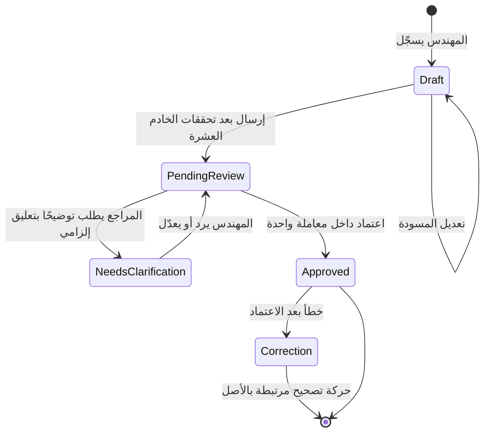

**شرح نصي:**

| الحالة | المعنى | الأثر المالي |
|---|---|---|
| `Draft` | محفوظ ولم يُرسل | ⛔ **صفر** |
| `PendingReview` | أُرسل وينتظر المراجعة | ⛔ **صفر** |
| `NeedsClarification` | الإدارة طلبت توضيحًا أو تعديلًا | ⛔ **صفر** |
| `Approved` | **حركة مالية رسمية** | ⭐ **أثر واحد في العهدة وأثر واحد في تكلفة العملية** |
| `Correction` | حركة تصحيح **مرتبطة بالأصل** | أثر التصحيح فقط — **الأصل لا يُمحى** |

> ⛔ **لا تُستخدم `Rejected` كرفض نهائي يحذف المعاملة** (BR-209).

### 12.2 مسار البيانات في المصروف

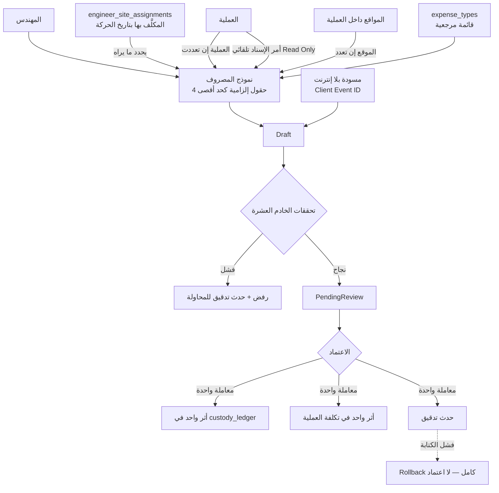

**العلاقات والـCardinality نصيًا:**

- `Expense` → `Engineer` : **N : 1** إلزامية
- `Expense` → `Operation` : **N : 1** إلزامية
- `Expense` → `Site` : **N : 1** إلزامية — **والموقع يجب أن يتبع العملية**
- `Expense` → `AssignmentOrder` : **N : 1** — **مشتق من العملية، لا يُدخله المهندس**
- `Expense` → `ExpenseType` : **N : 1** إلزامية من قائمة
- `Expense` → `ExpenseAttachment` : **1 : 0..N** — **اختيارية دائمًا**
- `Expense (Approved)` → `CustodyLedgerEntry` : **1 : 1** — **أثر واحد لا أكثر**
- `Expense (Approved)` → `JournalEntry` : **1 : 1** لحدث الترحيل `ACCRUAL`

### 12.3 دفتر العهدة — Custody Ledger

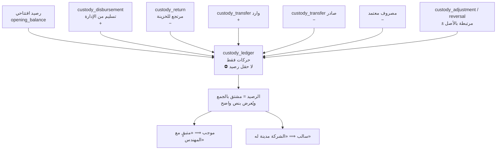

**القواعد الحاكمة:**

1. ⭐ **لا حقل رصيد قابل للتعديل اليدوي** (BR-028).
2. `موقف العهدة = الافتتاحي + المسلَّمة − المصروفات المعتمدة − المرتجع ± التصحيحات` (BR-026).
3. **العهدة الواحدة تغطي عدة مواقع وعدة عمليات** (BR-024).
4. **الرصيد السالب مشروع** ويعني أن الشركة مدينة للمهندس (BR-208).
5. ⛔ **لا يضيف المهندس عهدة لنفسه ولا يؤكد استلامها** (BR-025).

### 12.4 فصل الحضور عن الاستحقاق عن الدفع — Worker Separation

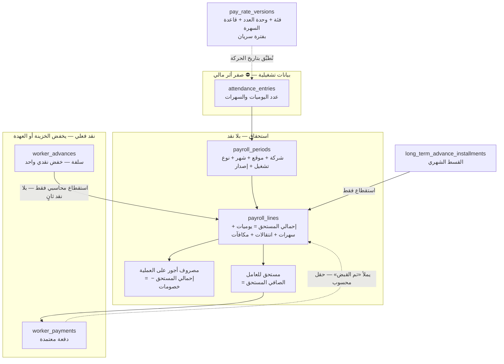

**⭐ ثلاث قواعد تمنع الخصم المزدوج:**

| # | القاعدة | المرجع |
|---|---|---|
| 1 | **الخزينة تُخفَّض في مكانين فقط**: `worker_advances` و`worker_payments` | BR-048 · BR-050 |
| 2 | **اعتماد الكشف لا يُحرِّك نقدًا** — يُنشئ مصروفًا والتزامًا فقط | **BR-047** |
| 3 | **السلفة تُخصم من المستحق كاستقطاع محاسبي بحت** بلا خروج نقدي ثانٍ | ⭐ **BR-049** |

> 📊 **ملاحظة تاريخية:** الواقع الحالي في Excel **يطبّق هذه القواعد فعلًا** — النظام الجديد **يحافظ عليها ولا يخترعها**.

### 12.5 المستخلص وأمر الدفع — Claim & Payment Order

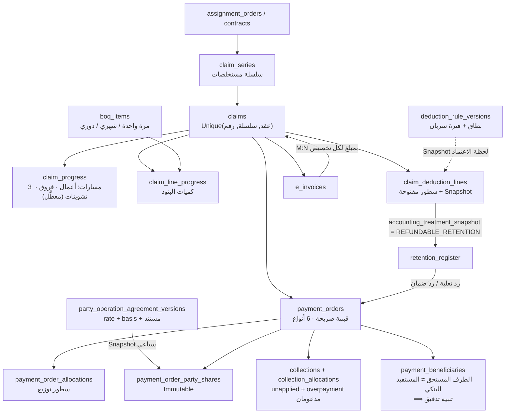

**Payment Waterfall — الترتيب القابل للتهيئة:**

| # | المرحلة | الأساس | ملاحظة |
|---|---|---|---|
| 1 | **إجمالي المستخلص** | مجموع المسارات | — |
| 2 | الضرائب والاستقطاعات القانونية | **يختلف بالجهة** | BR-067 |
| 3 | خصومات جهة الإسناد | كمية × فئة | بأسباب موثقة |
| 4 | التعليات والضمانات | الإجمالي أو تقديري | تدخل `retention_register` |
| 5 | **نسبة الشركة الخارجية** | **من نسخة الاتفاق وحدها** | ⛔ **لا تعميم** (BR-170) |
| 6 | السلف والتسويات | رصيد الطرف | مقاصّة |
| 7 | **صافي المستحق** | محسوب | **قد يكون سالبًا** (BR-069) |
| 8 | أمر الدفع | **قيمة صريحة** | **ليس بالضرورة = الصافي** (BR-079) |
| 9 | التحصيل الفعلي | — | قد يكون عدة دفعات |

**كل صف في المراحل 2–6 يحمل:** الأساس · الترتيب · النسبة أو المبلغ · **قاعدة التقريب** · تاريخ السريان · **نسخة القاعدة المستخدمة** (BR-085).

### 12.6 اتفاق الشركة الخارجية وحصتها — External Agreement & Share

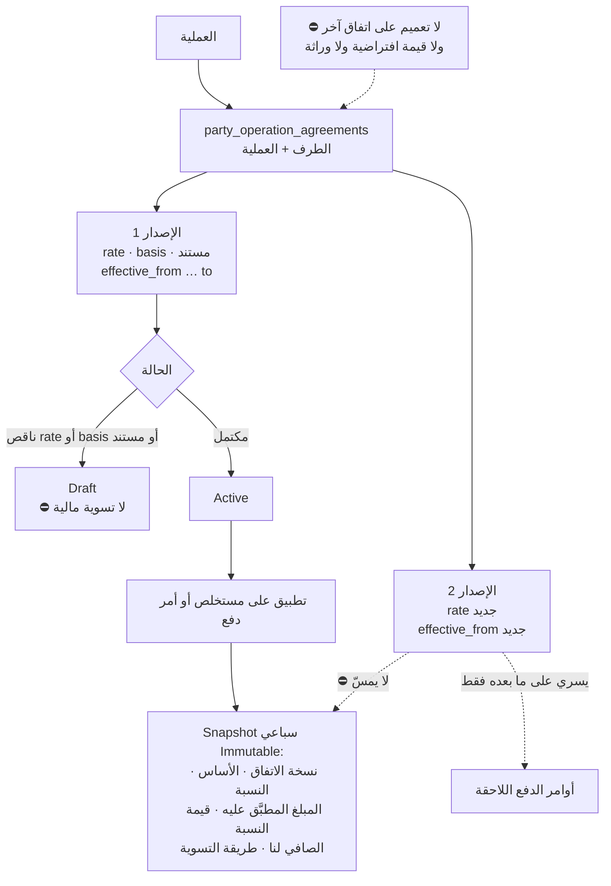

**العلاقات والـCardinality:**

- `Operation` → `PartyOperationAgreement` : **1 : 0..N** (اتفاق لكل شركة خارجية على العملية)
- `PartyOperationAgreement` → `PartyOperationAgreementVersion` : **1 : N** بفترات **غير متداخلة**
- `PartyOperationAgreementVersion` → `PaymentOrderPartyShare` : **1 : N** — والـSnapshot **Immutable**
- ⛔ **`rate` و`basis` لا يُقرآن من الشركة نفسها إطلاقًا** — بل من إصدار الاتفاق على العملية بعينها.

### 12.7 دورة حياة التقرير الشهري — Monthly Report Lifecycle

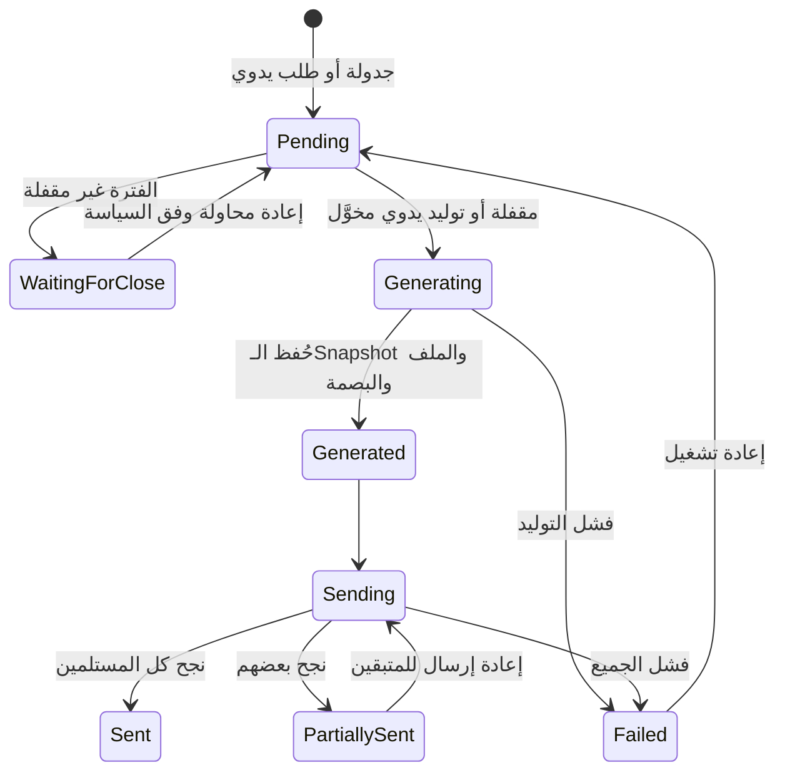

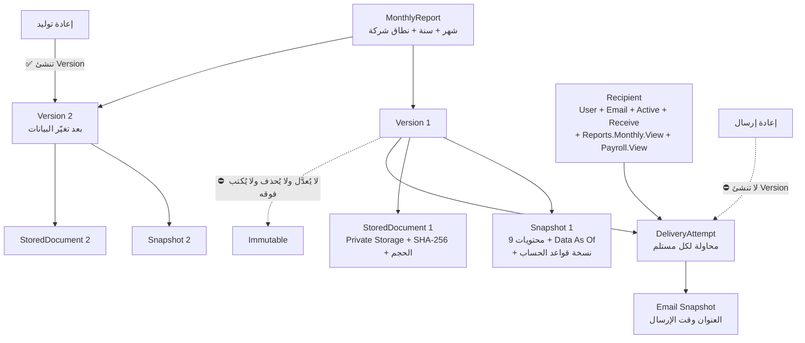

**⭐ الفارق الحاسم:**

| الفعل | ينشئ إصدارًا جديدًا؟ | ينشئ محاولة إرسال؟ |
|---|---|---|
| **إعادة توليد بعد تغيّر البيانات** | ✅ **نعم** | نعم |
| **إعادة إرسال نسخة قائمة** | ❌ **لا** | نعم |
| **إرسال إلى مستلم إضافي** | ❌ **لا** | نعم |
| **إعادة تشغيل المهمة بنفس المفتاح** | ❌ **لا** | ❌ **لا** |

### 12.8 دورة التعلية والمحتجز

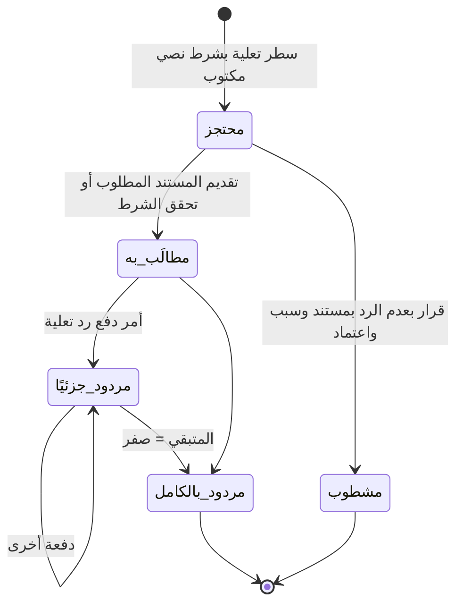

**قواعد الدورة:**

1. **الحجز لا يمسّ الإيراد** — الإيراد أُثبت بقيمة الأعمال كاملة، والتعلية **ذمة مدينة**.
2. **الرد لا يمسّ الإيراد أيضًا** — يقفل الذمة ويدخل النقد.
3. ⭐ **مجموع المردود ≤ الرصيد المحتجز** لكل سطر (BR-086).
4. ⛔ **الشطب لا يكون صامتًا أبدًا** — سبب ومستند ومعتمِد.
5. ⭐ **شرط الرد حدث تعاقدي لا تاريخ** (BR-125 · BR-166).

> 📊 **هذا عكس ما يفعله Excel اليوم**: يطرح عند الحجز ويضيف كـ`جمله الاعمال` عند الرد، فتتأرجح الأرقام شهريًا.

### 12.9 دورة حياة العملية

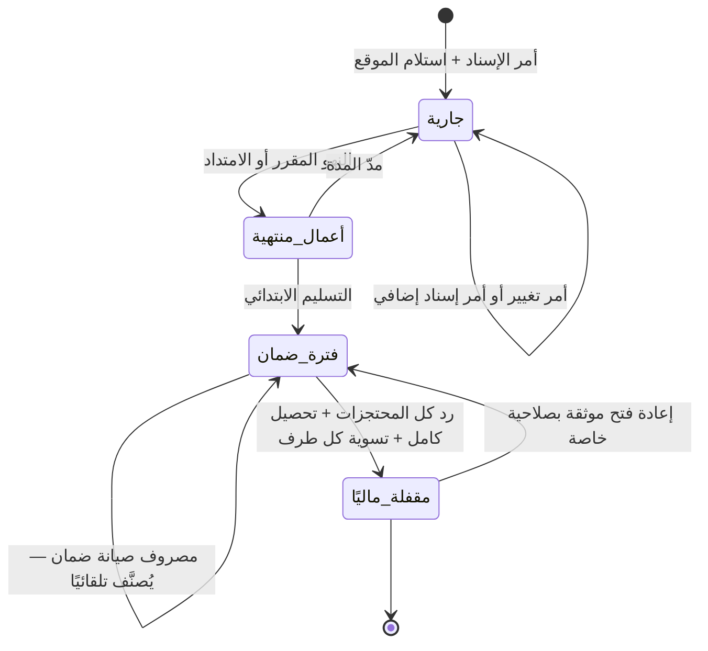

> ⭐ **الحالة تُصنِّف الإنفاق ولا تمنعه** (BR-108) — لأن المنع يدفع الموظفين لتحميل المصروف على عملية أخرى فتفسد البيانات أكثر.

---

## 13. المتطلبات غير الوظيفية

> **قاعدة ملزمة:** ⛔ **لا رقم أداء عشوائي.** كل رقم هنا إما 🟢 معتمد، أو 🔵 **مقترح بوضوح مع سبب اقتراحه**. **والمقترح لا يُعرض قرارًا نهائيًا.**

### 13.1 الأمان — NFR-SEC

| ID | المتطلب | المعيار القابل للقياس | الحالة |
|---|---|---|---|
| **NFR-SEC-001** | التحقق من الصلاحية في الخادم | **100%** من الاستدعاءات التي تعدّل بيانات تمرّ بفحص صلاحية في الخادم، **مستقلًا عن حالة الواجهة** | 🟢 BR-018 |
| **NFR-SEC-002** | حجب البيانات الحساسة قبل الكتابة | **صفر** ظهور لكلمة مرور أو رمز أو سر أو سلسلة اتصال أو حساب بنكي كامل أو محتوى مرفق في التدقيق أو Serilog | 🟢 BR-191 |
| **NFR-SEC-003** | استقلال `Payroll.View` | **صفر** حالة يُمنح فيها الوصول لبيانات الرواتب بالاشتقاق من دور | 🟢 BR-235 |
| **NFR-SEC-004** | التخزين الخاص | **صفر** رابط عام دائم لأي ملف · وكل وصول يمر بفحص صلاحيات | 🟢 BR-232 |
| **NFR-SEC-005** | صلاحية الروابط المؤقتة | الرابط المؤقت **مرتبط بالمستخدم** ومدته **قابلة للتهيئة** — المقترح **15 دقيقة** لأنه يكفي لتحميل ملف ولا يكفي لمشاركته | 🔵 **Proposed** |
| **NFR-SEC-006** | كلمات المرور | تُخزَّن **مجزَّأة بخوارزمية حديثة بملح فريد** · ⛔ ولا تُخزَّن ولا تُسجَّل نصًا أبدًا | 🔵 **Proposed** |
| **NFR-SEC-007** | انتهاء الجلسة | مهلة خمول **قابلة للتهيئة** — المقترح **8 ساعات للمهندس** (يوم عمل ميداني) و**60 دقيقة للمحاسب والمدير** (بيانات مالية حساسة) | 🔵 **Proposed** |
| **NFR-SEC-008** | النقل | **كل** الاتصالات عبر **TLS 1.2 أو أحدث** | 🔵 **Proposed** |
| **NFR-SEC-009** | منع التعديل التقني على التدقيق | صلاحيات قاعدة البيانات تُضبط بما **يمنع UPDATE وDELETE** على جداول التدقيق — **والآلية قرار التصميم الفيزيائي** | 🟢 BR-187 |
| **NFR-SEC-010** | عزل الفريق التقني | **صفر** وصول تطبيقي للفريق التقني إلى محتوى الأحداث المالية | 🟢 BR-192 |

### 13.2 الأداء — NFR-PERF

> ⚠️ **كل أرقام هذا القسم 🔵 مقترحة**، واختيارها مبني على **حجم البيانات المرصود فعلًا في 2026**، لا على تقدير عام.

| ID | المتطلب | المعيار المقترح | سبب الاقتراح |
|---|---|---|---|
| **NFR-PERF-001** | فتح نموذج المصروف | **≤ 2 ثانية** على شبكة موبايل 4G حتى الجاهزية للإدخال | النموذج يُفتح عشرات المرات يوميًا ميدانيًا · وتجاوز ثانيتين يدفع للتأجيل والتجميع الورقي |
| **NFR-PERF-002** | حفظ المصروف | **≤ 1.5 ثانية** من الضغط إلى التأكيد | الحفظ فعل متكرر · والانتظار الأطول يولّد ضغطات مكررة |
| **NFR-PERF-003** | حساب رصيد العهدة | **≤ 2 ثانية** لمهندس له حتى **5,000 حركة** | أعلى حجم مرصود في `العهد` 8,086 صفًا لـ**27 مندوبًا** ⟹ ~300 لكل مندوب · والسقف 5,000 هامش أمان ×16 |
| **NFR-PERF-004** | قائمة مواقع المهندس | **≤ 500 مللي ثانية** | تُستدعى مع كل فتح نموذج |
| **NFR-PERF-005** | تقرير مصروفات شهر لعملية | **≤ 5 ثوانٍ** لعملية بحتى **2,000 حركة شهريًا** | أعلى حجم مرصود في `الخزينه` **5,101 صفًا في 8 أشهر** لكل العمليات ⟹ السقف أعلى بكثير من الواقع |
| **NFR-PERF-006** | توليد التقرير الشهري | **≤ 10 دقائق** لشركة مُدارة واحدة | مهمة خلفية لا تفاعلية · والحد يضمن اكتمالها قبل ساعة العمل |
| **NFR-PERF-007** | استيراد دفعة Excel | **≤ 15 دقيقة** لملف بحتى **20,000 صف** | أكبر جدول مرصود `العهد` **8,086 صفًا**، و**19,297** نطاقًا خامًا ⟹ السقف يغطي الأكبر |
| **NFR-PERF-008** | بحث سجل التدقيق | **≤ 3 ثوانٍ** لنطاق شهر واحد | التدقيق استعلام رقابي لا تشغيلي |

### 13.3 الاعتمادية وسلامة البيانات — NFR-REL

| ID | المتطلب | المعيار | الحالة |
|---|---|---|---|
| **NFR-REL-001** | ذرّية الأثر المالي والتدقيق | **100%** من العمليات المالية تكتب أثرها وحدث تدقيقها **في معاملة واحدة** · **وفشل أيهما يُفشل الاثنين** | 🟢 BR-186 |
| **NFR-REL-002** | Idempotency | **صفر** أثر مالي مزدوج من إعادة طلب أو إعادة مزامنة أو إعادة تشغيل مهمة | 🟢 BR-103 · BR-188 · BR-241 |
| **NFR-REL-003** | اشتقاق الأرصدة | **صفر** حقل رصيد قابل للتعديل اليدوي في أي دفتر مالي | 🟢 BR-028 |
| **NFR-REL-004** | عدم قابلية المعتمد للتعديل | **صفر** مسار يتيح تعديل معاملة مالية معتمدة أو حذفها بصمت | 🟢 BR-187 · BR-213 |
| **NFR-REL-005** | دقة المبالغ | ⛔ **صفر** استخدام لـFloat أو Double في أي مبلغ مالي · والتقريب **مرة واحدة عند الحفظ** | 🟢 BR-093 |
| **NFR-REL-006** | فشل Serilog لا يؤثر | **صفر** معاملة مالية تفشل أو تُعكس بسبب فشل إرسال سجل تشغيلي | 🟢 BR-194 |
| **NFR-REL-007** | مطابقة الاستيراد | **كل** دفعة استيراد تنتهي بمطابقة مجموع، **والدفعة تتوقف عند عدم التطابق** | 🟢 📊 |
| **NFR-REL-008** | مطابقة ملف التقرير | **100%** تطابق بين الملف المُرسل وSnapshot عبر **SHA-256** | 🟢 BR-231 |
| **NFR-REL-009** | توافر النظام | **99.5%** شهريًا خارج نوافذ الصيانة المعلنة | 🔵 **Proposed** — يوازن بين كلفة البنية وطبيعة العمل المكتبي الميداني الذي يحتمل انقطاعًا قصيرًا |
| **NFR-REL-010** | نافذة الصيانة | تُعلَن **قبل 48 ساعة**، وتقع **خارج ساعات العمل** | 🔵 **Proposed** |

### 13.4 العمل بدون إنترنت والمزامنة — NFR-OFF

| ID | المتطلب | المعيار | الحالة |
|---|---|---|---|
| **NFR-OFF-001** | نطاق العمل بلا إنترنت | **مسودات المصروفات واليوميات فقط** — ⛔ **لا اعتماد ولا تقارير ولا عمليات مالية** | 🟢 ADR-008 |
| **NFR-OFF-002** | البيانات المخزَّنة محليًا | آخر نسخة متزامنة من: عمليات المهندس · أوامر الإسناد · مواقعه المكلَّف بها · أنواع المصروفات | 🟢 BR-212 |
| **NFR-OFF-003** | منع الإنشاء الناقص | ⛔ **لا تُنشأ مسودة بلا عملية وموقع وأمر إسناد معروفين** من البيانات المخزَّنة | 🟢 BR-212 |
| **NFR-OFF-004** | مفتاح منع التكرار | **كل** مسودة تحمل `Client Event ID` فريدًا يُولَّد على الجهاز | 🟢 BR-212 |
| **NFR-OFF-005** | التحقق بتاريخ الحركة | الخادم يتحقق بـ**تاريخ المصروف** لا تاريخ المزامنة | 🟢 BR-137 |
| **NFR-OFF-006** | معالجة التعارض | الحركة التي تعذّر قبولها **لا تُحذف ولا تُكرَّر** — تنتقل إلى **«تحتاج تدخل الإدارة»** | 🟢 BR-212 |
| **NFR-OFF-007** | مدة الاحتفاظ المحلي | المسودات غير المزامَنة تبقى على الجهاز **حتى تُزامَن أو يحذفها المستخدم** — ⛔ **ولا حذف تلقائي** | 🔵 **Proposed** |
| **NFR-OFF-008** | حجم التخزين المحلي | **≤ 50 ميجابايت** لبيانات المرجع والمسودات دون المرفقات | 🔵 **Proposed** — يناسب أجهزة الميدان المتواضعة |

### 13.5 التشغيل والنسخ الاحتياطي — NFR-OPS

| ID | المتطلب | المعيار | الحالة |
|---|---|---|---|
| **NFR-OPS-001** | نسخ احتياطي لقاعدة البيانات | نسخة كاملة **يوميًا** + سجل معاملات مستمر | 🔵 **Proposed** — البيانات المالية اليومية تجعل فقد يوم كامل غير مقبول |
| **NFR-OPS-002** | هدف نقطة الاسترجاع (RPO) | **≤ 15 دقيقة** | 🔵 **Proposed** — يوازن بين كلفة السجل المستمر وحجم الإدخال اليومي |
| **NFR-OPS-003** | هدف زمن الاسترجاع (RTO) | **≤ 4 ساعات** | 🔵 **Proposed** — النظام ليس نظام تشغيل لحظي |
| **NFR-OPS-004** | اختبار الاسترجاع | اختبار استرجاع كامل **كل 3 أشهر** وتوثيق نتيجته | 🔵 **Proposed** — نسخة احتياطية غير مختبَرة ليست نسخة |
| **NFR-OPS-005** | نسخ التخزين الخاص | الملفات تُنسخ احتياطيًا **بمعزل عن قاعدة البيانات** | 🟢 BR-233 |
| **NFR-OPS-006** | الاحتفاظ بالتدقيق | **سياسة معتمدة لكل نوع حدث** · ⛔ **ولا حذف بلا سياسة** · والأرشفة **نقل لا إتلاف** | 🟢 BR-190 · 🟡 المدة OQ-001 |
| **NFR-OPS-007** | تدوير سجلات Serilog | **سياسة تقنية مستقلة تمامًا** لا تمسّ سجل التدقيق | 🟢 BR-190 |
| **NFR-OPS-008** | المراقبة | **كل** فشل مهمة خلفية أو فشل إرسال بريد أو خطأ استيراد يظهر في منصة المراقبة | 🟢 BR-193 |
| **NFR-OPS-009** | Structured Logging | **100%** من سجلات Serilog حقول منظمة قابلة للاستعلام — ⛔ **لا رسائل نصية عشوائية** | 🟢 BR-193 |
| **NFR-OPS-010** | البيئات | بيئتان على الأقل: **تطوير** و**تشغيل** · والوجهات **قابلة للإعداد حسب البيئة** | 🟢 BR-194 |
| **NFR-OPS-011** | قابلية الصيانة | **كل وحدة** لها حدودها وواجهتها · ⛔ **ولا تقرأ وحدة جداول وحدة أخرى مباشرة** | 🟢 BR-157 |
| **NFR-OPS-012** | قابلية الاختبار | **كل** متطلب حرج له معيار قبول Given/When/Then وحالة اختبار مرجعية | 🟢 §28 |
| **NFR-OPS-013** | قابلية التوسع | يستوعب النظام **ضعف** أحجام 2026 المرصودة دون تغيير معماري | 🔵 **Proposed** — التوسع أفقي غير مطلوب لـModular Monolith بهذا الحجم |

### 13.6 قابلية الاستخدام — NFR-USE

| ID | المتطلب | المعيار | الحالة |
|---|---|---|---|
| **NFR-USE-001** | RTL كامل | **كل** الشاشات والتقارير والرسائل باتجاه **من اليمين إلى اليسار**، بما فيها الجداول والنماذج والتنبيهات | 🟢 |
| **NFR-USE-002** | الأرقام والتواريخ | الأرقام **عربية شرقية أو غربية بإعداد موحَّد**، والتواريخ بصيغة واضحة لا تحتمل لبسًا بين اليوم والشهر | 🔵 **Proposed** |
| **NFR-USE-003** | نموذج المصروف | **≤ 4 حقول إلزامية** في أسوأ الحالات · و**≤ 2** عند وحدانية العملية والموقع | 🟢 BR-203 · BR-205 |
| **NFR-USE-004** | الموبايل | **كل** شاشات المهندس تعمل على شاشة عرضها **360 بكسل** بلا تمرير أفقي | 🔵 **Proposed** — أدنى عرض شائع في أجهزة الميدان |
| **NFR-USE-005** | عرض الرصيد | **كل** رصيد يظهر مع **عبارة تفسيرية نصية** | 🟢 BR-027 |
| **NFR-USE-006** | مصطلحات الواجهة | الواجهة تستخدم **مصطلحات العمل** لا مصطلحات النموذج — ⛔ **ولا يظهر «Party» للمستخدم** | 🟢 BR-055 |
| **NFR-USE-007** | رسائل الخطأ | **كل** رسالة خطأ تذكر **ما الذي منع الحفظ وكيف يُصحَّح** — ⛔ **لا رسائل تقنية خام** | 🔵 **Proposed** |
| **NFR-USE-008** | الطباعة | التقارير الأساسية تُطبع على **A4** بلا قص ولا انقلاب اتجاه | 🔵 **Proposed** |
| **NFR-USE-009** | زر المرفق | يظهر الزر بنص **«إرفاق فاتورة أو صورة — اختياري»** | 🟢 BR-207 |

### 13.7 الخصوصية — NFR-SEC (امتداد)

| ID | المتطلب | المعيار | الحالة |
|---|---|---|---|
| **NFR-SEC-011** | تصنيف التقرير الشهري | `Confidential` — **لا تحميل إلا بـ`Reports.Monthly.View` و`Payroll.View` معًا** | 🟢 BR-245 |
| **NFR-SEC-012** | عناوين البريد | ⛔ **لا تُكشف عناوين المستلمين لبعضهم** — رسالة منفصلة لكل مستلم | 🟢 BR-236 |
| **NFR-SEC-013** | معلومات الجهاز | تُسجَّل **عند الحاجة فقط** وبما يتوافق مع سياسة الخصوصية | 🟢 BR-189 |
| **NFR-SEC-014** | حساب بنكي | يُسجَّل في التدقيق **بما يكفي للتمييز فقط** — ⛔ **لا رقم كامل** | 🟢 BR-191 |

---

## 14. الأمان والخصوصية

### 14.1 نموذج التهديد المختصر

| # | التهديد | الضابط | المرجع |
|---|---|---|---|
| T-01 | مهندس يسجّل مصروفًا على موقع ليس مكلَّفًا به بتعديل طلب API | **تحقق الخادم من التكليف بتاريخ الحركة + تسجيل المحاولة المرفوضة** | BR-018 · FR-EXP-015 |
| T-02 | موظف يعدّل معاملة معتمدة لإخفاء خطأ | **منع التعديل + التصحيح بحركة مرتبطة + Append-only للتدقيق** | BR-187 · BR-213 |
| T-03 | كتابة سجل تدقيق يزعم تغييرًا بدل حركة تصحيح | **منع صريح** — التصحيح بحركة لا بسجل | BR-187 |
| T-04 | تسريب بيانات الرواتب عبر التقرير الشهري | **`Payroll.View` مستقلة + بريد منفصل + تصنيف `Confidential` + منع الرابط العام** | BR-235 · BR-236 · BR-245 |
| T-05 | تسريب بيانات مالية عبر السجلات التشغيلية | **ممنوعات التسجيل + الحجب قبل الكتابة + منع وصول الفريق التقني للتدقيق** | BR-191 · BR-192 |
| T-06 | مضاعفة أثر مالي بإعادة إرسال طلب | **Idempotency Key في المزامنة والاستيراد والمهام** | BR-103 · BR-188 · BR-241 |
| T-07 | تسريب ملف تقرير برابط مشارك | ⛔ **لا رابط عام دائم** · الرابط **مؤقت ومرتبط بالمستخدم** وكل فتح **حدث تدقيق** | BR-232 · BR-237 |
| T-08 | صلاحية زائدة بالاشتقاق من دور Admin | ⛔ **`Payroll.View` لا تُشتق** | BR-235 |
| T-09 | حذف سجلات تدقيق بحجة المساحة | **سياسة احتفاظ معتمدة + أرشفة نقل لا إتلاف** | BR-190 |
| T-10 | تنفيذ صيغة حسابية مخزَّنة من البيانات | ⛔ **لا تُخزَّن صيغة حرة ولا تُنفَّذ** | BR-167 |
| T-11 | اعتبار غياب سجل Serilog دليلًا على عدم وقوع حركة | **Serilog ليس مصدر إثبات** | BR-183 |
| T-12 | دمج طرفين حقيقيين بقيد تفرّد على الاسم | ⛔ **لا تفرّد على الاسم المطبَّع** — كشف تشابه ينبّه ولا يدمج | BR-100 · BR-168 |

### 14.2 قواعد التعامل مع البيانات الحساسة

| الفئة | القاعدة | المرجع |
|---|---|---|
| **كلمات المرور والرموز والأسرار** | ⛔ **لا تُسجَّل إطلاقًا** في التدقيق ولا Serilog | BR-191 |
| **سلاسل الاتصال** | ⛔ **لا تُسجَّل** | BR-191 |
| **الحسابات البنكية** | يُسجَّل **ما يكفي للتمييز فقط** — لا الرقم كاملًا | BR-191 |
| **محتويات المرفقات** | يُسجَّل **وجود المرفق واسمه ومن أضافه** — ⛔ **لا محتواه** | BR-191 |
| **بيانات الرواتب** | ⛔ **لا تُسجَّل في Serilog** · ولا تُعرض بلا `Payroll.View` | BR-245 |
| **لقطات القيم قبل وبعد** | **تخضع لنفس قواعد الحجب** — ⛔ **لا استثناء لكونها داخل التدقيق** | BR-191 |
| **عنوان IP ومعلومات الجهاز** | **عند الحاجة فقط** | BR-189 |

**⭐ القاعدة الحاكمة:** **الحجب يُطبَّق قبل الكتابة لا عند العرض** (BR-191).

### 14.3 مصفوفة الوصول للسجلات

| الدور | الدفاتر والقيود | سجل التدقيق | سجل الإرسال | Serilog |
|---|---|---|---|---|
| **المهندس** | ⚠️ عهدته ومصروفاته | ❌ | ❌ | ❌ |
| **موظف الإدارة** | ⚠️ نطاقه | 👁️ **نطاقه فقط** | ⚠️ | ❌ |
| **المحاسب** | ✅ | 👁️ قراءة كاملة للأحداث المالية | ⚠️ | ❌ |
| **المدير** | ✅ | 👁️ **قراءة كاملة** | ✅ | ❌ |
| **الفريق التقني** | ❌ | ❌ **لا وصول لمحتوى الأحداث المالية** | ❌ | ✅ |

> ⭐ **لا أحد — على الإطلاق — يملك صلاحية تعديل أو حذف حدث تدقيق. القراءة هي الصلاحية القصوى** (BR-192).

---

## 15. Audit Trail و Operational Logging

### 15.1 ثلاثة أنظمة لا يحل أحدها محل الآخر

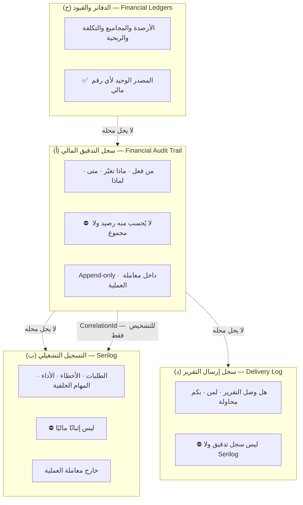

| البُعد | الدفاتر والقيود | سجل التدقيق | Serilog |
|---|---|---|---|
| **الغرض** | قياس مالي | **إثبات مسؤولية** | تشخيص تقني |
| **مصدر الأرصدة؟** | ✅ **نعم — الوحيد** | ❌ **لا إطلاقًا** | ❌ لا |
| **قابل للتعديل؟** | القيد المرحَّل غير قابل؛ التصحيح بقيد جديد | ❌ **Append Only** | يُدوَّر ويُحذف بسياسة تقنية |
| **داخل معاملة العملية؟** | ✅ نعم | ✅ **نعم — إلزامي** | ❌ **لا — ولا يجوز** |
| **فشله يُفشل المعاملة؟** | ✅ نعم | ✅ **نعم — Rollback كامل** | ❌ **لا — العملية تنجح** |
| **من يعدّله؟** | لا أحد بعد الترحيل | **لا أحد — ولا حتى الأدمن** | يُدار تقنيًا |
| **بيانات حساسة؟** | بضوابط | بحجب قبل الكتابة | ⛔ **ممنوعة منعًا باتًا** |
| **سياسة الاحتفاظ** | محاسبية وقانونية | **معتمدة — لا حذف بدونها** | تقنية قابلة للتدوير |

> ### **الرقم من الدفتر. القصة من سجل التدقيق. العطل من Serilog. والوصول من سجل الإرسال.**

### 15.2 مخطط الذرّية — الفارق الحاسم

```mermaid
graph TD
    subgraph FIN["المسار المالي — معاملة واحدة لا تتجزأ"]
        A["إجراء مالي"] --> B["التحقق من قواعد العمل"]
        B --> C["معاملة قاعدة البيانات"]
        C --> D["البيانات المالية والقيود"]
        C --> E["حدث التدقيق"]
        D --> F{"نجح الاثنان معًا؟"}
        E --> F
        F -->|"نعم"| G["Commit"]
        F -->|"لا — ولو فشل التدقيق وحده"| H["Rollback كامل<br/>العملية المالية تفشل"]
    end
    subgraph OPS["المسار التشغيلي — مستقل تمامًا"]
        I["تشغيل التطبيق"] --> J["Serilog"]
        J --> K["مخزن السجلات ومنصة المراقبة"]
        K --> L{"فشل الإرسال؟"}
        L -->|"نعم"| M["المعاملة المالية تبقى ناجحة<br/>لا Rollback"]
    end
    G -.->|"CorrelationId للتشخيص فقط — لا للدمج"| J
```

**لماذا الاختلاف مقصود:** **عملية مالية بلا أثر تدقيق = عملية بلا مسؤول.** أما عملية مالية بلا سجل تشغيلي فهي **عملية ناجحة يصعب تشخيصها تقنيًا** — وهذا مقبول.

### 15.3 المستويان الإلزاميان معًا

| المستوى | ما يلتقطه | الآلية |
|---|---|---|
| **تدقيق عام لتغيّر البيانات** | أي صف تغيّر وأي حقول وقيمها قبل وبعد | اعتراض طبقة الوصول للبيانات — **الآلية تُحسم في التصميم الفيزيائي** |
| **أحداث أعمال صريحة** | **المعنى التجاري**: اعتماد · تصحيح · إقفال · تفعيل اتفاق | تُسجَّل داخل منطق الأعمال |

> ⭐ **لا يُعتمد على الاعتراض العام وحده** — فهو يُظهر تغيّر الصفوف ولا يشرح معناها التجاري: لا يفرّق بين «اعتماد مصروف» و«تصحيح مصروف معتمد»، ولا يعرف أن تغيّر حقل الحالة هو في الواقع **إقفال فترة مالية يتطلب موافقة** (BR-185).

### 15.4 أحداث الأعمال الصريحة — حد أدنى

| الحدث | متى يُسجَّل |
|---|---|
| `ExpenseApproved` | اعتماد مصروف |
| `ExpenseClarificationRequested` | طلب توضيح |
| `CustodyDisbursed` | تسليم عهدة |
| `CustodyTransferred` | تحويل عهدة بين مهندسَين |
| `PayrollApproved` | اعتماد كشف أجور |
| `ClaimApproved` | اعتماد مستخلص |
| `PaymentOrderIssued` | إصدار أمر دفع |
| `CollectionAllocated` | تخصيص تحصيل |
| `FinancialPeriodClosed` / `FinancialPeriodReopened` | إقفال الفترة وإعادة فتحها |
| `CorrectionPosted` | ترحيل قيد تصحيح أو عكس |
| `ExternalCompanyAgreementActivated` | تفعيل اتفاق شركة خارجية |
| `EngineerSiteAssignmentCreated` / `Closed` | بدء التكليف وإنهاؤه |
| `MonthlyReportGenerated` / `VersionCreated` / `Downloaded` / `Sent` / `Resent` / `DeliveryFailed` | دورة التقرير الشهري |
| `ImportBatchStarted` / `Completed` / `Reprocessed` | الاستيراد وإعادة المعالجة |
| `PermissionGranted` / `Revoked` · `PayrollViewGranted` / `Revoked` | الصلاحيات |
| `AccessDenied` | **محاولة وصول مرفوضة** |

> **القائمة حد أدنى، وتتوسع مع كل حدث جديد ذي معنى مالي** (BR-195).

### 15.5 نطاق أحداث التدقيق الإلزامي — إحدى عشرة مجموعة + التقرير

| # | المجموعة | تشمل |
|---|---|---|
| 1 | **المصروفات** | إنشاء · تعديل · إرسال · طلب توضيح · رد المهندس · اعتماد · تصحيح أو عكس |
| 2 | **العهدة** | تسليم · مرتجع · تحويل · تصحيح |
| 3 | **الأجور والعمالة** | اليوميات واعتمادها · كشف الأجور واعتماده · سلف العمال · مدفوعاتهم |
| 4 | **المقاولون** | التسويات · المصروفات المدفوعة نيابة عنهم (مطالبة · تخصيص · تحصيل · شطب · نزاع) |
| 5 | **الموردون** | الموردون · الفواتير · المدفوعات وتخصيصها · الشيكات |
| 6 | **المستخلصات والتحصيل** | المستخلصات · سطور الاستقطاع · أوامر الدفع · التحصيلات وتخصيصها |
| 7 | **المحتجزات والضمانات** | التعليات · المحتجزات · ضمان الأعمال · الرد · **الشطب بالسبب والمعتمِد** |
| 8 | **الطبقة التعاقدية** | إنشاء الاتفاق وتعديله و**تفعيله** · تغيير النسبة أو أساسها أو سريانها · تغيير قواعد الاستقطاع وسياسات الأجور |
| 9 | **الإقفال** | إقفال الفترة وإعادة فتحها · إقفال العملية وإعادة فتحها |
| 10 | **الهوية والصلاحيات** | إنشاء المستخدمين وتعطيلهم · تغيير الأدوار والصلاحيات · **ربط المهندس بالمواقع وإنهاء التكليف** |
| 11 | **التاريخي والمزامنة** | اعتماد الأرصدة الافتتاحية · الاستيراد · المزامنة · إعادة معالجة بيانات مستوردة |
| 12 | **التقرير الشهري** | الإنشاء · نتيجة المهمة · كل انتقال حالة · إصدار نسخة · **التحميل ومن حمّله** · إضافة أو حذف مستلم · الإرسال وإعادته وفشله · تغيير الجدولة · **تغيير صلاحيات المستلمين** · **ومحاولة وصول مرفوضة** |

### 15.6 محتوى حدث التدقيق — مفاهيميًا

| المجموعة | العنصر |
|---|---|
| **الهوية** | معرّف داخلي فريد للحدث |
| **الزمن** | تاريخ ووقت **من السيرفر** بـ**UTC** |
| **الفاعل** | المستخدم · **الدور أو الصلاحية المستخدمة وقت التنفيذ** |
| **الفعل** | نوع العملية |
| **الهدف** | نوع الكيان · معرّفه · **رقم المستند التجاري** إن وُجد |
| **السياق** | الشركة · العملية · الموقع — عند الحاجة |
| **التغيير** | الحالة السابقة · الجديدة · **القيم قبل وبعد أو فروق الحقول** |
| **التبرير** | **سبب التغيير أو التصحيح** عند الحاجة |
| **الاعتماد** | **المعتمِد** عند اختلافه عن المنشئ |
| **الربط** | **CorrelationId** · **CausationId** |
| **المصدر** | Web · PWA · **Offline Sync** · **Import** · **System Job** |
| **منع التكرار** | **Client Event ID** أو **Idempotency Key** |
| **البيئة** | IP و User Agent أو معلومات الجهاز — **عند الحاجة** |
| **النسخة** | **إصدار بنية حدث التدقيق** (Schema Version) |

> ⛔ **هذه قائمة مفاهيمية.** تحويلها إلى حقول فعلية **مخرَج `logical-data-model-ar.md` §17.15**، وأنواعها وفهرستها **مخرَج التصميم الفيزيائي** (BR-189).

### 15.7 نطاق Serilog وحدوده

**يُستخدم حصرًا في:** طلبات HTTP · الأخطاء والاستثناءات · الأداء والطلبات البطيئة · مشاكل قاعدة البيانات والتخزين والمرفقات · فشل المهام الخلفية · الجانب التقني من فشل المزامنة والاستيراد · محاولات الدخول الفاشلة والوصول غير المصرَّح · التكاملات الخارجية · بدء التشغيل والإيقاف.

**الإثراء المطلوب عند توفر البيانات:** `CorrelationId` · `RequestId` · `UserId` · `CompanyId` · `OperationId` · `SiteId` · `Environment` · `ApplicationVersion`.

**الوجهات:** Console في التطوير · Seq أو OpenTelemetry أو منصة مراقبة مركزية في التشغيل — **والاختيار النهائي 🔵 غير محسوم ولا يُثبَّت في التوثيق**.

> ⭐ **القاعدة الفاصلة:** **فشل إرسال سجلات Serilog لا يجوز أن يُفسد أو يعكس معاملة مالية ناجحة** — وهذا **عكس سجل التدقيق تمامًا** (BR-194).
---

## 16. النموذج المفاهيمي للبيانات

> **المرجع التفصيلي:** `conceptual-data-model-ar.md` (المصدر) و`logical-data-model-ar.md` (المخرَج الجديد). **وهذا القسم خريطة عليا لا بديل عنهما.**

### 16.1 الخريطة المفاهيمية الكبرى

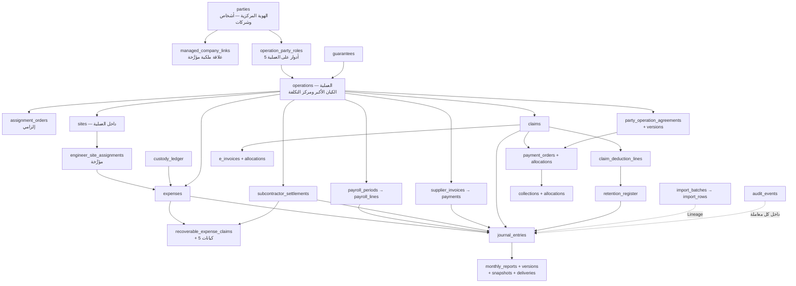

### 16.2 القرارات المفاهيمية المثبَّتة

| القرار | النص الملزم | المرجع |
|---|---|---|
| **قاعدة بيانات واحدة** | **PostgreSQL واحدة لكل النظام** — لا قاعدة لكل شركة ولا لكل وحدة | BR-156 |
| **المعمارية** | **Modular Monolith** — فصل **منطقي** للوحدات بحدود وواجهات وأحداث | BR-157 |
| **الفصل الفيزيائي الاختياري** | يجوز **PostgreSQL schemas** لفرض الحدود — **قرار التصميم الفيزيائي** | BR-157 |
| **نطاق الشركة** | **`managed_company_id`** على المستندات والحسابات التي تحتاجه فقط — **ليس على كل جدول** | BR-158 |
| **الشركات الخارجية** | **`parties`** — ⛔ **لا Tenants ولا Multi-tenancy** | BR-159 |
| **«شركاتنا»** | **علاقة ملكية/إدارة مؤرَّخة** على `parties` — لا جدول هوية منفصل | BR-160 |

### 16.3 العلاقات الجوهرية الاثنتا عشرة — نصيًا

| # | العلاقة | Cardinality | القيد |
|---|---|---|---|
| 1 | `operations` ← `assignment_orders` | **1 : 1 إلزامية** | لا عملية فعّالة بلا أمر إسناد (BR-197) |
| 2 | `operations` → `sites` | **1 : N** (N ≥ 1) | العملية تحتوي موقعًا أو أكثر |
| 3 | `sites` → `operations` | **N : 1 إلزامية** | **الموقع يتبع عملية واحدة** (BR-198) |
| 3.1 | 🟢 ⭐ `operations` ↔ `assignment_orders` | ⭐ **1 : 1 إلزامية** | ⭐ **حُسم في الباتش v1.2.1** — **أمر إسناد واحد لكل عملية ⛔ ولا يخدم الأمر الواحد عمليتين** (BR-247) |
| 3.2 | 🟢 `operations` → `operation_dates` | **1 : 0..1** | ⭐ **صف واحد بالتواريخ الأربعة** |
| 4 | `engineer_site_assignments` | **N : M مؤرَّخة** | لا حذف · إغلاق بتاريخ · فترات غير متداخلة لنفس (مهندس، موقع) (BR-202) |
| 5 | `expenses` → `engineer` · `operation` · `site` | **N : 1** لكل منها | **الموقع يجب أن يتبع العملية** (BR-211) |
| 6 | `expenses` → `assignment_order` | **N : 1 مشتق** | **من العملية — لا يُدخله المهندس** (BR-199) |
| 7 | `expenses` → `expense_type` | **N : 1** | من قائمة — لا نص حر (BR-206) |
| 8 | `expenses` ← `attachments` | **1 : 0..N** | **اختيارية دائمًا** (BR-207) |
| 9 | `expenses (Approved)` → `custody_ledger` | **1 : 1** | ⭐ **أثر واحد** (BR-213) |
| 10 | `expenses (Approved)` → تكلفة العملية | **1 : 1** | ⭐ **أثر واحد** (BR-213) |
| 11 | `claims` → `claim_deduction_lines` | **1 : N مفتوح** | سطور لا أعمدة ثابتة (BR-144…BR-146) |
| 12 | `party_operation_agreement_versions` → `payment_order_party_shares` | **1 : N** | **Snapshot سباعي Immutable** (BR-008) |

---

## 17. ملخص النموذج المنطقي للبيانات

> **المرجع الكامل:** **`logical-data-model-ar.md`** — وهو المخرَج المُلزِم. **وهذا القسم فهرس وخلاصة قرارات فقط.**

### 17.1 ⭐ المجالات العشرون

| # | Domain | الغرض المختصر | عدد الكيانات |
|---|---|---|---|
| 1 | **Identity, Users, Roles, Permissions** | من يدخل وماذا يملك | 7 |
| 2 | **Parties and Companies** | الهوية المركزية وأدوارها وشركاتنا | 9 |
| 3 | **Operations and Assignment Orders** | العملية وأمر إسنادها ومقايستها ودورة حياتها | 8 |
| 4 | **Sites and Engineer Assignments** | المواقع وتكليفات المهندسين | 2 |
| 5 | **Custody and Custody Ledger** | دفتر العهدة بأنواع حركاته | 3 |
| 6 | **Expenses and Expense Review** | المصروفات ودورة مراجعتها | 6 |
| 7 | **Workers, Attendance, Advances, Payments, Settlements** | العمالة وأجورها وسلفها ومدفوعاتها | 11 |
| 8 | **Engineer Payroll** | رواتب المهندسين وقواعد توزيعها | 4 |
| 9 | **Suppliers and Contractors** | الموردون والتوريدات والمقاولون وتسوياتهم | 11 |
| 10 | **Claims, Deductions and Payment Orders** | المستخلصات والاستقطاعات وأوامر الدفع والتحصيل | 14 |
| 11 | **External Company Agreements and Shares** | اتفاقات الشركات الخارجية وحصصها | 4 |
| 12 | **Retentions and Recoverable Amounts** | المحتجزات والمصروف القابل للاسترداد | 10 |
| 13 | **Reports, Snapshots and Deliveries** | التقارير وإصداراتها وSnapshots وسجل الإرسال | 10 |
| 14 | **Files and Attachments** | الملفات ومراجعها وبصماتها | 3 |
| 15 | **Audit Trail** | أحداث التدقيق وفروقها وروابطها وسياساتها | 4 |
| 16 | **Notifications** | التنبيهات وقواعدها وقنواتها | 4 |
| 17 | **Imports and Reconciliation** | دفعات الاستيراد وصفوفها ومطابقتها | 6 |
| 18 | **Reference Data** | البيانات المرجعية المشتركة | 10 |
| 🟢 ⭐ **19** | ⭐ **Accounting Ledger** | ⭐ **الأستاذ العام: الأحداث المالية والقيود وسطورها وقواعد الترحيل** | **9** |
| 🟢 ⭐ **20** | ⭐ **Treasury and Cash Management** | ⭐ **النقد الفعلي: الحسابات والحركات والتحويلات والمطابقة** | **7** |
| | **الإجمالي** | | ⭐ **148 كيانًا منطقيًا** |

> 🟢 ⭐ **الباتش v1.2.1:** **أُضيف المجالان 19 و20 لإغلاق أخطر ثغرة في النموذج** — **`journal_entries` و`cash_movements` كانا مستخدمَين في المخططات بلا تعريف كيان**. ⭐ **و`cash_movements` صار `treasury_movements` باسمه الرسمي.** **والتفصيل الكامل في `logical-model-patch-v1.2.1-ar.md`.**

### 17.2 حسم القيود المؤجَّلة من المرحلة صفر

| # | القيد | كان | **الحسم في النموذج المنطقي** |
|---|---|---|---|
| 1 | **`party_identifiers`** (BR-177) | نطاق التفرّد غير محدد | **`UNIQUE(identifier_type, identifier_value, jurisdiction_country, issuing_authority)` جزئي `WHERE valid_to IS NULL`** — والتفاصيل في `logical-data-model-ar.md` §2 |
| 2 | **`payroll_periods`** (BR-174) | `Unique(site, year, month)` غير كافٍ | **`UNIQUE(managed_company_id, site_id, period_year, period_month, run_type, version_no)` جزئي `WHERE status <> 'Cancelled'`** |
| 3 | **`payroll_lines`** (BR-175) | `Unique(period, resource)` يمنع حركة صحيحة | ⛔ **لا قيد تفرّد** — معرّف داخلي + `client_generated_id` + **كشف تكرار ينبّه** |
| 4 | **`attendance_entries`** (BR-176) | `line_number` استُخدم هوية | ⛔ **لا قيد تفرّد على التركيبة** — معرّف داخلي + `client_generated_id` + `duplicate_detection` |
| 5 | **`claims` التاريخية** (BR-181) | تفرّد يستحيل على بيانات 2026 | **`claim_series = LEGACY`** + `legacy_sequence` ثابت + `original_claim_reference` حرفي · **والتفرّد الكامل للسجلات الجديدة فقط** |
| 6 | **أمر الإسناد التاريخي للمصروف** (BR-214) | Snapshot أم Versioning؟ | ⭐ **Snapshot على المصروف عند الاعتماد** — الحقل `assignment_order_snapshot_id` يُملأ لحظة الاعتماد ولا يتغيّر · **والسبب والبدائل في §31 ADR-015** |

### 17.3 مبادئ إلزامية طُبِّقت على كل مجال

| # | المبدأ | التطبيق |
|---|---|---|
| 1 | **مصدر حقيقة واحد لكل مفهوم مالي** | جدول مالك واحد لكل مبلغ، والباقي Views (BR-101) |
| 2 | ⛔ **لا رصيد مخزَّن قابل للتعديل اليدوي** | كل رصيد **مشتق** من دفتر حركات (BR-028) — ويجوز Read Models وSnapshots **للأداء فقط** |
| 3 | ⛔ **لا تعديل مباشر لحركة مالية معتمدة** | التصحيح بـ`reversal` أو `adjustment` **مرتبط بالأصل** (BR-213 · BR-178) |
| 4 | ⛔ **لا Float ولا Double للمبالغ** | نوع عشري دقيق — **والدقة الفيزيائية النهائية قرار التصميم الفيزيائي** (BR-093) |
| 5 | **فصل التواريخ ذات المعاني المختلفة** | العملية · التسجيل · الاعتماد · السريان المحاسبي · الاستحقاق · الدفع |
| 6 | **بيانات إلزامية على كل سجل مالي** | المنشئ · وقت الإنشاء · الحالة · المصدر · العملية والموقع عند اللزوم · الطرف عند اللزوم · المرجع الأصلي · **هل هو مستورد** · `import_batch_id` · `Idempotency Key` عند الحاجة |
| 7 | **فصل الوصف الحر عن التصنيف عن الطرف** | ⛔ **لا عمود يحمل أكثر من معنى** (BR-053 · 📊) |
| 8 | ⛔ **لا اسم مفتاحًا** | لا اسم شخص ولا مورد ولا موقع يُستخدم مفتاحًا (BR-053 · BR-100) |
| 9 | **Party Model موحَّد بلا تعقيد زائد** | يخدم عدة أدوار — **والواجهة تعرض شاشات مألوفة** (BR-055) |
| 10 | **`aliases` للتنظيف لا للهوية** | لا تصبح هوية أساسية (BR-059) |
| 11 | **`identifiers` بنطاق** | النوع · الدولة · الجهة المصدرة · نطاق التفرّد (BR-177) |
| 12 | ⛔ **لا Unique على بيانات تاريخية قبل اختبارها** | (BR-102 · BR-082) |
| 13 | **تمييز ثلاثي** | قيد يمنع الخطأ · تنبيه لتكرار محتمل · **استثناء ترحيل Legacy** |
| 14 | ⛔ **`line_number` ليس هوية** | (BR-176) |
| 15 | **Idempotency للاستيراد والمزامنة والمهام** | (BR-103 · BR-188 · BR-241) |
| 16 | ⛔ **منع الأثر المالي المزدوج** | من إعادة الطلب أو إعادة تشغيل المهمة (BR-213 · BR-241) |
| 17 | **Offline Client ID على المصروف** | (BR-212) |
| 18 | ⭐ **أمر إسناد إلزامي لكل عملية — وبعلاقة `1 : 1`** | (BR-197 · **BR-247**) |
| 19 | **موقع واحد لعملية واحدة فعّالة** | (BR-198) |
| 20 | **تكليف مؤرَّخ بست خصائص** | بداية · نهاية اختيارية · حالة · المنشئ · منع التعارض · حفظ التاريخ (BR-202) |
| 21 | ⛔ **الأمان لا يعتمد على إخفاء القائمة** | الخادم يتحقق عند الحفظ والإرسال والاعتماد (BR-018 · BR-138) |
| 22 | **نسبة الشركة الخارجية داخل اتفاق العملية** | بـVersion وEffective Dates وSnapshot — ⛔ **لا قيمة ثابتة على الشركة** (BR-170) |
| 23 | **Snapshot عند تطبيق النسبة** | القاعدة · النسبة · الأساس · المبلغ الناتج · نسخة الاتفاق · تاريخ التطبيق (BR-008) |
| 24 | **الاستقطاعات Lines قابلة للتوسع** | ⛔ **لا مجموعة أعمدة ثابتة** (BR-144…BR-146) |
| 25 | **Snapshot للمعالجة المحاسبية وقت الاعتماد** | (BR-173) |
| 26 | **التقرير وإصداراته وSnapshots وإرسالاته كيانات مستقلة** | (BR-228 · BR-238) |
| 27 | **إعادة الإرسال لا تنشئ Version** | (BR-230) |
| 28 | **إعادة التوليد تنشئ Version** | (BR-230) |
| 29 | ⛔ **لا يُحسب رصيد من سجل التدقيق** | (BR-184 · BR-246) |
| 30 | ⛔ **لا PDF داخل قاعدة البيانات افتراضيًا** | القاعدة تحفظ metadata + مرجع + checksum + حجم (BR-232 · BR-233) |
| 31 | **Import يحتفظ بتسع معلومات** | الملف · بصمته · الورقة · الصف الأصلي · الدفعة · القيم الأصلية · القيم المطبَّعة · الخطأ/التحذير · المعالجة · مرجع السجل المستورد (BR-151…BR-154) |
| 32 | ⛔ **رفض صفوف `Total` و`SUBTOTAL`** | (📊 ب-13) |
| 33 | **إعادة حساب الأعمدة المحسوبة** | ⛔ **والفراغ لا يُقرأ صفرًا** (📊 ب-14) |
| 34 | **سياسة `LEGACY` واضحة** | ⛔ **لا يُخترع رقم تجاري** · هوية داخلية · **المطابقة المالية لا تُستثنى** (BR-181) |

### 17.4 قرار أمر الإسناد التاريخي — الحسم

> **المشكلة (BR-214):** إذا تغيّر ارتباط العملية بأمر الإسناد لاحقًا بالإجراء الإداري الموثَّق (BR-200)، **لا يجوز أن تتغيّر قراءة المصروفات القديمة بأثر رجعي**.

| البديل | المزايا | العيوب | القرار |
|---|---|---|---|
| **أ) Snapshot على المصروف عند الاعتماد** | قراءة بسيطة · صحيحة دائمًا · لا انضمام زمني | تكرار محدود لحقل واحد | ✅ **المعتمَد** |
| ب) Versioning لارتباط العملية بأمر الإسناد | بلا تكرار | كل قراءة تحتاج انضمامًا زمنيًا · وخطأ واحد فيه يفسد كل التقارير التاريخية | ❌ |
| ج) الاثنان معًا | أقصى أمان | تعقيد بلا حاجة مثبتة | ❌ |

**القرار المعتمد: (أ)** — ويُسجَّل كـ**ADR-015**. التفاصيل في `logical-data-model-ar.md` §6 و`architecture-decision-records-ar.md`.

### 17.5 🟢 ⭐ المحاسبة والخزينة — المجالان الجديدان (باتش v1.2.1)

#### 17.5.1 ⭐ مصادر الحقيقة المالية الأربعة

| # | الرقم | ⭐ مصدر حقيقته | ⛔ ما ليس مصدرًا له |
|---|---|---|---|
| 1 | **رصيد عهدة المهندس** | ⭐ **`custody_ledger_entries`** | ⛔ **لا عمود رصيد · ولا الخزينة · ولا الأستاذ** |
| 2 | **رصيد الخزينة أو البنك أو المحفظة** | ⭐ **`treasury_movements` المعتمدة** — **ويُطابق مع حساب النقدية في الأستاذ** | ⛔ **لا رقم مكتوب يدويًا** |
| 3 | **الأرصدة والقوائم المحاسبية** | ⭐ **`journal_entry_lines` المرحَّلة** | ⛔ **لا الدفاتر التشغيلية مباشرة** |
| 4 | **تكلفة العملية والموقع** | ⭐ **المعاملات المعتمدة والقيود ذات أبعاد العملية والموقع — بأساس الاستحقاق** | ⛔ **لا النقد المنصرف · ⛔ ولا جمع الدفتر التشغيلي مع قيده (حساب مزدوج)** |

#### 17.5.2 ⭐ سجل الأحداث المالية — آلية ربط القيد بمصدره

> 🟢 ⭐ **تعديل v2.0.1:** **العلاقة `Financial Event 1 : 0..1 Journal Entry`** — **و`1 : 1` إلزامية بعد `Posted`** · ⛔ **و`posting_sequence` أُلغي** · ⭐ **وكل أثر مستقل حدثٌ مستقل** (BR-265 · ADR-028).

> ⭐ **`financial_events` جدول واحد يسجّل كل حدث مالي قابل للترحيل، ويشير إليه كلٌّ من القيد والحركة النقدية بمفتاح أجنبي واحد إلزامي.**

| البديل | التكامل المرجعي | التوسع | القرار |
|---|---|---|---|
| **`source_type` + `source_id`** | ❌ **معدوم — Polymorphic غير قابل للتحقق** | ✅ | ⛔ **مرفوض — وأُزيل من كل الجداول المالية في v2.0.1** |
| **مفتاح أجنبي مباشر لكل نوع مصدر على كل جدول مالي** | ✅ | ⚠️ **تغيير بنية لكل نوع جديد** | ⚠️ **صحيح ولا يتوسّع بنظافة** |
| ⭐ **سجل أحداث مالية موحد بمفاتيح مُنمَّطة** | ✅ ⭐ **كامل ومركَّز** | ✅ | 🟢 ⭐ **المعتمَد — ADR-020** |

#### 17.5.3 ⭐ اعتماد المصروف — ⛔ ولا خصم نقدي مزدوج

| الأثر | يُنشأ عند اعتماد مصروف العهدة؟ | ⭐ لماذا |
|---|---|---|
| **حدث مالي** | ✅ **نعم** | نقطة الربط الواحدة |
| **حركة عهدة `EXPENSE_APPROVED`** | ✅ **واحدة فقط** | تستهلك رصيد المهندس (BR-213) |
| **قيد تكلفة متوازن** | ✅ **نعم** | **هنا تُقيَّد التكلفة** |
| ⛔ **حركة خزينة** | ⛔ **لا** | ⭐ **النقد خرج عند تسليم العهدة — وإنشاؤها خصم مزدوج** (**BR-256**) |
| **حدث تدقيق** | ✅ **نعم — داخل المعاملة نفسها** | (BR-183) |

> ⭐ **وصرف العهدة نفسه** ينشئ — **داخل معاملة واحدة** — **حدثًا ماليًا وحركة خزينة صادرة وحركة عهدة واردة وقيدًا متوازنًا وحدث تدقيق**، **بمفتاح منع تكرار واحد و`correlation_id` واحد** (**BR-257**).

#### 17.5.4 🟢 ⭐ مصفوفة آثار الحدث المالي — شرط الترحيل

> ⭐ **لكل نوع حدث: هل القيد مطلوب · كم حركة خزينة · هل حركة العهدة مطلوبة · وشرط `Posted`.** **المصفوفة الكاملة في `logical-data-model-ar.md` §19.6.1.**

| الحدث | القيد | الخزينة | العهدة |
|---|---|---|---|
| **تسليم عهدة** | مطلوب | ⭐ **صادرة واحدة** | **واردة** |
| ⭐ **اعتماد مصروف من عهدة** | مطلوب | ⛔ **ممنوعة** | **حركة مصروف** |
| **مصروف مباشر من الخزينة** | مطلوب | **صادرة واحدة** | ⛔ **لا** |
| **اعتماد فاتورة مورد آجلة** | مطلوب | ⛔ **ممنوعة** | ⛔ **لا** |
| **دفع مورد** | مطلوب | **صادرة واحدة** | ⛔ **لا** |
| **اعتماد مستخلص عميل** | مطلوب | ⛔ **ممنوعة** | ⛔ **لا** |
| **تحصيل من عميل** | مطلوب | **واردة واحدة** | ⛔ **لا** |
| **تحويل بين حسابين** | مطلوب | ⭐ **حركتان متساويتان** | ⛔ **لا** |
| **عكس حركة** | مطلوب | **طبقًا للأصل** | **طبقًا للأصل** |

> 🟢 ⭐ **الصياغة المعتمدة (تصحيح v2.0.1):** ⛔ **العبارة السابقة «يستحيل قيد بلا نقده أو نقد بلا قيده» أوسع من الحقيقة.**
> ✅ ⭐ **يستحيل ترحيل حدث مالي قبل اكتمال الآثار المطلوبة لنوعه — وقد يكون الحدث محاسبيًا بلا حركة نقدية إذا كان استحقاقًا غير مدفوع** (BR-264).

#### 17.5.5 ⭐ مواضع الخصم النقدي الحصرية

**تسليم العهدة · سلفة عامل · دفعة عامل · دفعة مورد · تحويل صادر · مصروف مدفوع مباشرة من الخزينة · تحصيل (وارد).**
⛔ **وما عدا ذلك استحقاق أو استقطاع محاسبي بلا حركة نقدية** — **ومنه: اعتماد كشف الأجور (BR-047) · وخصم السلفة في الكشف (BR-049) · واعتماد مصروف العهدة (BR-256).**

---

## 18. قاموس البيانات

> **المرجع الكامل:** **`data-dictionary-ar.md`**. **وهذا القسم قواعد التسمية والربط فقط.**

### 18.1 قواعد التسمية الملزمة

| # | القاعدة |
|---|---|
| 1 | **الاسم التقني إنجليزي** · `snake_case` · **مفرد للكيان وجمع للجدول** · واضح وثابت |
| 2 | ⛔ **لا يُشتق الاسم التقني من خطأ أو غموض في Excel** |
| 3 | **الاسم العربي للعرض** يُحفظ مستقلًا في `Arabic Display Label` |
| 4 | **اسم عمود Excel يُحفظ حرفيًا** في `Excel Mapping` — بمسافاته وأخطائه |
| 5 | ⛔ **لا يُستبدل الاسم العربي بالتقني ولا العكس** — **الثلاثة يتعايشون** |
| 6 | المفتاح الأساسي **`id`** · والمفتاح الأجنبي **`<entity>_id`** |
| 7 | حقول التاريخ تحمل **معناها في اسمها**: `expense_date` · `created_at` · `approved_at` · `effective_from` |
| 8 | حقول الحالة **`status`** بقائمة قيم مغلقة موثَّقة |
| 9 | ⛔ **لا اختصارات غامضة** — `assignment_order_id` لا `ao_id` |

### 18.2 تصنيف حقول Excel — ست فئات

| الفئة | المعنى | مثال |
|---|---|---|
| **نُقل كما هو** | معناه واضح ومطابق | `التاريخ` → `transaction_date` |
| **تغيّر معناه** | الاسم في Excel **خاطئ** والاسم الرسمي مختلف | `ضريبه قيمة مضافه 14%` → **20% من الضريبة المستقطعة** · `دمغة هندسية` → **نقابة المهن الهندسية** |
| **فُصل إلى أكثر من حقل** | عمود واحد يحمل عدة معانٍ | `بيان المصروف` → الطرف + التصنيف + حساب المراقبة + الوصف |
| **أصبح بيانات مرجعية** | قائمة نصية صارت جدولًا | `نوع المصروف` → `expense_types` |
| **أصبح محسوبًا** | يُعاد حسابه ولا يُستورد كرقم | `اجمالى الاستقطاعات` · `الصافي المستحق` · `السلف الحاليه` |
| **لن يُستورد** | ترقيم أو صيغة عرضية أو تقرير | `م` · `شهر` · `اسم الموقع` (VLOOKUP) · `التوقيـــع` |
| **يحتاج مراجعة بشرية** | معناه غير محسوم | `خصم عميل` · `اتساع` · `شيك وموارد` · `دائن حوافز` |

### 18.3 ⭐ تفكيك العمودين متعددي المعاني — لا يُعاد العيب القديم

> **العيب الأصلي:** `بيان المصروف` و`شرح القيد` **عمودان نصّيان حرّان يحملان معًا هوية الطرف** بلا مفتاح ولا تحقق إملائي.

**الفصل الملزم — تسعة مفاهيم مستقلة:**

| المفهوم | الحقل التقني | ملاحظة |
|---|---|---|
| **Description** | `description` | نص حر **للوصف فقط** — ⛔ لا هوية ولا تصنيف |
| **Expense Category** | `expense_type_id` | FK إلى قائمة مرجعية |
| **Party** | `party_id` | FK — ⛔ **لا اسم نصي** |
| **Engineer** | `engineer_id` | FK صريح — **لا يُشتق من الموقع** |
| **Supplier** | `supplier_party_id` | FK |
| **Worker** | `worker_party_id` أو `cost_resource_id` | FK |
| **Aggregation Account** | `aggregate_cost_account_id` | FK — **حساب تجميعي لا شخص** |
| **Operation** | `operation_id` | FK إلزامي |
| **Site** | `site_id` | FK إلزامي تابع للعملية |

**قاعدة التحويل عند غموض اسم Excel:**

1. **يُحفظ الاسم الأصلي حرفيًا** في `Excel Mapping`.
2. ⛔ **لا يُستخدم اسمًا تقنيًا غامضًا.**
3. **تُشرح طريقة التحويل** في `data-dictionary-ar.md` بخريطة صريحة.
4. ما لا يُحسم ⟹ **`UNCLASSIFIED_SUSPENSE` أو حالة `يحتاج تصنيفًا`** — ⛔ **ولا يُخترع تصنيف**.

---

## 19. قواعد سلامة البيانات

> **المرجع الكامل:** **`database-integrity-rules-ar.md`**. وهذه المبادئ العشرة الحاكمة.

| # | المبدأ | التطبيق |
|---|---|---|
| 1 | **مصدر حقيقة واحد** | جدول مالك واحد لكل مبلغ |
| 2 | **الأرصدة مشتقة** | ⛔ لا حقل رصيد قابل للتعديل |
| 3 | **المعتمد غير قابل للتعديل** | التصحيح بعكس أو تسوية مرتبطة بالأصل |
| 4 | **قيود تمنع الخطأ ≠ تنبيهات ≠ استثناءات Legacy** | ثلاثة مستويات مختلفة لا تُخلط |
| 5 | **Idempotency على كل مدخل خارجي** | مزامنة · استيراد · مهام خلفية · إعادة طلب |
| 6 | **التحقق العابر للجداول في الخادم** | ⛔ **لا `CHECK` عابر** — والآلية في التصميم الفيزيائي |
| 7 | **البيانات المرجعية تُعطَّل ولا تُحذف** | حين تكون لها حركات |
| 8 | **كل سجل مالي يحمل نسبه** | المنشئ · الوقت · المصدر · الدفعة · المرجع الأصلي |
| 9 | **Snapshot لكل قاعدة تحكم رقمًا معتمدًا** | معالجة محاسبية · نسبة شركة · طريقة احتساب أجر · قاعدة توزيع راتب |
| 10 | **التدقيق داخل المعاملة** | وفشله يُفشلها |

---

## 20. واجهات الأنظمة الخارجية

| # | النظام | الاتجاه | البروتوكول | البيانات | معالجة الفشل | الحالة |
|---|---|---|---|---|---|---|
| **EXT-01** | **Private File Storage** | خروج ودخول | API تخزين كائنات أو نظام ملفات مؤمَّن | مرفقات المصروفات · ملفات التقارير | **التقرير لا يُرسل قبل حفظ ملفه** · وفشل الرفع يُفشل العملية المرتبطة | 🟢 إلزامي |
| **EXT-02** | **مزوّد البريد الإلكتروني** | خروج | SMTP أو API | رسالة **منفصلة لكل مستلم** بمرفق PDF | ⭐ **فشل مستلم لا يوقف الباقين** ⟹ `PartiallySent` · **وعطل المزوّد لا يفقد التقرير** | 🟢 إلزامي |
| **EXT-03** | **منصة تجميع السجلات** | خروج | Sink (Seq · OTLP · غيرها) | سجلات Serilog منظمة | ⭐ **فشل الإرسال لا يُفشل أي معاملة مالية** | 🟢 إلزامي · 🔵 **الخدمة غير محسومة** |
| **EXT-04** | **ملفات Excel التاريخية** | دخول **لمرة واحدة** | رفع ملف + بصمة SHA-256 | الدفاتر الأربعة + ملف الأجور + ملف المهندس | **لا استيراد بلا بصمة** · و**الدفعة تتوقف عند عدم مطابقة المجموع** | 🟢 مرحلة ترحيل |
| **EXT-05** | **المستندات الورقية** | دخول يدوي | إدخال بشري + مرفق ممسوح | عقود · أوامر إسناد · مستخلصات · أوامر دفع · فواتير إلكترونية | لا شيء آلي — **والمستند المفقود لا تُفترض محتوياته** | 🟢 |
| **EXT-06** | **e-finance / منظومة الفاتورة الإلكترونية** | — | ⛔ **لا تكامل** | — | — | 🔮 **Future Scope** |
| **EXT-07** | **كشوف بنكية إلكترونية** | — | ⛔ **لا تكامل** | — | المطابقة يدوية أولًا | 🔮 **Future Scope** |

### 20.1 قواعد التعامل مع الخدمات الخارجية

| # | القاعدة |
|---|---|
| 1 | **كل خدمة خارجية لها سياسة إعادة محاولة معلَنة** بعدد محاولات وفاصل زمني وحد أقصى ثم تنبيه. |
| 2 | ⛔ **لا يعتمد أي أثر مالي على نجاح خدمة خارجية** — عدا التخزين الخاص حيث يُشترط حفظ الملف قبل إعلان النجاح. |
| 3 | **فشل الخدمة الخارجية يُسجَّل في Serilog** — وفشلُ عملية أعمال بسببه يُسجَّل في **التدقيق**. |
| 4 | **عناوين ومفاتيح الخدمات إعدادات بيئة** — ⛔ **لا تُكتب في الكود ولا تُسجَّل في أي سجل**. |

---

## 21. Background Jobs

| # | المهمة | التكرار | Idempotency Key | معالجة الفشل | الحالة |
|---|---|---|---|---|---|
| **JOB-01** | **توليد التقرير الشهري** | شهريًا — **المقترح: اليوم الأول من الشهر التالي · 08:00 · توقيت القاهرة** | النوع + الفترة + نطاق الشركة + رقم الإصدار | `Failed` برسالة · وإعادة تشغيل **لا تنتج تقريرًا مكررًا** | 🟢 · ⚪ التوقيت ASM-09 |
| **JOB-02** | **إرسال التقرير الشهري** | بعد التوليد · وعند إعادة الإرسال | النوع + الفترة + النطاق + الإصدار + **المستلم** | ⭐ **فشل مستلم لا يوقف الباقين** ⟹ `PartiallySent` · وإعادة محاولة مجدولة | 🟢 |
| **JOB-03** | **تنبيه اقتراب رد المحتجز** | يوميًا | النوع + السجل + تاريخ التنبيه | فشل الإرسال يُعاد · **ولا يُفقد التنبيه** | 🔵 |
| **JOB-04** | **تنبيه اقتراب انتهاء الضمان** | يوميًا | النوع + الضمان + تاريخ التنبيه | نفسه | 🔵 |
| **JOB-05** | **تنبيه تصعيد مراجعة المصروفات** | يوميًا — **المقترح: تنبيه بعد 3 أيام · تصعيد بعد 7** | النوع + المصروف + المستوى | نفسه | 🔵 **Proposed** |
| **JOB-06** | **حساب مرشحي تشابه الأطراف** | يوميًا أو عند الإنشاء | النوع + الطرفين | إعادة تشغيل **لا تنتج مرشحًا مكررًا** | 🔵 |
| **JOB-07** | **أرشفة سجل التدقيق** | حسب السياسة المعتمدة | النوع + الفترة | ⛔ **لا تنفيذ بلا سياسة معتمدة** · والأرشفة **نقل لا إتلاف** | 🟢 · 🟡 المدة OQ-001 |

### 21.1 قواعد المهام الخلفية

| # | القاعدة | المرجع |
|---|---|---|
| 1 | **الجدولة بيانات لا كود** — وتغييرها **يدخل سجل التدقيق** | **BR-216** |
| 2 | **كل مهمة لها Idempotency Key منطقي** · وإعادة تشغيلها **لا تنتج أثرًا ماليًا ثانيًا** | **BR-241** |
| 3 | **آلية المهام الدائمة** (Hangfire أو مكافئ) 🔵 **اقتراح تقني يُحسم في التصميم الفيزيائي** | ملحق التقرير §8.2 |
| 4 | **فشل المهمة يُسجَّل في Serilog**، **ونتيجتها تُسجَّل في التدقيق** | BR-193 · BR-243 |
| 5 | ⛔ **لا تكتب مهمة خلفية أثرًا ماليًا بلا حدث تدقيق في المعاملة نفسها** | BR-186 |

---

## 22. التقارير

### 22.1 قائمة التقارير المطلوبة

| # | التقرير | الجمهور | يحتاج `Payroll.View`؟ | الحالة |
|---|---|---|---|---|
| 1 | موقف عهدة كل مهندس | الإدارة · المدير | ❌ | 🟡 **أساسي أم مؤجَّل — قرار المدير** |
| 2 | إجمالي ما استلمه وصرفه كل مهندس | الإدارة | ❌ | 🟡 |
| 3 | رصيد العهدة الحالي والمتوقع | الإدارة | ❌ | 🟡 |
| 4 | مصروفات كل موقع | الإدارة · المحاسب | ❌ | 🟡 |
| 5 | مصروفات كل عملية | المحاسب · المدير | ❌ | 🟡 |
| 6 | المصروفات تحت المراجعة | الإدارة | ❌ | 🟡 |
| 7 | المصروفات التي تحتاج توضيحًا | الإدارة | ❌ | 🟡 |
| 8 | الأجور والسلف والمدفوعات | المحاسب | ✅ | 🟡 |
| 9 | موقف الموردين | المحاسب | ❌ | 🟡 |
| 10 | الشيكات المستحقة | المحاسب | ❌ | 🟡 |
| 11 | تكلفة وربحية كل عملية | المدير · المحاسب | ⚠️ إن تضمن رواتب | 🟡 |
| 12 | المستخلصات | المحاسب | ❌ | 🟡 |
| 13 | أوامر الدفع | المحاسب | ❌ | 🟡 |
| 14 | التحصيلات | المحاسب | ❌ | 🟡 |
| 15 | **المبالغ المحتملة للمتابعة من المحتجزات** | المحاسب · المدير | ❌ | 🟡 · ⭐ **يُعرض دائمًا بتاريخ الاستعلام** |
| 16 | العمليات المنتهية وعليها مصروفات | المحاسب | ❌ | 🟡 |
| 17 | البنود غير المصنفة | المحاسب | ❌ | 🟡 |
| 18 | أخطاء واستثناءات الاستيراد | المحاسب | ❌ | 🟢 **مرحلة ترحيل** |
| 19 | سجل التعديلات والتصحيحات | المدير · المحاسب | ❌ | 🟢 **للقراءة فقط وفق الصلاحيات** |
| 20 | تقرير يومي أو أسبوعي للإدارة | الإدارة | ❌ | 🟡 **الدورية غير محسومة** |
| **21** | ⭐ **التقرير الشهري المالي والتشغيلي (PDF بالبريد)** | المستلمون المخوَّلون | ✅ **إلزامي** | 🟢 **معتمد — BR-215…BR-246** |

> 🟡 **قرار مفتوح OQ-004:** أي من التقارير 1–17 و20 **أساسي في النسخة الأولى**. **التوصية الموثَّقة: 8 إلى 10 تقارير أساسية وتأجيل الباقي** — لأن كل تقرير «أساسي» يطيل النسخة الأولى.

### 22.2 قواعد ملزمة لكل التقارير

| # | القاعدة | المرجع |
|---|---|---|
| 1 | ⭐ **كل رقم من الدفاتر والقيود وحدها** — ⛔ **لا من سجل التدقيق ولا Serilog** | **BR-184** · **BR-246** |
| 2 | ⭐ **غير المعتمد خارج كل إجمالي رسمي** — ويُعرض منفصلًا بعدده ومبلغه | **BR-219** |
| 3 | ⭐ **التكلفة والنقد المنصرف رقمان منفصلان لا يُجمعان** | **BR-222** |
| 4 | **التجميع بمعرّف التصنيف لا باسمه** | **BR-221** |
| 5 | **كل مبلغ دالة في تاريخ الاستعلام يُعرض بتاريخه** | **BR-150** |
| 6 | **التقرير مقيَّد بنطاق صلاحية قارئه** | BR-192 |
| 7 | **أي تقرير يحتوي رواتب يتطلب `Payroll.View`** | **BR-235** |

### 22.3 التقرير الشهري — الأقسام السبعة

| # | القسم | المحتوى |
|---|---|---|
| 1 | **صفحة العنوان** | Label · الشهر والسنة · نطاق الشركة · تاريخ ووقت الإنشاء · رقم الإصدار · **حالة الفترة (مقفلة / غير مقفلة)** · **وتنبيه «أرقام غير نهائية» إن لم تُقفل** |
| 2 | **الملخص التنفيذي** | إجمالي المصروفات المعتمدة · يوميات العمالة المستحقة · رواتب المهندسين · إجمالي تكلفة المواقع · **إجمالي النقد المنصرف (رقم مستقل)** · **الحركات تحت المراجعة (خارج الإجمالي)** |
| 3 | **المصروفات حسب التصنيف** | الاسم · عدد الحركات · الإجمالي · **النسبة من إجمالي المصروفات** |
| 4 | **التفاصيل حسب المهندس** | العمليات والمواقع · المصروفات المعتمدة · يوميات العمالة في مواقعه · **راتبه** · إجمالي التكلفة المرتبطة به |
| 5 | **التفاصيل حسب الموقع** | العملية · **أمر الإسناد** · الموقع · المصروفات · اليوميات · **راتب المهندس الموزَّع إن وُجدت قاعدة معتمدة** · الإجمالي |
| 6 | **التفاصيل حسب العملية** | العملية · أمر الإسناد · إجمالي المواقع · المصروفات · اليوميات · الرواتب الموزَّعة · الإجمالي النهائي |
| 7 | **الحركات المعلقة والاستثناءات** | المصروفات تحت المراجعة · ما يحتاج توضيحًا · **التصحيحات والعكوس** · المشاكل التي تمنع اكتمال التقرير |

> ⭐ **ما في القسم 7 لا يدخل أي إجمالي رسمي في الأقسام 2…6** (BR-219).

---

## 23. Offline Drafts والمزامنة

### 23.1 نطاق العمل بلا إنترنت

| مدعوم | غير مدعوم |
|---|---|
| ✅ **مسودات المصروفات** | ❌ الاعتماد |
| ✅ **مسودات اليوميات** | ❌ التقارير |
| ✅ قراءة آخر نسخة متزامنة من المراجع | ❌ أي عملية مالية |
| | ❌ عرض أرصدة محدَّثة |

### 23.2 البيانات المخزَّنة على الجهاز

| البيان | لماذا |
|---|---|
| **عمليات المهندس** | لتحديد العملية بلا اتصال |
| **أوامر الإسناد المقابلة** | **لأن أمر الإسناد لا يُترك فارغًا** |
| **المواقع المكلَّف بها داخل كل عملية** | لتقييد الاختيار |
| **أنواع المصروفات الفعّالة** | لأن النوع من قائمة لا نص حر |

### 23.3 قواعد المزامنة الملزمة

| # | القاعدة | المرجع |
|---|---|---|
| 1 | ⛔ **لا تُنشأ مسودة بلا عملية وموقع وأمر إسناد معروفين** من البيانات المخزَّنة | **BR-212** |
| 2 | **كل مسودة تحمل `Client Event ID` فريدًا يُولَّد على الجهاز** | **BR-212** |
| 3 | ⭐ **تكرار المزامنة بنفس المفتاح لا يُنشئ مصروفًا ولا حدث تدقيق مكررًا** | **BR-103** · **BR-188** |
| 4 | ⭐ **الخادم يعيد التحقق بتاريخ المصروف لا تاريخ المزامنة** | **BR-137** |
| 5 | ⭐ **الحركة التي تعذّر قبولها لا تُحذف ولا تُكرَّر** — تنتقل إلى **«تحتاج تدخل الإدارة»** | **BR-212** |
| 6 | **رفض المزامنة نفسه حدث تدقيق** | ملحق التدقيق §8 |
| 7 | **يُسجَّل في الحدث: المصدر وتاريخ الحركة وتاريخ الاستلام — وهما مختلفان** | **BR-188** |

### 23.4 معالجة التعارض

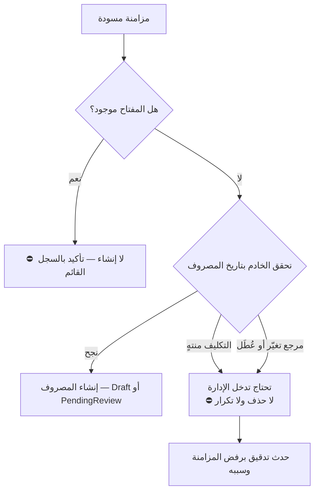

---

## 24. استيراد Excel والبيانات التاريخية

### 24.1 الملفات المصدرية وبصماتها

| # | الملف | الحجم | البصمة | الحالة |
|---|---|---|---|---|
| 1 | `الروضه 2026.xlsm` | 1,779,942 | MD5 `9cabb8f0a5a4f5583e1f4245b5feb765` | ✅ متاح |
| 2 | `دفتر تصفية العهد 2026.xlsx` | 1,537,750 | MD5 `4ca2aac07e192b5cde62c8ef9b3623a5` | ✅ متاح |
| 3 | `دفتر يومية المصروفات 2026.xlsx` | 1,233,457 | MD5 `a271ff05fc6385fca84fb42c18c7180b` | ✅ متاح |
| 4 | `دفتر تصفية الموردين 2026.xlsx` | 1,005,469 | **SHA-256 `b701435237260fdef3ed4843d1897ec369d185f0eb7fbeefd858e1884a1340a3`** · MD5 `6739c70e177e0772e7f7e7d9106f768b` | ✅ متاح |
| 5 | `هانى شاكر.xlsx` | 207,306 | MD5 `bdaaa6208cb0eecb1cb42fa2bef3fd08` | ✅ متاح — أغسطس 2026 فقط |
| 6 | **`الشيخ زايد 2026.xlsx` (نسخة 16 سبتمبر — المعتمدة)** | **985,492** | **MD5 `c3674d67ccbe99d3a0e6d24c25680a99`** | ✅ **المعتمد** |
| — | `الشيخ زايد 2026.xlsx` (نسخة 14 سبتمبر) | 986,687 | MD5 `0a17768f15f8de91fddf24fe03453a97` | ⛔ **مستبدَل — به 836 `#REF!`** |
| — | `الروضه 2025.xlsm` | — | **لا بصمة** | ❌ **غير متاح** |
| — | **13 ملف أجور موقع** | — | **لا بصمة** | ❌ **غير متاح — والمنهج معروف** |

> ⭐ **درس ملزم:** الملفان 6 و«14 سبتمبر» **بنفس الاسم ومختلفان**: 836 خلية `#REF!` أصبحت قيمًا، و23 كتلة شهرية تغيّرت. **الملف حيّ يتغيّر يوميًا** ⟹ **كل استيراد لقطة زمنية ببصمة** (BR-151 · BR-155).

### 24.2 الأوراق المرشَّحة للترحيل

| المصدر | الورقة | الصفوف الفعلية | يُرحَّل؟ |
|---|---|---|---|
| دفتر يومية المصروفات | `بيان المصروفات` (`الخزينه`) | **5,101** | ✅ |
| دفتر يومية المصروفات | `الوارد` | 519 | ✅ |
| دفتر يومية المصروفات | `دليل` | A1:S478 | ✅ **كثمانية جداول مرجعية** |
| دفتر تصفية العهد | `تصفية العهد` (`العهد`) | **8,086** | ✅ |
| دفتر تصفية الموردين | `تصفية الموردين` (`الموردين`) | **4,902** | ✅ |
| الروضه 2026 | `العملاء` (المستخلصات) | **204** | ✅ |
| الروضه 2026 | `شيكات` | **153** (الصفوف 4–194 فقط) | ✅ |
| الروضه 2026 | `دليل الحسابات` | A2:U479 | ✅ **الأصل** |
| الروضه 2026 | `ح المدينون` | 6 أرصدة افتتاحية | ✅ |
| ملف الأجور | 7 كشوف مواقع | **866 سطرًا** · 108 مورد تكلفة | ✅ |
| ملف الأجور | 4 تسويات مقاولين | كتل شهرية | ✅ |
| هانى شاكر | `المصروفات` + 6 أوراق مواقع | 128 + مصفوفات | ✅ |
| **12 ورقة تقارير في الروضه** | — | صيغ بحتة | ❌ **تصبح Views** |
| `موردين` · `ديون` · `ح موردين` | — | `#REF!` | ❌ **تقارير معطَّلة** |
| `Sheet1` · `pivot table` · `pivot عملاء` | — | Pivot | ❌ |

### 24.3 ⭐ فخّان مثبَتان يجب منعهما

#### الفخ الأول — صف `Total` داخل نطاق البيانات

**الواقع:** ورقة `العملاء` تحتوي في **الصف 985** على صف مجاميع جدول Excel بصيغ `SUBTOTAL(109, …)`.

**الخطر:** `SUBTOTAL(109,…)` يحسب **الصفوف الظاهرة فقط بعد الفلترة**. **واستيراد يبتلعه يضيف 30,299,223.55 وهمية لجملة الأعمال.**

**القاعدة الملزمة (FR-IMP-006 · FR-IMP-007):**

1. **يُرفض** أي صف قيمة عمود التسلسل (`م`) فيه **ليست رقمًا**.
2. **يُرفض** أي صف صيغته `SUBTOTAL` أو `AGGREGATE`.
3. ⭐ **مطابقة إلزامية**: مجموع الصفوف المستوردة = مجموع الورقة المحسوب مستقلًا، **وإلا تُوقَف الدفعة**.

**التسوية الموثَّقة:**

| البند | النطاق كله | − صف 985 | = **المعتمد** |
|---|---|---|---|
| تعليات | 118,040,846.14 | 8,558,427.45 | **109,482,418.69** |
| 5% ضمان اعمال | 13,180,588.09 | 1,044,401.95 | **12,136,186.14** |
| استكمال تأمين نهائى | 15,338,413.93 | 0.00 | **15,338,413.93** |
| تامين ازاله مخلفات | 533,677.82 | 52,220.10 | **481,457.72** |
| جمله الاعمال | 417,426,001.10 | 30,299,223.55 | **387,126,777.55** |

#### الفخ الثاني — خلية صيغة محذوفة

**الواقع:** `حى 1 زايد!U251` في ملف الأجور المعتمد **فارغة تمامًا** بينما كل أخواتها `=L−S−T`. و`SUBTOTAL(9,…)` **يتخطى الفارغ**.

**الأثر:** **+16,250.00** على إجمالي الصافي — فالمنشور في Excel `4,125,511.41` **والصحيح `4,109,261.41`**.

**القاعدة الملزمة (FR-IMP-008):** عند استيراد عمود محسوب، **يُعاد حساب القيمة من مكوّناتها وتُقارَن بما في الخلية**. و**الفراغ في عمود محسوب لا يُقرأ صفرًا** — بل يُعلَّم `صيغة مفقودة` **ويُحسب من المكوّنات**.

### 24.4 حقول Provenance الإلزامية لكل صف مستورد

```text
import_batch_id             ← الدفعة
source_file                 ← اسم الملف
source_sheet                ← الورقة
source_row                  ← الصف الأصلي
source_column_mapping_version ← نسخة خريطة التحويل
source_record_hash          ← بصمة السجل
file_sha256                 ← البصمة الأساسية — في import_batches فقط (⛔ لا تُكرَّر)
source_import_row_id        ← الربط بجدول Lineage
original_transaction_date   ← التاريخ المالي لا تاريخ الاستيراد
imported_at · imported_by
validation_status · error_message
source_formula              ← نص الصيغة الأصلية للمبالغ المركبة
source_name                 ← الاسم قبل التطبيع
```

### 24.5 سياسة `LEGACY` المعتمدة

| # | القاعدة |
|---|---|
| 1 | **`claim_series = LEGACY`** لكل سجل تاريخي مُرحَّل |
| 2 | **`legacy_sequence`** — معرّف داخلي **ثابت** لا يتغيّر بعد الترحيل، **ولا معنى تجاري له** |
| 3 | **`original_claim_reference`** — يحفظ النص الأصلي **حرفيًا** بمسافاته وأخطائه |
| 4 | **`source_import_row_id`** و**`source_record_hash`** **إلزاميان** |
| 5 | ⛔ **لا يُخترع رقم مستخلص تجاري** — لا ترقيم تقديري ولا إعادة بناء للتسلسل |
| 6 | ⭐ سجلات `LEGACY` **تُستثنى من تحقق التسلسل الطبيعي، ولا تُستثنى من المطابقة المالية** |
| 7 | **السجلات الجديدة** بعد التشغيل تخضع للتفرد الكامل وسلسلة حقيقية لا `LEGACY` |

### 24.6 حالات خاصة مرصودة تحتاج معالجة صريحة

| # | الحالة | المعالجة |
|---|---|---|
| 1 | **305 صف مكرر تمامًا** في `العهد` | **تحذير تشابه لا منع** + `client_generated_id` |
| 2 | **21 صف `عهد` = أرصدة أول المدة** (35,531.5) | ⟹ `opening_balances` **لا حركات** |
| 3 | `مرحل` في عمود مندوب العهدة | **رصيد افتتاحي لا شخص** |
| 4 | **78 حركة سالبة** في `الموردين` | كلها `فرق سعر` أو `رصيد اول المدة` ⟹ `price_adjustments` و`opening_balances` |
| 5 | **7 صفوف بكمية بلا سعر** | ⟹ **استلام غير مسعَّر** بعلامة |
| 6 | **`اسيوط` في عمود `نسبة الضريبة`** | **خطأ نوع** ⟹ يُرفض ويُعلَّم |
| 7 | **`مصروفات` مقابل `المصروفات`** | ⟹ **دمج في تصنيف واحد** بعد تطبيع |
| 8 | **`القاهرة الجديدة` مقابل `مدينة القاهرة الجديدة`** | ⟹ **دمج جهة إسناد** |
| 9 | **`الامارات` مقابل `بنك الامارات`** | ⟹ **دمج حساب مالي** |
| 10 | **`عمال حسين القناوى` مقابل `عمال حسين قناوى خوارج`** | ⟹ **يُستوردان منفصلين مع تنبيه تشابه** — ⛔ **ولا يُدمجان تلقائيًا** |
| 11 | **`استكمال العلمين` — أعمدة بأسماء نباتات** | **مصفوفة العمال أُعيد استخدامها لكميات مشتل** ⟹ **لا تُستورد كحضور** |
| 12 | **صفوف `شيكات` 197+ ملوَّثة بـPivot ملصوق** | **النطاق الصالح: الصفوف 4–194 فقط** |
| 13 | **`تم القبض` = 87,637.0772** يُصفّر الصافي بالضبط | ⚪ **plug** ⟹ يُستورد بحالة **`يحتاج مستندًا`** |
| 14 | **بيانات `التطوير الجديد` في ديسمبر وفراغ أبريل–نوفمبر** | يُرحَّل بتاريخه مع علامة **`تاريخ مشكوك فيه`** |
| 15 | **صافي سالب** (−21,100 · −37,823.77 · −16,250) | **يُرحَّل رصيدًا مدوَّرًا مدينًا** — ⛔ **لا يُصفَّر ولا يُخفى** |
| 16 | **خطوة الكتل الشهرية غير ثابتة** بين أوراق الأجور | ⛔ **أي مستورد يعتمد إزاحة ثابتة سيُتلف البيانات** ⟹ **اكتشاف الكتل بالبحث عن `عــن شهـــر:` وصف `الإجمالى`** |

---

## 25. المطابقة المالية والأرصدة الافتتاحية

### 25.1 مجاميع الرقابة المعتمدة

| المصدر | البند | القيمة المعتمدة |
|---|---|---|
| **ملف الأجور** | إحمالي المستحق | **8,502,043.69** |
| | السلف الحاليه | 1,659,128.00 |
| | الحالى من سلف مستديمة | 131,220.58 |
| | خصومات | 101,446.69 |
| | تم القبض | 2,500,987.02 |
| | **الصافي المستحق** | ⛔ ~~4,125,511.41 (قيمة Excel خاطئة)~~ ⟹ ✅ **4,109,261.41** |
| | **تكلفة الأجور على العمليات** (`L − R`) | **8,400,597.00** |
| **`العملاء`** | جمله الاعمال | **387,126,777.55** |
| | تعليات | **109,482,418.69** |
| | 5% ضمان اعمال | **12,136,186.14** |
| | استكمال تأمين نهائى | **15,338,413.93** |
| | تامين ازاله مخلفات | **481,457.72** |
| **الدفاتر** | `الخزينه` | 5,101 صفًا · 259,069,818 |
| | `الوارد` | 519 صفًا · 1,036,800,827 |
| | `العهد` | 8,086 صفًا · ~19,100,000 |
| | `الموردين` | 4,902 صفًا · 104,890,003.53 |
| | `شيكات` | 153 شيكًا · 50,190,000 |

### 25.2 ⭐ علاقة أرقام المحتجزات — الإجابة الصريحة

```
المحتجزات القائمة 27,474,600.07
    = 5% ضمان أعمال 12,136,186.14
    + استكمال تأمين نهائى 15,338,413.93
```

> ⭐ **و`تعليات` (109,482,418.69) و`تامين ازاله مخلفات` (481,457.72) خارج هذا الرقم** — ولا تُجمع معه.

**التوزيع بتاريخ استعلام 2026-09-16:**

| الفئة | المبلغ |
|---|---|
| **عمليات انتهى تسليمها ⟹ مبلغ محتمل مستحق المتابعة** | **4,792,152.37** (18 أمرًا) |
| تنتهي خلال 12 شهرًا | 11,101,022 |
| أبعد | 679,764 |
| **عمليات بلا `تاريخ التسليم النهائى` مسجل** | **11,138,575** (5 أوامر · 11 صفًا) |
| **الإجمالي** | **27,474,600** |

> ⭐ **تسمية ملزمة (BR-171 · BR-172):**
> - `27,474,600.07` = **«إجمالي المبالغ التاريخية المسجَّلة في عمودي `5% ضمان اعمال` و`استكمال تأمين نهائى`»** — ⛔ **وليس «رصيد محتجزات قائم مؤكد»**، لأن **الرصيد الافتتاحي غير متاح** و**الردود السابقة غير مكتملة التسجيل**.
> - `4,792,152.37` = **«مبلغ محتمل مستحق المتابعة بتاريخ الاستعلام، بافتراض عدم وجود ردود غير مسجَّلة»** — ⛔ **ولا يُقال «ولا أحد يطالب بها» بلا دليل**.

### 25.3 فحوص المطابقة الإلزامية

| # | الفحص | المصدر | التسامح |
|---|---|---|---|
| RC-01 | عدد أسطر كشف الأجور | صفوف بين الترويسة والإجمالى | **صفر** |
| RC-02…RC-04 | إجمالي اليوميات · السهرات · إحمالي المستحق | الأعمدة F · I · L | 0.01 |
| RC-05 | `السلف الحاليه` | العمود M مقابل مجموع الحركات | **صفر** |
| RC-06…RC-08 | القسط · الخصومات · إجمالي الاستقطاعات | P · R · S | 0.01 |
| RC-09 | `تم القبض` | العمود T مقابل مدفوعات معتمدة | **يُبلَّغ بالفرق** |
| RC-10 | `الصافي المستحق` | العمود U | 0.01 |
| RC-11 | **تكلفة أجور العملية** | `L − R` | 0.01 |
| RC-12 | **مطابقة السلف الثلاثية** | الكشف = حسابات الأجور = الخزينة + العهدة | **صفر** |
| RC-13 | رصيد السلف المستديمة | من الحركات | يُوثَّق الفرق |
| RC-14…RC-16 | مستحق المقاول · رصيد تعلياته · سطور خصوماته | كتل التسوية | 0.01 / صفر |
| RC-17 | ⭐ **عدم ازدواج المقاول** | لا مقاول له تسوية وسطر كشف بنفس القيمة والشهر | **صفر** |
| RC-18 | الصافي السالب | يُرصد استثناءً | تقرير |
| RC-19 | **بصمة الملف** | `file_sha256` في `import_batches` | يُسجَّل |
| RC-20 | **صافي الأجور** | 4,109,261.41 | ⚠️ **فرق متوقَّع معلوم 16,250.00** من `U251` — **يُوقَّع كفرق معلوم لا كخطأ ترحيل** |
| RC-21 | ⭐ **صف مجاميع داخل النطاق** | صف `Total` بصيغة `SUBTOTAL` | **لا تسامح — الرفض إلزامي** |
| RC-22 | **مجموع الدفعة المستوردة** | = مجموع الورقة المحسوب مستقلًا | **صفر — وإلا تتوقف الدفعة** |

### 25.4 الأرصدة الافتتاحية

| # | الرصيد | المصدر | الحالة |
|---|---|---|---|
| OB-01 | **أرصدة 27 مندوب عهدة** | `العهد` — 21 صفًا بـ35,531.5 + رصيد `مرحل` | 🟡 **يحتاج اعتماد — من يعتمدها؟** |
| OB-02 | **أرصدة 110 موردًا** | `الموردين` — حركات `رصيد اول المدة` | 🟡 **يحتاج اعتماد** |
| OB-03 | **محتجزات ما قبل 2026** | `الروضه 2025.xlsm` **غير متاح** | ❌ **غير معلوم — ولن يُعلم قبل توفر الملف** |
| OB-04 | **6 أرصدة `ح المدينون`** | `ح المدينون` | 🟡 **يحتاج تصنيفًا واعتمادًا** |
| OB-05 | **تعليات المقاولين السابقة** | الكتلة الأولى في ورقة التسوية = رصيد 2025 | 🟡 |

**القاعدة الملزمة (FR-IMP-016):** ⛔ **لا يُعتمد رصيد افتتاحي بلا مصدر وتاريخ ومعتمِد.**

### 25.5 ما لا يمكن إغلاقه من المصدر الحالي — إعلان صريح

| # | البند | السبب |
|---|---|---|
| 1 | **رصيد المحتجزات الافتتاحي** | `الروضه 2025.xlsm` غير متاح |
| 2 | **اكتمال ردود المحتجزات السابقة** | **صفر قيمة سالبة** في الأعمدة الأربعة ⟹ الردود غير مكتملة التسجيل |
| 3 | **بيانات أجور 13 موقعًا** | الملفات غير متاحة |
| 4 | **تصنيف 21,819,378.93 غير مصنَّفة** | ينتظر المحاسب |
| 5 | **تصحيح تضخيم 7,802,857** (أمر 64) | ينتظر قرار صاحب المشروع |
| 6 | **ثلاث تسويات مشتبه في تكرارها** | ينتظر قرار صاحب المشروع |
| 7 | **أربعة مستندات يعتبرها العقد جزءًا منه** | لم تصل — ⛔ **ولا تُفترض محتوياتها** |
---

## 26. استراتيجية الـAPI

> ⛔ **لا تُصمَّم نقاط نهاية نهائية في هذه الجولة.** النموذج المنطقي لم يُعتمد بعد، وتصميم API قبله يُنتج واجهات تُعاد كتابتها. **وما يُحدَّد الآن هو القدرات (Capabilities) لا التوقيعات.**

### 26.1 المبادئ الحاكمة

| # | المبدأ | السبب |
|---|---|---|
| 1 | **الـAPI يعكس مفاهيم العمل لا جداول القاعدة** | تغيّر الجدول لا يجب أن يكسر العميل |
| 2 | ⭐ **كل عملية تعدّل بيانات تمرّ بفحص صلاحية في الخادم** | ⛔ **الواجهة ليست أمانًا** (BR-018 · BR-138) |
| 3 | ⭐ **كل عملية مالية تقبل `Idempotency-Key`** | منع الأثر المزدوج من إعادة الطلب (BR-103) |
| 4 | ⭐ **كل استجابة خطأ تشرح ما منع الحفظ وكيف يُصحَّح** | ⛔ لا رسائل تقنية خام (NFR-USE-007) |
| 5 | **الترقيم والتصفية موحَّدان عبر كل القوائم** | اتساق العميل |
| 6 | **كل استدعاء يحمل `CorrelationId`** | ربط Serilog بحدث التدقيق للتشخيص فقط |
| 7 | ⛔ **لا نقطة نهاية تحذف معاملة مالية معتمدة** | (BR-187 · BR-213) |
| 8 | **الإصدار في المسار** (`/api/v1/…`) | كسر التوافق لا يُمرَّر صامتًا |

### 26.2 قدرات الـAPI المطلوبة — Capabilities

| # | القدرة | الوحدة | الملاحظة الملزمة |
|---|---|---|---|
| CAP-01 | مصادقة وإصدار جلسة | Identity | — |
| CAP-02 | قراءة صلاحيات المستخدم الفعّالة | Identity | تشمل **`Payroll.View` صراحةً** |
| CAP-03 | **قراءة عمليات المهندس ومواقعه بتاريخ** | EngineerAssignments | ⭐ **المحرك الأساسي لنموذج المصروف** — يعيد العمليات المسموح بها **ومواقعها داخل كل عملية** و**أمر إسناد كل عملية** |
| CAP-04 | قراءة أنواع المصروفات الفعّالة | ReferenceData | للتخزين المحلي بلا إنترنت |
| CAP-05 | **إنشاء مسودة مصروف** | Expenses | يقبل `Client Event ID` · ويرفض بلا عملية أو موقع أو أمر إسناد |
| CAP-06 | **مزامنة دفعة مسودات** | Expenses | ⭐ **Idempotent** · والتحقق **بتاريخ المصروف** |
| CAP-07 | إرسال مصروف للمراجعة | Expenses | يطبّق التحققات العشرة |
| CAP-08 | طلب توضيح / الرد عليه | Expenses | تعليق نصي إلزامي |
| CAP-09 | **اعتماد مصروف** | Expenses | ⭐ **معاملة واحدة** تكتب الأثرين وحدث التدقيق |
| CAP-10 | **تصحيح مصروف معتمد** | Expenses | ⛔ **لا تعديل للأصل** |
| CAP-11 | رفع مرفق وحذفه قبل الاعتماد | Files | ⛔ **لا يمنع غيابه أي خطوة** |
| CAP-12 | **قراءة رصيد العهدة ودفترها** | Custody | ⭐ **مشتق — لا حقل رصيد** |
| CAP-13 | تسجيل تسليم / مرتجع / تحويل / تصحيح عهدة | Custody | ⛔ المهندس لا ينشئ تسليمًا |
| CAP-14 | تسجيل يومية ودفعة يوميات | Workers | ⛔ **بلا أثر مالي** |
| CAP-15 | إعداد كشف أجور واعتماده | Workers | ⛔ **بلا حركة نقدية** |
| CAP-16 | تسجيل سلفة / دفعة عامل | Workers | خفض نقدي **مرة واحدة** |
| CAP-17 | إدارة موارد التكلفة وسياسات الأجر | Workers | ⛔ **لا صيغة حرة** |
| CAP-18 | إدارة الأطراف وأدوارهم ومعرّفاتهم | Parties | ⛔ **لا تفرّد على الاسم** |
| CAP-19 | **مراجعة مرشحي التشابه** | Parties | ⭐ **ينبّه ولا يدمج** |
| CAP-20 | إدارة العمليات وأوامر الإسناد والمواقع | Operations | ⭐ **أمر الإسناد إلزامي للتفعيل** |
| CAP-21 | **إدارة تكليفات المهندسين** | EngineerAssignments | ⭐ **الأدمن وحده** |
| CAP-22 | إدارة المقايسة وبنودها المتكررة | Operations | القيد **للمرة الواحدة فقط** |
| CAP-23 | إدارة اتفاقات الشركات الخارجية وإصداراتها | Contracts | ⛔ **لا تفعيل بلا rate وbasis ومستند** |
| CAP-24 | **تطبيق حصة الشركة الخارجية** | Contracts | ⭐ **Snapshot سباعي Immutable** |
| CAP-25 | إدارة المستخلصات ومساراتها | Claims | تفرّد (عقد · سلسلة · رقم) |
| CAP-26 | إدارة أنواع الاستقطاع وقواعدها المؤرَّخة | Claims | فترات **غير متداخلة داخل النطاق** |
| CAP-27 | **احتساب استقطاعات مستخلص** | Claims | ⭐ **Snapshot للمعالجة المحاسبية** |
| CAP-28 | إدارة أوامر الدفع وسطور توزيعها | Claims | **قيمة صريحة** |
| CAP-29 | إدارة التحصيلات وتخصيصاتها | Claims | **غير المخصَّص والزيادة مدعومان** |
| CAP-30 | إدارة دفتر المحتجزات وردّها وشطبها | Retentions | **شرط رد لا تاريخ** |
| CAP-31 | إدارة الضمانات وأحداثها | Guarantees | **الاتجاهان + تمييز الأداة** |
| CAP-32 | إدارة الموردين والتوريدات والفواتير والدفعات والشيكات | Suppliers | — |
| CAP-33 | إدارة اتفاقات المقاولين وتسوياتهم | Subcontractors | ⛔ **لا ازدواج مع كشف الأجور** |
| CAP-34 | **دورة المصروف القابل للاسترداد** | Subcontractors | مطالبة · تخصيص · تحصيل · شطب · نزاع |
| CAP-35 | إدارة رواتب المهندسين وقواعد توزيعها | EngineerPayroll | **الافتراضي بلا توزيع** |
| CAP-36 | **قراءة قائمة التقارير وتحميل تقرير** | Reporting | ⭐ **يتطلب `Payroll.View` لأي تقرير يحتوي رواتب** |
| CAP-37 | **توليد التقرير الشهري يدويًا** | Reporting | ⭐ **Idempotent** |
| CAP-38 | **إعادة إرسال التقرير لمستلم** | Reporting | ⛔ **لا تنشئ إصدارًا** |
| CAP-39 | إدارة مستلمي التقرير والجدولة | Reporting | **بيانات لا كود** |
| CAP-40 | **قراءة سجل التدقيق والبحث فيه** | Audit | ⛔ **قراءة فقط — لا تعديل ولا حذف** |
| CAP-41 | تصدير سجل التدقيق | Audit | **التصدير الجماعي حدث تدقيق** |
| CAP-42 | تشغيل دفعة استيراد ومتابعتها | Imports | ⛔ **لا بدء بلا بصمة** |
| CAP-43 | مراجعة أخطاء الاستيراد ومعالجتها | Imports | ⛔ **لا حذف لصف مرفوض** |
| CAP-44 | قراءة التنبيهات وإدارتها | Notifications | **قواعد التنبيه بيانات** |

### 26.3 ما يُؤجَّل إلى ما بعد اعتماد النموذج المنطقي

| # | البند |
|---|---|
| 1 | أسماء نقاط النهاية وأفعالها وتوقيعاتها |
| 2 | شكل أجسام الطلب والاستجابة |
| 3 | نموذج الترقيم والتصفية التفصيلي |
| 4 | رموز الأخطاء التفصيلية |
| 5 | آلية المصادقة المحددة وصلاحية الرموز |
| 6 | استراتيجية الإصدارات التفصيلية |

---

## 27. مبادئ تصميم الواجهة وتجربة المستخدم

### 27.1 المبادئ العامة

| # | المبدأ | المعيار |
|---|---|---|
| 1 | ⭐ **RTL كامل** | كل الشاشات والتقارير والرسائل — بما فيها الجداول والنماذج والتنبيهات |
| 2 | ⭐ **الواجهة تتكلم لغة العمل** | «المهندسون» · «العمال» · «الموردون» — ⛔ **ولا يظهر «Party» للمستخدم** (BR-055) |
| 3 | ⭐ **أقل عدد خطوات في الشاشة الأكثر استخدامًا** | نموذج المصروف **≤ 4 حقول إلزامية**، و**≤ 2** عند الوحدانية |
| 4 | ⭐ **لا رقم بلا وصف** | كل رصيد يظهر مع **عبارة تفسيرية** (BR-027) |
| 5 | **الواجهة تجربة استخدام لا أمان** | ⛔ **إخفاء الزر ليس منعًا** — الخادم يتحقق دائمًا |
| 6 | **رسالة الخطأ تشرح وتقترح** | ما منع الحفظ وكيف يُصحَّح |
| 7 | **الموبايل أولًا لشاشات المهندس** | تعمل على عرض **360 بكسل** بلا تمرير أفقي |
| 8 | **الطباعة مدعومة للتقارير الأساسية** | A4 بلا قص ولا انقلاب اتجاه |

### 27.2 شاشة المصروف — التصميم المُلزِم

**الترتيب الثماني (BR-203):**

```
1. العملية              [إلزامية — تُحدَّد تلقائيًا إن كانت واحدة]
2. الموقع داخل العملية   [إلزامي — يُحدَّد تلقائيًا إن كان واحدًا]
3. أمر الإسناد           [تلقائي · Read Only · سطر تأكيد لا حقل إدخال]
4. نوع المصروف           [إلزامي — من قائمة]
5. المبلغ                [إلزامي — أكبر من صفر]
6. إرفاق فاتورة أو صورة  [«اختياري» — مكتوبة في نص الزر]
7. بيان أو ملاحظة        [اختياري — إلزامي مع «أخرى» فقط]
8. إرسال للمراجعة
```

**مثال العرض المُلزِم لأمر الإسناد:**

```
العملية:      صيانة وتطوير أحياء الشيخ زايد
أمر الإسناد:  137
الموقع:       الحي الحادي عشر
```

**سلوك الاختيار التلقائي (BR-204):**

| الحالة | السلوك |
|---|---|
| عملية فعّالة واحدة | **تُحدَّد تلقائيًا** ويظهر اسمها وأمر إسنادها **كتأكيد مختصر** |
| أكثر من عملية | **Dropdown بالمسموح بها فقط** |
| بعد تحديد العملية | تظهر **المواقع المكلَّف بها داخلها فقط** |
| موقع واحد داخل العملية | **يُحدَّد تلقائيًا** |
| أكثر من موقع | Dropdown |
| **تغيير العملية** | **تتغيّر قائمة المواقع وأمر الإسناد تلقائيًا** |

**الرحلة المثلى:** `العملية → الموقع → نوع المصروف → المبلغ → إرسال` — **وتصل إلى `نوع المصروف → المبلغ → إرسال` عند وحدانية العملية والموقع**.

**⛔ حقول ممنوعة في نموذج المهندس (BR-208):** طريقة الدفع · مصدر الدفع · المدفوع إليه.

### 27.3 قواعد عرض حساسة

| # | القاعدة |
|---|---|
| 1 | **الرصيد الموجب** يُعرض بعبارة **«متبقٍ مع المهندس»** · **والسالب** بعبارة **«الشركة مدينة له»** |
| 2 | **كل مبلغ دالة في تاريخ الاستعلام** يُعرض **بتاريخه مرفقًا به** |
| 3 | **الحركات غير المعتمدة** تُعرض في **قسم منفصل بصريًا** عن الإجماليات الرسمية |
| 4 | **التكلفة والنقد المنصرف** يُعرضان **متجاورين بعنوانين مختلفين**، ⛔ **ولا يُجمعان في رقم واحد** |
| 5 | **شاشة سجل التدقيق للقراءة فقط** — ⛔ **لا أزرار تعديل أو حذف إطلاقًا** |
| 6 | **أقسام الرواتب** لا تُعرض ولا تُطبع لمن لا يملك `Payroll.View` |

---

## 28. الاختبارات

### 28.1 استراتيجية الاختبار

| المستوى | ما يغطيه | ملاحظة |
|---|---|---|
| **Unit** | حسابات الأجور والاستقطاعات والتقريب وقواعد السهرة | تُختبر بأرقام المجاميع الرقابية المرصودة فعلًا |
| **Integration** | ⭐ **ذرّية المعاملة المالية وحدث التدقيق** · Idempotency · المزامنة | **أهم مستوى في هذا النظام** |
| **Contract** | ثبات قدرات الـAPI بين الواجهة والخادم | بعد اعتماد النموذج المنطقي |
| **End-to-End** | رحلات UC-009 → UC-014 · UC-022 → UC-024 · UC-026 → UC-028 | بسيناريوهات واقعية |
| **Data Migration** | ⭐ **كل فحوص المطابقة RC-01…RC-22** | **الدفعة تتوقف عند فشل أي فحص بتسامح صفر** |
| **Security** | التحقق في الخادم · حجب البيانات · استقلال `Payroll.View` | — |
| **Performance** | أرقام NFR-PERF بأحجام 2026 المرصودة | — |

### 28.2 ⭐ معايير القبول الحرجة — Given / When / Then

> **هذه المعايير هي التي يُحكم بها على النظام. وفشل أيٍّ منها يمنع الإطلاق.**

#### AC-018 — المهندس لا يرى إلا المواقع المكلَّف بها

```gherkin
Given  مهندس مكلَّف بالموقع "الحي 11" داخل عملية "الشيخ زايد" بتكليف ساري
And    يوجد موقع "الحي 9" في العملية نفسها غير مكلَّف به
When   يفتح نموذج المصروف ويختار العملية
Then   تحتوي قائمة المواقع على "الحي 11" فقط
And    لا تحتوي على "الحي 9"
```

#### AC-020 — Backend يمنع تسجيل المصروف لموقع غير مكلَّف به

```gherkin
Given  مهندس غير مكلَّف بالموقع "الحي 9"
When   يُرسل طلب API معدَّل يحمل site_id الخاص بـ"الحي 9"
Then   يرفض الخادم الطلب برمز 403
And    لا يُنشأ أي سجل مصروف
And    تُسجَّل محاولة الوصول المرفوضة في سجل التدقيق
```

#### AC-019 — أمر الإسناد يُملأ تلقائيًا ولا يمكن تغييره

```gherkin
Given  مهندس مكلَّف بمواقع في عمليتين لكل منهما أمر إسناد مختلف
When   يختار العملية الأولى
Then   يظهر أمر إسنادها تلقائيًا للقراءة فقط
And    لا يوجد حقل إدخال يتيح تعديله
When   يغيّر الاختيار إلى العملية الثانية
Then   يتغيّر أمر الإسناد تلقائيًا إلى أمر إسناد العملية الثانية
And    تتغيّر قائمة المواقع إلى مواقع العملية الثانية
```

#### AC-038 — المصروف غير المعتمد لا يؤثر في الرصيد

```gherkin
Given  مهندس رصيد عهدته 10,000
And    له مصروف بمبلغ 1,200 في حالة PendingReview
When   يُقرأ رصيد العهدة
Then   يكون الرصيد 10,000
And    لا يظهر 1,200 في أي إجمالي رسمي
And    يظهر 1,200 في قسم "الحركات تحت المراجعة" منفصلًا
```

#### AC-027 — الاعتماد المتكرر لا ينشئ حركة عهدة ثانية

```gherkin
Given  مصروف بمبلغ 1,200 في حالة PendingReview
When   يُرسل طلب الاعتماد مرتين بنفس المعرّف
Then   تُنشأ حركة عهدة واحدة فقط بقيمة 1,200
And    يُنشأ قيد تكلفة عملية واحد فقط
And    يُسجَّل حدث تدقيق واحد للاعتماد
And    يكون الرصيد النهائي 8,800 لا 7,600
```

#### AC-029 — التصحيح لا يمحو القيد الأصلي

```gherkin
Given  مصروف معتمد بمبلغ 1,500 وله حركة عهدة وقيد تكلفة
When   يُنشأ تصحيح بمبلغ 300 بسبب موثَّق
Then   يبقى سجل المصروف الأصلي بمبلغ 1,500 كما هو
And    تبقى حركة العهدة الأصلية كما هي
And    تُنشأ حركة تصحيح مستقلة مرتبطة بالأصل
And    يُسجَّل حدثا تدقيق مرتبطان: الأصل والتصحيح
```

#### AC-023 / AC-026 — المرفق الاختياري لا يمنع الاعتماد

```gherkin
Given  مصروف بمبلغ 250,000 بلا أي مرفق
When   يُرسل للمراجعة ثم يُعتمد
Then   ينجح الإرسال
And    ينجح الاعتماد
And    لا تظهر أي رسالة تطلب مرفقًا كشرط
```

```gherkin
Given  محاولة تهيئة حد مبلغ يجعل المرفق مطلوبًا
When   تُحفظ الإعدادات
Then   لا يوجد أي إعداد من هذا النوع في النظام
```

#### AC-024 / AC-025 — التصنيف «أخرى» يطلب بيانًا

```gherkin
Given  مصروف نوعه "أخرى" وحقل البيان فارغ
When   يُحاول الحفظ أو الإرسال
Then   يُرفض برسالة تطلب البيان صراحةً
```

```gherkin
Given  مصروف نوعه "وقود — سولار" وحقل البيان فارغ
When   يُحفظ ويُرسل
Then   ينجح الاثنان بلا أي مطالبة ببيان
```

#### AC-123 — سلفة العامل لا تُخصم مرتين

```gherkin
Given  عامل صُرفت له سلفة 5,000 خفضت الخزينة مرة واحدة
When   يُعتمد كشف أجور الشهر ويُخصم منه 5,000 كاستقطاع
Then   لا تُخفَّض الخزينة مرة ثانية
And    لا تُخفَّض عهدة المهندس مرة ثانية
And    يقل الصافي المستحق للعامل بمقدار 5,000
And    تكون تكلفة الأجور على العملية = إحمالي المستحق − خصومات، بلا طرح السلفة
```

#### AC-041 — فشل مستلم تقرير لا يمنع بقية المستلمين

```gherkin
Given  تقرير شهري Generated وله ثلاثة مستلمين نشطين مخوَّلين
And    بريد المستلم الثاني يفشل
When   تُنفَّذ مهمة الإرسال
Then   يصل التقرير إلى المستلمين الأول والثالث
And    تُسجَّل محاولة فاشلة للمستلم الثاني بسببها وموعد محاولتها التالية
And    تكون حالة التقرير PartiallySent لا Failed
```

#### AC-046 — إعادة الإرسال لا تنشئ Version جديدة

```gherkin
Given  تقرير شهر سبتمبر 2026 بالإصدار 1 وقد أُرسل
When   يُعاد إرساله لمستلم واحد
Then   يبقى رقم الإصدار 1
And    لا يُنشأ Snapshot جديد ولا ملف PDF جديد
And    تُسجَّل محاولة إرسال جديدة في سجل الإرسال فقط
```

#### AC-045 — إعادة التوليد تنشئ Version جديدة

```gherkin
Given  تقرير شهر سبتمبر 2026 بالإصدار 1
And    تغيّرت بيانات الشهر بعد إصداره
When   يُعاد توليد التقرير
Then   يُنشأ الإصدار 2 بـSnapshot جديد وملف جديد ببصمة جديدة
And    يظهر Label الإصدار الثاني بصيغة "تقرير شهر سبتمبر 2026 — الإصدار 2"
```

#### AC-044 — التقرير القديم وSnapshot الخاص به لا يتغيّران

```gherkin
Given  تقرير الإصدار 1 محفوظ بـSnapshot وملف وبصمة SHA-256
When   تتغيّر بيانات الشهر ويُنشأ الإصدار 2
Then   يبقى ملف الإصدار 1 كما هو ببصمته نفسها
And    يبقى Snapshot الإصدار 1 كما هو
And    يبقى الإصداران معًا قابلين للعرض
```

#### AC-047 — من لا يملك `Payroll.View` لا يرى تقرير الرواتب

```gherkin
Given  مستخدم بدور Admin بلا صلاحية Payroll.View
When   يحاول تحميل التقرير الشهري الكامل
Then   يُرفض الطلب
And    لا يصل إليه التقرير بالبريد
And    تُسجَّل محاولة الوصول المرفوضة في سجل التدقيق
```

#### AC-002 / AC-014 — فشل Audit الحرج يؤدي إلى Rollback

```gherkin
Given  مصروف في حالة PendingReview
And    كتابة حدث التدقيق ستفشل داخل المعاملة
When   يُنفَّذ الاعتماد
Then   يحدث Rollback كامل
And    تبقى حالة المصروف PendingReview
And    لا تُنشأ حركة عهدة ولا قيد تكلفة
```

#### AC-013 — توقف منصة السجلات لا يمنع المعاملة المالية

```gherkin
Given  منصة تجميع السجلات غير متاحة
When   يُعتمد مصروف
Then   ينجح الاعتماد
And    تُكتب حركة العهدة وقيد التكلفة وحدث التدقيق
And    لا يحدث Rollback
```

#### AC-015 — Serilog لا يحتوي رواتب ولا أسرارًا

```gherkin
Given  عملية اعتماد كشف أجور تحتوي مبالغ رواتب
When   يُفحص محتوى سجلات Serilog الناتجة
Then   لا يظهر أي مبلغ راتب
And    لا يظهر أي اسم مقترن بمبلغ
And    لا تظهر كلمة مرور ولا رمز ولا سلسلة اتصال ولا رقم حساب بنكي كامل
```

#### AC-212 — إعادة استيراد الملف نفسه لا تضاعف البيانات

```gherkin
Given  دفعة استيراد مكتملة لملف ببصمة SHA-256 محددة
When   يُستورد الملف نفسه مرة ثانية
Then   لا يُنشأ أي سجل مالي مكرر
And    يُكتشف التكرار عبر source_record_hash وIdempotency Key
And    يُعرض تقرير يبيّن الصفوف المتطابقة
```

#### AC-008 / AC-028 — إعادة محاولة مزامنة Offline لا تضاعف المصروف

```gherkin
Given  مسودة مصروف على الجهاز لها Client Event ID محدد
When   تُزامَن ثلاث مرات بسبب انقطاع الشبكة
Then   يوجد مصروف واحد فقط على الخادم
And    يوجد حدث تدقيق واحد فقط لإنشائه
```

#### AC-007 — تطبيق نسبة الشركة الخارجية يستخدم نسخة الاتفاق الصحيحة

```gherkin
Given  اتفاق شركة خارجية له الإصدار 1 بنسبة 10% ساري حتى 2026-06-30
And    الإصدار 2 بنسبة 12% ساري من 2026-07-01
And    أمر دفع سبق إصداره في 2026-05-15 بالإصدار 1
When   يُصدر أمر دفع جديد بتاريخ 2026-08-10
Then   يُطبَّق الإصدار 2 بنسبة 12%
And    يُحفظ Snapshot سباعي يحمل نسخة الاتفاق 2
And    يبقى Snapshot أمر الدفع السابق على الإصدار 1 بنسبة 10% بلا تغيير
```

#### AC-166 — اتفاق ناقص لا يُفعَّل ولا ينشئ تسوية

```gherkin
Given  اتفاق شركة خارجية بلا basis محدد
When   تُحاول تفعيله
Then   يُرفض التفعيل ويبقى Draft
And    لا يمكن إنشاء تسوية مالية تستند إليه
And    لا يرث النظام basis من أي اتفاق آخر
```

#### AC-022 — لا إرسال بلا عملية أو موقع أو أمر إسناد

```gherkin
Given  مسودة مصروف ينقصها الموقع
When   تُرسل للمراجعة
Then   تُرفض برسالة تحدد الحقل الناقص
And    تبقى الحالة Draft
```

#### AC-098 — لا يوجد رصيد مخزَّن قابل للتعديل

```gherkin
Given  فحص كامل لنموذج البيانات
When   يُبحث عن أي حقل رصيد قابل للتعديل اليدوي في دفتر مالي
Then   لا يوجد أي حقل من هذا النوع
And    كل رصيد يُحسب من دفتر حركاته
```

#### AC-214 — مطابقة مجموع الاستيراد إلزامية

```gherkin
Given  ورقة Excel تحتوي صف مجاميع بصيغة SUBTOTAL داخل نطاق البيانات
When   تُشغَّل دفعة الاستيراد
Then   يُرفض صف المجاميع صراحةً
And    يطابق مجموع الصفوف المستوردة مجموع الورقة المحسوب مستقلًا
And    لا تضاف أي مبالغ وهمية إلى الإجماليات
```

### 28.3 إحصاء معايير القبول

| المصدر | العدد |
|---|---|
| **AC-001 … AC-015** — مرحَّلة من ق-1…ق-15 (التدقيق والتسجيل) | 15 |
| **AC-016 … AC-029** — مرحَّلة من ق-16…ق-29 (المصروف) | 14 |
| **AC-030 … AC-049** — مرحَّلة من ق-30…ق-49 (التقرير الشهري) | 20 |
| **AC-050 … AC-232** — جديدة في هذه الوثيقة | 183 |
| **الإجمالي** | **232** |
| منها **⭐ حرجة بصيغة Given/When/Then** | **24** |

> ⭐ **AC-001 … AC-049 هي بالضبط ق-1 … ق-49 في مستندات المرحلة صفر — ترقيم موازٍ بلا إعادة صياغة.**

### 28.3.1 ⭐ جدول المقابلة الكامل — ق ↔ AC

| AC | ≡ | نص المعيار المختصر | المصدر |
|---|---|---|---|
| **AC-001** | ق-1 | اعتماد مصروف يُنشئ أثرًا ماليًا وحدث تدقيق **داخل نفس المعاملة** | ملحق التدقيق |
| **AC-002** | ق-2 | **فشل حفظ حدث التدقيق ⟹ Rollback لاعتماد المصروف** | ملحق التدقيق |
| **AC-003** | ق-3 | تعديل مسودة يسجل **القيم التي تغيّرت ومن غيّرها** | ملحق التدقيق |
| **AC-004** | ق-4 | طلب التوضيح يسجل **المراجع والتعليق والتاريخ** | ملحق التدقيق |
| **AC-005** | ق-5 | التصحيح بعد الاعتماد **لا يغيّر الأصل** — حركة مرتبطة والحدثان مسجَّلان | ملحق التدقيق |
| **AC-006** | ق-6 | إقفال الفترة وإعادة فتحها يسجل **المستخدم والسبب والتاريخ والموافقة** | ملحق التدقيق |
| **AC-007** | ق-7 | تغيير نسبة شركة خارجية **ينشئ إصدار اتفاق جديدًا ولا يغيّر المستخلصات السابقة** | ملحق التدقيق |
| **AC-008** | ق-8 | تكرار المزامنة بنفس المفتاح **لا يُنشئ معاملة ولا حدثًا مكررًا** | ملحق التدقيق |
| **AC-009** | ق-9 | الاستيراد يسجل **الدفعة ومصدر السجل ونتيجة الاستيراد** | ملحق التدقيق |
| **AC-010** | ق-10 | **الأدمن العادي لا يستطيع تعديل أو حذف حدث تدقيق** | ملحق التدقيق |
| **AC-011** | ق-11 | المخوَّل يقرأ سجل حركة **من البداية إلى آخر تصحيح** | ملحق التدقيق |
| **AC-012** | ق-12 | ربط سجل Serilog بالطلب وبحدث التدقيق عبر **`CorrelationId`** | ملحق التدقيق |
| **AC-013** | ق-13 | **توقف منصة تجميع السجلات لا يمنع المعاملة المالية** | ملحق التدقيق |
| **AC-014** | ق-14 | **فشل كتابة التدقيق في قاعدة البيانات يمنع اكتمال المعاملة** | ملحق التدقيق |
| **AC-015** | ق-15 | **البيانات الحساسة لا تظهر في السجلات ولا في لقطات التدقيق دون حجب** | ملحق التدقيق |
| **AC-016** | ق-16 | عملية واحدة وموقع واحد ⟹ **الثلاثة تُحدَّد تلقائيًا** | ملحق العمليات |
| **AC-017** | ق-17 | عملية واحدة وعدة مواقع ⟹ العملية وأمر الإسناد تلقائيان **ويختار الموقع** | ملحق العمليات |
| **AC-018** | ق-18 | عدة عمليات ⟹ يختار العملية **ثم تظهر مواقعه داخلها فقط** | ملحق العمليات |
| **AC-019** | ق-19 | **تغيير العملية يغيّر قائمة المواقع وأمر الإسناد تلقائيًا** | ملحق العمليات |
| **AC-020** | ق-20 | **لا يمكن اختيار موقع تابع لعملية مختلفة** | ملحق العمليات |
| **AC-021** | ق-21 | **لا يمكن اختيار موقع غير مكلف به المهندس** | ملحق العمليات |
| **AC-022** | ق-22 | **لا إرسال بلا عملية أو موقع أو أمر إسناد** | ملحق العمليات |
| **AC-023** | ق-23 | **يمكن الإرسال والاعتماد دون فاتورة** | ملحق العمليات |
| **AC-024** | ق-24 | **«أخرى» تتطلب بيانًا** | ملحق العمليات |
| **AC-025** | ق-25 | المصروف العادي **لا يتطلب بيانًا** | ملحق العمليات |
| **AC-026** | ق-26 | **المرفق اختياري مهما كانت القيمة** | ملحق العمليات |
| **AC-027** | ق-27 | **الاعتماد يخصم المبلغ مرة واحدة من عهدة المهندس** | ملحق العمليات |
| **AC-028** | ق-28 | **تكرار المزامنة لا ينشئ مصروفًا ولا حدث تدقيق مكررًا** | ملحق العمليات |
| **AC-029** | ق-29 | **المصروف المعتمد لا يتغيّر مباشرة** | ملحق العمليات |
| **AC-030** | ق-30 | بعد إقفال الشهر **ينشئ النظام تقرير PDF تلقائيًا** | ملحق التقرير |
| **AC-031** | ق-31 | يظهر باسم **«تقرير شهر سبتمبر 2026»** | ملحق التقرير |
| **AC-032** | ق-32 | **يمكن تحميل الـPDF من شاشة التقارير** | ملحق التقرير |
| **AC-033** | ق-33 | يحتوي **المصروفات حسب التصنيف** | ملحق التقرير |
| **AC-034** | ق-34 | يحتوي **يوميات العمالة المرتبطة بكل مهندس** | ملحق التقرير |
| **AC-035** | ق-35 | يحتوي **رواتب المهندسين** | ملحق التقرير |
| **AC-036** | ق-36 | يحتوي **إجمالي كل موقع وكل عملية** | ملحق التقرير |
| **AC-037** | ق-37 | **يفرّق بين التكلفة والاستحقاق والنقد المنصرف** | ملحق التقرير |
| **AC-038** | ق-38 | **غير المعتمد لا يدخل الإجمالي الرسمي** | ملحق التقرير |
| **AC-039** | ق-39 | **المرسل يطابق Snapshot المحفوظ** | ملحق التقرير |
| **AC-040** | ق-40 | يُرسل **لكل المستلمين النشطين المخوَّلين** | ملحق التقرير |
| **AC-041** | ق-41 | **فشل مستلم واحد لا يمنع الباقين** | ملحق التقرير |
| **AC-042** | ق-42 | **يمكن إعادة الإرسال لمستلم واحد** | ملحق التقرير |
| **AC-043** | ق-43 | **إعادة تشغيل المهمة لا ترسل رسائل مكررة** | ملحق التقرير |
| **AC-044** | ق-44 | **تغيّر البيانات بعد الإصدار لا يغيّر الـPDF القديم** | ملحق التقرير |
| **AC-045** | ق-45 | **إعادة التوليد تنشئ Version جديدة** | ملحق التقرير |
| **AC-046** | ق-46 | **إعادة الإرسال لا تنشئ Version جديدة** | ملحق التقرير |
| **AC-047** | ق-47 | **مستخدم بلا `Payroll.View` لا يستطيع تحميل التقرير الكامل** | ملحق التقرير |
| **AC-048** | ق-48 | **كل الإنشاء والإرسال في سجل التدقيق** | ملحق التقرير |
| **AC-049** | ق-49 | **عطل مزوّد البريد لا يفقد التقرير المحفوظ** | ملحق التقرير |

> ⭐ **AC-050 … AC-232 جديدة في هذه الوثيقة**، وكل واحد منها مرتبط بمتطلب في §10 وبحالة اختبار في `requirements-traceability-matrix-ar.md`.


### 28.4 تغطية معايير القبول الحرجة المطلوبة

| # | المطلوب في الطلب | المعرّف | ✅ |
|---|---|---|---|
| 1 | المهندس لا يرى إلا المواقع المكلف بها | **AC-018** | ✅ |
| 2 | Backend يمنع تسجيل المصروف لموقع غير مكلف به | **AC-020** | ✅ |
| 3 | أمر الإسناد يُملأ تلقائيًا ولا يمكن تغييره | **AC-019** | ✅ |
| 4 | المصروف غير المعتمد لا يؤثر في الرصيد | **AC-038** | ✅ |
| 5 | الاعتماد المتكرر لا ينشئ حركة عهدة ثانية | **AC-027** | ✅ |
| 6 | التصحيح لا يمحو القيد الأصلي | **AC-029** | ✅ |
| 7 | المرفق الاختياري لا يمنع الاعتماد | **AC-023** · **AC-026** | ✅ |
| 8 | التصنيف «أخرى» يطلب بيانًا | **AC-024** · **AC-025** | ✅ |
| 9 | سلفة العامل لا تُخصم مرتين | **AC-123** | ✅ |
| 10 | فشل مستلم تقرير لا يمنع بقية المستلمين | **AC-041** | ✅ |
| 11 | إعادة إرسال التقرير لا تنشئ Version | **AC-046** | ✅ |
| 12 | إعادة التوليد تنشئ Version | **AC-045** | ✅ |
| 13 | التقرير القديم وSnapshot لا يتغيّران | **AC-044** | ✅ |
| 14 | من لا يملك Payroll.View لا يرى تقرير الرواتب | **AC-047** | ✅ |
| 15 | فشل Audit الحرج يؤدي إلى Rollback | **AC-002** · **AC-014** | ✅ |
| 16 | Serilog لا يحتوي رواتب أو أسرارًا | **AC-015** | ✅ |
| 17 | إعادة استيراد الملف نفسه لا تضاعف البيانات | **AC-212** | ✅ |
| 18 | إعادة محاولة مزامنة Offline لا تضاعف المصروف | **AC-008** · **AC-028** | ✅ |
| 19 | تطبيق نسبة الشركة الخارجية يستخدم نسخة الاتفاق الصحيحة | **AC-007** | ✅ |

**التغطية: 19 / 19.**

---

## 29. مصفوفة التتبع

> **المرجع الكامل:** **`requirements-traceability-matrix-ar.md`** — وفيه الربط الكامل لكل متطلب بـ: قاعدة العمل · حالة الاستخدام · كيانات البيانات · الصلاحية · حدث التدقيق · معيار القبول · حالة الاختبار · المستند المصدر · الحالة.

### 29.1 نتيجة فحص التتبع

| الفحص | النتيجة |
|---|---|
| متطلبات بلا قاعدة عمل أو قرار مصدر (**يتيمة**) | ✅ **صفر** |
| قواعد عمل بلا متطلب يطبّقها | ⚠️ **9** — كلها 🔵 مقترحة أو قواعد **تسمية ووصف** لا سلوك (تفاصيل في §29.2) |
| متطلبات حرجة بلا معيار قبول | ✅ **صفر** |
| معايير قبول بلا حالة اختبار | ✅ **صفر** |
| حالات استخدام بلا متطلبات مرتبطة | ✅ **صفر** |
| كيانات بيانات بلا سبب عمل | ✅ **صفر** |
| متطلبات مالية بلا أثر Audit معلَن | ✅ **صفر** |

### 29.2 القواعد بلا متطلب مباشر — مُعلَنة لا مخفية

| BR | لماذا لا متطلب مباشر له |
|---|---|
| **BR-092** | **حقيقة رصد** (شيك الضمان غير مسجَّل في `شيكات`) لا قاعدة سلوك — أثرها في FR-CLM-035 |
| **BR-095** | **إحصاء يبرر BR-093** (26% من القيم بكسور > منزلتين) — لا سلوك مستقل |
| **BR-113** · **BR-116** · **BR-122** · **BR-123** · **BR-126** · **BR-129** | **بنود عقد التيسير الوصفية** — تُسجَّل بيانات عقد، ولا يفرض أيٌّ منها سلوكًا برمجيًا مستقلًا |
| **BR-130** | **عيب توثيقي في العقد** (البند 14 مفقود · لا بند اختصاص) ⟹ **يحتاج مراجعة قانونية لا كودًا** — وسُجِّل كـ**RISK-012** |
| **BR-171** · **BR-172** | **قواعد تسمية ووصف** للأرقام المنشورة — تُطبَّق في §25.2 و§2.4 وفي كل تقرير، ولا تُنفَّذ كمتطلب وظيفي |

> ✅ **وهذا ليس نقصًا في التتبع بل تصنيفًا صحيحًا:** ليست كل قاعدة قاعدةَ سلوك برمجي.

### 29.3 تغطية القواعد الحرجة المطلوبة في الطلب

| # | القاعدة المطلوبة صراحةً | BR | FR | AC |
|---|---|---|---|---|
| 1–3 | شركات مملوكة وخارجية · الروضة والأقصى والأمل · الخارجية ليست مملوكة | BR-001 · BR-002 · BR-159 | FR-009 · UC-003 | AC-068 |
| 4–5 | اتفاق مستقل لكل عملية بتسعة عناصر · **لا تعميم** | **BR-170** · BR-004 | FR-CLM-011 · FR-CLM-012 | **AC-007** · AC-166 |
| 6 | التيسير قاعدتها مثبتة ولا تُعمَّم | BR-114 · BR-170 | FR-CLM-011 | AC-007 |
| 7–9 | العملية أكبر · الموقع داخلها · أمر إسناد إلزامي | **BR-196** … **BR-198** | FR-015 · FR-017 | **AC-022** · AC-077 |
| 10–11 | أمر الإسناد تلقائي Read Only · لا يكتبه المهندس | **BR-199** | FR-EXP-002 | **AC-019** |
| 12–15 | الأدمن يربط · المهندس يرى المكلَّف به · الوصول مشتق من المواقع · لا علاقة إضافية بلا حاجة | **BR-017** · **BR-201** | FR-019 · FR-023 · FR-024 | **AC-018** |
| 16–20 | نموذج سريع قليل الحقول · الحقول الأربعة · التعبئة التلقائية · البيان مع «أخرى» · المرفق اختياري دائمًا | **BR-203** … **BR-207** | FR-EXP-001 · FR-EXP-005 · FR-EXP-012 | **AC-016** · **AC-023** … **AC-026** |
| 21 | لا طريقة دفع ولا مصدر دفع ولا مدفوع إليه | **BR-208** | FR-EXP-001 | AC-016 |
| 22–23 | الحالات الأربع · لا رفض نهائي | **BR-209** | FR-EXP-010 | AC-103 |
| 24–25 | لا أثر قبل الاعتماد · أثر واحد في العهدة | **BR-213** · **BR-219** | FR-EXP-018 · FR-EXP-019 | **AC-027** · **AC-038** |
| 26–27 | عهدة واحدة لعدة مواقع · الرصيد بنص واضح | BR-024 · **BR-027** | FR-CUS-008 · FR-CUS-009 | AC-099 |
| 28–29 | الوارد يسجله الموظف · المهندس لا يؤكد | **BR-025** · **BR-140** | FR-CUS-001 · FR-CUS-002 | AC-094 |
| 30 | لا حذف ولا تعديل صامت · التصحيح بعكس مرتبط | **BR-187** · **BR-213** | FR-EXP-011 · FR-CLM-027 | **AC-029** |
| 31 | اللوادر حسابات تجميعية لا أشخاص | **BR-030** · **BR-031** | FR-010 · FR-011 | AC-070 |
| 32 | فصل الحضور والاستحقاق والسلفة والدفع والتسوية | **BR-046** … **BR-050** | FR-WRK-001 · FR-WRK-009 … 015 | AC-120 · **AC-123** |
| 33 | لا خصم يومية مرتين من العهدة | **BR-049** | FR-WRK-012 | **AC-123** |
| 34 | فصل تكلفة الشهر عن النقد المنصرف | **BR-222** | FR-REP-007 | **AC-037** |
| 35 | التقرير الشهري بأحد عشر شرطًا | **BR-215** … **BR-242** | FR-REP-005 … FR-REP-027 | **AC-030** … **AC-049** |
| 36 | محتوى التقرير التسعة | **BR-218** · **BR-228** | FR-REP-006 · FR-REP-027 | **AC-033** … **AC-037** |
| 37 | حسم مصدر رواتب المهندسين وقاعدة توزيعها · وحتى ذلك بند مستقل | **BR-225** · **BR-226** | FR-PAY-002 · FR-PAY-004 | AC-131 · AC-133 |
| 38 | لا تُحسب اليوميات لأكثر من مهندس أو موقع | BR-021 · **BR-106** | FR-WRK-018 | AC-129 |
| 39–42 | Audit مستقل عن Serilog بثمانية شروط | **BR-182** … **BR-195** | FR-AUD-001 … FR-AUD-018 | **AC-001** … **AC-015** |
| 43–44 | PostgreSQL · Modular Monolith | **BR-156** · **BR-157** | ADR-001 · ADR-002 | — |
| 45–46 | لا Soft Delete عام · المرجعية تُعطَّل والمالية تُصحَّح | **BR-187** · CON-01 · CON-03 | FR-013 · FR-EXP-011 | AC-072 |
| 47 | أسماء Excel محفوظة للعرض والترحيل · والتقنية إنجليزية واضحة | CON-04 · §18.1 | FR-003 · FR-IMP-003 | AC-062 · AC-210 |

**التغطية: 47 / 47.**

---

## 30. التشغيل والنشر والنسخ الاحتياطي

### 30.1 البيئات

| البيئة | الغرض | وجهة السجلات | البيانات |
|---|---|---|---|
| **التطوير** | تطوير واختبار | Console | بيانات مُولَّدة — ⛔ **لا بيانات إنتاج حقيقية** |
| **التشغيل** | العمل الفعلي | منصة مراقبة مركزية | بيانات حقيقية |
| **(اختياري) الاختبار** | قبول المستخدم وتجربة الترحيل | Console أو منصة | **نسخة مُقنَّعة** من الإنتاج | 🔵 Proposed |

### 30.2 النشر

| # | القاعدة | الحالة |
|---|---|---|
| 1 | **النشر لا يبدأ قبل موافقة صريحة على النموذج المنطقي** | 🟢 |
| 2 | **كل إصدار يحمل `ApplicationVersion` تظهر في كل سجل Serilog** | 🟢 BR-193 |
| 3 | **تغيّرات بنية قاعدة البيانات تمرّ بمراجعة معتمدة** قبل التطبيق | 🔵 |
| 4 | **نافذة صيانة معلَنة قبل 48 ساعة وخارج ساعات العمل** | 🔵 |
| 5 | **إمكانية التراجع عن الإصدار** موثَّقة لكل نشر | 🔵 |

### 30.3 النسخ الاحتياطي والاسترجاع

| البند | القيمة | الحالة |
|---|---|---|
| نسخة كاملة لقاعدة البيانات | **يوميًا** | 🔵 Proposed |
| سجل معاملات مستمر | **نعم** | 🔵 Proposed |
| **RPO** | **≤ 15 دقيقة** | 🔵 Proposed |
| **RTO** | **≤ 4 ساعات** | 🔵 Proposed |
| **اختبار استرجاع كامل** | **كل 3 أشهر وتوثيق نتيجته** | 🔵 Proposed |
| **نسخ التخزين الخاص** | **بمعزل عن قاعدة البيانات** | 🟢 BR-233 |
| مدة الاحتفاظ بالنسخ | **12 شهرًا** — والمالي يتبع السياسة المحاسبية والقانونية | 🔵 Proposed · 🟡 يحتاج قرار |

> ⭐ **نسخة احتياطية غير مختبَرة ليست نسخة احتياطية.**

### 30.4 المراقبة والتنبيه التشغيلي

| # | ما يُراقَب | القناة |
|---|---|---|
| 1 | فشل المهام الخلفية | منصة المراقبة + تنبيه |
| 2 | فشل إرسال البريد | منصة المراقبة + سجل الإرسال |
| 3 | أخطاء الاستيراد | تقرير الدفعة + المنصة |
| 4 | الطلبات البطيئة تجاوز حدود NFR-PERF | المنصة |
| 5 | محاولات الدخول الفاشلة والوصول غير المصرَّح | Serilog + التدقيق |
| 6 | امتلاء التخزين الخاص | المنصة |

---

## 31. Architecture Decisions

> **المرجع الكامل:** **`architecture-decision-records-ar.md`**. وهذه فهرسة فقط.

| ADR | العنوان | الحالة |
|---|---|---|
| **ADR-001** | PostgreSQL قاعدة بيانات واحدة لكل النظام | ✅ **Accepted** |
| **ADR-002** | Modular Monolith لا Microservices | ✅ **Accepted** |
| **ADR-003** | ASP.NET Core للـBackend | ✅ **Accepted** |
| **ADR-004** | React PWA للواجهة | ✅ **Accepted** |
| **ADR-005** | Private File Storage خارج قاعدة البيانات | ✅ **Accepted** |
| **ADR-006** | سجل تدقيق مالي منفصل عن Serilog | ✅ **Accepted** |
| **ADR-007** | التصحيحات المالية Append-only | ✅ **Accepted** |
| **ADR-008** | العمل بلا إنترنت للمسودات فقط | ✅ **Accepted** |
| **ADR-009** | القواعد المالية مُصدَّرة (Versioned Rules) | ✅ **Accepted** |
| **ADR-010** | التقارير الشهرية مُصدَّرة وغير قابلة للتعديل | ✅ **Accepted** |
| **ADR-011** | دفتر الحركات المنطقي مصدر الرصيد | ✅ **Accepted** |
| **ADR-012** | Markdown هو التوثيق الرسمي (Canonical) | ✅ **Accepted** |
| **ADR-013** | نسخة تفاعلية مولَّدة من Markdown | ✅ **Accepted** |
| **ADR-014** | تصميم قاعدة البيانات قبل الـAPI التفصيلي | ✅ **Accepted** |
| **ADR-015** | **Snapshot لأمر الإسناد على المصروف المعتمد** | ✅ **Accepted** — يحسم BR-214 |
| **ADR-016** | Party Model موحَّد بلا Multi-tenancy | ✅ **Accepted** |
| **ADR-017** | كشف التشابه بدل قيود التفرّد على الأسماء | ✅ **Accepted** |
| **ADR-018** | Idempotency Key مدخلًا إلزاميًا لكل مصدر خارجي | ✅ **Accepted** |

---

## 32. القرارات المفتوحة

> ⛔ **لا يُبنى على أيٍّ من هذه رقم مالي ولا جدول.** وكل واحد منها له **افتراض عامل معلَّم** يسمح بالمضي في التصميم.

### 32.1 قرارات لا تمنع التصميم ولا الترحيل

| OQ | السؤال | من يقرر | الافتراض العامل | أثر التأجيل |
|---|---|---|---|---|
| **OQ-001** | **مدة الاحتفاظ بسجل التدقيق المالي، ومن يعتمد أي حذف أو أرشفة** | المدير + المحاسب | ⛔ **لا حذف حتى تُعتمد سياسة** | **لا أثر بنيوي** — الحقل موجود والسياسة تُملأ |
| **OQ-002** | **منصة تجميع السجلات النهائية** | قرار تشغيلي | الوجهة **إعداد بيئة** | **لا أثر على النموذج** |
| **OQ-003** | **سقف مبلغ اعتماد موظف الإدارة** | المدير | ⚪ **سقف ثم تصعيد** · والقيمة الفارغة = بلا سقف | **لا أثر بنيوي** |
| **OQ-004** | **أي التقارير أساسي في النسخة الأولى** | المدير | **التوصية: 8–10 تقارير** | يطيل النسخة الأولى |
| **OQ-005** | **هل المحاسب يرى تكلفة كل العمليات أم محددة؟** | المدير | ⚪ **كل العمليات** | نطاق صلاحية لا بنية |
| **OQ-006** | **دورية التقرير الإداري: يومي أم أسبوعي؟** | المدير | ⚪ **أسبوعي** | — |
| **OQ-007** | **آلية المهام الخلفية (Hangfire أو بديلها)** | التصميم الفيزيائي | Hangfire 🔵 اقتراح | — |
| **OQ-008** | **آلية Idempotency (فهرس · قيد · مفتاح)** | التصميم الفيزيائي | **المبدأ ملزم الآن** | — |
| **OQ-009** | **شكل التخزين الخاص ومدة الرابط المؤقت** | التصميم الفيزيائي | 15 دقيقة 🔵 | — |
| **OQ-010** | **آلية الاعتراض العام للتدقيق** | التصميم الفيزيائي | EF Core Interceptor أو مكافئ | — |
| **OQ-011** | **شكل تخزين فروق الحقول** (سطر لكل حقل أم لقطة أم الاثنان) | النموذج المنطقي | **مقترح في `logical-data-model-ar.md` §15** | — |
| **OQ-012** | **`requires_dual_acceptance` مفعَّلة أم لا؟** | المدير | ⚪ **مفعَّلة** | إعداد |
| **OQ-013** | **سقف السلف المستديمة وقواعد أقساطها** | المدير | ⚪ **بلا سقف** · حقل اختياري | — |
| **OQ-014** | **مدة فترة الضمان لكل عقد** | من العقد | ⚪ **سنة من التسليم الابتدائي** | — |
| **OQ-015** | **مدة تصعيد مراجعة المصروفات** | المدير | ⚪ **تنبيه 3 أيام · تصعيد 7** | — |

### 32.2 قرارات تمنع الترحيل لا التصميم

| OQ | السؤال | الأثر الرقمي | الافتراض العامل |
|---|---|---|---|
| **OQ-016** | **المعالجة المحاسبية للمصروف القابل للاسترداد** — ذمة مدينة من لحظة الصرف أم مصروف عملية ثم قيد استرداد؟ | يغيّر **ربحية كل عملية بها طرف خارجي أو مقاول** | ⚪ **ذمة مدينة** — **والدورة تدعم الاثنين بلا تغيير جدول واحد** · **يحتاج اعتماد المحاسب** |
| **OQ-017** | **مدى الترحيل: 2026 فقط أم 2025 وما قبلها؟** | حجم المشروع وزمنه | ⚪ **2026 + أرصدة افتتاحية** |
| **OQ-018** | **تصحيح ازدواج 2026 بأثر رجعي أم من تاريخ التشغيل؟** | ترحيل أرقام 2026 ومطابقتها | ⚪ **ترحيل كما هو + تقرير فروق موقَّع** · والتصحيح من تاريخ التشغيل |
| **OQ-019** | **`تعليات` و`استكمال تأمين نهائى` و`تامين ازاله مخلفات` — أيها `REFUNDABLE_RETENTION` فعلًا؟** | **15,819,871.65** للبندين غير المحسومين | ✅ التعليات **محتجز** (نص + رد فعلي 12,731,150) · ❓ **الآخران غير محسومين — لا نص يدعمهما** |
| **OQ-020** | **`تامينات مقاولات`** | **1,481,595** | ⚪ `LIABILITY_TO_THIRD_PARTY` — **يحتاج المحاسب** |
| **OQ-021** | **`ضريبه ارباح 1% و3%`** | **4,150,387** | ⚪ `PREPAID_TAX_ASSET` — **يحتاج المحاسب** |
| **OQ-022** | **`فرق الضريبة`** — التزام فعلي؟ | **14,941,272** | ❓ **لا افتراض — معالجة ضريبية لا تُفترض** |
| **OQ-023** | **التسويات الثلاث المتطابقة** | 80,173.80 × 3 | تُستورد بعلامة **`تكرار مشتبه به`** ولا تُرحَّل محاسبيًا |
| **OQ-024** | **أمر الإسناد 64** — صف واحد أم ثلاثة؟ | تصحيح تضخيم **7,802,857** | التصميم يمنع التكرار مستقبلًا · **والترحيل يحتاج قرارك** |
| **OQ-025** | **من يعتمد الأرصدة الافتتاحية؟** | **نقطة بداية كل الأرصدة** | `opening_balances` بمصدر وتاريخ وموافقة |
| **OQ-026** | **`خصم عميل`** — توزيعه على الفئات الست | **5,999,217** على 83 مستخلصًا | يُستورد `UNCLASSIFIED_SUSPENSE` · وفئة «خصم ثابت مسعَّر» **موثَّقة بفئاتها** |
| **OQ-027** | **المستفيد البنكي شخص طبيعي وحساب واحد لجهتين — ما التفويض؟** | **تدقيق لا ترحيل** | يُسجَّل كما هو **مع تنبيه تدقيق إلزامي** |
| **OQ-028** | **مستخلصات مدمجة** (25 صفًا) | **79,362,406** | تُستورد بعلامة `مدمج` وتُستثنى من تحقق التسلسل |
| **OQ-029** | **صف الأجور `حى 1 زايد!251`** — رصيد مدين أم تحصيل غير مسجَّل؟ | **−16,250.00** | يُرحَّل **رصيدًا مدينًا** بعلامة `يحتاج مراجعة` |
| **OQ-030** | **بصمات الملفات الناقصة** | `الروضه 2025` + 13 ملف أجور | ⛔ **لا يُرحَّل ملف بلا بصمة SHA-256** |

### 32.3 🟡 القراران اللذان ينتقلان إلى النموذج المنطقي — وحُسما فيه

| # | القرار | الحسم |
|---|---|---|
| 1 | **تمثيل راتب المهندس نفسه** كبند رواتب شهرية | ✅ **حُسم:** كيان `EngineerPayrollEntry` مستقل في **Domain 8** — والتفاصيل في `logical-data-model-ar.md` §8 |
| 2 | **قاعدة توزيع الراتب** من الخيارات الأربعة | 🟡 **لم يُحسم — قرار المدير والمحاسب** · **والافتراضي المثبَّت: «بلا توزيع»** (BR-226) — **والكيان `EngineerSalaryAllocationRule` موجود ومُصدَّر وجاهز لأي خيار** |

### 32.4 Blocking Decisions

> ## ✅ **لا يوجد Blocking Decision واحد.**

**التحقق:** فُحص كل قرار مفتوح بالسؤال: **«هل يؤدي الحسم المعاكس إلى نموذج بيانات مختلف جذريًا؟»**

| القرار | الحسم المعاكس | يغيّر البنية؟ |
|---|---|---|
| OQ-016 (المعالجة المحاسبية للاسترداد) | مصروف عملية ثم قيد استرداد | ❌ **لا** — **قيد محاسبي واحد عند الإنشاء**، والدورة الستّية تدعم الاثنين |
| قاعدة توزيع الراتب | أي من الخيارات الأربعة | ❌ **لا** — الكيان مُصدَّر ويقبل أي قاعدة |
| OQ-019…OQ-022 (المعالجات المحاسبية) | أي تصنيف آخر | ❌ **لا** — **قيمة حقل مرجعي** داخل بنية قائمة |
| OQ-017 (مدى الترحيل) | توسيعه | ❌ **لا** — حجم بيانات لا بنية |
| OQ-003 (سقف الاعتماد) | بلا سقف | ❌ **لا** — الحقل الفارغ يعني بلا سقف |

---

## 33. المخاطر

| RISK | الخطر | الاحتمال | الأثر | الضابط | المرجع |
|---|---|---|---|---|---|
| **RISK-001** | **استخدام Serilog بديلًا للتدقيق المالي عند الضغط** | متوسط | 🔴 **عالٍ** — فقد الإثبات المالي | **قاعدة صريحة** + فصل الوجهات + **منع وصول الفريق التقني لمحتوى الأحداث المالية** | BR-183 · BR-192 |
| **RISK-002** | **حساب أرصدة من سجل التدقيق لأنه «أسهل»** | متوسط | 🔴 **عالٍ** — أرقام خاطئة في تقارير رسمية | **قاعدة صريحة** + **التقارير من الدفاتر حصرًا** | BR-184 · BR-246 |
| **RISK-003** | **كتابة التدقيق خارج المعاملة «لتحسين الأداء»** | متوسط | 🔴 **عالٍ** — حركة مالية بلا مسؤول | **قاعدة صريحة** + **AC-002 و AC-014** | BR-186 |
| **RISK-004** | **تسريب بيانات حساسة داخل لقطات القيم قبل/بعد** | متوسط | 🔴 **عالٍ** | **الحجب قبل الكتابة** + **AC-015** | BR-191 |
| **RISK-005** | **حذف سجلات تدقيق بحجة المساحة** | منخفض | 🔴 **عالٍ** | **سياسة احتفاظ معتمدة** + **الأرشفة نقل لا إتلاف** | BR-190 |
| **RISK-006** | **تضخم حجم التدقيق وتأثيره على الأداء** | مرتفع | 🟡 متوسط | سياسة احتفاظ متدرجة + أرشفة — **والضبط الفني في التصميم الفيزيائي** | — |
| **RISK-007** | **الاكتفاء بالاعتراض العام فيضيع المعنى التجاري** | مرتفع | 🟡 متوسط | **المستويان معًا إلزاميان** | BR-185 |
| **RISK-008** | **تكرار أحداث التدقيق من المزامنة** | مرتفع | 🟡 متوسط | **Idempotency Key إلزامي** + **AC-008** | BR-188 |
| **RISK-009** | **الالتفاف على منع التعديل بكتابة حدث تدقيق زائف** | منخفض | 🔴 **عالٍ** | **قاعدة صريحة** — التصحيح بحركة لا بسجل | BR-187 |
| **RISK-010** | **اعتبار غياب سجل Serilog دليلًا على عدم وقوع حركة** | متوسط | 🟡 متوسط | **Serilog ليس مصدر إثبات** | BR-183 |
| **RISK-011** | ⭐ **الترحيل يضاعف الأثر المالي التاريخي** | مرتفع | 🔴 **عالٍ جدًا** | **سبع طبقات منع ازدواج** + **مطابقة مجموع إلزامية** + **رفض صفوف المجاميع** + **إعادة حساب الأعمدة المحسوبة** | BR-100…BR-106 · FR-IMP-005…008 |
| **RISK-012** | **عيوب توثيقية في العقد** (البند 14 مفقود · لا بند اختصاص ولا تحكيم) | مؤكد | 🟡 متوسط | **يُسجَّل عيبًا يحتاج مراجعة قانونية** — ⛔ **ولا يُفترض بند غائب** | **BR-130** |
| **RISK-013** | **أربعة مستندات يعتبرها العقد جزءًا منه ولم تصل** | مؤكد | 🟡 متوسط | ⛔ **لا تُفترض محتوياتها** · ويُسجَّل النقص | 📊 |
| **RISK-014** | ⭐ **رصيد المحتجزات الافتتاحي غير معلوم** ولن يُعلم قبل `الروضه 2025.xlsm` | مؤكد | 🔴 **عالٍ** | ⛔ **لا يُوصف 27,474,600.07 بأنه رصيد قائم** · والتسمية الملزمة في BR-171 | **BR-171** |
| **RISK-015** | **11,138,575 محتجزة معلَّقة لأن `تاريخ التسليم النهائى` فارغ** | مؤكد | 🔴 **عالٍ** | **تعبئته من العقود مهمة يدوية لمرة واحدة تساوي ملايين** | DEP-07 |
| **RISK-016** | **دمج طرفين حقيقيين بقيد تفرّد على الاسم** | مرتفع | 🔴 **عالٍ** — فقد هوية | ⛔ **لا تفرّد على الاسم المطبَّع** + **كشف تشابه ينبّه ولا يدمج** | BR-100 · BR-168 |
| **RISK-017** | **مستورد يعتمد إزاحة ثابتة للكتل الشهرية** | مرتفع | 🔴 **عالٍ** — إتلاف بيانات | **اكتشاف الكتل بالبحث النصي لا بالإزاحة** | 📊 |
| **RISK-018** | **الملف المصدر يتغيّر يوميًا فيُرحَّل الخطأ** | مؤكد | 🟡 متوسط | **كل استيراد لقطة ببصمة** + **لا اعتماد لملف بلا بصمة** | BR-151 · BR-155 |
| **RISK-019** | **تسريب بيانات الرواتب عبر التقرير الشهري** | متوسط | 🔴 **عالٍ** | **`Payroll.View` مستقلة** + **بريد منفصل** + **تصنيف Confidential** + **لا رابط عام** | BR-235 · BR-245 |
| **RISK-020** | **تحميل راتب المهندس على موقع عشوائي بلا سياسة** | مرتفع | 🟡 متوسط — تشويه تكلفة الموقع | ⛔ **منع صريح** + **الافتراضي بلا توزيع** + **بيان صريح في التقرير** | BR-225 · BR-226 |
| **RISK-021** | **إضافة حقل «طريقة الدفع» أو «مدفوع إليه» لاحقًا بحسن نية** | متوسط | 🟡 متوسط — كسر نموذج العهدة | ⛔ **منع مثبَّت صراحةً** لئلا يُضاف لاحقًا | **BR-208** |
| **RISK-022** | **جعل المرفق إجباريًا بحد مبلغ لاحقًا** | متوسط | 🟡 متوسط — تعطيل الإدخال الميداني | ⛔ **منع مثبَّت: لا حد مبلغ يجعله مطلوبًا** | **BR-207** |
| **RISK-023** | **تنفيذ التحقق العابر للجداول كـ`CHECK`** | متوسط | 🔴 **عالٍ** — ضمان وهمي | ⛔ **منع صريح** + توثيق البدائل الأربعة | **BR-180** |
| **RISK-024** | **الاعتماد على إخفاء العنصر في الواجهة أمانًا** | مرتفع | 🔴 **عالٍ** | **الخادم يتحقق دائمًا** + **AC-020** | BR-018 · BR-138 |
| **RISK-025** | **عدم اعتماد المحاسب للمعالجات فيبقى 21.8 مليون غير مصنَّف** | مرتفع | 🟡 متوسط | **`UNCLASSIFIED_SUSPENSE` صريح** ⛔ **ولا يُخترع تصنيف** | BR-149 |

---

## 34. Future Scope

| # | البند | السبب |
|---|---|---|
| **FS-01** | **نسخة مختصرة من التقرير الشهري بلا أقسام الرواتب** | ⛔ **مؤجَّل ولا يُفترض وجوده الآن** — والسلوك الافتراضي: **لا إرسال ولا تحميل** لمن لا يملك `Payroll.View` |
| **FS-02** | **`Opened At` لتتبع فتح البريد** | يُدعم **فقط إذا دعمه المزوّد بصورة معتمدة** — **ويُعامل مؤشرًا لا إثباتًا** |
| **FS-03** | **رابط تحميل آمن مؤقت بدل المرفق عند تجاوز الحجم** | التصميم يدعمه لاحقًا — **ويظل مؤقتًا ومرتبطًا بالمستخدم** ⛔ **لا Public URL** |
| **FS-04** | **مسار التشوينات في المستخلص** | **غير مستخدم لديكم** — يبقى في النموذج **معطَّلًا** |
| **FS-05** | **مطابقة بنكية إلكترونية آلية** | المطابقة يدوية أولًا |
| **FS-06** | **إدارة الأصول والمعدات كأصول ثابتة** | الحساب التجميعي **يجوز ربطه بأصل لاحقًا بقرار الإدارة** |
| **FS-07** | **تكامل e-finance ومنظومة الفاتورة الإلكترونية** | تُسجَّل يدويًا كمرجع |
| **FS-08** | **إعداد الإقرارات الضريبية** | النظام يسجّل الاستقطاع ولا يُعدّ الإقرار |
| **FS-09** | **تطبيق موبايل أصلي** | React PWA يغطي الموبايل |
| **FS-10** | **تعدد العملات** | حقل العملة موجود · والنظام أحادي العملة في النسخة الأولى |
| **FS-11** | **توقيع إلكتروني معتمد** | الاعتماد داخل النظام `approved_by` + `approved_at` |
| **FS-12** | **إشعارات Push** | التنبيه بالبريد وداخل التطبيق |
| **FS-13** | **العمل الكامل بلا إنترنت** (غير المسودات) | ADR-008 |
| **FS-14** | **ترحيل 2022–2025** | مسار «قراءة فقط» موسوم `تاريخي غير مدقق` |
| **FS-15** | **دمج الأطراف الآلي** | ⛔ **كشف التشابه ينبّه ولا يدمج** — والدمج قرار بشري دائمًا |

---

## 35. Change Log

| الإصدار | التاريخ | نوع التغيير | ما تغيّر | السبب |
|---|---|---|---|---|
| 🟢 ⭐ **2.0.1** | 2026-09-20 | 🟠 **PATCH تصحيحي** | ⭐ **باتش `logical-model-correction-patch-v2.0.1-ar.md`**: **مصفوفة آثار الحدث المالي** · **قيد واحد لكل حدث وإلغاء `posting_sequence`** · ⭐ **`accounting_adjustments` (الكيان الوحيد المضاف)** · **قواعد سطور القيد** · **تخصيصات الخزينة بحدث مالي** · **`funding_source` ⟸ `settlement_mode`** · **`financial_accounts` ⟸ `treasury_accounts`** · **قواعد `instrument`** · **استراتيجية الاستيراد** · **تقسيم W1 إلى خمس خطوات** · **10 قواعد جديدة BR-263…BR-272** | ⭐ **إغلاق آخر مشكلات النموذج المنطقي قبل التصميم الفيزيائي** — **وأهمها: ربط القيد بالحدث لا يضمن اكتمال الأثر** |
| ⭐ **2.0.0** | 2026-09-20 | 🔴 **MAJOR — تغيير بنيوي** | ⭐ **باتش `logical-model-patch-v1.2.1-ar.md`**: **مجالان جديدان (19 المحاسبة · 20 الخزينة)** · **16 كيانًا جديدًا** · **16 قاعدة جديدة BR-247…BR-262** · ⭐ **العملية ↔ أمر الإسناد `1 : 1`** · **حالات المصروف أربع** · **فصل سجل الإرسال عن محاولاته** · **دلالة `NULL` في كل قيد تفرّد** · 🏗️ **وسم المرشحات الفيزيائية** | ⭐ **`journal_entries` و`cash_movements` كانا مستخدمَين بلا تعريف — وهو خلل مانع للتصميم الفيزيائي** · **وتعارض داخلي في Cardinality العملية وأمر الإسناد** |
| | | 🆕 **إضافة** | **`logical-model-patch-v1.2.1-ar.md`** — وثيقة الباتش الكاملة | تجميع التصحيحات وبدائلها وأسبابها في مستند واحد |
| | | 🆕 **إضافة** | **`mvp-entity-scope-matrix-ar.md`** — تصنيف 148 كيانًا بأربع موجات | ⛔ **لا تُنفَّذ 148 جدولًا دفعة واحدة** |
| | | 🆕 **إضافة** | **`database-design-ar.md`** + **`generate-erd.py`** — شرح قاعدة البيانات ومخطط ERD مرسوم | طلب صريح بمستند يشرح الجداول والعلاقات ولماذا |
| **1.2.0** | 2026-09-17 | 🆕 **إنشاء** | **إنشاء هذه الوثيقة** — المرجع الرسمي الشامل للفريق: 35 قسمًا · 246 قاعدة عمل · 226 متطلبًا وظيفيًا · 54 متطلبًا غير وظيفي · 32 حالة استخدام · 232 معيار قبول · 18 قرارًا معماريًا · 30 قرارًا مفتوحًا · 25 خطرًا | اكتمال المرحلة صفر وجاهزيتها للانتقال إلى SRS والنموذج المنطقي |
| | | 🆕 **إضافة** | **`logical-data-model-ar.md`** — 18 Domain · 125 كيانًا منطقيًا | المخرَج المُلزِم التالي |
| | | 🆕 **إضافة** | **`data-dictionary-ar.md`** — قاموس البيانات وربط Excel | فصل أسماء العرض عن التقنية عن المصدر |
| | | 🆕 **إضافة** | **`database-integrity-rules-ar.md`** | تثبيت قواعد النزاهة والتصحيح والتزامن |
| | | 🆕 **إضافة** | **`database-design-review-checklist-ar.md`** | أداة مراجعة قبل التصميم الفيزيائي |
| | | 🆕 **إضافة** | **`requirements-traceability-matrix-ar.md`** | إثبات ألا متطلب يتيم ولا قاعدة معلَّقة |
| | | 🆕 **إضافة** | **`architecture-decision-records-ar.md`** — 18 ADR | توثيق القرارات المعمارية وبدائلها |
| | | 🆕 **إضافة** | **`documentation-index-ar.md`** · **`documentation-generation-guide-ar.md`** | فهرس المستندات ودليل توليد النسخة التفاعلية |
| | | 🆕 **إضافة** | **`system-specification-and-team-reference-ar.html`** | نسخة قراءة تفاعلية **مولَّدة** — ⛔ **Markdown هو المصدر الرسمي** |
| | | ✅ **حسم** | **BR-214** — أمر الإسناد التاريخي ⟹ **Snapshot على المصروف المعتمد** (ADR-015) | كان مؤجَّلًا للنموذج المنطقي |
| | | ✅ **حسم** | **BR-174** · **BR-177** — صيغتا التفرّد النهائيتان | كانتا مؤجَّلتين صراحةً |
| | | ✅ **حسم** | **تمثيل راتب المهندس** ⟹ كيان مستقل في Domain 8 | امتداد نطاق معتمد في 1.1.4 |
| | | ⚠️ **إعلان** | **قاعدة توزيع راتب المهندس لم تُحسم** — والافتراضي «بلا توزيع» مثبَّت | قرار المدير والمحاسب |
| | | ⚠️ **إعلان** | **ستة ملفات بأسماء عربية خارج `docs/` صُنِّفت `Superseded`** — ⛔ **ولم تُعدَّل ولم تُحذف** | نسخ جولة سابقة استُبدلت بمحتوى `docs/` |
| | | ⚠️ **إعلان** | **إضافة البادئة `NFR-USE-XXX`** على قائمة البادئات المطلوبة | حشر قابلية الاستخدام تحت `NFR-OPS` كان سيخلط بين تشغيل النظام وتجربة مستخدميه |

### 35.1 قواعد الإصدارات القادمة

| الحالة | رقم الإصدار |
|---|---|
| تصحيح توثيقي بلا تغيير قاعدة | `1.2.x` |
| إضافة متطلبات أو مجال جديد | `1.x.0` |
| **تغيير بنيوي في النموذج المنطقي** | `2.0.0` |

### 35.2 المعرّفات المحجوزة

| المعرّف | السبب |
|---|---|
| **BR-134** | ⛔ **ملغاة في 1.1.3** — لا يُعاد استخدام الرقم |

---

> ## نهاية الوثيقة
>
> **المستندات المُكمِّلة الإلزامية:**
> `logical-data-model-ar.md` · `data-dictionary-ar.md` · `database-integrity-rules-ar.md` · `database-design-review-checklist-ar.md` · `requirements-traceability-matrix-ar.md` · `architecture-decision-records-ar.md` · `documentation-index-ar.md` · `documentation-generation-guide-ar.md`
>
> ⛔ **ولا يبدأ أي SQL أو DDL أو Migrations أو كود قبل موافقة صريحة على النموذج المنطقي.**
