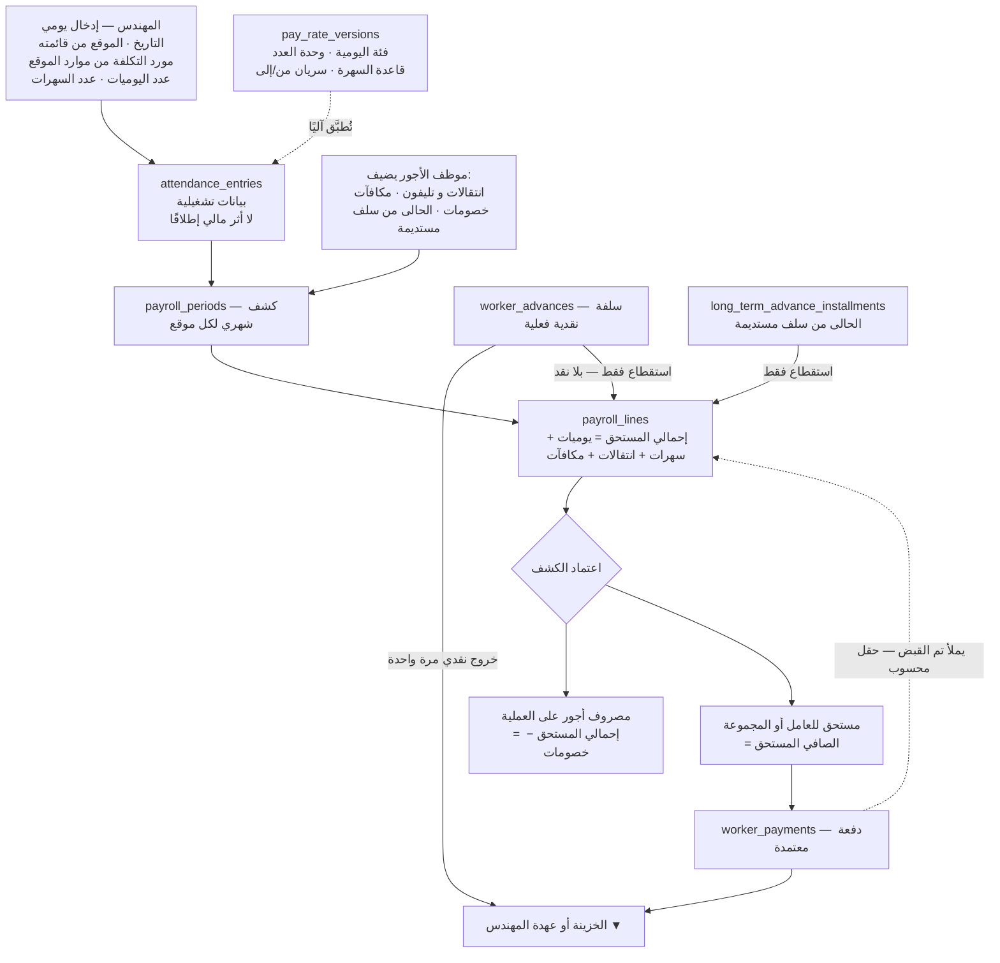
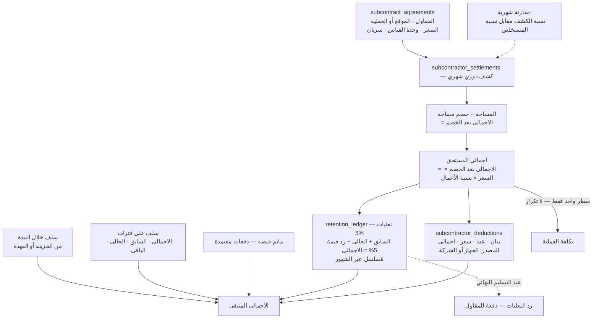

# ملحق الأجور واليوميات وتسويات المقاولين

**الإصدار:** 1.1.1 · **تاريخ الإصدار الأول:** 2026-09-16 · **تاريخ التعديل:** 2026-09-16 · **جزء من** `phase-zero-final-report-ar.md`
**يُقرأ مع:** `phase-zero-patch-v1.1.1-ar.md` (أعلى أولوية) · `phase-zero-errata-v1.1-ar.md` · `reconciliation-exceptions-ar.md` · `consistency-matrix-ar.md` — وعند أي اختلاف، **الإصدار 1.1.1 هو الحاكم**.

**الملف المعتمد:** `الشيخ زايد 2026.xlsx` — MD5 `c3674d67ccbe99d3a0e6d24c25680a99` (نسخة 16 سبتمبر)

> ⛔ **الاستنتاج السابق «بيانات الأجور غير كافية» مُلغى نهائيًا.** الملف يثبت شكل الكشف ومعادلاته بالكامل — 866 سطر أجور · 108 مورد تكلفة · 7 كشوف مواقع × 8 أشهر · 4 تسويات مقاولين.

---

## 1. الفحص الفعلي

| البند | النتيجة |
|---|---|
| عدد الأوراق | **11** — لا أوراق مخفية |
| كشوف مرتبات مواقع | **7**: الشيخ زايد · حى 1 زايد · حى 9 زايد · المداخل زايد · صيانة الدائرى زايد · حى 11 زايد · التطوير الجديد |
| تسويات مقاولين | **4**: محمد سليم حى 1 · احمد فتجى حى 1 · وليد عزت حى 11 · محمود حنفى (حى 9) |
| VBA / Pivot / Tables | ❌ لا شيء |
| Named Ranges | 153 — أغلبها `#REF!` موروث من ملف 2023 (`_asd` · `_شسي` · `_xlcn.WorksheetConnection_حساباتالروضه2023.xlsm…`) |
| **روابط خارجية** | **2 فقط** — `دفتر يومية المصروفات 2026` (`[1]`) و`دفتر تصفية العهد 2026` (`[2]`) — **وكلاهما متاح لدينا** |
| **خلايا `#REF!`** | **صفر** ✅ (كانت 836 في نسخة 14 سبتمبر) |
| أشهر بها بيانات | **يناير → أغسطس** · سبتمبر–ديسمبر قوالب فارغة · **استثناء: `التطوير الجديد` به بيانات في ديسمبر** |

### 1.1 بنية الكتلة الشهرية

| ترتيب الصف | المحتوى |
|---|---|
| 1 | `كشــف المرتبــــات الشهــــري` |
| 2 | `الموقــــع :` \<اسم\> · `عــن شهـــر:` \<تاريخ أول الشهر\> |
| 3 | رؤوس الأعمدة `A..V` |
| 4 | رؤوس فرعية: `N..Q` (سلف مستديمة) و`D..I` (فئة/العدد/إجمالي) |
| 5..n | صفوف البيانات — 25 إلى 38 صفًا |
| الأخير | `الإجمالى` — `SUBTOTAL(9, …)` |

> ⚠️ **خطوة الكتل غير ثابتة بين الأوراق.** `الشيخ زايد` كل 34 صفًا (R3, R37, R71…) بينما `حى 1 زايد` متغيرة (R3, R49, R96, R140, R179, R219, R261, R303). **أي مستورد يعتمد إزاحة ثابتة سيُتلف البيانات** — يجب اكتشاف الكتل بالبحث عن `عــن شهـــر:` وصف `الإجمالى`.

---

## 2. المعادلات الفعلية — خلية بخلية

| اسم عمود Excel حرفيًا | الحرف | الصيغة | الطبيعة |
|---|---|---|---|
| `م` | A | `=A(السابق)+1` | ترقيم — **يُستبعد** |
| `الإســــــــــــم` | B | يدوي | **مفتاح ربط نصي** |
| `الصافي المستحق` (الأول) | C | `=U` | **تكرار عرضي — يُستبعد** |
| `اليوميــــــــــــات / فئة` | D | يدوي (أو صيغة لأسطر المقاولين) | سعر الوحدة |
| `اليوميــــــــــــات / العدد` | E | يدوي | كمية |
| `اليوميــــــــــــات / إجمالي` | F | `=D*E` | محسوب |
| `السهــــــــــرات / فئة` | G | `=D/7` أو `=D/2` أو رقم يدوي | **متغيّر** |
| `السهــــــــــرات / العدد` | H | يدوي | كمية |
| `السهــــــــــرات / إجمالي` | I | `=H*G` | محسوب |
| `انتقالات و تليفون` | J | يدوي | بدل |
| `مكافآت` | K | يدوي | بدل |
| `إحمالي المستحق` | L | **`=I+F+J+K`** | **الاستحقاق الإجمالي** |
| `السلف الحاليه` | M | `SUMIFS` خارجي — §4 | **آلي من الخزينة/العهدة** |
| `سلف مستديمة / الاجمالى` | N | `SUMIFS` خارجي **+** `SUMIF(كتلة الشهر السابق)` | **رصيد تراكمي مُسلسل** |
| `سلف مستديمة / المخصوم سابقاً` | O | `=SUMIF(prev N)+SUMIF(prev P)` | تراكمي |
| `سلف مستديمة / الحالى` | P | **يدوي** | قسط الشهر |
| `سلف مستديمة / الباقى` | Q | **`=N-(O+P)`** | محسوب |
| `خصومات` | R | يدوي | خصم |
| `اجمالى الاستقطاعات` | S | **`=M+P+R`** | محسوب |
| `تم القبض` | T | يدوي | مدفوع |
| `الصافي المستحق` | U | **`=L-S-T`** | **الصافي النهائي** |
| `التوقيـــع` | V | فراغ | توقيع ورقي |

**ملاحظة حاسمة:** `اجمالى الاستقطاعات` تستخدم **`الحالى` (P)** لا `الباقى` (Q). ولهذا حتى حين كانت `N` و`Q` ملوَّثتين بـ836 خطأ `#REF!` في النسخة السابقة، **لم يتأثر `الصافي المستحق` ولا تكلفة الأجور على العملية**.

---

## 3. قاعدة السهرات — لا قاعدة واحدة

| القاعدة | عدد الأسطر | النسبة |
|---|---:|---:|
| `= فئة اليومية ÷ 7` | **549** | 77.4% |
| `= فئة اليومية ÷ 2` | **129** | 18.2% |
| **رقم يدوي ثابت** | **26** | 3.7% |
| صيغة أخرى (`=152712*0.7`) | 1 | 0.1% |

**القاعدة ليست «أفراد ÷7 ومجموعات ÷2»:**

| المورد | القاعدة | النوع الحقيقي |
|---|---|---|
| `عمال سعد` · `عمال حسين القناوى` | ÷2 | مجموعة عمال |
| `احمد سباك العلمين` · `بسام سباك العلمين` · `حسين على السباك` · `محمد امير السباك` · `عبدالهادى عشرى السباك` | **÷2** | **أفراد — لكن سبّاكون** |
| `م/ محمد سعيد` · `عادل السواق` · `شعبان ضاحى` | ÷7 | أفراد |
| `شعبان ضاحى رى` | **14 يدويًا** (فئة اليوم 66.67 ⟹ النسبة 4.76) | فرد — لا ÷7 ولا ÷2 |

⟹ **القاعدة خاصية للمورد نفسه** (ح-40). والحرفة قد تكون معيارًا (كل السبّاكين ÷2) لكن هذا **استنتاج غير مؤكد** — يُخزَّن كخاصية ولا يُبنى عليه منطق.

### 3.1 وحدة `العدد` تختلف داخل الكشف الواحد

| الفئة | عدد الأسطر | مثال |
|---|---:|---|
| **أيام** (25–32) | 341 | `م/ مصطفى` 27.5 يوم |
| **آخر** | 144 | قيم متفرقة |
| **مبلغ مقطوع** (العدد = 1) | 104 | `صليب` 6,000 × 1 · `شقة م/ عز` 5,000 × 1 |
| **عامل-يوم** (> 40) | 81 | `عمال سعد` 424 × 170 |
| **نسبة إنجاز** (≤ 1) | 20 | `وليد عزت حى 11` 0.7 |

⟹ حقل **`وحدة العدد` إلزامي** (ح-43).

### 3.2 تغيّر الفئة عبر السنة — 15 موردًا

| المورد | الفئات المسجَّلة |
|---|---|
| `عمال حسين القناوى` | 150 → 165 → 175 → 200 |
| `جرار حسين جادور` | 550 → 600 → 800 |
| `جرار محمود حنفى` | 450 → 600 → 800 |
| `عمال سعد` | 140 → 170 → 195 |
| `عمال عوض` | 160 → 170 → 195 |
| `سيد العريان` | 150 → 166.67 → 200 |
| `عادل السواق` | 550 → 600 |
| (+8 أخرى) | — |

⟹ `pay_rate_versions` بـ`valid_from/valid_to` **ضرورة مثبتة بالبيانات** (ح-44).

---

## 4. دورة السلف — الصيغة التي تحلّ لغز العمودين

```text
السلف الحاليه (M) =
    SUMIFS( الخزينه[المبلغ],
            الخزينه[شرح القيد]    = اسم المورد,          ← اسم العامل هنا
            الخزينه[بيان المصروف] = "سلف <اسم الموقع>",
            الخزينه[شهر]          = رقم الشهر )
  + SUMIFS( العهد[...] بنفس الشروط )
```

```text
سلف مستديمة / الاجمالى (N) =
    SUMIFS( الخزينه , شرح القيد = الاسم , بيان المصروف = "سلف مستديمة" , شهر = m )
  + SUMIFS( العهد    , نفس الشروط )
  + SUMIF ( نطاق أسماء الشهر السابق , الاسم , نطاق N للشهر السابق )   ← الترحيل المُسلسل
```

⟹ **عمودان نصّيان حرّان معًا يشكّلان مفتاح ربط العامل بسلفته** — `بيان المصروف` يحمل حساب سلف الموقع، و`شرح القيد` يحمل اسم العامل. بلا FK ولا تحقق إملائي.

**والآلية سليمة محاسبيًا:** السلفة تخرج نقدًا **مرة واحدة** ثم تُخصم في الكشف **كاستقطاع فقط** بلا خروج نقدي ثانٍ — أي أن **الواقع الحالي يطبّق ح-46..ح-49 فعلًا؛ النظام الجديد يحافظ عليه لا يخترعه.**

**التحقق الرقمي (الشيخ زايد، يناير):**

| المصدر | القيمة |
|---|---:|
| `M33` في كشف الأجور | 12,500 |
| `حسابات الأجور` صف `سلف الشيخ زايد` — `له` | 12,500 |
| منها من الخزينة (`المكتب`) | 2,500 |
| منها من العهدة (`الموقع`) | 10,000 |
| **`الصافي` = له − المكتب − الموقع** | **0** ✅ |

---

## 5. دورة الأجور — من الإدخال إلى الدفع بلا خصم مزدوج



**شرح:** الخزينة تُخفَّض في **مكانين فقط**: `worker_advances` و`worker_payments`. اعتماد الكشف **لا يُحرِّك نقدًا** — يُنشئ مصروفًا والتزامًا. والسلفة تُخصم من المستحق كاستقطاع محاسبي بحت. و`تم القبض` يصبح **حقلًا محسوبًا من مدفوعات معتمدة** لا رقمًا يُكتب — وهذا يُغلق ثغرة الأرقام المُقحَمة (مثل 87,637.0772 التي تُصفّر الصافي بالضبط في `حى 9 زايد` مايو).

---

## 6. مجاميع الرقابة — الملف المعتمد

| الموقع | يناير | فبراير | مارس | أبريل | مايو | يونيو | يوليو | أغسطس |
|---|---:|---:|---:|---:|---:|---:|---:|---:|
| الشيخ زايد | 156,766.67 | 146,278.57 | 141,314.29 | 156,966.67 | 144,704.76 | 151,123.81 | 148,619.05 | **161,247.62** |
| حى 1 زايد | 305,849.40 | 265,260.36 | 230,423.10 | 316,946.79 | 305,050.00 | 305,830.36 | 343,222.86 | 372,972.17 |
| حى 9 زايد | 80,173.80 | 71,392.62 | 65,579.52 | 118,009.76 | 115,135.48 | 99,927.20 | 91,627.20 | **0.00** |
| المداخل زايد | 118,023.52 | 109,561.86 | 95,851.79 | 134,874.64 | 153,312.01 | 146,443.16 | 125,001.61 | **156,142.50** |
| صيانة الدائرى زايد | 233,453.81 | 109,486.55 | 78,157.38 | 105,648.57 | 177,543.33 | 217,303.33 | 218,273.33 | **276,126.67** |
| حى 11 زايد | 188,404.30 | 180,151.32 | 120,307.30 | 210,438.07 | 181,240.13 | 219,525.79 | 270,244.71 | 240,016.74 |
| التطوير الجديد | — | 61,385.28 | 51,861.47 | — | — | — | — | — |

*(القيم = `إحمالي المستحق` — العمود L. `التطوير الجديد` به أيضًا 28,842.50 في **ديسمبر**.)*

**الإجماليات 2026 (7 مواقع × 8 أشهر):**

| البند | الإجمالي |
|---|---:|
| إحمالي المستحق | **8,502,043.69** |
| السلف الحاليه | 1,659,128.00 |
| الحالى من سلف مستديمة | 131,220.58 |
| خصومات | 101,446.69 |
| تم القبض | 2,500,987.02 |
| الصافي المستحق | ~~4,125,511.41~~ ⟵ **قيمة Excel خاطئة** · ✅ **الصحيح 4,109,261.41** |
| **تكلفة الأجور على العمليات (L − R)** | **8,400,597.00** |

### 6.1 تكلفة الأجور تصل العملية بأساس الاستحقاق

```text
حساب التكاليف!<شهر>.الاجور = '[ملف الأجور]<الموقع>'!L<الإجمالى> − '[…]'!R<الإجمالى>
```

**التحقق:** `'[2]الشيخ زايد'!$L$33-$R$33` = 156,766.67 − 0 = **156,766.67** ✅ مطابق.

⟹ **أساس استحقاق لا أساس مدفوع** — السلف والمقبوض لا تُخفّض تكلفة العملية. **صحيح محاسبيًا ويُحافظ عليه** (ح-45).

### 6.2 شذوذات مرصودة

| الشذوذ | التفصيل |
|---|---|
| **صافي سالب** | `حى 9 زايد` أغسطس: `إحمالي المستحق` = 0 مع سلف 21,100 ⟹ **−21,100** |
| **رقم مُقحَم (plug)** | `حى 9 زايد` مايو: `تم القبض` = **87,637.0772** ⟹ صافي 0.000 بالضبط |
| **بيانات في شهر خاطئ** | `التطوير الجديد`: ديسمبر به سطران، وأبريل–نوفمبر فارغة تمامًا |
| **تغيّر بين نسختي الملف** | أغسطس تغيّر في 5 مواقع بعد ملء `تم القبض` — مثال: `صيانة الدائرى` الصافي 235,626.67 → **3,066.67** |

---

## 7. الأنواع الستة داخل عمود `الإســــــــــــم`

من 108 مورد تكلفة مرصود:

| النوع | العدد | أمثلة |
|---|---:|---|
| **فرد** | 78 | `عادل السواق` · `شعبان ضاحى` · `دسوقى كامل` |
| **معدة أو مركبة** | 11 | `سيارة زايد 2` · `سيارة زايد 4و5` · `سيارة زايد 6` · `جرار حسين جادور` · `جرار محمد عبدالعزيز` · `جرار محمود حنفى` · `سيارة محمد سليم` · `سيارة محمود حنفى` · `سيارة ياسر` · `سيارة م/ ب` · `سيارة م/  ا م` |
| **مجموعة عمال** | 6 | `عمال سعد` · `عمال عوض` · `عمال حسين القناوى` · `عمال حسين قناوى خوارج` · `عمال عوض خوارج` · `عمال عبدالله قصاصين` |
| **سكن أو حساب تجميعي** | 6 | `شقة م/ عز` · `شقة حمدان` · `شقة الصعايدة` · `شقة عوض` · `شقة عمال سعد` · `الغفر` |
| **مقاول أو رئيس مجموعة** | 4 | `محمد سليم` · `محمود حنفى` · `وليد عزت` · `احمد فتحى` |
| **مهندس أو مشرف** | 3 | `م/ محمد سعيد` · `م/ احمد علاء` · `م/ مصطفى` |

⟹ **30 موردًا من 108 ليسوا أشخاصًا.** `شقة م/ عز` ليست عاملًا ولا طرفًا قانونيًا — **حساب تجميعي** (ح-33). ولا يُنشأ لأي منها مستخدم ولا حساب عهدة ولا أصل معدات.

> **ملاحظة تطبيع:** `عمال حسين القناوى` مقابل `عمال حسين قناوى خوارج` — الأولى بـ`القناوى` والثانية بـ`قناوى`. وقد يكونان موردين مختلفين فعلًا («خوارج» = عمالة من خارج الموقع) أو خطأ إملائي. **يُستوردان منفصلين مع تنبيه تشابه** ولا يُدمجان تلقائيًا.

---

## 8. تسويات المقاولين — مسار مستقل

### 8.1 شجرة المعادلات

| اسم عمود Excel | الصيغة |
|---|---|
| `المساحة` | يدوي |
| `خصم مساحة` | يدوي أو `=0*(21.43%)` |
| `الاجمالى بعد الخصم` | `= المساحة − خصم مساحة` |
| `السعر` | يدوي |
| `نسبة الأعمال` | يدوي |
| **`اجمالى المستحق`** | **`= الاجمالى بعد الخصم × السعر × نسبة الأعمال`** |
| `تعليات 5% / الحالى` | `= اجمالى المستحق × 5%` |
| `تعليات 5% / السابق` | `= الاجمالى` من الكتلة السابقة — **مُسلسل** |
| `تعليات 5% / الاجمالى` | `= السابق + الحالى − رد قيمة 5%` |
| `رد قيمة 5 %` | يدوي |
| `سلف / خلال المدة` | `SUMIFS(الخزينه/العهد, شرح القيد = اسم المقاول, بيان المصروف = "سلف <الموقع>", شهر = m)` |
| `سلف على فترات / الباقى` | `= الاجمالى − السابق − الحالى` |
| `خصومات` | `= الجهاز + الشركة` · و`الشركة = SUM(سطور الخصم المفصّلة)` |
| سطور الخصم | `بيان` · `عدد` · `سعر` · `اجمالى = عدد × سعر` |
| `ماتم قبضه` | يدوي |
| **`الاجمالى المتبقى`** | **`= المستحق − تعليات الحالى − سلف خلال المدة − الحالى من سلف الفترات − خصومات − ماتم قبضه`** |

**مثال متحقَّق (وليد عزت حى 11، يناير):** `39,270 × 0.8 × 0.7 = 21,991.20` ✅ · تعليات الحالى `21,991.20 × 5% = 1,099.56` ✅ · خصومات مفصّلة 4,988 (عمال · قص شجر · كارونا · بوجيه · بكرة سلك · فلتر بنزين · كربراتير · يومية قصاص · محبس 1.5 بوصة 1×88 · مخلفات 7×700=4,900) · سلف 8,000 · **المتبقى 7,903.64** ✅

### 8.2 دورة التسوية



**شرح:** `نسبة الأعمال` هنا **لا علاقة لها** بـ`نسبة الشركة صاحبة العملية` — الأولى نسبة إنجاز مادي للمقاول، والثانية خصم تعاقدي على مستحق العميل (ح-19 في سجل القواعد). ودفتر `تعليات 5%` **مُسلسل**: رصيد كل شهر يرث إجمالي سابقه، فلا يُخزَّن كرقم بل يُحتسب من الحركات. والقيد الحاكم: **التسوية تدخل التكلفة مرة واحدة فقط** — إما سطر كشف أجور أو كشف تسوية، لا الاثنان (ح-52).

### 8.3 ⛔ مشكلتان مرصودتان

**أ. الربط بين ورقة التسوية وكشف الأجور يدوي وناقص**

نتيجة التسوية يُعاد إدخالها **يدويًا** في كشف الأجور بصيغة مكتوبة لا مرجع خلوي:

| الورقة | السطر | الصيغة | النتيجة |
|---|---|---|---|
| `حى 9 زايد` (كشف) | R8 `محمود حنفى حى 9` | `فئة = =152712*0.7` · `عدد = 0.75` | 80,173.80 |
| `محمود حنفى (حى 9)` (تسوية) | R4–R9 | `(162712 − 10000) × 0.7 × 0.75` | 80,173.80 |

الرقمان متطابقان **بالمصادفة الحسابية**. أي تعديل في ورقة التسوية **لن ينتقل**. وأسوأ مثال: `حى 1 زايد` R342 `محمد سليم حى1` — `فئة = =86775.28*2.5` ثم `إجمالي = =D342*E342/30*9` — **خمسة معاملات في صيغة واحدة**.

**ب. ثلاث تسويات متطابقة رقميًا — اشتباه قالب منسوخ**

| الورقة | المساحة | خصم | السعر | نسبة الأعمال | المستحق | تعليات السابق | خصومات | المتبقى |
|---|---:|---:|---:|---:|---:|---:|---:|---:|
| `محمد سليم حى 1` | 162,712 | 10,000 | 0.7 | 0.75 | **80,173.80** | 99,009.05 | 0 | 74,165.11 |
| `احمد فتجى حى 1` | 162,712 | 10,000 | 0.7 | 0.75 | **80,173.80** | 99,009.05 | 0 | 74,165.11 |
| `محمود حنفى (حى 9)` | 162,712 | 10,000 | 0.7 | 0.75 | **80,173.80** | 99,009.05 | 9,380 | 64,785.11 |

ثلاثة مقاولين، **اثنان في `حى 1` وواحد في `حى 9`**، بنفس كل شيء. **والأخطر:** بمراجعة كشف `حى 1 زايد` ليناير (35 سطرًا) **لا يظهر `محمد سليم حى1` ولا `احمد فتحى` إطلاقًا** ⟹ تسويتاهما (80,173.8 لكل) **لم تدخلا تكلفة العملية**، بينما `محمود حنفى` دخل.

⟹ **سؤال ب-5 في `open-questions-ar.md`** · والطبقة السابعة من إطار منع الازدواج تكشفه: **بصمة تسوية متطابقة ⟹ تحذير قبل الاعتماد**.

---

## 9. فحوص المطابقة الشهرية لكل موقع

| # | الفحص | مصدر Excel | مصدر النظام | التسامح |
|---|---|---|---|---|
| ط-1 | عدد أسطر الكشف | صفوف بين الترويسة والإجمالى | `COUNT(payroll_lines)` | **صفر** |
| ط-2 | إجمالي اليوميات | `SUBTOTAL` العمود F | `SUM(days_amount)` | 0.01 |
| ط-3 | إجمالي السهرات | العمود I | `SUM(overtime_amount)` | 0.01 |
| ط-4 | `إحمالي المستحق` | العمود L | `SUM(gross_entitlement)` | 0.01 |
| ط-5 | `السلف الحاليه` | العمود M | `SUM(worker_advances)` | **صفر** |
| ط-6 | `الحالى` من سلف مستديمة | العمود P | `SUM(installments)` | 0.01 |
| ط-7 | `خصومات` | العمود R | `SUM(payroll_deduction_lines)` | 0.01 |
| ط-8 | `اجمالى الاستقطاعات` | العمود S | `M + P + R` | 0.01 |
| ط-9 | `تم القبض` | العمود T | `SUM(worker_payments)` المعتمدة | **يُبلَّغ بالفرق** |
| ط-10 | `الصافي المستحق` | العمود U | `L − S − T` | 0.01 |
| ط-11 | **تكلفة أجور العملية** | `L − R` | `SUM(gross) − SUM(deductions)` | 0.01 |
| ط-12 | **مطابقة السلف ثلاثية** | `M33` = `حسابات الأجور.له` = الخزينة + العهدة | نفس الثلاثة | **صفر** |
| ط-13 | رصيد `سلف مستديمة` | متاح الآن (صفر `#REF!`) | من الحركات | يُوثَّق الفرق |
| ط-14 | `اجمالى المستحق` للمقاول | `C9` في كل كتلة | `gross_due` | 0.01 |
| ط-15 | رصيد `تعليات 5%` | `G11` مُسلسل | `retention_ledger` | 0.01 |
| ط-16 | سطور خصومات المقاول | `SUM(L6:L19)` | `SUM(subcontractor_deductions)` | **صفر** |
| ط-17 | **عدم ازدواج المقاول** | — | لا مقاول له تسوية وسطر كشف بنفس القيمة/الشهر | **صفر** |
| ط-18 | الصافي السالب | `حى 9 أغسطس = −21,100` | يُرصد استثناءً | تقرير |
| ط-19 | **بصمة الملف** | `file_sha256` في `import_batches` وقت الاستيراد (ح-151/ح-152) | — | يُسجَّل |
| ط-20 🆕 | **صافي الأجور** | `SUM(U)` = 4,125,511.41 | **4,109,261.41** | ⚠️ **فرق متوقَّع 16,250.00** — مصدره خلية `حى 1 زايد!U251` الفارغة. يُوقَّع كفرق معلوم لا كخطأ ترحيل |
| ط-21 🆕 | **صف مجاميع داخل النطاق** | صف `Total` بصيغة `SUBTOTAL` | يُرفض | **لا تسامح** — الرفض إلزامي (ب-13) |

---

## § تعديلات الإصدار 1.1 — ملزمة وتَجُبّ ما يخالفها أعلاه

### 1. الصافي المنشور في Excel خاطئ

| البند | Excel | **الصحيح** |
|---|---|---|
| الصافي المستحق (`U`) | 4,125,511.41 | **4,109,261.41** |
| تكلفة الأجور (`L − R`) | 8,400,597.01 | **8,400,597.00** |

**السبب:** خلية `حى 1 زايد!U251` (احمد فتحى · يونيو 2026) **فارغة تمامًا — لا صيغة ولا قيمة** بينما 32 صفًا في الكتلة نفسها تحمل `=L{r}-S{r}-T{r}`. قيمتها الصحيحة `3,750.00 − 20,000.00 − 0 = −16,250.00`، و`SUBTOTAL(9,…)` يتخطى الفارغ.

**فحص شامل:** هذه **الخلية الوحيدة** الفارغة في عمود `U` في الملف كله، و`S` ليس فيها فراغ واحد، و`S = M+P+R` صحيحة في **كل الكتل الـ84**. المصالحة الخلوية الكاملة في `reconciliation-exceptions-ar.md` §1.

**لماذا حدث:** السلفة (20,000) تتجاوز الاستحقاق (3,750) فالصافي سالب، ونموذج Excel لا يمثّل رصيدًا مدينًا مدوَّرًا على العامل. 🟡 هذه **فرضية** — الدليل هو الخلية الفارغة لا النية. ويدعمها أن صافيات سالبة أخرى (−21,100 · −37,823.77) **لم تُحذف صيغها**، فالتعامل مع السالب **غير متسق لا ممنوع**.

**⟹ الأثر على التصميم:** `payroll_lines.net_due` **يجب أن يقبل السالب**، ويُرحَّل رصيدًا مدينًا على العامل في `party_operation_accounts` — لا يُخفى ولا يُصفَّر.

### 2. سياسة الأجر — لا صيغة حرة (ح-167)

يُلغى تمثيل «قاعدة السهرة» بقيمة `صيغة`. البديل الملزم:

| الحقل | القيم |
|---|---|
| `calculation_method` | `DAILY_RATE_DIVIDED` · `DAILY_RATE_FIXED_MULTIPLE` · `EXPLICIT_AMOUNT` |
| `parameters` | `divisor = 7` · `divisor = 2` · `amount = <قيمة>` |
| Snapshot | `payroll_lines` تحمل الطريقة والمعاملات وقت الاحتساب |

الأنماط الثلاثة المرصودة (**549 حالة ÷7 · 129 حالة ÷2 · 26 قيمة يدوية**) تُمثَّل كلها بهذه الثلاثة **بلا مفسِّر صيغ**. تخزين صيغة نصية وتنفيذها ثغرة أمنية وتُعجز التدقيق.

### 3. الحضور — تصحيح قيد التفرد (ح-162)

`Unique(مورد، موقع، تاريخ)` **يمنع حركات صحيحة**: وردية ثانية في اليوم · سطران بفئتي أجر · تصحيح سطر. البديل: `Unique(مورد، موقع، تاريخ، رقم الوردية، رقم السطر)` + **كشف تشابه ينبّه ولا يمنع**.

### 4. تسويات المقاولين — ما أضافه نص العقد

| القاعدة | نص العقد |
|---|---|
| **ح-119** تعلية 5% ضمان أعمال **من إجمالي أعمال كل مستخلص**، تبقى بيد الشركة لحين إتمام المقاولة | البند السادس |
| **ح-120** استنزال **كافة الخصومات المقررة على الشركة من قبل الجهاز** من مستحقات المقاول | البند السادس — **يُغلق السؤال ج-14**: `الجهاز` = خصم مُمرَّر · `الشركة` = ما قدّمناه |
| **ح-118** المحاسبة **بعد صرف مستحقات الشركة من الجهاز** (Back-to-back) — مع فصل تاريخ الاعتراف عن تاريخ الحلول | البند السادس |
| **ح-121** غرامات مسعَّرة **غير قابلة للتفاوض**: الجرار 600 ج/يوم · ماكينة القص 400 · العامل الزراعي 150 · سيارة المخلفات 400/نقلة | البند الخامس |
| **ح-122** القيمة التعاقدية **تشمل** الأجور ومصاريف العمال وإقامتهم وسفرهم والتأمين عليهم | البند الخامس |
| **ح-127** **يُمنع على المقاول الإسناد من الباطن** كليًا أو جزئيًا | البند الحادي عشر |
| **ح-128** ضمان بـ**شيك** 400,563 لا خطاب ضمان | البند الثاني عشر |

### 5. المصروف القابل للاسترداد — دورة كاملة لا حقل

ما كان في 1.0 «حقل `recoverable_from_party_id` على المصروف» صار **دورة بستة كيانات** (النموذج المفاهيمي §5.9): مطالبات · تخصيصات M:N · تحصيلات بخمس طرق · شطب باعتماد · نزاعات · حالة محسوبة. وهذا ما يجعل سؤال «كم على المقاول فلان؟» قابلًا للإجابة، ويمنع الازدواج المثبت (**صفر قيد استرداد** في `الخزينه` و`العهد` و`الموردين`).

**المعالجة المحاسبية نفسها تبقى سؤالًا مفتوحًا (أ-2) يحتاج اعتماد المحاسب.**
